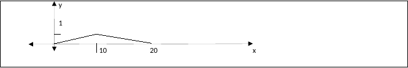

<!-- markdownlint-disable MD036 -->

# ex_fin_15_12_2010[1]

> Transcripción del original. Año de archivo: 2016. Atribución: Archivado en
> carpeta canónica de AMII; carrera no identificada en el documento. Las erratas
> y las repeticiones del original se conservan.

1- La ecuación diferencial de una familia de curvas en el plano (x,y) es
$`y^{'''}(x) = \  - 24\cos{\frac{\pi}{2}\ x}`$

Encuentre una ecuación para esa familia de curvas

Encuentre un elemento de esa familia que pase por los puntos (0,-4) ; (1,0) ; y
que tenga una pendiente 6 en $`x=1`$

2- Muestre que la solución de $`y'(x) = 1 + 2xy`$ que cumple $`y(1) = 0`$ puede
ser $`y(x) = \ e^{x^{2}}\int_{1}^{x}{e^{- t^{2}}\ dt}`$

3- Sea la función periódica del gráfico



Indique porque la serie de fourier contiene términos únicamente en coseno.

Indique como obtiene los coeficientes, calcule los primeros.

4-\\

```math
\int_{0}^{3}{\left\lbrack \int_{\frac{4y}{3}}^{\sqrt{25 - y^{2}}}{f(x,y)dx} \right\rbrack dy}
```

Invierta el orden de integración.

Teoría:

1\. Enuncie el teorema de Green. Dé su interpretación física y una aplicación del
mismo.

2\. Defina diferencial de una función de dos variables independiente. Dé su
interpretación geométrica

3\. Defina derivada direccional. Demuestre que sea f diferenciable en el punto
(x,y) la dirección del máximo incremento de f está dada por
$`\nabla f(x,y)\ \ y\ el\ valor\ máximo\ de\ {f´}_{u} = \parallel \nabla f \parallel`$
