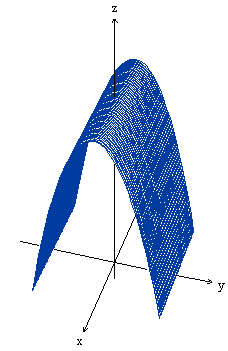

<!-- markdownlint-disable MD036 -->

# 2do_Parcial_IQ_2016

> Transcripción del original. Año de archivo: 2016. Atribución: IQ explícito; no
> atribuido a ISI. Las erratas y las repeticiones del original se conservan.

**<u>Se
desea construir un techo parabólico sin paredes verticales cuya base sea de
16x16 metros en el plano XY con una altura máxima de 10 metros en Z.</u>**

1\. Definir las ecuaciones que describen el techo tal que la base quede centrada
en el origen. Enuncie analíticamente el Dominio, Imagen y defina el Rango y
Recorrido tal que tenga las dimensiones solicitadas.

2\. Dibuje el objeto en 3D, obtenga trazas y 3 curvas de nivel incluyendo
$`Z=4`$.

3\. Se necesita perforar el techo utilizando como referencia una circunferencia
de radio 2 en el plano XY (piso) centrada en (0,0). Calcule la altura máxima y
mínima que alcanzaría el techo en el perímetro del orificio cortado.

4\. Suponiendo que una gota de lluvia cayera verticalmente y que una vez en
contacto con la chapa siguiera por el efecto de la gravedad el camino con mayor
pendiente de bajada, encuentre matemáticamente este camino. Dibuje la
trayectoria en algún punto con altura de 4 metros y relaciónelo con la curva de
nivel.

5\. Calcule el descenso aproximado de la gota si su posición en el dominio cambió
1 metro.

6\. Proponga los cálculos necesarios para obtener la cantidad de chapa plana a
plegar para construir el **techo.**
