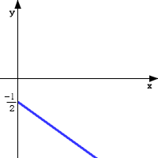
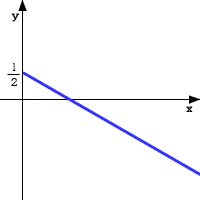
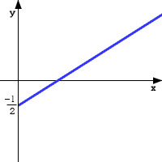
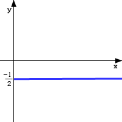
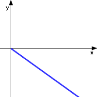
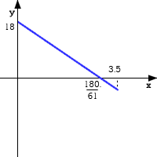
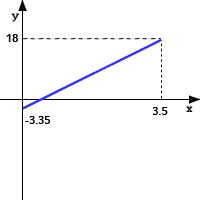
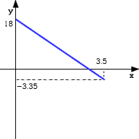
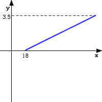

<!-- markdownlint-disable MD036 -->

# Evaluación 3

> Transcripción del original. Año de archivo: 2016. Atribución: Pendiente:
> evaluación de curso externo sin identificación AMII. Las erratas y las
> repeticiones del original se conservan.

**Evaluación 3**

**Question 1**

La presión que experimenta bajo el agua un buzo depende de la profundidad a la
que se encuentra éste en el océano. Al nivel de la superficie, la presión es
igual a 1 atmósfera. La razón con la que cambia la presión, con respecto al
cambio de la profundidad, es constante e igual a 0.0994 atmósferas/metro. Decide
cuáles de las siguientes opciones expresan información válida para esta
situación.

- [ ] Cuando la profundidad del buzo aumenta medio metro, la presión a la que
  está sometido aumenta en 0.0497 atmósferas.

- [ ] La presión que experimentaba el buzo a los *x* metros de profundidad se
  modela con la función $`y(x)=0.0994x`$

- [ ] Para calcular la presión a la que se encuentra el buzo al llegar a la
  profundidad de *x* metros se debe dividir 0.0994 entre *x* y agregar 1.

- [ ] A los 50 metros de profundidad el buzo está sujeto a una presión de 5.97
  atmósferas.

- [ ] Sabiendo que la presión de 11 atmósferas causa un efecto dañino al
  organismo, el buzo debe evitar llegar a los 1 + 0.0994 (11) metros.

**Question 2**

La magnitud *y* depende de la magnitud *x* de tal forma que su razón de cambio
constante es igual a −12(unidades de *y* / unidades de *x*). Elige entre las
siguientes representaciones gráficas las que pueden estar representando el
comportamiento descrito. El eje vertical representa a la magnitud *y* y el
horizontal a la magnitud *x*.

- [ ] 

- [ ] 

- [ ] 

- [ ] 

- [ ] 

**Question 3**

Un alpinista sube una montaña de 3.5 kilómetros de altura. En la base de la
montaña la temperatura es de 18 grados centígrados. Si se sabe que la
temperatura disminuye a razón constante de 6.1 grados/kilómetro a medida que
aumenta la altitud, decide cuáles de las siguientes gráficas pueden modelar el
comportamiento de la temperatura *y* en función de la altitud *x*.

- [ ] 

- [ ] 

- [ ] 

- [ ] 

- [ ] 

**Question 4**

Una llave está llenando de agua a un tanque de tal manera que el nivel del agua
está cambiando uniformemente a razón de 11.6 centímetros / minuto. La altura del
tanque es de 1 metro 45 centímetros y en este instante en que lo observamos
(tiempo = 0) el nivel del agua es de 43.5 centímetros. Escoge las opciones que
establecen un resultado válido con esta información.

- [ ] Entre los 3 y 3.5 minutos, el nivel aumentó de 78.3 a 84.1 centímetros.

- [ ] El tanque se llena a los 8.75 minutos.

- [ ] El nivel llega a un metro a los 4.87 minutos.

- [ ] Para tener el tanque a la mitad de su capacidad bastan 4.375 minutos.

- [ ] De los 5 a los 6 minutos, el nivel aumenta exactamente 11.6 centímetros.

**Question 5**

Un tanque cilíndrico está llenándose de agua. En el instante $`x=0`$ se observa
la acción simultánea de dos llaves, la llave superior que alimenta al tanque de
agua con una rapidez constante de *v*1 litros por minuto, y la llave inferior
que desaloja el agua del tanque con una rapidez constante de *v*2 litros por
minuto. Considera que la cantidad de agua en el tanque está representada por el
modelo lineal $`y(x)=20+2.5x`$ donde *y* se mide en litros. Selecciona las
opciones que son válidas para esta situación.

- [ ] $`v1=6`$ litros / minuto y $`v2=3.5`$ litros / minuto.

- [ ] $`v1=3.5`$ litros / minuto y $`v2=6`$ litros / minuto.

- [ ] Llegará un momento en el que el tanque se llena.

- [ ] El tanque se vacía a los 8 minutos.

- [ ] $`v1=20`$ litros / minuto y $`v2=2.5`$ litros / minuto.

**Question 6**

Considera la función lineal $`y(x)=a+bx`$ donde *y* representa la longitud en
centímetros de una varilla que se ha estado calentando, y *x* representa los
grados de temperatura que se irán agregando a la temperatura original de la
varilla. Supongamos que por un período de un minuto, esta situación de
alargamiento se modelará con un cambio uniforme, como lo expresa la función.
Decide si son correctas las interpretaciones siguientes con respecto a la
situación.

- [ ] $`y(x)=a+bx`$ representa cuántos grados se requieren de temperatura para
  que la varilla llegue a la longitud de *x* centímetros.

- [ ] La letra *b* debe representar a un número negativo en esta situación.

- [ ] $`y(x)=a+bx`$ expresa la longitud en centímetros de la varilla cuando se
  han agregado *x* grados a su temperatura.

- [ ] La letra *a* está representando la longitud inicial que tenía la varilla
  cuando se le comienza a aplicar el calor.

- [ ] La cantidad *a*+2*b* representa la longitud de la varilla cuando se ha
  aumentado en 2 grados su temperatura.

**Question 7**

Entre las siguientes opciones, escoge la representación algebraica de las rectas
a las cuales pertenece el punto (34,57).

- [ ] $`4x-7y+2=0`$

- [ ] $`34x+57y=0`$

- [ ] $`28x-42y+9=0`$

- [ ] $`20x+21y=30`$

- [ ] $`43x+75y=2`$

**Question 8**

Escoge entre las opciones siguientes las que representan a la recta que tiene
pendiente 4 y que pasa por el punto (0,2).

- [ ] $`2x-y+4=0`$

- [ ] $`y=2+4x`$

- [ ] $`4x+y-2=0`$

- [ ] $`4x-y+2=0`$

- [ ] $`x+4y+2=0`$

**Question 9**

Considera la expresión algebraica de la recta dada por $`2x-3y+5=0`$ y realiza
el procedimiento algebraico señalado en cada opción para que escojas solamente
las opciones que establecen el resultado correctamente.

- [ ] Si despejo *y*, obtengo $`y=23x+5`$.

- [ ] Si sustituyo *x* por 13, obtengo $`y=179`$.

- [ ] Si sustituyo *y* por 27 obtengo $`x=2914`$.

- [ ] Si despejo *x*, obtengo $`x=32y+52`$.

- [ ] Si divido entre 6 toda la expresión, obtengo $`x3-y2=-56`$.

**Question 10**

Considera la expresión $`1x-1=23`$ (no siendo *x* igual a 1) y realiza en ella
los procedimientos algebraicos necesarios que te permitan decidir cuáles de las
siguientes opciones representan un paso correcto buscando despejar *x*.

- [ ] $`2(x-1)=3`$

- [ ] $`1x-1=23`$

- [ ] $`x-11=32`$

- [ ] $`1-23=x-1`$

- [ ] $`3=2x-1`$

## Observación sobre la notación de la fuente

Las cadenas de las preguntas 9 y 10 (`23`, `179`, `2914`, `x3`, `y2`, `−56`,
entre otras) se conservan como aparecen en el documento y su render. No se
reconstruyen barras de fracción o exponentes que la fuente no muestra, ni se
corrigen las opciones de respuesta.
