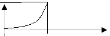

<!-- markdownlint-disable MD036 -->

# ex_final_23-2-11[1]

> Transcripción del original. Año de archivo: 2016. Atribución: Archivado en
> carpeta canónica de AMII; carrera no identificada en el documento. Las erratas
> y las repeticiones del original se conservan.

a)-Una cepa de bacterias crece en forma proporcional a la cantidad de individuos
presente, y la población se duplica en una hora, ¿Cuánto crecerá al cabo de dos
horas?

-describa el aspecto teórico especifico

b)-Una curva cuya ecuación cartesiana $`y=f(x)`$ pasa por el origen. Por un
punto arbitrario de esta curva se trazan rectas paralelas a los ejes de
coordenadas, de modo que el rectángulo que se forma es dividido por esa curva en
dos partes, de modo que el área de una de esas partes es tres veces la otra.
Encuentre la función.



-describa el aspecto teórico especifico

c)-Hallar los valores de a, b y c tales que la derivada direccional de
$`f(x,y,z) = axy^{2} + byz + cz^{2}x^{3}`$ en (1,2,-1) sea máxima igual a 64, y
ocurra en dirección paralela al eje z

-describa el aspecto teórico especifico

d)-Sea f una función definida en el rectángulo $`Q=[0,1]\times[0,1]`$ del modo

```math
f(x,y) = \left\{ \begin{array}{r}
1 - x - y\ \ \text{si }x + y \leq 1 \\
0\ \ \text{en los demás puntos de Q}
\end{array} \right.
```

calcular el volumen por doble integración existente bajo f

-describa el aspecto teórico especifico

a)-Una cepa de bacterias crece en forma proporcional a la cantidad de individuos
presente, y la población se duplica en una hora, ¿Cuánto crecerá al cabo de dos
horas?

-describa el aspecto teórico especifico

b)-Una curva cuya ecuación cartesiana $`y=f(x)`$ pasa por el origen. Por un
punto arbitrario de esta curva se trazan rectas paralelas a los ejes de
coordenadas, de modo que el rectángulo que se forma es dividido por esa curva en
dos partes, de modo que el área de una de esas partes es tres veces la otra.
Encuentre la función.


-describa el aspecto teórico especifico

c)-¿Para qué valores de *a,b*\*,\*\*\*y c la derivada direccional de
$`f(x,y,z) = axy^{2} + byz + cz^{2}x^{3}`$ en (1,2,-1) sea máxima igual a 64, y
ocurra en dirección paralela al eje z?

-describa el aspecto teórico especifico

d)-Sea f una función definida en el rectángulo $`Q=[0,1]\times[0,1]`$ del modo

```math
f(x,y) = \left\{ \begin{array}{r}
1 - x - y\ \ \text{si }x + y \leq 1 \\
0\ \ \text{en los demás puntos de Q}
\end{array} \right.
```

calcular el volumen por doble integración existente bajo f

-describa el aspecto teórico especifico
