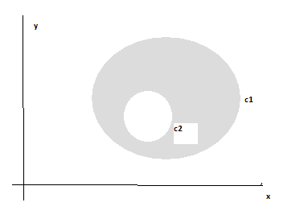

<!-- markdownlint-disable MD036 -->

# ex_final_9-2-11[1]

> Transcripción del original. Año de archivo: 2016. Atribución: Archivado en
> carpeta canónica de AMII; carrera no identificada en el documento. Las erratas
> y las repeticiones del original se conservan.

1-Según el teorema de Green para regiones múltiplemente conexas, se cumple

$$
\iint_{R}^{}{\left( \frac{\partial Q}{\partial x} - \frac{\partial P}{\partial y} \right)dxdy} = \oint_{c1}^{}{Pdx + Qdy} - \ \oint_{c2}^{}{Pdx + Qdy}\text{               (*)}
$$

Calcular
por este método el área encerrada entre dos circunferencias concéntricas de
radios $r_{1} = 3\text{   y  }r_{2} = 1$

Desarrolle los aspectos teóricos necesarios para demostrar $\text{(*)}$\
2-¿Cuales son las condiciones necesarias para que un campo vectorial sea un
gradiente?

3- Compruebe que $y = f(x)$ satisface la ecuación diferencial
$y' + \ P(x)y = Q(x)$ y la condición inicial $f(a) = b$, siendo $a$ cualquier
punto del intervalo donde $P$ y $Q$ son continuas y $b$ un número real
cualquiera

$$
f(x) = be^{- A(x)} + \ e^{- A(x)}\int_{a}^{x}{Q(t)e^{A(t)}dt}\ \ \text{con }\ A(x) = \ \int_{a}^{x}{P(t)dt}
$$

4-Desarrollo de Fourier de los primeros sumandos de

1-Según el teorema de Green para regiones múltiplemente conexas, se cumple

$$
\iint_{R}^{}{\left( \frac{\partial Q}{\partial x} - \frac{\partial P}{\partial y} \right)dxdy} = \oint_{c1}^{}{Pdx + Qdy} - \ \oint_{c2}^{}{Pdx + Qdy}\text{               (*)}
$$

Calcular
por este método el área encerrada entre dos circunferencias concéntricas de
radios $r_{1} = 3\text{   y  }r_{2} = 1$

Desarrolle los aspectos teóricos necesarios para demostrar $\text{(*)}$\
2-¿Cuales son las condiciones necesarias para que un campo vectorial sea un
gradiente?

3- Compruebe que $y = f(x)$ satisface la ecuación diferencial
$y' + \ P(x)y = Q(x)$ y la condición inicial $f(a) = b$, siendo $a$ cualquier
punto del intervalo donde $P$ y $Q$ son continuas y $b$ un número real
cualquiera

$$
f(x) = be^{- A(x)} + \ e^{- A(x)}\int_{a}^{x}{Q(t)e^{A(t)}dt}\ \ \text{con }\ A(x) = \ \int_{a}^{x}{P(t)dt}
$$

4-Desarrollo de Fourier de los primeros sumandos
de
