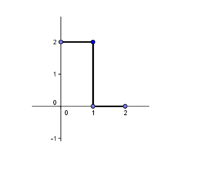

<!-- markdownlint-disable MD036 -->

# Examen Final 09-2012

> Transcripción del original. Año de archivo: 2016. Atribución: Identificación
> ISI o varias carreras que incluyen ISI en fuente. Las erratas y las
> repeticiones del original se conservan.

**<u>Examen Final 05/09/2012</u>**

**<u>Primera parte</u>**

1\. ¿Qué significa que un campo vectorial sea conservativo?

2\. ¿Qué relación existe entre los límites iterados y el límite doble?

3\. Defina función vectorial, campo vectorial y campo escalar. Dé un ejemple de
cada uno de ellos y su aplicación.

**<u>Segunda Parte</u>**

Desarrolle dos de los siguientes temas para aprobar:

1\. Derivadas direccionales. Desarrollo, representación gráfica. Relación entre
las derivadas direccionales y el gradiente de un campo escalar.

2\. Desarrollo en Serie de COSENOS . Interpretación gráfica de las Armónicas.

3\. Ecuaciones diferenciales lineales de primer orden.

**<u>EXAMEN FINAL PRÁCTICO</u>**

1\. Verifique que el trabajo que realiza el campo vectorial
$`\vec{F}(x,y) = 2xy\vec{i} + (x^{2} - y)\vec{j}`$ entre los puntos (-1,4) y
(1,2) es independiente de la trayectoria.

2\. Calcule el volumen del prisma limitado por los planos,
$`x = 0\ ;y = x\ ;y = \sqrt{\frac{\pi}{2}\ }\ ;1 \leq z \leq 3`$

3\. Desarrolle en serie de cosenos la siguiente función:

