<!-- markdownlint-disable MD029 -->

# ANÁLISIS MATEMÁTICO II

GUÍA DE PROBLEMAS PROPUESTOS PARA EL ALUMNO DE LAS CARRERAS DE INGENIERÍA
ELECTROMECÁNICA, INGENIERÍA QUÍMICA E INGENIERÍA EN SISTEMAS DE INFORMACIÓN

Fuente: `Guia completa TP.pdf`, 30 páginas, año impreso no indicado.
[Procedencia](../../../resources/2016/fuentes.md). Se conserva la numeración y
las erratas del original; no se completan ni resuelven ejercicios.

## PARTE Nº 1

Espacios euclídeos de n dimensiones. Entornos. Clasificación de puntos.
Conjuntos abiertos, cerrados, acotados, conexos. Funciones de dos variables.
Punciones de variables. Dominio, representación gráfica. Curvas y superficies de
nivel.

### nº1

Representar los conjuntos de puntos definidos a continuación

| Conjunto | Conjunto |
| -- | -- |
| $`A=\{(x,y)/x-y\ge0\}`$ | $`F=\{(x,y)/x\cdot y\le1\}`$ |
| $`B=\{(x,y)/x^2+y^2\le9\}`$ | $`G=\{(x,y)/r^2<x^2+y^2\le R^2\}`$ $r<R$ y ambos reales |
| $`C=\{(x,y)/y\ge2x-3\}`$ | $`H=\{(x,y)/\lvert x\rvert<1\land\lvert y\rvert<2\}`$ |
| $`D=\{(x,y)/y\ge x^2+2x-1\}`$ | $`I=\{(x,y)/d(P,A)=d(P,B)\}`$ con $P(x,y)$; $A(x_a,y_a)$; $B(x_b,y_b)$; $d=$ distancia |
| $`E=\{(x,y)/x=1/n;\ n\in\mathbb N\}`$ | $`J=\{(x,y,z)/x^2+y^2+z^2\le4\}`$ |

### nº2

Determinar los conjuntos de definición de las funciones que se indican a
continuación. Decir si se trata de conjuntos abiertos, cerrados, conexos y/o
acotados. Indicar en cada caso cual es el conjunto frontera y si pertenece o no
al conjunto definido.

$$
z=+\sqrt{1-x^2-y^2}
$$

$$
z=\mathop{\mathrm{arc\ sen}}\nolimits (x+y)
$$

$$
z=\frac1{\mathop{\mathrm{sen}}\nolimits (x-y)}
$$

$$
z=\sqrt{x\cdot y}
$$

$$
z=\sqrt{|x|+|y|-2}
$$

$$
z=\sqrt{\ln(y^2-2x)}
$$

$$
z=y/\cos x
$$

$$
z=\frac{\mathop{\mathrm{arc\ sen}}\nolimits (y-x^2)}{\sqrt{2-|x|}}
$$

$$
z=\frac{\ln(x+y)\cdot\ln(4-x-y)}{\sqrt{16-x^2-y^2}}
$$

### nº3

Construir las gráficas de las siguientes funciones. Emplear para ello las
trazas, curvas de nivel o intersecciones con los planos paralelos a los
coordenados.

a) $f:R^2\to R$; $x=3$

a) $f:R^2\to R$; $y=2$

b) $f:R^2\to R$; $3x+4z=12$

c) $f:R^2\to R$; $(y-2)^2+z^2=4$

d) $f:R^2\to R$; $(y-1)^2+z^2=x$

e) $f:R^2\to R$; $x^2/9+y^2/4+z^2/16=1$

f) $f:R^2\to R$; $x^2/9+y^2/4-z^2/16=1$

g) $f:R^2\to R$; $y=z$

h) $f:R^2\to R$; $(x-2)^2+(y-1)^2+(z-3)=4$

### nº4

Sea $T(x,y)=x^2+4y^2$, la expresión que vincula cada punto de una placa con su
temperatura; encontrar las isotermas (líneas que unen puntos de igual
temperatura) para 0º, 10º y 15ºC. Hallar también la temperatura del punto
$(1,1)$.

Adicional:

1. Probar que si $x^2+2xy+y^2=(x+y)^2\ge0$ entonces $4x^2+6xy+4y^2<0$ (notar que
   esto genera una contradicción y lo solicitado es falso)

1. Para que valores de $\alpha$, es siempre $x^2+\alpha xy+y^2>0$, siempre que
   $x$ e $y$ no sean nulos ambos?

## PARTE Nº 2

Límite doble. Límite iterado, Relación entre el límite doble e iterado.
Funciones continuas. Propiedades.

### nº5

Calcular los límites dobles de las expresiones

$$
\lim_{(x,y)\to(2,1)}\frac{5x^3-3y^2}{2x^2+y^3}\qquad
\lim_{(x,y)\to(2,0)}\frac{y\cdot\mathop{\mathrm{sen}}\nolimits (x-2)}{x^2-4}
$$

$$
\lim_{(x,y)\to(0,0)}\frac{(3+y^2)\mathop{\mathrm{sen}}\nolimits x}{x}\qquad
\lim_{(x,y)\to(0,0)}\frac{3\mathop{\mathrm{sen}}\nolimits (x\cdot y)}x
$$

$$
\lim_{(x,y)\to(0,1)}\frac{xy-x^2+3}{x^2+y^3}\qquad
\lim_{(x,y)\to(0,0)}y\mathop{\mathrm{sen}}\nolimits \frac\pi x
$$

$$
\lim_{(x,y)\to(-1,2)}F(x,y);\quad\text{siendo }F(x,y)
\begin{cases}x^3+2y^2-1&\text{si }(x,y)\ne(-1,2)\\7&\text{si }(x,y)=(-1,2)\end{cases}
$$

### nº6

Calcular los límites iterados. Decir si existe límite doble.

$F(x,y)=\frac{3x^2+y^2}{x^2+y^2}$ en $P(0,0)$

$F(x,y)=(x+y)\left(\mathop{\mathrm{sen}}\nolimits \frac\pi x+\mathop{\mathrm{sen}}\nolimits \frac\pi y\right)$
en $P(0,0)$

$F(x,y)=y\mathop{\mathrm{sen}}\nolimits (\pi/x)$ en $P(0,0)$

$F(x,y)=\frac{2x+3y}{x-y}$ en $P(1,2)$

### nº7

Calcular los límites iterados y el límite direccional sobre la curva dada, en el
punto $P(0,0)$. Decir si existe el límite doble en dicho punto.

a) $F(x,y)=\frac{x^2+y^2}{x^2\cdot y^2+(x-y)^2}$; $y=x$

b) $F(x,y)=\frac{x\cdot y}{x^2+y^2}$; $y=x^2$

c) $F(x,y)=\frac{x\cdot y-1}{x^3-y^3}$; $y=m$

### nº8

Verificar la continuidad de las siguientes funciones.

$$
F(x,y)=\begin{cases}x^2+2y^2&\text{si }(x,y)\ne(1,2)\\0&\text{si }(x,y)=(1,2)\end{cases};\quad P(1,2)
$$

a)

$$
F(x,y)=\begin{cases}\dfrac{\mathop{\mathrm{sen}}\nolimits (x^2+y^2)}{x^2+y^2}&\text{si }(x,y)\ne(0,0)\\1&\text{si }(x,y)=(0,0)\end{cases};\quad P(0,0)
$$

b)

$$
F(x,y)=\begin{cases}\dfrac{2x^2+2y^2}{e^{x\cdot y}(x^2+y^2)}&\text{si }(x,y)\ne(0,0)\\2&\text{si }(x,y)=(0,0)\end{cases};\quad P(0,0)
$$

c)

$$
F(x,y)=\begin{cases}\dfrac{x^3\mathop{\mathrm{sen}}\nolimits y-y^2\mathop{\mathrm{sen}}\nolimits x}{x\cdot y}&\text{si }x\cdot y\ne0\\0&\text{si }x\cdot y=0\end{cases};\quad P(0,0)
$$

d) $F(x,y)=\frac{x^2-y^2}{x^2+y^2}$; $P(0,0)$

e) $F(x,y)=\frac{x^2-y^2-1}{x^2-4y}$; $P(2,1)$

g) Estime la posibilidad de la existencia del limite en el origen de

$$
f(x,y)=\frac{x^3-y^3}{x-y}
$$

$$
g(x,y)=\frac{x^5-y^5}{x-y}
$$

Redefina las funciones para que sean continuas en todo punto del plano real

### nº9

Si $f(2,3)=4$; se puede concluir algo acerca de $\lim_{(x,y)\to(2,3)}f(x,y)=4$?
Proponga ideas.

### nº10

Determinar si las siguientes afirmaciones son verdaderas (V) o falsas(F). si son
falsas, explicar porqué.

a) $\lim_{(x,y)\to(0,0)}f(x,y)=0\Rightarrow\lim_{x\to0}f(x,0)=0$

b) $G$ y $H$ son funciones continuas de $x$ e $y$ $\Rightarrow f(x,y)=G(x)+H(y)$
es continua

## PARTE Nº 3

Derivadas parciales de una función de dos variables. Interpretación geométrica.
Derivadas parciales de n variables. Derivadas parciales sucesivas. Teorema de
Shwartz. Funciones compuestas de varias variables: definición y derivación.
Funciones implícitas de una y dos variables: definición, existencia y
derivación. Desarrollo de Taylor y Maclaurin para funciones de dos o más
variables. Extremos relativos para funciones de dos variables independientes:
condiciones necesarias y suficientes. Extremos relativos de funciones con
variables ligadas. Derivadas direccionales.

Funciones diferenciables de dos variables. Diferenciales parciales. Significado
geométrico. Funciones diferenciales de n variables. Relación entre la
derivabilidad, diferenciabilidad y continuidad. Diferenciales sucesivas.

### nº11

Analizar el comportamiento de $f(x,y)$ en $P(0,0)$, analizando limites y
estudiando su existencia, continuidad, derivadas parciales, diferencial

$$
f(x,y)\begin{cases}\dfrac{2xy}{2x^2+3y^2}&\text{si }(x,y)\ne(0,0)\\0&\text{si }(x,y)=(0,0)\end{cases}
$$

### nº12

Determinar si $f(x,y)$ es diferenciable.

a)

$$
f(x,y)=\begin{cases}\dfrac{-3x\cdot y}{x^2+y^2}&\text{si }(x,y)\ne(0,0)\\0&\text{si }(x,y)=(0,0)\end{cases}
$$

b) $f(x,y)=x^2+y^2$

### nº13

Hallar las derivadas parciales primeras de las siguientes funciones.

a) $z=\mathop{\mathrm{arc\ tg}}\nolimits (x/y)$

b) $z=\mathop{\mathrm{sen}}\nolimits (y\cdot\ln x)$

c) $z=x\cdot y/(x^2+y^2)$

d) $z=v\cdot\mathop{\mathrm{arc\ sen}}\nolimits (x/y)$

e) $e=(x^2+y^2+z^2)^{1/2}$

f) $z=x^y$

g) $z=\log xy$

h) $z=(\mathop{\mathrm{tg}}\nolimits y)^{1/x}$

i) $w=x^{y^z}$

### nº14

Hallar las derivadas parciales segundas de las siguientes funciones.

a) $F(x,y)=x^y$ b) $F(x,y,z)=z^3+3^{xy}$ c) $F(x,y)=x\cos y+y\cos x$

### nº15

Dadas las siguientes funciones, verificar las igualdades correspondientes.

a)

$$
z=\frac{x^3+8xy^2-y^3}{x^3+y^3};\quad x\frac{\partial z}{\partial x}+y\frac{\partial z}{\partial y}=0
$$

b)

$$
u=x^2y+y^2z+z^2x
$$

$$
\frac{\partial u}{\partial x}+\frac{\partial u}{\partial y}+\frac{\partial u}{\partial z}=(x+y+z)^2
$$

c)

$$
z=\ln(e^x+e^y)
$$

$$
\frac{\partial z}{\partial x}+\frac{\partial z}{\partial y}=1
$$

### nº16

Determinar las derivadas parciales de 1º y 2º orden. Verificar el teorema de
Schuartz.

a) $z=x^3y-3x+2y$

b) $z=x\cdot e^{xy}$

c) $z=x\cos y+2x$

d) $z=\mathop{\mathrm{arc\ tg}}\nolimits (x/y)$

e) $z=u\cos(xy)$

### nº17

Una función $z=f(x,y)$, cuyas derivadas parciales de 2º orden existen y son
continuas, y además verifican la ecuación de Laplace $f'_{xx}+f'_{yy}=0$, se
dice que es armónica. Demostrar que las siguientes funciones son armónicas en
una región del plano.

a) $z=e^x\cos y$ b) $z=-2x(y-1)$ c) $z=2x-x^3+3xy^2$

### nº18

Hallar el diferencial total de las siguientes funciones.

$z=(x^2+y^2)^{1/2}$

$z=y^2e^x+x^2e^y$

$u=\mathop{\mathrm{sen}}\nolimits (xy/z)$

d) Utilizar el Cálculo para estimar el porcentaje en que cambia el volumen de un
cilindro si el radio aumenta en 1% y la altura disminuye en 1.5%.

e) El Volumen de una célula en forma de elipsoide, está dado por la formula:
$V(a;b)=\frac43\pi\cdot a^2\cdot b$; estimar el cambio porcentual en $V(a;b)$
producido si $a$ crece en 5% y $b$ decrece en 3%.

### nº19

El área del rectángulo de la figura es $A=b\cdot h$. Hallar $dA$ y determinar en
el gráfico el área correspondiente a la diferencia entre $\Delta A$ (incremento
total) y $dA$ (diferencial total).

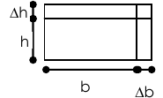

### nº20

Un rectángulo cuyas medidas son $h=10$cm y $b=40$cm; el error en la medición de
cuál de los dos lados influye más en el valor del área? (considerar se produce
un error a la vez).

### nº21

Una pila de bloques mide 60x50x4 unidades métricas, dicha medición fue hecha con
una cinta que comete un error del 1% de la longitud de la medida. Si son 12
bloques por unidad métrica cúbica, y 1000 bloques cuestan A, se desea calcular
el error aproximado en el costo, que involucra la medida.

### nº22

Las dimensiones interiores de una caja de metal sin tapa son 6x4x2 pies, siendo
el espesor de 0,1 pie. Calcular el volumen de material usado (determinar por
incremento total y por diferencial total, comparar valores).

### nº23

Los lados de un terreno triangular miden 100m y 125m con un error posible de
0,2m; el ángulo comprendido es de 60º con un error posible de 1º. ¿Cuál es el
error aproximado con que está determinada la superficie del terreno?

### nº24

La constante $C$ de la ley de Boyle “$P\cdot V=C$”, se calcula midiendo la
presión y el volumen. Si la presión es de 5000 libras por pie², y el volumen es
de 15 pie³, pudiendo cometerse un error del 1% en la presión y del 2% en la
medida del volumen, ¿cuál es el error aproximado cometido en al determinación de
“C”?

### nº25

La longitud $x$ de un lado del triángulo aumenta a razón de 3 cm/s. La longitud
$y$ del otro lado disminuye a razón de 2 cm/s y el ángulo $\phi$ comprendido
entre ellos aumenta a razón de 0,05 rad/s. ¿A qué velocidad cambia el área del
triángulo?, cuando $(x;y)$ miden 40 y 50 cm y $\phi=30$º

### nº26

Desarrollar en serie de Taylor hasta el 3º término más el término
complementario, las siguientes funciones, en los puntos indicados.

a) $z=x^3+3xy^3$; $P(-1,1)$

b) $z=x^y$; $P(1,2)$

c) $z=e^{xy}$; $P(1,1)$

d) $z=\mathop{\mathrm{sen}}\nolimits (x+y)$; $P(\pi,\pi/2)$

### nº27

Desarrollar en serie de Mac Laurin las siguientes funciones.

a) $z=e^{xy}$ b) $z=\mathop{\mathrm{sen}}\nolimits (x+y)$

### nº28

Determinar las derivadas parciales indicadas de las siguientes funciones
compuestas.

a) $z=\mathop{\mathrm{sen}}\nolimits (y/x)$; siendo $x=e^{v/u}$; $y=2^{u/v}$;
hallar $z_u$

b) $z=\mathop{\mathrm{sen}}\nolimits [\ln(u/v)]$; siendo $u=1/t$; $v=3t+1$;
hallar $z_t$

c) $x=\ln(u^2+y^2)^{1/2}$; siendo $u=\mathop{\mathrm{arc\ tg}}\nolimits (v/z)$;
$y=v^z$; hallar $x_z$; $x_v$

d) $u=e^{xy+2z}$; siendo $x=3t^v$; $y=v/t$; $z=v^2-t$; hallar $u_t$; $u_v$

### nº29

Determinar $T'_\rho$ y $T'_\varphi$, para $T=x^3-xy+y^3$; siendo:
$x=\rho\cos\varphi$; $y=\rho\mathop{\mathrm{sen}}\nolimits \varphi$

### nº30

Dada $U=z\mathop{\mathrm{sen}}\nolimits (y/x)$, determinar $U'_r$; y $U'_s$;
siendo:

$$
\begin{cases}x=3r^2+2s\\y=4r-2s^3\\z=2r^2-3s^2\end{cases}
$$

### nº31

Sea $y=F(x)$, dada como: $x^2y^3+2x^2y+3x^4-y=1$; cuando $x=1$, $y=-1$, calcular
$y'$; en el punto $x=1$.

### nº32

Para la función definida implícitamente:
$e-x\cos y+\mathop{\mathrm{sen}}\nolimits y=e$, calcular $y'$ en $x=1$; $y=\pi$.

### nº33

Siendo $U=x^3y$, determinar $dU/dt$, dado que $x=x(t)$ e $y=y(t)$, siendo:

$$
\begin{cases}x^5+y-t=0\\x^2+y^3-t=0\end{cases}
$$

### nº34

Determinar las derivadas parciales de $u$ y de $v$, respecto de $x$ e $y$,
siendo $u=u(x,y)$; y $v=v(x,y)$, dadas por el siguiente sistema.

$$
\begin{cases}u^2-v=3x+y\\u-2v^2=x+2y\end{cases}
$$

### nº35

Encontrar $dy/dx$; y $dz/dx$; dadas $y=y(x)$; y $z=z(x)$, como:

$$
\begin{cases}z=4x^2-3y^2\\z^2+y^2+x^2=24\end{cases}
$$

### nº36

Encontrar $v'_x$; $v'_y$; $u'_x$; $u'_y$; siendo $u=u(x,y)$ y $v=v(x,y)$,
expresadas como:

$$
\begin{cases}x+y+u+v=1\\x^2+y^2+u^2+v^2=b^2\end{cases}
$$

### nº37

Identificar los extremos y puntos de silla de las siguientes funciones.

a) $z=x\cdot y$

b) $z=x^2\cdot y^2$

c) $z=x^3-3xy^2$

d) $z=x^2+(y-1)^2$

e) $z=x^2-(y-1)^2$

f) $z=1+x^2-y^2$

g) $z=(x-y+1)^2$

h) $z=x^2-xy+y^2-2x+y$

i) $z=x^3+y^3-3x-12y+20$

j) Hallar los extremos, y describir su naturaleza, de la función:
$z=(x^2+2y^2)e^{1-x^2-y^2}$

k) Hallar los extremos, y describir su naturaleza, de la función:
$z=(x-4)\ln(xy)$

l) Hallar los extremos, y describir su naturaleza, de la función
$z=xye^{-\left(\frac{16x^2+9y^2}{288}\right)}$

m) Hallar los extremos, y describir su naturaleza, de la función:
$z=x\ln\left(\frac{y^2}{x}\right)+3x-xy^2$

### nº38

Encontrar el punto $P(x,y,z)$ que pertenece al plano $3x+4y+z=26$; y que se
halla más próximo al origen de coordenadas. Aplicar método del Hessiano y
multiplicador de Lagrange.

### nº39

a-Se desea construir una caja de cartón de 320m³, sin tapa, utilizando la menor
cantidad de material posible. Determinar el largo, ancho y alto de dicha caja;
por el método del Hessiano y utilizando multiplicador de Lagrange.

b-Considere la función $z=8/(x^2+y^2+4)$ ¿Es posible construir un cilindro
debajo de la superficie definida por la función indicada de volumen máximo?

c-Igual que el caso b pero que sea un paralelepipedo de base cuadrada?

### nº40

Cuál es el máximo volumen de un paralelepípedo que se puede construir de modo
que: (largo+ancho+alto)=$x+y+z=a$; siendo $a=$ constante.

### nº41

Determinar si las siguientes afirmaciones son verdaderas (V) o falsas(F).
Justificar la respuesta.

a) Si $f$ tiene máximo relativo en $(x_0,y_0,z_0)$, entonces
$f'_x(x_0,y_0)=f'_y(x_0,y_0)=0$.

b) Si $f$ es continua para todo $x$ e $y$ del dominio, y tiene dos mínimos
relativos, entonces tiene al menos un máximo.

### nº42

Demostrar que una caja de volumen dado y de superficie mínima es un cubo.

### nº43

Hallar la derivada de $F(x,y)=x^2y+\mathop{\mathrm{sen}}\nolimits (xy)$; en el
punto $P(1,\pi/2)$; en la dirección $\varphi=45$º (respecto del eje x).

### nº44

Hallar la derivada de $F(x,y)=x^3y+e^{xy}$; en el punto $P(1,1)$; en la
dirección $\varphi=30$º (respecto del eje x).

### nº45

Dada la función $F(x,y)=(x^2-y^2)/(x^2+y^2)$; hallar la derivada direccional en
el punto $P(2,2)$; en la dirección dada por la recta que pasa por $P$ y por el
punto $Q(3,4)$.

### nº46

Para $F(x,y)=x^2-5xy$; hallar su derivada direccional en el punto $P(2,5)$;
siendo la dirección la del vector $v=3i-3j$.

### Problemas tomados del libro Cálculo 2 Rabuffetti

Problema:

- Dividir el número 600 en tres partes de modo que la suma de los porductos
  binarios de esas partes sea máxima

$$
x+y+z=600
$$

$$
f(x,y,z)=xy+xz+yz
$$

Es necesario encontrar si la función tiene algún máximo bajo la condición
inicial

$$
z=600-x-y
$$

$$
f(x,y,600-x-y)=g(x,y)=xy+x(600-x-y)+y(600-x-y)
$$

Notar que la f originalmente dada no tiene restricciones en su dominio y de
todas las ternas ordenadas que podríamos considerar, solamente tomamos aquellas
que pertenecen a un plano

$$
g_x(x,y)=y+(600-x-y)-x-y=600-2x-y=0
$$

$$
g_y(x,y)=x-x+(600-x-y)-y=600-x-2y=0
$$

$$
2x+y=600\qquad x+2y=600
$$

$$
x_1=\frac{\begin{vmatrix}600&1\\600&2\end{vmatrix}}{\begin{vmatrix}2&1\\1&2\end{vmatrix}}
=\frac{1200-600}{4-1}=\frac{600}3=200
$$

$$
y_1=\frac{\begin{vmatrix}2&600\\1&600\end{vmatrix}}{\begin{vmatrix}2&1\\1&2\end{vmatrix}}
=\frac{1200-600}{4-1}=\frac{600}3=200
$$

Este es el único punto critico

$$
H(x,y)=g_{xx}g_{yy}-(g_{xy})^2=(-2)(-2)-(-1)^2=4-1=3
$$

$$
H(x_1,y_1)=3>0
$$

$g_{xx}(x_1,y_1)=-2<0\to(x_1,y_1)=(200,200)$ corresponde a un máximo local

La terna de valores que sumada da 600 es (200,200,200) y esta hace máximo la
suma de productos binarios de ellos, siendo 200.200+200.200+200.200= 120.000

Problema:

Máximo y mínimo absoluto de $f(x,y)=x^2-y^2$ sobre $`A=\{(x,y)/x^2+y^2\le9\}`$

Notar que la función tiene un punto critico en (0,0) que corresponde a una
ensilladura, además la función allí es cero, y tiene un crecimiento positivo
siempre que y=0, y tiene un decrecimiento siempre que x=0

Es de esperar algún absoluto en el borde del conjunto restrictivo

Allí es $f\left(x,[9-x^2]^{1/2}\right)=x^2-9-x^2=9-2x^2$ pero esto es válido
siempre que $|x|\le3$ esto pasa por un máximo si x=0, lo que nos lleva a dos
posibles valores de y, y =3, y=-3

Un análisis similar corresponde a considerar todo con la variable y, llevando a
dos soluciones x=3; x=-3 Por lo tanto hay cuatro opciones, dos de máximo y dos
de minimo

Criterio similar si consideramos la forma con coordenadas polares de x y de y

Problema

Se pide el valor mínimo de $x^2+4xy+5y^2-4x-6y+7$

Planteo esperable

$$
2x+4y-4=0\qquad4x+10y-6=0
$$

$$
x=\frac{\begin{vmatrix}4&4\\6&10\end{vmatrix}}{\begin{vmatrix}2&4\\4&10\end{vmatrix}}
=\frac{40-24}4=4
$$

$$
y=\frac{\begin{vmatrix}2&4\\4&6\end{vmatrix}}{\begin{vmatrix}2&4\\4&10\end{vmatrix}}
=\frac{12-16}4=-1
$$

$H(x,y)=2\cdot10-16=4>0$ deriv parc seg =2 hay minimo en (4,-1)

El valor mínimo es 2.

De otra forma interesante

$$
x^2+4xy+5y^2-4x-6y+7
$$

Interesante es tomar el polinomio en x

$$
\begin{aligned}
&x^2+4xy+5y^2-4x-6y+7\\
&=x^2+2x\frac{4y-4}2+(5y^2-6y+7)+(2y-2)^2-(2y-2)^2\\
&=(x+[2y-2])^2+(5y^2-6y+7)-(2y-2)^2\\
&=(x+[2y-2])^2+(5y^2-6y+7)-4y^2-4+8y\\
&=(x+[2y-2])^2+y^2+2y+1+2\\
&=(x+[2y-2])^2+(y+1)^2+2
\end{aligned}
$$

Con lo cual obtenemos factores o sumandos siempre positivos y para que su suma
sea mínima es necesario que los términos cuadráticos sean cero y con ello
obtenemos el mínimo de 2, justo para y=-1 y x=4 Tal como lo predice el método
anterior.

### Derivadas MATHCAD

Para evaluar derivadas de funciones de dos variables, primero debemos definir
nuestra función. Por ejemplo, $\mathrm f(x,y):=x\cos(y)+y\cos(x)$

Para evaluar la primera derivada respecto de x, utilizamos la función
"Derivative" de la barra de herramientas llamada Calculus:
$\frac{\mathrm d}{\mathrm d\blacksquare}\blacksquare$

Luego, insertamos el nombre de la función y la variable respecto de la cual
queremos derivar: $\frac{\mathrm d}{\mathrm dx}\mathrm f(x,y)$ Para obtener el
valor, presionamos Control+. luego de completar la expresión:

$$
\frac{\mathrm d}{\mathrm dx}\mathrm f(x,y)\to\cos(y)-y\sin(x)
$$

Obtenemos así nuestra primera derivada.

Si queremos hallar la segunda derivada, utilizamos la función "Nth Derivative"
de la barra Calculus. Repetimos lo mismos pasos que en el caso anterior:

$$
\frac{\mathrm d^2}{\mathrm dx^2}\mathrm f(x,y)\to(-y)\cos(x)
$$

Si ahora queremos hallar las derivadas cruzadas de la función, tendremos que
realizar lo siguiente. Al momento de evaluar la primera derivada, designamos un
nombre a esa nueva función. Lo que nos quedaría:

$$
\mathrm{f1}(x,y):=\frac{\mathrm d}{\mathrm dx}\mathrm f(x,y)\to\cos(y)-y\sin(x)
$$

Ahora, al evaluar las derivadas cruzadas, utilizaremos la función "f1" en lugar
de "f", para el caso que queramos evaluar la derivada de f(x,y) primero respecto
de x y luego respecto de y:

$$
\frac{\mathrm d}{\mathrm dy}\mathrm{f1}(x,y)\to(-\sin(y))-\sin(x)
$$

Si queremos comprobar que las derivadas cruzadas sean iguales, nada más tenemos
que definir las funciones necesarias, en nuestro caso sería:

$$
\mathrm{f2}(x,y):=\frac{\mathrm d}{\mathrm dy}\mathrm f(x,y)\to(-x)\sin(y)+\cos(x)
$$

$$
\frac{\mathrm d}{\mathrm dx}\mathrm{f2}(x,y)\to(-\sin(y))-\sin(x)
$$

Si queremos hallar la derivada tercera, realizamos lo mismo que para el caso de
la derivada segunda:

$$
\frac{\mathrm d^3}{\mathrm dx^3}\mathrm f(x,y)\to y\sin(x)
$$

Si queremos evaluar derivadas cruzamos, nada más nombramos las funciones
necesarias. Por ejemplo:

$$
\mathrm{f11}(x,y):=\frac{\mathrm d}{\mathrm dy}\mathrm{f1}(x,y)
$$

Luego: $\frac{\mathrm d}{\mathrm dx}\mathrm{f11}(x,y)\to-\cos(x)$ es la derivada
tercera de f(x,y) respecto de x, de y, y de x nuevamente.

Ejemplo:

$$
\mathrm j(x,y):=e^{x\cdot y}\sin(y)
$$

$$
\mathrm{j1}(x,y):=\frac{\mathrm d}{\mathrm dx}\mathrm j(x,y)\to y e^{x\cdot y}\sin(y)
$$

$$
\mathrm{j2}(x,y):=\frac{\mathrm d}{\mathrm dy}\mathrm j(x,y)\to x e^{x\cdot y}\sin(y)+e^{x\cdot y}\cos(y)
$$

$$
\frac{\mathrm d^2}{\mathrm dx^2}\mathrm j(x,y)\to y^2e^{x\cdot y}\sin(y)
$$

$$
\frac{\mathrm d^2}{\mathrm dy^2}\mathrm j(x,y)\to x^2e^{x\cdot y}\sin(y)+2xe^{x\cdot y}\cos(y)-e^{x\cdot y}\sin(y)
$$

$$
\frac{\mathrm d}{\mathrm dy}\mathrm{j1}(x,y)\to e^{x\cdot y}\sin(y)+yx e^{x\cdot y}\sin(y)+y e^{x\cdot y}\cos(y)
$$

$$
\frac{\mathrm d}{\mathrm dx}\mathrm{j2}(x,y)\to e^{x\cdot y}\sin(y)+xy e^{x\cdot y}\sin(y)+y e^{x\cdot y}\cos(y)
$$

## PARTE Nº 4

Curvas en el espacio. Longitud de arco de curva. Funciones vectoriales de una
variable: límites de continuidad y derivación. Vector tangente Unitario.
Representaciones paramétricas equivalentes. Longitud de arco. Vector normal
unitario. Vector binormal. Rectas tangentes normal y binormal. Ecuación de un
plano.

Campos escalares y vectoriales. Derivada de un campo escalar respecto a una
dirección. Gradiente. Operador Nabla. Relación entre la derivada direccional y
el gradiente. Interpretación geométrica del gradiente. Vector normal unitario y
plano tangente a una superficie. Divergencia. Interpretación física de la
divergencia. Rotacional. Interpretación física del rotacional. Propiedades.

### nº47

Dada $f(u,v)=e^{uv}i+(u-v)j+u\mathop{\mathrm{sen}}\nolimits (v)k$; determinar
$f'_u$; $f'_v$; $f'_u\times f'_v$

### nº48

Encontrar la expresión de la recta que pasa por $A(a_1,a_2,a_3)$ y es paralela
al vector $B=b_1i+b_2j+b_3k$.

### nº49

Trazar la curva dada vectorialmente por f(t). Encontrar la dirección de la curva
en $P(0,a,0)$; y encontrar su longitud si $0\le t\le2\pi$. Siendo
$f(t)=a\cos(t)i+a\mathop{\mathrm{sen}}\nolimits (t)j$.

### nº50

Tazar la curva representada por:
$r(t)=a\cos t i+a\mathop{\mathrm{sen}}\nolimits t j+bt k$; siendo
$b>0\le t\le\infty$.

### nº51

Hallar la longitud de la curva dada por:
$r(t)=t i+\mathop{\mathrm{sen}}\nolimits (2\pi t)j+\cos(2\pi t)k$; siendo
$0\le t\le1$.

### nº52

Se tiene que construir una chapa para techo usando una máquina que dobla una
hoja plana de aluminio convirtiéndola en una que tiene la forma ondulada Se
necesita una hoja de 60 pulgadas de ancho, y cada onda tiene una altura de una
pulgada desde la línea central y un periodo de 6 pulgadas. El problema consiste
en encontrar la longitud del ancho inicial de la chapa, para lograr, luego de
pasar por la máquina, lo deseado

### nº53

Una partícula en movimiento, cuya trayectoria está dada por: $x=e^{-t}$;
$y=2\cos(3t)$; $z=2\mathop{\mathrm{sen}}\nolimits (3t)$. Encontrar las
componentes de la velocidad y la aceleración para t=1seg; según la dirección
$d=i-3j+2k$.

### nº54

Dada $\phi(x,y,z)=3x^2y-y^3z^3$; encontrar $\nabla\phi$ en el punto
$P(1,-2,-3)$.

### nº55

Hallar la derivada direccional de $\phi(x,y,z)=x^2+y^2+z^2$ en el punto
$P(1,1,0)$; según la dirección de la recta que une $P$ con $Q(2,1,1)$. Hallar
también el valor de la máxima deriva direccional en el punto $P$.

### nº56

Para la placa del ejercicio nº4, donde la función T(x,y) vincula cada punto de
la placa con su temperatura, hallar los puntos donde se verifican las máximas y
mínimas temperaturas.

### nº57

Determinar si las siguientes afirmaciones son verdaderas (V) o falsas(F).
Justificar la respuesta.

a) Si $f(x,y)=\sqrt{1-x^2-y^2}$; entonces $D_uf_{(0,0)}=0$, para todo $u$, donde
$u$ es un versor.

b) Dada $f=f(x,y)$, si $D_uf$ existe, entonces $D_uf=-D_{-u}f$, donde $u$ y $-u$
son versores.

c) $\nabla(c\cdot f)=\nabla c+\nabla f$

d) $\nabla(c\cdot f)=\nabla c\cdot\nabla f$

e) $\nabla(f\cdot g)=\nabla f+\nabla g$

f) $\nabla(f\cdot g)=\nabla f\cdot\nabla g$

g) $\nabla(f\cdot g)=g\cdot\nabla f+f\cdot\nabla g$

h) $\nabla f=\mathop{\mathrm{grad}}\nolimits f=f'_x+f'_y+f'_z$

i) $\nabla f=\mathop{\mathrm{grad}}\nolimits f=f'_x i+f'_y j+f'_z k$

### nº58

Para la función temperatura T(x,y) del ejercicio nº 4 y sus isotermas
correspondientes, determinar la variación de T en la dirección de los vectores
$u1=2i-3j$ y $u2=i+j$, cuál es el valor de la máxima variación que puede sufrir
y en qué dirección lo hace. Cuál es la relación entre las derivadas
direccionales y el concepto de gradiente.

### nº59

Dibujar la curva espacial dada por r(t), trazar $r(t_0)$ y $r'(t_0)$, siendo
t0=3/2.p; y $r(t)=2\cos(t)i+2\mathop{\mathrm{sen}}\nolimits (t)j+t k$. Cómo es
$r'$ respecto de $r$.

### nº60

Demostrar que para un objeto en movimiento uniforme ($|V|=$cte), sus vectores
velocidad $V$ y aceleración $a$ son ortogonales

## PARTE Nº 5

Integral doble de una función continua. Dominio sobre un rectángulo. Integral
doble sobre un dominio cerrado. Aplicaciones. Integral triple. Cálculo de
integral triple. Aplicaciones. Nociones sobre la integridad de superficie.
Integrales que dependen de un parámetro. Continuidad. Derivación bajo el signo
integral: regla de Leibnitz. Integrales sucesivas. Integrales curvilíneas.
Integrales curvilíneas parciales. Definición y Cálculo. Integral curvilínea
total. Condición para que la integral no dependa del camino de integración.
Integral sobre una curva simple cerrada: Teorema de Green. Aplicaciones

### nº61

Resolver las siguientes integrales paramétricas

$$
\int_0^2 3xy\,dx=\varphi(y)
$$

$$
\int_0^{\pi/2}3xy\mathop{\mathrm{sen}}\nolimits z\,dz=\psi(x,y)
$$

$$
\int_1^2(x^2y+2x)\,dy=\chi(x)
$$

$$
\int_x^{x^2+2}2xy\,dy=\psi(x)
$$

### nº62

Resolver aplicando la Regla de Leinbniz las siguientes integrales.

a) $`\left[\int_b^a x\cos(\alpha x)\,dx\right]`$

b) $`\left[\int_0^\infty e^{-\alpha x}x^n\,dx\right]`$; $n\in\mathbb N$

c) $`\psi(\alpha)=\int_1^2(x^2\alpha x+3)\,dx\Rightarrow\psi'_\alpha=?`$

### nº63

Calcular integrando primero respecto de x; y luego respecto de y.

$$
\iint_R(\sqrt{x}+y-3x^2y)\,dxdy;\quad R=\{(x,y)/0\le x\le1;1\le y\le3\}
$$

Calcular las siguientes integrales.

a) $`\int_0^2\int_0^1(x^2+2y)\,dydx`$

b) $`\int_{-3}^5\int_{-2}^4(xy-y^2x^2)\,dydx`$

### nº64

Resolver $`\iint_R F(x,y)\,dxdy`$; para los siguientes pasos.

a) $F(x,y)=x^2-3y+5$; $`R=\{1\le x\le4;-3\le y\le2\}`$

b) $F(x,y)=y^2/(1+x^2)$; $`R=\{-1\le x\le1;0\le y\le2\}`$

c) $F(x,y)=y+3$; $`R=\{0\le x\le1;x^2\le y\le x+2\}`$

d) $F(x,y)=x^2+8xy-1$; $`R=\{1\le y\le2;y\le x\le3\}`$

e) $F(x,y)=e^{x^2}$; $`R=\{0\le x\le3;0\le y\le x/3\}`$

### nº65

Resolver la siguiente integral doble, hacerlo también invirtiendo el orden de
integración. Graficar el recinto.

$$
\int_1^{\ln5}\int_0^{\ln y}e^{x+y}\,dxdy
$$

### nº66

Resolver las integrales, graficar el recinto de integración.

a) $`\iint_R(x^2+y^2)\,dxdy`$; $`R=\{0\le x\le1\land-1\le y\le0\}`$

b) $`\iint_R(16-x^2)\,dxdy`$; $`R=\{0\le x\le4\land0\le y\le x`$

### nº67

Resolver las siguientes integrales dobles.

a) $`\int_3^4\int_1^2\frac{dy\,dx}{(x+y)^2}`$

b) $`\int_1^2\int_x^{\sqrt x}xy\,dy\,dx`$

### nº68

Calcular el área de las siguientes regiones mediante integrales dobles.

a) $`R=\{(x,y)/0\le y\le4-4x/3\land0\le x\le3\}`$

b) $`R=\{(x,y)/x^2\le y\le1\land-1\le x\le1\}`$

c) $`R=\{(x,y)/4-4x\le y^2\le4-x\}`$

d) $`R=\{3y^2=25x;5x^2=9y\}`$

e) $`R=\{y=4x-x^2;y=x\}`$

f) $`R=\{y^2=4x;9x^2=y\}`$

g) $`R=\{-y^2+6y=x;x=y\}`$

h) $`R=\{x^2+y^2=10;y^2=9x\}`$

i) $`R=\{y=x^2-2x-2;y=1\}`$

### nº69

Determinar el volumen

a) $`D=\{(x,y,z)/0\le y\le6\land0\le z\le4-x^2\}`$

b) $`S=\{x^2+y^2=16;x^2+z^2=16;\text{primer octante}\}`$

### nº70

Sea R una región del plano xy cuya área es B. Si f(x,y)=k para todo punto de R,
cuál es el valor de $`\iint_R f(x,y)\,dA`$.

### nº71

Determinar si las siguientes afirmaciones son verdaderas (V) o falsas(F).
Justificar la respuesta.

a) Si $`\iint_R f(r,\theta)\,dA>0\Rightarrow f(r,\theta)>0`$;
$\forall(r,\theta)$

b)

$$
\int_a^b\int_c^d f(x)g(y)\,dy\,dx
=\left[\int_a^b f(x)\,dx\right]\left[\int_c^d g(y)\,dy\right]
$$

### nº72

Calcular el volumen que determinan los siguientes conjuntos de puntos

a) $`A=\{(x,y,z)/4x^2+y^2+1\le z\le10\}`$

b) $`B=\{(x,y,z)/0\le y\le6\land0\le z\le4-x^2\}`$

c) $`C=\{(x,y,z)/x^2+y^2\le16\land x^2+z^2\le16\}`$

d) $`D=\{(x,y,z)/0\le y\le16-x^2-z^2\}`$

e) $4z=10-4x^2-y^2$; primer octante

f) $z=x^2+y^2$; $0\le y\le1\land0\le x\le1$

### nº73

Determinar el centro de gravedad de una lámina rectangular definida por:

$`D=\{(x,y)/0\le x\le2\land0\le y\le3\}`$

### nº74

Determinar el centro de gravedad de:

$`D=\{(x,y)/0\le x\le1\land0\le y\le x^{1/2}\}`$

### nº75

Determinar el centro de masa de:

$`D=\{(x,y)/0\le x\le2\land0\le y\le3\}`$; siendo la densidad
$\rho(x,y)=x\cdot y$

### nº76

Determinar los momentos de inercia axiales (Ix, Iy), polares (I₀) y centrífugos
(Ixy) de las siguientes figuras.

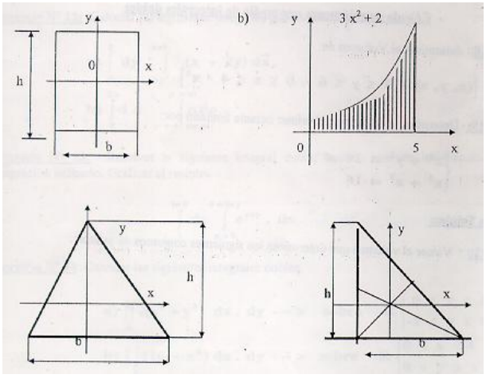

### nº77

Hallar los momentos de inercia de:

$`D=\{(x,y)/0\le x\le1\land0\le y\le x\}`$; siendo $\rho=x+y$

### nº78

Hallar el momento de inercia respecto del eje z.

$`S=\{(x,y,z)/0\le y;0\le x\land0\le z\le1-x-y\}`$; siendo la densidad constante

### nº79

Hallar la masa de una placa homogénea donde densidad=cte

$`D=\{(x,y)/y^2\le x\le y+2\}`$

### nº80

Determinar el momento estático del sólido homogéneo definido por:

$`S=\{(x,y,z)/0\le z\le4-x^2-4y^2;x+y\le1;0\le x;0\le y\}`$

### nº81

Determinar las coordenadas del centro de gravedad de la mitad superior de una
esfera de radio R y centro en el origen de coordenadas, la densidad $\rho$ es
constante.

### nº82

a- Se desea medir el volumen de combustible remanente en un tanque cilíndrico
enterrado horizontalmente, de radio 2m y longitud 10m midiendo con una varilla
metálica recta, calibrada para tal fin, la zona que quedó humedecida por el
combustible. Proponer una escala para tal regla.

b- si $`\int_0^a f(x)\,dx=I`$ y
$`J=\int_0^a f(x)\left[\int_0^x f(y)\left(\int_0^y f(z)\,dz\right)dy\right]dx`$

indicar si $J=I^3$; $J=\frac13 I^3$; $J=\frac16 I^3$; $J=I$; $J=3I$

### nº83

Calcular el área de la superficie en el espacio S, dada por z=f(x,y) sobre la
región R del plano xy.

a) $z=2x+2y$; R triángulo definido por los vértices (0,0)(2,0)(0,2)

b) $z=9-x^2$; R cuadrado definido por los vértices (0,0)(3,0)(0,3)(3,3)

### nº84

Dada $z=F(x,y)=x^2y-3x$; y siendo C un arco de parábola determinado por
$y=x^2+2$; entre P(1,3) y Q(4,18); determinar: $`\int_C F(x,y)\,dx`$

### nº85

Calcular $`\int_C F(x,y)\,dy`$; siendo $F(x,y)=x-y^2$;
$`C=\{y=5x+2;0\le x\le3\}`$. Tomando a y como parámetro; luego tomando a x como
parámetro.

### nº86

Dadas las funciones $P(x,y)=x^2-y$; $Q(x,y)=y^2+x$; y la curva
$`C=\{y=x^2+1;0\le x\le1\}`$; obtener $`\int_C P(x,y)\,dx+Q(x,y)\,dy`$

### nº87

Calcular $`\int_C(x^2y-3x)\,dx+(xy-2)\,dy`$; siendo C un arco de sinusoide entre
$(0,0)$ y $(\pi/2,1)$

### nº88

Calcular $`\int_C(xy\,dx-3y^2\,dy)`$; siendo $`C=\{(x,y)/x^2+y^2=4\}`$

### nº89

Resolver $`\int_C y^2\,dx+xy\,dy`$; estando la curva C definida por la siguiente
figura:

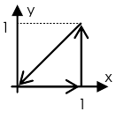

### nº90

Siendo la curva C la frontera del conjunto definido por:
$`D=\{(x,y)/0\le x\le1;x^2\le y\le x\}`$; calcular

$$
\int_C\left(\frac{x^2y^2}2\,dx+x^3\,dy\right)
$$

### nº91

Calcular el trabajo realizado al mover una partícula en un campo de fuerzas a lo
largo de la curva definida por:
$`C=\{x=3(1-\mathop{\mathrm{sen}}\nolimits t);y=3(1-\cos t);0\le t\le2\pi\}`$.
Estando el campo de fuerzas actuantes definido por la función vectorial:
$F=(6-y)i-(3-y)j$

### nº92

Si la curva C está definida por $`C=\{y=x;x=3;y=0\}`$; calcular
$`\int_C(x^2y\,dx-xy\,dy)`$

### nº93

Calcular $`\int_C[(2x+y)\,dx+(x-y)\,dy]`$; estando la curva C asociada a
$F(t)=(t-1)i+t^2j$; para $0\le t\le2$.

### nº94

Calcular $`\int_C\left[\frac{x+y}{x^2+y^2}\,dx-\frac{x-y}{x^2-y^2}\,dy\right]`$;
siendo C la circunferencia $x^2+y^2=4$.

### nº95

Evaluar la integral curvilínea; a lo largo de una circunferencia con centro en
el origen.

$$
\int\frac{x}{x^2+y^2}\,dx-\frac{y}{x^2+y^2}\,dy
$$

### nº96

Verificar el teorema de Green.

a) $`\int_C(x^3+2y^2)\,dx+(y^2+x^2y)\,dy`$; $`C=\{y^2=x;y^2=x^3;0\le y\le1\}`$.

b) $`\int_C(xy^2-x)\,dx+(x^2-y^3x)\,dy`$; siendo C la frontera del conjunto
$`D=\{(x,y)/x^2\le y\le2+x\}`$

c) $`\iint_D(2y-3xy^2)\,dxdy`$; $`D=\{(x,y)/y^2\le x\le y;0\le y\le1\}`$

### nº97

Calcular el área de los siguientes conjuntos de puntos mediante la aplicación de
integrales curvilíneas.

a) $`D=\{(x,y)/x^3\le y^2\le x;0\le y\}`$

b) $`D=\{(x,y)/(2x^2-8x+10)\le y\le(-x^2+4x+1)\}`$

### nº98

Calcular el área de la siguiente figura.

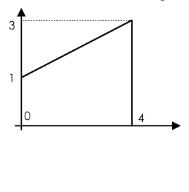

### nº99

Calcular las siguientes integrales curvilíneas sobre tres trayectorias
diferentes (C₁, C₂, C₃). Determinar como son las funciones respecto a las
distintas trayectorias.

a) $`\int_C[(x^2+y)\,dx+(2x-y^2)\,dy]`$; $`C_1=\{y=x^2;0\le x\le1\}`$;
$`C_2=\{y^2=x;0\le x\le1\}`$; $`C_3=\{y=x;0\le x\le1\}`$

b) $`\int_C[2xy^3\,dx+(3x^2y^2-2)\,dy]`$; $`C_1=\{y=x;0\le x\le1\}`$;
$`C_2=\{y=x^{3/2};0\le x\le1\}`$; $`C_3=\{y=x^2;0\le x\le1\}`$

## PARTE Nº 6

Conceptos generales. Orden de una ecuación diferencial. Solución general y
particular. Condiciones iniciales. Ecuación con variables separables. Funciones
homogéneas. Ecuaciones lineales. Ecuación de Bernoulli. Ecuación diferencial
exacta. Factores integrantes. Ecuaciones diferenciales totales. Trayectorias
ortogonales. Aplicaciones. Sistemas de ecuaciones diferenciales de primer orden.

Ecuaciones homogéneas de segundo orden. Soluciones particulares linealmente
independientes. Solución general. Constantes arbitrarias. Ecuación
característica de la ecuación diferencial, distintos casos. Ecuación completa:
solución particular y general. Método de Lagrange y Coeficientes Indeterminados.

### nº100

Resolver siguientes ecuaciones diferenciales con variables separables.

a) $y'/y-1/(x+2)=0$

b) $`4y\,dx-x(y-3)\,dy=0`$; pasa por (2,1)

c) $y'+2xy=0$

d) $2x\cdot y'=y$

e) $`(1+x^3)\,dy-x^2y\,dx=0`$

f) $y\cdot y'=(1-2x)/y$

g) $x\cdot y'+y=y^2$

h) $xy\cdot y'=1-x^2$

### nº101

Hallar la ecuación de la curva tal que la pendiente de la recta tangente en cada
punto es proporcional a la abcisa de dicho punto, y que pasa por el punto P(1,1)

### nº102

Resolver las siguientes ecuaciones diferenciales homogéneas.

a) $dy/dx=(x^2+y^2)/xy$

b) $`x^2\,dy-(y^2+2xy)\,dx=0`$; particularizar para x=1 e y=4

c) $`2xy\,dy-(x^2+y^2)\,dx=0`$

b) $y'=(x^3+y^3)/(3xy^2)$

e) $x^2\cdot y'=y^2-2x^2$

f) $`(3y^2+3xy+x^2)\,dx=(x^2+2xy)\,dy`$

g) $y'=(y^2-2xy-x^2)/(y^2+2xy-x^2)$; particularizar para x=1 e y=-1

h) $`x\,dy-y\,dx=(x^2-y^2)^{1/2}\,dx`$; para el punto x=1 e y=0

### nº103

Resolver las ecuaciones diferenciales lineales de 1º orden.

a) $y'+2y=x$

b) $`2y\mathop{\mathrm{sen}}\nolimits x\,dx=\cos x\,dy-2\,dx`$; para x=0 e y=3

### nº104

Resolver las ecuaciones diferencial total exacta.

a) $`(x^2-2y)\,dx+(y-2x)\,dy=0`$

b) $`(4x+1)\,dx-2y\,dy=0`$

c) $`(y-2x)\,dx+x\,dy=0`$

d) $`(-e^y\mathop{\mathrm{sen}}\nolimits x+3x^2)\,dx+(e^y\cos x-2y)\,dy=0`$

e) $`2xy^3\,dx+(3x^2y^2+2y)\,dy=0`$; para el punto (1,2)

### nº105

Resolver las siguientes ecuaciones diferenciales.

a) $y'+\mathop{\mathrm{sen}}\nolimits x(y-1)=0$

b) $x\cdot y'-e^{2x}+y=xy$

c) $(1+x^2)y'-2xy=(1+x^2)^2$

d) $x(y'-y)=(1+x^2)e^x$

e) $y'+y=\cos x$

f) $y'+(1-2x)y/x^2=1$

### nº106

Resolver las siguientes ecuaciones a coeficientes constantes de orden superior.

1. $y''+y'=0$

1. $y''+2y'-3y=0$

1. $(D^2+D-2)y=0$

1. $(D^3+2D^2-3D)y=0$

1. $y''+y=0$

1. $y''-2y'+2y=0$

1. $(D^2-4)y=e^x$

1. $y''-y=0$

1. $y''-2y'+y=2e^{2x}$

1. $(D^2+4)y=\cos x$

1. $y''+4y'+3y=1+5\cos x$

1. $(D^2-D)y=x^2$

1. $(D^2+1)y=\mathop{\mathrm{sen}}\nolimits x$

1. $(D^2+2D)y=3xe^x$

1. $d^2y/dx^2+9y=4x\mathop{\mathrm{sen}}\nolimits x$

1. $y''-y'=2e^{2x}\mathop{\mathrm{sen}}\nolimits x$

1. $y''+y'-2y=e^x+e^{2x}$

1. $y''-y=x^2+\cos(2x)$

1. $(D^2-4D-5)y=e^{2x}+4\mathop{\mathrm{sen}}\nolimits x$

1. $(D^2+1)y=e^{2x}+x^2$

1. $(D^2+2D)y=e^x+\cos(x)+x$

### nº107

Marcar con verdadero (V) o falso (F) las siguientes respuestas.

a) $y''+2y'-3y=0$; $r1=-3$, $r2=1$

- [ ] a) $y=e^{-3x}$
- [ ] b) $y=C1\cdot e^{-3x}$
- [ ] c) $y=e^{-3x}+e^x$
- [ ] d) $y=e^{-3x}(C1\cos x+C2\mathop{\mathrm{sen}}\nolimits x)$

b) $y''-2y'+2y=0$; $r=2\pm i$

- [ ] a) $y=e^x(\cos2x+\mathop{\mathrm{sen}}\nolimits 2x)$
- [ ] b) $y=e^{2x}(\cos x+\mathop{\mathrm{sen}}\nolimits x)$
- [ ] c) $y=e^{2x}(C1\cos x+C2\mathop{\mathrm{sen}}\nolimits x)$

c) $y''-2y'+y=2e^{2x}$; $r=1$

- [ ] a) $y=C1\cdot e^x+C2\cdot xe^x+2e^{2x}$
- [ ] b) $y=C1\cdot e^x+C2\cdot e^x+2e^{2x}$
- [ ] c) $y=C1\cdot e^x+C2\cdot xe^x+2xe^{2x}$
- [ ] d) $y=C1\cdot e^x+C2\cdot e^x+2x\cdot e^{2x}$

d) $y''+y=\cos x$; $r=\pm i$

- [ ] a) $y=C1\cos x+C2\mathop{\mathrm{sen}}\nolimits x+\cos x$
- [ ] b) $y=C1\cos x+C2\mathop{\mathrm{sen}}\nolimits x+x\cos x$

e) $y''-4y=e^x$; $r=\pm2$

- [ ] a) $y=C1\cdot e^{2x}+C2\cdot e^{-2x}+a\cdot e^x$
- [ ] b) $y=C1\cdot e^{2x}+C2\cdot e^{-2x}+x\cdot a\cdot e^x$
- [ ] c) $y=e^{2x}+C2\cdot e^{-2x}+a\cdot e^x$

### nº108

las constantes que se determinan en la solucion de una E. D., quedan definidas
por las condiciones de valor inicial y de frontera

Una partícula P se mueve a lo largo del eje x de modo que su aceleración en
cualquier tiempo t > [glifo no representado en la fuente] 0 esta dado por a = 16
– 24 t

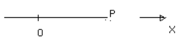

Encuentre la posición de la partícula, medida desde el origen en cualquier
tiempo $t>$ siendo su posición en t=0, x = 2 y su velocidad v = -5

Encuentre la posición de la partícula medida desde el origen en cualquier tiempo
t > 0 sabiendo que inicialmente la partícula esta ubicada en x = 2 y que cuando
t = 1 esta ubicada en x = 7

### nº109

Hallar la curva sobre el plano (x,y,O) de modo tal que su pendiente en cualquier
punto (x,y) sea igual a 2x Encontrar la ecuación de la curva que pasa por el
punto (2,5)

### nº110

Muestre que cada ecuación diferencial de la primer columna tiene como solución
la columna segunda, y obtenga las soluciones particulares que satisfagan las
condiciones de la tercer columna

| Ecuación | Solución | Condiciones |
| -- | -- | -- |
| $y''+y\tan x=0$ | $y=A\cos X$ | $y(\pi)=4$ |
| $y''-y=4x$ | $y=C_1e^x+C_2e^{-x}-4x$ | $y(0)=2$; $y'(0)=0$ |
| $x(y')^2+2yy'+xyy''=0$ | $xy^2=Ax+B$ | $y(3)=1$; $y(3)=2$ |

### nº111

Resuelva $xy'-3y=0$

Compare la solución encontrada con la función

$$
y(x)=\begin{cases}4x^3&\forall x>\text{[glifo no representado]}\,0\\0&\forall x<0\end{cases}
$$

Esta función es solución de la E.D.?

### nº112

Introducción teórica: Teorema de existencia y unicidad Dada una e. d. de primer
orden $y'=f(x,y)$

si f(x,y) es real, finita, siempre valorada y continua en todos los puntos de
una región r del plano xy y además se cumple:

$\frac{\partial f(x;y)}{\partial x}$ real, finita, siempre valorada y continua
en r

Entonces existe una y solo una solución y = g(x) en r, tal que $y=y_0$ en
$x=x_0$

Analice la condición establecida en el anterior teorema y de una explicación
sobre la solución propuesta en el problema nº 111

### nº113

Dada la ecuación diferencial lineal de primer orden

$$
y'+P(x)y=Q(x)
$$

Donde P(x) Y Q(x) son continuas en el intervalo [a,b] Aplique los conceptos del
teorema anterior para decidir si existe una única solución tal que $y=y_0$ para
$x=x_0$ con $x_0$ dentro del intervalo [a,b]

### nº114

Utilice el concepto de una diferencial exacta, para lograr una solución general
de la ecuación diferencial del problema anterior

### nº115

Resuelva

1. $xy'-y=2x^2y$

1. $I'+5I=10$ CON $I(0)=0$

1. $`2y\mathop{\mathrm{COS}}\nolimits x\,dx+3\mathop{\mathrm{SEN}}\nolimits x\,dy=0`$
   CON $y(\pi/2)=2$

### nº116

Una masa de 2 kg cae verticalmente hacia abajo, bajo la influencia de la
gravedad, partiendo del reposo. Asumiendo despreciable la resistencia del aire,
establecer la ecuación diferencial y las condiciones asociadas que describen el
problema, obteniendo la función que define su velocidad y su posición desde el
punto de arranque.-

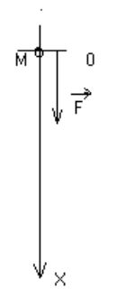

### nº117

Una masa de 2 kg se lanza hacia arriba con una velocidad de 40 m/s, sobre las
pautas establecidas en el problema anterior, indicar cual es su velocidad a los
2 s. Cual es la máxima altura que alcanza Cuanto tarda en regresar

### nº118

Un paracaidista cuyo peso combinado es de 100 kg, cae desde el reposo. El
paracaídas ya esta abierto cuando el salto se produce, y tiene una fuerza
actuando sobre él, debido a la resistencia del aire, proporcional en cualquier
instante a su velocidad. El paracaidista cae verticalmente Describir el
movimiento resultante, velocidad, posición.-

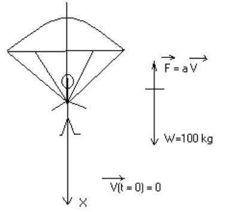

### nº119

Un tanque tiene 500 litros de una solución al 10% en volumen de alcohol, como
indica el grafico: En determinado instante se abren las válvulas v1 y v2, de
modo que por v1 ingresa una solución al 50% en

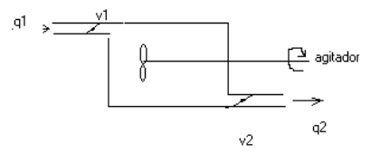

volumen a un caudal de 4 litros/minuto, mientras que por v2 sale la solución a
un caudal de 5 litros minuto El contenido del tanque esta siendo homogeneizado
continuamente mediante un adecuado sistema de agitación. ¿Cuántos litros de
alcohol hay dentro del tanque al cabo de 10 minutos?

### nº120

La fuerza de resistencia del agua que actúa sobre un bote es proporcional a su
velocidad instantánea y es tal que a 20 pies/seg la resistencia es de 40 lb El
bote y su conductor pesan 480 lb y el motor puede ejercer una fuerza estable de
50 lb Encontrar la máxima velocidad a la cual puede viajar el bote, suponiendo
que parte del reposo

### nº121

A- Un generador con una fem de 100 v se conecta en serie a una resistencia de 10
ohm y un inductor de 2 hy. La conexión se hace en tiempo t = 0 seg, establecer
la corriente al tiempo t

B- Igual al caso anterior pero el generador produce una fem igual a:

$$
v(t)=20\cos5t
$$

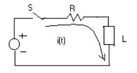

### nº122

Un tanque de 38 litros contiene 2,3 kg de sal disuelta. A través de las válvulas
a1 y a2 en determinado instante se hace entrar y salir solución salina al mismo
caudal de 7,6 litros / minutos

La solución entrante es de 0,36 kg de sal por litro

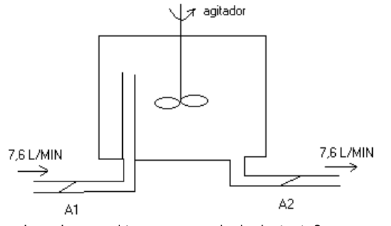

¿Cuál es la cantidad de sal que hay en el tanque en cualquier instante?

### nº123

1. $y'=(x-3y)/(2y-5x)$

1. $Y'=(X+1)/(2-Y)$ PARA LA CONDICION X = -3; Y = 4

1. $XY'-Y=2XY$

1. $Y'=-X/Y$ PARA X=1;Y=2

1. $I'+5I=10$ CON I(0)=0

1. $Y'=(X-Y)/(X+Y)$

1. $Y'=(Ye^{Y/X}+Y)/X$

1. $`(2X+1/X)\,dX-Y'=0`$

1. $`(2XY+3X^2)\,dX+X^2\,dY=0`$

1. $`(2Y+3X)\,dX+X\,dY=0`$

1. $Y'=(XY^2-1)/(1-X^2Y)$ PARA (X,Y)=(0,1)

1. $Y'=(3X+XY^2)/(Y+X^2Y)$ Y(1)=3

1. $dI/dt+10I/(2t+5)=10$ I(0)=0

1. $dI/dt+2I=10e^{-2t}$

1. $y''+4y'-5y=0$

1. $2y'''-5y''+2y'=0$

1. $y''=4y$

1. $y''-y=0$ PARA y(0)=2; y'(0)=-3

1. $y''-3y'+2y=0$ y(0)=-1; y'(0)=0

1. $y''-6y'+9y=0$

1. $y'''-6y''+12y'-8y=0$

1. $y''+y=0$

1. $y''+2y'+5y=0$

1. $y''+4y'+9y=x^2+3x$

1. $y''+4y=4e^{2x}$

1. $y''+4y'+4y=6\mathop{\mathrm{sen}}\nolimits (3x)$

1. $y''+y=f(x)$

$$
f(x)=\begin{cases}x,&0\le x\le\pi\\0,&x>\pi\end{cases}
$$

$y(0)=y'(0)=0$

$y(x),y'(x)$ son continuas en $x=\pi$

28. $d^2s/dt^2+ds/dt=t+e^{-t}$ con $ds/dt=s=0$, en t=0

### nº124

Una partícula se mueve sobre el eje x de manera que su velocidad es proporcional
al producto de su posición instantánea x y el tiempo t. Si la partícula está en
x = 54 cuando t = 0, y x = 36 cuando t = 1. ¿Dónde estará cuando t = 2?

### nº125

Calcular la corriente eléctrica en un circuito resistivo - inductivo, cuando se
aplica una bateria en el instante t=0.

$V=100\ \text{volt}$; $R=10\ \Omega$; $L=2\ \text{Hy}$.

### nº126

Calcular la corriente eléctrica en un circuito resistivo - capacitivo, cuando se
aplica una bateria en el instante t=0.

$V=100\ \text{volt}$; $R=20\ \Omega$; $C=0{,}01\ \text{F}$.

### nº127

Una masa m pende de un hilo inextensible, de largo l y masa despreciable. el
sistema esta libre de moverse en un plano vertical, encontrar el periodo de la
vibración.

### nº128

Obtener la corriente eléctrica a partir de que se cierra el contacto del
circuito que figura a continuación:

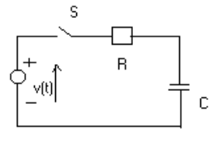

Tensión de la fuente de alimentación:

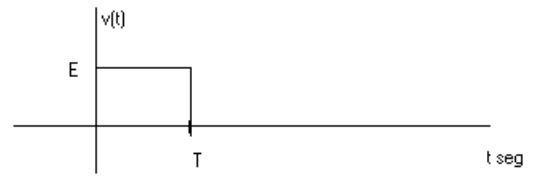

### nº129

Estudios biológicos demuestran que un órgano de volumen v (cm³) una determinada
droga puede ingresar transportada por un solvente, a una tasa a(Cm³/seg) y salir
a b(Cm³/seg).

Si la concentración de ingreso se ajusta a la siguiente relación

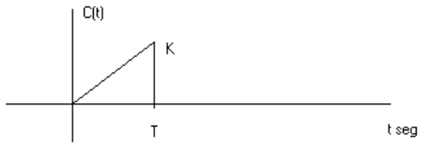

Asumiendo que en t=0 la concentración es nula, ¿Cuál es la concentración de la
droga dentro del órgano en cualquier instante?

### nº130

El incremento de masa corporal es proporcional a las calorías diarias que se
toman, y al consumo de tales que se hacen.

Si el consumo es aproximadamente igual a 40 cal/dia/kg por cada kg de masa
corporal de acuerdo a una actividad normal, entonces para que pierda masa
corporal, debe consumir menos energía, manteniendo su nivel de actividad
constante.

Sobre estas condiciones proponga un modelo de variación de masa corporal en
función de las calorías que toma una persona de 80kg y que comienza una dieta de
2500 diarias y calcule cuanto tiempo tardara en perder 5kg.

¿Si se mantuviesen estas condiciones de dieta, y actividad, cual seria el peso
limite de esa persona?

## Parte 7 — Series de Fourier

Series de Fourier. Determinación de los coeficientes para una función del
período $2\pi$. Generalización para un período distinto. Desarrollo de Fourier
para funciones pares e impares. Convergencia para la serie de Fourier.

### nº131

Desarrollar en series de Fourier las siguientes funciones periódicas de periodo
$2\pi$.

1. $`f(x)=\begin{cases}-1,&-\pi<x<0\\1,&0<x<\pi\end{cases}`$; $f(x)=f(x+2\pi)$.

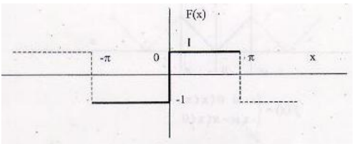

2. $`f(x)=\begin{cases}2,&-\pi/2<x<\pi/2\\0,&-\pi<x<-\pi/2\ \text{o}\ \pi/2<x<\pi\end{cases}`$;
   período $2\pi$.

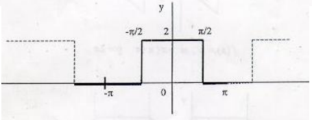

3. $`f(x)=\begin{cases}0,&-\pi<x<0\\3,&0<x<\pi\end{cases}`$; período $2\pi$.

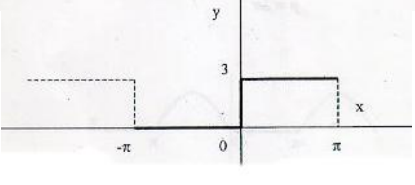

4. $`f(x)=\begin{cases}x,&0<x<\pi\\-x,&-\pi<x<0\end{cases}`$; período $2\pi$.

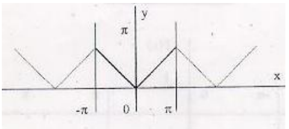

5. $f(x)=x$, $-\pi<x<\pi$; período $2\pi$.

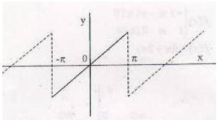

6. $`f(x)=\begin{cases}x,&0<x<\pi\\\pi,&-\pi<x<0\end{cases}`$; período $2\pi$.

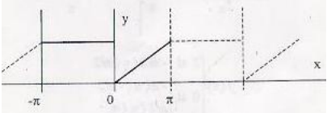

7. $`f(x)=\begin{cases}0,&-\pi<x<0\\\mathop{\mathrm{sen}}\nolimits x,&0<x<\pi\end{cases}`$;
   período $2\pi$.

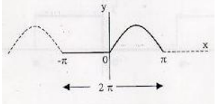

8. $f(x)=x^2$, $-\pi<x<\pi$; período $2\pi$.

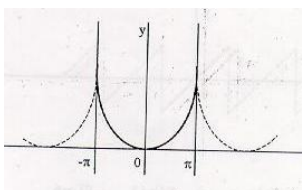

9. $f(x)=e^x$, $-\pi<x<\pi$; período $2\pi$.

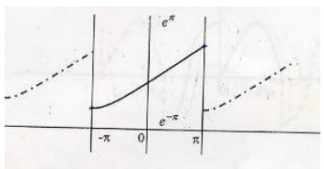

10. $`f(x)=\begin{cases}0,&-\pi<x<0\\x^2,&0<x<\pi\end{cases}`$; período $2\pi$.

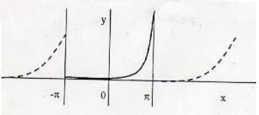

### nº132

Desarrollar en series de Fourier las siguientes funciones periódicas de periodo
$2L\ne2\pi$.

1. $`f(x)=\begin{cases}0,&-2<x<0\\x,&0<x<2\end{cases}`$; período $2L=4$.

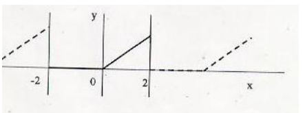

2. $f(x)=-x$, $-3<x<3$; período $2L=6$.

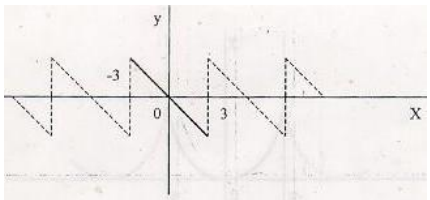

3. $`f(x)=\begin{cases}-\mathop{\mathrm{sen}}\nolimits 4x,&-\pi/4<x<0\\\cos4x,&0<x<\pi/4\end{cases}`$;
   período $2L=\pi/2$.

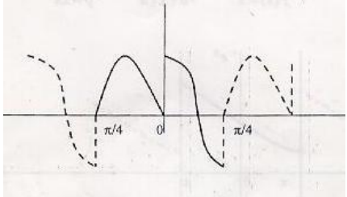

### Desarrollo en Mathcad (página 30)

$$
f(x):=x
$$

$$
a_0(x):=\frac1\pi\int_{-\pi}^{\pi}f(x)\,dx\ \longrightarrow\ 0
$$

$$
a(x,k):=\frac1\pi\int_{-\pi}^{\pi}\bigl(f(x)\cos(kx)\bigr)\,dx\ \longrightarrow\ 0
$$

$$
b(x,k):=\frac1\pi\left[\int_{-\pi}^{\pi}\bigl(f(x)\sin(kx)\bigr)\,dx\right]
\ \longrightarrow\ -\frac2\pi\frac{-\sin(\pi k)+\pi k\cos(\pi k)}{k^2}
$$

$$
j(x):=\frac{a_0(x)}2+\sum_{k=1}^{3}\bigl(a(x,k)\cos(kx)+b(x,k)\sin(kx)\bigr)
\ \longrightarrow\ 2\sin x-\sin(2x)+\frac23\sin(3x)
$$

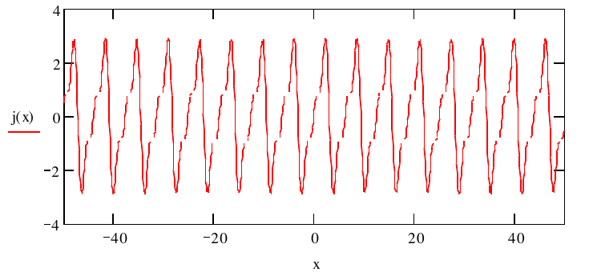

## Parte 8 — Ecuaciones Diferenciales con Derivadas Parciales

Noción de algunos tipos de ecuaciones diferenciales de segundo orden de
coeficientes constantes. Conceptos básicos. Resolución de casos sencillos de
ecuaciones de Laplace. Problemas de contorno. Aplicaciones. Ecuaciones del calor
y de las ondas.

### nº133

Resolver los siguientes problemas de ecuaciones en derivadas parciales

| Ecuación | Condición |
| -- | -- |
| $\dfrac{\partial u}{\partial x}+3\dfrac{\partial u}{\partial y}=0$ | $u(0,y)=4e^{-2y}+3e^{-6y}$ |
| $\dfrac{\partial u}{\partial x}+\dfrac{\partial u}{\partial y}=0$ | $u(0,y)=2e^{-y}+3e^{-2y}$ |
| $\dfrac{\partial u}{\partial x}+u=\dfrac{\partial u}{\partial y}$ | $u(x,0)=4e^{-3x}$ |
| $4\dfrac{\partial y}{\partial t}+\dfrac{\partial y}{\partial x}=3y$ | $y(x,0)=4e^{-x}-e^{-5x}$ |

## Observaciones de transcripción

Se conservaron la numeración, las repeticiones de incisos, las condiciones y las
expresiones del original, incluso cuando resultan anómalas. Por ejemplo: el
inciso repetido de nº3 y nº102, la condición con `p` de nº59, las dos
condiciones `y(3)` de nº110 y la derivada respecto de $x$ de nº112. No se
resolvieron los ejercicios.

En nº108 y nº111 hay glifos ausentes en la propia representación PDF; se señalan
como `[glifo no representado en la fuente]` sin reconstruirlos por conjetura.
Las figuras y las salidas de Mathcad se compararon con las páginas originales.
