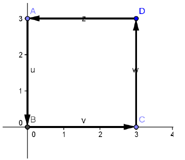

# Integrales de línea

Fuente: `Integrales de línea.pdf`, páginas 1–3.
[Procedencia](../../../resources/2016/fuentes.md).

1. Definir la integral de línea de una función $f$ a lo largo de una curva suave
   $C$ en el plano y en el espacio. ¿Cómo se evalúa la integral de línea como
   integral definida?
1. Definir una integral de línea de un campo vectorial continuo $F$ sobre una
   curva suave $C$. ¿Cómo se evalúa la integral de línea como integral definida?

<!-- El original reinicia la numeración. -->

1. Hallar una parametrización suave a trozos de la trayectoria $C$.

   a. $x^2+y^2=9$

   b. $\frac{x^2}{16}+\frac{y^2}{9}=1$

   c. $x^2+y^2=9$

   d.
   

1. Evaluar la integral de línea a lo largo de la trayectoria dada:

   a. $`\int_C\int(x-y)\,ds`$; $C:\vec r(t)=4t\vec i+3t\vec j$, $0\le t\le2$

   b. $`\int_C\int(x^2+y^2+z^2)\,ds`$;
   $C:\vec r(t)=\mathop{\mathrm{sen}}\nolimits t\vec i+\cos t\vec j+8t\vec k$,
   $0\le t\le2$

1. *Masa:* Hallar la masa total de dos vueltas de un resorte de densidad $\rho$
   y que tiene forma de hélice circular.
   $r(t)=3\cos t\vec i+3\mathop{\mathrm{sen}}\nolimits t\vec j+2t\vec k$ donde
   $\rho(x,y,z)=z$

1. Hallar el trabajo realizado por el campo de fuerzas $F(x,y)=2xi+yj$ sobre una
   partícula que se mueve a lo largo del triángulo de vértices $(0,0)$; $(1,0)$
   y $(1,1)$ en sentido positivo.

1. Calcular el trabajo realizado por el campo de fuerzas
   $\vec F(x,y)=\frac12xy\vec i+\frac14x^2\vec j$ sobre una partícula que se
   mueve desde el punto $(0,0)$ hasta el punto $(1,1)$ a lo largo de $C_1:y=x^2$

## Campos vectoriales conservativos

1. Enuncie el teorema fundamental de las integrales de línea
1. ¿Qué significa que la integral de línea sea independiente de la trayectoria?
   Enunciar el método para determinar si una integral de línea es independiente
   de la trayectoria.

<!-- El original reinicia la numeración. -->

1. Para el campo de fuerzas dado por
   $\vec F(x,y,z)=e^x\cos y\vec i-e^x\mathop{\mathrm{sen}}\nolimits y\vec j+2\vec k$
   mostrar que $\int_C\vec F\cdot d\vec r$ es independiente de la trayectoria y
   calcular el trabajo realizado por $F$ sobre un objeto que se mueve a lo largo
   de la curva $C$ desde $(0,\pi/2,1)$ hasta $(1,\pi,3)$.

1. Sea $\vec F(x,y)=\frac{y}{x^2+y^2}\vec i-\frac{x}{x^2+y^2}\vec j$

   a. Mostrar que $\frac{\partial N}{\partial x}=\frac{\partial M}{\partial y}$

   b. Si $\vec r(t)=\cos t\vec i+\mathop{\mathrm{sen}}\nolimits t\vec j$ para
   $0\le t\le\pi$ hallar $\int_C\vec F\cdot d\vec r$

   c. Si $\vec r(t)=\cos t\vec i-\mathop{\mathrm{sen}}\nolimits t\vec j$ para
   $0\le t\le\pi$ hallar $\int_C\vec F\cdot d\vec r$

   d. Si $\vec r(t)=\cos t\vec i+\mathop{\mathrm{sen}}\nolimits t\vec j$ para
   $0\le t\le2\pi$ hallar $\int_C\vec F\cdot d\vec r$

   e. Mostrar que
   $\nabla\left(\mathop{\mathrm{arctg}}\nolimits \frac{x}{y}\right)=\vec F$

## Teorema de Green

Sea $R$ una región simplemente conexa cuya frontera es una curva $C$ suave a
trozos, orientada en sentido contrario a las agujas del reloj. Si $M$ y $N$
tienen derivadas parciales continuas en una región abierta que contiene a $R$,
entonces

$$
\int_C Mdx+Ndy=\iint_R\left(\frac{\partial N}{\partial x}-\frac{\partial M}{\partial y}\right)dA
$$

1. Sea $R$ la región interior a $(x^2/9)+(y^2/4)=1$ y exterior a $x^2+y^2=1$;
   evaluar la integral $`\oint 2xy\,dx+(x^2+2x)\,dy`$ aplicando el teorema de
   Green

1. Comprobar el teorema de Green evaluando ambas integrales
   $\int_C y^2dx+x^2dy=\iint_R\left(\frac{\partial N}{\partial x}-\frac{\partial M}{\partial y}\right)dA$
   sobre la trayectoria dada

   a) $C$: cuadrado cuyos vértices son $(0,0),(4,0),(4,4),(0,4)$

   b) $C$: frontera de la región comprendida entre las gráficas de $y=x$ e
   $y=\frac{x^2}{4}$

   c) $C$: círculo dado por $x^2+y^2=1$

1. Estando sometida a la fuerza $\vec F(x,y)=y^3\vec i+(x^3+3xy^2)\vec j$ una
   partícula recorre una vez el círculo de radio 3, centrado en el origen.
   Calcule el trabajo realizado por $F$ aplicando el teorema de Green.

1. Calcule el área de la elipse $\frac{x^2}{a^2}+\frac{y^2}{b^2}=1$

1. Calcule el área de la región encerrada por las curvas aplicando el T. de
   Green: $y=x^2-4$ y el arco superior de $x^2+y^2=4$

1. Calcule el área de la región encerrada por las curvas aplicando el T. de
   Green: $y=x^2-4$ y el arco superior de $x^2+y^2=4$

***Para pensar:*** Sea $I=\int_C\frac{ydx-xdy}{x^2+y^2}$ donde $C$ es un círculo
orientado en sentido positivo, mostrar que $I=0$ si $C$ no contiene al origen.
¿Cuál es el valor de $I$ si $C$ contiene al origen?

Nota de transcripción: se conservan los dos signos de integral impresos en 2.a y
2.b de la primera página y la repetición de Green 5 y 6.
