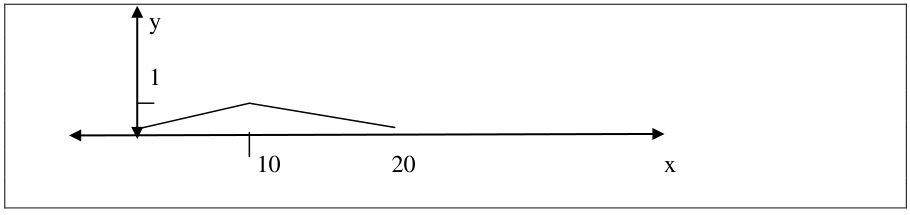
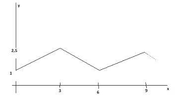
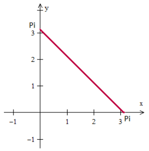

<!-- markdownlint-disable MD026 -->

# Práctico Series de Fourier

Fuente: `Series de Fourier- Práctica.pdf`, páginas 1–3.
[Procedencia y revisión](../../../resources/2016/resume-misc-cobertura.md).

## Página 1

1. Sean $f(x)$ y $g(x)$ dos funciones pares demuestre que:

   a. La función $U(x)=f(x)+g(x)$ es una función par.

   b. La función $U(x)=f(x)*g(x)$ es una función par.

   c. La función $U(x)=f(x)/g(x)$ es una función par.

1. Sean $f(x)$ y $g(x)$ dos funciones impares demuestre que:

   a. La función $U(x)=f(x)+g(x)$ es una función impar.

   b. La función $U(x)=f(x)*g(x)$ es una función par.

   c. La función $U(x)=f(x)/g(x)$ es una función par.

1. Verifique que:

   a. $`\int_{-\pi}^{\pi}\cos nx\,dx=0`$

   b. $`\int_{-\pi}^{\pi}\mathop{\mathrm{sen}}\nolimits nx\,dx=0`$

   c. $`\int_{-\pi}^{\pi}\mathop{\mathrm{sen}}\nolimits (mx)\cos(nx)\,dx=0`$

   d.
   $`\int_{-\pi}^{\pi}\mathop{\mathrm{sen}}\nolimits (mx)\mathop{\mathrm{sen}}\nolimits (nx)\,dx=0`$
   si $m\ne n$

   e.
   $`\int_{-\pi}^{\pi}\mathop{\mathrm{sen}}\nolimits (mx)\mathop{\mathrm{sen}}\nolimits (nx)\,dx=\pi`$
   si $m=n$

   f. $`\int_{-\pi}^{\pi}\cos(mx)\cos(nx)\,dx=0`$ si $m\ne n$

   g. $`\int_{-\pi}^{\pi}\cos(mx)\cos(nx)\,dx=\pi`$ si $m=n$

1. Desarrolle en series de Fourier la función

   $$
   f(x)=\begin{cases}
   2&\text{si }-\frac{\pi}{2}<x<\frac{\pi}{2}\\
   0&\text{si }-\pi<x<-\frac{\pi}{2}\ \text{o}\ \frac{\pi}{2}<x<\pi
   \end{cases}
   $$

1. Sea la función periódica del gráfico

   

   Indique porqué la serie de Fourier contiene términos únicamente en coseno.
   Indique como obtiene los coeficientes, calcule los primeros.

### 3.- Desarrollo de Fourier de los primeros sumandos de

## Página 2

### 4.-

Sea la función periódica $f(x)=x$, $-\pi<x<\pi$ cuyo período es $2\pi$ y su
desarrollo de Fourier

$$
f(x)=2\left(\frac{\sin x}{1}-\frac{\sin 2x}{2}+\frac{\sin 3x}{3}-\cdots\right),
$$

según los datos dados, obtenga el desarrollo de la función periódica $f(x)=x+3$,
$-0.5<x<0.5$, de período 1.

### 5.- Desarrollar en serie de Fourier la Función:

$$
f(x)=\begin{cases}
\frac12x+1&\text{si }-2\le x<0\\
0&\text{si }0<x\le6
\end{cases}
\qquad\text{de período }8
$$

### 6.-

Encontrar la serie de cosenos para la función $f(x)=1$, si $0\le x\le2$.

### 7.- Dada la siguiente función:

a) Grafique la función utilizando el programa WinPlot (es gratuito y puede
bajarlo desde <http://math.exeter.edu/rparris/winplot.html>)- Es libre de usar
otra herramienta si lo desea.

b) Encuentre las expresiones de las series COSENO y SENO de Fourier para
extensiones periódicas PAR e IMPAR de la función respectivamente. Grafique por
separado cada una para $n=2$ y compárelas con la función original.

c) Realice la extensión periódica de la función original (de período $\pi$) y
grafíquela. Encuentre la serie de Fourier de la misma y grafíquela para $n=3$.

## Página 3

d) Calcule la serie de Fourier para una función de igual período y pendiente,
con componente constante nula y centrada en el origen. Una vez encontrada la
serie de Fourier para esta nueva función grafíquela y luego adáptela para que
converja a la función original (modificando su componente constante y la fase de
sus componentes sinusoidales). Grafique la serie para $n=3$ después de la
adaptación.

e) Observando todo lo anterior saque sus conclusiones acerca de los distintos
medios para la obtención de una serie y como son sus convergencias dentro y
fuera del intervalo en cuestión.

### 8.-

Siendo

$$
f(x)=\begin{cases}
x+\frac\pi2&-\pi<x<0\\
-x+\frac\pi2&0<x<\pi
\end{cases}
\quad\text{con } f(x)=f(x+2\pi),
$$

expresable como

$$
f(x)=\frac1\pi\left(\cos x+\frac1{3^2}\cos3x+\frac1{5^2}\cos5x+\cdots\right).
$$

Si considera necesario puede utilizar los datos dados para expresar el
desarrollo de

$$
h(t)=\begin{cases}
t+1&-1<t<0\\
-t+1&0<t<1
\end{cases}
\quad\text{con }h(t+2)=h(t).
$$

Describa los aspectos teóricos básicos necesarios para obtener el desarrollo de
Fourier del ejemplo dado.

> Nota de transcripción: se conserva el reinicio de numeración después del
> ejercicio 5 de la primera página. Se conserva el coeficiente $1/\pi$ del
> ejercicio 8 tal como está impreso; no se ha corregido ni resuelto ningún
> ejercicio.
