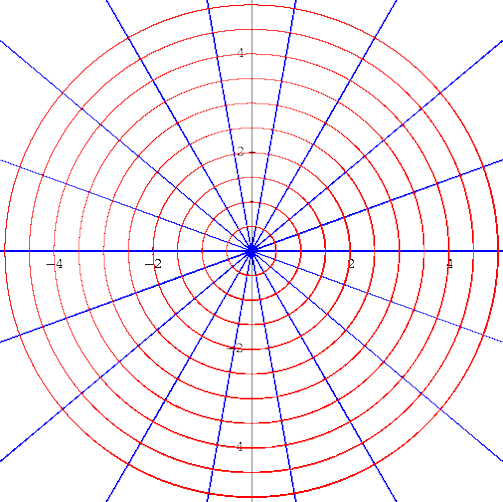

# Ecuaciones diferenciales

Fuente: «Teórico Ecuaciones diferenciales.pdf», archivo de 2016, 14 páginas.
Autor y año de edición no indicados.
[Procedencia y revisión](../../../resources/2016/apuntes-teoricos-cobertura.md).

## Página 1

Se denomina “Ecuación Diferencial” a toda ecuación en la que aparecen una o
varias derivadas de una función.

### Clasificación

A las ecuaciones diferenciales podemos clasificarlas en dos grandes grupos. Las
ecuaciones diferenciales ORDINARIAS son aquellas que contienen diferenciales o
derivadas totales y las ecuaciones diferenciales en DERIVADAS PARCIALES cuando
contienen derivadas parciales.

El **orden** de una ecuación diferencial lo da la derivada de mayor orden que
interviene en la misma.

El **grado** de una ecuación diferencial ordinaria algebraica, respecto de sus n
derivadas, es el grado algebraico de su derivada de mayor orden.

Ejemplos:

1. $`x^2\frac{d^2y}{dx^2}+2x\frac{dy}{dx}+y=x^2+2`$ (ordinaria de 2° orden, 1er
   grado)
1. $`\left(\frac{d^3y}{dx^3}\right)^2+2\frac{d^2y}{dx^2}\cdot\frac{dy}{dx}+x\left(\frac{dy}{dx}\right)^3=0`$
   (ordinaria de 3er orden, 2do grado)
1. $`(x+y^2-3xy)+(x^2+3x+2)\frac{dy}{dx}=0`$ (ordinaria de 1er orden, 1er grado)
1. $`\frac{\partial y}{\partial x}=y`$ (en derivadas parciales, 1er grado)

Una **solución** de una ecuación diferencial ordinaria de dos variables es una
relación sin derivadas entre las variables, que satisface la ecuación.

Si en particular la solución tiene la forma $`y=f(x)`$, al sustituir “y” y las
derivadas de “y” con respecto a x, por $`f(x)`$ y sus derivadas sucesivas
$`f'(x),f''(x)\ldots f(x)^n`$ se obtiene una identidad.

Así decimos que $`y=c\cdot x^2`$ es solución de $`2y=x\cdot\frac{dy}{dx}`$, pues
sustituyendo $`c\cdot x^2`$ por **y** y $`2cx`$ por la $`\frac{dy}{dx}`$ se
obtiene

```math
x\cdot2cx=2cx^2
```

### Consideraciones geométricas

Toda ecuación diferencial de primer orden y primer grado se puede escribir de la
forma:

```math
\frac{dy}{dx}=f(x,y)
```

## Página 2

expresión que hace corresponder a cada punto $`P(x_0,y_0)`$ una línea de
pendiente $`\left(\frac{dy}{dx}\right)_P=f(x_0,y_0)`$ es decir, la relación que
asocia a cada punto una dirección. Cada punto de la curva $`f(x,y)=m`$ está
asociado con la pendiente $`m`$. Las curvas se denominan “isoclinas”.

**Ejemplo:** $`\frac{dy}{dx}=-\frac{x}{2y}`$ las isóclinas se definen por:

```math
-\frac{x}{2y}=m,\quad\text{o bien}\quad x=-2my
```

Que representa todas las líneas rectas que pasan por (0,0).

Así, para m=0, cada punto de x=-2.0.y=0, tiene 0 como pendiente.

Para m=1, cada punto de x=-2.1.y=-2y, tiene 1 como pendiente.

Nótese que un conjunto de puntos asociados en la misma dirección están sobre una
línea que pasa por el origen.

### Obtención de la ecuación diferencial a partir de la solución general

Para resolver este problema inverso, derívese la solución general, derívese la
ecuación de la derivada primera, derívese la ecuación de la derivada segunda,
etc, hasta que el número de ecuaciones derivadas sea igual al número de
constantes arbitrarias independientes en la solución general. Finalmente,
elimínense las constantes entre la solución general y las ecuaciones derivadas.

**Ejemplos:**

**1)** Hállese la ecuación diferencial cuya solución es:
$`y=C\cdot\mathop{\mathrm{sen}}\nolimits 4x`$

```math
y=C\cdot\mathop{\mathrm{sen}}\nolimits 4x\qquad \frac{dy}{dx}=4C\cdot\cos4x=y'
```

```math
\left.\begin{aligned}
y=C\cdot\mathop{\mathrm{sen}}\nolimits 4x&\Rightarrow C=\frac{y}{\mathop{\mathrm{sen}}\nolimits 4x}\\
y'=4C\cdot\cos4x&\Rightarrow C=\frac{y'}{\cos4x}
\end{aligned}\right\}\quad
\frac{y}{\mathop{\mathrm{sen}}\nolimits 4x}=\frac{y'}{4\cos4x}
```

o también $`4y\cos4x-\frac{dy}{dx}\mathop{\mathrm{sen}}\nolimits 4x=0`$.

**2)** Encontrar la ecuación diferencial de todas las circunferencias con centro
en (0,0).

$`x^2+y^2=r^2\;\therefore\;x^2=r^2-y^2`$ derivamos la solución general y
obtenemos:

$`2x=-2y\cdot y'`$ ya que $`y=f(x)`$ por lo tanto $`x=-y\cdot y'`$ o bien
$`x-y\cdot y'=0`$.

## Página 3

### Trayectorias ortogononales

Dos curvas son ortogonales en un punto que pertenece a ambas si y solo si las
rectas tangentes a cada una de las curvas en un punto son perpendiculares.

Si una curva es ortogonal a cada curva de una familia, se dice que es una
trayectoria ortogonal de la familia.

Si dos familias de curvas del mismo plano son tales que cada una de ellas es
ortogonal a la otra familia, decimos que ambas familias son ortogonales entre
si.

Por ejemplo, las familias del gráfico son ortogonales, la familia de círculos
centrados en el origen y el haz de rectas que pasa por el (0,0).



En muchas aplicaciones, sobre todo geométricas y físicas, interesa encontrar las
trayectorias ortogonales a una familia de curvas dada. Por ejemplo, en el campo
electrostático las líneas de fuerza y las equipotenciales son trayectorias
ortogonales. Lo mismo sucede en teoría del calor con las líneas isotermas y las
de flujo calórico.

**¿Cómo encontrar una familia de curvas ortogonales a una dada?**

Vamos a buscar una familia de curvas ortogonales a la familia de rectas de
ecuación $`y=cx`$.

Según la definición de familias ortogonales, cada curva de una de ellas debe
tener tangentes perpendiculares a las de la otra, es decir, las pendientes de
las rectas tangentes de la primer familia serán opuestas e inversas a las de la
otra.

## Página 4

Por otro lado sabemos que la pendiente de la recta tangente a una curva que es
gráfica de una función y=f(x), es la derivada de dicha función. Es decir,
$`\frac{dy}{dx}=m`$, siendo m la pendiente de las rectas tangentes a la gráfica
de y=f(x).

Volviendo a nuestro problema y teniendo en cuenta que el problema de las
pendientes plantea una ecuación diferencial. $`\frac{dy}{dx}=m`$ podemos
concluir que la segunda familia de curvas tendrá la pendiente opuesta e inversa
a m. Entonces quedaría: $`\frac{dy}{dx}=-\frac1m`$ que sería la ecuación
diferencial asociada a la segunda familia de curvas.

Por lo tanto si resuelvo esta ecuación tendré la expresión de la segunda familia
de curvas.

**1)** Hallamos la ecuación diferencial asociada a la familia dada:

```math
y=cx\Rightarrow y'=c
```

eliminamos la constante c tratando a

```math
\begin{cases}y=cx\\y'=c\end{cases}
\quad\text{como un sistema de ecuaciones}\quad
\begin{cases}c=\frac yx\\c=y'\end{cases}\Rightarrow\frac yx=y'
```

**2)** Como dijimos y'=m, con lo cual la segunda familia tendrá su pendiente
$`m_1-\frac1{y'}`$, es decir:

```math
\frac yx=-\frac1{y'}
```

**3)** Finalmente, nos queda resolver la ecuación anterior para saber qué
familia de curvas está asociada a ella, o bien, qué familia de curvas la
satisface.

```math
\frac yx=-\frac1{y'}\Rightarrow yy'=-x\Rightarrow y\frac{dy}{dx}=-x
```

$`y\,dy=-x\,dx`$, integrando ambos miembros se obtiene $`y^2+x^2=k`$.

Como vemos en el gráfico anterior, las familias $`y=cx`$ y $`y^2+x^2=k`$ tiene
trayectorias ortogonales.

## Página 5

### Ecuaciones Diferenciales de 1er Orden

#### Ecuaciones Diferenciales con VARIABLES SEPARABLES

Se llama así a toda ecuación diferencial de la forma

```math
M\,dx+N\,dy=0
```

en la que los coeficientes M y N son funciones de una sola variable o a lo sumo
están formados por los productos de factores que contienen, cada uno de ellos,
una sola variable. Toda ecuación de este tipo puede llevarse a la forma

```math
f_{1(x)}\,dx+f_{2(x)}\,dy=0
```

cuya solución es $`\int f_{1(x)}\,dx+\int f_{2(x)}\,dy=0`$.

**Ejemplos:**

**1)** Resolver la ecuación $`(1+x^2)dy-xy\,dx=0`$. separando las variables
tendremos: $`\frac{dy}{y}-\frac{x}{1+x^2}dx=0`$, cuya solución es integrando la
igualdad

```math
\int\frac{dy}{y}-\int\frac{x}{1+x^2}dx=C
\Rightarrow\ln y-\frac12\ln(1+x^2)=\ln C
```

```math
\ln y=\ln C+\ln\sqrt{1+x^2}=\ln C\cdot\sqrt{1+x^2}
```

```math
y=C\cdot\sqrt{1+x^2}
```

**2)** Hallar las ecuaciones de las curvas tales que los segmentos de cada recta
tangente comprendidos entre los ejes coordenados queden divididos en 2 partes
iguales por el punto de tangencia.

Sea P(x,y), un punto de tangencia y $`\overline{MN}`$ la tangente a la curva en
el punto $`P`$, $`P\in\overline{MN}\;\wedge\;\overline{NP}=\overline{PM}`$, si
$`\overline{NP}=\overline{PM}\Rightarrow\overline{OP'}=\overline{P'M}=x`$
$`\therefore\overline{NP''}=\overline{P''O}=y`$, se deduce entonces que:
$`\overline{OM}=2x\;\wedge\;\overline{ON}=2y`$.

```math
\frac{dy}{dx}=-\frac{\overline{ON}}{\overline{ON}}=-\frac{2y}{2x}=-\frac yx
```

Por lo tanto si $`\frac{dy}{dx}=-\frac yx`$ será entonces:

## Página 6

$`x\cdot dy+y\cdot dx=0\Rightarrow\frac{dx}{x}+\frac{dy}{y}=0`$ integrando
tenemos

```math
\ln x+\ln y=\ln C\;\therefore\;\ln(x\cdot y)=\ln C\Rightarrow x\cdot y=C
```

que es la ecuación de la familia de curvas buscadas.

### Funciones homogéneas

Diremos que una función f(x,y) es homogénea de grado K si y solo si:

```math
f(tx,ty)=t^K\cdot f(x,y)
```

esta definición se generaliza para el caso de más variables independientes.

**Ejemplo:**

Sea $`f(x,y)=2\cdot y^3\cdot e^{y/x}-\frac{x^4}{x+3y}`$ será entonces que

```math
\begin{aligned}
f(tx,ty)&=2\cdot(ty)^3\cdot e^{\frac{yt}{xt}}-\frac{(tx)^4}{xt+3(yt)}\\
&=2\cdot t^3\cdot y^3\cdot e^{y/x}-\frac{t^4\cdot x^4}{t(x+3y)}\\
&=2\cdot t^3\cdot y^3\cdot e^{y/x}-\frac{t^3\cdot x^4}{x+3y}\\
&=t^3\left[2\cdot y^3\cdot e^{y/x}-\frac{x^4}{x+3y}\right]=t^3f(x,y)
\end{aligned}
```

Se trata entonces de una función homogénea de tercer grado ya que k=3.

#### Propiedades

1.- Si M(x,y) y N(x,y) son dos funciones homogéneas del mismo grado, entonces el
cociente $`\frac{M(x,y)}{N(x,y)}`$ resulta función homogénea de “grado cero”.

Demostración:

Supongamos que M(x,y) y N(x,y) son homogéneas de grado k, entonces se verificará

```math
\begin{cases}M(tx,ty)=t^k\cdot M(x,y)\\N(tx,ty)=t^k\cdot N(x,y)\end{cases}
```

el cociente será:

```math
\frac{M(tx,ty)}{N(tx,ty)}=\frac{t^kM(tx,ty)}{t^kN(tx,ty)}=t^0\cdot\frac{M(tx,ty)}{N(tx,ty)}
```

en este caso K=0.

## Página 7

2.- Si una función f(x,y) es homogénea de “grado cero” es función de (y/x). Si
f(x,y) es homogénea de “grado cero”

```math
f(x,y)=\vartheta(y/x)=\phi(x/y)
```

$`f(tx,ty)=t^0\cdot f(x,y)=f(x,y)`$ por ser $`t^0=1`$, el parámetro t puede
tomar cualquier valor inclusive t=1/x o t=1/y.

Supongamos que t=1/x

```math
f(tx,ty)=f\left(\frac1x\cdot x\cdot\frac yx\right)=f(1\cdot y/x)=\vartheta(y/x)
```

si t=1/y

```math
f(tx,ty)=f\left(\frac xy,\frac1y\cdot y\right)=f\left(\frac xy,1\right)=\phi(x/y)
```

### Ecuaciones Diferenciales con COEFICIENTES HOMOGÉNEOS

Sea la forma

```math
M(x,y)\cdot dx+N(x,y)\cdot dy=0
```

Donde M y N son funciones homogéneas del mismo grado k, también podemos
escribir:

```math
\frac{M(x,y)}{N(x,y)}dx+dy=0\quad\text{o bien}\quad
\frac{M(x,y)}{N(x,y)}+\frac{dy}{dx}=0
```

El cociente entre M y N es de “grado cero” y por lo tanto es función de y/x o
bien de x/y.

Supongamos $`f\left(1,\frac yx\right)+\frac{dy}{dx}=0`$, al valor de y/x lo
hacemos igual a v.

$`\frac yx=v\Rightarrow y=v\cdot x\;\therefore\;dy=v\cdot dx+x\cdot dv`$
reemplazando en la ecuación

```math
f(1,v)+\frac{v\cdot dx+x\cdot dv}{dx}=0
\Rightarrow f(1,v)+x\cdot\frac{dv}{dx}+v=0
```

que resulta una ecuación de variables separables:

```math
\frac{x}{dx}dv+v+\varphi(v)=0\Rightarrow\frac{dv}{v+\varphi(v)}+\frac{dx}{x}=0
```

## Página 8

Ejemplo: Sea $`(x^2-xy+y^2)dx-xy\cdot dy=0`$, hacemos $`\frac yx=u\;\therefore`$

```math
y=ux\Rightarrow dy=u\cdot dx+x\cdot du
```

reemplazamos

```math
[x^2-x\cdot u\cdot x+(u\cdot x)^2]\cdot dx-x\cdot u\cdot x(u\cdot dx+x\cdot du)=0
```

```math
x^2(1-u+u^2)dx-x^2(u^2dx+uxdu)=0
```

```math
(1-u+u^2)dx-(u^2dx+uxdu)=0
```

```math
(1-u)dx-uxdu=0\Rightarrow\frac{dx}{x}-\frac{u\,du}{1-u}=0
```

como $`\frac{u}{u-1}=1+\frac1{u-1}`$ quedaría

```math
\frac{dx}{x}+du+\frac{du}{u-1}=0\Rightarrow\ln x+u+\ln(u-1)=\ln C
```

pero $`u=\ln e^u`$ reemplazando tenemos:

```math
\ln x+\ln u^u+\ln(u-1)=\ln C
```

```math
e^ux(u-1)=C\;\therefore\;e^{y/x}\cdot x\left(\frac yx-1\right)=C
```

solución: $`e^{y/x}\cdot(y-x)=C`$.

### Ecuaciones Diferenciales Exactas

Una ecuación diferencial de la forma

```math
M\cdot dx+N\cdot dy=0\tag{1}
```

se llama ”exacta” cuando existe una función U, cuya diferencial total es el
primer miembro de la ecuación, es decir, se verifica que:

```math
dU=M\cdot dx+N\cdot dy
```

En este caso dU=0 y su solución será: U=C. Para que la ecuación (1) sea exacta
debe verificarse

```math
\frac{\partial M}{\partial x}=\frac{\partial N}{\partial x}\tag{2}
```

## Página 9

**Demostración:** Supongamos existe una función U(x,y) tal que $`dU=Mdx+Ndy`$.

Entonces $`\frac{\partial U}{\partial x}=M`$,
$`\frac{\partial U}{\partial y}=N`$ por consiguiente serán:
$`\frac{\partial^2U}{\partial y\partial x}=\frac{\partial M}{\partial y}`$;
$`\frac{\partial^2U}{\partial x\partial y}=\frac{\partial N}{\partial x}`$ y
como sabemos, se verificará que las derivadas
$`\frac{\partial^2U}{\partial y\partial x}=\frac{\partial^2U}{\partial x\partial y}`$
se deduce que $`\frac{\partial M}{\partial y}=\frac{\partial N}{\partial x}`$
con lo que queda demostrado. Es posible demostrar también que se verifica (2),
existe U tal que su diferencial es Mdx+Ndy (primer miembro de la ecuación
diferencial dada).

**Ejemplo:** Resolver la ecuación $`e^y dx+(xe^y-2y)dy=0`$ en este caso será:

```math
\frac{\partial M}{\partial y}=e^y;\quad
\frac{\partial N}{\partial x}=\frac{\partial(xe^y-2y)}{\partial x}=e^y
\;\therefore\;\frac{\partial M}{\partial y}=\frac{\partial N}{\partial x}
```

siendo iguales esas derivadas, la ecuación es exacta. Por consiguiente,
integrando M.dx obtenemos una primera expresión de "U":

$`U(x,y)=\int e^y dx=xe^y+C(y)`$ por lo tanto su diferencial será:

$`dU=e^y dx+(xe^y+C'(y))dy`$ donde C'(y) es la derivada de C(y). Si comparamos
esta ecuación con la dada vemos que C(y)= -2y.

por lo tanto $`C(y)=\int C'(y)dy=\int-2y\,dy=-y^2`$ Po lo cual la expresión
final será:

```math
U(x,y)=xe^y-y^2=C
```

**Ejemplo:** Resolver $`(x^2+y^2)dx+2xy\,dy=0`$ **(1)**

```math
\frac{\partial M}{\partial y}=\frac{\partial(x^2+y^2)}{\partial y}=2y
```

```math
\frac{\partial N}{\partial x}=\frac{\partial(2xy)}{\partial x}=2y
```

Verifica la condición
$`\frac{\partial M}{\partial y}=\frac{\partial N}{\partial x}`$ por lo que
podemos decir que la ecuación diferencial es exacta.

## Página 10

$`U(x,y)=\int Mdx=\int(x^2+y^2)dx=\frac{x^3}{3}+xy^2+C(y)`$

su diferencial total será:

$`dU=(x^2+y^2)dx+(2xy+C'(y))dy`$

comparando esta expresión con **(1)** surge que C'(y)=0 por lo que C(y) es una
constante.

La solución general de la ecuación es: $`\frac{x^3}{3}+xy^2=c`$.

### Ecuaciones diferenciales Lineales de 1er Orden

Son ecuaciones de la forma:

```math
dy+P(x)\cdot y\cdot dx=Q(x)dx
```

donde la variable "y" y el "dy" aparecen en términos distintos y con exponente
uno, en tanto los coeficientes P(x) y Q(x) son funciones de la variable x. Si se
tratata de una ecuación lineal en x, se escribiría:

```math
dx+P(y)\cdot x\cdot dy=Q(y)dy
```

"Toda ecuación diferencial lineal puede ser transformada en una ecuación
diferencial exacta multiplicando por el factor integrante $`e^{\int Pdx}`$"

**Demostración:** Sea la ecuación diferencial en y:

```math
dy+P(x)\cdot y\cdot dx=Q(x)dx
```

supongamos que F(x) es el factor integrante, entonces multiplicando a ambos
mimbros de la igualdad se obtiene

```math
F(x)dy+F(x)P(x)\cdot y\cdot dx=F(x)Q(x)dx
```

sacando dx como factor común e igualando a cero quedaría:

## Página 11

```math
F(x)dy+(F(x)P(x)\cdot y-F(x)Q(x))dx=0
```

como se ha supuesto que F(x) es el factor integrante, ésta última debe ser
exacta, por lo tanto:

```math
\frac{\partial F(x)}{\partial x}
=\frac{\partial(F(x)P(x)\cdot y-F(x)Q(x))}{\partial x}
```

analicemos ambos miembros.

```math
\frac{\partial F(x)}{\partial x}=F'(x)=\frac{dF}{dx}
\quad\text{por ser }F(x)\text{ función de }x\text{ únicamente.}
```

$`\frac{\partial(F(x)P(x)\cdot y-F(x)Q(x))}{\partial y}=F(x)\cdot P(x)`$ de modo
que

```math
\frac{dF}{dx}=F(x)\cdot P(x)\quad\text{o sea que}\quad
\frac{dF}{F(x)}=P(x)\,dx\Rightarrow\ln F(x)=\int P(x)dx
```

nos queda:

```math
F(x)=e^{\int P(x)dx}
```

Ahora bien, como hemos partido de la suposición dela existencia del factor
integrante F(x), debemos demostrar que efectivamente $`e^{\int P(x)dx}`$ es
factor integrante de la ecuación diferencial $`dy+P(x)\cdot y\cdot dx=Q(x)dx`$.

En efecto, si multiplicamos la ecuación por el factor integrante quedaría:

```math
e^{\int P(x)dx}dy+e^{\int P(x)dx}P(x)\cdot y\cdot dx=e^{\int P(x)dx}Q(x)dx
```

Observemos que el primer miembro de esta igualdad es la diferencial exacta de la
expresión $`y\cdot e^{\int P(x)dx}`$ y el segundo miembro es una función de una
sola variable en x, o sea:

```math
d[e^{\int P(x)dx}]=e^{\int P(x)dx}\cdot Q(x)\cdot dx
\Rightarrow y\cdot e^{\int P(x)dx}=\int e^{\int P(x)dx}\cdot Q(x)dx
```

## Página 12

Observando en esta solución que el primer miembro es el producto del factor
integrante por la variable "y", solo queda resolver la integral.

*Regla práctica para resolver una ecuación diferencial lineal de 1er orden:*

1. Llévese a la forma general $`dy+P(x)\cdot y\cdot dx=Q(x)dx`$
1. Calcúlese el factor integrante $`e^{\int P(x)dx}`$
1. Multiplíquese la ecuación lineal por el factor integrante
1. La solución de esta nueva ecuación exacta es:
   $`y\cdot e^{\int P(x)dx}=\int e^{\int P(x)dx}\cdot Q(x)dx`$

**Ejemplo:**

```math
2(y-4x^2)dx+xdy=0
```

$`2y\,dx-8x^2dx+xdy=0\Rightarrow`$ dividiendo por x tendremos:
$`dy+\frac2x\cdot y\cdot dx=8x\,dx`$

```math
P(x)=\frac2x;\qquad Q(X)=8x
```

Factor integrante:

```math
e^{\int\frac2x dx}=e^{2\ln x}=x^2
```

Multiplicando por $`x^2`$ ambos miembros de la ecuación:

```math
x^2dy+\frac2x\cdot x^2\cdot y\cdot dx=x^2 8x\,dx
\Rightarrow x^2dy+2x\cdot y\cdot dx=8x^3dx
```

sacando factor común $`x^2dy+(2x\cdot y-8x^3)dx=0`$

la solución de esta nueva ecuación será entonces:

```math
y\cdot x^2=\int x^2\cdot8x\,dx\;\therefore\;yx^2=2x^4+C\quad\text{o bien}
```

```math
2x^4-yx^2=C
```

### Ecuación diferencial de Bernoulli

Es una ecuación diferencial de la forma:

```math
\frac{dy}{dx}+P(x)y=Q(x)y^n
```

## Página 13

si dividimos ambos miembros por $`y^n`$ se obtiene:

```math
\frac1{y^n}\cdot\frac{dy}{dx}+P(x)\cdot\frac1{y^{n-1}}=Q(x)\tag{1}
```

igualdad fácilmente transformable en una ecuación lineal mediante la siguiente
sustitución

```math
u=\frac1{y^{n-1}}\Rightarrow\frac{du}{dx}=-(n-1)y^{-n}\cdot y'
=(1-n)\frac1{y^n}\cdot\frac{dy}{dx}
```

despejando:

```math
\frac1{(1-n)}\cdot\frac{du}{dx}=\frac1{y^n}\cdot\frac{dy}{dx}
```

reemplazamos ahora en la ecuación (1)

$`\frac1{(1-n)}\cdot\frac{du}{dx}+P(x)\cdot u=Q(x)`$ o sea, se tendrá la forma:

```math
\frac{du}{dx}+(1-n)P(x)\cdot u=(1-n)Q(x)
```

que es la forma de una ecuación lineal de fácil solución.

**Ejemplo:**

$`\frac{dy}{dx}+\frac1x\cdot y=x^3\cdot y^3`$ dividiendo por $`y^3`$ obtendremos
$`\frac1{y^3}\cdot\frac{dy}{dx}+\frac1x\cdot\frac1{y^2}=x^3`$.

hacemos $`u=\frac1{y^2}\Rightarrow\frac{du}{dx}=-2\frac1{y^3}\cdot\frac{dy}{dx}
\;\therefore\;\frac1{y^3}\frac{dy}{dx}=-\frac{du}{2dx}`$

reemplazando

$`du-2u\cdot\frac1x\cdot dx=-2\cdot x^3\cdot dx`$ ecuación lineal en u

$`P=-\frac2x`$ el factor integrante será $`e^{\int-\frac2x dx}=x^{-2}`$

reemplazando, la solución de esta ecuación será:
$`\frac1{x^2}du-\frac2{x^3}\cdot u\cdot dx=-2x\,dx`$

```math
d[u\cdot x^{-2}]=-2x\,dx\Rightarrow\frac{u}{x^2}=-x^2+C
\Rightarrow x^2+\frac1{y^2x^2}=C
```

### Resolución de problemas

## Página 14

**Ejemplo:** Se ha establecido que la velocidad de la desintegración del radio
es directamente proporcional a su masa en cada instante dado. Determinar la ley
de variación de la masa del radio en función del tiempo, si para t=0 la masa fue
m₀.

Sea $`m`$ la masa en el instante $`t`$ y $`m+\Delta m`$ la masa al instante
$`t+\Delta t`$, entonces:

la velocidad de desintegración del radio en el instante $`t`$ sería
$`\frac{dm}{dt}`$ y según la hipótesis:

$`\frac{dm}{dt}=-km`$, donde k es un coeficiente de proporcionalidad positivo.

Separando las variables la ecuación tenemos: $`\frac{dm}{m}=-k\,dt`$

y resolviendo la ecuación

```math
\ln m=-kt+\ln C
```

de donde $`\ln\frac mc=-kt\Rightarrow m=Ce^{-kt}`$.

Siendo $`m_0`$ la masa inicial (es decir en el instante t=0), entonces
$`m_0=Ce^{-k\cdot0}=C`$.

con lo cual la ley de variación de la masa en función del tiempo sería

```math
m(t)=m_0e^{-kt}
```

## Observaciones de transcripción

Se conservaron las erratas y las inconsistencias visibles del original. Entre
ellas: página 1, $`f(x)^n`$; página 2, denominador sin 4 al despejar C y signo
en $`x-y\cdot y'=0`$; página 4, $`m_1-1/y'`$; página 5, $`f_{2(x)}`$ y cociente
$`\overline{ON}/\overline{ON}`$; página 6, argumentos $`(tx,ty)`$ en el
cociente; página 7, productos en $`f(\frac1x\cdot x\cdot\frac yx)`$; página 8,
$`\ln u^u`$ y condición (2) con ambos denominadores $`\partial x`$; página 9,
C(y)=-2y; página 11, derivada respecto de x en el segundo miembro y ausencia de
y dentro de $`d[e^{\int P(x)dx}]`$; página 14, c minúscula dentro del logaritmo.
No se modificaron los resultados matemáticos ni se agregaron soluciones.
