<!-- markdownlint-disable MD036 -->

# CAPÍTULO 5. INTEGRALES MÚLTIPLES

Fuente: `Integrales.pdf`, 29 páginas.
[Procedencia](../../../resources/2016/fuentes.md). Se conserva la secuencia de
diapositivas y la notación del original.

- 5.1 INTEGRALES DOBLES
- 5.2 INTEGRALES TRIPLES
- 5.3 APLICACIONES

## Página 2. 5.1 INTEGRALES DOBLES — INTRODUCCIÓN

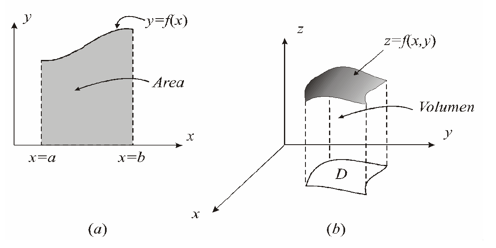

(a) Área bajo una curva. (b) Volumen bajo una superficie.

## Página 3. 5.1 INTEGRALES DOBLES — SOBRE RECTÁNGULOS

```math
S_n=\sum_{j=0}^{n-1}\sum_{k=0}^{n-1}f(c_{jk})\,\Delta x\Delta y
```

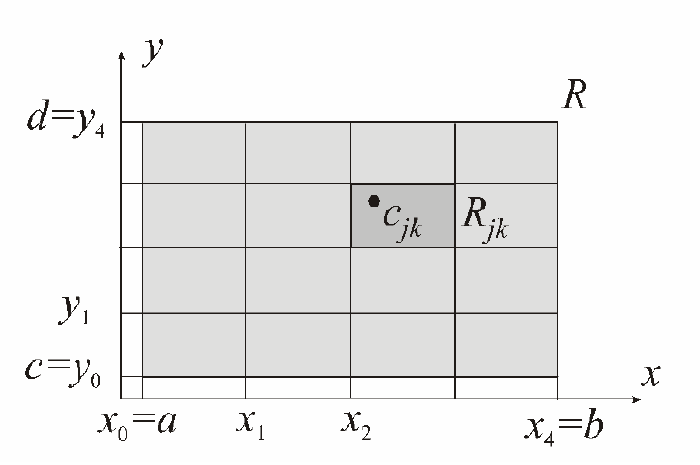

```math
\lim_{n\to\infty}\sum_{j=0}^{n-1}\sum_{k=0}^{n-1}f(c_{jk})\,\Delta x\Delta y
=\iint_R f(x,y)\,dxdy
```

## Página 4. 5.1 INTEGRALES DOBLES — INTERPRETACIÓN como VOLUMEN

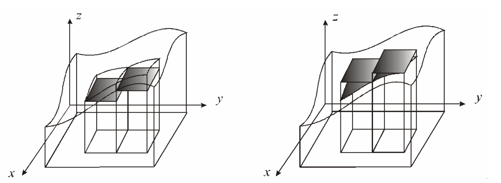

Volumen de un sólido inscrito. Volumen de un sólido circunscrito.

## Página 5. 5.1 INTEGRALES DOBLES — PROPIEDADES

a) Linealidad.

```math
\iint_R(f+g)\,dxdy=\iint_R f\,dxdy+\iint_R g\,dxdy;
```

```math
\iint_R\alpha f\,dxdy=\alpha\iint_R f\,dxdy
```

b) Monotonía.

$`f(x,y)\le g(x,y)`$ entonces

```math
\iint_R f\,dxdy\le\iint_R g\,dxdy
```

```math
\left|\iint_R f\,dxdy\right|\le\iint_R|f|\,dxdy
```

## Página 6. 5.1 INTEGRALES DOBLES — PROPIEDADES

c) Aditividad respecto a rectángulos.

```math
\iint_R f\,dxdy=\iint_{R_1}f\,dxdy+\iint_{R_2}f\,dxdy
```

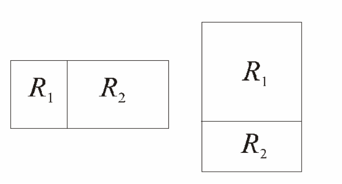

## Página 7. 5.1 INTEGRALES DOBLES — PROPIEDADES

**Valor medio**

```math
f_R=\frac{1}{\mathop{\mathrm{área}}\nolimits (R)}\iint_R f(x,y)\,dxdy
```

**Teorema del valor medio para integrales dobles**

Supongamos que $`f:R\longrightarrow\mathbb R`$ es continua.

Entonces para algún punto $`(x_0,y_0)`$ en $`R`$, tenemos

```math
\iint_R f(x,y)\,dxdy=f(x_0,y_0)A(R)
```

## Página 8. 5.1 INTEGRALES DOBLES — INTEGRALES ITERADAS

```math
\iint f(x,y)\,dxdy=\int\left[\int f(x,y)\,dx\right]dy;
```

```math
\iint f(x,y)\,dydx=\int\left[\int f(x,y)\,dy\right]dx
```

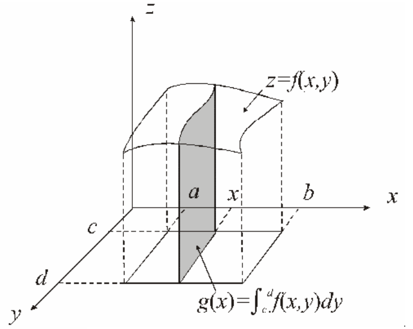

**Teorema de Fubini sobre un rectángulo**

Supongamos que $`f(x,y)`$ es una función continua sobre un rectángulo $`R`$.

```math
\iint_R f(x,y)\,dxdy
=\int_c^d\left(\int_a^b f(x,y)\,dx\right)dy
=\int_a^b\left(\int_c^d f(x,y)\,dy\right)dx
```

## Página 9. 5.1 INTEGRALES DOBLES — SOBRE REGIONES GENERALES

```math
\iint_D f\,dxdy=\iint_R f\cdot\chi_D\,dxdy=\iint_R f^*\,dxdy
```

```math
f^*=f\cdot\chi_D=\begin{cases}
f(x,y)&\text{si }(x,y)\in D\\
0&\text{si }(x,y)\in R-D
\end{cases}
```

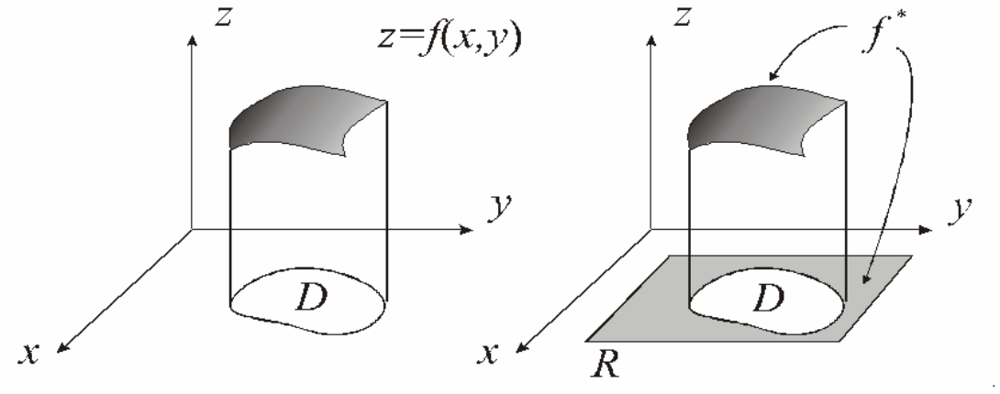

## Página 10. 5.1 INTEGRALES DOBLES — REGIONES de INTEGRACIÓN

REGIONES DE TIPO (I)

```math
D_I=\{(x,y)/a\le x\le b,\phi_1(x)\le y\le\phi_2(x)\}
```

REGIONES DEL TIPO (II)

```math
D_{II}=\{(x,y)/\psi_1(y)\le x\le\psi_2(y),c\le y\le d\}
```

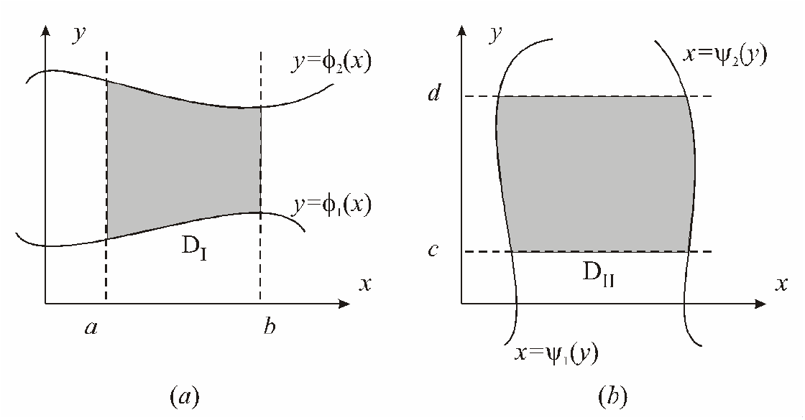

## Página 11. 5.1 INTEGRALES DOBLES — TMA FUBINI para REGIONES de INTEGRACIÓN

Supongamos que $`f`$ es continua en $`D`$

```math
\iint_D f(x,y)\,dxdy=\int_a^b\left(\int_{\phi_1(x)}^{\phi_2(x)}f(x,y)\,dy\right)dx
```

```math
\iint_D f(x,y)\,dxdy=\int_c^d\left(\int_{\psi_1(y)}^{\psi_2(y)}f(x,y)\,dx\right)dy
```

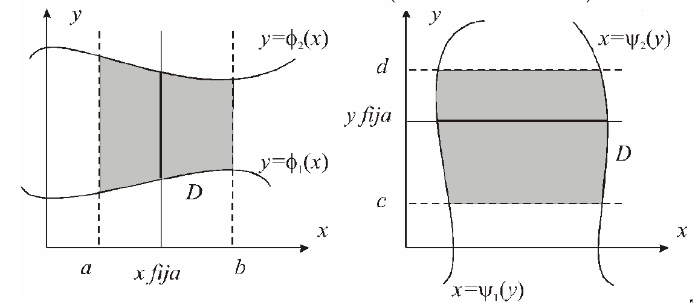

## Página 12. 5.1 INTEGRALES DOBLES — CAMBIO de VARIABLES

```math
\bar F:D'\subseteq\mathbb R^2\longrightarrow\mathbb R^2
```

```math
\bar F(u,v)=(x,y)=(x(u,v),x(u,v))
```

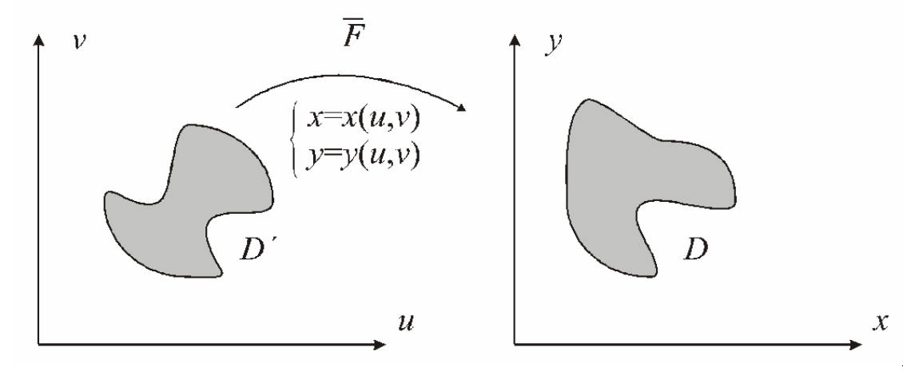

Nota de transcripción: la segunda componente de la igualdad de la página 12 está
impresa como $`x(u,v)`$; el dibujo rotula $`y=y(u,v)`$. Se conservan ambas
expresiones.

## Página 13. 5.1 INTEGRALES DOBLES — CAMBIO de VARIABLES

```math
\begin{aligned}
\iint_D f(x,y)\,dxdy
&=\iint_{D'}f(x(u,v),y(u,v))\left|\det[\bar F'(u,v)]\right|\,dudv\\
&=\iint_{D'}f(x(u,v),y(u,v))|J(u,v)|\,dudv
\end{aligned}
```

```math
\det[\bar F'(u,v)]=J(u,v)=\frac{\partial(x,y)}{\partial(u,v)}
=\det\begin{bmatrix}\frac{\partial x}{\partial u}&\frac{\partial x}{\partial v}\\
\frac{\partial y}{\partial u}&\frac{\partial y}{\partial v}\end{bmatrix}
```

## Página 14. 5.1 INTEGRALES DOBLES — CAMBIO a POLARES

$`x=r\cos\theta`$, $`y=r\mathop{\mathrm{sen}}\nolimits \theta`$

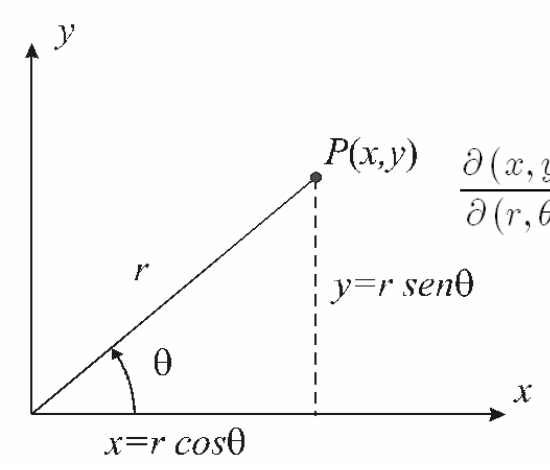

```math
\frac{\partial(x,y)}{\partial(r,\theta)}
=\det\begin{bmatrix}\frac{\partial x}{\partial r}&\frac{\partial x}{\partial\theta}\\
\frac{\partial y}{\partial r}&\frac{\partial y}{\partial\theta}\end{bmatrix}
=\det\begin{bmatrix}\cos\theta&-r\mathop{\mathrm{sen}}\nolimits \theta\\
\mathop{\mathrm{sen}}\nolimits \theta&r\cos\theta\end{bmatrix}=r
```

```math
\begin{aligned}
\iint_D f(x,y)\,dxdy
&=\iint_{D'}f(x(r,\theta),y(r,\theta))\left|\frac{\partial(x,y)}{\partial(r,\theta)}\right|\,drd\theta\\
&=\iint_{D'}f(r\cos\theta,r\mathop{\mathrm{sen}}\nolimits \theta)\,rdrd\theta
\end{aligned}
```

## Página 15. 5.2 INTEGRALES TRIPLES — SOBRE PARALELEPÍPEDOS

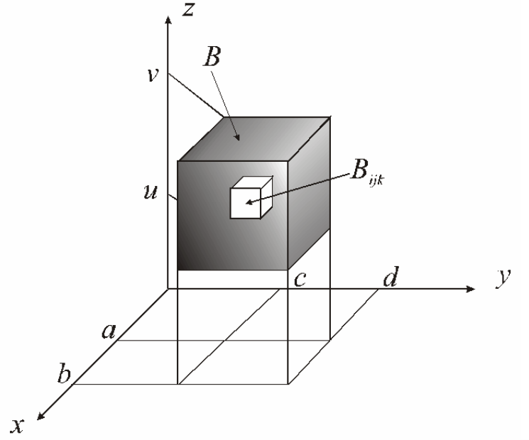

```math
\lim_{n\to\infty}\sum_{i=0}^{n-1}\sum_{j=0}^{n-1}\sum_{k=0}^{n-1}
f(c_{ijk})\,\Delta x\Delta y\Delta z=\iiint_B f(x,y,z)\,dxdydz
```

## Página 16. 5.2 INTEGRALES TRIPLES — INTEGRALES ITERADAS

```math
\int_u^v\left(\int_c^d\left(\int_a^b f(x,y,z)\,dx\right)dy\right)dz;
\qquad
\int_u^v\left(\int_a^b\left(\int_c^d f(x,y,z)\,dy\right)dx\right)dz;\quad\text{etc.}
```

**Teorema de Fubini sobre un paralelepípedo**

Si se cumple que $`f(x,y,z)`$ es continua sobre el paralelepípedo $`B`$

```math
\iiint_B f(x,y,z)\,dxdydz
=\int_u^v\left(\int_c^d\left(\int_a^b f(x,y,z)\,dx\right)dy\right)dz
```

## Página 17. 5.2 INTEGRALES TRIPLES — SOBRE REGIONES GENERALES

**Regiones de integración en $`\mathbb R^3`$**, tipo (I)

$`a\le x\le b`$, $`\phi_1(x)\le y\le\phi_2(x)`$ y
$`\gamma_1(x,y)\le z\le\gamma_2(x,y)`$

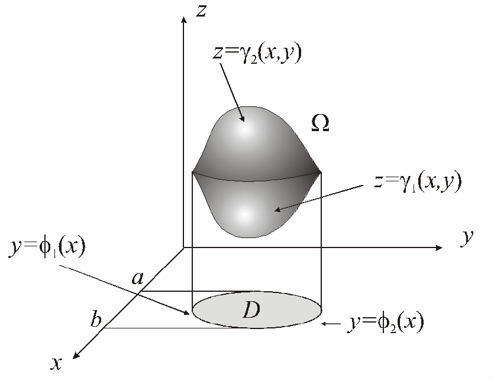

## Página 18. 5.2 INTEGRALES TRIPLES — SOBRE REGIONES GENERALES

**Regiones de integración en $`\mathbb R^3`$.**

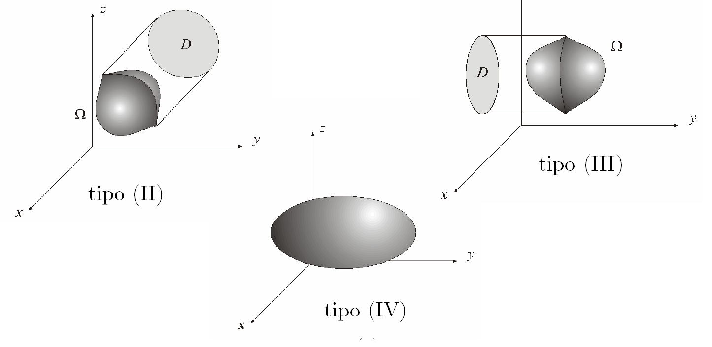

## Página 19. 5.2 INTEGRALES TRIPLES — TMA FUBINI para REGIONES de INTEGRACIÓN

Si suponemos que $`\Omega`$ es del tipo (I), entonces

```math
\begin{aligned}
\iiint_\Omega f(x,y,z)\,dxdydz
&=\int_a^b\left(\int_{\phi_1(x)}^{\phi_2(x)}\left(\int_{\gamma_1(x,y)}^{\gamma_2(x,y)}f(x,y,z)\,dz\right)dy\right)dx\\
&=\iint_D\left[\int_{\gamma_1(x,y)}^{\gamma_2(x,y)}f(x,y,z)\,dz\right]dydx
\end{aligned}
```

## Página 20. 5.2 INTEGRALES TRIPLES — CAMBIO de VARIABLES

```math
\bar F(u,v,w)=(x,y,z)=(x(u,v,w),y(u,v,w),z(u,v,w))
```

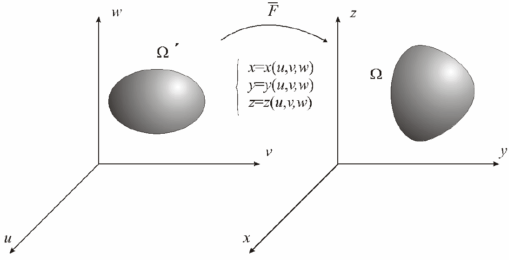

## Página 21. 5.2 INTEGRALES TRIPLES — CAMBIO de VARIABLES

```math
\iiint_\Omega f(x,y,z)\,dxdydz
=\iiint_{\Omega'}f(\bar F(u,v,w))\left|\frac{\partial(x,y,z)}{\partial(u,v,w)}\right|\,dudvdw
```

```math
J=\det\bar F'(u,v,w)=\frac{\partial(x,y,z)}{\partial(u,v,w)}
=\det\begin{bmatrix}
\frac{\partial x}{\partial u}&\frac{\partial x}{\partial v}&\frac{\partial x}{\partial w}\\
\frac{\partial y}{\partial u}&\frac{\partial y}{\partial v}&\frac{\partial y}{\partial w}\\
\frac{\partial z}{\partial u}&\frac{\partial z}{\partial v}&\frac{\partial z}{\partial w}
\end{bmatrix}
```

## Página 22. 5.2 INTEGRALES TRIPLES — CAMBIO a CILÍNDRICAS

$`x=r\cos\theta`$, $`y=r\mathop{\mathrm{sen}}\nolimits \theta`$, $`z=z`$

```math
\bar F(r,\theta,z)=(x,y,z)=(r\cos\theta,r\mathop{\mathrm{sen}}\nolimits \theta,z)
```

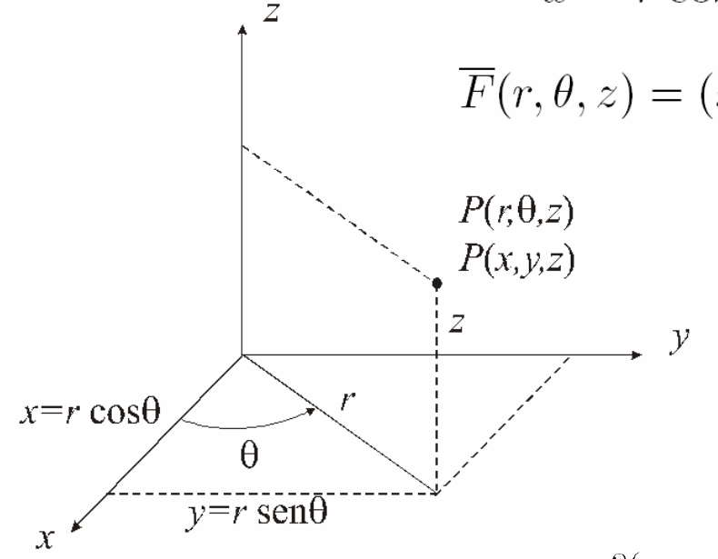

```math
\det\bar F(r,\theta,z)=\frac{\partial(x,y,z)}{\partial(r,\theta,z)}
=\det\begin{bmatrix}
\cos\theta&-r\mathop{\mathrm{sen}}\nolimits \theta&0\\
\mathop{\mathrm{sen}}\nolimits \theta&r\cos\theta&0\\
0&0&1
\end{bmatrix}=r
```

## Página 23. 5.2 INTEGRALES TRIPLES — CAMBIO a ESFÉRICAS

$`x=\rho\cos\theta\mathop{\mathrm{sen}}\nolimits \phi`$,
$`y=\rho\mathop{\mathrm{sen}}\nolimits \theta\mathop{\mathrm{sen}}\nolimits \phi`$,
$`z=\rho\cos\phi`$

```math
\bar F(\rho,\theta,\phi)=(x,y,z)
=(\rho\cos\theta\mathop{\mathrm{sen}}\nolimits \phi,\rho\mathop{\mathrm{sen}}\nolimits \theta\mathop{\mathrm{sen}}\nolimits \phi,\rho\cos\phi)
```

```math
\frac{\partial(x,y,z)}{\partial(\rho,\theta,\phi)}=-\rho^2\mathop{\mathrm{sen}}\nolimits \phi
```

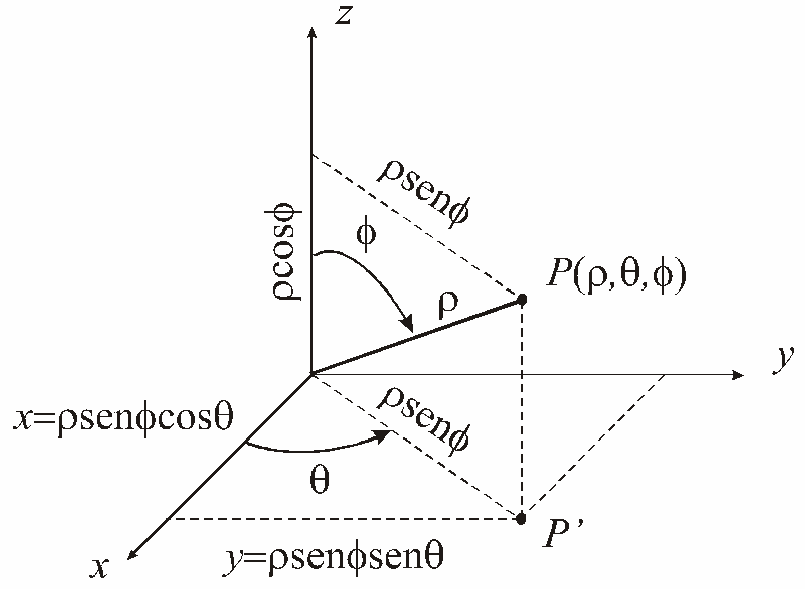

Nota de transcripción: en el gráfico la componente vertical está rotulada
$`\rho\cos\theta`$, mientras que las ecuaciones indican $`\rho\cos\phi`$. Se
conserva el dibujo original.

## Página 24. 5.3 APLICACIONES — VOLÚMENES y ÁREAS de figuras planas

```math
\iiint_\Omega dxdydz=\text{volumen de }\Omega
```

```math
\iint_D dxdy=\text{área de }D
```

## Página 25. 5.3 APLICACIONES — Centro de Masa y Momentos de figuras planas

```math
m=\iint_D\mu(x,y)\,dxdy
```

```math
x_G=\frac{\iint_D x\mu(x,y)\,dxdy}{\iint_D\mu(x,y)\,dxdy};\qquad
y_G=\frac{\iint_D y\mu(x,y)\,dxdy}{\iint_D\mu(x,y)\,dxdy}
```

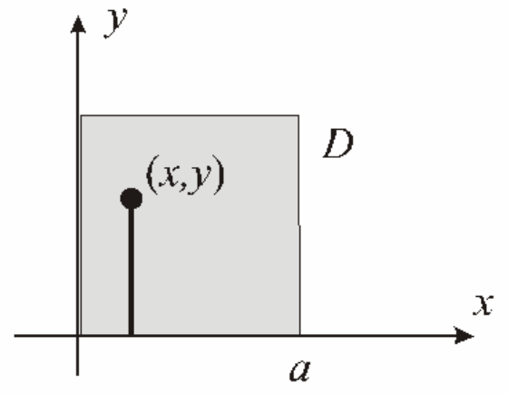

## Página 26. 5.3 APLICACIONES — Centro de Masa y Momentos de figuras planas

```math
I_x=\iint_D y^2\mu(x,y)\,dxdy;\qquad
I_y=\iint_D x^2\mu(x,y)\,dxdy
```

```math
I_0=\iint_D(x^2+y^2)\mu(x,y)\,dxdy
```

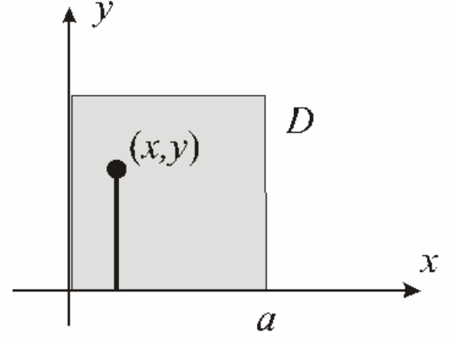

## Página 27. 5.3 APLICACIONES — Centro de Masa y Momentos de cuerpos en el espacio

```math
m=\iiint_\Omega\mu(x,y,z)\,dxdydz
```

```math
x_G=\frac{M_{yz}}m
=\frac{\iiint_\Omega x\mu(x,y,z)\,dxdydz}{\iiint_\Omega\mu(x,y,z)\,dxdydz}
```

```math
y_G=\frac{M_{xz}}m
=\frac{\iiint_\Omega y\mu(x,y,z)\,dxdydz}{\iiint_\Omega\mu(x,y,z)\,dxdydz}
```

```math
z_G=\frac{M_{xy}}m
=\frac{\iiint_\Omega z\mu(x,y,z)\,dxdydz}{\iiint_\Omega\mu(x,y,z)\,dxdydz}
```


## Página 28. 5.3 APLICACIONES — Centro de Masa y Momentos de cuerpos en el espacio

```math
I_x=\iiint_\Omega(y^2+z^2)\mu(x,y,z)\,dxdydz;
```

```math
I_y=\iiint_\Omega(x^2+z^2)\mu(x,y,z)\,dxdydz;
```

```math
I_z=\iiint_\Omega(x^2+y^2)\mu(x,y,z)\,dxdydz
```

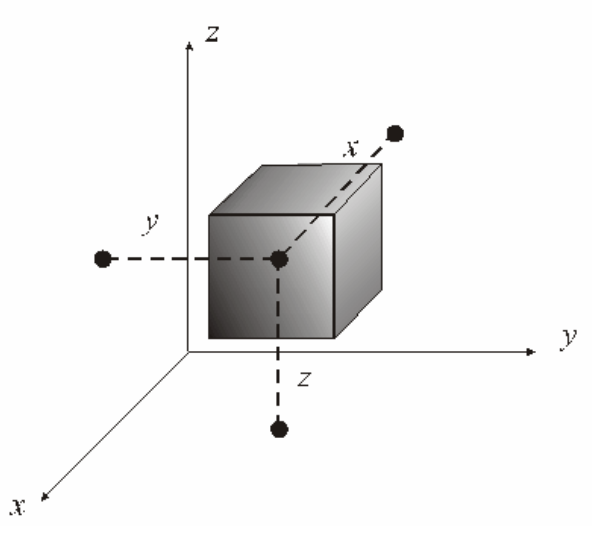

## Página 29. 5.3 APLICACIONES — Centro de Masa y Momentos de cuerpos en el espacio

```math
I_{xy}=\iiint_\Omega z^2\mu(x,y,z)\,dxdydz;
```

```math
I_{xz}=\iiint_\Omega y^2\mu(x,y,z)\,dxdydz;
```

```math
I_{yz}=\iiint_\Omega x^2\mu(x,y,z)\,dxdydz
```

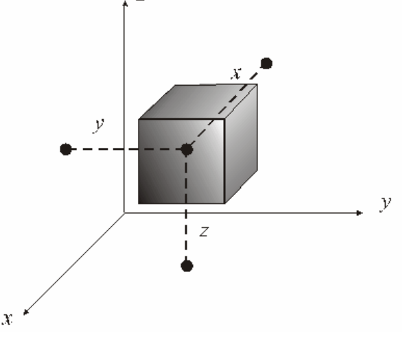

```math
I_0=\iiint_\Omega(x^2+y^2+z^2)\mu(x,y,z)\,dxdydz
```
