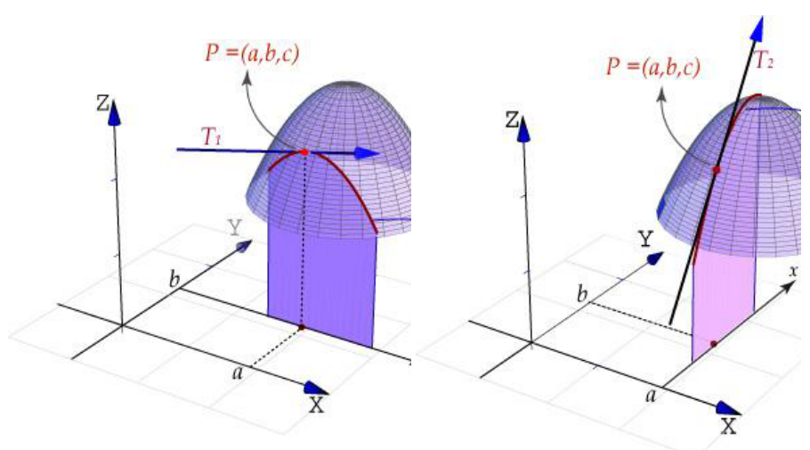
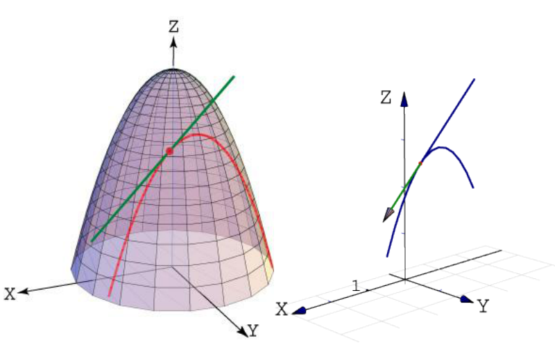
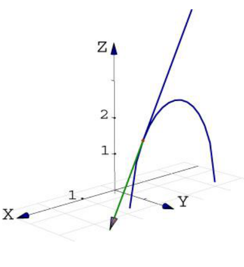

# Interpretación geométrica de la derivada parcial

Fuente: `Interpretacion_geometrica_de_la_derivada_parcial (1).pdf`, páginas 1–4.
[Procedencia y revisión](../../../resources/2016/materiales-complementarios-cobertura.md).

## Página 1

Recordemos que la gráfica de $`z=f(x,y)`$ representa una superficie $`S`$. Si
$`f(a,b)=c`$, entonces el punto $`P=(a,b,c)`$ está sobre la superficie $`S`$. El
plano vertical $`y=b`$ interseca a la superficie $`S`$ en la curva $`C_1`$ (es
decir, $`C_1`$ es la traza de la superficie $`S`$ sobre el plano $`y=b`$. De
manera semejante, el plano vertical $`x=a`$ interseca a la superficie $`S`$ en
la curva $`C_2`$. Ambas curvas pasan por el punto $`P`$.

Observe que la curva $`C_1`$ es la gráfica de la función $`g(x,y)`$ de manera
que la pendiente de su recta tangente $`T_1`$ en el punto $`P`$ es
$`g'(a)=f_x(a,b)`$. La curva $`C_2`$ es la gráfica de la función $`g(y)=f(a,b)`$
así que la pendiente de su tangente $`T_2`$ en el punto $`P`$ es
$`g'(b)=f_y(a,b)`$.



## Página 2

Por consiguiente, las derivadas parciales $`f_x(a,b)`$ y $`f_y(a,b)`$ pueden
interpretarse geométricamente como las pendientes de las rectas tangentes a las
curvas $`C_1`$ y $`C_2`$ en el punto $`P`$, respectivamente.

Las derivadas parciales pueden también ser vistas como razones de cambio. Si
$`z=f(x,y)`$, entonces $`f_x`$ representa la razón de cambio de $`z`$ con
respecto a $`x`$, cuando $`y`$ permanece fija. De manera semejante, $`f_y`$
representa la razón de cambio de $`z`$ con respecto a $`y`$, cuando $`x`$
permanece fija.

### Ejemplo 1

Hallar la ecuación de la recta tangente a la curva que se obtiene de la
intersección del paraboloide $`z=4-x^2-y^2`$ y el plano $`y=1`$, cuando
$`x=1/2`$.



### Ejemplo 2

El plano $`y=2`$ interseca al elipsoide $`4x^2+2y^2+z^2=16`$ formando una
elipse. Determine las ecuaciones paramétricas para la recta tangente a la elipse
en el punto $`(1,2,2)`$.

## Página 3



Observación: si $`f`$ es una función de dos variables $`x`$ e $`y`$, entonces
sus derivadas parciales $`f_x`$ y $`f_y`$ también son funciones de dos
variables, de modo que podemos considerar sus derivadas parciales segundas de
$`f`$.

Si $`z=f(x,y)`$, utilizamos la siguiente notación:

```math
(f_x)_x=f_{xx}=f_{11}=\frac{\partial}{\partial x}\left(\frac{\partial f}{\partial x}\right)=\frac{\partial^2 f}{\partial x^2}=\frac{\partial^2 z}{\partial x^2}
```

```math
(f_x)_y=f_{xy}=f_{12}=\frac{\partial}{\partial y}\left(\frac{\partial f}{\partial x}\right)=\frac{\partial^2 f}{\partial y\partial x}=\frac{\partial^2 z}{\partial y\partial x}
```

```math
(f_y)_x=f_{yx}=f_{21}=\frac{\partial}{\partial x}\left(\frac{\partial f}{\partial y}\right)=\frac{\partial^2 f}{\partial x\partial y}=\frac{\partial^2 z}{\partial x\partial y}
```

```math
(f_y)_y=f_{yy}=f_{22}=\frac{\partial}{\partial y}\left(\frac{\partial f}{\partial y}\right)=\frac{\partial^2 f}{\partial y^2}=\frac{\partial^2 z}{\partial y^2}
```

La notación $`f_{xy}`$ o $`\frac{\partial^2 y}{\partial x\partial y}`$ o
significa que primero derivamos con respecto a $`x`$ y luego con respecto a
$`y`$, mientras que para calcular $`f_{yx}`$ el orden se invierte.

## Página 4

### Teorema (igualdad de las derivadas mixtas)

Sea $`f:D\subseteq\mathbb R\longrightarrow\mathbb R`$ una función escalar donde
$`D`$ es un disco abierto con centro en $`(a,b)`$ y radio $`\delta`$, entonces
si las funciones $`f_{xy}`$ y $`f_{yx}`$ son continuas en $`D`$, entonces

```math
f_{xy}(a,b)=f_{yx}(a,b)
```

> Nota de transcripción: se conservan las expresiones $`g(x,y)`$ y
> $`g(y)=f(a,b)`$, el paréntesis sin cerrar de la primera página y la notación
> $`\partial^2 y/(\partial x\partial y)`$ y el «o» repetido de la página 3 tal
> como aparecen en el original. Los ejemplos sólo contienen enunciados y
> figuras.
>
> El teorema imprime $`D\subseteq\mathbb R`$ sin exponente 2; se conserva esa
> notación.
