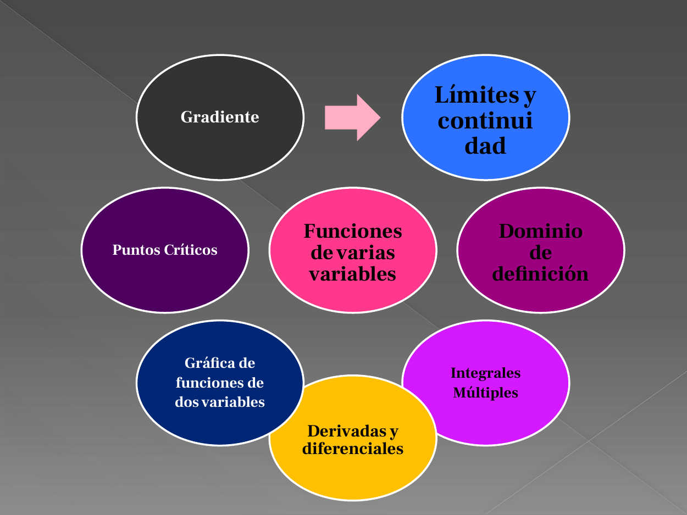
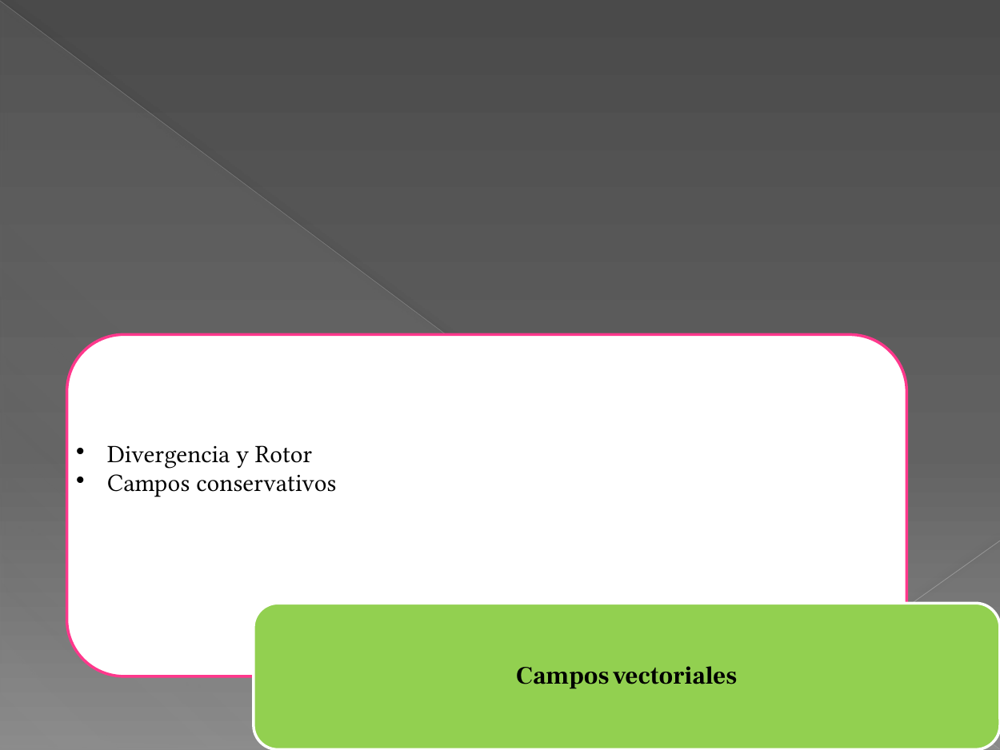
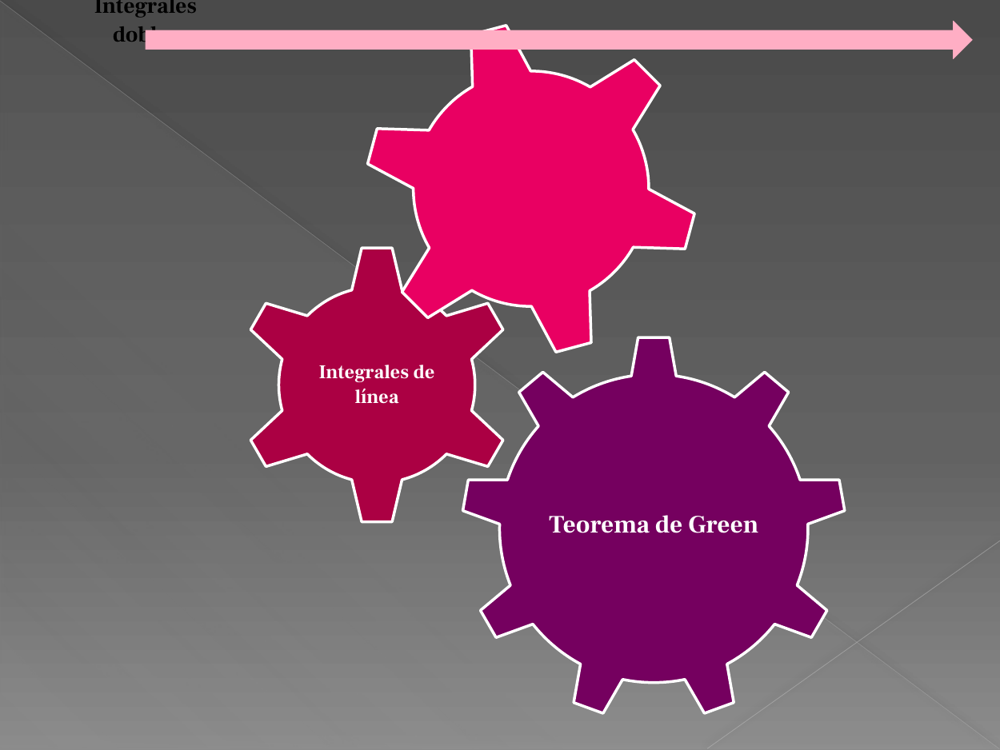

<!-- markdownlint-disable MD036 -->

# Presentación de Análisis Matemático II

> Transcripción del original. Año de archivo: 2016. Atribución: Identificación
> ISI o varias carreras que incluyen ISI en fuente. Las erratas y las
> repeticiones del original se conservan.

## Alcance y observaciones de transcripción

No se reproduce la animación del SmartArt. Sus 25 etiquetas y jerarquía se
recuperaron del XML; el estado estático de diapositiva 7 no muestra todas las
ramas.

## Contenido del original

## Diapositiva 1 — Análisis Matemático II

Teoría: Ing. César Flores

Práctico: Prof. Bibiana Altamirano

Ing. Luciano Curi

## Diapositiva 2 — Condición de cursada

- Para regularizar: aprobar 3 de 4 parciales y los prácticos solicitados
- Para promocionar: aprobar los 4 parciales con nota mayor o igual a 7

Fechas de parciales

1er Parcial: Martes 10 de mayo

2° Parcial: Martes 28 de junio

Recuperatorio 1° y 2° Martes 5 de julio

## Diapositiva 3 — Conocimientos previos

- Nociones básicas de geometría plana: cálculo de áreas y perímetros
- Resolución de sistemas de ecuaciones lineales y no lineales
- Ecuaciones y gráficas de las cónicas
- Ecuación de la recta y del plano
- Funciones trigonométricas
- Vectores: representación, productos escalar y vectorial
- Derivadas e integrales inmediatas

## Diapositiva 4 — Series de Fourier

Una serie de Fourier descompone funciones periódicas o señales periódicas en la
suma de funciones oscilantes simples, como senos y cosenos. El estudio de la
serie de Fourier es una rama del análisis de Fourier.

## Diapositiva 5 — Ecuaciones Diferenciales

Una ecuación diferencial es una ecuación en la que intervienen derivadas de una
o más funciones desconocidas.

## Diapositiva 6 — Funciones de varias variables

Etiquetas del diagrama:

- Funciones de varias variables
- Límites y continuidad
- Dominio de definición
- Derivadas y diferenciales
- Gráfica de funciones de dos variables
- Puntos Críticos
- Gradiente
- Integrales Múltiples

Nota de transcripción: el panel de notas contiene únicamente «6».

## Diapositiva 7 — Campos vectoriales

Texto completo del SmartArt, incluidas las ramas que no aparecen en la
exportación estática. La jerarquía se conserva de las conexiones del objeto
original:

- Campos vectoriales
  - Divergencia y Rotor
  - Campos conservativos
- Integrales de línea
  - ´Trabajo de un campo de fuerzas
  - Masa de un cable
- Funciones vectoriales
  - Curvas en el espacio
  - Movimiento a lo largo de una curva

## Diapositiva 8 — Integrales

Etiquetas del SmartArt: Teorema de Green, Integrales de línea, Integrales
dobles.

## Diapositiva 9 — Bibliografía obligatoria

- Introducción al Análisis Matemático Cálculo 2- Hebe Rabuffetti.
- Cálculo II-Larson
- Ecuaciones Diferenciales Aplicadas-Murray R. Spiegel
- Apuntes de Análisis Matemático II-DeUrrutia-Mahave
