<!-- markdownlint-disable MD036 -->

# Taylor en dos variables

> Transcripción del original. Año de archivo: 2016. Atribución: Archivado en
> carpeta canónica de AMII; carrera no identificada en el documento. Las erratas
> y las repeticiones del original se conservan.

## Alcance y observaciones de transcripción

Las 13 figuras/capturas se conservan completas. Se transcriben las entradas y la
salida algebraica de Derive de las figuras 7–8, uniendo sus renglones
continuados visibles (incluidos `82` + `9` y `566` + `70`). No se recalcula el
polinomio. En la figura 6 un coeficiente está parcialmente tapado por el eje
verde de la gráfica y el texto termina después de `−2`, sin cerrar el
paréntesis: se conserva ese fragmento con las pérdidas identificadas. Las
figuras 1–5 son gráficas sin expresiones adicionales; 9–13 repiten el rótulo
$f(x;y)=\ln(x+y)$.

## Contenido del original

**<u>Un Ejemplo de Taylor</u>**

$z = \ln(x.y);\ \ aproximar\ por\ el\ Polinomio\ de\ Taylor\ en\ P(0.1\ ;0.1)de\ grado\ 3$

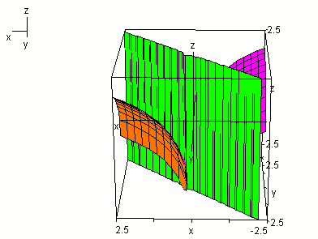

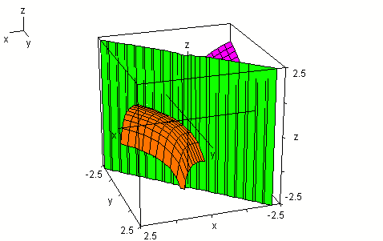

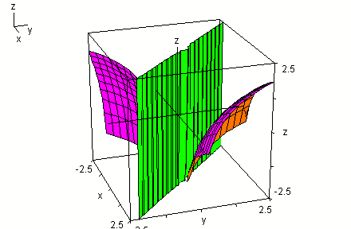

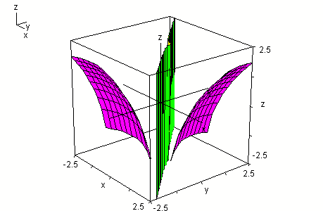

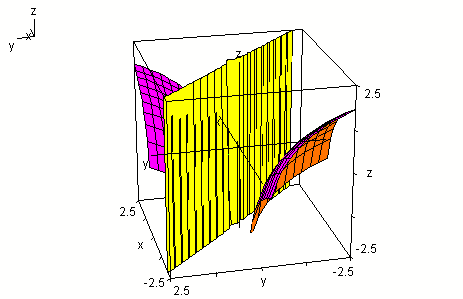

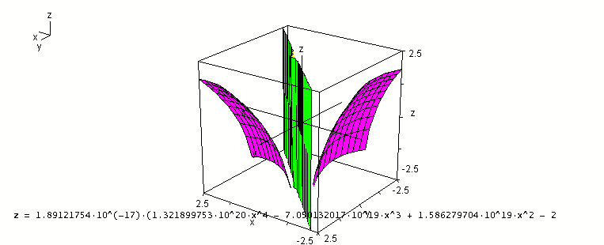

Expresión visible al pie de la figura 6 (fragmento; el original usa `10^`):

$$
z=1.89121754\cdot10^{-17}\left(
1.321899753\cdot10^{20}x^4
-\underbrace{7.0\ldots132017}_{\text{cifras tapadas por la gráfica}}
\cdot10^{19}x^3
+1.586279704\cdot10^{19}x^2-2
\;\underbrace{\ldots}_{\text{final no visible}}\right.
$$

El paréntesis queda abierto porque así termina el fragmento visible. Los puntos
suspensivos y sus etiquetas son marcas editoriales de contenido que no puede
leerse en esa imagen.

Aproximar por el Polinomio de Taylor al P(1;1) a la función $z = ln(x + y)$

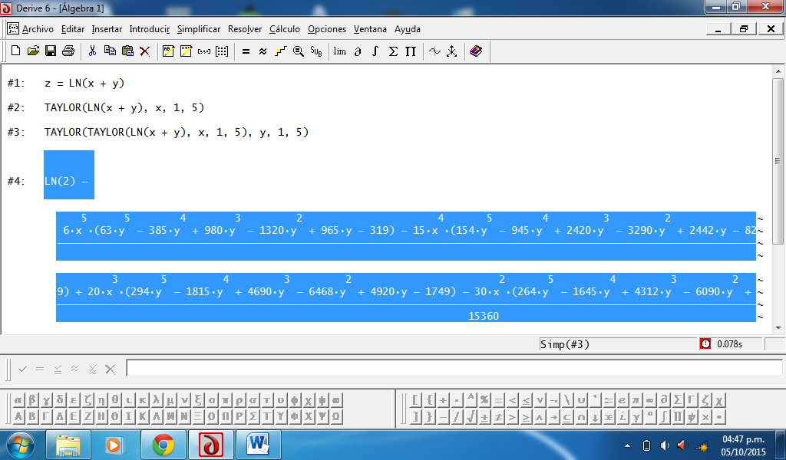

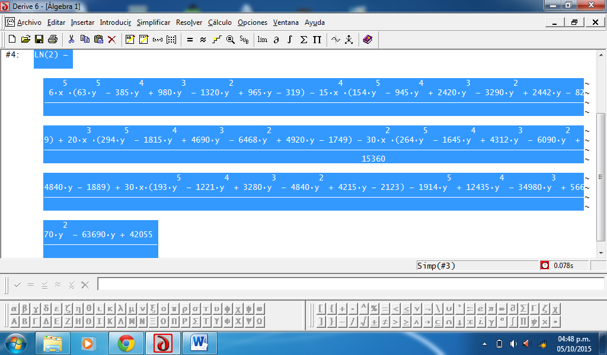

Entradas visibles de Derive (figura 7):

$$
\#1:\quad z=\mathop{\mathrm{LN}}\nolimits (x+y)
$$

$$
\#2:\quad\mathop{\mathrm{TAYLOR}}\nolimits (\mathop{\mathrm{LN}}\nolimits (x+y),x,1,5)
$$

$$
\#3:\quad\mathop{\mathrm{TAYLOR}}\nolimits (
\mathop{\mathrm{TAYLOR}}\nolimits (\mathop{\mathrm{LN}}\nolimits (x+y),x,1,5),y,1,5)
$$

Salida `#4`, `Simp(#3)`, visible entre las figuras 7 y 8:

$$
\ln(2)-\frac{N(x,y)}{15360}
$$

con el numerador transcrito por renglones para conservar legibilidad:

$$
\begin{aligned}
N(x,y)={}&6x^5(63y^5-385y^4+980y^3-1320y^2+965y-319)\\
&-15x^4(154y^5-945y^4+2420y^3-3290y^2+2442y-829)\\
&+20x^3(294y^5-1815y^4+4690y^3-6468y^2+4920y-1749)\\
&-30x^2(264y^5-1645y^4+4312y^3-6090y^2+4840y-1889)\\
&+30x(193y^5-1221y^4+3280y^3-4840y^2+4215y-2123)\\
&-1914y^5+12435y^4-34980y^3+56670y^2-63690y+42055.
\end{aligned}
$$

Las capturas identifican Derive 6 y muestran la fecha `05/10/2015`; esa fecha
pertenece a la captura, no acredita una fecha de autoría del documento.

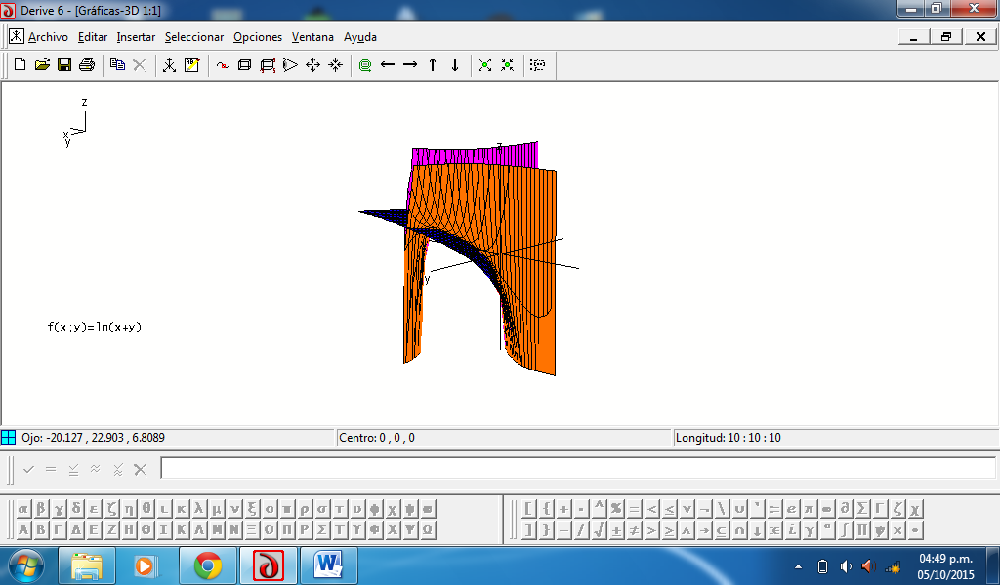

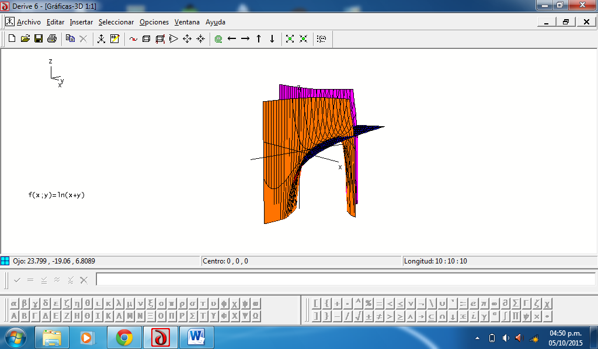

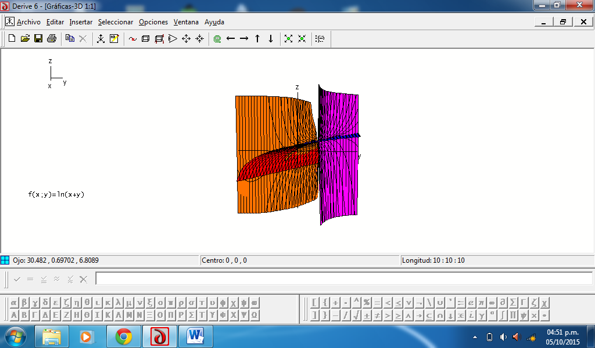

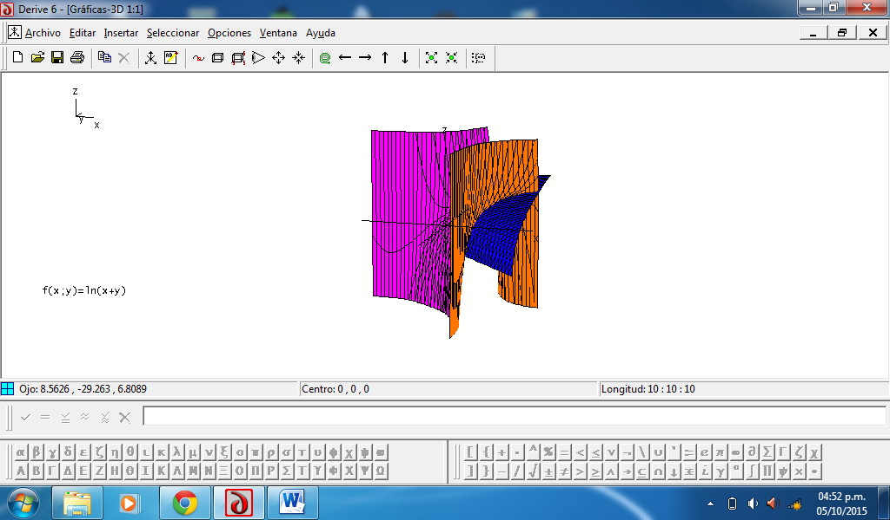

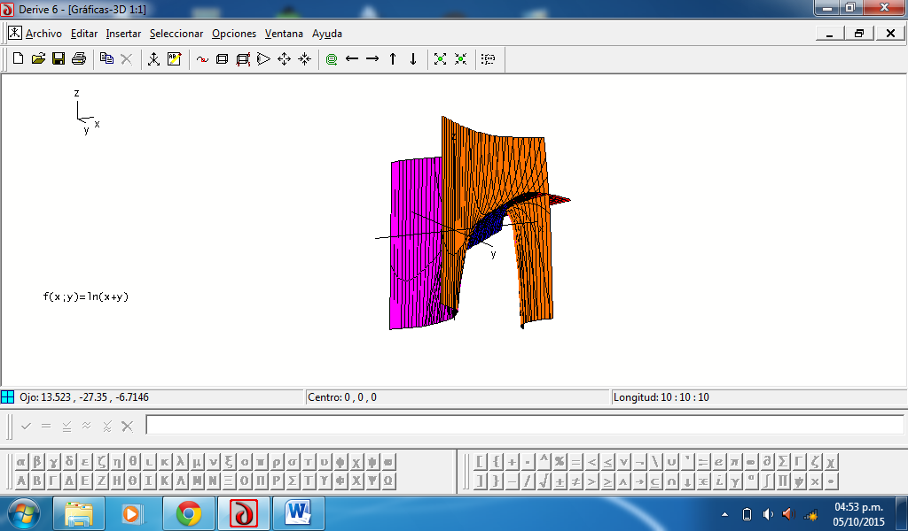

Rótulo de las figuras 9–13:

$$
f(x;y)=\ln(x+y)
$$
