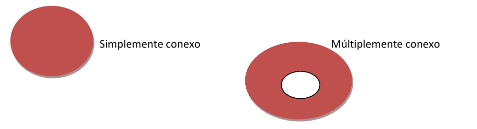
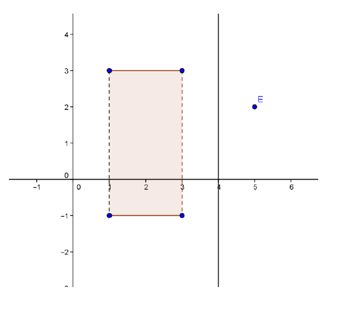

# Espacio Métrico

Fuente: `Espacio Métrico.pdf`, páginas 1–2.
[Procedencia](../../../resources/2016/fuentes.md).

Todo conjunto no vacío de elementos, llamados puntos, entre los cuales se ha
definido la distancia.

**Distancia:** Dados dos puntos $\bar A$ y $\bar B$ de $R^n$;
$\bar A=(a_1,a_2,\ldots,a_n)$ y $\bar B=(b_1,b_2,\ldots,b_n)$, llamaremos
distancia euclideana entre ambos al número real:

$$
d(\bar A,\bar B)=|\bar A-\bar B|=\sqrt{(a_1-b_1)^2+(a_2-b_2)^2+\cdots+(a_n-b_n)^2}
$$

**Entorno** de $\bar A\in R^n$;
$E(\bar A,r)=\{\bar P\in R^n/d(\bar P,\bar A)\le r\}$

En $R^2$, representa geométricamente el interior de un círculo de radio $r$ cuyo
centro es $\bar A$.

En $R^3$, representa una esfera de radio $r$ cuyo centro es $\bar A$.

Si el centro no pertenece al entorno, se obtiene la definición de entorno
reducido.

**Entorno reducido** de $\bar A\in R^n$;
$E'(\bar A,r)=\{\bar P\in R^n/0<d(\bar P,\bar A)\le r\}$

$\bar P$ es **punto de acumulación** de un conjunto $A$ si cualquier entorno
reducido de $\bar P$ contiene algún punto de $A$.

$\bar P$ es **punto interior** del conjunto $A$ si existe algún
$E(\bar P,r)\subset A$.

$\bar P$ es **punto frontera** del conjunto $A$ si todo $E'(\bar P,r)$ contiene
puntos de $A$ y puntos que no pertenecen a $A$.

**Frontera** del conjunto $A$ es el conjunto de todos sus puntos frontera.

$A$ es un **conjunto abierto** si todos sus puntos son interiores.

$A$ es un **conjunto cerrado** si todos sus puntos son de acumulación, o bien,
si el conjunto frontera está incluido en el mismo.

**Conjunto conexo** es aquél en el que pueden unir dos puntos cualesquiera del
mismo mediante una poligonal de un número finito de segmentos totalmente
incluida en el conjunto.

Un conjunto conexo es **simplemente conexo** cuando todo polígono convexo
determinado por una poligonal cerrada está contenido en el mismo. En caso
contrario se llama **múltiplemente conexo**.

$A$ es un **conjunto acotado** si y sólo si existe algún radio $r$ de modo que
pueda definir un entorno que incluya totalmente al mismo.

**Ejemplo 1:**

Graficar el conjunto de puntos dado y caracterizarlo. (Ver gráfico al final del
texto)

$$
B=\{(x,y)/|x-2|<1\land|y-1|\le2\lor x=4\lor(x,y)=(5,2)\}
$$

**Puntos interiores** son los que están en el rectángulo coloreado:

$$
B_i=\{(x,y)/|x-2|<1\land|y-1|\le2\lor x\ne4\lor(x,y)\ne(5,2)\}
$$

**Punto aislado:** $(5,2)$

**Conjunto frontera:** está formado por los lados del rectángulo, la recta $x=4$
y el punto aislado.

$$
\begin{aligned}
B_f=\{(x,y)/{}&(x=1\land-1\le y\le3)\lor(x=3\land-1\le y\le3)\\
&\lor(y=-1\land1\le x\le3)\lor(y=3\land1\le x\le3)\\
&\lor x=4\lor(x,y)=(5,2)\}
\end{aligned}
$$

**Observaciones:**

- El punto aislado es siempre frontera pues no es interior ni exterior.
- A un conjunto abierto no puede pertenecerle ningún punto frontera en cambio a
  un conjunto cerrado siempre incluye su frontera.
- Entonces, si a un conjunto le pertenecen algunos puntos de su frontera pero no
  todos, el conjunto no es ni abierto ni cerrado.

Nota de transcripción: se conservan las desigualdades no estrictas en los
entornos, la definición de conjunto cerrado y la expresión de $B_i$, aunque
presentan inconsistencias con las descripciones y el gráfico. No se han
corregido.
