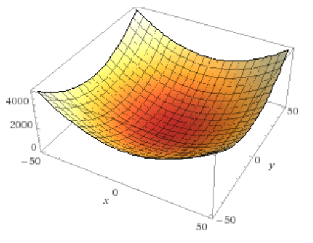
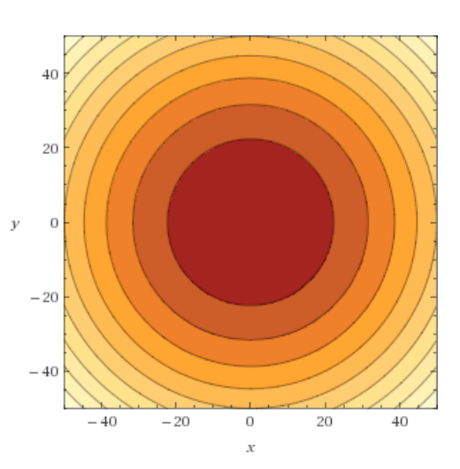
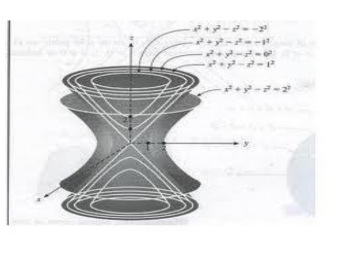

# Campos escalares

Fuente: `Funciones de dos o más variables.pdf`, páginas 1–4.
[Procedencia](../../../resources/2016/fuentes.md).

## Funciones de dos o más variables

### Variables y funciones

Todo punto "p" perteneciente a un espacio métrico $`E_n`$, está definido por una
$`n`$-upla de números reales. Este punto "p" también puede ser representado por
un vector $`\vec p=(a_1,a_2,a_3,\ldots,a_n)`$.

Dados, un conjunto $`A`$ contenido en $`E_n`$ y el conjunto $`R`$ de los números
reales, si "f" es una ley que hace corresponder a cada elemento de $`A`$ un
único elemento de $`R`$, diremos que $`f`$ es una función real de $`n`$
variables reales o una función de $`n`$ variables.

```math
f:A\longrightarrow R,\quad\text{con }A\subseteq E_n
```

### Función de dos variables

Sea $`A\subseteq R^2`$, si a cada par ordenado $`(x,y)`$ le corresponde un único
número real $`f(x,y)`$, entonces se dice que $`f`$ es una **función de $`x`$ e
$`y`$**. El conjunto $`A`$ es el **dominio de $`f`$**, y el correspondiente
conjunto de valores $`f(x,y)`$ es el **rango o recorrido de $`f`$**.

En la función $`z=f(x,y)`$, $`x`$ e $`y`$ son las **variables independientes** y
$`z`$ es la **variable dependiente**. En todos los casos, para $`n\ge2`$, la
función de $`n`$ variables se denomina **campo escalar**.

**Ejemplo 1:**

$`f(x,y)=x^2-y^2`$ o bien $`z=x^2-y^2`$ el dominio de la función son todos los
pares de puntos del plano **xy**.

**Ejemplo 2:**

$`f(x,y)=\ln xy`$, el dominio son todos los pares de puntos $`(x,y)`$ tales que
hagan el producto $`x\cdot y>0`$, es decir positivo. Esto lo verifican todos los
puntos del primer y tercer cuadrantes.

**Ejemplo 3:**

$`f(x,y)=\sqrt{x^2+4y^2-1}`$, el dominio son todos los pares de puntos $`(x,y)`$
tales que el radicando sea no negativo, es decir,
$`x^2+4y^2-1\ge0\Rightarrow\frac{x^2}{4}+y^2\ge1`$

## Gráfica de una función de dos variables

La gráfica de una función de dos variables es el conjunto de todos los puntos
$`(x,y,z)`$ para los que $`z=f(x,y)`$ con $`(x,y)`$ perteneciente al dominio de
la misma.

La interpretación geométrica de la gráfica es una superficie en el espacio.

**Ejemplo:** $`f(x,y)=x^2+y^2`$



### Curvas de nivel

Se llama curva de nivel a la curva determinada por todos los puntos del dominio
que tienen la misma imagen, es decir

```math
C=\{(x,y)\in R/f(x,y)=c;\ c\in R\}
```

**Ejemplo:** las curvas de nivel correspondientes a la superficie anterior
$`f(x,y)=x^2+y^2`$ serían círculos concéntricos centrados en el origen.



En un mapa climático, las curvas de nivel correspondientes a igual presión se
llaman **isobaras**, los de igual temperatura se llaman **isotermas**.

## Superficie de nivel

Si $`f`$ es una función de tres variables, cuyos valores se obtienen mediante la
fórmula $`u=f(x,y,z)`$, la función no tiene representación gráfica usual, pero
pueden hallarse sus superficies de nivel.

Dado un campo escalar de tres variables $`u=f(x,y,z)`$, se llama superficie de
nivel al conjunto de puntos del dominio $`(x,y,z)`$ para los cuales
$`f(x,y,z)=c`$. O sea, superficie de nivel es el conjunto
$`S=\{(x,y,z)\in R^3/f(x,y,z)=c\}`$

Ejemplo: Sea $`w:R^3\longrightarrow R/w^2-x^2-y^2+z^2=0`$, para encontrar las
superficies de nivel hacemos $`w=c`$, con $`c=\pm1,\pm2,0`$

```math
x^2+y^2-z^2=-1^2
```

```math
x^2+y^2-z^2=-2^2
```

```math
x^2+y^2-z^2=0^2
```

```math
x^2+y^2-z^2=1^2
```

```math
x^2+y^2-z^2=2^2
```



Nota de transcripción: se conservan la desigualdad final del ejemplo 3, el
conjunto $`C`$ escrito en $`R`$ y los signos de las superficies de nivel. No se
corrigen las inconsistencias del original. La figura final tiene etiquetas
borrosas; se conserva la imagen y las cinco ecuaciones legibles de la página
anterior, sin reconstruir los rótulos por conjetura.
