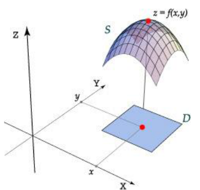
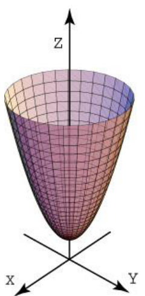
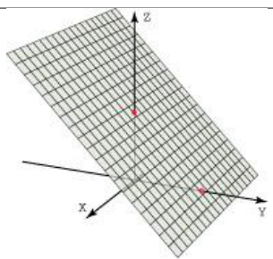
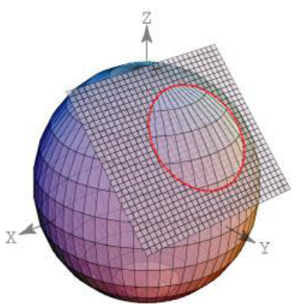
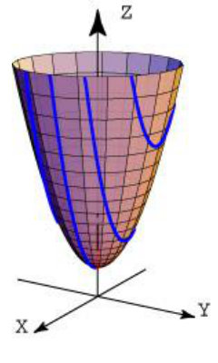
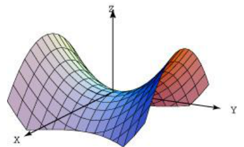
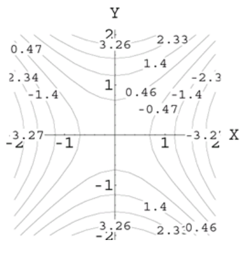
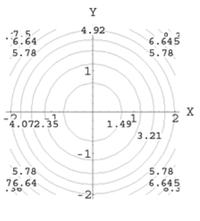
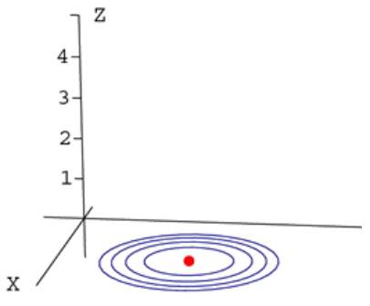
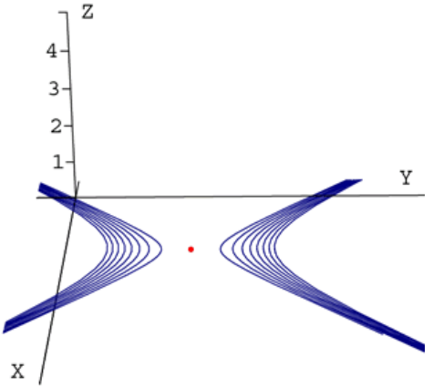

<!-- markdownlint-disable MD036 -->

# Gráfica de funciones de dos variables

Fuente: `Gráfica de funciones de dos variables.pdf`, páginas 1–9.
[Procedencia y revisión](../../../resources/2016/resume-misc-cobertura.md). El
título se repite como encabezado en las páginas originales.

## Página 1

Existen varias maneras de visualizar una función de dos variables, en esta
sección lo haremos mediante una superficie en el espacio tridimensional.

### Definición (gráfica de funciones de dos variables)

La gráfica de una función $`f:D\subset\mathbb R^2\Rightarrow\mathbb R`$ es el
conjunto de puntos $`(x,y,z)`$ tales que $`z=f(x,y)`$ y $`(x,y)\in D`$. Es
decir,

```math
\mathop{\mathrm{Graf}}\nolimits (f)=\{(x,y,f(x,y))/(x,y)\in D\}
```

**Observación:** La gráfica de una función de dos variables $`z=f(x,y)`$ puede
interpretarse geométricamente como una superficie $`S`$ en el espacio de forma
tal que su proyección sobre el plano $`xy`$ es $`D`$, el dominio de $`f`$. En
consecuencia, a cada punto $`(x,y)`$ en $`D`$ le corresponde un punto
$`(x,y,z)`$ en la superficie y, a la inversa, a cada punto $`(x,y,z)`$ en la
superficie le corresponde un punto $`(x,y)`$ en $`D`$ (figura 1).



### Ejemplo 1

Trace la gráfica de la función $`f(x,y)=x^2+y^2+1`$.

## Página 2

**Solución**

La gráfica de esta tipo funciones es muy común y se conocen como paraboloides
(figura 2).



**Observación:** el paraboloide anterior $`z=x^2+y^2+1`$ tiene su eje de
simetría al eje $`z`$, y un paraboloide como $`y=x^2+z^2+1`$ tiene como eje de
simetría al eje $`y`$.

### Ejemplo 2

Trace la gráfica de la función $`f(x,y)=-y+2`$.

**Solución**

Esta es otra de las gráficas que usaremos con mucha frecuencia, se trata de un
plano $`z+y=2`$, su gráfica se muestra en la figura 3.

## Página 3



### Superficies

Debido a que muchas de las superficies $`S`$ con las que trabajaremos no
provienen de una función $`z=f(x,y)`$, es necesario extender nuestra definición
de gráfica.

### Definición (superficie)

La gráfica de la ecuación $`f(x,y,z)=0`$ es el conjunto de puntos
$`(x,y,z)\in\mathbb R^3`$ tales que satisfacen esta ecuación. Usualmente nos
referimos a la gráfica de una ecuación como una superficie $`S`$.

### Definición (traza de una superficie)

La traza de una superficie $`S`$ en el plano $`P`$, es la curva que resulta de
la intersección entre ambos.

### Ejemplo 3

Obtenga la traza de la esfera

```math
x^2+y^2+z^2=10
```

sobre el plano $`y+z=4`$.

Interprete los resultados.

## Página 4

**Solución**

Para hallar la ecuación de la traza debemos resolver el siguiente sistema

```math
\begin{cases}x^2+y^2+z^2=10\\y+z=4\end{cases}
```

```math
z=4-y\Rightarrow x^2+y^2+(4-y)^2=10\Rightarrow x^2+2(y-2)^2=1
```

que resulta ser una elipse $`\frac{x^2}{2}+(y-2)^2=1`$ en el plano $`xy`$,
dominio de la curva cuya imagen se encuentra sobre el plano $`z=4-y`$.

El sistema de ecuaciones

```math
\begin{cases}\frac{x^2}{2}+(y-2)^2=1\\z=4-y\end{cases}
```

describe un círculo en $`\mathbb R^3`$.

La curva y las superficies se muestran en la figura 4.



### Ejemplo 4

Dibuje las trazas del paraboloide $`z=x^2+y^2+1`$ sobre los planos $`y=c`$, para
los diferentes valores de $`c=0,\pm2,\pm1`$.

**Solución**

En este caso las trazas corresponden a parábolas:
$`y=\pm c\Rightarrow z=x^2+c^2+1`$ es decir, son parábolas en diferentes planos
paralelos al plano $`zx`$.

## Página 5

En la figura 5 se muestran las trazas y la superficie.



Otra manera de visualizar una superficie es por medio de sus curvas de nivel o
mapas de contorno.

### Definición (curvas de nivel)

La proyección perpendicular sobre el plano $`xy`$, de la traza de la superficie
$`S`$ sobre el plano $`z=k`$ se conoce como curva de nivel o línea de contorno.
Al conjunto de estas curvas de nivel se le llama mapa de contorno.

**Observación:** también podemos definir curvas de nivel proyectando sobre el
plano coordenado $`yz`$. Las trazas de la supeficie $`S`$ sobre el plano $`x=k`$
o proyectando sobre el plano coordenado $`xz`$ las trazas de la superficie $`S`$
sobre el plano $`y=k`$. Aunque no se acostumbra hacerlo, pueden ser de utilidad
al trazar la gráfica de una superficie.

### Ejemplo 5

Dibujar un mapa de contorno para el hiperboloide parabólico dado por

```math
z=f(x,y)=y^2-x^2
```

## Página 6

La gráfica de esta función se muestra en la figura 6.



**Solución**

Para cada valor de $`k`$, hacemos $`f(x,y)=k`$ y dibujamos la curva resultante
en el plano $`xy`$. Para esto analicemos tres casos:

- Si $`k\lt 0`$, digamos que $`k=-c^2`$, entonces

  ```math
  y^2-x^2=-c^2\Rightarrow\frac{x^2}{c^2}-\frac{y^2}{c^2}=1
  ```

Por tanto las curvas de nivel son hipérbolas con eje transversal horizontal y
asíntotas $`y=\pm x`$.

- Si $`k=0`$

  ```math
  y^2-x^2=0\Rightarrow y=\pm x\quad\text{(rectas)}
  ```

- Si $`k\gt 0`$, digamos que $`k=c^2`$, entonces

  ```math
  y^2-x^2=-c^2\Rightarrow\frac{x^2}{c^2}-\frac{y^2}{c^2}=1
  ```

Por tanto las curvas de nivel son hipérbolas con eje transversal vertical y
asíntotas $`y=\pm x`$.

## Página 7

El mapa de contorno se muestra en la figura 7.



### Ejemplo 6

Trazar el mapa de contorno para el paraboloide $`z=x^2+y^2+1`$.

**Solución**

Vamos a analizar tres casos:

- Si $`k\gt 1`$, digamos que $`k=c^2+1`$ con $`c=\pm1`$, entonces

  ```math
  x^2+y^2+1=1+c^2\Rightarrow x^2+y^2=c^2
  ```

Entonces las curvas de nivel son círculos con centro en $`(0,0)`$ y radio $`r`$.

- Si $`k=1`$, entonces

  ```math
  x^2+y^2+1=1\Rightarrow x^2+y^2=0
  ```

lo cual corresponde al punto $`(0,0)`$.

- Si $`k\lt 1`$, digamos que $`k=1-c^2`$ con $`c\ne0`$, entonces

  ```math
  x^2+y^2+1=1-c^2\Rightarrow x^2+y^2=-c^2
  ```

## Página 8

Lo cual es imposible y no hay curvas de nivel si se corta con planos por debajo
de $`z=1`$. El mapa de contorno se muestra en la figura 8.



**Observación:** un mapa de contorno muestra la variación de $`z`$ con respecto
a $`x`$ e $`y`$ por el espaciado entre las curvas de nivel. Mucho espacio entre
las curvas de nivel indica que $`z`$ varía lentamente, mientras que un espaciado
pequeño indica un cambio rápido en $`z`$. Otra cosa importante de notar en la
figura 9, es que el radio de la curva de nivel (círculo) es proporcional al
valor de $`k`$, esto indica que $`z`$ va creciendo; lo cual concuerda con la
forma de la superficie (paraboloide). Un comportamiento contrario indicaría que
$`z`$ decrece. Por otro lado, para proyectar una buena ilusión tridimensional en
un mapa de contorno es importante elegir los valores de $`k`$ de forma que estén
espaciados uniformemente.

### Ejemplo

En la figura 9 y la figura 10, se muestran algunas curvas de nivel para

```math
z=(x-3)^2+(y-3)^2
```

## Página 9



Algunas curvas de nivel para

```math
z=(x-3)^2-\frac{(y-5)^2}{4}
```



> Nota de transcripción: se conservan las erratas del original: la cadena
> $`x^2+2(y-2)^2=1`$ y la posterior elipse de la página 4 no son equivalentes;
> en el caso $`k\gt 0`$ de la página 6 se repite la ecuación del caso negativo;
> la página 7 imprime $`c=\pm1`$ y «radio r»; se conserva «hiperboloide
> parabólico» y la afirmación sobre proporcionalidad del radio. No se han
> corregido silenciosamente.
