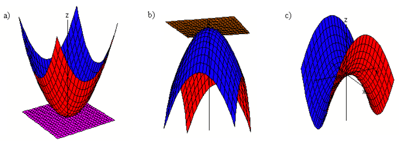
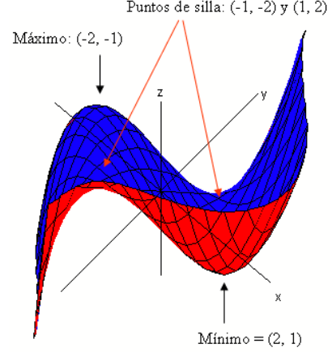
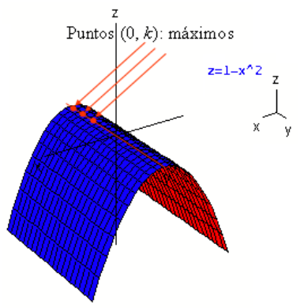
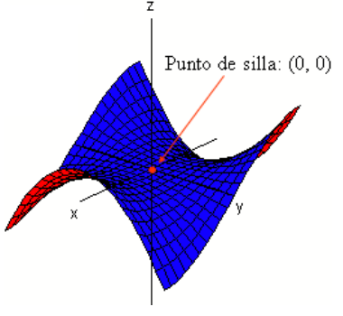
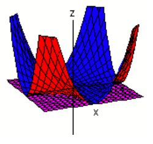

# Máximos y mínimos de funciones de dos variables

Fuente: `Puntos criticos.pdf`, páginas 1–5. Autor: José María Martínez Mediano
(firma al pie de las cinco páginas).
[Procedencia y revisión](../../../resources/2016/resume-misc-cobertura.md).

## Página 1

Dado un campo escalar $f:D\subset\mathbb R^2\longrightarrow\mathbb R$, $D$
abierto y $(x_0,y_0)\in D$.

- Se dice que $(x_0,y_0)$ es un **punto crítico o estacionario** de $f$ si
  $f(x,y)$ es diferenciable y

  $$
  df(x_0,y_0)=(0,0)\Rightarrow\nabla f(x_0,y_0)=(0,0)\Leftrightarrow f_x(x_0,y_0)=0\ \text{y}\ f_y(x_0,y_0)=0.
  $$

El punto $(x_0,y_0,f(x_0,y_0))$ se llama punto crítico o estacionario de la
superficie. El plano tangente en un punto crítico es horizontal. Generalmente
los puntos estacionarios de una superficie se clasifican en máximos, mínimos y
puntos de silla.

- Una función $f$ tiene un **mínimo local** en $(x_0,y_0)$ si
  $f(x_0,y_0)\le f(x,y)$, para todo $(x,y)$ perteneciente a un entorno de
  $(x_0,y_0)$. El número $f(x_0,y_0)$ es el mínimo de $f$ en ese entorno.
- Una función $f$ tiene un **máximo local** en $(x_0,y_0)$ si
  $f(x_0,y_0)\ge f(x,y)$, para todo $(x,y)$ perteneciente a un entorno de
  $(x_0,y_0)$. El número $f(x_0,y_0)$ es el máximo de $f$ en ese entorno.

Los máximos y los mínimos se llaman óptimos locales o relativos.

- Una función $f$ tiene un **punto de silla** en $(x_0,y_0)$ si todo entorno de
  $(x_0,y_0)$ contiene puntos $(x,y)$ tales que $f(x_0,y_0)\ge f(x,y)$ y otros
  para los que $f(x_0,y_0)\le f(x,y)$.

### Ejemplos

a) La función $f(x,y)=x^2+y^2$ tiene un mínimo en el punto $(0,0)$. El valor de
$f(x,y)\ge0$ para todo punto de un entorno de $(0,0)$. Como puede verse, el
punto $(0,0)$ es estacionario: $f_x(x,y)=2x$ y $f_y(x,y)=2y$ se anulan a la vez
en el punto $(0,0)$. El plano $z=0$ es tangente a ella en el punto $(0,0,0)$.

b) La función $f(x,y)=2-x^2-y^2$ tiene un máximo en el punto $(0,0)$. El valor
de $f(x,y)\le2$ para todo punto de un entorno de $(0,0)$. Como puede verse, el
punto $(0,0)$ es estacionario: $f_x(x,y)=-2x$ y $f_y(x,y)=-2y$ se anulan a la
vez en el punto $(0,0)$. El plano $z=2$ es tangente a ella en el punto
$(0,0,2)$.

c) La función $f(x,y)=x^2-y^2$ tiene un punto de silla en $(0,0)$. Existen
puntos de cualquier entorno de $(0,0)$ que hacen que $f(x,y)\le0$; y otros que
hacen que $f(x,y)\ge0$. El punto $(0,0)$ también es estacionario: $f_x(x,y)=2x$
y $f_y(x,y)=-2y$ se anulan a la vez en el punto $(0,0)$. El plano $z=0$,
tangente a $f(x,y)=x^2-y^2$ en el punto $(0,0,0)$ atraviesa esa superficie.

## Página 2: Condiciones de optimalidad

### 1. Condición necesaria de primer orden

Si $f$ posee un óptimo local en el punto $(x_0,y_0)$, entonces
$\nabla f(x_0,y_0)=(0,0)$. (Véase Nota 1.) Los óptimos se encuentran entre las
soluciones del sistema

$$
\begin{cases}f_x(x,y)=0\\f_y(x,y)=0\end{cases}
\quad\longrightarrow\text{puntos críticos}.
$$

No todos los puntos críticos son óptimos: entre ellos puede haber puntos de
silla.

### 2. Condiciones de segundo orden

Si $(x_0,y_0)$ es un punto crítico de $f$, se considera su matriz hessiana

$$
Hf(x_0,y_0)=\begin{pmatrix}f_{xx}(x_0,y_0)&f_{xy}(x_0,y_0)\\f_{yx}(x_0,y_0)&f_{yy}(x_0,y_0)\end{pmatrix}
\quad\longrightarrow\text{para simplificar: } Hf(x_0,y_0)=\begin{pmatrix}A&B\\B&C\end{pmatrix}
$$

Con esto:

- Si $(x_0,y_0)$ es un punto crítico de $f$, entonces si $AC-B^2>0$ y $A<0$
  $\Rightarrow(x_0,y_0)$ es máximo.
- Si $(x_0,y_0)$ es un punto crítico de $f$, entonces si $AC-B^2>0$ y $A>0$
  $\Rightarrow(x_0,y_0)$ es mínimo.
- Si $(x_0,y_0)$ es un punto crítico y $AC-B^2<0$ $\Rightarrow(x_0,y_0)$ es un
  punto de silla.
- Si $(x_0,y_0)$ es un punto crítico y $AC-B^2=0$, el caso es dudoso: puede
  tratarse de un máximo, de un mínimo o de un punto de silla.

(Véase Sydsaeter pp. 488 y ss. Véanse también las notas 2, 3, 4.)

### Ejemplos

a) Estudio de los extremos relativos de la función $f(x,y)=x^3+3xy^2-15x-12y$.

- Puntos críticos:

  $$
  \begin{cases}f_x=3x^2+3y^2-15=0\\f_y=6xy-12=0\end{cases}
  \Rightarrow\begin{cases}3x^2+3\cdot(2/x)^2-15=0\\y=2/x\end{cases}
  \Rightarrow x^4-5x^2+4=0\Rightarrow x=\pm1;\ \pm2
  $$

Los puntos críticos son: $(1,2)$; $(-1,-2)$; $(2,1)$; $(-2,-1)$.

- Hessiana:

  $$
  \begin{cases}f_{xx}=6x&f_{xy}=6y\\f_{yx}=6y&f_{yy}=6x\end{cases}
  $$

Punto $(1,2)$ $\longrightarrow Hf(1,2)=\begin{pmatrix}6&12\\12&6\end{pmatrix}$
$\longrightarrow |H|=36-144<0\Rightarrow(1,2)$ es punto de silla.

Punto $(-1,-2)$
$\longrightarrow Hf(-1,-2)=\begin{pmatrix}-6&-12\\-12&-6\end{pmatrix}$
$\longrightarrow |H|=36-144<0\Rightarrow(-1,-2)$ es punto de silla.

Punto $(2,1)$ $\longrightarrow Hf(2,1)=\begin{pmatrix}12&6\\6&12\end{pmatrix}$
$\longrightarrow |H|=144-36>0$; $A>0\Rightarrow(2,1)$ es un mínimo local. Su
valor es $f(2,1)=-28$.

Punto $(-2,-1)$
$\longrightarrow Hf(-2,-1)=\begin{pmatrix}-12&-6\\-6&-12\end{pmatrix}$
$\longrightarrow |H|=144-36>0$; $A<0\Rightarrow(-2,-1)$ es un máximo local. Su
valor es $f(-2,-1)=28$.

## Página 3

b) Estudio de los extremos relativos de la función $f(x,y)=1-x^2$.

- Puntos críticos:

  $$
  \begin{cases}f_x=-2x=0\\f_y=0\end{cases}
  \Rightarrow\begin{cases}x=0\\y=k\end{cases}
  \quad\longrightarrow\text{Hay infinitos puntos críticos: }(0,k).
  $$

- Hessiana:

  $$
  \begin{cases}f_{xx}=-2&f_{xy}=0\\f_{yx}=0&f_{yy}=0\end{cases}
  \Rightarrow Hf(0,k)=\begin{pmatrix}-2&0\\0&0\end{pmatrix}
  $$

Como su determinante es cero se trata de una caso dudoso. En este caso, la duda
se sustancia al considerar que la expresión $1-x^2\le1$. Por tanto, como
$f(0,k)=1$ para cualquier valor de $k$ $\Rightarrow$ en los puntos $(0,k)$ hay
máximos.

c) Estudio de los extremos relativos de la función $f(x,y)=x^3-3xy^2$.

- Puntos críticos:

  $$
  \begin{cases}f_x=3x^2-3y^2=0\\f_y=6xy=0\end{cases}
  \Rightarrow\text{Punto crítico: }(0,0).
  $$

- Hessiana:

  $$
  \begin{cases}f_{xx}=6x&f_{xy}=-6y\\f_{yx}=-6y&f_{yy}=6x\end{cases}
  \Rightarrow Hf(0,0)=\begin{pmatrix}0&0\\0&0\end{pmatrix}
  \longrightarrow |H|=0\longrightarrow\text{Caso dudoso}.
  $$

En cualquier entorno de $(0,0)$ existen puntos que hacen que $f(x,y)>f(0,0)$ y
otros que hacen que $f(x,y)<f(0,0)$. En concreto, para puntos de la forma
$(m,m)$, con $m$ tan pequeño como se desee, $f(m,m)=-2m^3$ que toma valores
mayores o menores que 0 dependiendo del signo de $m$.

d) Estudio de los extremos relativos de la función $f(x,y)=x^2y^2$.

- Puntos críticos:

$f_x(x,y)=2xy^2=0$; $f_y(x,y)=2x^2y=0$. Hay infinitos puntos críticos: $(0,k)$ y
$(k,0)$. Como $f(x,y)=x^2y^2$ siempre es $\ge0$, en esos puntos hay mínimos. A
partir de la hessiana no puede determinarse, pues:

$$
f_{xx}=2y^2;\quad f_{xy}=4xy;\quad f_{xx}=2x^2
\Rightarrow H(f)(0,k)=\begin{pmatrix}2k^2&0\\0&0\end{pmatrix}.
$$

## Página 4: Optimización: Algunas aclaraciones teóricas

### Nota 1

Si $f$ posee un óptimo local (máximo) en el punto $(x_0,y_0)$, y por tanto
$f(x_0,y_0)\ge f(x,y)$, entonces la derivada direccional en $(x_0,y_0)$ según la
dirección de cualquier vector $\vec v$ no puede ser positiva:

$$
f'((x_0,y_0),\vec v)=\lim_{h\to0}\frac{f((x_0,y_0)+h(v_1,v_2))-f(x_0,y_0)}h\le0
$$

Como $f(x,y)-f(x_0,y_0)\le0$:

$$
\text{para }h<0\Rightarrow f'((x_0,y_0),\vec v)=\left[\frac{(-)}{(-)}\right]\ge0;
\quad\text{y para }h>0\Rightarrow f'((x_0,y_0),\vec v)=\left[\frac{(-)}{(+)}\right]\le0
$$

Por tanto, $f'((x_0,y_0),\vec v)=0$. En particular:

$$
\text{para }\vec v=(1,0)\longrightarrow f'((x_0,y_0),\vec v)=f_x(x_0,y_0)=0;
$$

$$
\text{para }\vec v=(0,1)\longrightarrow f'((x_0,y_0),\vec v)=f_y(x_0,y_0)=0
$$

Luego, si $f$ posee un óptimo local en el punto $(x_0,y_0)$, entonces
$\nabla f(x_0,y_0)=(0,0)$.

### Nota 2

Normalmente la clasificación de los puntos críticos de una función de varias
variables se hace estudiando la forma cuadrática
$Hf(x_0,y_0)=\begin{pmatrix}A&B\\B&C\end{pmatrix}$. Los criterios de
clasificación pueden verse en Sydsaeter pp. 420 y ss.

### Nota 3

Lo dicho en la nota 2 cobra sentido si se tiene en cuenta el desarrollo de
Taylor de grado dos, pues cuando $\nabla f(x_0,y_0)=(0,0)$ la expresión queda:

$$
f(x,y)=f(x_0,y_0)+\frac12(x-x_0,y-y_0)
\begin{pmatrix}f_{xx}(x_0,y_0)&f_{xy}(x_0,y_0)\\f_{yx}(x_0,y_0)&f_{yy}(x_0,y_0)\end{pmatrix}
\begin{pmatrix}x-x_0\\y-y_0\end{pmatrix}+R(x,y)
$$

donde el resto $R(x,y)\to0$ cuando $(x-x_0,y-y_0)\to(0,0)$. Por tanto, que
$f(x_0,y_0)\le f(x,y)$ —caso de mínimo— o que $f(x_0,y_0)\ge f(x,y)$ —caso de
máximo— depende del término asociado a la hessiana; esto es, del carácter de la
forma cuadrática $Hf(x_0,y_0)$.

Ampliación de esta nota: Conviene observar que la matriz $Hf(x_0,y_0)$, en
adelante $H$, es simétrica. Por tanto es diagonalizable mediante congruencias;
esto es, existe una matriz diagonal $D$ y una matriz ortogonal $C$ tales que
$H=CDC^T$. En consecuencia, para cualquier matriz fila (para un vector) $X$ se
cumple que:

$$
XHX^T=XCDC^TX^T\Rightarrow XHX^T=(XC)D(XC)^T
$$

Si $X=(x,y)$ y $\lambda_1$ y $\lambda_2$ son los autovalores de matriz $H$, con
autovectores asociados $\begin{pmatrix}u_1\\u_2\end{pmatrix}$ y
$\begin{pmatrix}v_1\\v_2\end{pmatrix}$, ortonormales, entonces

$$
(x,y)H\begin{pmatrix}x\\y\end{pmatrix}
=(x,y)\begin{pmatrix}u_1&v_1\\u_2&v_2\end{pmatrix}
\begin{pmatrix}\lambda_1&0\\0&\lambda_2\end{pmatrix}
\begin{pmatrix}u_1&u_2\\v_1&v_2\end{pmatrix}\begin{pmatrix}x\\y\end{pmatrix}=
$$

## Página 5

$$
=\big((x,y)\cdot(u_1,u_2)\quad(x,y)\cdot(v_1,v_2)\big)
\begin{pmatrix}\lambda_1&0\\0&\lambda_2\end{pmatrix}
\begin{pmatrix}(x,y)\cdot(u_1,u_2)\\(x,y)\cdot(v_1,v_2)\end{pmatrix}=
$$

$$
=\big(\lambda_1(x,y)\cdot(u_1,u_2)\quad\lambda_2(x,y)\cdot(v_1,v_2)\big)
\begin{pmatrix}(x,y)\cdot(u_1,u_2)\\(x,y)\cdot(v_1,v_2)\end{pmatrix}=
$$

$$
=\lambda_1(x,y)\cdot(u_1,u_2)\cdot(x,y)\cdot(u_1,u_2)
+\lambda_2(x,y)\cdot(v_1,v_2)\cdot(x,y)\cdot(v_1,v_2)=
$$

$$
=\lambda_1(x^2+y^2)+\lambda_2(x^2+y^2)
$$

Esto indica que el signo de $(x,y)H\begin{pmatrix}x\\y\end{pmatrix}$ depende de
$\lambda_1$ y $\lambda_2$, pues $(x^2+y^2)\ge0$ siempre. (Recuérdese que si $C$
es ortogonal, entonces: $(u_1,u_2)\cdot(u_1,u_2)=1$ y
$(v_1,v_2)\cdot(v_1,v_2)=1$.)

En consecuencia:

- si ambos autovalores son positivos $\Rightarrow$
  $(x,y)H\begin{pmatrix}x\\y\end{pmatrix}>0\Rightarrow f(x_0,y_0)\le f(x,y)$
  $\longrightarrow$ en $(x_0,y_0)$ se tiene un mínimo.
- si ambos autovalores son negativos $\Rightarrow$
  $(x,y)H\begin{pmatrix}x\\y\end{pmatrix}<0\Rightarrow f(x_0,y_0)\ge f(x,y)$
  $\longrightarrow$ en $(x_0,y_0)$ se tiene un máximo.
- si los autovalores tienen signos distintos $\Rightarrow$
  $(x,y)H\begin{pmatrix}x\\y\end{pmatrix}$ toma signos distintos $\Rightarrow$
  en $(x_0,y_0)$ se tiene un punto de silla.

### Nota 4

El signo de los autovalores está ligado al determinante de $H$:

$$
|Hf(x_0,y_0)|=\begin{vmatrix}A&B\\B&C\end{vmatrix}=AC-B^2
$$

En efecto, la ecuación característica de
$Hf(x_0,y_0)=\begin{pmatrix}A&B\\B&C\end{pmatrix}$ es

$$
\begin{vmatrix}A-\lambda&B\\B&C-\lambda\end{vmatrix}
=\lambda^2-(A+C)\lambda+(AC-B^2)=0.
$$

Las soluciones de esta ecuación de segundo grado, que son los autovalores
$\lambda_1$ y $\lambda_2$, cumplen:

$$
\lambda_1+\lambda_2=A+C,\qquad\lambda_1\cdot\lambda_2=(AC-B^2)
$$

Luego:

- Si $AC-B^2<0$ los autovalores tienen signos opuestos $\longrightarrow$ en
  $(x_0,y_0)$ se tiene un punto de silla.

- Si los autovalores tienen signos iguales $\Rightarrow AC-B^2>0$
  $\Rightarrow AC>B^2$, que sólo puede darse si $A$ y $C$ tienen el mismo signo,
  que además coincide con el signo de $\lambda_1$ y $\lambda_2$, ya que
  $A+C=\lambda_1+\lambda_2$.

- Luego:

  si $AC-B^2>0$ y $A>0$, $\lambda_1$ y $\lambda_2$ son positivos
  $\longrightarrow$ en $(x_0,y_0)$ se tiene un mínimo.

  si $AC-B^2>0$ y $A<0$, $\lambda_1$ y $\lambda_2$ son negativos
  $\longrightarrow$ en $(x_0,y_0)$ se tiene un máximo.

> Nota de transcripción: se mantienen las erratas del original: en el ejemplo c
> se imprime $f_y=6xy$ y $f_{yy}=6x$; en d se repite $f_{xx}$ para $2x^2$; la
> última igualdad de la ampliación de la nota 3 sustituye ambos productos por
> $x^2+y^2$. No se corrigen estas expresiones ni sus conclusiones.
