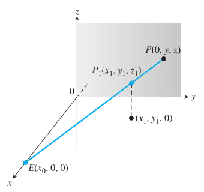
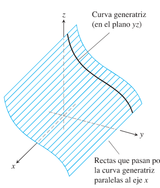
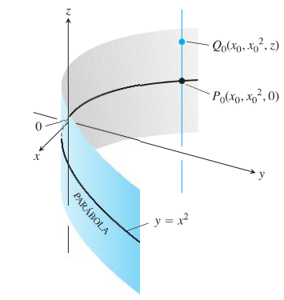
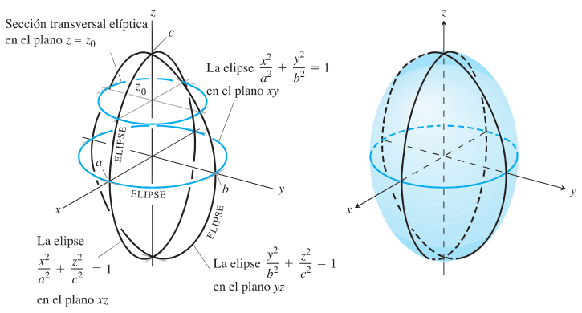
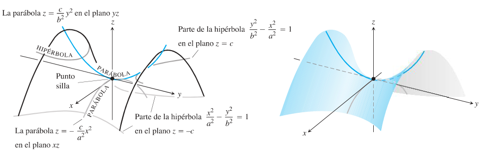
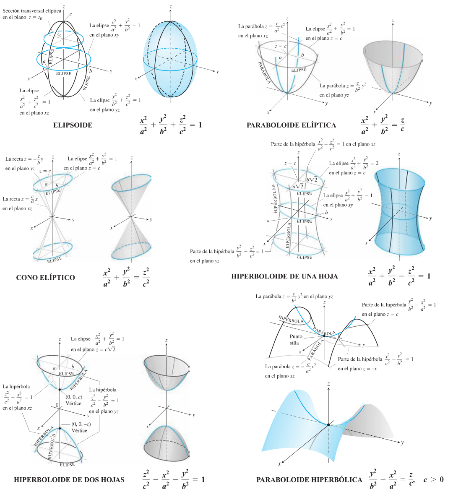

<!-- markdownlint-disable MD029 -->

# Cilindros y superficies cuádricas

Fuente: `Resumen cuadricas.pdf`, páginas PDF 1–4; páginas impresas 696–699 del
capítulo 12, «Los vectores y la geometría del espacio». El extracto no incluye
portada, autor ni año impreso.
[Procedencia y revisión](../../../resources/2016/resume-misc-cobertura.md).

## Página 696: ejercicios de la sección anterior

68. ¿Cómo podría saber si dos planos $`A_1x+B_1y+C_1z=D_1`$ y
    $`A_2x+B_2y+C_2z=D_2`$ son paralelos o perpendiculares? Justifique su
    respuesta.

01. Obtenga dos planos distintos cuya intersección sea la recta $`x=1+t`$,
    $`y=2-t`$, $`z=3+2t`$. Escriba las ecuaciones para cada plano en la forma
    $`Ax+By+Cz=D`$.

01. Encuentre el plano que pasa por el origen y que corta al plano
    $`M:2x+3y+z=12`$ en un ángulo recto. ¿Cómo sabe que su plano es
    perpendicular a $`M`$?

01. La gráfica de $`(x/a)+(y/b)+(z/c)=1`$ es un plano para cualesquiera números
    distintos de cero $`a`$, $`b`$ y $`c`$. ¿Cuáles planos tienen una ecuación
    de esta forma?

01. Suponga que $`L_1`$ y $`L_2`$ son rectas no paralelas distintas (que no se
    intersecan). ¿Es posible que un vector no nulo sea perpendicular a ambas?
    Justifique su respuesta.

01. **La perspectiva en graficación por computadora** En los gráficos por
    computadora y el dibujo en perspectiva necesitamos representar objetos
    vistos por el ojo en el espacio como imágenes en un plano bidimensional.
    Suponga que el ojo está en $`E(x_0,0,0)`$, como se muestra en la figura, y
    que queremos representar un punto $`P_1(x_1,y_1,z_1)`$ como un punto sobre
    el plano $`yz`$. Hacemos esto proyectando $`P_1`$ sobre el plano con un rayo
    desde $`E`$. El punto $`P_1`$ se representa mediante el punto $`P(0,y,z)`$.
    El problema para nosotros como diseñadores de gráficos es encontrar $`y`$ y
    $`z`$ dados $`E`$ y $`P_1`$.

    a. Escriba una ecuación vectorial que sea válida entre
    $`\overrightarrow{EP}`$ y $`\overrightarrow{EP_1}`$. Use esta ecuación para
    expresar $`y`$ y $`z`$ en términos de $`x_0`$, $`x_1`$, $`y_1`$ y $`z_1`$.

    b. Compruebe las fórmulas obtenidas para $`y`$ y $`z`$ en el inciso (a),
    investigando su comportamiento en $`x_1=0`$ y $`x_1=x_0`$ y también viendo
    qué pasa cuando $`x_0\to\infty`$. ¿Qué encontró?

    

01. **Rectas ocultas en graficación por computadora** Éste es otro problema
    típico en la graficación por computadora. Su ojo está en $`(4,0,0)`$. Usted
    está mirando una placa triangular cuyos vértices están en $`(1,0,1)`$,
    $`(1,1,0)`$ y $`(-2,2,2)`$. El segmento de recta de $`(1,0,0)`$ a
    $`(0,2,2)`$ pasa por la placa. ¿Qué porción del segmento de recta está
    oculto a su vista por la placa? (Éste es un ejercicio de localización de
    intersecciones de rectas y planos).

## 12.6 Cilindros y superficies cuádricas

Hasta ahora hemos estudiado dos tipos de superficies: esferas y planos. En esta
sección ampliaremos nuestro inventario para incluir una variedad de cilindros y
superficies cuádricas. Las superficies cuádricas son superficies definidas por
ecuaciones de segundo grado en $`x`$, $`y`$ y $`z`$. Las esferas son superficies
cuádricas y hay otras de igual interés que serán necesarias en los capítulos 14
a 16.

### Cilindros

Un **cilindro** es una superficie que se genera por el movimiento de una línea
recta paralela a una recta fija dada a lo largo de una curva plana dada. La
curva se llama **curva generatriz** del cilindro (figura 12.43). En geometría
sólida, donde *cilindro* significa *cilindro circular*, las curvas generatrices
son circunferencias, pero ahora permitimos curvas generatrices de cualquier
tipo. El cilindro de nuestro primer ejemplo es generado por una parábola.



### Ejemplo 1

Obtenga una ecuación para el cilindro formado por las rectas paralelas al eje
$`z`$ que pasan por la parábola $`y=x^2`$, $`z=0`$ (figura 12.44).

**Solución** El punto $`P_0(x_0,x_0^2,0)`$ está en la parábola $`y=x^2`$ en el
plano $`xy`$. Entonces, para cualquier valor de $`z`$, el punto
$`Q_0(x_0,x_0^2,z)`$ estará en el cilindro porque se encuentra en la recta
$`x=x_0`$, $`y=x_0^2`$ que pasa por $`P_0`$ paralela al eje $`z`$.
Recíprocamente, cualquier punto $`Q(x_0,x_0^2,z)`$ cuya coordenada $`y`$ sea el
cuadrado de su coordenada $`x`$, está sobre el cilindro, ya que se encuentra
sobre la recta $`x=x_0`$, $`y=x_0^2`$ que pasa por $`P_0`$ paralela al eje $`z`$
(figura 12.44).

Sin importar el valor de $`z`$, los puntos sobre la superficie son aquellos
cuyas coordenadas satisfacen la ecuación $`y=x^2`$. Esto hace de $`y=x^2`$ una
ecuación para el cilindro. Debido a esto, llamamos al cilindro “el cilindro
$`y=x^2`$”.

## Página 697

Como sugiere el ejemplo 1, cualquier curva $`f(x,y)=c`$ en el plano $`xy`$
define un cilindro paralelo al eje $`z`$, cuya ecuación también es $`f(x,y)=c`$.
Por ejemplo, la ecuación $`x^2+y^2=1`$ define el cilindro circular formado por
las rectas paralelas al eje $`z`$ que pasan por la circunferencia $`x^2+y^2=1`$
en el plano $`xy`$.

De un modo similar, cualquier curva $`g(x,z)=c`$ en el plano $`xz`$ define un
cilindro paralelo al eje $`y`$ cuya ecuación espacial también es $`g(x,z)=c`$.
Cualquier curva $`h(y,z)=c`$ define un cilindro paralelo al eje $`x`$ cuya
ecuación espacial también es $`h(y,z)=c`$. Sin embargo, el eje de un cilindro no
necesita ser paralelo a un eje coordenado.



**Figura 12.44** Todos los puntos del cilindro del ejemplo 1 tienen coordenadas
de la forma $`(x_0,x_0^2,z)`$. Le llamamos “el cilindro $`y=x^2`$”.

### Superficies cuádricas

Una **superficie cuádrica** es la gráfica en el espacio de una ecuación de
segundo grado en $`x`$, $`y`$ y $`z`$. Nos enfocaremos en la ecuación general

```math
Ax^2+By^2+Cz^2+Dz=E,
```

donde $`A`$, $`B`$, $`C`$, $`D`$ y $`E`$ son constantes. Las superficies
cuádricas básicas son los **elipsoides**, los **paraboloides**, los **conos
elípticos** y los **hiperboloides**. Las esferas son casos especiales de los
elipsoides. Daremos unos cuantos ejemplos para ilustrar cómo dibujar una
superficie cuádrica y luego presentamos una tabla de gráficas en la que se
resumen los tipos básicos.

### Ejemplo 2

El **elipsoide**

```math
\frac{x^2}{a^2}+\frac{y^2}{b^2}+\frac{z^2}{c^2}=1
```

(figura 12.45) corta los ejes coordenados en $`(\pm a,0,0)`$, $`(0,\pm b,0)`$ y
$`(0,0,\pm c)`$. Se encuentra dentro de la caja rectangular definida por las
desigualdades $`|x|\le a`$, $`|y|\le b`$, $`|z|\le c`$. La superficie es
simétrica con respecto a cada uno de los planos coordenados porque en la
ecuación que la define, cada variable está elevada al cuadrado.



**Figura 12.45** El elipsoide
$`\frac{x^2}{a^2}+\frac{y^2}{b^2}+\frac{z^2}{c^2}=1`$ del ejemplo 2 tiene
secciones transversales elípticas en cada uno de los tres planos coordenados.

Las curvas donde los tres planos coordenados cortan a la superficie son elipses.
Por ejemplo,

```math
\frac{x^2}{a^2}+\frac{y^2}{b^2}=1\qquad\text{cuando}\quad z=0.
```

## Página 698

La curva cortada a la superficie por el plano $`z=z_0`$, $`|z_0|<c`$, es la
elipse

```math
\frac{x^2}{a^2(1-(z_0/c)^2)}+\frac{y^2}{b^2(1-(z_0/c)^2)}=1.
```

Si cualesquiera dos de los semiejes $`a`$, $`b`$ y $`c`$ son iguales entre sí,
la superficie es un **elipsoide de revolución**. Si los tres semiejes son
iguales, la superficie es una esfera.

### Ejemplo 3

El **paraboloide hiperbólico**

```math
\frac{y^2}{b^2}-\frac{x^2}{a^2}=\frac zc,\qquad c>0
```

tiene simetría con respecto a los planos $`x=0`$ y $`y=0`$ (figura 12.46). Las
secciones transversales en estos planos son

```math
x=0:\quad\text{la parábola }z=\frac c{b^2}y^2.\tag{1}
```

```math
y=0:\quad\text{la parábola }z=-\frac c{a^2}x^2.\tag{2}
```

En el plano $`x=0`$, la parábola se abre hacia arriba a partir del origen. La
parábola en el plano $`y=0`$ se abre hacia abajo.

Si cortamos a la superficie con un plano $`z=z_0>0`$, la sección transversal es
una hipérbola,

```math
\frac{y^2}{b^2}-\frac{x^2}{a^2}=\frac{z_0}c,
```

con su eje focal paralelo al eje $`y`$ y sus vértices sobre la parábola de la
ecuación (1). Si $`z_0`$ es negativo, el eje focal es paralelo al eje $`x`$ y
los vértices están sobre la parábola de la ecuación (2).



**Figura 12.46** El paraboloide hiperbólico $`(y^2/b^2)-(x^2/a^2)=z/c`$,
$`c>0`$. Las secciones transversales por planos perpendiculares al eje $`z`$ por
arriba y por abajo del plano $`xy`$ son hipérbolas. Las secciones transversales
por planos perpendiculares a los otros ejes son parábolas.

Cerca del origen, la superficie tiene la forma de una silla de montar o de un
paso de montaña. Para una persona que viaja a lo largo de la superficie en el
plano $`yz`$, el origen le parece un mínimo, pero para alguien que viaja en el
plano $`xz`$, el origen parece un máximo. Este tipo de punto se llama **punto
silla** (o punto de silla) de una superficie. Diremos más acerca de puntos silla
en la sección 14.7.

La tabla 12.1 muestra las gráficas de los seis tipos básicos de superficies
cuádricas. Cada superficie mostrada es simétrica con respecto al eje $`z`$, pero
otros ejes coordenados pueden servir también (con los cambios apropiados en la
ecuación).

## Página 699: Tabla 12.1. Gráficas de superficies cuádricas

| Superficie | Ecuación |
| -- | -- |
| ELIPSOIDE | $`\frac{x^2}{a^2}+\frac{y^2}{b^2}+\frac{z^2}{c^2}=1`$ |
| PARABOLOIDE ELÍPTICA | $`\frac{x^2}{a^2}+\frac{y^2}{b^2}=\frac zc`$ |
| CONO ELÍPTICO | $`\frac{x^2}{a^2}+\frac{y^2}{b^2}=\frac{z^2}{c^2}`$ |
| HIPERBOLOIDE DE UNA HOJA | $`\frac{x^2}{a^2}+\frac{y^2}{b^2}-\frac{z^2}{c^2}=1`$ |
| HIPERBOLOIDE DE DOS HOJAS | $`\frac{z^2}{c^2}-\frac{x^2}{a^2}-\frac{y^2}{b^2}=1`$ |
| PARABOLOIDE HIPERBÓLICA | $`\frac{y^2}{b^2}-\frac{x^2}{a^2}=\frac zc`$, $`c>0`$ |



Las etiquetas de los seis gráficos se conservan en la imagen. Sus ecuaciones
son:

- Elipsoide: sección transversal elíptica en el plano $`z=z_0`$; la elipse
  $`x^2/a^2+y^2/b^2=1`$ en el plano $`xy`$; la elipse $`x^2/a^2+z^2/c^2=1`$ en
  el plano $`xz`$; la elipse $`y^2/b^2+z^2/c^2=1`$ en el plano $`yz`$.
- Paraboloide elíptica: la parábola $`z=(c/a^2)x^2`$ en el plano $`xz`$; la
  parábola $`z=(c/b^2)y^2`$ en el plano $`yz`$; la elipse $`x^2/a^2+y^2/b^2=1`$
  en el plano $`z=c`$.
- Cono elíptico: la recta $`z=(c/b)y`$ en el plano $`yz`$; la recta $`z=(c/a)x`$
  en el plano $`xz`$; la elipse $`x^2/a^2+y^2/b^2=1`$ en el plano $`z=c`$.
- Hiperboloide de una hoja: parte de la hipérbola $`x^2/a^2-z^2/c^2=1`$ en el
  plano $`xz`$; parte de la hipérbola $`y^2/b^2-z^2/c^2=1`$ en el plano $`yz`$;
  la elipse $`x^2/a^2+y^2/b^2=2`$ en el plano $`z=c`$; la elipse
  $`x^2/a^2+y^2/b^2=1`$ en el plano $`xy`$; marcas $`a\sqrt2`$, $`b\sqrt2`$.
- Hiperboloide de dos hojas: la elipse $`x^2/a^2+y^2/b^2=1`$ en el plano
  $`z=c\sqrt2`$; la hipérbola $`z^2/c^2-x^2/a^2=1`$ en el plano $`xz`$; la
  hipérbola $`z^2/c^2-y^2/b^2=1`$ en el plano $`yz`$; vértices $`(0,0,c)`$ y
  $`(0,0,-c)`$.
- Paraboloide hiperbólica: la parábola $`z=(c/b^2)y^2`$ en el plano $`yz`$; la
  parábola $`z=-(c/a^2)x^2`$ en el plano $`xz`$; parte de la hipérbola
  $`y^2/b^2-x^2/a^2=1`$ en el plano $`z=c`$; parte de la hipérbola
  $`x^2/a^2-y^2/b^2=1`$ en el plano $`z=-c`$; punto silla.

> Nota de transcripción: se conservan los nombres «paraboloide elíptica» y
> «paraboloide hiperbólica» de la tabla original. El archivo comienza con los
> ejercicios de una sección anterior; se incluyen completos.
