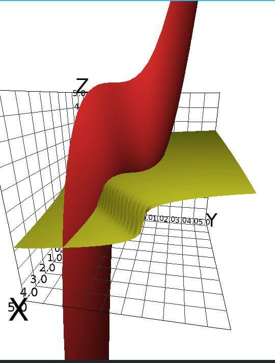

# Sistema de funciones implícitas y derivadas

Fuente: `Sist de fn implícitas y derivadas.jpg`, una imagen.
[Procedencia y revisión](../../../resources/2016/resume-misc-cobertura.md).

El original contiene únicamente este gráfico tridimensional, con ejes $`X`$,
$`Y`$ y $`Z`$ y marcas numéricas. No incluye ecuaciones, enunciado ni texto
explicativo.
