# Series de Fourier

Fuente: «Series de Fourier.pdf», archivo de 2016, 22 páginas. Autor: Ing.
Leopoldo De Urrutia. Edición electrónica: Prof. Bibiana Altamirano. Gráficos:
Ing. Luciano Curie. Año de edición no indicado.
[Procedencia y revisión](../../../resources/2016/resume-teoria-cobertura.md).

## Página 1

### Conceptos previos

Iniciaremos este capítulo con la revisión de algunos conceptos elementales que
serán de aplicación en los desarrollos posteriores.

### Funciones Pares

Una función y=f(x) es PAR si $\forall x:f(-x)=f(x)$.

**Ejemplos:** son funciones pares

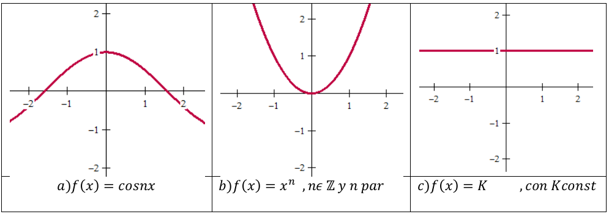

a) $f(x)=\cos nx$; b) $f(x)=x^n$, $n\in\mathbb Z$ y n par; c) $f(x)=K$, con K
const.

Como consecuencia inmediata de la definición podemos observar que para todo par
de puntos simétricos al origen “-x₀”; “x₀” pertenecientes a su dominio, la
función toma los mismos valores numéricos y por lo tanto “su gráfica es
simétrica respecto al eje de ordenadas”.

### Propiedades de las funciones pares

Sean f(x) y g(x) dos funciones pares:

**Propiedad 1:** La suma de dos funciones pares es otra función par:

U(x)= f(x) + g(x) es PAR, es decir, U(-x)=U(x)

*Demostración:* U(-x)= f(-x)+g(-x)= f(x)+g(x)=U(x) por lo tanto se cumple que
U(-x)=U(x)

## Página 2

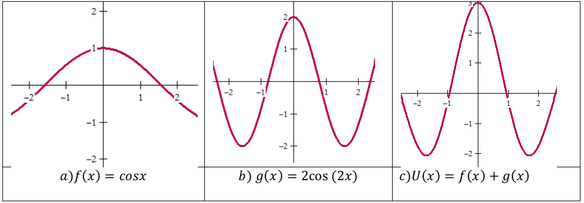

**Propiedad 2:** El producto o cociente de dos funciones pares es otra función
par:

V(x)= f(x) .g(x) es PAR, es decir, V(-x)=V(x)

*Demostración:* V(x)= f(x) .g(x) = f(-x) .g(-x) =V(-x) por lo tanto se cumple
que V(-x)=V(x)

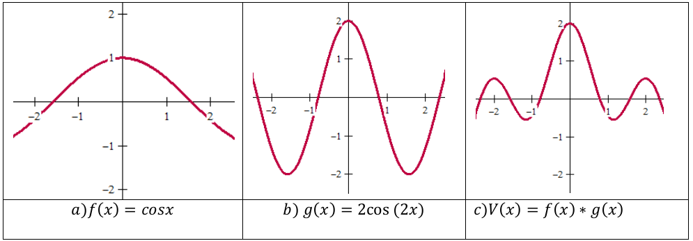

Demuestre que V(x)=f(x)/g(x) es par

**Propiedad 3:** $\int_{-a}^a f(x)dx=2\int_0^a f(x)dx$

esta propiedad de la integral definida de una función par, en un intervalo de
integración simétrico respecto del origen es evidente, si se tiene en cuenta la
simetría de representación abordada anteriormente, el valor de la integral como
área.

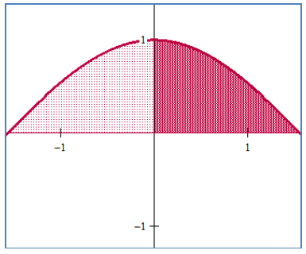

## Página 3

### Funciones impares

Una función y=f(x) es **IMPAR** si $\forall x:f(-x)=-f(x)$.

**Ejemplos:** son funciones impares

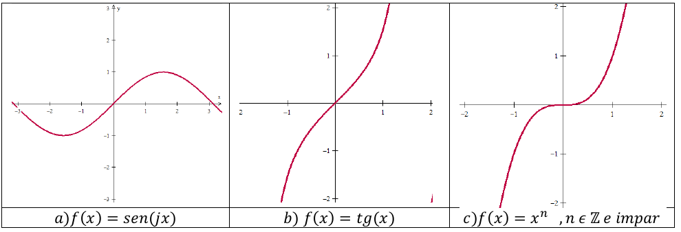

a) $f(x)=\operatorname{sen}(jx)$; b) $f(x)=\operatorname{tg}(x)$; c) $f(x)=x^n$,
$n\in\mathbb Z$ e impar.

### Propiedades de las funciones impares

Sean f(x) y g(x) funciones impares:

**Propiedad 1:** La suma de dos funciones impares es otra función impar:

U(x)= f(x) + g(x) es IMPAR, es decir, U(-x)=-U(x)

*Demostración:* U(-x)= f(-x)+g(-x)=- f(x)-g(x)=-( f(x) + g(x) )=-U(x) por lo
tanto se cumple que U(-x)=-U(x)

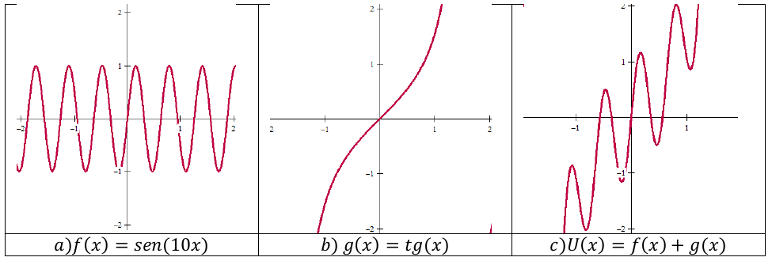

**Propiedad 2:** El producto o cociente de dos funciones impares es una función
par:

V(x)= f(x) .g(x) es PAR, es decir, V(-x)=V(x)

*Demostración:* V(-x)= f(-x) .g(-x) =[- f(x)] .[-g(x)] = f(x) .g(x) =V(x) por lo
tanto se cumple que V(-x)=V(x)

Demuestre que V(x)=f(x)/g(x) es par

## Página 4

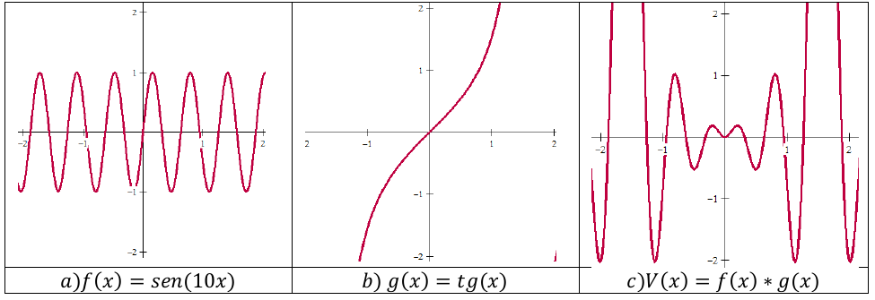

**Propiedad 3:** El producto o cociente de una función par y otra impar da como
resultado una función impar.

Sean f(x) una función par y g(x)una función impar entonces V(x)= f(x) .g(x) es
una función impar

Demostración: Sabemos que f(x)=f(-x) y g(-x)=-g(x)

V(-x)= f(-x).g(-x)=f(x).[-g(x)]=-[f(x).g(x)]=-V(x) por lo tanto V(x) es impar

Demuestre que V(x)=f(x)/g(x) es impar

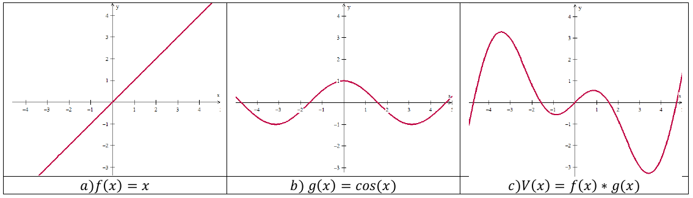

**Propiedad 4:** Dado que una función impar toma valores numéricos opuestos para
valores opuestos de la variable independiente, su gráfica es una curva simétrica
respecto al punto de origen.

Ejemplo: f(x)=x3

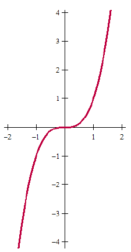

Como consecuencia de esta propiedad de simetría geométrica resulta evidente que
toda integral definida de una función impar en un intervalo de integración
simétrico respecto del origen es nulo. Por lo tanto $\int_{-a}^a f(x)dx=0$, si
f(x) es una función impar.

## Página 5

### Funciones Periódicas

**Definición:** Se dice que una función y=f(x) es periódica y que su período es
“p” si se cumple que:

$$
f(x+p)=f(x)\quad\forall x\in\mathbb R
$$

*Ejemplos:* las funciones trigonométricas, ya que:

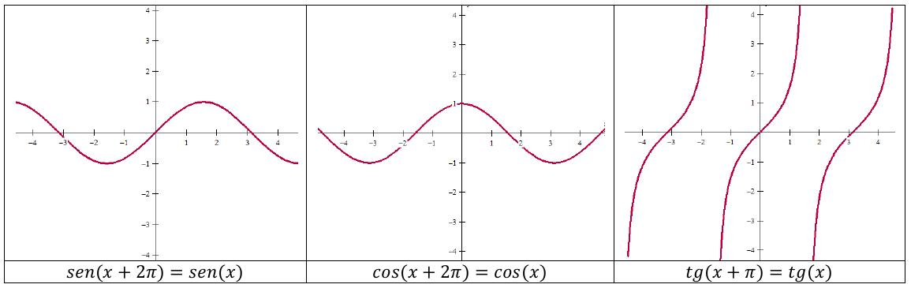

$$
\operatorname{sen}(x+2\pi)=\operatorname{sen}(x),\quad
\cos(x+2\pi)=\cos(x),\quad\operatorname{tg}(x+\pi)=\operatorname{tg}(x)
$$

En los dos primeros casos el período es 2π y en el tercero es π. Como
consecuencia inmediata de la definición observamos que la gráfica de una función
periódica se repite en intervalos consecutivos cuya amplitud es “p”.

Representamos la función de período 2π definida por:

$$
f(x)=\begin{cases}x&\text{si }0<x<\pi\\\pi&\text{si }\pi<x<2\pi\end{cases}
$$

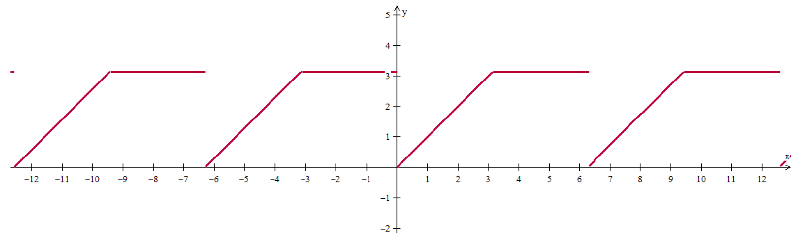

### Propiedades de las funciones periódicas

**Propiedad 1:** Si $f(x+p)=f(x)\;\forall x\in\mathbb R$ y $n\in\mathbb Z$,
$n\ne0$ entonces y $f(x+np)=f(x)$, de modo que **“cualquier múltiplo entero del
período, también es período de la misma función”**. El período “p” de menor
valor se denomina *período primitivo de la función*.

Hemos visto que tg x= tg(x+π), son también períodos de la función tangente,
$\pm2\pi,\pm3\pi,\pm4\pi$ etc., pero el período primitivo de la función es p=π.

## Página 6

**Propiedad 2:** Si f(x) es una función periódica de período p, f(ax) es otra
función de período p/a $\forall a>0$.

Demostración: en la función f(ax) le asignaremos a x el valor x+p/a

f(a(x+p/a)) distribuyendo queda f(ax+a.p/a)=f(ax+p) y como
$f(x+p)=f(x)\;\forall x\in\mathbb R$ incluso para (a.x)

entonces f(a(x+p/a))=f(ax) con lo cual queda demostrado que su período es p/a

Como aplicación a esta propiedad observamos que siendo el período de f(x)=sen x
es p=2π por lo tanto el período de la función f(x)=sen nx será p=2π/n

Como consecuencia las gráficas correspondientes a sen x, sen 2x, sen 3x… se
repiten 1,2,3,… veces el período 2π, como se puede observar.

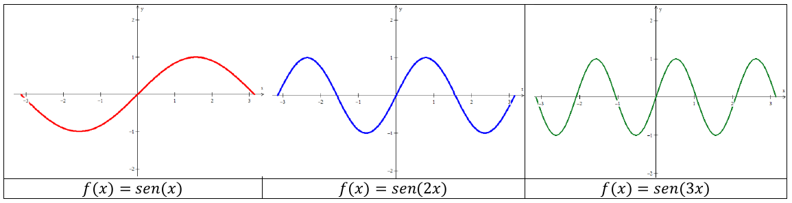

Lo mismo ocurre con las funciones cosenoidales para cos x, cos 2x, cos 3x, ya
que conocemos su gráfica.

**Propiedad 3:** Si f(x) es una función periódica de período p y b≠0, entonces
f(x/b) es otra función periódica cuyo período es p.b.

*Demostración:*

$$
f\left(\frac{x+p\cdot b}{b}\right)=f\left(\frac xb+p\right)\quad\text{pero}
$$

$$
f\left(\frac xb+p\right)=f\left(\frac xb\right)\quad\text{por ser }f(x+p)=f(x)\;\forall x,
\quad\text{entonces }f\left(\frac xb\right)\text{ es periódica de período }b\cdot p
$$

**Propiedad 4:** La suma de funciones periódicas de igual período es otra
función periódica del mismo período.

Sean f(x) y g(x) tales que:

$$
\begin{cases}f(x+p)=f(x)\\g(x+p)=g(x)\end{cases}
\quad\text{entonces }h(x)=f(x)+g(x)
$$

Entonces se cumplirá: h(x+p)= f(x+p)+g(x+p)=f(x)+g(x)=h(x)

Por lo tanto h(x+p)=h(x)

**Propiedad 5:** Supongamos la función:

$$
f(x)=2\operatorname{sen}x+\frac32\operatorname{sen}2x+\operatorname{sen}3x
$$

es una suma de funciones periódicas; la primera de las cuales (sen x) tiene
período p=2π; la segunda (sen 2x) tiene un período primitivo p=π y la tercera
p=2π/3 pero considerando la propiedad 2, ambas admiten también período p=2π.

## Página 7

En consecuencia f(x) tiene por período p=2π.

Por ser de suma importancia para interpretar algunos de los desarrollos en serie
de Fourier construiremos su gráfica correspondiente. Para ello recordemos que en
la función y=A.sen x, el coeficiente A es la “amplitud” de onda de modo que

$$
-A\le f(x)\le A
$$

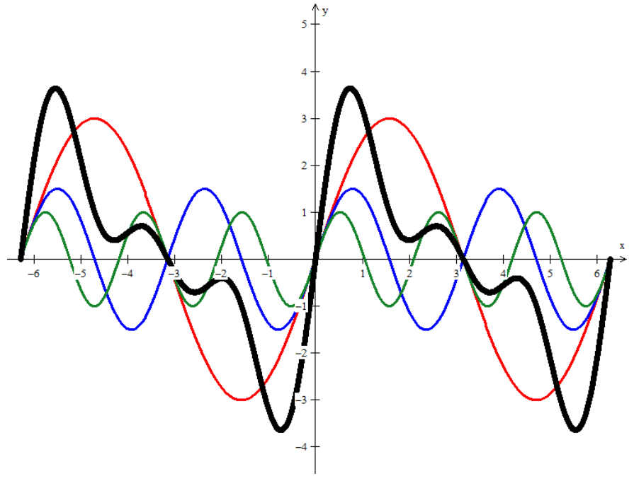

### Integrales definidas de funciones periódicas

Sea f(x) una función periódica de período p; f(x)=f(x+p)
$\forall x\in\mathbb R$. Si f(x) es integrable en un intervalo de amplitud igual
al período p, entonces es integrable sobre cualquier intervalo de $\mathbb R$.
Además se verifica que:

$\int_a^{a+p}f(x)dx$ es constante, cualquiera sea el valor de a y siempre que la
longitud del intervalo de integración sea p **(en el gráfico “p” aparece como
“T”)**.

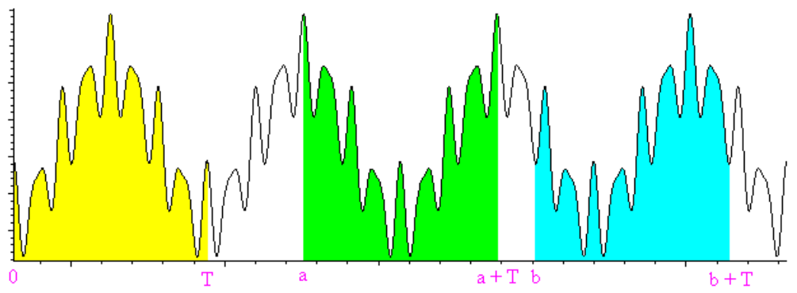

*Demostración:*

## Página 8

$$
\int_a^{a+p}f(x)dx=\int_0^p f(x)dx+\int_p^{a+p}f(x)dx-\int_0^a f(x)dx\tag{1}
$$

Analicemos la segunda integral, del segundo miembro:

$\int_a^{a+p}f(x)dx$; se hacemos x=t+p ⇒ dx=dt, además

Si p=x ⇒ t=0; si x=a+p ⇒ t=a, reemplazando

$\int_a^{a+p}f(x)dx=\int_0^a f(t+p)dt=\int_0^a f(x)dx$, reemplazando en (1)

$\int_a^{a+p}f(x)dx=\int_0^p f(x)dx+\int_0^a f(x)dx-\int_0^a f(x)dx$ por lo
tanto

$$
\int_a^{a+p}f(x)dx=\int_0^p f(x)dx=\int_{-p/2}^{p/2}f(x)dx
$$

### Fórmulas de posterior aplicación

Verificamos las siguientes expresiones, donde m y n son número enteros.

**Fórmula 1:**

$$
\int_{-\pi}^{\pi}\cos nx\,dx=0\;\therefore\;
\int_{-\pi}^{\pi}\cos nx\,dx=\frac1n\int_{-\pi}^{\pi}\cos(nx)\,d(nx)
=\left.\frac1n\operatorname{sen}nx\right|_{-\pi}^{\pi}=0
$$

**Fórmula 2:** $\int_{-\pi}^{\pi}\operatorname{sen}nx\,dx=0$ es nula por ser
**sen nx** una función impar.

**Fórmula 3:** $\int_{-\pi}^{\pi}\operatorname{sen}(mx)\cdot\cos(nx)dx=0$ por lo
tanto, dado que el integrando es el producto de dos funciones, una par (cos nx)
y una impar (sen mx), la resultante será otra función impar y como los límites
de integración son simétricos, la integral es nula.

**Fórmula 4:**

$$
\int_{-\pi}^{\pi}\operatorname{sen}(mx)\operatorname{sen}(nx)dx
=\begin{cases}0&\text{si }m\ne n\\\pi&\text{si }m=n\end{cases}
$$

a) Primer caso $m\ne n$

$$
\int_{-\pi}^{\pi}\operatorname{sen}(mx)\cdot\operatorname{sen}(nx)dx
=\frac12\left[\frac{\operatorname{sen}(m-n)\cdot x}{m-n}
-\frac{\operatorname{sen}(m+n)\cdot x}{m+n}\right]_{-\pi}^{\pi}
$$

$$
\frac12\left[\frac{\operatorname{sen}(m-n)\cdot\pi}{m-n}
-\frac{\operatorname{sen}(m+n)\cdot\pi}{m+n}\right]=0
$$

b) Segundo caso si m=n

$$
\begin{aligned}
\int_{-\pi}^{\pi}\operatorname{sen}(mx)\cdot\operatorname{sen}(mx)dx
&=\int_{-\pi}^{\pi}\operatorname{sen}^2(mx)dx
=\frac1m\int_{-\pi}^{\pi}\operatorname{sen}^2(mx)d(mx)\\
&=\frac1{2\cdot m}[mx-\operatorname{sen}(mx)\cdot\cos(mx)]_{-\pi}^{\pi}\\
&=\frac1{2\cdot m}[m\pi-m(-\pi)]==\frac{2\cdot m\pi}{2m}=\pi
\end{aligned}
$$

**Fórmula 5:**

$$
\int_{-\pi}^{\pi}\cos(mx)\cdot\cos(nx)\cdot dx
=\begin{cases}0&\text{si }m\ne n\\\pi&\text{si }m=n\end{cases}
$$

a. Primer caso $m\ne n$

## Página 9

$$
\int_{-\pi}^{\pi}\cos(mx)\cdot\cos(nx)dx
=\frac12\left[\frac{\operatorname{sen}(m-n)\cdot x}{m-n}
-\frac{\operatorname{sen}(m+n)\cdot x}{m+n}\right]_{-\pi}^{\pi}
$$

$\frac12\left[\frac{\operatorname{sen}(m-n)\cdot\pi}{m-n}
-\frac{\operatorname{sen}(m+n)\cdot\pi}{m+n}\right]=0$ por ser
$m\pm n\in\mathbb Z$, por lo tanto la integral es nula.

b. Segundo caso si m=n

$$
\begin{aligned}
\int_{-\pi}^{\pi}\cos(mx)\cdot\cos(nx)dx
&=\int_{-\pi}^{\pi}\cos^2(mx)dx=\frac1m\int_{-\pi}^{\pi}\cos^2(mx)d(mx)\\
&=\frac1{2\cdot m}[mx+\operatorname{sen}(mx)\cdot\cos(mx)]_{-\pi}^{\pi}\\
&=\frac1{2\cdot m}[m\pi-m(-\pi)]==\frac{2\cdot m\pi}{2m}=\pi
\end{aligned}
$$

**Fórmula 6:**

$$
P(x)=\frac12+\sum_{k=1}^n\cos kx
=\frac{\operatorname{sen}(n+\frac12)x}{2\operatorname{sen}\frac x2}
$$

Desarrollando:

$$
P(x)=\frac12+\cos x+\cos2x+\cos3x+\cdots+\cos nx
$$

Reemplazando en cada término la siguiente expresión del coseno:
$\cos\alpha=\frac{e^{i\alpha}+e^{-i\alpha}}2$

$$
\begin{aligned}
P(x)&=\frac12+\left(\frac{e^{ix}+e^{-ix}}2\right)
+\left(\frac{e^{i2x}+e^{-i2x}}2\right)
+\left(\frac{e^{i3x}+e^{-i3x}}2\right)+\cdots
+\left(\frac{e^{inx}+e^{-inx}}2\right)\\
&=\frac12(e^{-inx}+\cdots e^{-i2x}+e^{-ix}+1+e^{ix}+e^{i2x}+\cdots+e^{inx})
\end{aligned}
$$

Sumando el segundo miembro, como los términos de una progresión geométrica, de
razón $q=e^{ix}$, cuyo número de términos es (2n+1) y el primer témino es
$e^{-inx}$, resulta que:

$$
P(x)=\frac12\cdot e^{-inx}\cdot\frac{e^{ix(2n+1)}-1}{e^{ix}-1}
=\frac12\cdot\frac{e^{ix(n+1)}-e^{-inx}}{e^{ix}-1}
$$

Multiplicando numerador y denominador por la misma expresión $e^{-\frac12ix}$
obtenemos:

$$
P(x)=\frac12\cdot\frac{e^{ix(n+\frac12)}-e^{-ix(n+\frac12)}}{e^{\frac12ix}-e^{-\frac12ix}}
$$

Dividiendo y multiplicando por 2i tendremos:

$$
P(x)=\frac12\cdot
\frac{\frac{e^{ix(n+\frac12)}-e^{-ix(n+\frac12)}}{2i}}
{\frac{e^{\frac12ix}-e^{-\frac12ix}}{2i}}
=\frac12\frac{\operatorname{sen}(n+\frac12)x}{\operatorname{sen}(\frac12x)}
$$

con lo que queda demostrado.

**Fórmula 7:** Si a la igualdad
$\frac12+\sum_{k=1}^n\cos x=\frac{\operatorname{sen}(n+\frac12)x}{2\operatorname{sen}(\frac12x)}$
se la integra entre -π y π

## Página 10

$$
\frac12\int_{-\pi}^{\pi}dx+\sum_{k=1}^n\int_{-\pi}^{\pi}\cos x\cdot dx
=\int_{-\pi}^{\pi}\frac{\operatorname{sen}(n+\frac12)x}{2\operatorname{sen}(\frac12x)}\cdot dx
$$

En el primer miembro tendremos:

$$
\frac12\cdot2\pi+\sum_{k=1}^n\frac2k\cdot\operatorname{sen}k\pi=\pi
$$

en consecuencia tendremos:

$$
\int_{-\pi}^{\pi}\frac{\operatorname{sen}(n+\frac12)x}{2\operatorname{sen}(\frac12x)}\cdot dx=\pi
$$

De la misma manera que el caso 6, se demuestra:

$$
\sum_{k=1}^n\frac2k\cdot\operatorname{sen}k\pi
=\frac12\operatorname{cotg}\frac x2
-\frac{\cos(n+\frac12)x}{\operatorname{sen}\frac x2}
$$

Funciones continuas por tramos en [a,b], entonces se verificará que:

$$
\lim_{\lambda\to0}\int_a^b f(x)\operatorname{sen}\lambda x\cdot dx=0
\quad\text{o bien que}\quad
\lim_{\lambda\to0}\int_a^b f(x)\cos\lambda x\cdot dx=0
$$

*Demostración:* Supondremos primero que la función f(x) es continua en (a,b).
Llamemos:

$$
I(\lambda)=\int_a^b f(x)\operatorname{sen}\lambda x\cdot dx\tag{1}
$$

haciendo $x=t+\frac\pi\lambda$

$$
\begin{cases}
x=a\Rightarrow t=a-\frac\pi\lambda\;\wedge\;x=b\Rightarrow t=b-\frac\pi\lambda\\
f(x)=f(t+\frac\pi\lambda)\\
\operatorname{sen}\frac\pi\lambda x=\operatorname{sen}\lambda(t+\frac\pi\lambda)
=\operatorname{sen}(\lambda t+\pi)=-\operatorname{sen}\lambda t
\end{cases}
$$

Por lo tanto:

$$
I(\lambda)=-\int_{a-\frac\pi\lambda}^{b-\frac\pi\lambda}
f(t+\tfrac\pi\lambda)\cdot\operatorname{sen}\lambda t\cdot dt
=\int_{a-\frac\pi\lambda}^{b-\frac\pi\lambda}
f(x+\tfrac\pi\lambda)\cdot\operatorname{sen}\lambda x\cdot dx\tag{2}
$$

sumando las expresiones (1)y(2)tendremos:

## Página 11

$$
\begin{aligned}
2\cdot I(\lambda)&=-\int_{a-\frac\pi\lambda}^a f(x+\tfrac\pi\lambda)\operatorname{sen}\lambda x\cdot dx\\
&\quad+\int_a^{b-\frac\pi\lambda}[f(x)-f(x+\tfrac\pi\lambda)]\operatorname{sen}\lambda x\cdot dx
+\int_{b-\frac\pi\lambda}^b f(x)\operatorname{sen}\lambda x\cdot dx
\end{aligned}
$$

llamando M al máximo valor de la función f(x) en (a,b);
$|f(x)|\le M\;\forall x\in(a,b)$

y considerando que $|\operatorname{sen}\lambda x|\le1$, reemplazando resulta

$$
2\cdot|I(\lambda)|\le M\int_{a-\frac\pi\lambda}^a dx
+\int_a^{b-\frac\pi\lambda}|f(x)-f(x+\tfrac\pi\lambda)|\cdot dx
+\int_{b-\frac\pi\lambda}^b dx
$$

$$
2\cdot|I(\lambda)|\le2\cdot M\frac\pi\lambda
+\int_a^{b-\frac\pi\lambda}|f(x)-f(x+\tfrac\pi\lambda)|\cdot dx\;\therefore
$$

Para λ > K₁ es $\frac\pi\lambda<\frac\varepsilon{b-a}$ siendo
$\varepsilon\in\mathbb R$ arbitrario

Para λ > K₂ es $|f(x)-f(x+\frac\pi\lambda)|<\frac\varepsilon{b-a}$ por ser f(x)
continua en (a,b)

$$
\int_a^{b-\frac\pi\lambda}|f(x)-f(x+\tfrac\pi\lambda)|dx
<\frac\varepsilon{b-a}\int_a^{b-\frac\pi\lambda}dx
=\frac\varepsilon{b-a}(b-a-\tfrac\pi\lambda)<\varepsilon
$$

En consecuencia:

$$
2\cdot|I(\lambda)|\le2M\cdot\frac\varepsilon{2M}+\varepsilon
\Rightarrow|I(\lambda)|<\varepsilon;\quad\forall\lambda>i\lambda
\quad\text{siendo }\lambda i=\operatorname{máx}(K_1,K_2)
$$

Este teorema puede extenderse a funciones seccionalmente continuas en un
intervalo (a,b), es decir a funciones que tengan un número finito de
discontinuidades finitas en (a,b).

### Series de Fourier

En numerosos problemas prácticos de física, ingeniería y otras ciencias,
aparecen funciones periódicas cuya transformación en suma de funciones
periódicas más simples como lo son sen nx y cos nx nos permite el estudio de las
mismas. Este desarrollo se denomina “Serie de Fourier” en honor al físico
francés Jean Baptiste Fourier. Veamos algunos ejemplos de funciones periódicas
de aplicación práctica.

**Ejemplo 1:** Rectificador de media onda

La corriente eléctrica con la que se alimenta el sistema eléctrico Argentino
posee un voltaje senoidal dado por la ecuación V=E. sen ωt donde E es su tensión
máxima y 2π/ω su período. Si pudiésemos ver con un osciloscopio la onda
obtendríamos un seno con frecuencia de 50 Hz (período de 20 mS).

## Página 12

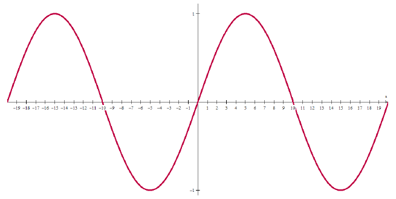

Si se aplica a través de un rectificador de media onda, que anula sus valores
negativos de la onda (presente en la gran mayoría de electrodomésticos) se
obtiene la función definida de la siguiente forma:

$$
f(t)=\begin{cases}0&\text{si }-p/2<t<0\\E\cdot\operatorname{sen}\omega t&\text{si }0<t<p/2\end{cases}
\quad\text{siendo }p=\frac{2\pi}\omega
$$

cuya gráfica es

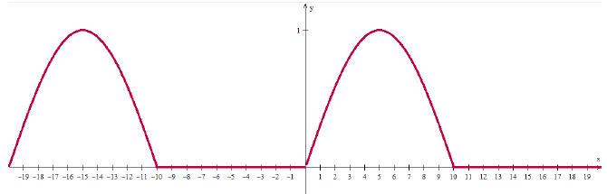

**Ejemplo2:** Frecuentemente para obtener la rectificación de la onda completa
se emplean dispositivos combinados que producen la inversión de la porción
negativa de la onda y se produce la onda de la siguiente gráfica:

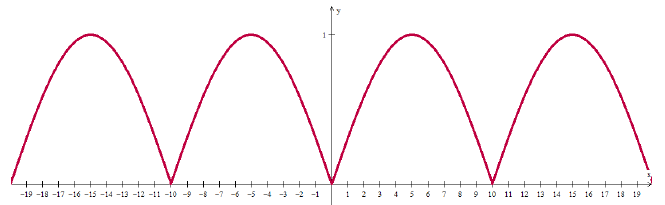

Estos rectificadores de media onda o de onda completa son dispositivos que see
emplean en la ingeniería electromecánica o electrónica con el fin de transformar
intensidades o voltajes de una corriente alternada en intensidad o voltaje de
una corriente continua.

**Ejemplo 3:** Otra onda que aparece frecuentemente es la llamada “dientes de
sierra”

$$
f(x)=ax\quad\text{si }-\frac p2\le x\le\frac p2\quad\text{siendo }f(x)=f(x+p)
$$

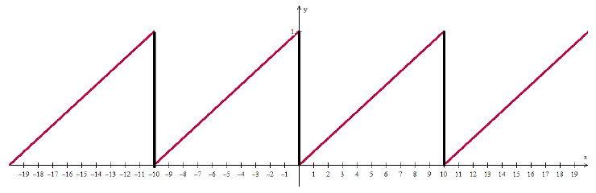

## Página 13

### Series de Fourier para funciones de período 2π

Sea una función f(x) de período p=2π, que además es continua o seccionalmente
continua con un número finito de discontinuidades finitas en ´[-π,π] y
supongamos puede ser desarrollada en una serie de Fourier de la forma:

$$
f(x)=\frac{a_0}2+\sum_{n=1}^{\infty}(a_n\cos nx+b_n\operatorname{sen}nx)
$$

Donde a₀,aₙ, y bₙ son los coeficientes cuya determinación estudiaremos. Este
desarrollo de la función es una suma de infinitas funciones simples senoidales y
cosenoidales recibe el nombre de “Serie de Fourier”. Para determinar los
coeficientes partimos del supuesto de que el desarrollo existe y la serie
converge hacia los valores de la función. Con posterioridad estudiaremos en qué
condiciones se verifica dicha convergencia. Supongamos su desarrollo de la
forma:

$$
f(x)=\frac{a_0}2+\sum_{n=1}^{\infty}(a_n\cos nx+b_n\operatorname{sen}nx)
\quad\text{donde }a_0,a_n\text{ y }b_n\text{ son constantes.}
$$

- Integrando ambos miembros entre los límites –π y π se obtiene:

$$
\int_{-\pi}^{\pi}f(x)dx=\int_{-\pi}^{\pi}\frac{a_0}2dx
+\sum_{n=1}^{\infty}\left(a_n\int_{-\pi}^{\pi}\cos nx\cdot dx
+b_n\int_{-\pi}^{\pi}\operatorname{sen}nx\,dx\right)
$$

Conforme a lo demostrado anteriormente las integrales que aparecen dentro del
paréntesis son nulas, resultando:

$$
\int_{-\pi}^{\pi}f(x)dx=\int_{-\pi}^{\pi}\frac{a_0}2dx
=\frac{a_0}2\int_{-\pi}^{\pi}dx=\left.x\right]_{-\pi}^{\pi}=\pi a_0
$$

de donde

$$
a_0=\frac1\pi\int_{-\pi}^{\pi}f(x)\cdot dx
$$

- Multiplicamos ambos miembros del desarrollo por
  $\cos kx\;\forall x\in\mathbb N$, integrando:

$$
\int_{-\pi}^{\pi}f(x)\cos kx\,dx==\frac{a_0}2\int_{-\pi}^{\pi}\cos kx\,dx
\sum_{n=1}^{\infty}\left(a_n\int_{-\pi}^{\pi}\cos kx\cdot\cos nx\cdot dx
+b_n\int_{-\pi}^{\pi}\cos kx\cdot\operatorname{sen}nx\,dx\right)
$$

Todas las integrales del segundo miembro son nulas con la excepción de la
integral

$$
\int_{-\pi}^{\pi}\cos kx\cdot\cos nx\,dx=\pi\quad\text{cuando }n=k
$$

Por lo tanto

$$
\int_{-\pi}^{\pi}f(x)\cos kx\,dx=\int_{-\pi}^{\pi}(\cos nx)^2\cdot dx=a_n\pi
$$

de donde

$$
a_n=\frac1\pi\int_{-\pi}^{\pi}f(x)\cdot\cos nx\cdot dx
$$

- Multiplicando ambos miembros del desarrollo por \[texto y fórmula tapados por
  el recuadro anterior en el original\] $\forall x\in\mathbb N$, integrando
  tenemos:

## Página 14

$$
\begin{aligned}
\int_{-\pi}^{\pi}f(x)\operatorname{sen}kx\,dx
&=\frac{a_0}2\int_{-\pi}^{\pi}\operatorname{sen}kx\cdot dx
\sum_{n=1}^{\infty}\left(a_n\int_{-\pi}^{\pi}\operatorname{sen}kx\cdot\cos nx\cdot dx\right.\\
&\qquad\left.+b_n\int_{-\pi}^{\pi}\operatorname{sen}kx\cdot\operatorname{sen}nx\,dx\right)
\end{aligned}
$$

De acuerdo a lo demostrado anteriormente todas las integrales del segundo
miembro son nulas exceptuando:

$$
\int_{-\pi}^{\pi}\operatorname{sen}kx\cdot\operatorname{sen}nx\cdot dx=\pi\quad\text{si }k=n
$$

$$
\int_{-\pi}^{\pi}f(x)\operatorname{sen}kx\,dx
=\int_{-\pi}^{\pi}(\operatorname{sen}nx)^2\cdot dx=b_n\pi
$$

de donde

$$
b_n=\frac1\pi\int_{-\pi}^{\pi}f(x)\cdot\operatorname{sen}nx\cdot dx
$$

Las fórmulas obtenidas para la determinación de los coeficientes a₀,aₙ, y bₙ se
les da, el nombre de “Fórmulas de Euler”, para la determinación de los
coeficientes de Fourier de la serie:

$$
f(x)=\frac{a_0}2+\sum_{n=1}^{\infty}(a_n\cos nx+b_n\operatorname{sen}nx)
$$

### Condiciones de Dirichlet

Si una función f(x):

- está definida arbitrariamente en el intervalo (-π, π) excepto posiblemente en
  un número finito de puntos pertenecientes al intervalo
- es periódica de período p=2π, fuera de ese intervalo, es decir f(x)=f(x+2π)
- es continua en (-π, π), a lo sumo tiene un número finito de discontinuidades
  de primera especie (saltos)
- posee un número finito de máximos o mínimos en el intervalo (-π, π)

entonces f(x) puede ser desarrollada por la serie de Fourier cuyos coeficientes
han sido determinados anteriormente por las fórmulas de Euler. Esta serie
converge uniformemente hacia los valores de la función f(x), si x es un “punto
de continuidad” y hacia el promedio $\frac{f(x+0)+f(x-0)}2$ si x₀ es un punto de
discontinuidad, entendiéndose por:

$$
f(x_0+0)=\lim_{\xi\to0}f(x_0+\xi)\quad\text{y}\quad
f(x_0-0)=\lim_{\xi\to0}f(x_0-\xi)
$$

Las condiciones expresadas son “suficientes” pero no “necesarias”. No existen
condiciones necesarias y suficientes, tampoco lo es suficientes ser continuas en
(-π, π).

### Fórmula de Dirichlet

Para sumas parciales de una Serie de Fourier

$$
S_n(x)=\frac{a_0}2+\sum_{k=1}^n(a_k\cdot\cos kx+b_k\cdot\operatorname{sen}kx)
\quad\forall k\in\mathbb N
$$

## Página 15

Donde

$$
a_0=\frac1\pi\int_{-\pi}^{\pi}f(t)\cdot dt\qquad
 a_k=\frac1\pi\int_{-\pi}^{\pi}f(t)\cdot\cos kt\cdot dt\qquad
 b_k=\frac1\pi\int_{-\pi}^{\pi}f(t)\cdot\operatorname{sen}kt\cdot dt
$$

$$
\begin{aligned}
S_n(x)&=\frac1{2\pi}\int_{-\pi}^{\pi}f(t)\cdot dt
+\frac1\pi\sum_{k=1}^n f(t)\cdot(\cos kx\cdot\cos kt+\operatorname{sen}kx\cdot\operatorname{sen}kt)\,dt\\
&=\frac1{2\pi}\int_{-\pi}^{\pi}f(t)\cdot dt
+\frac1\pi\sum_{k=1}^n f(t)\cdot\cos k(t-x)\,dt\\
&=\frac1\pi\int_{-\pi}^{\pi}f(t)\cdot\left[\frac12+\frac1\pi\sum_{k=1}^n\cos k(t-x)\right]dt\\
&=\frac1\pi\int_{-\pi}^{\pi}f(t)\frac{\operatorname{sen}(n+\frac12)(t-x)}{2\cdot\operatorname{sen}\frac{t-x}2}dt
\end{aligned}
$$

por la **Fórmula 6** mostrada anteriormente en **Fórmulas de posterior
aplicación**

Haciendo: t-x = s → t=s+x y para un x₀ fijo dt=ds

Y también

$$
\begin{cases}\text{si }t=-\pi\Rightarrow s=-\pi-x\\\text{si }t=\pi\Rightarrow s=\pi-x\end{cases}
$$

Sustituyendo estos valores:

$$
S_n(x)=\frac1\pi\int_{-\pi-x}^{\pi-x}f(x+s)
\frac{\operatorname{sen}(n+\frac12)s}{2\cdot\operatorname{sen}\frac s2}ds
$$

Como el integrando tiene un período 2π, podemos reemplazar el intervalo
$[-\pi-x,\pi-x]$ por cualquier otro intervalo de longitud 2π en particular
$[-\pi,\pi]$, por lo tanto la sumatoria será:

$$
S_n(x)=\frac1\pi\int_{-\pi}^{\pi}f(x+s)
\frac{\operatorname{sen}(n+\frac12)s}{2\cdot\operatorname{sen}\frac s2}ds
$$

### Convergencia de la serie de Fourier

Sea f(x) continua por tramos en $(-\infty,\infty)$ con período 2π y se supone
que:

$f(x)=\frac12[f(x^+)+f(x^-)]\;\forall x$ entonces el desarrollo de la serie de
Fourier para f(x) converge a f(x₀) en cada x₀, donde f(x) tenga una derivada por
la derecha y por la izquierda.

## Página 16

*Demostración:*

**Primer caso:** Suponemos f(x) continua en x₀, por lo tanto

$$
f(x_0^+)=f(x_0^-)=f(x_0)
$$

Además como las derivadas existen a ambos lados de $x_0$, será entonces:

$$
\lim_{h\to0^+}\frac{f(x_0+h)-f(x_0^+)}h
\qquad
\lim_{h\to0^-}\frac{f(x_0-h)-f(x_0^-)}h
$$

partiendo de esta hipótesis, demostraremos que:

$$
|S_n(x_0)-f(x_0)|<\xi\quad\text{para }n>k
$$

Por la fórmula de Dirichlet:

$$
S_n(x_0)=\frac1\pi\int_{-\pi}^{\pi}f(x_0+s)
\frac{\operatorname{sen}(n+\frac12)s}{2\cdot\operatorname{sen}\frac s2}ds\tag{1}
$$

$$
f(x_0)=\frac1\pi f(x_0)\cdot\pi
=\frac1\pi f(x_0)\int_{-\pi}^{\pi}\frac{\operatorname{sen}(n+\frac12)s}{2\cdot\operatorname{sen}\frac s2}ds
=\frac1\pi\int_{-\pi}^{\pi}f(x_0)\cdot\frac{\operatorname{sen}(n+\frac12)s}{2\cdot\operatorname{sen}\frac s2}ds\tag{2}
$$

Si restamos (1) y (2) obtendremos:

$$
S_n(x_0)-f(x_0)=\frac1\pi\int_{-\pi}^{\pi}\frac{f(x_0+s)-f(x_0)}{2\cdot\operatorname{sen}\frac s2}
\cdot\operatorname{sen}(n+\tfrac12)s\cdot ds
$$

multiplicando y dividiendo por s, $\forall s\ne0$

$$
S_n(x_0)-f(x_0)=\frac1\pi\int_{-\pi}^{\pi}
\left[\frac{f(x_0+s)-f(x_0)}s\cdot\frac{s/2}{\operatorname{sen}\frac s2}\right]
\cdot\operatorname{sen}(n+\tfrac12)s\cdot ds
$$

Llamemos g(s) al primer factor del integrando

$$
g(s)=\frac{f(x_0+s)-f(x_0)}s\cdot\frac{s/2}{\operatorname{sen}\frac s2}
$$

Por ser f(x) continua, es g(s) continua $\forall s\ne0$.

Para $s\to0$ existen los límites por la derecha y por la izquierda de g(s) en
s=0, por lo que g(s) es seccionalmente continua en el período $[-\pi,\pi]$.

Aplicando el lema de Rieman-Lebesgue ya visto, es:

$\lim_{n\to\infty}\frac1\pi\int_{-\pi}^{\pi}g(s)\cdot\operatorname{sen}[(n+\frac12)\cdot s]ds=0$
por lo tanto: $|S_n(x_0)-f(x_0)|<\varepsilon$ para $n>K$.

**Segundo caso:** Cuando x₀ es un punto de discontinuidad de f(x).

## Página 17

*Demostración:*

$S_n(x)=\frac{a_0}2+\sum_{k=1}^{\infty}(a_k\cdot\cos kx+b_k\cdot\operatorname{sen}kx)
\quad\forall k\in\mathbb N$, converge a

$\frac12[f(x_0+0)+f(x_0-0)]$ por lo tanto

$$
S_n(x_0)=\frac1\pi\int_{-\pi}^0 f(x_0+s)
\frac{\operatorname{sen}(n+\frac12)\cdot s}{2\cdot\operatorname{sen}\frac s2}ds
+\frac1\pi\int_0^{\pi} f(x_0+s)
\frac{\operatorname{sen}(n+\frac12)\cdot s}{2\cdot\operatorname{sen}\frac s2}ds\tag{1}
$$

Además por descomposición de la **Fórmula 7** en **Fórmulas de posterior
aplicación**, por ser un integrando par:

$$
\int_{-\pi}^0\frac{\operatorname{sen}(n+\frac12)\cdot s}{2\cdot\operatorname{sen}\frac s2}ds=\frac\pi2
$$

$$
\int_0^{\pi}\frac{\operatorname{sen}(n+\frac12)\cdot s}{2\cdot\operatorname{sen}\frac s2}ds=\frac\pi2
$$

Por lo tanto multiplicando la primera integral por $\frac{f(x_0-0)}\pi$ y la
segunda por $\frac{f(x_0+0)}\pi$ tendremos:

$$
\frac1\pi\int_{-\pi}^0 f(x_0-0)\frac{\operatorname{sen}(n+\frac12)\cdot s}{2\cdot\operatorname{sen}\frac s2}ds
=\frac{f(x_0-0)}2
$$

$$
\frac1\pi\int_0^{\pi} f(x_0+0)\frac{\operatorname{sen}(n+\frac12)\cdot s}{2\cdot\operatorname{sen}\frac s2}ds
=\frac{f(x_0+0)}2
$$

Y sumando ambas igualdades obtenemos otra igualdad:

$$
\frac{f(x_0+0)}2+\frac{f(x_0-0)}2
=\frac1\pi\int_{-\pi}^0 f(x_0-0)\frac{\operatorname{sen}(n+\frac12)\cdot s}{2\cdot\operatorname{sen}\frac s2}ds
+\frac1\pi\int_0^{\pi} f(x_0+0)\frac{\operatorname{sen}(n+\frac12)\cdot s}{2\cdot\operatorname{sen}\frac s2}ds\tag{2}
$$

Restando (1)-(2) tenemos:

$$
\begin{aligned}
S_n(x_0)-\frac{f(x_0+0)}2-\frac{f(x_0-0)}2
&=\frac1\pi\int_{-\pi}^0[f(x_0+s)-f(x_0-0)]
\frac{\operatorname{sen}(n+\frac12)\cdot s}{2\cdot\operatorname{sen}\frac s2}ds\\
&\quad+\frac1\pi\int_0^{\pi}[f(x_0+s)-f(x_0+0)]
\frac{\operatorname{sen}(n+\frac12)\cdot s}{2\cdot\operatorname{sen}\frac s2}ds
\end{aligned}
$$

$g_1(s)=\frac{f(x_0+s)-f(x_0-0)}{2\cdot\operatorname{sen}\frac s2}$ es continua
en el intervalo [-π,0]

para $s\to0^-$
$\frac{f(x_0+s)-f(x_0-0)}{s/2}\cdot\frac{s/2}{2\cdot\operatorname{sen}\frac s2}
\to\frac{f'(x_0^-)}2$ existe, por lo tanto $g_1(s)$ es continua.

## Página 18

para $s\to0^+$
$\frac{f(x_0+s)-f(x_0+0)}{s/2}\cdot\frac{s/2}{2\cdot\operatorname{sen}\frac s2}
\to\frac{f'(x_0^+)}2$ existe, por lo tanto $g_2(s)$ es continua.

Aplicando el teorema de Rieman-Lebesgue, ambas integrales tenderán a cero cuando
$n\to\infty$ y entonces:

$$
S_n(x_0)\text{ converge a }\frac{f(x_0+0)}2+\frac{f(x_0-0)}2
$$

### Desarrollo en Serie de Fourier de funciones pares

Si f(x)es par se cumple que f(x)=f(-x); sabemos también que cos nx es par y sen
nx es impar. Como el producto de dos funciones pares es otra función par,
entoces f(x).cos nx es una función par y el el desarrollo de Fourier los
coeficientes de los términos cosenoidales toman la forma siguiente:

$$
a_n=\frac1\pi\int_{-\pi}^{\pi}f(x)\cdot\cos nx\cdot dx
=\frac2\pi\int_0^{\pi}f(x)\cdot\cos nx\cdot dx
$$

De la misma manera:

$$
a_0=\frac1\pi\int_{-\pi}^{\pi}f(x)dx=\frac2\pi\int_0^{\pi}f(x)dx
$$

En cambio por ser el producto f(x). sen nx una función impar, se tendrá:

$$
b_n=\frac1\pi\int_{-\pi}^{\pi}f(x)\cdot\operatorname{sen}nx\cdot dx=0
$$

Los coeficientes de los términos sinusoidales serán todos nulos, por lo tanto el
desarrollo de la serie de Fourier se reduce, resultando así:

$f(x)=\frac{a_0}2+\sum_{n=1}^{\infty}a_n\cos nx$ donde sus coeficientes serán

$$
a_0=\frac2\pi\int_0^{\pi}f(x)dx\qquad
 a_n=\frac2\pi\int_0^{\pi}f(x)\cdot\cos nx\cdot dx
$$

## Página 19

### Desarrollo en Serie de Fourier de funciones impares

Si f(x) es impar entonces

$$
\begin{cases}f(x)\cdot\cos nx&\text{es impar}\\f(x)\cdot\operatorname{sen}nx&\text{es par}\end{cases}
$$

Por lo tanto:

$$
a_0=\frac1\pi\int_{-\pi}^{\pi}f(x)dx=0\quad\text{y}\quad
 a_n=\frac1\pi\int_{-\pi}^{\pi}f(x)\cdot\cos nx\cdot dx=0
$$

por ser los integrandos funciones impares, por lo cual el desarrollo de la serie
de Fourier para funciones impares quedaría:

$$
f(x)=\frac{a_0}2+\sum_{n=1}^{\infty}b_n\operatorname{sen}nx
\qquad\text{donde }b_n=\frac2\pi\int_0^{\pi}f(x)\cdot\operatorname{sen}nx\cdot dx
$$

### Desarrollo en serie de Fourier para funciones de período 2L

Sea f(x) una función periódica de período 2L, es decir, $f(x)=f(x+2L)$.
Supongamos que f(x) cumple las condiciones necesarias para poder ser
desarrollada en Serie de Fourier. Si hacemos $x=\frac L\pi\cdot t$ entonces
$f(x)=f(\frac L\pi\cdot t)=\varphi(t)$.

Demostraremos en primer lugar que la nueva función $\varphi(t)$ es también una
función periódica de período 2π.

$$
\varphi(t+2\pi)=f\left[\frac L\pi(t+2\pi)\right]
=f\left(\frac L\pi t+2L\right)\quad\text{pero sabemos que}
$$

$$
f\left(\frac L\pi\cdot t+2L\right)=f\left(\frac L\pi\cdot t\right)
$$

ya que la función f(x) tiene período 2L y podemos escribir:

$\varphi(t+2\pi)=f(\frac L\pi\cdot t+2L)=f(\frac L\pi t)=\varphi(t)$, queda sí
demostrado que $\varphi(t)$ es una función periódica de período 2π. En esas
condiciones, $\varphi(t)$ puede ser desarrollada en serie de Fourier de la forma
conocida:

$$
\varphi(t)=\frac{a_0}2+\sum_{n=1}^{\infty}(a_n\cdot\cos nt+b_k\cdot\operatorname{sen}nt)\tag{1}
$$

Donde los coeficientes a₀,aₙ, y bₙ están dados por la fórmula de Euler:

$$
a_0=\frac1\pi\int_{-\pi}^{\pi}\varphi(t)\cdot dt\qquad
 a_n=\frac1\pi\int_{-\pi}^{\pi}\varphi(t)\cdot\cos nt\cdot dt\qquad
 b_n=\frac1\pi\int_{-\pi}^{\pi}\varphi(t)\cdot\operatorname{sen}nt\cdot dt
$$

## Página 20

Haciendo el cambio de variable correspondiente $x=\frac L\pi\cdot t$ de donde
$t=\frac\pi L\cdot x$ y $dt=\frac\pi L\cdot dx$.

Además sabemos que $\varphi(t)=f(x)$, también los límites de integración:

cuando $t=\pi\to x=\frac L\pi\cdot\pi=L\;\therefore\;\text{si }t=\pi\to x=L$

cuando
$t=-\pi\to x=\frac L\pi\cdot(-\pi)=-L\;\therefore\;\text{si }t=-\pi\to x=-L$

reemplazando en (1) todas las expresiones encontradas:

$$
f(x)=\frac{a_0}2+\sum_{n=1}^{\infty}\left(a_n\cdot\cos\frac{n\pi x}L+b_n\cdot\operatorname{sen}\frac{n\pi x}L\right)
$$

Los coeficientes serán:

$$
a_0=\frac1\pi\int_{-\pi}^{\pi}\varphi(t)\cdot dt
=\frac1\pi\int_{-L}^L f(x)\cdot\frac\pi L\cdot dx
=\frac1L\int_{-L}^L f(x)\cdot dx
$$

$$
a_0=\frac1L\int_{-L}^L f(x)\cdot dx
$$

$$
a_n=\frac1\pi\int_{-\pi}^{\pi}\varphi(t)\cdot\cos nt\cdot dt
=\frac1\pi\int_{-L}^L f(x)\cdot\frac\pi L\cdot\cos\frac{n\pi x}L\cdot dx
=\frac1L\int_{-L}^L f(x)\cdot\cos\frac{n\pi x}L\cdot dx
$$

$$
a_n=\frac1L\int_{-L}^L f(x)\cdot\cos\frac{n\pi x}L dx
$$

$$
b_n=\frac1\pi\int_{-\pi}^{\pi}\varphi(t)\cdot\operatorname{sen}nt\cdot dt
=\frac1\pi\int_{-L}^L f(x)\cdot\frac\pi L\cdot\operatorname{sen}\frac{n\pi x}L\cdot dx
=\frac1L\int_{-L}^L f(x)\cdot\operatorname{sen}\frac{n\pi x}L\cdot dx
$$

$$
b_n=\frac1L\int_{-L}^L f(x)\cdot\operatorname{sen}\frac{n\pi x}L\cdot dx
$$

**Ejemplo 1:** Desarrollar en Serie de Fourier la forma simétrica de una onda
rectangular dada por:

$$
f(x)=\begin{cases}
-K&\text{si }x\in(-\pi,-\frac\pi2)\;\wedge\;x\in(\frac\pi2,\pi)\\
K&\text{si }x\in(-\frac\pi2,\frac\pi2)
\end{cases}
$$

Siendo $f(x)=f(x+2\pi)$ la onda ilustra el siguiente gráfico, simétrica al eje y

Por tratarse de una función par la serie de Fourier es un desarrollo reducido de
términos cosenoidales ya que bₙ=0.

$f(x)=\frac{a_0}2+\sum_{n=1}^{\infty}a_n\cos nx$ siendo
$a_0=\frac2\pi\int_0^{\pi}f(x)dx$ y
$a_n=\frac2\pi\int_0^{\pi}f(x)\cdot\cos nx\cdot dx$.

## Página 21

Cálculo de a₀:

$$
a_0=\frac2\pi\left[\int_0^{\frac\pi2}K\cdot dx+\int_{\frac\pi2}^{\pi}(-K)\cdot dx\right]
=\frac{2\cdot K}\pi\left[\int_0^{\frac\pi2}dx-\int_{\frac\pi2}^{\pi}dx\right]=0
$$

Cálculo de aₙ:

$$
\begin{aligned}
a_n&=\frac2\pi\left[\int_0^{\frac\pi2}K\cdot\cos nx\cdot dx
+\int_{\frac\pi2}^{\pi}(-K)\cdot\cos nx\cdot dx\right]\\
&=\frac{2\cdot K}\pi\left[\int_0^{\frac\pi2}\cos nx\cdot dx
-\int_{\frac\pi2}^{\pi}\cos nx\cdot dx\right]\\
&=\frac{2\cdot K}{\pi\cdot n}\left(\operatorname{sen}n\frac\pi2+\operatorname{sen}n\frac\pi2\right)
=\frac{4\cdot K}{\pi\cdot n}\operatorname{sen}n\frac\pi2
\end{aligned}
$$

ya que sen n.0=sen n.π=0

esto indica que
$a_0=0;\;a_1=\frac{4K}\pi;\;a_2=0;\;a_3=\frac{-4K}{3\pi};\;a_4=0;\;a_5=\frac{4K}{5\pi}\;\ldots$

donde todos los términos de orden par se anulan y los de orden impar son
alternadamente positivos y negativos, tomando $\frac{4K}\pi$ factor común:

$$
f(x)=\frac{4K}\pi(\cos x-\tfrac13\cos3x+\tfrac15\cos5x-\tfrac17\cos7x+\cdots)
=\frac{4K}\pi\sum_{n=1}^{\infty}(-1)^{n-1}\cdot\frac{\cos(2n-1)\cdot x}{(2n-1)}
$$

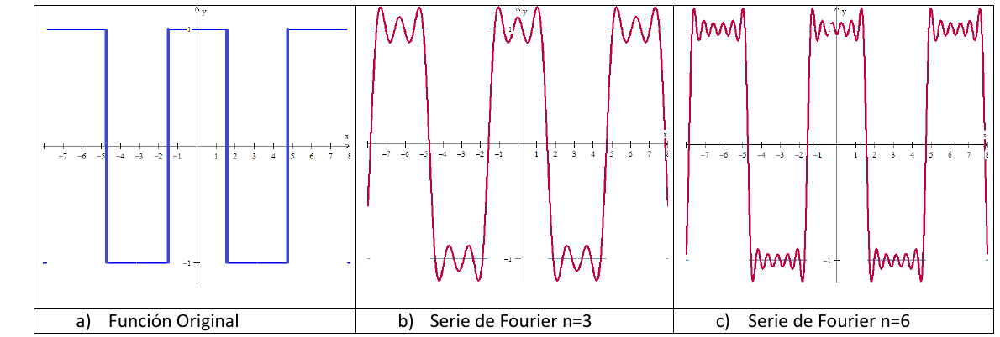

**Ejemplo 2:** Desarrollar en serie de Fourier la forma antisimétrica de una
onda rectangular:

$$
f(x)=\begin{cases}-K&\text{si }-\pi<x<0\\K&\text{si }0<x<\pi\end{cases}
$$

siendo f(x)=f(x+2)

Ilustramos la onda en el siguiente gráfico, simétrica respecto del origen. Por
tratarse de una función impar del desarrollo de la serie, como vimos
anteriormente, se reduce a una suma de términos senoidales, mientras que a₀=aₙ=0
$\forall n\in\mathbb N$ y solo debemos calcular bₙ.

$$
b_n=\frac2\pi\int_0^{\pi}f(x)\cdot\operatorname{sen}nx\cdot dx
\;\therefore\;f(x)=\sum_{n=1}^{\infty}b_n\operatorname{sen}nx
$$

## Página 22

$$
b_n=\frac2\pi\int_0^{\pi}K\cdot\operatorname{sen}nx\cdot dx
=\frac{2K}\pi\int_0^{\pi}\operatorname{sen}nx\cdot dx
=\frac{2K}{n\cdot\pi}\int_0^{\pi}\operatorname{sen}nx\cdot d(n\cdot x)=
$$

$b_n=\frac{2K}{n\cdot\pi}[-\operatorname{con}n\cdot\pi-(-\cos0)]
=\frac{2K}{n\cdot\pi}(\cos0-\cos n\cdot\pi)=\frac{2K}{n\cdot\pi}(1-(-1)^n)$
término general del coeficiente bₙ.

Si n es par $b_n=\frac{2K}{n\cdot\pi}(1-1)=0$

Si n es impar $b_n=\frac{2K}{n\cdot\pi}(1+1)=\frac{4K}{n\cdot\pi}$ entonces:

$$
b_1=\frac{4K}\pi;\quad b_2=0;\quad b_3=\frac{4K}{3\pi};\quad b_4=0;\quad b_5=\frac{4K}{5\pi}
$$

Como vemos el factor $\frac{4K}\pi$ es común a todos los términos, por lo tanto
el desarrollo en serie de Fourier será:

$$
f(x)=\frac{4K}\pi(\operatorname{sen}x+\tfrac13\operatorname{sen}3x
+\tfrac15\operatorname{sen}5x+\tfrac17\operatorname{sen}7x+\cdots
+\tfrac1{2n-1}\operatorname{sen}(2n-1)x+\cdots)
$$

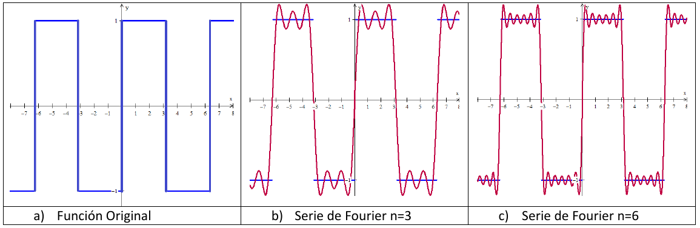

**Autor:** Ing. Leopoldo De Urrutia

**Responsable de edición en formato electrónico:** Prof. Bibiana Altamirano

**Gráficos:** Ing. Luciano Curie

## Observaciones de transcripción

Se conservan las erratas y afirmaciones del documento sin corregirlas. Entre
ellas: signo menos en la fórmula 5; sumas de cos x sin k y expresión con sen kπ
en páginas 9–10; límites λ→0 en el lema de página 10; signo de la segunda
integral de (2) en página 10; desigualdades y notación “iλ”/“λi” de página 11;
ausencia de signo + antes de sumas en páginas 13–14 y de integrales en página
15, así como el factor 1/π dentro del corchete; afirmaciones sobre convergencia
uniforme y condiciones necesarias en página 14; factores de los límites en
páginas 17–18; bₖ en página 19; intersección de intervalos en página 20;
f(x)=f(x+2) en página 21 y “con” en página 22.

En la última viñeta de la página 13, parte de la frase y la fórmula quedan
ocultas por el recuadro de aₙ en el propio original. Se indicó la pérdida sin
reconstruir por conjetura.
