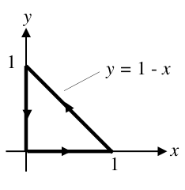
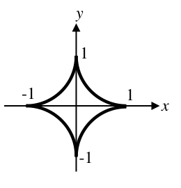
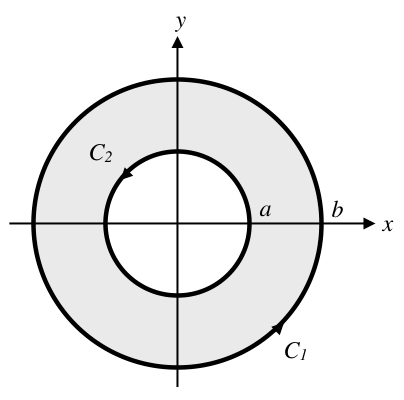

# PROBLEMAS DE TEOREMA DE GREEN

> Fuente: `2020/13-Teoriema de Green/Ejercicios Resueltos Green.pdf`.
> Transcripción de las páginas 1–5; no consta autor ni año impreso. Controles en
> [cobertura](../../../resources/2020/documentos-pdf-cobertura.md). Se conservan
> las erratas de las fórmulas; se señalan al final.

## ENUNCIADO DEL TEOREMA

Sea C una curva simple y cerrada, suave a trozos y orientada positivamente, y
sea $`F(x;y)=(P;Q)`$ un campo vectorial cuyas funciones coordenadas tienen
derivadas parciales continuas sobre una región abierta que contiene a la región
D acotada por C. Entonces:

```math
\iint_D\left(\frac{\partial Q}{\partial x}-\frac{\partial P}{\partial y}\right)dA
=\int_C F\cdot dr=\int_C P\,dx+Q\,dy
```

## PROBLEMAS RESUELTOS

### 1.) Transformación de una integral de línea en una de área

Evaluar $`\int_C x^4\,dx+xy\,dx`$, donde C es la curva triangular que une los
puntos $`(0;0)`$, $`(0;1)`$ y $`(1;0)`$, orientada positivamente.

**SOLUCIÓN:**



La gráfica indica la región encerrada por la curva C. Tenemos:

```math
P(x;y)=x^4\Rightarrow\frac{\partial P}{\partial y}=0
```

```math
Q(x;y)=xy\Rightarrow\frac{\partial Q}{\partial x}=y
```

Por lo tanto:

```math
\begin{aligned}
\int_C x^4\,dx+xy\,dx
&=\iint_D\left(\frac{\partial Q}{\partial x}-\frac{\partial P}{\partial y}\right)dA
=\int_0^1\int_0^{1-x}y\,dy\,dx\\
&=\int_0^1\left(\left.\tfrac12y^2\right|_0^{1-x}\right)dx
=\int_0^1\tfrac12(1-x)^2\,dx\\
&=\left.-\tfrac16(1-x)^3\right|_0^1=\frac16
\end{aligned}
```

Nótese que si hubiéramos hecho la integral de línea habríamos tenido que hacer 3
integrales con las correspondientes parametrizaciones.v

### 2.) Determinación de un área mediante una integral de línea

Determine el área de la región limitada por la hipocicloide que tiene la
ecuación vectorial

```math
r(t)=\cos^3t\,\mathbf i+\mathop{\mathrm{sen}}\nolimits ^3t\,\mathbf j,\quad0\leq t\leq2\pi
```



**SOLUCIÓN:**

De la parametrización de la curva tenemos:

```math
x=\cos^3t\Rightarrow x^{2/3}=\cos^2t
```

```math
y=\mathop{\mathrm{sen}}\nolimits ^3t\Rightarrow y^{2/3}=\mathop{\mathrm{sen}}\nolimits ^2t
```

Sumando miembro a miembro tenemos:

```math
\begin{aligned}
x^{2/3}+y^{2/3}=1
&\Rightarrow y=\pm(1-x^{2/3})^{3/2}\\
&\Rightarrow A=\int_{-1}^1\int_{-(1-x^{2/3})^{3/2}}^{+(1-x^{2/3})^{3/2}}dy\,dx
=\int_{-1}^1 2(1-x^{2/3})^{3/2}\,dx
\end{aligned}
```

Este cálculo, ejecutado como integral de área, es muy complicado. El teorema de
Green nos permite transformar esta integral en una de línea, usando como
trayectoria la hipocicloide del enunciado y definiendo una función apropiada
para la integración. Veamos:

El área de una región D viene dada por $`A=\iint_D1\,dA`$. Por lo tanto, para
aplicar Green deberíamos encontrar funciones P, Q /
$`\frac{\partial Q}{\partial x}-\frac{\partial P}{\partial y}=1`$. Un par de
funciones sencillas que cumplen esta condición son $`P=0,Q=x`$. Si recordamos la
parametrización, escribimos:

```math
x=\cos^3t\Rightarrow dx=-3\cos^2t\mathop{\mathrm{sen}}\nolimits t\,dt
```

```math
y=\mathop{\mathrm{sen}}\nolimits ^3t\Rightarrow dy=3\mathop{\mathrm{sen}}\nolimits ^2t\cos t\,dt
```

Luego:

```math
\begin{aligned}
A&=\iint_D\left(\frac{\partial Q}{\partial x}-\frac{\partial P}{\partial y}\right)dA
=\int_C P\,dx+Q\,dy\\
&=\int_0^{2\pi}\cos^3t\,3\mathop{\mathrm{sen}}\nolimits ^2t\cos t\,dt
=3\int_0^{2\pi}\cos^4t\mathop{\mathrm{sen}}\nolimits ^2t\,dt\\
&=3\int_0^{2\pi}\cos^2t\frac{\mathop{\mathrm{sen}}\nolimits ^22t}{4}\,dt
=3\int_0^{2\pi}\left(\frac{1+\cos2t}{2}\right)\frac{\mathop{\mathrm{sen}}\nolimits ^22t}{4}\,dt\\
&=\frac38\int_0^{2\pi}(\mathop{\mathrm{sen}}\nolimits ^22t+\mathop{\mathrm{sen}}\nolimits ^22t\cos2t)\,dt\\
&=\frac38\int_0^{2\pi}\left(\frac{1-\cos4t}{2}+\mathop{\mathrm{sen}}\nolimits ^22t\cos2t\right)dt\\
&=\frac38\left[\frac12t-\frac{\mathop{\mathrm{sen}}\nolimits 4t}{8}+\frac{\mathop{\mathrm{sen}}\nolimits ^32t}{6}\right]_0^{2\pi}
=\frac38\pi
\end{aligned}
```

De esta manera contamos con una herramienta más para obtener el área de la
región encerrada por una curva cerrada, que se suma al método en coordenadas
polares visto en Análisis II y al cálculo por integral de área que ejecutamos
cuando tenemos la expresión cartesiana de la curva.v

### 3.) Limitaciones en la aplicación del Teorema de Green

Dado

```math
F(x;y)=(P;Q)=(-y\,\mathbf i+x\,\mathbf j)/(x^2+y^2)
```

a) Calcular su integral de línea sobre el círculo $`x^2+y^2=1`$

b) Calcular
$`\iint_D\left(\frac{\partial Q}{\partial x}-\frac{\partial P}{\partial y}\right)dA`$,
donde D es la región encerrada por la curva del punto a).

c) Discutir si estos resultados están de acuerdo o no con el Teorema de Green.

**SOLUCIÓN:**

a) Parametricemos el círculo.

```math
\begin{cases}
x=\cos t\Rightarrow dx=-\mathop{\mathrm{sen}}\nolimits t\,dt\\
y=\mathop{\mathrm{sen}}\nolimits t\Rightarrow dy=\cos t\,dt
\end{cases},\quad0\leq t\leq2\pi
```

```math
P(x(t);y(t))=\frac{-\mathop{\mathrm{sen}}\nolimits t}{\mathop{\mathrm{sen}}\nolimits ^2t+\cos^2t}
=-\mathop{\mathrm{sen}}\nolimits t\,dt\Rightarrow P\,dx=\mathop{\mathrm{sen}}\nolimits ^2t\,dt
```

```math
Q(x(t);y(t))=\frac{\cos t}{\mathop{\mathrm{sen}}\nolimits ^2t+\cos^2t}
=\cos t\,dt\Rightarrow Q\,dx=\cos^2t\,dt
```

Integrando tendremos, así:

```math
\int_C P\,dx+Q\,dy=\int_0^{2\pi}(\mathop{\mathrm{sen}}\nolimits ^2t+\cos^2t)\,dt=2\pi
```

b) Haciendo los cálculos directamente en coordenadas cartesianas es:

```math
\frac{\partial Q}{\partial x}
=\frac{x^2+y^2-x2x}{(x^2+y^2)^2}
=\frac{y^2-x^2}{(x^2+y^2)^2}
```

```math
\frac{\partial P}{\partial y}
=\frac{-(x^2+y^2)-(-y)2y}{(x^2+y^2)^2}
=\frac{y^2-x^2}{(x^2+y^2)^2}
```

```math
\Rightarrow\frac{\partial Q}{\partial x}-\frac{\partial P}{\partial y}=0
\Rightarrow\iint_D\left(\frac{\partial Q}{\partial x}-\frac{\partial P}{\partial y}\right)dA=0
```

c) Aparentemente estos resultados contradirían el Teorema de Green. Sin embargo,
este último no es aplicable a la región en cuestión, dado que las funciones P y
Q no tienen derivadas parciales continuas en el punto $`(0;0)`$, que está
contenido en la región.v

### 4.) Aplicación del teorema de Green a un problema físico sobre una región con agujeros

Determinar el momento de inercia de una arandela homogénea de radio interno a,
radio externo b y masa M, respecto a uno de sus diámetros.



**SOLUCIÓN:**

Determinaremos el momento de inercia respecto al diámetro colineal con el eje x.
De Física sabemos que:

```math
I_x=\iint_D\rho y^2\,dA
```

Donde $`\rho`$ es la densidad superficial de la arandela, supuesta constante
dado que es homogénea.

Esta región no es simplemente conexa pero, como se vio en la teoría, se puede
extender el teorema de Green a este tipo de regiones con agujeros, siendo:

```math
\iint_D\left(\frac{\partial Q}{\partial x}-\frac{\partial P}{\partial y}\right)dA
=\int_{C_1}P\,dx+Q\,dy-\int_{C_2}P\,dx+Q\,dy
```

Por lo tanto podremos calcular la integral doble del momento de inercia como dos
integrales. Para ello debemos encontrar funciones P, Q tales que:

```math
\left(\frac{\partial Q}{\partial x}-\frac{\partial P}{\partial y}\right)=y^2;
\quad\text{tomamos, por ejemplo: }Q=0;\quad P=\tfrac13y^3
```

Aplicando Green con esta función tenemos:

```math
\begin{aligned}
I_x&=\iint_D\rho y^2\,dA
=\rho\left[\int_{C_1}-\tfrac13y^3\,dx+0\,dy-\int_{C_2}-\tfrac13y^3\,dx+0\,dy\right]\\
&=\rho\left[\int_{C_1}-\tfrac13y^3\,dx+\int_{C_2}\tfrac13y^3\,dx\right]\qquad(1)
\end{aligned}
```

Parametrizando estas curvas tenemos

```math
C_1\begin{cases}x=b\cos t\Rightarrow dx=-b\mathop{\mathrm{sen}}\nolimits t\\
y=b\mathop{\mathrm{sen}}\nolimits t\Rightarrow dy=b\cos t\end{cases},\quad0\leq t\leq2\pi
```

```math
C_2\begin{cases}x=a\cos t\Rightarrow dx=-a\mathop{\mathrm{sen}}\nolimits t\\
y=a\mathop{\mathrm{sen}}\nolimits t\Rightarrow dy=a\cos t\end{cases},\quad0\leq t\leq2\pi
```

Reemplazando con esto en (1) tendremos:

```math
\begin{aligned}
I_x&=\rho\left[\int_0^{2\pi}-\tfrac13b^3\mathop{\mathrm{sen}}\nolimits ^3t(-b\mathop{\mathrm{sen}}\nolimits t)\,dt
+\int_0^{2\pi}\tfrac13a^3\mathop{\mathrm{sen}}\nolimits ^3t(-a\mathop{\mathrm{sen}}\nolimits t)\,dt\right]\\
&=\rho\tfrac13(b^4-a^4)\int_0^{2\pi}\mathop{\mathrm{sen}}\nolimits ^4t\,dt\\
&=\rho\tfrac13(b^4-a^4)\int_0^{2\pi}\mathop{\mathrm{sen}}\nolimits ^2t(1-\cos^2t)\,dt\\
&=\tfrac13\rho(b^4-a^4)\int_0^{2\pi}\left(\mathop{\mathrm{sen}}\nolimits ^2t-\frac{\mathop{\mathrm{sen}}\nolimits ^22t}{4}\right)dt\\
&=\tfrac13\rho(b^4-a^4)\int_0^{2\pi}\left(\frac{1-\cos t}{2}-\frac{1-\cos4t}{8}\right)dt\\
&=\tfrac14\rho(b^4-a^4)\pi
=\tfrac14(b^2+a^2)\rho\pi(b^2-a^2)
=\tfrac14(b^2+a^2)M
\end{aligned}
```

Ésta es la manera estándar de expresar un momento de inercia: como el producto
de una longitud o suma de longitudes al cuadrado por la masa del rígido.v

## Notas de transcripción

- En 1, el original escribe $`xy\,dx`$ en el enunciado y en la integral inicial,
  aunque luego emplea $`Q=xy`$.
- En 3, el original añade $`dt`$ a los valores de P y Q, y escribe $`Q\,dx`$ en
  la línea que termina en $`\cos^2t\,dt`$.
- En 4, escribe $`P=\tfrac13y^3`$ en la elección de P, pero emplea
  $`-\tfrac13y^3`$ en la aplicación. La parametrización de $`C_2`$ tiene el
  signo representado en el original.
- En la última cadena, el original imprime $`(1-\cos t)/2`$, sin el factor 2 en
  el argumento del coseno. Se conserva sin corrección.
- Se conservan las letras `v` al final de cada solución.
