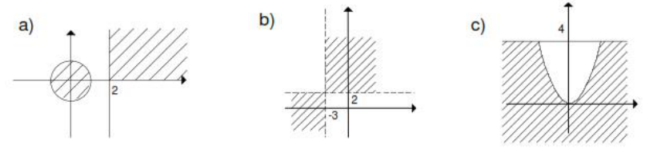
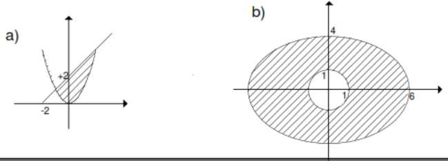
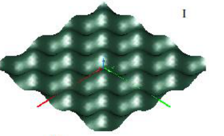
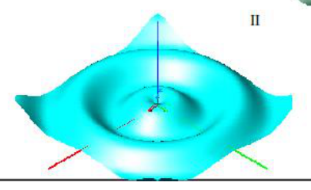
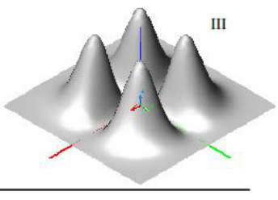
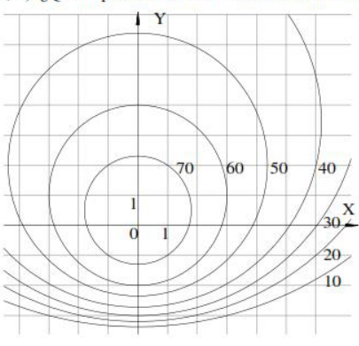
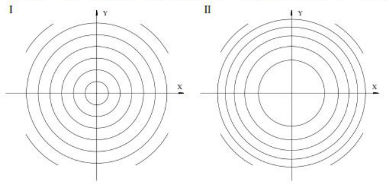
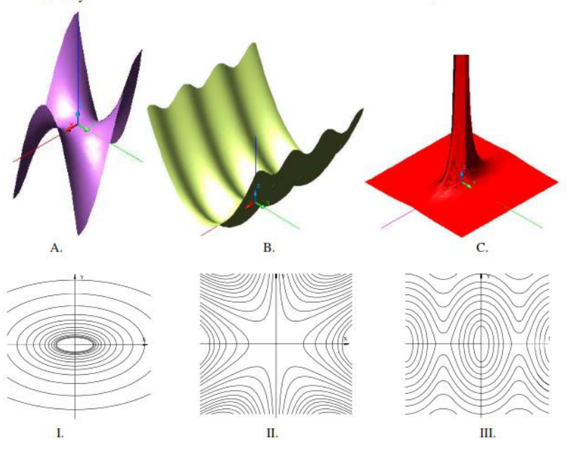

<!-- markdownlint-disable MD029 -->

# ANÁLISIS MATEMÁTICO II - I.Q. - Guía COMPLEMENTARIA

> Fuente:
> `2020/5-Funciones de Varias Variables ( Campo Escalar)/Guía Complementaria Campos escalares.pdf`.
> Transcripción de las páginas 1–8. El encabezado identifica I.Q.; no se
> atribuye a ISI. No consta autor ni año impreso. Se conservan las sucesivas
> numeraciones de los bloques. Controles en
> [cobertura](../../../resources/2020/documentos-pdf-cobertura.md).

## Página 1 — REPRESENTACIÓN DE SUPERFICIES

1. Dadas las siguientes superficies, identificarlas, hallar sus trazas, sus
   intersecciones con los ejes coordenados y representarlas gráficamente

   a) $`8-2x-4y=0`$

   b) $`12x+6y-9z=3`$

   c) Crear la ecuación de un plano que resulte paralelo al eje y

   d) $`4x=8`$

   e) $`\frac12y=3`$

   f) Hallar la ecuación de un plano que resulte paralelo al plano xz

   g) Escribir las ecuaciones correspondientes a los tres planos coordenados.

   h) $`\frac{x^2}4+\frac{z^2}{16}=1`$ para $`z\geq0`$

   i) $`-2z=4x^2+y^2`$

   j) $`\frac{x^2}4-\frac{y^2}9+\frac{z^2}{16}=1`$

   k) $`z=-\left(x^2+\frac{y^2}4\right)+9`$ con $`z\geq0`$

1. Decir a qué cuádricas corresponden las siguientes ecuaciones y hacer un
   esquema en cada caso:

   a) $`\frac{x^2}{a^2}+\frac{y^2}{b^2}-\frac{z^2}{c^2}=1`$

   b) $`\frac{x^2}{a^2}+\frac{y^2}{b^2}+\frac{z^2}{c^2}=1`$

   c) $`\frac{x^2}{a^2}-\frac{y^2}{b^2}-\frac{z^2}{c^2}=1`$

   d) $`-\frac{x^2}{a^2}+\frac{y^2}{b^2}+\frac{z^2}{c^2}=1`$

   e) $`\frac{x^2}{a^2}+\frac{y^2}{b^2}+\frac{z^2}{c^2}=-1`$

   f) $`\frac{x^2}{a^2}+\frac{y^2}{b^2}=z`$

   g) $`\frac{x^2}{a^2}-\frac{y^2}{b^2}=z`$

   h) $`\frac{x^2}{a^2}-\frac{y^2}{b^2}=-z`$

1. Intersecciones entre superficies y volúmenes limitados por superficies:
   Esquematizar las siguientes regiones

   a) $`z=4-y^2`$; $`z=4-x^2`$; $`z=0`$; $`y=0`$; $`x=0`$

   b) $`z=2-x^2`$; $`\frac x4+\frac y6=1`$ en el primer octante.

   c) $`z=4-x^2`$; $`y=2-x`$; $`y=2+x`$ en el primer octante.

   d) $`x^2+y^2=16`$; $`z=y`$; $`z=2y`$ en el primer octante.

   e) $`z=\frac{y^2}{16}-\frac{x^2}9+4`$; $`\frac x6+\frac y4=1`$ en el primer
   octante.

   f) Trace la región limitada por la superficie $`z=\sqrt{x^2+y^2}`$ y
   $`x^2+y^2=1`$ para $`1\leq z\leq2`$.

   g) Trace la región limitada por los paraboloides $`z=x^2+y^2`$ y
   $`z=2-x^2-y^2`$.

   h) Encuentre una ecuación para la superficie formada por todos los puntos que
   equidistan del punto (-1,0,0) y el plano x=1. Identifique la superficie.

## Página 2 — continuación

4. Intersecciones entre superficies y volúmenes limitados por superficies:
   Esquematizar las siguientes regiones

   a) $`x^2+y^2+z^2=9`$; $`z=0`$; $`y=0`$; $`x=0`$

   b) $`z=4-y^2`$; $`z=0`$; $`y=0`$; $`x=0`$; $`x=4`$

   c) $`z=x^2+y^2`$; $`y=0`$; $`y=1`$; $`x=0`$; $`x=1`$

   d) $`z=x^2+y^2`$; $`2x+y-2z+4=0`$ en el primer octante

### FUNCIONES DE DOS VARIABLES

1. $`f(x,y)=x^2+3xy+5y^3-2y^2+8`$

   Calcular: a) $`f(0;0)`$ b) $`f(1;0)`$ c) $`f(0;2)`$ d) $`f(1;1)`$

1.

```math
f(x,y)=\begin{cases}\dfrac{y^2-2x}{x^2+y^2}&\forall(x;y)\ne(0;0)\\0&(x;y)=(0;0)\end{cases}
```

Calcular: a) $`f(1;0)`$ b) $`f(2;2)`$ c) $`f(0;0)`$ d) $`f(x;0)`$

3. La altura h de las olas en el mar abierto depende de la velocidad v del
   viento y la duración del tiempo t que el viento haya estado soplando a esa
   velocidad. En la siguiente tabla aparecen los valores de la función
   $`h=f(v,t)`$ en pies:

   a) ¿Cuál es el valor de $`f(40,15)`$? ¿Cuál es su significado?

   b) ¿Cuál es el significado de la función $`h=f(30,t)`$? describa el
   comportamiento de esta función.

   c) ¿Cuál es el significado de la función $`h=f(v,30)`$? Describa el
   comportamiento de esta función.

   Duración (horas); velocidad del viento (km/h):

   | Velocidad / duración | 5 | 10 | 15 | 20 | 30 | 40 | 50 |
   | -- | -- | -- | -- | -- | -- | -- | -- |
   | 10 | 2 | 2 | 2 | 2 | 2 | 2 | 2 |
   | 15 | 4 | 4 | 5 | 5 | 5 | 5 | 5 |
   | 20 | 5 | 7 | 8 | 8 | 9 | 9 | 9 |
   | 30 | 9 | 13 | 16 | 17 | 18 | 19 | 19 |
   | 40 | 14 | 21 | 25 | 28 | 31 | 33 | 33 |
   | 50 | 19 | 29 | 36 | 40 | 45 | 48 | 50 |
   | 60 | 24 | 37 | 47 | 54 | 62 | 67 | 69 |

1. Responder si la función está o no definida en los siguientes casos.

   $`f(x;y)=\frac{2xy}{y^2-x^2}`$ para $`x=y`$

   $`f(x;y)=\frac{\mathop{\mathrm{sen}}\nolimits x-\mathop{\mathrm{sen}}\nolimits y}{\cos^2x-\mathop{\mathrm{sen}}\nolimits ^2y}`$
   para $`x=y=\frac\pi4`$

## Página 3

### Puntos interiores, exteriores y frontera. Conjuntos abiertos, cerrados, acotados y conexos

5. Dados los siguientes conjuntos en R²

   a) Graficarlos

   b) Hallar el conjunto derivado (conjunto de puntos de acumulación)

   c) Hallar el conjunto de sus puntos interiores

   d) Justificar si son conjuntos abiertos o cerrados

   e) Definir su frontera

   f) Decir si son o no conexos

   $`A=\{(x;y)/y-\frac x2\geq0\}`$

   $`B=\{(x;y)/y\lt x^2\land y\lt 2\}`$

   $`C=\{(x;y)/[(x-1)^2+y^2\lt 1]\lor[(x-1)^2+y^2\gt 3]\}`$

   $`D=\{(x;y)/\frac{x^2}4+\frac{y^2}9\lt 1\land y\geq1\}`$

   $`E=\{(x;y)/|x+y|\leq1\}`$

1. Describir analíticamente los siguientes conjuntos de puntos.

   

### DOMINIO E IMAGEN DE FUNCIONES DE DOS VARIABLES

1. Determinar el dominio y la imagen de las siguientes funciones. Graficar el
   dominio

   a) $`z=+\sqrt{16-x^2-y^2}`$

   b) $`z=\mathop{\mathrm{arcsen}}\nolimits (x+y)`$

   c) $`z=+\sqrt{xy}+\ln(x+y)`$

   d) $`z=\frac{2x+6}{(x^2-3x+2)(y^2-16)}`$

   e) $`z=\frac1{(x^2-y^2)\cos(x+4y)}`$

   f) $`z=\frac{\ln(2x-y)}{x^2+y^2-4}`$

   g) $`z=\frac1{9-(x^2+y^2)}`$

   h) $`z=\frac1{+\sqrt{y-\sqrt x}}`$

   i) $`z=+\sqrt{\mathop{\mathrm{sen}}\nolimits (xy)-2}`$

   j) $`z=\ln\sqrt{xy-4}`$

   k) $`z=\sqrt{\mathop{\mathrm{sen}}\nolimits (xy)}`$

## Página 4 — ANÁLISIS MATEMÁTICO II - I.Q. - Guía COMPLEMENTARIA

### FUNCIONES DE DOS VARIABLES

1. $`f(x,y)=x^3+2xy^2-5y^3-1`$

   Calcular: a) $`f(1;0)`$ b) $`f(0;1)`$ c) $`f(1;-1)`$ d) $`f(-1;1)`$

1.

```math
f(x,y)=\begin{cases}\dfrac1{x^2-y^2}&\forall|x|\ne|y|\\0&|x|=|y|\end{cases}
```

Calcular: a) $`f(0;1)`$ b) $`f(a;-a)`$ c) $`f(0;0)`$ d) $`f(-a;a)`$ e)
$`f(a;1/a)`$

3. Responder si la función está o no definida en los siguientes casos.

   a) $`f(x;y)=\frac{2xy}{y^2-x^2}`$ para $`|x|=|y|`$

   b) $`f(x;y)=\frac1{\sqrt{x-y}}`$ para $`x\gt y`$

### Puntos interiores, exteriores y frontera. Conjuntos abiertos, cerrados, acotados y conexos

4. Dados los siguientes conjuntos en R²

   a) Graficarlos

   b) Hallar el conjunto derivado (conjunto de puntos de acumulación)

   c) Hallar el conjunto de sus puntos interiores

   d) Justificar si son conjuntos abiertos o cerrados

   e) Definir su frontera

   f) Decir si son o no conexos

   $`A=\{(x;y)/|x-y|\leq4\land|y-4|\lt 2\}`$

   $`B=\{(x;y)/2\leq x^2+\frac{y^2}2\leq8\}`$

   $`C=\{(x;y)/x^2+y^2\lt 1\land y\geq0\}`$

   $`D=\{(x;y)/0\leq x\lt 2\land0\leq y\lt 1\}`$

   $`E=\{(x;y)/x^2+y^2\gt 0\}\cap\{(x;y)/x^2+y^2\lt 1\}`$

1. Describir analíticamente los siguientes conjuntos de puntos.

   

## Página 5 — DOMINIO E IMAGEN DE FUNCIONES DE DOS VARIABLES

1. Determinar el dominio y el rango de las siguientes funciones. Graficarlas

   a) $`z=\frac1{\mathop{\mathrm{sen}}\nolimits (x-y)}`$

   b) $`z=+\sqrt{x^2+2y^2-4}`$

   c) $`z=\arccos|x^2+y^2-3|`$

   d) $`z=\frac{+\sqrt{25-x^2-y^2}}{x-y}`$

   e) $`z=\frac{+\sqrt{9-x^2-y^2}}{\mathop{\mathrm{sen}}\nolimits (x-y)}`$

   f) $`z=\frac{\ln(2x-y)}{+\sqrt{4-x^2}}`$

   g) $`z=\frac1{\ln(x^2+y^2-1)}`$

   h) $`z=\frac1{+\sqrt{\frac{x^2}9+\frac{y^2}4-1}}`$

   i) $`z=+\sqrt{xy(1-x-y)}`$

   j) $`z=+\sqrt{\ln(xy-4)}`$

   k) $`z=\frac{\ln(x^2-y)}{+\sqrt{16-x^2-y^2}}`$

   l) $`z=\frac1{\ln(x^2-y^2)}`$

   m) $`z=\frac1{\ln(x+y-3)}`$

1. Encuentre y trace el dominio de la función.

   a) $`f(x,y)=\sqrt{x+y}`$

   b) $`f(x,y)=\sqrt x+\sqrt y`$

   c) $`f(x,y)=\ln(9-x^2-9y^2)`$

   d) $`f(x,y)=\frac{x-3y}{x+3y}`$

   e) $`f(x,y)=\frac{3x+5x}{x^2+y^2-4}`$

   f) $`f(x,y)=\sqrt{y-x}\ln(y+x)`$

   g) $`f(x,y)=xy\sqrt{x^2+y}`$

   h) $`f(x,y)=\sqrt{x^2+y^2-1}+\ln(4-x^2-y^2)`$

   i) $`f(x,y,z)=\sqrt{1-x^2-y^2-z^2}`$

   j) $`f(x,y,z)=\ln(16-4x^2-4y^2-z^2)`$

1. Sea $`f(x,y)=\ln(x+y-1)`$

   a) Evalúe f (1,1)

   b) Evalúe f (e,1)

   c) Encuentre el dominio de f.

   d) Encuentre la imagen de f.

1. Sea $`f(x,y)=e^{x^2-y}`$

   a) Evalúe f (2,4)

   b) Encuentre el dominio de f.

   c) Encuentre la imagen de f.

1. Sea $`g(x,y)=\sqrt{36-9x^2-4y^2}`$

   a) Evalúe g (1,2).

   b) Encuentre y trace el dominio de g.

   c) Encuentre la imagen de g.

## Página 6 — continuación

6. Sea $`f(x,y,z)=x^2\ln(x-y+z)`$

   a) Evalúe f (3,6,4).

   b) Encuentre el dominio de f.

   c) Encuentre la imagen de f.

1. Sea $`f(x,y,z)=1/\sqrt{x^2+y^2+z^2-1}`$.

   a) Evalúe f (1,3,-4).

   b) Encuentre el dominio de f.

   c) Encuentre la imagen de f.

### CURVAS DE NIVEL

1. Graficar las curvas de nivel para $`z\in\mathbb Z`$ y $`|z|\leq2`$, de las
   siguientes superficies

   a) $`z=\frac{2x}{x^2+1}`$

   b) $`z=\frac{y-1}{x^2+1}`$

   c) $`z=+\sqrt{1+x+y}`$

   d) $`z=x^2+y^2`$

   e) $`z=x^2-y^2`$

1. En los siguientes casos, considerar los valores que pueden asignarse a z y
   graficar las curvas de nivel.

   a) $`z=\frac{y}{x^2+3}`$

   b) $`z=4x+y-5`$

1. Una placa metálica delgada, ubicada en el plano xy, tiene temperatura T(x,y)
   en el punto (x,y). Las curvas de nivel de T se denominan *isotermas* porque
   en todos los puntos de una isoterma la temperatura es la misma. Trace algunas
   isotermas si la función de temperatura está dada por
   $`T(x,y)=100/(1+x^2+2y^2)`$

1. Si V(x,y) es el potencial electrónico en un punto (x,y) del plano xy,
   entonces las curvas de nivel de V se llaman *curvas equipotenciales* porque
   en todos los puntos de dicha curva el potencial eléctrico es igual. Trace
   algunas curvas equipotenciales si $`V(x,y)=c/\sqrt{r^2-x^2-y^2}`$, donde c es
   una constante positiva.

1. Relacione la función con su gráfica y esquematice su curva de nivel. De
   razones para su elección.

   a) $`z=\mathop{\mathrm{sen}}\nolimits \sqrt{x^2+y^2}`$

   b) $`z=x^2y^2e^{-x^2-y^2}`$

   c)
   $`z=\mathop{\mathrm{sen}}\nolimits x\cdot\mathop{\mathrm{sen}}\nolimits y`$

   

   

   

## Página 7 — ANÁLISIS MATEMÁTICO II - I.Q. - Guía COMPLEMENTARIA

Más de…

### CURVAS DE NIVEL

1. Cada una de las siguientes ecuaciones representa el relieve de distintos
   terrenos. Grafique las curvas de nivel de cada uno de ellos con una
   separación de 1 m desde 2 m de profundidad y hasta 2 m de altura
   ($`z\in\mathbb Z`$ y $`|z|\leq2`$).

   a) $`z=x+y`$ b) $`z=2xy`$ c) $`z=\frac{2y}{x^2+1}`$

1. La siguiente ecuación representa la radiación de temperatura dentro de un
   local en °C. Graficar las isotermas (curvas de igual temperatura) para hacer
   un estudio de climatización del mismo. Considerar qué valores extremos puede
   tomar la temperatura.

   a) $`z=x^2+3y^2+10`$ b) $`z=22-|x|-|y|`$

1. A continuación se ilustra un mapa de contornos para una función f, utilícelo
   para estimar los valores de f (-3,3) y f (3,-2). ¿Qué se puede decir acerca
   de la forma de la superficie?

   

1. A continuación se ilustran dos mapas de contorno. Uno es para una función f
   cuya gráfica es un cono, el otro es para función g cuya gráfica es un
   paraboloide. ¿Cuál es cuál, y por qué?

   

## Página 8

5. Relacione la función con su gráfica y con su curva de nivel. De razones para
   su elección.

   a) $`z=\frac1{x^2+4y^2}`$ b) $`z=x^3-3xy^2`$ c)
   $`z=\mathop{\mathrm{sen}}\nolimits ^2x+\frac14y^2`$

   

## Notas de transcripción

Se conservan la denominación «potencial electrónico» y el numerador $`3x+5x`$ de
la página 5, inciso 2.e. Los encabezados de las páginas 1, 4 y 7 repiten la
identificación I.Q.; no consta ISI en el documento.
