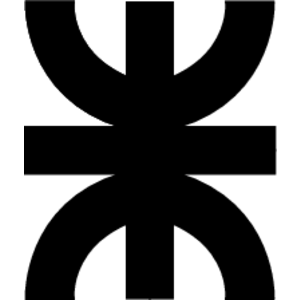
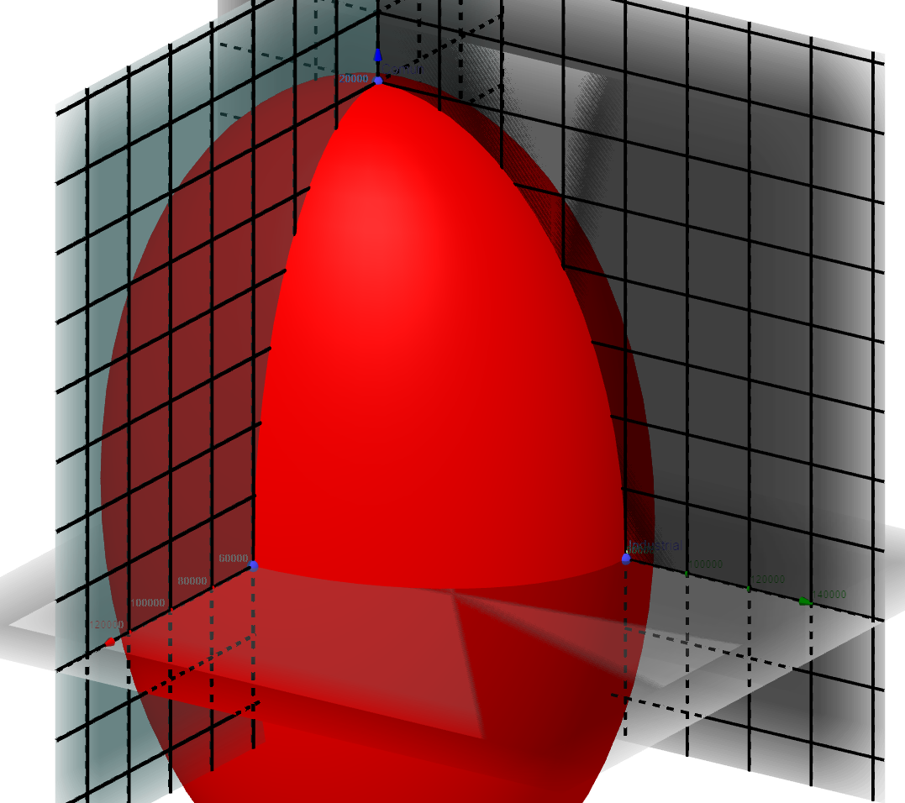
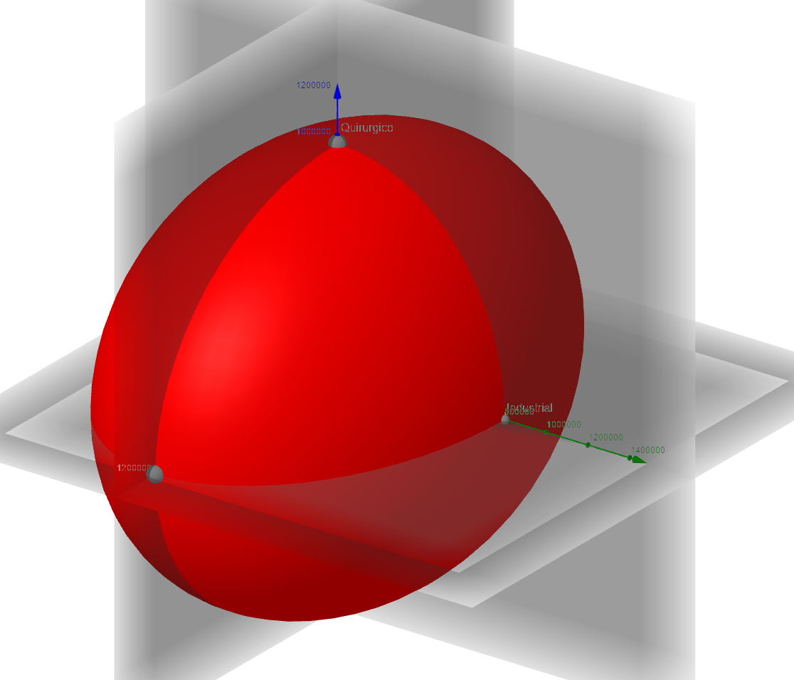
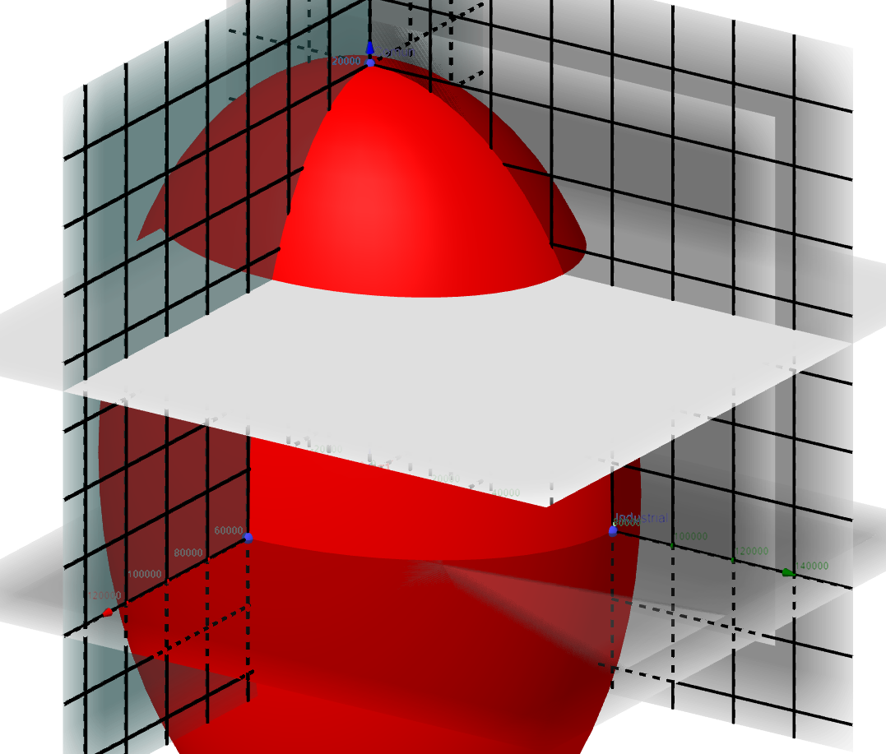
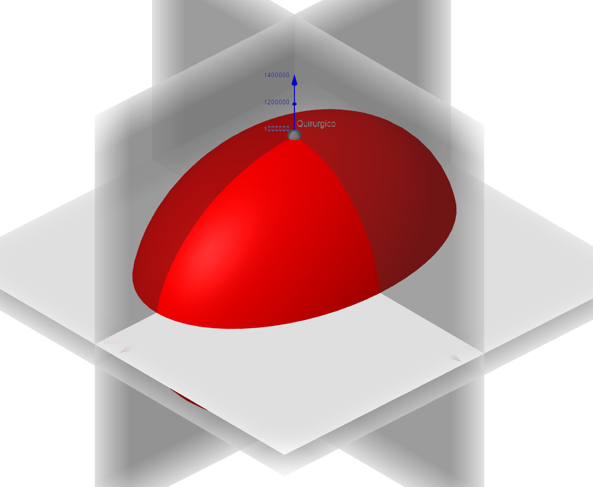
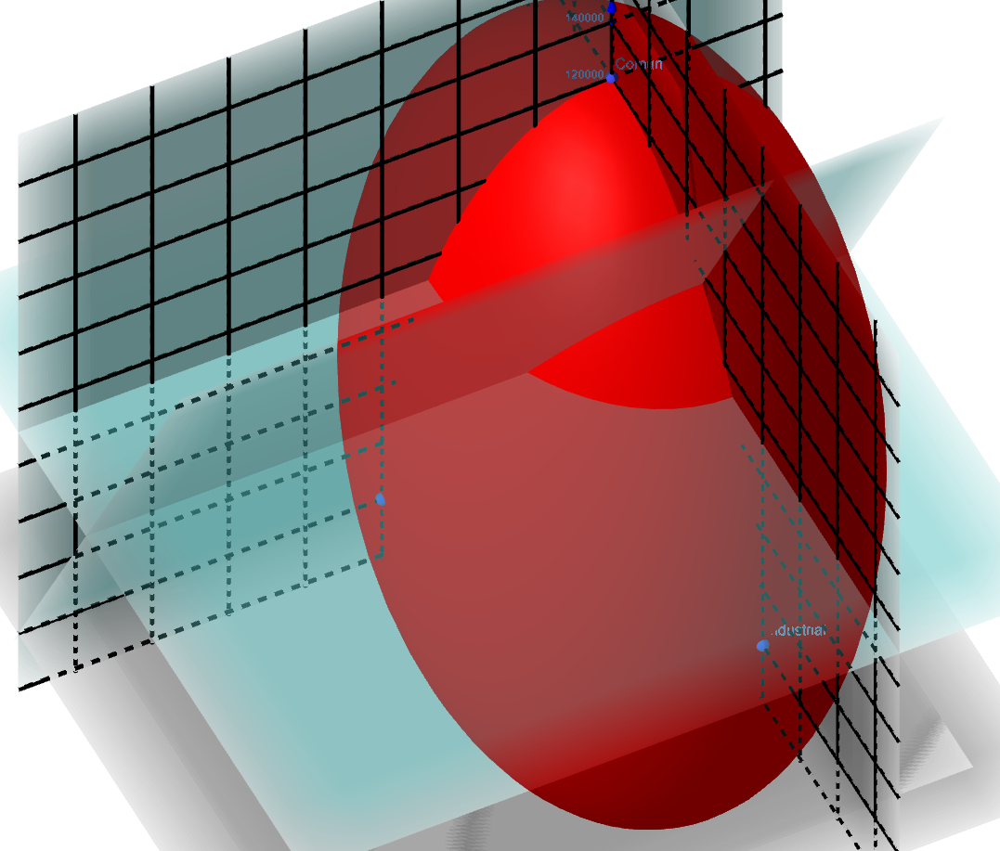
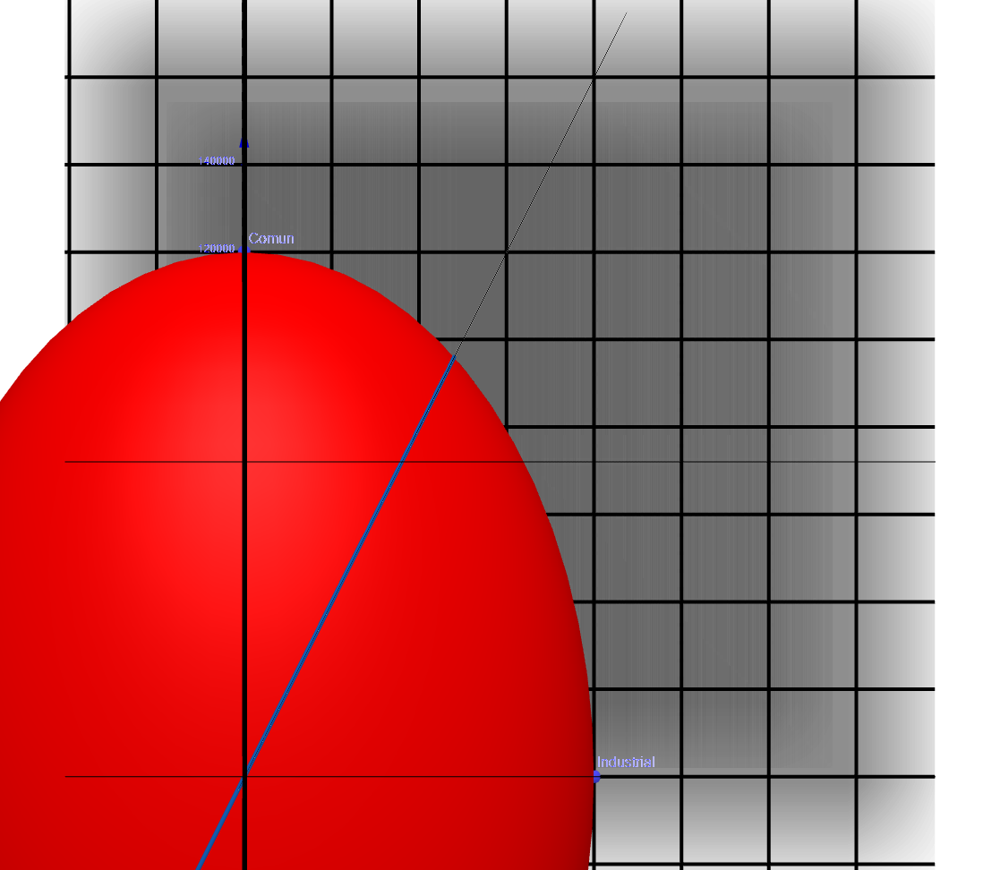
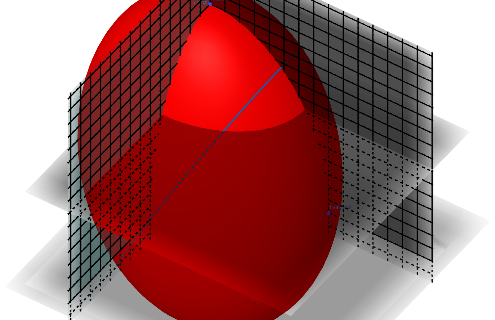
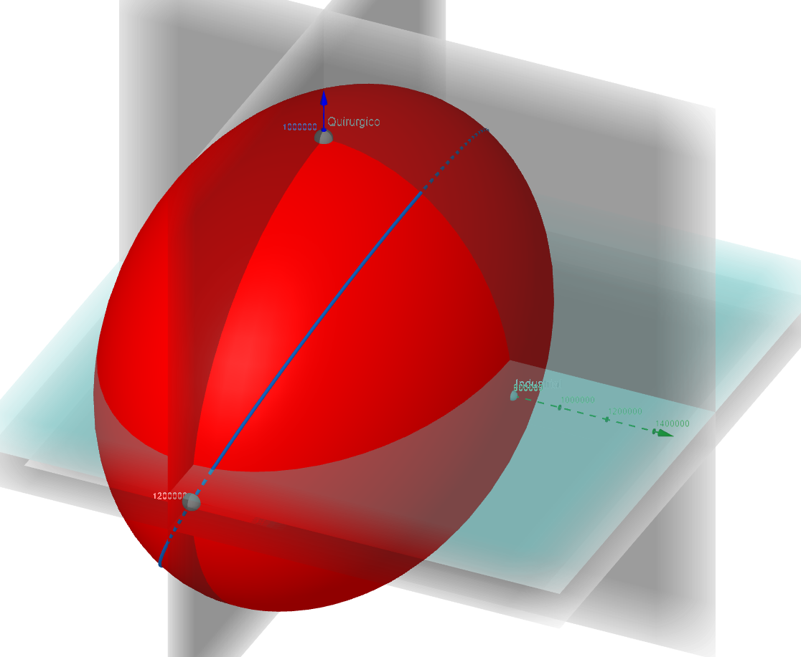

<!-- markdownlint-disable MD036 -->

# Probelmas de Aplicacion Campo Escalar

> Transcripción del original. Año de archivo: 2020. Atribución: Identificación
> ISI o varias carreras que incluyen ISI en fuente. Las erratas y las
> repeticiones del original se conservan.

## Alcance y observaciones de transcripción

Se omiten nombre y legajo de la portada y encabezados. Se preservan las
respuestas y errores del trabajo entregado, sin validarlos como soluciones
correctas.

## Contenido del original

Universidad Tecnológica Nacional

Facultad Regional Resistencia

Ingeniería en Sistemas de Información

Análisis Matemático II

______________________________________________________________________

Trabajo Práctico de aplicación: Campos Escalares

**Profesor Teoría:** Ing. Cesar Armando Flores

**Trabajos Prácticos**: Prof. Bibiana Altamirano

**Carrera**: I.S.I

2020

**Problema de aplicación**

Una textil productora de protectores buco nasal (barbijos) produce tres tipos de
distinta eficiencia.

Tipo A (uso común) capacidad máxima 120.000 unidades por mes.

Tipo B (uso industrial) capacidad máxima 80.000 unidades por mes.

Tipo C (uso quirúrgico) capacidad máxima 60.000 unidades por mes.

De modo que si produce más de uno, debe dejar de producir los otros en forma
proporcional.

1\. Defina matemática y gráficamente la ley de producción bajo condición máxima.

a. Expresión matemática de la producción en función de la capacidad.\\

$$
\frac{x^{2}}{60000^{2}} + \frac{y^{2}}{80000^{2}} + \frac{z^{2}}{120000^{2}} = 1
$$

b.
Expresión
gráfica de la producción en función de la capacidad.\
dicha expresión grafica corresponde a la gráfica de un elipsoide vertical en el
origen de las coordenadas definido para el primer octante y todos los puntos de
su superficie representan las proporciones de producción entre barbijos comunes,
industriales y quirúrgicos.

En condiciones normales de ventas (de acuerdo con formatos demanda-oferta), y
con materia prima disponible, la utilidad

por producto es

A (\$20 por unidad); B (\$10 por unidad); C (\$8 por unidad)

2\. Puede definir matemática y gráficamente la utilidad.

a. Expresión matemática de la utilidad en función del costo:\\

$$
\frac{x^{2}}{{(20*60000)}^{2}} + \frac{y^{2}}{{(10*80000)}^{2}} + \frac{z^{2}}{{(8*120000)}^{2}} = 1
$$

b. Expresión gráfica de la utilidad en función del costo:\
\
dicha expresión gráfica corresponde a la gráfica de un elipsoide horizontal en
el origen de las coordenadas definido para el primer octante y todos los puntos
de su superficie representan las proporciones de utilidades entre barbijos
comunes, industriales y quirúrgicos.

La llegada de la epidemia, hizo que el gobierno congele los precios, y por tanto
las utilidades, y aseguró a la empresa la

materia prima en cantidad y precio. Exigió que produzca el 60% de su máximo de
los del tipo C, asegurando su

adquisición.

3\. como queda definida matemática y gráficamente la nueva condición de
producción bajo condición máxima.

a. Expresión matemática de la producción en función de la capacidad, con la
producción mínima del 60% que impone el gobierno.\\

$$
\frac{x^{2}}{60000^{2}} + \frac{y^{2}}{80000^{2}} + \frac{z^{2}}{120000^{2}} = 1
$$

, donde Z ≥ 72000,(que representa el barbijo común), ya que siempre trabaja a
producción Máxima y esta no puede ser menor al 60% (72000)

b. Expresión gráfica de la producción en función de la capacidad.\
\
dicha expresión gráfica corresponde a la gráfica de un elipsoide vertical en el
origen de las coordenadas definido para el primer octante y todos los puntos de
su superficie y su intersección del plano $Z=72000$, donde representan las
proporciones de producción entre barbijos comunes, industriales y quirúrgicos,
cumpliendo con la producción mínima del 60% de barbijos comunes (Z)

4\. Para asegurar la máxima utilidad, supuesta la venta total de lo producido,
cual es la condición de producción en términos matemáticos y gráficos.

a. Expresión matemática de la utilidad en función del costo, con la producción
mínima del 60% que impone el gobierno.\\

$$
\frac{x^{2}}{{(20*60000)}^{2}} + \frac{y^{2}}{{(10*80000)}^{2}} + \frac{z^{2}}{{(8*120000)}^{2}} = 1
$$

, donde Z ≥ 160000, ya que la utilidad mínima que se obtiene por parte de los
barbijos comunes, es de 160000(60% de las ventas de barbijos comunes).

b. Expresión gráfica de la utilidad en función del costo.\
\
dicha expresión gráfica corresponde a la gráfica de un elipsoide horizontal en
el origen de las coordenadas definido para el primer octante y todos los puntos
de su superficie y su intersección del plano $Z=160000$, donde representan las
proporciones de utilidad entre barbijos comunes, industriales y quirúrgicos,
cumpliendo con la producción mínima del 60% de barbijos comunes (Z)\
\
Ante la ordenanza de obligatoriedad de usar protector común por parte de la
población, en lugares cerrados, el gobierno exige que la planta textil produzca
por cada uno del tipo B, dos del tipo A (obligatorio para el público), como
minimo.

5\. Es posible mantener la producción al máximo, bajo la nueva ordenanza. Analice
gráfica y analíticamente.

a. Gráficamente:\
\
\
\
dicha expresión gráfica corresponde a la gráfica de un elipsoide vertical en el
origen de las coordenadas definido para el primer octante y todos los puntos de
su superficie y su intersección con los planos plano $Z=72000$ (condición 1), y
$Z=2Y$ (condición 2) donde representan las proporciones de producción entre
barbijos comunes, industriales y quirúrgicos, cumpliendo con la producción
mínima del 60% de barbijos comunes ($Z=72000$) y 2 barbijos comunes por cada de
tipo industrial($Z=2Y$).\
\
\
\
\
\
\
\
\
\
\
\
\
\
\
\
Vista Lateral ($x=0$)\

b. Analíticamente:\
es posible mantener la producción al máximo, de 2 barbijos comunes, por cada
barbijo industrial, y una producción mínima del 60% del barbijo en el segmento
resultante entre los 2 puntos, definidos por la intersección de $Z=2Y$ y Z=
72000, y $Z=2Y$ y las tangentes con el elipsoide vertical.

Intente una solución posible de cumplimiento, aunque sea aproximada y determine
la utilidad de la empresa.\
\
el conjunto solución son todos los pares (x,y) que estén incluiudos en el
segmento (azul), que corresponde a la traza que cumplen las condiciones
anteriores.\
La utilidad, bajo las condiciones mencionadas, son las siguientes.\
\
el segmento (azul) que atraviesa el elipsoide, representa la utilidad de ventas
de la planta, en función de las condiciones de producción mencionadas
