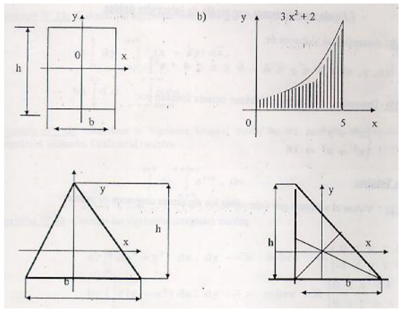
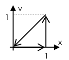
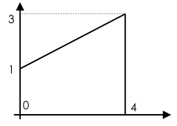

# PARTE Nº 5

> Fuente: `2020/10-Integrales Multiples/Trabajo práctico N° 5.pdf`.
> Transcripción de las páginas PDF 1–6, impresas 41–46. No consta autor ni año
> impreso. Controles en
> [cobertura](../../../resources/2020/pdf2020-cobertura.md).

Integral doble de una función continua. Dominio sobre un rectángulo. Integral
doble sobre un dominio cerrado. Aplicaciones. Integral triple. Cálculo de
integral triple. Aplicaciones. Nociones sobre la integridad de superficie.
Integrales que dependen de un parámetro. Continuidad. Derivación bajo el signo
integral: regla de Leibnitz. Integrales sucesivas. Integrales curvilíneas.
Integrales curvilíneas parciales. Definición y Cálculo. Integral curvilínea
total. Condición para que la integral no dependa del camino de integración.
Integral sobre una curva simple cerrada: Teorema de Green. Aplicaciones

## nº61. Resolver las siguientes integrales paramétricas

$$
\int_0^2 3xy\,dx=\varphi(y)
$$

$$
\int_0^{\pi/2}3xy\cdot\mathop{\mathrm{sen}}\nolimits z\,dz=\psi(x,y)
$$

$$
\int_1^2(x^2y+2x)\,dy=\chi(x)
$$

$$
\int_x^{x^2+2}2xy\,dy=\psi(x)
$$

## nº62. Resolver aplicando la Regla de Leinbniz las siguientes integrales

a)

$$
\frac\partial{\partial\alpha}\left[\int_b^a x\cdot\cos(\alpha x)\,dx\right]
$$

b)

$$
\frac\partial{\partial\alpha}\left[\int_0^\infty e^{-\alpha x}x^n\,dx\right];\quad n\in\mathbb N
$$

c)

$$
\psi(\alpha)=\int_1^2(x^2\alpha x+3)\,dx\Rightarrow\psi'_\alpha=?
$$

## nº63. Calcular integrando primero respecto de x; y luego respecto de y

$$
\iint_R(\sqrt x+y-3x^2y)\,dx\,dy;\quad
R=\{(x,y)/0\leq x\leq1;1\leq y\leq3\}
$$

Calcular las siguientes integrales.

a) $`\int_0^2\int_0^1(x^2+2y)\,dy\,dx`$

b) $`\int_{-3}^5\int_{-2}^4(xy-y^2x^2)\,dy\,dx`$

## nº64. Resolver la integral para los siguientes pasos

$$
\iint_R F(x,y)\,dx\,dy
$$

a) $F(x,y)=x^2-3y+5$; $`R=\{1\leq x\leq4;-3\leq y\leq2\}`$

b) $F(x,y)=y^2/(1+x^2)$; $`R=\{-1\leq x\leq1;0\leq y\leq2\}`$

c) $F(x,y)=y+3$; $`R=\{0\leq x\leq1;x^2\leq y\leq x+2\}`$

d) $F(x,y)=x^2+8xy-1$; $`R=\{1\leq y\leq2;y\leq x\leq3\}`$

e) $F(x,y)=e^{x^2}$; $`R=\{0\leq x\leq3;0\leq y\leq x/3\}`$

## nº65

Resolver la siguiente integral doble, hacerlo también invirtiendo el orden de
integración. Graficar el recinto.

$$
\int_1^{\ln5}\int_0^{\ln y}e^{x+y}\,dx\,dy
$$

## nº66

Resolver las integrales, graficar el recinto de integración.

a) $`\iint_R(x^2+y^2)\,dx\,dy`$; $`R=\{0\leq x\leq1\land-1\leq y\leq0\}`$

b) $`\iint_R(16-x^2)\,dx\,dy`$; $`R=\{0\leq x\leq4\land0\leq y\leq x\}`$

## nº67. Resolver las siguientes integrales dobles

a) $`\int_3^4\int_1^2\frac{dy\,dx}{(x+y)^2}`$

b) $`\int_1^2\int_x^{\sqrt x}xy\,dy\,dx`$

## nº68. Calcular el área de las siguientes regiones mediante integrales dobles

a) $`R=\{(x,y)/0\leq y\leq4-4x/3\land0\leq x\leq3\}`$

b) $`R=\{(x,y)/x^2\leq y\leq1\land-1\leq x\leq1\}`$

c) $`R=\{(x,y)/4-4x\leq y^2\leq4-x\}`$

d) $`R=\{3y^2=25x;5x^2=9y\}`$

e) $`R=\{y=4x-x^2;y=x\}`$

f) $`R=\{y^2=4x;9x^2=y\}`$

g) $`R=\{-y^2+6y=x;x=y\}`$

h) $`R=\{x^2+y^2=10;y^2=9x\}`$

i) $`R=\{y=x^2-2x-2;y=1\}`$

## nº69. Determinar el volumen

a) $`D=\{(x,y,z)/0\leq y\leq6\land0\leq z\leq4-x^2\}`$

b) $`S=\{x^2+y^2=16;x^2+z^2=16;\text{ primer octante}\}`$

## nº70

Sea R una región del plano xy cuya área es B. Si $f(x,y)=K$ para todo punto de
R, cuál es el valor de $`\iint_R f(x,y)\,dA`$.

## nº71

Determinar si las siguientes afirmaciones son verdaderas (V) o falsas(F).
Justificar la respuesta.

a) Si $`\iint_R f(r,\theta)\,dA>0\Rightarrow f(r,\theta)>0;\forall(r,\theta)`$

b)

$$
\int_a^b\int_c^d f(x)\cdot g(y)\,dy\cdot dx
=\left[\int_a^b f(x)\cdot dx\right]\cdot\left[\int_c^d g(y)\cdot dy\right]
$$

## nº72. Calcular el volumen que determinan los siguientes conjuntos de puntos

a) $`A=\{(x,y,z)/4x^2+y^2+1\leq z\leq10\}`$

b) $`B=\{(x,y,z)/0\leq y\leq6\land0\leq z\leq4-x^2\}`$

c) $`C=\{(x,y,z)/x^2+y^2\leq16\land x^2+z^2\leq16\}`$

d) $`D=\{(x,y,z)/0\leq y\leq16-x^2-z^2\}`$

e) $4z=10-4x^2-y^2$; primer octante

f) $z=x^2+y^2$; $0\leq y\leq1\land0\leq x\leq1$

## nº73. Determinar el centro de gravedad de una lámina rectangular definida por

$$
D=\{(x,y)/0\leq x\leq2\land0\leq y\leq3\}
$$

## nº74. Determinar el centro de gravedad de

$$
D=\{(x,y)/0\leq x\leq1\land0\leq y\leq x^{1/2}\}
$$

## nº75. Determinar el centro de masa de

$$
D=\{(x,y)/0\leq x\leq2\land0\leq y\leq3\};\quad\text{siendo la densidad }\rho(x,y)=x\cdot y
$$

## nº76

Determinar los momentos de inercia axiales (Ix, Iy), polares (I₀) y centrífugos
(Ixy) de las siguientes figuras.

## nº77. Hallar los momentos de inercia de

$$
D=\{(x,y)/0\leq x\leq1\land0\leq y\leq x\};\quad\text{siendo }\rho=x+y
$$

## nº78. Hallar el momento de inercia respecto del eje z

$$
S=\{(x,y,z)/0\leq y;0\leq x\land0\leq z\leq1-x-y\};\quad\text{siendo la densidad constante}
$$

## nº79. Hallar la masa de una placa homogénea donde densidad=cte

$$
D=\{(x,y)/y^2\leq x\leq y+2\}
$$

## nº80. Determinar el momento estático del sólido homogéneo definido por

$$
S=\{(x,y,z)/0\leq z\leq4-x^2-4y^2;x+y\leq1;0\leq x;0\leq y\}
$$

## nº81

Determinar las coordenadas del centro de gravedad de la mitad superior de una
esfera de radio R y centro en el origen de coordenadas, la densidad ρ es
constante.

## nº82

a- Se desea medir el volumen de combustible remanente en un tanque cilíndrico
enterrado horizontalmente, de radio 2m y longitud 10m midiendo con una varilla
metálica recta, calibrada para tal fin, la zona que quedó humedecida por el
combustible. Proponer una escala para tal regla.

b- si $`\int_0^a f(x)\,dx=I`$ y
$`J=\int_0^a f(x)[\int_0^x f(y)(\int_0^y f(z)\,dz)\,dy]\,dx`$

indicar si $J=I^3$; $J=\frac13I^3$; $J=\frac16I^3$; $J=I$; $J=3I$

## nº83

Calcular el área de la superficie en el espacio S, dada por z=f(x,y) sobre la
región R del plano xy.

a) $z=2x+2y$; R triángulo definido por los vértices (0,0)(2,0)(0,2)

b) $z=9-x^2$; R cuadrado definido por los vértices (0,0)(3,0)(0,3)(3,3)

## nº84

Dada $z=F(x,y)=x^2y-3x$; y siendo C un arco de parábola determinado por
$y=x^2+2$; entre P(1,3) y Q(4,18); determinar: $`\int_C F(x,y)\,dx`$

## nº85

Calcular $`\int_C F(x,y)\,dy`$; siendo $F(x,y)=x-y^2$;
$`C=\{y=5x+2;0\leq x\leq3\}`$. Tomando a y como parámetro; luego tomando a x
como parámetro.

## nº86

Dadas las funciones $P(x,y)=x^2-y$; $Q(x,y)=y^2+x$; y la curva
$`C=\{y=x^2+1;0\leq x\leq1\}`$; obtener $`\int_C P(x,y)\,dx+Q(x,y)\,dy`$

## nº87

Calcular $`\int_C(x^2y-3x)\,dx+(xy-2)\,dy`$; siendo C un arco de sinusoide entre
(0,0) y (π/2,1)

## nº88

Calcular $`\int_C(xy\,dx-3y^2\,dy)`$; siendo $`C=\{(x,y)/x^2+y^2=4\}`$

## nº89

Resolver $`\int_C y^2\,dx+xy\,dy`$; estando la curva C definida por la siguiente
figura:

## nº90

Siendo la curva C la frontera del conjunto definido por:
$`D=\{(x,y)/0\leq x\leq1;x^2\leq y\leq x\}`$; calcular
$`\int_C\left(\frac{x^2y^2}2\,dx+x^3\,dy\right)`$

## nº91

Calcular el trabajo realizado al mover una partícula en un campo de fuerzas a lo
largo de la curva definida por:
$`C=\{x=3(1-\mathop{\mathrm{sen}}\nolimits t);y=3(1-\cos t);0\leq t\leq2\pi\}`$.
Estando el campo de fuerzas actuantes definido por la función vectorial:
$F=(6-y)\mathbf i-(3-y)\mathbf j$

## nº92

Si la curva C está definida por $`C=\{y=x;x=3;y=0\}`$; calcular
$`\int_C(x^2y\,dx-xy\,dy)`$

## nº93

Calcular $`\int_C[(2x+y)\,dx+(x-y)\,dy]`$; estando la curva C asociada a
$F(t)=(t-1)\mathbf i+t^2\mathbf j$; para $0\leq t\leq2$.

## nº94. Calcular

$$
\int_C\left[\frac{x+y}{x^2+y^2}\,dx-\frac{x-y}{x^2-y^2}\,dy\right]
$$

siendo C la circunferencia $x^2+y^2=4$.

## nº95

Evaluar la integral curvilínea; a lo largo de una circunferencia con centro en
el origen.

$$
\int\frac{x}{x^2+y^2}\,dx-\frac{y}{x^2+y^2}\,dy
$$

## nº96. Verificar el teorema de Green

a) $`\int_C(x^3+2y^2)\,dx+(y^2+x^2y)\,dy`$ $`C=\{y^2=x;y^2=x^3;0\leq y\leq1\}`$.

b) $`\int_C(xy^2-x)\,dx+(x^2-y^3x)\,dy`$; siendo C la frontera del conjunto
$`D=\{(x,y)/x^2\leq y\leq2+x\}`$

c) $`\iint_D(2y-3xy^2)\,dx\,dy`$; $`D=\{(x,y)/y^2\leq x\leq y;0\leq y\leq1\}`$

## nº97

Calcular el área de los siguientes conjuntos de puntos mediante la aplicación de
integrales curvilíneas.

a) $`D=\{(x,y)/x^3\leq y^2\leq x;0\leq y\}`$

b) $`D=\{(x,y)/(2x^2-8x+10)\leq y\leq(-x^2+4x+1)\}`$

## nº98. Calcular el área de la siguiente figura

## nº99

Calcular las siguientes integrales curvilíneas sobre tres trayectorias
diferentes (C₁, C₂, C₃). Determinar como son las funciones respecto a las
distintas trayectorias.

a) $`\int_C[(x^2+y)\,dx+(2x-y^2)\,dy]`$; $`C_1=\{y=x^2;0\leq x\leq1\}`$;
$`C_2=\{y^2=x;0\leq x\leq1\}`$; $`C_3=\{y=x;0\leq x\leq1\}`$

b) $`\int_C[2xy^3\,dx+(3x^2y^2-2)\,dy]`$; $`C_1=\{y=x;0\leq x\leq1\}`$;
$`C_2=\{y=x^{3/2};0\leq x\leq1\}`$; $`C_3=\{y=x^2;0\leq x\leq1\}`$

## Notas de transcripción

Se conservan «integridad de superficie», «Leinbniz», «para los siguientes pasos»
y los dominios/expresiones del original, sin resolver ni corregir los
ejercicios. En el nº94 los denominadores impresos son diferentes.
