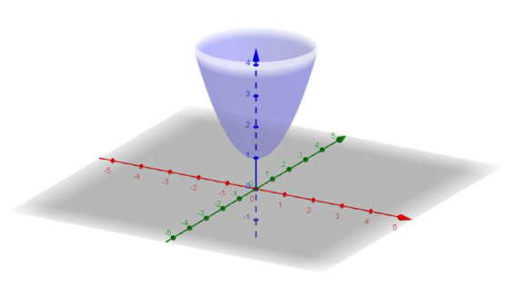
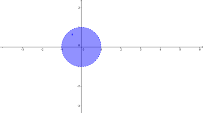

# Área de una superficie

> Fuente: `2020/11-Integrales de Superficie/Área de una superficie.pdf`.
> Transcripción de las páginas 1–2; no consta autor ni año impreso. Procedencia
> y controles en [cobertura](../../../resources/2020/pdf2020-cobertura.md).

## Definición del área de una superficie

Si $`f`$ y sus primeras derivadas son continuas en la región cerrada R en el
plano $`xy`$, entonces el área de una superficie S dada por $`z=f(x,y)`$ sobre R
está dada por:

```math
\text{Área de una superficie}=\iint_R dS
=\iint_R\sqrt{1+[f_x(x,y)]^2+[f_y(x,y)]^2}\,dA
```

Ejemplo: Hallar el área del paraboloide $`z=1+x^2+y^2`$, que se encuentra sobre
el círculo unidad $`x^2+y^2\leq1`$.



El recinto R de integración sería el círculo unitario.



Las derivadas parciales: $`f_x(x,y)=2x`$ y $`f_y(x,y)=2y`$, se tiene

```math
S=\iint_R\sqrt{1+[f_x(x,y)]^2+[f_y(x,y)]^2}\,dA
=\iint_R\sqrt{1+4x^2+4y^2}\,dA
```

Se puede pasar a coordenadas polares haciendo

```math
x=r\cos\theta;\ y=r\mathop{\mathrm{sen}}\nolimits \theta
\quad\text{con }0\leq r\leq1;\ 0\leq\theta\leq2\pi
```

```math
S=\int_0^{2\pi}\int_0^1\sqrt{1+4r^2}\cdot r\cdot dr\cdot d\theta\approx5.33
```

## Ejercicios

Hallar el área de la superficie dada por $`z=f(x,y)`$ sobre la región R.

1. $`f(x,y)=2x+2y`$; $`R`$: triángulo cuyos vértices son $`(0,0),(2,0),(0,2)`$.
1. $`f(x,y)=8+2x+2y`$, $`R:\{(x,y):x^2+y^2\leq4\}`$.
1. $`f(x,y)=9+x^2-y^2`$, $`R:\{(x,y):x^2+y^2\leq4\}`$.
1. $`f(x,y)=\sqrt{x^2+y^2}`$, $`R:\{(x,y):0\leq f(x,y)\leq1\}`$.
1. $`f(x,y)=\sqrt{a-x^2-y^2}`$, $`R:\{(x,y):x^2+y^2\leq b^2,\ 0\lt b\lt a\}`$.
1. $`f(x,y)=\sqrt{a-x^2-y^2}`$, $`R:\{(x,y):x^2+y^2\leq a^2\}`$.

> Nota de transcripción: se conservan el valor aproximado $`5.33`$ y las
> expresiones con $`a`$ del original, sin corregirlos.
