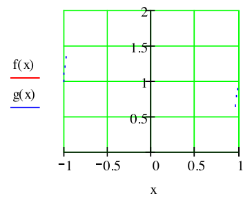
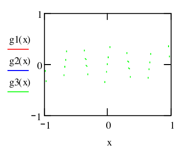
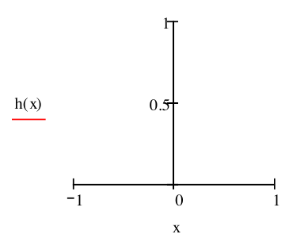
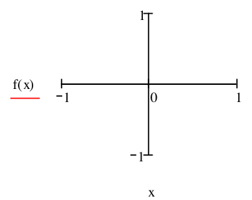
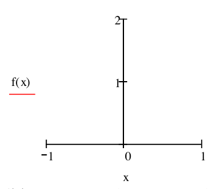

<!-- markdownlint-disable MD036 -->

# Series de Fourier

Autor: Ing. César Flores.

Fuente: `2020/3-Series de Fourier/fourier.pdf`, 14 páginas. Año impreso: no
consta. SHA-256:
`53f931d5baece0f847a1b616c9bf1a97dbad10e45aec9ba3d17a9070e29daa51`.
[Procedencia](../../../resources/2020/fuentes.md).

Transcripción completa cotejada con las páginas originales. Se conservan las
erratas y las consignas sin resolver. Los encabezados de página son editoriales.

## Página 1 — Introducción

Antes de iniciar lo referente a series de Fourier, es necesario recordar algunos
conceptos del álgebra, como son los conceptos de **Cuerpo** y **Espacio
Vectorial**.

Sea $`K`$ un conjunto no vacio, y $`(+,.)`$ Son operaciones de $`K`$, y decimos
que $`K`$ es **cuerpo**, si se cumple:

Para la suma $`(+)`$:

- $`K\times K\to K`$ Ley de composición interna
- $`\forall a,b,c\in K,\ a+(b+c)=(a+b)+c`$ asociatividad
- $`\exists0\in K,\forall a\in K\Rightarrow a+0=0+a=a`$ existencia del elemento
  neutro para $`+`$
- $`\forall a\in K,\exists(-a)\Rightarrow a+(-a)=0`$ existencia del inverso para
  $`+`$
- $`\forall a,b\in K,\ a+b=b+a`$ simetría en $`+`$

Para el producto $`(.)`$

- $`K\times K\to K`$ Ley de composición interna
- $`\forall a,b,c\in K,\ a.(b.c)=(a.b).c`$ asociatividad
- $`\exists1\in K,\forall a\in K\Rightarrow a.1=a`$ existencia del elemento
  neutro para $`(.)`$
- $`\forall a\in K,\exists(1/a)\ \text{con}\ a\ne0\Rightarrow a.(1/a)=1`$
  existencia del inverso para $`(.)`$
- $`\forall a,b,c\in K,\ a.(b+c)=a.b+a.c=(b+c).a`$ distribución de $`(.)`$ en
  $`(+)`$

**Ejercite su interpretación**

Demuestre que $`\mathbb N`$ no es cuerpo igual que $`\mathbb Z`$ (naturales,
enteros). Verifique que $`\mathbb Q,\mathbb R,\mathbb C`$ son cuerpos
(racionales, reales, complejos).

Sea $`V`$ un conjunto no vacío y $`(+)`$ una operación en $`V`$, donde se cumple

```math
\forall u,v,w\in V,\ u+(v+w)=(u+v)+w
```

```math
\exists0\in V,\forall u\in V\Rightarrow u+0=0+u=u
```

con 0 indicamos en elemento neutro para $`+`$ de $`V`$

```math
\forall u\in V,\exists(-u)\Rightarrow u+(-u)=0
```

notar que referimos al elemento neutro de $`V`$

```math
\forall u,v\in V,\ u+v=v+u
```

¡No confundir! dado que se ha escrito mismo el símbolo $`(+)`$, para el cuerpo
como para $`V`$, pero tienen un significado distinto en general.

**Espacio vectorial** es la composición del conjunto $`V`$ con su $`(+)`$ y el
cuerpo $`K`$ con sus $`(+)`$ y $`(.)`$. De forma que anotamos simbólicamente
$`\{V,K,(.)\}`$ y decimos que $`V`$ es un K-espacio vectorial con una $`(.)`$
que es una operación $`(.):K\times V\to V`$ llamada producto por un escalar,
siendo el escalar, un elemento perteneciente a K.

¡No confundir! dado que se ha escrito mismo el símbolo $`(.)`$ para indicar el
producto por un escalar

$`V`$ es un K-espacio vectorial, porque cumple

```math
\forall u,v\in V,\forall a\in K\ \text{se cumple}\ a.(u+v)=a.u+a.v
```

```math
\forall u\in V,\forall a,b\in K\ \text{se cumple}\ (a+b).u=a.u+b.uv
```

## Página 2

```math
\forall u\in V,\ \text{con}\ 1\in K,\ 1.u=u
```

```math
\forall u\in V,\forall a,b\in K\ \text{se cumple}\ (a.b).u=a.(b.u)
```

¡No confundir! y notar que se ha usado $`(.)`$ y $`(+)`$ pero que tienen
significados distintos, pero el lector estará familiarizado con el algebra
vectorial clásico y debe reconocer la diferencia.

**Ejercite su interpretación**

Sea $`V`$ el espacio vectorial de las ternas ordenadas, que en la práctica
formal llamamos $`\mathbb R^3`$, con $`u=(u_1,u_2,u_3)`$, con
$`u_i\in\mathbb R`$. $`\mathbb R`$ es el cuerpo que conocemos de los reales.
Demuestre o verifique que $`(\mathbb R^3,+,\mathbb R,.)`$ es un
$`\mathbb R`$espacio vectorial, con la suma de vectores, y el producto por un
escalar que Ud. ya conoce de la geometría analítica.

**Ejercite su interpretación**

Verifique que el conjunto de los polinomios de grado n con coeficientes reales o
complejos, con la suma usual que Ud. conoce, es un $`\mathbb R`$ espacio
vectorial, con el producto por un escalar, que ya lo conoce.

$`V`$ es un K-espacio vectorial, y ocurre, que cualquier elemento de $`V`$,
puede expresarse como una combinación lineal, de un subconjunto de $`V`$, al
cual llamamos $`\langle G\rangle`$.

Sea $`G=\{u_1,u_2,u_3,\ldots u_n\}=\langle G\rangle`$. Sea $`v\in V`$ entonces

```math
v=\sum_i^n\alpha_i u_i\quad\text{con}\ \alpha_i\in K\ \forall i
```

$`\langle G\rangle`$ será llamado generador de $`V`$.

Recuerde: Necesitamos que $`\{u_1,u_2,u_3,\ldots u_n\}`$ sean vectores
linealmente independientes.

**Ejercite su interpretación**

Demuestre o verifique que en $`(\mathbb R^3,+,\mathbb R,.)`$ que es un
$`\mathbb R`$espacio vectorial, el conjunto
$`\langle G\rangle=\{(1,1,0),(-1,1,0),(0,0,1)\}`$ es linealmente independiente.
Recuerde que $`\sum_i^3\beta_i u_i=0`$ (0, es el elemento neutro en
$`\mathbb R^3`$) solamente si $`\beta_i=0\ \forall i`$.

Si esto es así, exprese a $`v=(3,18,51)\in\mathbb R^3`$ como combinación lineal
de $`\langle G\rangle`$.

**Ejercite su interpretación**

Demuestre o verifique que en $`(\mathbb R^3,+,\mathbb R,.)`$ que es un
$`\mathbb R`$espacio vectorial, el conjunto
$`\langle G\rangle=\{(1,0,0),(0,1,0),(0,0,1)\}`$ es linealmente independiente.
Recuerde que $`\sum_i^3\beta_i u_i=0`$ (0, es el elemento neutro en
$`\mathbb R^3`$) solamente si $`\beta_i=0\ \forall i`$. En este caso
$`\langle G\rangle`$ es lo que llamamos base canónica en $`\mathbb R^3`$.

## Página 3 — Producto interno

Debe entender que un conjunto $`V`$, K-espacio vectorial puede tener distintos
sistemas generadores, y además esos sistemas de generadores pueden tener
distinta cantidad de elementos. Cuando esa cantidad sea mínima, tenemos lo que
formalmente llamamos base, y la cantidad de elementos de esa base se llama
**dimensión** del espacio vectorial.

**Producto interno** (recuerde que en algebra lo llamábamos también producto
escalar. ¡Notar que no es el producto por un escalar!)

Consideramos $`V`$, $`\mathbb R`$-espacio vectorial (es decir que el cuerpo que
consideramos es el de los reales). Se define el producto interno como

```math
\phi:V\times V\to\mathbb R
```

cumpliendo:

```math
\forall a\in\mathbb R,\forall u,v,w\in V
```

```math
\phi(u+v,z)=\phi(u,z)+\phi(v,z)
```

```math
\phi(a.u,z)=a.\phi(u,z)
```

```math
\phi(u,v)=\phi(v,u)
```

$`\phi(u,u)\gt 0`$ si $`u\ne0`$ el producto interior del vector por sí mismo es
un real positivo.

**Ejercite su interpretación**

Demuestre o verifique que en $`(\mathbb R^3,+,\mathbb R,.)`$ que es un
$`\mathbb R`$espacio vectorial, y el producto interior definido como
$`\phi(u,v)=\sum_1^3u_i v_i`$. Con $`u=(u_1,u_2,u_3)`$ y $`v=(v_1,v_2,v_3)`$.
Cumple con las propiedades enunciadas.

**Ejercite su interpretación**

Si $`a\lt b\in\mathbb R`$, y
$`C[a,b]=\{f:[a,b]\to\mathbb R\mathrel{\therefore}f\ \text{es continua}\}`$.
Demuestre que $`C[a,b]`$ es un $`\mathbb R`$espacio vectorial (espacio vectorial
de las funciones continuas en el intervalo [a,b]

Demuestre que $`\phi(f,g)=\int_a^b f(x)g(x)\,dx`$ (¡Notar cómo se define el
producto interior!), es producto interior porque cumple las propiedades
enunciadas.

## Página 4 — Norma de un vector

Por comodidad llamamos al producto interior $`\phi(f,g)=\langle f,g\rangle`$.

Se define la norma de un vector, asociado a un producto interior a

```math
\|u\|=\langle u,u\rangle^{1/2}
```

Que debe cumplir: notar que $`\langle,\rangle:V\times V\to\mathbb R^+`$

```math
\forall u\in V,\ \|u\|\ge0,\ \text{y}\ \|u\|=0\iff u=0
```

(Notar que se hace referencia al elemento neutro de la suma de los reales, y
también al elemento neutro del espacio vectorial)

```math
\forall a\in\mathbb R,\ \|a\,u\|=|a|\|u\|
```

Notar que se hace referencia a valor absoluto del escalar.

```math
|\langle v,w\rangle|\le\|v\|\,\|w\|\quad\text{(Desigualdad de Cauchy-Schwartz)}
```

```math
\|u+v\|\le\|u\|+\|v\|\quad\text{(Desigualdad triangular)}
```

**Ejercite su interpretación**

Demuestre o verifique que en $`(\mathbb R^2,+,\mathbb R,.)`$ que es un
$`\mathbb R`$espacio vectorial, y el producto interior definido como
$`\langle u,v\rangle=\sum_1^2u_i v_i`$. Con $`u=(u_1,u_2)`$ y $`v=(v_1,v_2)`$.
$`\|u\|=\langle u,u\rangle^{1/2}`$ norma del vector. Cumple con las propiedades
enunciadas.

### Serie de Fourier

Sea g(x) una función definida para todos los valores x del intervalo
$`a\le x\le b`$.

Si consideramos esta función como un vector de $`V`$, $`\mathbb R`$-espacio
vectorial.

Dos funciones como vectores: f(x) y g(x) en el intervalo $`a\le x\le b`$.

## Página 5 — Producto interior

```math
\langle f,g\rangle=\int_a^b f(x)g(x)\,dx
```

Por ello si dos funciones son ortogonales, el producto interno es nulo.

Norma de la función o vector

```math
\|f\|=\langle f,f\rangle^{1/2}=\sqrt{\int_a^b(f(x))^2\,dx}
```

Una función normalizada consistirá en lo mismo que se consideraba en
$`\mathbb R^n`$

```math
\frac{f}{\langle f,f\rangle^{1/2}}
```

(Será tal que el producto interior por si misma tendrá como resultado el valor
uno)

```math
\langle f,f\rangle=\frac{\left(\int_a^b f(x)^2\,dx\right)}
{\left[\sqrt{\int_a^b f^2\,dx}\right]^2}=1
```

Un conjunto de funciones del espacio vectorial considerado $`\varnothing_j`$ que
sea ortonormal en el intervalo $`a\le x\le b`$ cumplirá

```math
\int_a^b\varnothing_j\varnothing_k\,dx=
\begin{cases}0&j\ne k\\1&j=k\end{cases}\quad j=1,2,3,\ldots
```

Una función f(x) podrá expandirse según esa sucesión de funciones
$`\varnothing_j`$, como una serie

```math
f(x)=\sum_{j=1}^{\infty}c_j\varnothing_j(x)
```

Las constantes apropiadas, $`c_k`$ pueden obtenerse, multiplicando por
$`\varnothing_k(x)`$

```math
f(x)\varnothing_k(x)=\sum_{j=1}^{\infty}c_j\varnothing_j(x)\varnothing_k(x)
```

Integrando

```math
\int_a^b f(x)\varnothing_k(x)\,dx=
\sum_{j=1}^{\infty}c_j\int_a^b\varnothing_j(x)\varnothing_k(x)\,dx=c_k
```

```math
\int_a^b\varnothing_j\varnothing_k\,dx=
\begin{cases}0&j\ne k\\1&j=k\end{cases}\quad j=1,2,3,\ldots
```

## Página 6 — Conjunto ortonormal completo

```math
c_k=\int_a^b f(x)\varnothing_k(x)\,dx\quad k=1,2,3\ldots
```

El problema que se presenta es: La serie
$`\sum_{j=1}^{\infty}c_j\varnothing_j(x)`$ contiene todas las funciones
$`\varnothing_j(x)`$ necesarias para la expansión.? $`\varnothing_j(x)`$ es un
conjunto completo.? Y aun siendo completo, como saber si la serie representa a
la función f(x).

**Definición**

Una sucesión $`\varnothing_j(x)`$ de funciones ortonormales j=1,2,3,….. se dice
que es un conjunto ortonormal completo en el intervalo [a,b], si para todas las
funciones f(x), cuya $`\int_a^b(f(x))^2\,dx`$ existe, se cumple:

```math
\lim_{n\to\infty}E_n=\lim_{n\to\infty}\frac1{(b-a)}
\int_a^b\left[f(x)-\sum_{j=1}^n c_j\varnothing_j\right]^2\,dx=0
```

Donde

```math
E_n=\frac1{(b-a)}\int_a^b\left[f(x)-\sum_{j=1}^n c_j\varnothing_j\right]^2\,dx
```

Representa el error medio cuadrático de aproximar con los n primeros términos de
esta serie la función f(x).

Operando:

```math
\begin{aligned}
\left[f(x)-\sum_{j=1}^n c_j\varnothing_j\right]^2
&=[f(x)]^2+\left[\sum_{j=1}^n c_j\varnothing_j\right]^2
-2f(x)\sum_{j=1}^n c_j\varnothing_j=\\
&=[f(x)]^2+\sum_{j=1}^n c_jc_j\varnothing_j\varnothing_j
+\sum_{j\ne k}^n c_jc_k\varnothing_j\varnothing_k
-2\sum_{j=1}^n c_j\varnothing_j f(x)
\end{aligned}
```

Integrando

```math
\begin{aligned}
\int_a^b\left[f(x)-\sum_{j=1}^n c_j\varnothing_j\right]^2\,dx
&=\\
&=\int_a^b[f(x)]^2\,dx+\sum_{j=1}^n c_j^2\int_a^b\varnothing_j^2\,dx
+\sum_{j\ne k}c_jc_k\int_a^b\varnothing_j\varnothing_k\,dx\\
&\quad-2\sum_{j=1}^n c_j\int_a^b f(x)\varnothing_j\,dx
=\int_a^b[f(x)]^2\,dx+\sum_{j=1}^n c_j^2-2\sum_{j=1}^n c_j^2\\
&=\int_a^b[f(x)]^2\,dx-\sum_{j=1}^n c_j^2
\end{aligned}
```

Si se cumple que el conjunto ortonormal es completo entonces

```math
\lim_{n\to\infty}\int_a^b[f(x)]^2\,dx-\sum_{j=1}^n c_j^2=0
```

## Página 7 — Igualdad de Parseval

```math
\int_a^b[f(x)]^2\,dx=\sum_{j=1}^{\infty}c_j^2
```

Llamada igualdad de Parseval. Si se cumple esto para cualquier función f(x), la
serie propuesta converge en media cuadrática, aunque esto no asegura la
convergencia puntual.

El siguiente conjunto de funciones constituye una base ortogonal

```math
\left\{1;\cos\frac{j\pi x}{L};\sin\frac{j\pi x}{L}\right\}\quad j=1,2,3\ldots
```

El intervalo que se considera es

```math
a=-L\le x\le L=b
```

Su normalización involucra el cociente por su norma, que calculamos

```math
\sqrt{\int_{-L}^{L}1^2\,dx}=\sqrt{2L}
```

```math
\sqrt{\int_{-L}^{L}\left[\cos\frac{j\pi x}{L}\right]^2\,dx}=\sqrt L
```

```math
\sqrt{\int_{-L}^{L}\left[\sin\frac{j\pi x}{L}\right]^2\,dx}=\sqrt L
```

**Ejercite su interpretación**

Verifique los cálculos anteriores.

Queda entonces el conjunto ortonormal

```math
\left\{\frac1{\sqrt{2L}};\frac1{\sqrt L}\cos\frac{j\pi x}{L};
\frac1{\sqrt L}\sin\frac{j\pi x}{L}\right\}\quad j=1,2,3,\ldots
```

Se cumplen:

```math
\int_{-L}^L\frac1{\sqrt{2L}}\frac1{\sqrt L}\cos\frac{j\pi x}{L}\,dx=0\quad j=1,2,3,\ldots
```

```math
\int_{-L}^L\frac1{\sqrt{2L}}\frac1{\sqrt L}\sin\frac{j\pi x}{L}\,dx=0\quad j=1,2,3,\ldots
```

```math
\int_{-L}^L\frac1{\sqrt L}\cos\frac{j\pi x}{L}\frac1{\sqrt L}\sin\frac{k\pi x}{L}\,dx=0
\quad\text{para todo j,k}
```

```math
\int_{-L}^L\frac1{\sqrt L}\cos\frac{j\pi x}{L}\frac1{\sqrt L}\cos\frac{k\pi x}{L}\,dx=
\begin{cases}0&j\ne k\\1&j=k\end{cases}
```

```math
\int_{-L}^L\left[\frac1{\sqrt{2L}}\right]^2\,dx=1
```

## Página 8 — Serie trigonométrica de Fourier

```math
\int_{-L}^L\frac1{\sqrt L}\sin\frac{j\pi x}{L}\frac1{\sqrt L}\sin\frac{k\pi x}{L}\,dx=
\begin{cases}0&j\ne k\\1&j=k\end{cases}
```

**Ejercite su interpretación**

Verifique los cálculos anteriores.

Entonces una función f(x) podrá desarrollarse según la **serie trigonométrica de
Fourier**

```math
f(x)=a'_0\frac1{\sqrt{2L}}+\sum_{j=1}^{\infty}
\left(a'_j\frac1{\sqrt L}\cos\frac{j\pi x}{L}+b'_j\frac1{\sqrt L}\sin\frac{j\pi x}{L}\right)
```

Donde los coeficientes se obtienen según el criterio establecido

```math
c_k=\int_a^b f(x)\varnothing_k(x)\,dx\quad k=1,2,3\ldots
```

Para este conjunto resulta, multiplicando convenientemente la serie propuesta
por

```math
\frac1{\sqrt L}\cos\frac{k\pi x}{L}
```

Integrando en el intervalo

```math
\begin{aligned}
\int_{-L}^L f(x)\frac1{\sqrt L}\cos\frac{k\pi x}{L}\,dx
&=\\
&=a'_0\frac1{\sqrt{2L}}\int_{-L}^L\frac1{\sqrt L}\cos\frac{k\pi x}{L}\,dx\\
&\quad+\sum_{j=1}^{\infty}\left(a'_j\frac1{\sqrt L}\frac1{\sqrt L}
\int_{-L}^L\cos\frac{k\pi x}{L}\cos\frac{j\pi x}{L}\,dx\right.\\
&\qquad\left.+b'_j\frac1{\sqrt L}\frac1{\sqrt L}
\int_{-L}^L\cos\frac{k\pi x}{L}\mathop{\mathrm{sen}}\nolimits \frac{j\pi x}{L}\,dx\right)
\end{aligned}
```

Para k=1,2,3, ...

```math
\begin{aligned}
\int_{-L}^L f(x)\frac1{\sqrt L}\cos\frac{k\pi x}{L}\,dx
&=a'_k\frac1{\sqrt L}\frac1{\sqrt L}\int_{-L}^L\cos\frac{k\pi x}{L}\cos\frac{k\pi x}{L}\,dx\\
&=a'_k\frac1{\sqrt L}\frac1{\sqrt L}\int_{-L}^L\left[\cos\frac{k\pi x}{L}\right]^2\,dx
\end{aligned}
```

```math
\begin{aligned}
\frac1{\sqrt L}\int_{-L}^L f(x)\cos\frac{k\pi x}{L}\,dx
&=a'_k\frac1{\sqrt L}\frac1{\sqrt L}\int_{-L}^L\left[\cos\frac{k\pi x}{L}\right]^2\,dx\\
&=a'_k\frac1{\sqrt L}\frac1{\sqrt L}
\left[\frac x2+\frac{\sin(2k\pi x/L)}{4k\pi/L}\right]_{-L}^{L}\\
&=a'_k\frac1{\sqrt L}\frac1{\sqrt L}L=a'_k
\end{aligned}
```

```math
a'_k=\frac1{\sqrt L}\int_{-L}^L f(x)\cos\frac{k\pi x}{L}\,dx\quad k=1,2,3,\ldots
```

De igual forma, multiplicando la serie propuesta por

## Página 9 — Coeficientes

```math
\frac1{\sqrt L}\mathop{\mathrm{sen}}\nolimits \frac{k\pi x}{L}
```

Integrando en el intervalo, resulta:

```math
b'_k=\frac1{\sqrt L}\int_{-L}^L f(x)\mathop{\mathrm{sen}}\nolimits \frac{k\pi x}{L}\,dx
```

Para encontrar el coeficiente $`a'_0`$ el mecanismo procedimental es similar,
multiplicando por

```math
\frac1{\sqrt{2L}}
```

integrando

```math
\int_{-L}^L f(x)\frac1{\sqrt{2L}}\,dx=a'_0
```

```math
a'_0=\frac1{\sqrt{2L}}\int_{-L}^L f(x)\,dx
```

Sustituyendo los coeficientes calculados en la serie

```math
f(x)=a'_0\frac1{\sqrt{2L}}+\sum_{j=1}^{\infty}
\left(a'_j\frac1{\sqrt L}\cos\frac{j\pi x}{L}+b'_j\frac1{\sqrt L}\mathop{\mathrm{sen}}\nolimits \frac{j\pi x}{L}\right)
```

```math
\begin{aligned}
f(x)&=\left\{\frac1{\sqrt{2L}}\int_{-L}^L f(x)\,dx\right\}\frac1{\sqrt{2L}}\\
&\quad+\sum_{j=1}^{\infty}\left(\left\{\frac1{\sqrt L}\int_{-L}^L f(x)\cos\frac{j\pi x}{L}\,dx\right\}
\frac1{\sqrt L}\cos\frac{j\pi x}{L}\right.\\
&\qquad\left.+\left\{\frac1{\sqrt L}\int_{-L}^L f(x)\mathop{\mathrm{sen}}\nolimits \frac{j\pi x}{L}\,dx\right\}
\frac1{\sqrt L}\mathop{\mathrm{sen}}\nolimits \frac{j\pi x}{L}\right)
\end{aligned}
```

Sustituyendo las expresiones de los coeficientes, de la siguiente forma

```math
a'_0=\frac1{\sqrt{2L}}\int_{-L}^L f(x)\,dx=a_0\sqrt{\frac L2}
```

```math
a'_k=\frac1{\sqrt L}\int_{-L}^L f(x)\cos\frac{k\pi x}{L}\,dx=a_k\sqrt L
```

```math
b'_k=\frac1{\sqrt L}\int_{-L}^L f(x)\mathop{\mathrm{sen}}\nolimits \frac{k\pi x}{L}\,dx=b_k\sqrt L
```

Resulta la forma mas usual de presentar a la serie de Fourier

```math
f(x)=\frac{a_0}2+\sum_{j=1}^{\infty}\left(a_j\cos\frac{j\pi x}{L}+b_j\mathop{\mathrm{sen}}\nolimits \frac{j\pi x}{L}\right)
```

```math
a_0=\frac1L\int_{-L}^L f(x)\,dx
```

## Página 10 — Parseval y ejemplo

```math
a_j=\frac1L\int_{-L}^L f(x)\cos\frac{j\pi x}{L}\,dx\qquad
b_j=\frac1L\int_{-L}^L f(x)\mathop{\mathrm{sen}}\nolimits \frac{j\pi x}{L}\,dx\quad j=1,2,3,\ldots
```

Donde se hace notar que el término constante $`a_0/2`$ corresponde al valor
medio de la función en el intervalo dado.

La igualdad de Parseval dada al principio queda escrita en términos de los
coeficientes encontrados

```math
\begin{aligned}
\int_{-L}^L[f(x)]^2\,dx
&=\sum_{j=1}^{\infty}c_j^2
=\left[a_0\sqrt{\frac L2}\right]^2+\sum_{j=1}^{\infty}[a_k\sqrt L]^2+[b_k\sqrt L]^2\\
&=[a_0]^2\frac L2+L\sum_{j=1}^{\infty}[a_k]^2+[b_k]^2
=L\frac{[a_0]^2+2\sum_{j=1}^{\infty}[a_k]^2+[b_k]^2}{2}
\end{aligned}
```

```math
\frac1L\int_{-L}^L[f(x)]^2\,dx=\frac{[a_0]^2}2+2\sum_{j=1}^{\infty}[a_k]^2+[b_k]^2
```

Algunas veces la expresión funcional se especifica en un intervalo de longitud
2L diferente a $`-L\le x\le L`$ por ejemplo en $`c\le x\le c+2L`$. Por lo que
los coeficientes deben calcularse según

```math
a_0=\frac1L\int_c^{c+2L}f(x)\,dx
```

```math
a_k=\frac1L\int_c^{c+2L}f(x)\cos\frac{k\pi x}{L}\,dx\qquad
b_k=\frac1L\int_c^{c+2L}f(x)\mathop{\mathrm{sen}}\nolimits \frac{k\pi x}{L}\,dx\quad k=1,2,3,\ldots
```

### Ejemplo

```math
f(x)=1-x\qquad -1\le x\le1\qquad 2L=2
```

```math
a_0=\int_{-1}^1(1-x)\,dx=\left[x-(x^2/2)\right]_{-1}^1
=1-\frac12+1+\frac12=2
```

```math
a_k=\int_{-1}^1(1-x)\cos k\pi x\,dx=0
```

```math
b_k=\int_{-1}^1(1-x)\sin k\pi x\,dx=\frac{2\cos k\pi}{k\pi}
```

## Página 11 — Representación y convergencia

```math
1-x=1-\frac2\pi\sin\pi x+\frac2{2\pi}\sin2\pi x-\frac2{3\pi}\sin3\pi x
+\frac2{4\pi}\sin4\pi x-\frac2{5\pi}\sin5\pi x\ldots
```



Se ha representado (Mathcad ) en trazo rojo la expresión funcional f(x) y en
azul el desarrollo tomando una aproximación de los seis primeros sumandos.

Notar que

```math
\sin\pi x
```

```math
\sin2\pi x
```

```math
\sin3\pi x
```



Son todas expresiones de periodo 2. Por lo que si intentamos extendernos más
allá del intervalo [-1,1] con la serie de Fourier, lo que logramos es
representar nuevamente a f(x), es decir que la serie de Fourier hace periódica
la función. Pero si la función de partida es periódica, la serie de Fourier la
representa para todo valor de la variable. Observar que bajo las condiciones
expuestas y en términos gráficos existe una notoria diferencia de f(x) con la
serie propuesta en x = -1 y en x= 1.

Condición para la convergencia

### Condiciones de Dirichlet

f(x) es definida en el intervalo $`-L\le x\le L`$ y periodica $`f(x+2L)=f(x)`$.

## Página 12 — Casos especiales

f(x) es seccionalmente continua en el intervalo. f ‘(x) es seccionalmente
continua en el intervalo.

entonces la expresión a la derecha de

```math
f(x)=\frac{a_0}2+\sum_{j=1}^{\infty}\left(a_j\cos\frac{j\pi x}{L}+b_j\mathop{\mathrm{sen}}\nolimits \frac{j\pi x}{L}\right)
```

converge para todos los puntos x donde exista continuidad, si los coeficientes
son calculados con

```math
a_0=\frac1L\int_{-L}^L f(x)\,dx
```

```math
a_k=\frac1L\int_{-L}^L f(x)\cos\frac{k\pi x}{L}\,dx\qquad
b_k=\frac1L\int_{-L}^L f(x)\mathop{\mathrm{sen}}\nolimits \frac{k\pi x}{L}\,dx\quad k=1,2,3,\ldots
```

Y converge a

```math
\frac12[f(x+0)+f(x-0)]
```

= media aritmética de los límites por izquierda y derecha en el punto de
discontinuidad. (Esto puede notarse claramente en la representación grafica del
ejemplo anterior)

### Casos especiales

Hay situaciones donde únicamente la serie tiene términos de coseno, es decir que
los coeficientes $`b_j`$ son todos nulos

```math
f(x)=\frac{a_0}2+\sum_{j=1}^{\infty}\left(a_j\cos\frac{j\pi x}{L}\right)
```

Si sustituimos x por –x vemos

```math
f(-x)=\frac{a_0}2+\sum_{j=1}^{\infty}\left(a_j\cos\left[-\frac{j\pi x}{L}\right]\right)
=\frac{a_0}2+\sum_{j=1}^{\infty}\left(a_j\cos\frac{j\pi x}{L}\right)=f(x)
```

Por lo tanto si la función cumple el requisito $`f(x)=f(-x)`$ se denomina
función par y su serie de Fourier solamente tiene términos de coseno, es decir
los coeficientes $`b_k=0`$ para todo k.

Hay situaciones donde la serie contiene únicamente términos de senos

```math
f(x)=\frac{a_0}2+\sum_{j=1}^{\infty}\left(b_j\mathop{\mathrm{sen}}\nolimits \frac{j\pi x}{L}\right)
```

y con el mismo criterio sustituimos x por –x

```math
f(-x)=\sum_{j=1}^{\infty}\left(b_j\mathop{\mathrm{sen}}\nolimits \left[-\frac{j\pi x}{L}\right]\right)
=-\sum_{j=1}^{\infty}\left(b_j\mathop{\mathrm{sen}}\nolimits \frac{j\pi x}{L}\right)=-f(-x)
```

Por lo tanto si la función cumple el requisito $`f(x)=-f(-x)`$ se denomina
función impar y su serie de Fourier solamente tiene términos de seno, es decir
los coeficientes $`a_j=0`$ para todo k.

Por ejemplo:

## Página 13 — Ejemplos de paridad



$`h(x)=x^2`$ es función par y en el intervalo [-1,1] su desarrollo en serie de
Fourier únicamente tiene términos en coseno ($`b_j=0`$).



$`f(x)=x`$ es función impar y en el intervalo [-1,1] su desarrollo en serie de
Fourier únicamente tiene términos en seno ($`a_j=0`$).



$`f(x)=1-x`$ no cumple ninguno de los requisitos anteriores pero su desarrollo
es

```math
g(x):=1-\left(\frac2\pi\right)\sin(\pi x)
+\left(\frac2{2\pi}\right)\sin(2\pi x)-\left(\frac2{3\pi}\right)\sin(3\pi x)
+\left(\frac2{4\pi}\right)\sin(4\pi x)-\left(\frac2{5\pi}\right)\sin(5\pi x)
```

Notar que puede ser tratada como una constante en el intervalo menos una función
impar $`h(x)=-x`$. La función constante tiene como representación a la constante
misma y la función impar a términos únicamente en seno.

## Página 14

Esto razonamiento se puede extenderse para situaciones transformables en pares,
de acuerdo a las simetrías visibles.

## Observaciones de transcripción

Se conservan, entre otras, las siguientes particularidades del original:

- Página 1: `b.uv` en la segunda propiedad del producto por escalar.
- Página 3: la cuantificación con $`w`$ seguida de fórmulas con $`z`$; el
  paréntesis abierto del ejercicio sobre funciones continuas.
- Páginas 5–8: el símbolo de la familia ortonormal se representa como
  $`\varnothing_j`$, siguiendo la forma y el carácter del PDF.
- Página 10: los índices $`j/k`$, los términos $`[b_k]^2`$ fuera de las sumas y
  el factor 2 de la igualdad final de Parseval se conservan sin corregirlos.
- Página 12: el último miembro $`-f(-x)`$ de la cadena para la función impar y
  el término constante de esa serie se conservan como están impresos.
- Las cinco gráficas de las páginas 11 y 13 se conservan como aparecen en el
  PDF: varias curvas no están dibujadas, aunque sus ejes y leyendas sí aparecen.
  No se reconstruyen gráficos ausentes por cálculo o conjetura.
