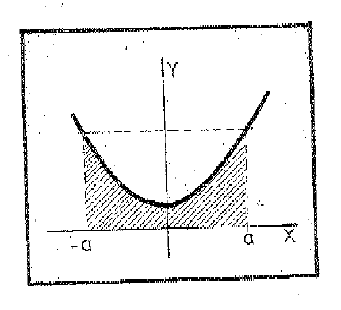
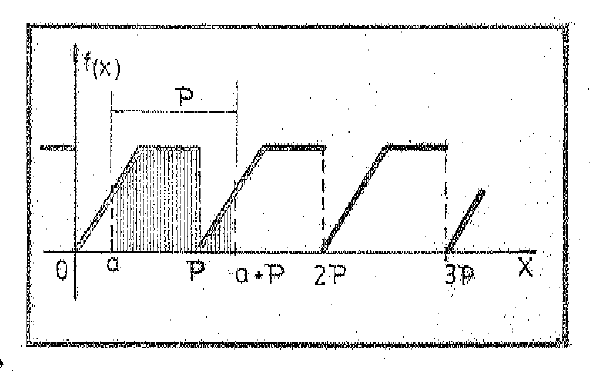
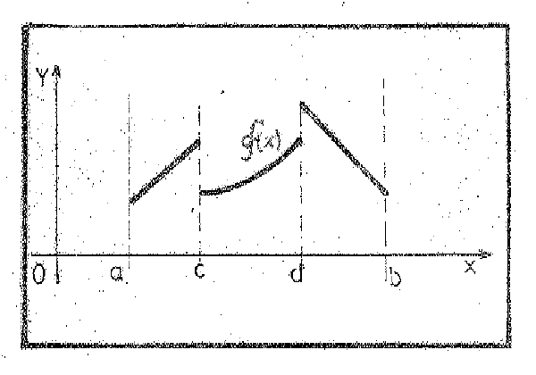

# Series de Fourier — Conceptos previos

Fuente: «Apunte de Clases del Ing. Urrutia.pdf», carpeta de 2020. Esta parte
transcribe páginas PDF 1–16 (portada y hojas impresas 1–15).
[Procedencia y cobertura](../../../resources/2020/fourier-urrutia-cobertura.md).

## Página PDF 1 — Portada

UNIVERSIDAD TECNOLÓGICA NACIONAL

FACULTAD REGIONAL RESISTENCIA

ANÁLISIS MATEMÁTICO II

SERIES DE FOURIER

Apunte de clase del Ing. Leopoldo S. de Urrutia

## Página PDF 2 — Hoja N° 1

UNIVERSIDAD TECNOLÓGICA NACIONAL

FACULTAD REGIONAL RESISTENCIA

### Serie de Fourier

### Conceptos previos

Iniciaremos este capítulo con la revisión de algunos conceptos elementales que
serán de aplicación en los desarrollos posteriores.

### I.- Funciones Pares e Impares

**1.** Una función de variable “x”, $`f(x)`$ es **par** si $`\forall x`$, se
verifica la igualdad:

```math
f(-x)=f(+x)=f(x)
```

son funciones pares, entre otras las siguientes:

a) $`f(x)=\cos nx`$;

b) $`f(x)=x^n`$ para n entero y par;

c) $`f(x)=K`$ (constante)

como consecuencia inmediata de la definición podemos observar que para todo par
de puntos simétricos al origen “-$`x_{0}`$”; “$`x_{0}`$”, pertenecientes a su
dominio, la función toma los mismos valores numéricos y por lo tanto “su gráfica
es simétrica respecto al eje de ordenadas”.


## Página PDF 3 — Hoja N° 2

### Propiedades de las Funciones Pares

Sean $`f(x)`$ y $`g(x)`$ dos funciones pares, $`U(x)`$=$`f(x)`$+$`g(x)`$ y
$`V(x)`$=$`f(x)`$.$`g(x)`$ demostraremos que:

**2.** La suma de dos funciones pares es otra función par. En efecto:

```math
U(-x)=f(-x)+g(-x)=f(x)+g(x)=U(x),
```

por lo tanto se cumple que:

```math
U(-x)=U(x)
```

**3.** El producto o cociente de dos funciones pares es otra función par.

```math
V(x)=f(x)\cdot g(x)=f(-x)\cdot g(-x)=V(-x),
```

por lo tanto se cumple que:

```math
V(-x)=V(x)
```

**4.** Si $`f(x)`$ es par entonces:

```math
\int_{-a}^a f(x)\cdot dx=2\cdot\int_0^a f(x)\cdot dx
```

esta propiedad de la integral definida de una función par, en intervalo de
integración simétrico respecto del origen es evidente, si se tiene en cuenta la
simetría de representación abordada anteriormente, y el valor de la integral
como área.



## Página PDF 4 — Hoja N° 3

**5.** Una función de variable independiente x, $`f(x)`$ es “impar”, si se
verifica que:

```math
f(-x)=-f(x)\qquad\forall x,
```

son funciones impares las siguientes:

a) $`f(x)=\mathop{\mathrm{sen}}\nolimits x`$

b) $`f(x)=\mathop{\mathrm{tg}}\nolimits x`$

c) $`f(x)=x^n`$ si n es entero e impar.

Sean $`f(x)`$ y $`g(x)`$ funciones impares y $`U(x)`$=$`f(x)`$+$`g(x)`$,
$`V(x)`$=$`f(x)`$.$`g(x)`$.

**6.** La suma de dos funciones impares es otra función impar. En efecto:

```math
U(-x)=f(-x)+g(-x)=-f(x)-g(x)=-(f(x)+g(x))=-U(x)
```

por lo tanto $`U(-x)=-U(x)`$

**7.** El producto o cociente de dos funciones impares es una función “Par”.

```math
V(-x)=f(-x)\cdot g(-x)=[-f(x)]\cdot[-g(x)]=f(x)\cdot g(x)=V(x)
```

por lo tanto:

```math
V(-x)=V(x)
```

**8.** El producto o cociente de una función PAR y otra IMPAR da como resultado
otra función IMPAR. Supongamos dos funciones:

$`f(x)=f(-x)`$ función par y $`g(-x)=-g(x)`$ una función impar,

entonces $`V(x)=f(x)\cdot g(x)`$ resulta:

```math
V(-x)=f(-x)\cdot g(-x)=f(x)\cdot(-g(x))=-(f(x)\cdot g(x))=-V(x)
```

por lo tanto $`V(x)`$ es impar.

**9.** Dado que una función impar toma valores numéricos opuestos para valores
opuestos de la variable independiente, su gráfica es una curva simétrica
respecto al punto de origen. Ejemplo:

```math
f(x)=x^3
```

**10.** Como consecuencia de la propiedad de simetría geomé-

## Página PDF 5 — Hoja N° 4

trica expresada en el punto anterior resulta evidente que toda integral definida
de una función impar en un intervalo de integración simétrico respecto del
origen es nula, por lo tanto

```math
\int_{-a}^a f(x)\cdot dx=0,\quad\text{si }f(x)\text{ es una función impar.}
```

## Página PDF 6 — Hoja N° 5

### II.- Funciones Periódicas

**1.** Se dice que una función y=$`f(x)`$ es periódica y que su período es “p”,
si se cumple que:

```math
f(x+p)=f(x),\quad\forall x\in\mathbb R,
```

un ejemplo son las funciones trigonométricas, ya que:

```math
\mathop{\mathrm{sen}}\nolimits (x+2\pi)=\mathop{\mathrm{sen}}\nolimits x;\quad
\cos(x+2\pi)=\cos x,\quad\mathop{\mathrm{tg}}\nolimits (x+\pi)=\mathop{\mathrm{tg}}\nolimits x
```

en los dos primeros casos el período es $`2\pi`$ y en el tercero es $`\pi`$.
Como consecuencia inmediata de la definición observamos que la gráfica de una
función periódica se repite en intervalos consecutivos cuya amplitud es “p”.
Representamos la función de período $`2\pi`$ definida por:

```math
f(x)=\begin{cases}x&\text{si }0\lt x\lt \pi\\\pi&\text{si }\pi\lt x\lt 2\pi\end{cases}
```


### Propiedades de las funciones periódicas

**2.** Si $`f(x+p)=f(x)\;\forall x\in\mathbb R`$ y n es un número entero ≠0 será
$`f(x+np)=f(x)`$, de modo que “cualquier múltiplo entero del período, también es
período de la misma función”. El período “p de menor valor”, se denomina
“período primitivo de la función”. Hemos visto en el punto anterior que
$`\mathop{\mathrm{tg}}\nolimits (x)=\mathop{\mathrm{tg}}\nolimits (x+\pi)`$, son
también períodos de la función tangente, $`\pm2\pi`$, $`\pm3\pi`$, $`\pm4\pi`$,
etc., pero el período primitivo de la función es $`p=\pi`$.

**3.** Si $`f(x)`$ es una función periódica de período p, f(ax) es otra función
periódica de período p/a $`\forall a\gt 0`$. Para su demostración reemplacemos
en la función f(ax), a la variable (x) por el valor (x+p/a).

## Página PDF 7 — Hoja N° 6

$`f(a(x+p/a))=f(ax+p)`$ como $`f(x+p)=f(x)\;\forall x`$ incluso (x.a)

$`f(a(x+p/a))=f(ax)`$ con lo cual queda demostrado su período p/a.

Como aplicación de esta propiedad observamos que siendo el período de
$`f(x)=\mathop{\mathrm{sen}}\nolimits x;\;p=2\pi`$, por lo tanto el de la
función $`f(x)=\mathop{\mathrm{sen}}\nolimits nx`$, será $`p=2\pi/n`$.

Así entonces, las gráficas correspondientes a: sen x, sen 2x, sen 3x,…, se
repiten 1, 2, 3,… veces el período $`2\pi`$, como se puede observar.


Lo mismo ocurre con las funciones cosenoidales para cos x, cos 2x, cos 3x, que
ya conocemos su gráfica.

**4.** Si $`f(x)`$ es una función periódica de período p y b≠0, entonces f(x/b)
es otra función periódica cuyo período es p.b. Lo demostraremos:

```math
f\left(\frac{x+p\cdot b}{b}\right)=f\left(\frac xb+p\right)\quad\text{pero}
```

```math
f\left(\frac xb+p\right)=f\left(\frac xb\right)\quad\text{por ser }f(x+p)=f(x)\;\forall x
```

## Página PDF 8 — Hoja N° 7

```math
f\left(\frac{x+p\cdot b}{b}\right)=f\left(\frac xb+p\right)\quad\text{pero}
```

```math
f\left(\frac xb+p\right)=f\left(\frac xb\right)
```

por ser $`f(x+p)=f(x)\;\forall x`$, entonces $`f(\frac xb)`$ es periódica de
período b.p.

**5.** La suma de funciones periódicas de igual período es otra función
periódica del mismo período.

sean $`f(x)`$ y $`g(x)`$ tales que:

```math
\begin{cases}f(x+p)=f(x)\\g(x+p)=g(x)\\h(x)=f(x)+g(x)\end{cases}\quad\forall x
```

entonces se cumplirá:

```math
h(x+p)=f(x+p)+g(x+p)=f(x)+g(x)=h(x)
```

por lo tanto $`h(x+p)=h(x)`$.

**6.** Supongamos la función:

```math
f(x)=2\cdot\mathop{\mathrm{sen}}\nolimits x+\frac32\cdot\mathop{\mathrm{sen}}\nolimits 2x+\mathop{\mathrm{sen}}\nolimits 3x,
```

es una función, suma de funciones periódicas; la primera de las cuales (sen x)
tiene por período $`p=2\pi`$ y la segunda (sen 2x) tiene un período primitivo
$`p=\pi`$ y la tercera $`2\pi/3`$; pero considerando la propiedad 2, ambas
admiten también $`p=2\pi`$.

En consecuencia $`f(x)`$ tiene por período $`p=2\pi`$.

Por ser de suma importancia para interpretar algunos de los desarrollos en serie
de Fourier construiremos su gráfica correspondiente. Para ello recordemos que en
la función y=A.sen x,

## Página PDF 9 — Hoja N° 8

el coeficiente A es la “amplitud” de la onda de modo que:

```math
-A\le f(x)\le A
```


## Página PDF 10 — Hoja N° 9

### 7. Integrales Definidas de Funciones Periódicas

Sea $`f(x)`$ una función periódica de período P;
$`f(x)=f(x+P)\;\forall x\in\mathbb R`$. Si $`f(x)`$ es integrable en un
intervalo de amplitud igual al período P, entonces es integrable sobre cualquier
intervalo $`\in\mathbb R`$. Además se verifica que:



$`\int_a^{a+P}f(x)dx`$, es constante, cualquiera sea el valor de a y siempre que
la longitud del intervalo de integración sea P.

Demostración:

```math
\int_a^{a+P}f(x)dx=\int_0^P f(x)\cdot dx+\int_P^{a+P}f(x)\cdot dx-\int_0^a f(x)\cdot dx\tag{1}
```

Analicemos la segunda integral, del segundo miembro:

$`\int_P^{a+P}f(x)\cdot dx`$; si hacemos $`x=t+P\Rightarrow dx=dt`$ además,

si $`P=x\Rightarrow t=0`$; si $`x=a+P\Rightarrow t=a\;\therefore`$ reemplazando

$`\int_P^{a+P}f(x)\cdot dx=\int_0^a f(t+P)dt=\int_0^a f(x)\cdot dx`$,
reemplazando en 1

$`\int_a^{a+P}f(x)\cdot dx=\int_0^P f(x)\cdot dx+\int_0^a f(x)dx-\int_0^a f(x)dx`$
por lo tanto

```math
\int_a^{a+P}f(x)\cdot dx=\int_0^P f(x)\cdot dx=\int_{-P/2}^{P/2}f(x)\cdot dx
```

## Página PDF 11 — Hoja N° 10

### Fórmulas De Posterior Aplicación

Verificaremos las siguientes expresiones, donde m y n son números enteros.

### 1.-

```math
\int_{-\pi}^{\pi}\cos nx\cdot dx=0\;\therefore\;
\int_{-\pi}^{\pi}\cos nx\cdot dx=\frac1n\int_{-\pi}^{\pi}\cos(nx)\cdot d(nx)
=\left.\frac1n\mathop{\mathrm{sen}}\nolimits nx\right|_{-\pi}^{\pi}=0
```

**2.-** $`\int_{-\pi}^{\pi}\mathop{\mathrm{sen}}\nolimits nx\cdot dx=0`$ es nula
por ser “sen nx” una función impar.

**3.-**
$`\int_{-\pi}^{\pi}\mathop{\mathrm{sen}}\nolimits (mx)\cdot\cos(nx)\cdot dx=0`$
por lo tanto dado que se trata de un integrando producto de dos funciones una
par (cos nx) y una impar (sen mx), la resultante será otra función impar, como
los límites de integración son simétricos la integral es nula.

### 4.-

```math
\int_{-\pi}^{\pi}\mathop{\mathrm{sen}}\nolimits (mx)\cdot\mathop{\mathrm{sen}}\nolimits (nx)\cdot dx
=\begin{cases}0&\text{si }m\ne n\\\pi&\text{si }m=n\end{cases}
```

a) primer caso si m≠n

```math
\int_{-\pi}^{\pi}\mathop{\mathrm{sen}}\nolimits (mx)\cdot\mathop{\mathrm{sen}}\nolimits (nx)\cdot dx
=\frac12\left[\frac{\mathop{\mathrm{sen}}\nolimits (m-n)\cdot x}{m-n}
-\frac{\mathop{\mathrm{sen}}\nolimits (m+n)\cdot x}{m+n}\right]_{x=-\pi}^{\pi}
```

```math
=\frac12\left[\frac{\mathop{\mathrm{sen}}\nolimits (m-n)\pi}{m+n}
-\frac{\mathop{\mathrm{sen}}\nolimits (m+n)\pi}{m+n}\right]=0\quad\text{por ser }(m\pm n)\in\mathbb Z
```

b) segundo caso si m=n

```math
\begin{aligned}
\int_{-\pi}^{\pi}\mathop{\mathrm{sen}}\nolimits (mx)\cdot\mathop{\mathrm{sen}}\nolimits (nx)\cdot dx
&=\int_{-\pi}^{\pi}\mathop{\mathrm{sen}}\nolimits ^2(mx)\cdot dx
=\frac1m\int_{-\pi}^{\pi}\mathop{\mathrm{sen}}\nolimits ^2(mx)\cdot d(mx)\\
&=\frac1{2\cdot m}[mx-\mathop{\mathrm{sen}}\nolimits (mx)\cdot\cos(mx)]_{x=-\pi}^{\pi}\\
&=\frac1{2\cdot m}[m\pi-m(-\pi)]=\frac{2m\pi}{2m}=\pi
\end{aligned}
```

### 5.-

```math
\int_{-\pi}^{\pi}\cos(mx)\cdot\cos(nx)\cdot dx
=\begin{cases}0&\text{si }m\ne n\\\pi&\text{si }m=n\end{cases}
```

## Página PDF 12 — Hoja N° 11

a) primer caso si m≠n

```math
\int_{-\pi}^{\pi}\cos(mx)\cdot\cos(nx)\cdot dx
=\frac12\left[\frac{\mathop{\mathrm{sen}}\nolimits (m-n)x}{m-n}
+\frac{\mathop{\mathrm{sen}}\nolimits (m+n)x}{m+n}\right]_{x=-\pi}^{\pi}
=\frac{\mathop{\mathrm{sen}}\nolimits (m-n)\cdot\pi}{m-n}+\frac{\mathop{\mathrm{sen}}\nolimits (m+n)\pi}{m+n}
```

por ser m±n∈Z, por lo tanto la integral es nula.

b) segundo caso si m=n

```math
\begin{aligned}
\int_{-\pi}^{\pi}\cos(mx)\cdot\cos(nx)\cdot dx
&=\int_{-\pi}^{\pi}\cos^2(mx)\cdot dx
=\frac1m\int_{-\pi}^{\pi}\cos^2(mx)\cdot d(mx)\\
&=\frac1{2\cdot m}[mx+\cos(mx)\cdot\mathop{\mathrm{sen}}\nolimits (mx)]_{x=-\pi}^{\pi}\\
&=\frac1{2\cdot m}[m\pi-m(-\pi)]=\frac{2m\pi}{2m}=\pi
\end{aligned}
```

### 6.-

```math
P(x)=\frac12+\sum_{K=1}^n\cos K\cdot x
=\frac{\mathop{\mathrm{sen}}\nolimits (n+1/2)x}{2\cdot\mathop{\mathrm{sen}}\nolimits x/2}
```

Desarrollando:

$`P(x)=\frac12+\cos x+\cos2x+\cos3x+\cdots+\cos nx`$, por lo tanto

sabemos que $`\cos\alpha=\frac{e^{i\alpha}+e^{-i\alpha}}2`$; reemplazando en
cada término:

```math
\begin{aligned}
P(x)&=\frac12+\frac12(e^{ix}+e^{-ix})+\frac12(e^{i2x}+e^{-i2x})+\cdots+\frac12(e^{inx}+e^{-inx})\\
&=\frac12(e^{-inx}+\cdots+e^{-i2x}+e^{-ix}+1+e^{ix}+e^{i2x}+\cdots+e^{inx})
\end{aligned}
```

sumando el segundo miembro, como los términos de una progresión geométrica, de
razón $`q=e^{ix}`$, cuyo número de términos es (2n+1) y el primer término es
$`e^{-inx}`$, resulta que:

## Página PDF 13 — Hoja N° 12

multiplicando numerador y denominador por una misma expresión $`e^{-\frac12ix}`$
obtenemos:

```math
P(x)=1/2\cdot\frac{e^{ix(n+1/2)}-e^{-ix(n+1/2)}}{e^{1/2ix}-e^{-1/2ix}}
```

dividiendo y multiplicando por 2i tendremos:

```math
P(x)=1/2\cdot\frac{\frac{e^{ix(n+1/2)}-e^{-ix(n+1/2)}}{2i}}
{\frac{e^{1/2ix}-e^{-1/2ix}}{2i}}
=1/2\frac{\mathop{\mathrm{sen}}\nolimits (n+1/2)\cdot x}{\mathop{\mathrm{sen}}\nolimits (1/2\cdot x)}
```

quedando así demostrada.

**7.** Si a la igualdad
$`\frac12+\sum_{K=1}^n\cos Kx=\frac{\mathop{\mathrm{sen}}\nolimits (n+1/2)\cdot x}{2\cdot\mathop{\mathrm{sen}}\nolimits x/2}`$
se la integra entre $`-\pi`$ y $`\pi`$.

```math
\frac12\int_{-\pi}^{\pi}dx+\sum_{K=1}^n\int_{-\pi}^{\pi}\cos Kx\cdot dx
=\int_{-\pi}^{\pi}\frac{\mathop{\mathrm{sen}}\nolimits (n+1/2)\cdot x\,dx}{2\cdot\mathop{\mathrm{sen}}\nolimits x/2}
```

en el primer miembro tendremos:

```math
\frac12\left.x\right|_{-\pi}^{\pi}+\sum_{K=1}^n\left.\frac1K\cdot\mathop{\mathrm{sen}}\nolimits Kx\right|_{-\pi}^{\pi}
=\frac12\cdot2\pi+\sum_{K=1}^n\frac2K\cdot\mathop{\mathrm{sen}}\nolimits K\pi=\pi
```

en consecuencia tendremos:

```math
\int_{-\pi}^{\pi}\frac{\mathop{\mathrm{sen}}\nolimits (n+1/2)\cdot x}{2\cdot\mathop{\mathrm{sen}}\nolimits x/2}dx=\pi
```

De la misma manera que el caso 6, se demuestra:

```math
\sum_{K=1}^n\mathop{\mathrm{sen}}\nolimits Kx
=\frac12\mathop{\mathrm{cotg}}\nolimits x/2-\frac{\cos(n+1/2)x}{\mathop{\mathrm{sen}}\nolimits x/2}
```

## Página PDF 14 — Hoja N° 13

funciones continuas por tramos en [a,b], entonces se verificará que:

```math
\lim_{\lambda\to\infty}\int_a^b f(x)\cdot\mathop{\mathrm{sen}}\nolimits \lambda x\cdot dx=0,
\quad\text{o bien que}\quad
\lim_{\lambda\to\infty}\int_a^b f(x)\cdot\cos\lambda x\cdot dx=0
```

Demostración:

Supondremos primero que la función $`f(x)`$ es continua en (a,b). Llamemos:

```math
I(\lambda)=\int_a^b f(x)\cdot\mathop{\mathrm{sen}}\nolimits \lambda x\cdot dx\tag{1}
```

haciendo $`x=t+\pi/\lambda`$

```math
\begin{cases}
x=a\Rightarrow t=a-\pi/\lambda\;\wedge\;x=b\Rightarrow t=b-\pi/\lambda\\
f(x)=f(t+\pi/\lambda)\\
\mathop{\mathrm{sen}}\nolimits \lambda x=\mathop{\mathrm{sen}}\nolimits \lambda(t+\pi/\lambda)
=\mathop{\mathrm{sen}}\nolimits (\lambda t+\pi)=-\mathop{\mathrm{sen}}\nolimits \lambda t
\end{cases}
```

por lo tanto:

```math
I(\lambda)=-\int_{a-\pi/\lambda}^{b-\pi/\lambda}f(t+\pi/\lambda)\cdot\mathop{\mathrm{sen}}\nolimits \lambda t\cdot dt
=-\int_{a-\pi/\lambda}^{b-\pi/\lambda}f(x+\pi/\lambda)\cdot\mathop{\mathrm{sen}}\nolimits \lambda x\cdot dx\tag{2}
```

sumando las expresiones (1) y (2) tendremos:

```math
\begin{aligned}
2I(\lambda)&=-\int_{a-\pi/\lambda}^a f(x+\pi/\lambda)\cdot\mathop{\mathrm{sen}}\nolimits \lambda x\cdot dx\\
&\quad+\int_a^{b-\pi/\lambda}[f(x)-f(x+\pi/\lambda)]\cdot\mathop{\mathrm{sen}}\nolimits \lambda x\cdot dx
+\int_{b-\pi/\lambda}^b f(x)\cdot\mathop{\mathrm{sen}}\nolimits \lambda x\cdot dx
\end{aligned}
```

llamando M al máximo valor de la función $`f(x)`$ en (a,b);

```math
|f(x)|\le M\quad\forall x\in(a,b)
```

y considerando que $`|\mathop{\mathrm{sen}}\nolimits \lambda x|\le1`$,
reemplazando resulta:

```math
2|I(\lambda)|\le M\int_{a-\pi/\lambda}^a dx
+\int_a^{b-\pi/\lambda}|f(x)-f(x+\pi/\lambda)|dx+M\int_{b-\pi/\lambda}^b dx
```

```math
2|I(\lambda)|\le2M\pi/\lambda+\int_a^{b-\pi/\lambda}|f(x)-f(x+\pi/\lambda)|dx\;\therefore
```

## Página PDF 15 — Hoja N° 14

para $`\lambda\gt K_2`$ es $`|f(x)-f(x+\pi/\lambda)|\lt \frac\xi{b-a}`$ por ser
$`f(x)`$ continua en (a,b)

```math
\int_a^{b-\pi/\lambda}|f(x)-f(x+\pi/\lambda)|\cdot dx
\lt \frac\xi{b-a}\int_a^{b-\pi/\lambda}dx
=\frac\xi{b-a}(b-a-\pi/\lambda)\lt \xi
```

en consecuencia:

```math
2|I(\lambda)|\lt 2M\cdot\frac\xi{2M}+\xi\Rightarrow|I(\lambda)|\lt \xi;
\quad\forall\lambda\gt i\lambda\;(i\lambda=\mathop{\mathrm{máx}}\nolimits K_1,K_2)
```

Este teorema puede extenderse a funciones seccionalmente continuas en un
intervalo (a,b), es decir a funciones que tengan un número finito de
discontinuidades finitas en (a,b). Ejemplo de función seccionalmente continua:



Bastará para demostrarlo, efectuar una partición del intervalo (a,b) en cada uno
de los puntos de discontinuidad y verificar que el teorema se cumple en cada uno
de los subintervalos resultantes de la partición practicada.

Además si tenemos en cuenta que:

```math
\cos(\alpha x+\beta)=\mathop{\mathrm{sen}}\nolimits (\alpha x+\beta+\pi/2)
```

## Página PDF 16 — Hoja N° 15

en consecuencia:

```math
\lim_{\alpha\to\infty}\int_a^b f(x)\cdot\cos(\alpha x+\beta)dx=0
\quad\text{si hacemos }\beta=0
```

obtendremos:

```math
\lim_{\alpha\to\infty}\int_a^b f(x)\cdot\mathop{\mathrm{sen}}\nolimits \alpha x\cdot dx=0
\quad\wedge\quad
\lim_{\alpha\to\infty}\int_a^b f(x)\cdot\cos\alpha x\cdot dx=0
```

donde $`f(x)`$ es una función que cumple las condiciones expresadas en el
teorema.
