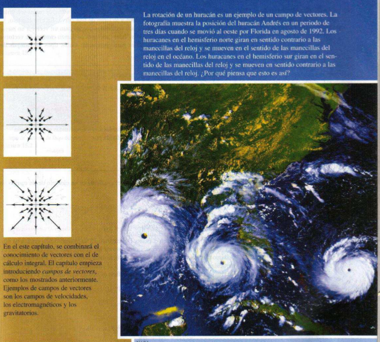
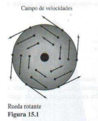
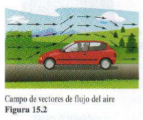
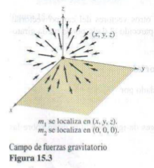
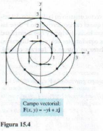
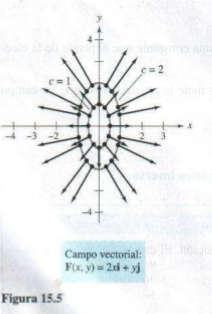
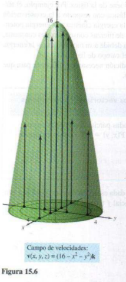

# 15. Análisis vectorial

> Fuente: `2020/12-Analisis Vectorial/Análisis Vectorial (1) - Libro.pdf`.
> Extracto de las páginas impresas 1053–1062 (10 páginas PDF); no constan autor
> ni año en este extracto. OCR español y transcripción cotejada con todas las
> páginas. Procedencia y controles en
> [cobertura](../../../resources/2020/pdf2020-cobertura.md).

## Página 1053

La rotación de un huracán es un ejemplo de un campo de vectores. La fotografía
muestra la posición del huracán Andrés en un periodo de tres días cuando se
movió al oeste por Florida en agosto de 1992. Los huracanes en el hemisferio
norte giran en sentido contrario a las manecillas del reloj y se mueven en el
sentido de las manecillas del reloj en el océano. Los huracanes en el hemisferio
sur giran en el sentido de las manecillas del reloj y se mueven en sentido
contrario a las manecillas del reloj. ¿Por qué piensa que esto es así?

En el este capítulo, se combinará el conocimiento de vectores con el de cálculo
integral. El capítulo empieza introduciendo campos de vectores, como los
mostrados anteriormente. Ejemplos de campos de vectores son los campos de
velocidades, los electromagnéticos y los gravitatorios.

## Página 1054 — Sección 15.1. Campos de vectores

- Comprender el concepto de un campo de vectores.
- Determinar si un campo de vectores es conservativo.
- Calcular el rotacional de un campo vectorial.
- Calcular la divergencia de un campo vectorial.

### Campos de vectores

En el capítulo 12 se estudiaron funciones vectoriales que asignan un vector a un
número real. Se comprobó que las funciones vectoriales de números reales son
útiles para representar curvas y movimientos a lo largo de una curva. En este
capítulo, se estudiarán otros dos tipos de funciones vectoriales que asignan un
vector a un punto en el plano o a un punto en el espacio. Tales funciones se
llaman **campos de vectores** o (**campos vectoriales**), y son útiles para
representar varios tipos de **campos de fuerza** y **campos de velocidades**.

**Definición de un campo de vectores.** Sean $M$ y $N$ funciones de dos
variables $x$ y $y$, definidas en una región plana $R$. La función $\mathbf F$
definida por

$$
\mathbf F(x,y)=M\mathbf i+N\mathbf j
$$

(Plano) se llama un **campo de vectores en $R$**.

Sea $M$, $N$ y $P$ funciones de tres variables $x$, $y$ y $z$, definidas en una
región sólida $Q$ en el espacio. La función $\mathbf F$ definida por

$$
\mathbf F(x,y,z)=M\mathbf i+N\mathbf j+P\mathbf k
$$

(Espacio) se llama un **campo de vectores en $Q$**.

**NOTA.** Aunque un campo de vectores está constituido por infinitos vectores,
se puede obtener una idea aproximada de su estructura dibujando varios vectores
representativos $\mathbf F(x,y)$, cuyos puntos iniciales son $(x,y)$.

De esta definición se puede ver que el *gradiente* es un ejemplo de un campo de
vectores. Por ejemplo, si

$$
f(x,y)=x^2+y^2,
$$

entonces el gradiente de $f$

$$
\nabla f(x,y)=f_x(x,y)\mathbf i+f_y(x,y)\mathbf j=2x\mathbf i+2y\mathbf j
$$

(Campo de vectores en el plano) es un campo de vectores en el plano. Del
capítulo 13, la interpretación gráfica de este campo es una familia de vectores
cada uno de los cuales apunta en la dirección de máximo crecimiento a lo largo
de la superficie dada por $z=f(x,y)$. Para esta función particular, la
superficie es un paraboloide y el gradiente informa que la dirección de máximo
incremento a lo largo de la superficie es la dirección dada por el rayo que va
del origen a través del punto $(x,y)$.

De manera similar, si

$$
f(x,y,z)=x^2+y^2+z^2
$$

entonces el gradiente de $f$

$$
\begin{aligned}
\nabla f(x,y,z)&=f_x(x,y,z)\mathbf i+f_y(x,y,z)\mathbf j+f_z(x,y,z)\mathbf k\\
&=2x\mathbf i+2y\mathbf j+2z\mathbf k
\end{aligned}
$$

(Campo de vectores en el espacio) es un campo de vectores en el espacio.

Un campo de vectores es **continuo** en un punto si cada una de sus funciones
componentes $M$, $N$ y $P$ es continuo en ese punto.

## Página 1055

Algunos ejemplos físicos comunes de campos vectoriales son los **campos de
velocidades**, los **gravitatorios** y los de **fuerza eléctrica**.

1\. Un *campo de velocidades* describe el movimiento de un sistema de partículas
en el plano o en el espacio. Por ejemplo, la figura 15.1 muestra el campo de
vectores determinado por una rueda que gira en un eje. Los vectores velocidad
los determina la localización de sus puntos iniciales: cuanto más lejano está un
punto del eje, mayor es su velocidad. Otros campos de velocidad están
determinados por el flujo de líquidos a través de un recipiente o por el flujo
de corrientes aéreas alrededor de un objeto móvil, como se muestra en la figura
15.2.

2\. Los *campos gravitatorios* los define la **ley de la gravitación de Newton**,
que establece que la fuerza de atracción ejercida en una partícula de masa $m_1$
localizada en $(x,y,z)$ por una partícula de masa $m_2$ localizada en $(0,0,0)$
está dada por

$$
\mathbf F(x,y,z)=\frac{-Gm_1m_2}{x^2+y^2+z^2}\mathbf u
$$

donde $G$ es la constante gravitatoria y $\mathbf u$ es el vector unitario en la
dirección del origen a $(x,y,z)$. En la figura 15.3 se puede ver que el campo
gravitatorio $\mathbf F$ tiene las propiedades de que todo vector
$\mathbf F(x,y,z)$ apunta hacia el origen, y que la magnitud de
$\mathbf F(x,y,z)$ es la misma en todos los puntos equidistantes del origen. Un
campo de vectores con estas dos propiedades se llama un **campo de fuerzas
central**. Utilizando el vector posición

$$
\mathbf r=x\mathbf i+y\mathbf j+z\mathbf k
$$

para el punto $(x,y,z)$, se puede expresar el campo gravitatorio $\mathbf F$
como

$$
\begin{aligned}
\mathbf F(x,y,z)&=\frac{-Gm_1m_2}{\|\mathbf r\|^2}
\left(\frac{\mathbf r}{\|\mathbf r\|}\right)\\
&=\frac{-Gm_1m_2}{\|\mathbf r\|^2}\mathbf u.
\end{aligned}
$$

3\. Los *campos de fuerzas eléctricas* se definen por la **ley de Coulomb**, que
establece que la fuerza ejercida en una partícula con carga eléctrica $q_1$
localizada en $(x,y,z)$ por una partícula con carga eléctrica $q_2$ localizada
en $(0,0,0)$ está dada por

$$
\mathbf F(x,y,z)=\frac{cq_1q_2}{\|\mathbf r\|^2}\mathbf u
$$

donde $\mathbf r=x\mathbf i+y\mathbf j+z\mathbf k$,
$\mathbf u=\mathbf r/\|\mathbf r\|$ y $c$ es una constante que depende de la
elección de unidades para $\|\mathbf r\|$, $q_1$ y $q_2$.

Nótese que un campo de fuerzas eléctricas tiene la misma forma que un campo
gravitatorio. Es decir,

$$
\mathbf F(x,y,z)=\frac{k}{\|\mathbf r\|^2}\mathbf u.
$$

Tal campo de fuerzas se llama un **campo cuadrático inverso**.

**Definición de campo cuadrático inverso.** Sea
$\mathbf r(t)=x(t)\mathbf i+y(t)\mathbf j+z(t)\mathbf k$ un vector posición. El
campo de vectores $\mathbf F$ es un **campo cuadrático inverso** si

$$
\mathbf F(x,y,z)=\frac{k}{\|\mathbf r\|^2}\mathbf u
$$

donde $k$ es un número real y $\mathbf u=\mathbf r/\|\mathbf r\|$ es un vector
unitario en la dirección de $\mathbf r$.

## Página 1056

Como los campos vectoriales constan de una cantidad infinita de vectores, no es
posible hacer un dibujo de todo el campo completo. En lugar de esto, cuando se
esboza un campo vectorial, el objetivo es dibujar vectores representativos que
ayuden a visualizar el campo.

### EJEMPLO 1. Dibujo de un campo vectorial

Dibujar algunos vectores del campo vectorial dado por

$$
\mathbf F(x,y)=-y\mathbf i+x\mathbf j.
$$

**Solución.** Se podrían trazar los vectores en varios puntos del plano, al
azar. Sin embargo, es más demostrativo trazar vectores de magnitud igual. Esto
corresponde a encontrar curvas de nivel en los campos escalares. En este caso,
vectores de igual magnitud se encuentran en círculos.

$$
\begin{aligned}
\|\mathbf F\|&=c &&\text{Vectores de longitud }c.\\
\sqrt{x^2+y^2}&=c\\
x^2+y^2&=c^2 &&\text{Ecuación del círculo.}
\end{aligned}
$$

Para empezar a hacer el dibujo, se elige un valor de $c$ y se dibujan varios
vectores en el círculo resultante. Por ejemplo, los vectores siguientes se
encuentran en el círculo unitario.

| Punto | Vector |
| -- | -- |
| $(1,0)$ | $\mathbf F(1,0)=\mathbf j$ |
| $(0,1)$ | $\mathbf F(0,1)=-\mathbf i$ |
| $(-1,0)$ | $\mathbf F(-1,0)=-\mathbf j$ |
| $(0,-1)$ | $\mathbf F(0,-1)=\mathbf i$ |

En la figura 15.4 se muestran éstos y algunos otros vectores del campo
vectorial. Nótese en la figura que este campo vectorial es parecido al dado por
la rueda giratoria mostrada en la figura 15.1.

### EJEMPLO 2. Dibujo de un campo vectorial

Dibujar algunos vectores en el campo vectorial dado por

$$
\mathbf F(x,y)=2x\mathbf i+y\mathbf j.
$$

**Solución.** Para este campo vectorial, los vectores de igual longitud están
sobre las elipses dadas por

$$
\|\mathbf F\|=\sqrt{(2x)^2+(y)^2}=c
$$

lo cual implica que

$$
4x^2+y^2=c^2.
$$

Para $c=1$, dibujar varios vectores $2x\mathbf i+y\mathbf j$ de magnitud 1 en
puntos de la elipse dada por

$$
4x^2+y^2=1.
$$

Para $c=2$, dibujar varios vectores $2x\mathbf i+y\mathbf j$ de magnitud 2 en
puntos de la elipse dada por

$$
4x^2+y^2=4.
$$

Estos vectores se muestran en la figura 15.5.

## Página 1057

### EJEMPLO 3. Esbozo de un campo vectorial

Dibujar algunos vectores en el campo de velocidad dado por

$$
\mathbf v(x,y,z)=(16-x^2-y^2)\mathbf k
$$

donde $x^2+y^2\leq16$.

**Solución.** Es válido imaginar que $\mathbf v$ describe la velocidad de un
fluido a través de un tubo de radio 4. Los vectores próximos al eje $z$ son más
largos que aquellos cercanos al borde del tubo. Por ejemplo, en el punto
$(0,0,0)$, el vector velocidad es $\mathbf v(0,0,0)=16\mathbf k$, considerando
que en el punto $(0,3,0)$, el vector velocidad es $\mathbf v(0,3,0)=7\mathbf k$.
La figura 15.6 muestra éstos y varios otros vectores para el campo de
velocidades. De la figura, se observa que la velocidad del fluido es mayor en la
zona central que en los bordes del tubo.

### Campos vectoriales conservativos

En la figura 15.5 todos los vectores parecen ser normales a la curva de nivel de
la que emergen. Porque ésta es una propiedad de los gradientes, es natural
preguntar si el campo vectorial dado por $\mathbf F(x,y)=2x\mathbf i+y\mathbf j$
es el gradiente de alguna función diferenciable $f$. La respuesta es que algunos
campos vectoriales, denominados **campos vectoriales conservativos**, pueden
representarse como los gradientes de funciones diferenciables, mientras que
algunos otros no pueden.

**Definición de campos vectoriales conservativos.** Un campo vectorial
$\mathbf F$ se llama **conservativo** si existe una función diferenciable $f$
tal que $\mathbf F=\nabla f$. La función $f$ se llama **función potencial** para
$\mathbf F$.

### EJEMPLO 4. Campos vectoriales conservativos

a) El campo vectorial dado por $\mathbf F(x,y)=2x\mathbf i+y\mathbf j$ es
conservativo. Para comprobarlo, considere la función potencial
$f(x,y)=x^2+\frac12y^2$. Como

$$
\nabla f=2x\mathbf i+y\mathbf j=\mathbf F
$$

se sigue que $\mathbf F$ es conservativo.

b) Todo campo cuadrático inverso es conservativo. Para comprobarlo, sea

$$
\mathbf F(x,y,z)=\frac{k}{\|\mathbf r\|^2}\mathbf u
\quad\text{y}\quad f(x,y,z)=\frac{-k}{\sqrt{x^2+y^2+z^2}},
$$

donde $\mathbf u=\mathbf r/\|\mathbf r\|$. Como

$$
\begin{aligned}
\nabla f&=\frac{kx}{(x^2+y^2+z^2)^{3/2}}\mathbf i
+\frac{ky}{(x^2+y^2+z^2)^{3/2}}\mathbf j
+\frac{kz}{(x^2+y^2+z^2)^{3/2}}\mathbf k\\
&=\frac{k}{x^2+y^2+z^2}
\left(\frac{x\mathbf i+y\mathbf j+z\mathbf k}{\sqrt{x^2+y^2+z^2}}\right)\\
&=\frac{k}{\|\mathbf r\|^2}\frac{\mathbf r}{\|\mathbf r\|}\\
&=\frac{k}{\|\mathbf r\|^2}\mathbf u
\end{aligned}
$$

se deduce que $\mathbf F$ es conservativo.

## Página 1058

Como puede verse en el ejemplo 4b, muchos campos vectoriales importantes,
incluyendo campos gravitatorios y de fuerzas eléctricas, son conservativos. Gran
parte de la terminología introducida en este capítulo viene de la física. Por
ejemplo, el término “conservativo” se deriva de la ley física clásica con
respecto a la conservación de la energía. Esta ley establece que la suma de la
energía cinética y la energía potencial de una partícula que se mueve en un
campo de fuerzas conservativo es constante. (La energía cinética de una
partícula es la energía debida a su movimiento, y la energía potencial es la
energía debida a su posición en el campo de fuerzas.)

El importante teorema siguiente da una condición necesaria y suficiente para que
un campo vectorial en el plano sea conservativo.

### TEOREMA 15.1. Criterio para campos vectoriales conservativos en el plano

Sea $M$ y $N$ dos funciones con primeras derivadas parciales continuas en un
disco abierto $R$. El campo vectorial dado por
$\mathbf F(x,y)=M\mathbf i+N\mathbf j$ es conservativo si y sólo si

$$
\frac{\partial N}{\partial x}=\frac{\partial M}{\partial y}.
$$

**Demostración.** Para mostrar que la condición dada es necesaria para que
$\mathbf F$ sea conservativo, suponer que existe una función potencial $f$ tal
que

$$
\mathbf F(x,y)=\nabla f(x,y)=M\mathbf i+N\mathbf j.
$$

Entonces se tiene

$$
\begin{aligned}
f_x(x,y)=M&\quad\Longrightarrow\quad f_{xy}(x,y)=\frac{\partial M}{\partial y}\\
f_y(x,y)=N&\quad\Longrightarrow\quad f_{yx}(x,y)=\frac{\partial N}{\partial x}
\end{aligned}
$$

y, por la equivalencia de derivadas parciales mixtas $f_{xy}$ y $f_{yx}$, se
puede concluir que $\partial N/\partial x=\partial M/\partial y$ para todo
$(x,y)$ en $R$. Lo suficiente de la condición se muestra en la sección 15.4.

**NOTA.** El teorema 15.1 requiere que el dominio de $\mathbf F$ sea un disco
abierto. Si $R$ simplemente es una región abierta, la condición dada es
necesaria pero no suficiente para producir un campo vectorial conservativo.

### EJEMPLO 5. Investigación de campos vectoriales conservativos en el plano

Decidir si el campo vectorial dado por $\mathbf F$ es conservativo.

a) $\mathbf F(x,y)=x^2y\mathbf i+xy\mathbf j$

b) $\mathbf F(x,y)=2x\mathbf i+y\mathbf j$

Solución:

a) El campo vectorial dado por $\mathbf F(x,y)=x^2y\mathbf i+xy\mathbf j$ no es
conservativo porque

$$
\frac{\partial M}{\partial y}=\frac{\partial}{\partial y}[x^2y]=x^2
\quad\text{y}\quad
\frac{\partial N}{\partial x}=\frac{\partial}{\partial x}[xy]=y.
$$

b) El campo vectorial dado por $\mathbf F(x,y)=2x\mathbf i+y\mathbf j$ es
conservativo porque

$$
\frac{\partial M}{\partial y}=\frac{\partial}{\partial y}[2x]=0
\quad\text{y}\quad
\frac{\partial N}{\partial x}=\frac{\partial}{\partial x}[y]=0.
$$

## Página 1059

El teorema 15.1 permite decidir si un campo vectorial es o no conservativo. Pero
no dice cómo encontrar una función potencial de $\mathbf F$. El problema es
comparable al de la integración indefinida. A veces se puede encontrar una
función potencial por simple inspección. Así, en el ejemplo 4 se observa que

$$
f(x,y)=x^2+\frac12y^2
$$

tiene la propiedad de que $\nabla f(x,y)=2x\mathbf i+y\mathbf j$.

### EJEMPLO 6. Calcular una función potencial para F(x, y)

Hallar una función potencial para

$$
\mathbf F(x,y)=2xy\mathbf i+(x^2-y)\mathbf j.
$$

**Solución.** Del teorema 15.1 sigue que $\mathbf F$ es conservativo porque

$$
\frac{\partial}{\partial y}[2xy]=2x
\quad\text{y}\quad
\frac{\partial}{\partial x}[x^2-y]=2x.
$$

Si $f$ es una función cuyo gradiente es igual a $\mathbf F(x,y)$, entonces

$$
\nabla f(x,y)=2xy\mathbf i+(x^2-y)\mathbf j
$$

lo cual implica que

$$
f_x(x,y)=2xy
$$

y

$$
f_y(x,y)=x^2-y.
$$

Para reconstruir la función $f$ de estas dos derivadas parciales, integrar
$f_x(x,y)$ con respecto a $x$ y $f_y(x,y)$ con respecto a $y$, como sigue.

$$
\begin{aligned}
f(x,y)&=\int f_x(x,y)\,dx=\int2xy\,dx=x^2y+g(y)\\
f(x,y)&=\int f_y(x,y)\,dy=\int(x^2-y)\,dy=x^2y-\frac{y^2}{2}+h(x)
\end{aligned}
$$

Nótese que $g(y)$ es constante con respecto a $x$ y $h(x)$ es constante con
respecto a $y$. Para hallar una sola expresión que represente $f(x,y)$, sea

$$
g(y)=-\frac{y^2}{2}\quad\text{y}\quad h(x)=K.
$$

Entonces, se puede escribir

$$
\begin{aligned}
f(x,y)&=x^2y+g(y)+K\\
&=x^2y-\frac{y^2}{2}+K.
\end{aligned}
$$

Este resultado se puede verificar formando el gradiente de $f$. Se verá que es
igual a la función original $\mathbf F$.

**NOTA.** La solución en el ejemplo 6 es comparable a la dada por una integral
indefinida. Es decir, la solución representa a una familia de funciones
potenciales, dos de las cuales difieren por una constante. Para hallar una
solución única, se tendría que fijar una condición inicial que deba satisfacer
la función potencial.

## Página 1060 — Rotacional de un campo vectorial

El teorema 15.1 tiene un análogo para campos vectoriales en el espacio. Antes de
establecer ese resultado, se da la definición del **rotacional de un campo
vectorial** en el espacio.

**Definición del rotacional de un campo vectorial.** El rotacional de
$\mathbf F(x,y,z)=M\mathbf i+N\mathbf j+P\mathbf k$ es

$$
\begin{aligned}
\operatorname{rot}\mathbf F(x,y,z)&=\nabla\times\mathbf F(x,y,z)\\
&=
\left(\frac{\partial P}{\partial y}-\frac{\partial N}{\partial z}\right)
\mathbf i

-
\left(\frac{\partial P}{\partial x}-\frac{\partial M}{\partial z}\right)
\mathbf j

+
\left(\frac{\partial N}{\partial x}-\frac{\partial M}{\partial y}\right)
\mathbf k
.
\end{aligned}
$$

**NOTA.** Si $\operatorname{rot}\mathbf F=\mathbf0$, entonces se dice que
$\mathbf F$ es un **campo irrotacional**.

La notación de producto vectorial usada para el rotacional proviene de ver el
gradiente $\nabla f$ como el resultado del **operador diferencial** $\nabla$ que
actúa en la función $f$. En este contexto, se utiliza la siguiente forma de
determinante como ayuda mnemotécnica para recordar la fórmula para el
rotacional.

$$
\begin{aligned}
\operatorname{rot}\mathbf F(x,y,z)&=\nabla\times\mathbf F(x,y,z)\\
&=\begin{vmatrix}
\mathbf i&\mathbf j&\mathbf k\\
\dfrac{\partial}{\partial x}
&
\dfrac{\partial}{\partial y}
&
\dfrac{\partial}{\partial z}\\
M&N&P
\end{vmatrix}\\
&=
\left(\frac{\partial P}{\partial y}-\frac{\partial N}{\partial z}\right)
\mathbf i

-
\left(\frac{\partial P}{\partial x}-\frac{\partial M}{\partial z}\right)
\mathbf j

+
\left(\frac{\partial N}{\partial x}-\frac{\partial M}{\partial y}\right)
\mathbf k

\end{aligned}
$$

### EJEMPLO 7. Cálculo del rotacional de un campo vectorial

Hallar $\operatorname{rot}\mathbf F$ para el campo vectorial dado por

$$
\mathbf F(x,y,z)=2xy\mathbf i+(x^2+z^2)\mathbf j+2yz\mathbf k.
$$

¿Es $\mathbf F$ irrotacional?

**Solución.** El rotacional de $\mathbf F$ está dado por

$$
\begin{aligned}
\operatorname{rot}\mathbf F(x,y,z)&=\nabla\times\mathbf F(x,y,z)\\
&=\begin{vmatrix}
\mathbf i&\mathbf j&\mathbf k\\
\dfrac{\partial}{\partial x}
&
\dfrac{\partial}{\partial y}
&
\dfrac{\partial}{\partial z}\\
2xy&x^2+z^2&2yz
\end{vmatrix}\\
&=
\begin{vmatrix}\dfrac{\partial}{\partial y}
&
\dfrac{\partial}{\partial z}\\x^2+
z^2&2yz\end{vmatrix}\mathbf i

-\begin{vmatrix}\dfrac{\partial}{\partial x}
&
\dfrac{\partial}{\partial z}\\2xy&2yz\end{vmatrix}\mathbf j

+
\begin{vmatrix}\dfrac{\partial}{\partial x}
&
\dfrac{\partial}{\partial y}\\2xy&x^2+
z^2\end{vmatrix}\mathbf k
\\
&=(2z-2z)\mathbf i-(0-0)\mathbf j+(2x-2x)\mathbf k\\
&=\mathbf0.
\end{aligned}
$$

Como $\operatorname{rot}\mathbf F=\mathbf0$, $\mathbf F$ es irrotacional.

## Página 1061

Más adelante en este capítulo, se asignará una interpretación física al
rotacional de un campo vectorial. Pero por ahora, el uso primario del rotacional
se muestra en la prueba siguiente para el campo de vectores conservativo en el
espacio. El teorema establece que para un campo vectorial cuyo dominio sea todo
el espacio tridimensional (o una esfera abierta), el rotacional es 0 en cada
punto en el dominio si y sólo si $\mathbf F$ es conservativo. La demostración es
similar a la dada para el teorema 15.1.

### TEOREMA 15.2. Criterio para campos vectoriales conservativos en el espacio

Suponer que $M$, $N$ y $P$ tienen primeras derivadas parciales continuas en una
esfera abierta $Q$ en el espacio. El campo vectorial dado por
$\mathbf F(x,y,z)=M\mathbf i+N\mathbf j+P\mathbf k$ es conservativo si y sólo si

$$
\operatorname{rot}\mathbf F(x,y,z)=\mathbf0.
$$

Es decir, $\mathbf F$ es conservativo si y sólo si

$$
\frac{\partial P}{\partial y}=\frac{\partial N}{\partial z},\quad
\frac{\partial P}{\partial x}=\frac{\partial M}{\partial z}
\quad\text{y}\quad
\frac{\partial N}{\partial x}=\frac{\partial M}{\partial y}.
$$

Del teorema 15.2 se puede ver que el campo vectorial del ejemplo 7 es
conservativo, ya que $\operatorname{rot}\mathbf F(x,y,z)=\mathbf0$. Comprobar
que el campo vectorial

$$
\mathbf F(x,y,z)=x^3y^2z\mathbf i+x^2z\mathbf j+x^2y\mathbf k
$$

no es conservativo; se puede demostrar que su rotacional es

$$
\operatorname{rot}\mathbf F(x,y,z)=(x^3y^2-2xy)\mathbf j
+(2xz-2x^3yz)\mathbf k\ne\mathbf0.
$$

Para los campos vectoriales en el espacio que satisfagan el criterio y sean, por
tanto, conservativos se puede encontrar una función potencial siguiendo el mismo
modelo utilizado en el plano (como se demostró en el ejemplo 6).

### EJEMPLO 8. Calcular una función potencial para F(x, y, z)

Hallar una función potencial para
$\mathbf F(x,y,z)=2xy\mathbf i+(x^2+z^2)\mathbf j+2yz\mathbf k$.

**Solución.** Del ejemplo 7 se sabe que el campo vectorial dado por $\mathbf F$
es conservativo. Si $f$ es una función tal que
$\mathbf F(x,y,z)=\nabla f(x,y,z)$, entonces

$$
f_x(x,y,z)=2xy,\quad f_y(x,y,z)=x^2+z^2\quad\text{y}\quad f_z(x,y,z)=2yz
$$

e integrando separadamente con respecto a $x$, $y$ y $z$ se obtiene

$$
\begin{aligned}
f(x,y,z)&=\int M\,dx=\int2xy\,dx=x^2y+g(y,z)\\
f(x,y,z)&=\int N\,dy=\int(x^2+z^2)\,dy=x^2y+yz^2+h(x,z)\\
f(x,y,z)&=\int P\,dz=\int2yz\,dz=yz^2+k(x,y).
\end{aligned}
$$

Comparando estas tres versiones de $f(x,y,z)$, concluir que

$$
g(y,z)=yz^2+K,\quad h(x,z)=K\quad\text{y}\quad k(x,y)=x^2y+K.
$$

Por tanto, $f(x,y,z)$ resulta ser

$$
f(x,y,z)=x^2y+yz^2+K.
$$

**NOTA.** Los ejemplos 6 y 8 son las ilustraciones de un tipo de problema
llamados *reconstrucción de una función a partir de su gradiente*. Si se decide
tomar un curso en ecuaciones diferenciales, se estudiarán otros métodos para
resolver este tipo de problemas. Un método popular da una interacción entre las
“integraciones parciales” sucesivas y derivaciones parciales.

## Página 1062 — Divergencia de un campo vectorial

Se ha visto que el rotacional de un campo vectorial $\mathbf F$ es a su vez un
campo vectorial. Otra función importante definida en un campo vectorial es la
**divergencia**, que es una función escalar.

**Definición de divergencia de un campo vectorial.** La divergencia de
$\mathbf F(x,y)=M\mathbf i+N\mathbf j$ es

$$
\operatorname{div}\mathbf F(x,y)=\nabla\cdot\mathbf F(x,y)
=\frac{\partial M}{\partial x}+\frac{\partial N}{\partial y}.
\qquad\text{Plano.}
$$

La divergencia de $\mathbf F(x,y,z)=M\mathbf i+N\mathbf j+P\mathbf k$ es

$$
\operatorname{div}\mathbf F(x,y,z)=\nabla\cdot\mathbf F(x,y,z)
=\frac{\partial M}{\partial x}+\frac{\partial N}{\partial y}
+\frac{\partial P}{\partial z}.
\qquad\text{Espacio.}
$$

Si $\operatorname{div}\mathbf F=0$, entonces se dice que $\mathbf F$ es de
**divergencia nula**.

**NOTA.** La divergencia puede verse como un tipo de derivadas de $\mathbf F$ ya
que, para campos de velocidades de partículas, mide el ritmo de flujo de
partículas por unidad de volumen en un punto. En hidrodinámica (el estudio del
movimiento de fluidos), un campo de velocidades de divergencia nula se llama
**incompresible**. En el estudio de electricidad y magnetismo, un campo
vectorial de divergencia nula se llama el **solenoidal**.

La notación de producto escalar usada para la divergencia proviene de considerar
$\nabla$ como un **operador diferencial**, como sigue.

$$
\begin{aligned}
\nabla\cdot\mathbf F(x,y,z)&=\left[
\left(\frac{\partial}{\partial x}\right)
\mathbf i+
\left(\frac{\partial}{\partial y}\right)
\mathbf j+
\left(\frac{\partial}{\partial z}\right)
\mathbf k\right]
\cdot(M\mathbf i+N\mathbf j+P\mathbf k)\\
&=\frac{\partial M}{\partial x}+\frac{\partial N}{\partial y}
+\frac{\partial P}{\partial z}
\end{aligned}
$$

### EJEMPLO 9. Divergencia de un campo vectorial

Hallar la divergencia en $(2,1,-1)$ para el campo vectorial

$$
\mathbf F(x,y,z)=x^3y^2z\mathbf i+x^2z\mathbf j+x^2y\mathbf k.
$$

**Solución.** La divergencia de $\mathbf F$ es

$$
\operatorname{div}\mathbf F(x,y,z)=\frac{\partial}{\partial x}[x^3y^2z]
+\frac{\partial}{\partial y}[x^2z]+\frac{\partial}{\partial z}[x^2y]=3x^2y^2z.
$$

En el punto $(2,1,-1)$, la divergencia es

$$
\operatorname{div}\mathbf F(2,1,-1)=3(2)^2(1)^2(-1)=-12.
$$

Hay muchas propiedades importantes de la divergencia y el rotacional de un campo
vectorial $\mathbf F$ (ver ejercicios 77 a 83). Se establece una de uso muy
frecuente en el teorema 15.3. En el ejercicio 84 se pide demostrar este teorema.

### TEOREMA 15.3. Relación entre divergencia y rotacional

Si $\mathbf F(x,y,z)=M\mathbf i+N\mathbf j+P\mathbf k$ es un campo vectorial y
$M$, $N$ y $P$ tienen segundas derivadas parciales continuas, entonces

$$
\operatorname{div}(\operatorname{rot}\mathbf F)=0.
$$
