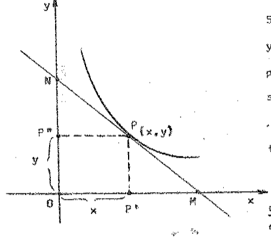

# Ecuaciones diferenciales ordinarias — Parte 1

> Fuente: `2020/15-EDO 2do Orden/Apunte Ecuaciones Diferenciales.pdf`.
> Universidad Tecnológica Nacional, Facultad Regional Resistencia. Análisis
> Matemático II. Apunte de las clases del Ing. Leopoldo S. de Urrutia. No consta
> año impreso. Esta parte comprende portada, contenido y páginas impresas 1–15
> (PDF 1–17). Procedencia en
> [cobertura](../../../resources/2020/pdf2020-cobertura.md).

## Portada

UNIVERSIDAD TECNOLÓGICA NACIONAL\
FACULTAD REGIONAL RESISTENCIA\
ANÁLISIS MATEMÁTICO II

ECUACIONES DIFERENCIALES ORDINARIAS

Apunte de las clases del Ing. Leopoldo S. de Urrutia

## Contenido

| Tema | Hoja Nº |
| -- | -- |
| Ecuaciones Diferenciales. Clasificación | 1 |
| Consideraciones Geométricas | 2 |
| Obtención de la Ecuación Diferencial a partir de la solución general | 2 |
| Ecuación Diferencial con Variables Separables | 3 |
| Funciones Homogéneas | 4 |
| Ecuaciones Diferenciales con Coeficientes Homogéneos | 5 |
| Ecuaciones que pueden convertirse en Homogéneas | 7 |
| Ecuaciones Diferenciales Exactas | 8 |
| Ecuaciones Diferenciales Lineales de 1er Orden | 10 |
| Ecuación Diferencial de Bernoulli | 12 |
| Ecuación Diferencial de Clairaut | 13 |
| Ecuaciones Diferenciales Lineales de 2do Orden | 16 |
| Método de los Coeficientes Indeterminados | 22 |
| Método de Lagrange | 26 |
| Resolución de Ecuaciones Diferenciales mediante el empleo de Series | 28 |
| Resolución Numérica de Ecuaciones Diferenciales | 32 |
| Método de Empleo de Series | 36 |
| Método Abreviado que comprende Operadores | 37 |
| Ejercitación | 42 |

## Página 1 — Ecuaciones Diferenciales

Se denomina “ECUACIÓN DIFERENCIAL” a toda ecuación en la que aparecen una ó
varias derivadas de una función.

Clasificación: A las ecuaciones diferenciales podemos clasificarlas en dos
grandes grupos, las **Ordinarias**: son aquellas que contienen diferenciales ó
derivadas totales, o ambas a la vez, pero no derivadas parciales; y **Ecuación
entre Derivadas Parciales**: cuando contienen derivadas parciales.

**Orden** de una ecuación diferencial es el orden de la derivada de mayor orden
que interviene en ella.

**Grado** de una ecuación diferencial ordinaria algebraica, respecto a sus
derivadas, es el grado algebraico de su “derivada de mayor orden”.

Ejemplos:

1\.

```math
x^2\frac{d^2y}{dx^2}+2x\frac{dy}{dx}+y=x^2+2
```

(ordinaria, 2º orden, 1er grado)

2\.

```math
\left(\frac{d^3y}{dx^3}\right)^2
+2\frac{d^2y}{dx^2}\cdot\frac{dy}{dx}
+x\left(\frac{dy}{dx}\right)^3=0
```

(ordinaria, 3er orden, 2do grado)

3\.

```math
(x+y^2-3xy)+(x^2+x+2)\frac{dy}{dx}=0
```

(ordinaria, 1er orden, 1er grado)

4\.

```math
\frac{\partial z}{\partial x}=y
```

(Entre derivadas parciales, 1er grado)

5\.

```math
\frac{\partial^2u}{\partial x^2}
+\frac{\partial^2u}{\partial y^2}
+\frac{\partial^2u}{\partial z^2}=0
```

“Una **solución** de una ecuación diferencial ordinaria de dos variables, es una
relación, sin derivadas, entre las variables, que satisface a la ecuación”.

Si en particular la solución tiene la forma $`y=f(x)`$, al sustituir “$`y`$”, y
las derivadas de “$`y`$” con respecto a $`x`$, por $`f(x)`$ y sus derivadas
sucesivas $`f'(x),f''(x),\ldots,f^{(n)}(x)`$, se obtiene una identidad.

## Página 2 — Consideraciones Geométricas

Así decimos que $`y=cx^2`$ es solución de: $`2y=x\frac{dy}{dx}`$, pues
sustituyendo $`cx^2`$ por $`y`$, y $`2cx`$ por la $`\frac{dy}{dx}`$, se obtiene:

```math
x\cdot2cx=2cx^2
```

o sea una identidad.

Toda ecuación diferencial de primer orden y primer grado se puede escribir en la
forma:

```math
\frac{dy}{dx}=f(x,y)
```

expresión que hace corresponder a cada punto $`(x_0,y_0)`$: una línea de
pendiente $`\left(\frac{dy}{dx}\right)_0=f(x_0,y_0)`$, es decir, la relación que
asocia a cada punto una dirección. Cada punto de la curva $`f(x,y)=m`$, está
asociado con la pendiente $`m`$. Las curvas se denominan “**isoclinas**”.

Ejemplo: $`\frac{dy}{dx}=-\frac{x}{2y}`$. Las isoclinas se definen por:

```math
-\frac{x}{2y}=m\qquad x=-2my
```

que representa todas las líneas rectas que pasan por $`(0,0)`$. Así, para
$`m=0`$, cada punto de $`x=-2\cdot0\cdot y=0`$, tiene 0 como pendiente; para
$`m=1`$, cada punto de $`x=-2\cdot1\cdot y=-2y`$, tiene 1 como pendiente.

Nótese que los conjuntos de puntos asociados con la misma dirección están sobre
una línea que pasa por el origen.

### Obtención de la ECUACIÓN DIFERENCIAL a partir de la SOLUCIÓN GENERAL

Para resolver este problema inverso, derívese la solución general, derívese la
ecuación de la derivada primera, derívese la ecuación de la derivada segunda,
etc., hasta que el número de ecuaciones derivadas, sea igual al número de
constantes arbitrarias independientes en la solución general. Finalmente,
elimínense las constantes entre la solución general y las ecuaciones derivadas.

## Página 3

Ejemplos:

1\) Hállese la ecuación diferencial cuya solución general es:

```math
y=C\mathop{\mathrm{sen}}\nolimits 4x
```

```math
y=C\mathop{\mathrm{sen}}\nolimits 4x\qquad
\frac{dy}{dx}=4C\cos4x=y'
```

```math
\begin{aligned}
y=C\mathop{\mathrm{sen}}\nolimits 4x&\Rightarrow C=y/\mathop{\mathrm{sen}}\nolimits 4x\\
y'=4C\cos4x&\Rightarrow C=y'/4\cos4x
\end{aligned}
```

```math
\frac{y}{\mathop{\mathrm{sen}}\nolimits 4x}-\frac{y'}{4\cos4x}=0
```

o también

```math
4y\cos4x-\frac{dy}{dx}\mathop{\mathrm{sen}}\nolimits 4x=0
```

2\) Encuentre la ecuación diferencial de todas las circunferencias con centro en
$`(0,0)`$.

```math
x^2+y^2=R^2\quad\therefore\quad x^2=R^2-y^2
```

derivamos la solución general y obtenemos:

```math
2x=-2yy'\qquad\text{ya que }y=f(x)
```

por lo tanto $`x=-yy'`$,

```math
x+yy'=0
```

### Ecuaciones Diferenciales con VARIABLES SEPARABLES

Se llama así a toda ecuación diferencial de forma:

```math
M\,dx+N\,dy=0
```

en la que los coeficientes $`M`$ y $`N`$ son funciones de una sola variable o a
lo sumo están formados por productos de factores que contienen cada uno de ellos
una sola variable. Toda ecuación de este tipo puede llevarse a la forma

```math
f_1(x)\,dx+f_2(y)\,dy=0
```

cuya solución es:

```math
\int f_1(x)\,dx+\int f_2(y)\,dy=C
```

Ejemplos.

1.- Resolver la ecuación $`(1+x^2)\,dy-xy\,dx=0`$.

Separando las variables tendremos:

```math
\frac{dy}{y}-\frac{x}{1+x^2}\,dx=0
```

cuya solución es, integrando la igualdad:

## Página 4

```math
\int\frac{dy}{y}-\int\frac{x}{1+x^2}\,dx=C
\quad\therefore\quad \ln y-\frac12\ln(1+x^2)=\ln C
```

```math
\ln y=\ln C+\ln\sqrt{1+x^2}=\ln C\sqrt{1+x^2}
```

```math
y=C\sqrt{1+x^2}
```

2.- Hallar las ecuaciones de las curvas tales que los segmentos de recta de cada
tangente comprendidos entre los ejes coordenados queden divididos en 2 partes
iguales por el punto de tangencia.



Sea $`P(x,y)`$, un punto de tangencia y $`\overline{MN}`$ la tangente a la curva
en el punto $`P`$. $`P\in\overline{MN}\land\overline{NP}=\overline{PM}`$.

Si $`\overline{NP}=\overline{PM}\Rightarrow\overline{OP'}=\overline{P'M}=x`$

$`\therefore\ \overline{NP''}=\overline{P''O}=y`$ se deduce entonces que:

```math
\overline{OM}=2x\quad\land\quad\overline{ON}=2y
```

```math
\frac{dy}{dx}=-\frac{\overline{ON}}{\overline{OM}}=-\frac{2y}{2x}=-\frac yx
```

por lo tanto si, $`\frac{dy}{dx}=-\frac yx`$ será entonces:

```math
x\,dy+y\,dx=0\quad\Longrightarrow\quad\frac{dx}{x}+\frac{dy}{y}=0
```

integrando tenemos

```math
\ln x+\ln y=\ln C\quad\therefore\quad\ln(xy)=\ln C\Rightarrow xy=C
```

que es la ecuación de la familia de curvas buscadas.

### Funciones Homogéneas

Diremos que una función $`f(x,y)`$ es homogénea de grado $`k`$ si y solo si:

```math
f(tx,ty)=t^kf(x,y)
```

esta definición se generaliza para el caso de más variables independientes.
Ejemplo:

Sea $`f(x,y)=2y^3\exp(y/x)-\frac{x^4}{x+3y}`$ será entonces que

## Página 5

```math
\begin{aligned}
f(tx,ty)&=2(ty)^3e^{yt/(xt)}-\frac{(tx)^4}{(xt)+3(yt)}\\
&=2t^3y^3e^{y/x}-\frac{t^4x^4}{t(x+3y)}\\
&=2t^3y^3e^{y/x}-t^3\frac{x^4}{x+3y}\\
&=t^3\left[2y^3e^{y/x}-\frac{x^4}{x+3y}\right]\\
&=t^3f(x,y)
\end{aligned}
```

se trata entonces de una función homogénea de tercer grado, ya que $`k=3`$.

Propiedades:

1º) Si $`M(x,y)`$ y $`N(x,y)`$ son dos funciones homogéneas del mismo grado,
entonces el cociente $`M(x,y)/N(x,y)`$ resulta una función homogénea de “grado
cero”.

Demostración: Supongamos $`M(x,y)`$ y $`N(x,y)`$ son homogéneas de grado $`k`$,
entonces se verificará:

```math
\begin{cases}
M(tx,ty)=t^kM(x,y)\\
N(tx,ty)=t^kN(x,y)
\end{cases}
```

el cociente será:

```math
\frac{M(tx,ty)}{N(tx,ty)}
=\frac{t^kM(x,y)}{t^kN(x,y)}=t^0\frac{M(x,y)}{N(x,y)}
```

en este caso $`k=0`$.

2º) Si una función $`f(x,y)`$ es homogénea de “grado cero”, es función de
$`(y/x)`$. Si $`f(x,y)`$ es homogénea de grado 0

```math
f(x,y)=\varphi(y/x)=\phi(x/y)
```

```math
f(tx,ty)=t^0f(x,y)=f(x,y)
```

por ser $`t^0=1`$, el parámetro $`t`$ puede tomar cualquier valor inclusive
$`t=1/x`$ ó $`t=1/y`$.

Supongamos que $`t=1/x`$:

```math
f(tx,ty)=f\left(\frac1x x,\frac yx\right)=f(1,y/x)=\varphi(y/x)
```

si $`t=1/y`$:

```math
f(tx,ty)=f\left(\frac xy,\frac1y y\right)=f(x/y,1)=\phi(x/y)
```

### Ecuaciones Diferenciales con COEFICIENTES HOMOGÉNEOS

Sea la forma

```math
M(x,y)\,dx+N(x,y)\,dy=0
```

## Página 6

donde $`M`$ y $`N`$ son funciones homogéneas del mismo grado $`k`$, también
podemos escribir:

```math
\frac{M(x,y)}{N(x,y)}\,dx+dy=0
\quad\text{ó}\quad
\frac{M(x,y)}{N(x,y)}+\frac{dy}{dx}=0
```

el cociente entre $`M`$ y $`N`$, es de “grado cero”, y por lo tanto es función
de $`(y/x)`$ o bien $`(x/y)`$.

Supongamos $`f(1,y/x)+\frac{dy}{dx}=0`$ al valor $`y/x`$ lo hacemos igual a
$`v`$:

```math
y/x=v\Rightarrow y=vx\quad\therefore\quad dy=v\,dx+x\,dv
```

reemplazando en la ecuación:

```math
f(1,v)+\frac{x\,dv+v\,dx}{dx}=0
\Rightarrow f(1,v)+x\frac{dv}{dx}+v=0
```

ecuación ésta última con variables separables:

```math
x\frac{dv}{dx}+v+\phi(v)=0
\Rightarrow\frac{dv}{v+\phi(v)}+\frac{dx}{x}=0
```

Ejemplo: sea $`(x^2-xy+y^2)\,dx-xy\,dy=0`$.

Hacemos $`y/x=u\ \therefore\ y=ux\Rightarrow dy=u\,dx+x\,du`$; reemplazamos

```math
\begin{aligned}
(x^2-xux+(ux)^2)\,dx-xux(u\,dx+x\,du)&=0\\
x^2(1-u+u^2)\,dx-x^2(u^2\,dx+ux\,du)&=0\\
(1-u+u^2)\,dx-u^2\,dx-ux\,du&=0\\
(1-u)\,dx-ux\,du&=0
\end{aligned}
```

```math
\frac{dx}{x}-\frac{u\,du}{1-u}=0
```

```math
\frac{u}{u-1}=1+\frac1{u-1}\qquad
\frac{dx}{x}+\frac{u\,du}{u-1}=0
```

```math
\frac{dx}{x}+du+\frac{du}{u-1}=0
\Rightarrow\ln x+u+\ln(u-1)=\ln C
```

pero $`u=\ln e^u`$ reemplazando tenemos:

```math
\ln x+\ln e^u+\ln(u-1)=\ln C
```

```math
e^ux(u-1)=C\quad\therefore\quad e^{y/x}x(y/x-1)=C
```

Solución

```math
e^{y/x}(y-x)=C
```

## Página 7 — Ecuaciones que pueden convertirse en Homogéneas

En todo lo visto antes, hemos considerado a $`x`$ y $`y`$ como de primer grado,
y una expresión como homogénea, si es una suma de términos que son todos del
mismo grado. A veces, la expresión dada que no es homogénea en ese sentido puede
hacerse homogénea si se considera a las variables $`x`$ e $`y`$ en distintas
dimensiones, análogamente a como se consideran las magnitudes en una ecuación de
dimensiones. La diferencial de $`x`$, tiene que considerarse como teniendo la
misma dimensión que la variable $`x`$, de igual manera para $`y`$. La dimensión
de un producto es entonces la suma de las dimensiones de sus factores y una
expresión $`M\,dx+N\,dy`$ se considera homogénea si es suma de términos de una
misma dimensión.

La ecuación $`(xy^2-3y)\,dx-x\,dy=0`$ es homogénea si consideramos $`x`$ como
siendo de dimensión 1 e $`y`$ como de dimensión $`-1`$, pues entonces es una
suma de términos que tiene cada uno dimensión cero.

Para resolver ecuaciones que se hacen homogéneas cuando se supone a la variable
$`x`$ de dimensión 1, y a la variable $`y`$, de dimensión $`n`$, hagamos
$`y=vx^n`$. La nueva ecuación en “$`v`$” y “$`x`$” será entonces separable. Así
en la ecuación ejemplo, hagamos

```math
y=vx^{-1}\quad;\quad dy=\frac{x\,dv-v\,dx}{x^2}
```

reemplazando:

```math
\left(\frac{v^2}{x}-\frac{3v}{x}\right)dx
-x\left(\frac{x\,dv-v\,dx}{x^2}\right)=0
```

esta ecuación separando se reduce a la forma

```math
-\frac{dx}{x}+\frac{dv}{v^2-2v}=0
```

que tiene como solución a

```math
-\ln x-\frac12\ln v+\frac12\ln(v-2)+\ln C=0
\quad\text{ó}\quad\frac{v-2}{v}=Cx^2
\quad\therefore\quad v=\frac2{1-Cx^2}
```

finalmente como $`v=yx`$:

```math
y=\frac2{x(1-Cx^2)}
```

Se observará que con las dimensiones asignadas a $`x`$ y $`y`$, la cantidad
“$`v`$”, definida por la igualdad propuesta, $`y=vx^n`$, es de “dimensión cero”;
pues si, expresamos $`y`$ en función de $`x`$, y de cualquier otra cantidad de
dimensión cero, la ecuación diferencial es separable.

## Página 8

esto es lo único que hay de importante en la sustitución.

### Ejemplo de aplicación

Sea la ecuación diferencial

```math
(1+x^2y+x^4y^2)\,dy+2x^3y^3\,dx=0
```

Esta ecuación diferencial podría considerarse homogénea si suponemos que la
variable $`y`$ es de dimensión 1 y la variable $`x`$ de dimensión $`-1/2`$. Sin
embargo, es más sencillo adoptar para $`x^2`$ la dimensión $`-1`$, es así:

```math
x^2=vy^{-1}\Rightarrow x^2=\frac vy
```

derivando

```math
2x\,dx=\frac{y\,dv-v\,dy}{y^2}
```

reemplazando la ecuación se convierte en

```math
(1+v+v^2)\,dy+vy^2\left(\frac{y\,dv-v\,dy}{y^2}\right)=0
```

que se reduce a

```math
\frac{dy}{y}+\frac{v\,dv}{1+v}=0
```

la solución de esta ecuación es

```math
\ln y+v-\ln(1+v)=\ln C
```

```math
ye^v=C(1+v)
```

pero como tenemos $`x^2=\frac vy`$ ó $`v=x^2y`$:

```math
ye^{x^2y}=C(1+x^2y)
```

### ECUACIONES DIFERENCIALES EXACTAS

Una ecuación diferencial de la forma

```math
M\,dx+N\,dy=0\tag{1}
```

se llama “exacta” cuando existe una función $`U`$ cuya diferencial total es el
primer miembro de la ecuación, es decir verifica:

```math
dU=M\,dx+N\,dy
```

En este caso $`dU=0`$ y su solución será: $`U=C`$. Para que la ecuación (1) sea
exacta debe verificarse:

```math
\frac{\partial M}{\partial y}=\frac{\partial N}{\partial x}\tag{2}
```

Demostración: Supongamos que existe una función $`U(x,y)`$ tal que

```math
dU=M\,dx+N\,dy
```

## Página 9

entonces $`\frac{\partial U}{\partial x}=M`$;
$`\frac{\partial U}{\partial y}=N`$ por consiguiente será:

```math
\frac{\partial^2U}{\partial y\partial x}=\frac{\partial M}{\partial y};
\qquad\frac{\partial^2U}{\partial x\partial y}=\frac{\partial N}{\partial x}
```

y como sabemos, se verificará que las derivadas

```math
\frac{\partial^2U}{\partial x\partial y}
=\frac{\partial^2U}{\partial y\partial x}
\quad\text{se deduce}\quad
\frac{\partial M}{\partial y}=\frac{\partial N}{\partial x}
```

con lo que queda demostrado. Es posible demostrar también que si verifica (2),
existe $`U`$ tal que su diferencial es $`M\,dx+N\,dy`$ (Primer miembro de la
ecuación diferencial dada).

Ejemplo: Resolver la ecuación: $`e^y\,dx+(xe^y-2y)\,dy=0`$.

En este caso será:

```math
\frac{\partial M}{\partial y}=e^y;\qquad
\frac{\partial N}{\partial x}=\frac{\partial}{\partial x}(xe^y-2y)=e^y
\quad\therefore\quad\frac{\partial M}{\partial y}
=\frac{\partial N}{\partial x}
```

siendo iguales esas derivadas, la ecuación es exacta. Por consiguiente,
integrando $`M\,dx`$ considerando “$`y`$” constante, obtenemos una primera
expresión de $`U`$:

```math
U=\int e^y\,dx=xe^y+C(y)
```

por lo tanto, su diferencial será:

```math
dU=e^y\,dx+(xe^y+C'(y))\,dy
```

donde $`C'(y)`$ es la derivada de $`C(y)`$. Si comparamos esta ecuación con la
dada vemos que

```math
C'(y)=-2y\quad\therefore\quad C(y)=\int C'(y)\,dy=\int-2y\,dy=-y^2
```

no añadiéndose ninguna constante. Por lo tanto la expresión final de $`U(x,y)`$
será:

```math
U=xe^y-y^2=C
```

El valor de $`C(y)`$ obtenido, pudo hallarse también integrando directamente
$`-2y\,dy`$ que es la parte de $`(xe^y-2y)`$, que no contiene $`x`$.

Ejemplo: Resolver $`(x^2+y^2)\,dx+2xy\,dy=0`$.

```math
\begin{cases}
\dfrac{\partial M}{\partial y}=\dfrac{\partial}{\partial y}(x^2+y^2)=2y\\
\dfrac{\partial N}{\partial x}=\dfrac{\partial}{\partial x}(2xy)=2y
\end{cases}
```

Verifica la condición $`\frac{\partial M}{\partial y}
=\frac{\partial N}{\partial x}`$ por lo tanto la ecuación diferencial es exacta.

## Página 10

```math
U=\int M\,dx=\int(x^2+y^2)\,dx=\frac{x^3}{3}+xy^2+C(y)
```

su diferencial total será:

```math
dU=(x^2+y^2)\,dx+(2xy+C'(y))\,dy
```

comparando esta expresión con la ecuación diferencial surge que $`C'(y)=0`$ por
lo tanto $`C(y)=K`$.

La solución general de la ecuación es:

```math
U=\frac{x^3}{3}+xy^2=C
```

### ECUACIONES DIFERENCIALES “LINEALES” DE 1er ORDEN

Son ecuaciones de la forma:

```math
dy+P(x)y\,dx=Q(x)\,dx
```

donde podemos observar que tanto la variable $`y`$ como $`dy`$ aparecen en
términos distintos y con exponentes uno, en tanto que los coeficientes $`P(x)`$
y $`Q(x)`$ son funciones de la variable $`x`$. Si se tratara de una ecuación
lineal en $`x`$, se escribiría:

```math
dx+P(y)x\,dy=Q(y)\,dy
```

“Toda ecuación diferencial Lineal, puede ser transformada en una ecuación
diferencial **exacta**, multiplicando por el **factor integrante**
$`e^{\int P\,dx}`$”.

Demostración.

Sea la ecuación diferencial Lineal en $`y`$:

```math
dy+P(x)y\,dx=Q(x)\,dx
```

supongamos que $`F(x)`$ es el factor integrante, entonces multiplicando a ambos
miembros de la igualdad se obtiene:

```math
F(x)\,dy+F(x)P(x)y\,dx=F(x)Q(x)\,dx
```

que podemos expresar

```math
F(x)\,dy+[F(x)P(x)y-F(x)Q(x)]\,dx=0
```

como se ha supuesto que $`F(x)`$ es el factor integrante esta última ecuación
debe ser exacta y por tanto:

```math
\frac{\partial F(x)}{\partial x}
=\frac{\partial}{\partial y}[F(x)P(x)y-F(x)Q(x)]
```

analicemos ambos miembros.

## Página 11

```math
\frac{\partial F(x)}{\partial x}=F'(x)=\frac{dF}{dx}
```

por ser $`F(x)`$, función de $`x`$ únicamente.

```math
\frac{\partial}{\partial y}[F(x)P(x)y-F(x)Q(x)]=F(x)P(x)
```

de modo que se cumplirá:

```math
\frac{dF}{dx}=F(x)P(x)\quad\text{o sea}\quad
\frac{dF}{F(x)}=P(x)\,dx\Rightarrow\ln F(x)=\int P(x)\,dx
```

nos queda que

```math
F(x)=e^{\int P(x)\,dx}
```

Ahora bien, como hemos partido de la suposición de la existencia del factor
$`F(x)`$, debemos demostrar que efectivamente $`e^{\int P\,dx}`$ es el factor
integrante de la ecuación diferencial $`dy+P(x)y\,dx=Q(x)\,dx`$. En efecto,

```math
e^{\int P\,dx}\,dy+e^{\int P\,dx}P(x)y\,dx
=e^{\int P\,dx}Q(x)\,dx
```

o sea multiplicando por $`e^{\int P\,dx}`$.

Observemos que el primer miembro de esta igualdad, es la diferencial exacta de
la expresión $`[ye^{\int P\,dx}]`$ y el segundo miembro es una función de una
sola variable $`(x)`$, o sea:

```math
d\left\{ye^{\int P\,dx}\right\}=e^{\int P\,dx}Q(x)\,dx
\Rightarrow ye^{\int P\,dx}=\int e^{\int P\,dx}Q(x)\,dx
```

Observando en esta solución, que el primer miembro es el producto del factor
integrante por la variable $`y`$, solo queda resolver la integral.

Regla Práctica para resolver una ecuación diferencial lineal.

1º) Llévase a la forma general $`dy+P(x)y\,dx=Q(x)\,dx`$.

2º) Calcúlese el factor integrante $`e^{\int P\,dx}`$.

3º) Multiplíquese la ecuación lineal por el factor integrante.

4º) La solución de esta nueva ecuación exacta es:

```math
ye^{\int P\,dx}=\int e^{\int P\,dx}Q(x)\,dx
```

Ejemplos:

```math
2(y-4x^2)\,dx+x\,dy=0
```

```math
2y\,dx-8x^2\,dx+x\,dy=0
```

dividiendo por $`(x)`$ tendremos:

```math
dy+\frac2x y\,dx=8x\,dx\quad;\quad P(x)=\frac2x\quad;\quad Q(x)=8x
```

```math
e^{\int P\,dx}=e^{\int(2/x)\,dx}=e^{2\ln x}=x^2
```

el factor integrante.

## Página 12

resulta: $`F(x)=x^2`$, por lo tanto multiplicamos la ecuación por $`x^2`$

```math
x^2\,dy+2xy\,dx=8x^3\,dx
```

```math
x^2\,dy+[2xy-8x^3]\,dx=0
```

la solución será entonces:

```math
d\{yx^2\}=e^{\int P\,dx}Q(x)\,dx=x^2\cdot8x\,dx=8x^3\,dx
```

```math
\therefore\quad yx^2=2x^4+C\quad\text{o bien}\quad2x^4-yx^2=C
```

```math
(x^5+3y)\,dx-x\,dy=0\Rightarrow dy-\frac3xy\,dx=x^4\,dx
```

```math
P(x)=-\frac3x;\quad Q(x)=x^4
```

```math
e^{\int P\,dx}=e^{\int-\frac3x\,dx}=e^{\ln x^{-3}}=x^{-3}
```

```math
x^{-3}\,dy-3x^{-4}y\,dx=x\,dx
```

la solución general será:

```math
yx^{-3}=\int x\,dx\Rightarrow yx^{-3}-\frac12x^2=C
```

### Ecuación Diferencial de BERNOULLI

Es una ecuación diferencial de la forma:

```math
\frac{dy}{dx}+P(x)y=Q(x)y^n
```

si dividimos ambos miembros por $`y^n`$ se obtiene:

```math
\frac1{y^n}\frac{dy}{dx}+P(x)\frac1{y^{n-1}}=Q(x)
```

igualdad ésta fácilmente transformable en una ecuación lineal mediante la
sustitución siguiente:

```math
u=\frac1{y^{n-1}}\quad\therefore\quad
\frac{du}{dx}=-(n-1)y^{-n}y'=(1-n)\frac1{y^n}\frac{dy}{dx}
```

despejando términos:

```math
\frac1{y^n}\frac{dy}{dx}=\frac1{1-n}\frac{du}{dx}
```

reemplazando en la ecuación

```math
\frac1{1-n}\frac{du}{dx}+P(x)u=Q(x)
```

o sea tendrá la forma

## Página 13

```math
\frac{du}{dx}+(1-n)P(x)u=Q(x)(1-n)
```

que es la forma de una ecuación lineal de fácil solución.

Ejemplo:

```math
\frac{dy}{dx}+\frac1xy=x^3y^3
```

dividiendo por $`y^3`$ obtendremos

```math
\frac1{y^3}\frac{dy}{dx}+\frac1x\frac1{y^2}=x^3
```

por lo tanto si hacemos $`u=\frac1{y^2}`$:

```math
\frac{du}{dx}=-\frac2{y^3}\frac{dy}{dx}
\quad\therefore\quad\frac1{y^3}\frac{dy}{dx}=-\frac{du}{2\,dx}
```

reemplazando:

```math
du-2u\frac1x\,dx=-2x^3\,dx
```

ecuación lineal en $`u`$.

$`P=-2/x`$, el factor integrante será $`e^{\int-\frac2x\,dx}=x^{-2}`$
reemplazando, la solución de esta ecuación será:

```math
\frac1{x^2}\,du-\frac2{x^3}u\,dx=-2x\,dx
```

```math
d\{ux^{-2}\}=-2x\,dx\Rightarrow\frac u{x^2}=-x^2+C
\Rightarrow x^2+\frac1{y^2x^2}=C
```

### Ecuación Diferencial de CLAIRAUT

Es una ecuación de la forma: $`y=px+f(p)`$ donde $`p=\frac{dy}{dx}`$.

En este tipo de ecuación, se obtienen dos soluciones derivando respecto de la
variable $`x`$. Tendremos entonces:

```math
\frac{dy}{dx}=\frac{dp}{dx}x+p+f'(p)\frac{dp}{dx}
```

```math
\therefore\quad\frac{dp}{dx}[x+f'(p)]=0
```

Dado que es el producto de 2 factores puede suceder que:

a) $`\frac{dp}{dx}=0\Rightarrow p=C`$ significa que si la derivada primera es
nula $`p`$ no depende de la variable $`x`$.

Si reemplazamos el valor de $`p=C`$ hallado, en la ecuación dada tenemos

```math
y=Cx+f(C)
```

## Página 14

b) Otra solución no tan simple se tiene de $`[x+f'(p)]=0`$ ó $`x=-f'(p)`$ que
reemplazando en la ecuación da:

```math
y=px+f(p)\quad\text{pero}\quad x=-f'(p)
```

```math
y=p[-f'(p)]+f(p)\Rightarrow y=f(p)-pf'(p)
```

Recordemos que toda solución obtenida de reemplazar por un valor numérico las
constantes de la **Solución general**, es una “**solución particular**” de la
ecuación diferencial. Por ejemplo la solución

```math
y=Cx+f(C)
```

representa una familia de curvas, cada una de las cuales se obtiene dando a la
constante $`C`$ un valor numérico distinto.

Ejemplo:

```math
y_1=C_1x+f(C_1);\quad y_2=C_2x+f(C_2);\quad y_n=C_nx+f(C_n)
```

son soluciones particulares obtenidas de la solución general.

Una solución de la ecuación diferencial se llama “**singular**” si no se puede
obtener por sustitución de la constante en la solución general. Tal es el caso
de la solución $`y=f(p)-pf'(p)`$, por lo tanto decimos que la función
$`y=f(p)-pf'(p)`$ es una “solución singular” de la ecuación.

Generalmente una “Solución singular” representará la “**envolvente**” de la
familia de curvas dada por la solución general, pues si $`p`$ es la pendiente
común a una curva y a la envolvente en cada punto $`x,y`$; los valores $`(x,y)`$
y $`p`$, satisfacen la ecuación diferencial. Es sabido que la envolvente de una
familia de curvas dada por $`f(x,y,C)=0`$ donde $`C`$ es el parámetro, se
obtiene eliminando el parámetro $`C`$ en las ecuaciones:

```math
\begin{cases}
f(x,y,C)=0\\
\dfrac{\partial}{\partial C}f(x,y,C)=0
\end{cases}
```

Entonces dada una familia de curvas representada por la solución general de una
ecuación de Clairaut, $`y=Cx+f(C)`$ la envolvente se obtiene eliminando $`C`$ en
el sistema:

```math
\begin{cases}
y=Cx+f(C)\\
0=x+f'(C)
\end{cases}
```

## Página 15

Ejemplos: $`y=px-p^3`$.

La solución general es inmediata y se obtiene haciendo $`p=C`$,

```math
y=Cx-C^3
```

“Solución General” de la ecuación diferencial. Las soluciones particulares las
obtenemos dando valores a $`C`$, de manera que:

```math
\begin{cases}
C=1\Rightarrow y_1=x-1\\
C=2\Rightarrow y_2=2x-8\\
C=3\Rightarrow y_3=3x-27
\end{cases}
```

“Soluciones Particulares”, cada una de las cuales representa una curva distinta,
y el conjunto de todas ellas es una “familia de curvas”.

Una “solución singular”, se obtiene haciendo:

```math
x+f'(p)=0\quad\therefore\quad x=-f'(p)
```

como $`f(p)=-p^3\Rightarrow f'(p)=-3p^2\Rightarrow x=3p^2`$, reemplazamos en la
ecuación dada

```math
y=p(3p^2)-p^3=2p^3
```

por lo tanto el sistema es:

```math
\begin{cases}
x=3p^2\Rightarrow x/3=p^2\quad\therefore\quad p^6=x^3/27\\
y=2p^3\Rightarrow y/2=p^3\quad\therefore\quad p^6=y^2/4
\end{cases}
```

```math
\therefore\quad\frac{x^3}{27}=\frac{y^2}{4}
\qquad4x^3=27y^2\quad\text{(ecuación de la envolvente)}
```

2\) $`y=px+1/p`$; solución general $`y=Cx+1/C`$.

Solución singular:

```math
x+f'(p)=0\Rightarrow x=-f'(p)
```

como:

```math
f(p)=\frac1p\quad\therefore\quad f'(p)=-\frac1{p^2}\Rightarrow x=\frac1{p^2}
```

reemplazando en $`y`$

```math
y=px+1/p\quad\therefore\quad y=p(1/p^2)+1/p=2/p
```

```math
\begin{cases}
x=1/p^2\Rightarrow x=1/p^2\\
y=2/p\Rightarrow y^2=4/p^2
\end{cases}
\qquad x-y^2/4=0
```

```math
y^2=4x
```
