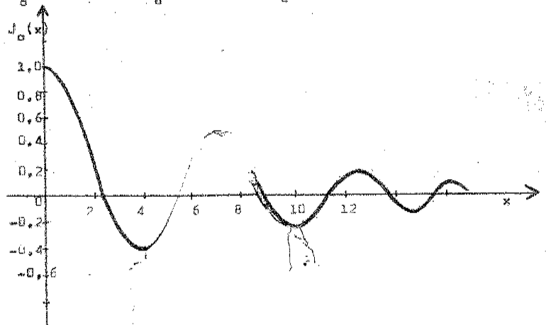
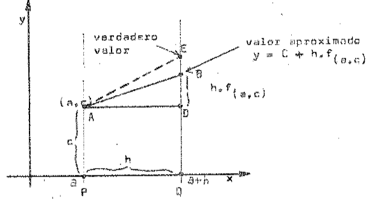
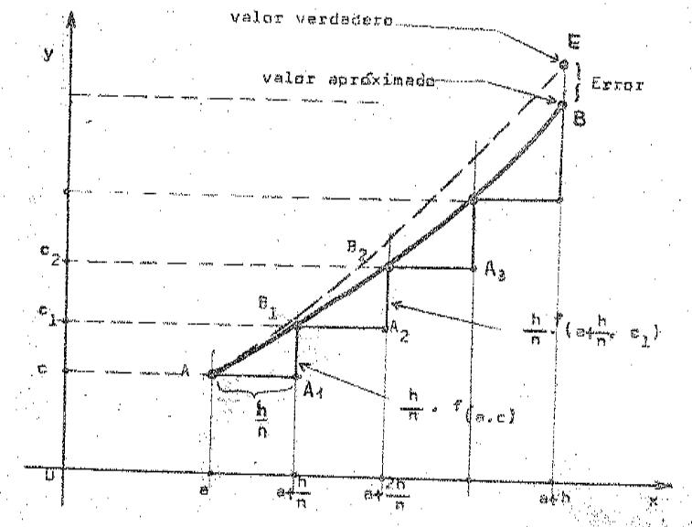

# Ecuaciones diferenciales ordinarias — Parte 3

> Fuente: `2020/15-EDO 2do Orden/Apunte Ecuaciones Diferenciales.pdf`. Apunte de
> las clases del Ing. Leopoldo S. de Urrutia. Universidad Tecnológica Nacional,
> Facultad Regional Resistencia. Sin año impreso. Páginas impresas 29–37, primer
> tema (PDF 31–39), continuación del tema de series iniciado en la hoja 28.
> Procedencia en [cobertura](../../../resources/2020/pdf2020-cobertura.md).

## Página 29

En estos casos, puesto que no podemos recurrir a “funciones trascendentales
superiores”, la única opción consiste en aceptar métodos aproximados. Para dar
lugar e introducir la idea del método consideraremos la ecuación diferencial
$`y'=y`$ con la condición $`y(0)=1`$ separando variables para resolverla,
rápidamente descubrimos que la función buscada es
$`y=e^x\Rightarrow y(0)=e^0=1`$.

Ahora bién, sabemos que muchas funciones como $`e^x`$,
$`\mathop{\mathrm{sen}}\nolimits nx`$, $`\cos nx`$ y muchas otras, se pueden
expresar mediante un desarrollo en serie del tipo

```math
a_0+a_1x+a_2x^2+a_3x^3+\cdots\tag{1}
```

Planteémonos la siguiente pregunta: ¿Qué procedimiento podríamos seguir para
hallar la solución requerida (si existe), suponiendo que no estemos
familiarizados con las funciones exponenciales y sus propiedades? Uno de los
caminos es empezar a admitir que la solución adopte la forma de un desarrollo en
serie del tipo (1) donde los coeficientes $`a_0,a_1,a_2,\ldots`$ son constantes
a determinar. Si aceptamos la posibilidad de que (1) sea la solución, tenemos:

```math
y=a_0+a_1x+a_2x^2+a_3x^3+\cdots
```

```math
y'=\frac d{dx}(a_0+a_1x+a_2x^2+a_3x^3+\cdots)
```

admitiendo la derivación término a término en una serie infinita, obtendremos:

si $`y'=y;\quad\forall y(0)=1`$

```math
a_1+2a_2x+3a_3x^2+4a_4x^3+\cdots
=a_0+a_1x+a_2x^2+a_3x^3+\cdots
```

puesto que esto tiene que ser una identidad, los coeficientes de las potencias
correspondientes de $`x`$ deben ser iguales, de modo que será:

```math
a_0=a_1;\quad2a_2=a_1;\quad3a_3=a_2;\quad4a_4=a_3;\quad\ldots
```

o también:

```math
a_0=a_1;\quad a_2=\frac{a_1}2=\frac{a_0}2;\quad
 a_3=\frac{a_2}3=\frac{a_0}{3!};\quad a_4=\frac{a_3}4=\frac{a_0}{4!}
```

sustituyendo estos valores en la serie

```math
y=a_0+a_0x+\frac{a_0}{2!}x^2+\frac{a_0}{3!}x^3+\frac{a_0}{4!}x^4+\cdots
```

## Página 30

```math
y=a_0\left(1+x+\frac{x^2}{2!}+\frac{x^3}{3!}+\frac{x^4}{4!}+\cdots\right)
```

utilizando la condición de que $`y=1`$ cuando $`x=0`$, se desprende que
$`a_0=1`$, queda entonces:

```math
y=1+x+\frac{x^2}{2!}+\frac{x^3}{3!}+\frac{x^4}{4!}+\cdots
```

que no es más que un desarrollo en serie de la función $`f(x)=e^x`$ o sea que
realmente hemos encontrado la solución buscada.

Aunque quizás haya sido la deducción indebidamente simplificada, ya que se han
omitido algunas demostraciones, y aceptadas conocidas las conclusiones generales
obtenidas, se pueden aplicar a numerosos casos donde la cuestión de la
rigurosidad se analiza por separado. Veamos otro ejemplo ilustrativo más simple.

Resolver:

```math
xy''+y'+xy=0
```

supongamos que acepta una serie como integral general de la forma ya vista en
(1),

```math
y=a_0+a_1x+a_2x^2+a_3x^3+\cdots
```

```math
y'=a_1+2a_2x+3a_3x^2+4a_4x^3+\cdots
```

```math
y''=2a_2+6a_3x+12a_4x^2+20a_5x^3+\cdots
```

podemos desarrollar por separado cada término de la ecuación diferencial.

```math
xy=a_0x+a_1x^2+a_2x^3+a_3x^4+\cdots
```

```math
y'=a_1+2a_2x+3a_3x^2+4a_4x^3+5a_5x^4+\cdots
```

```math
xy''=2a_2x+6a_3x^2+12a_4x^3+20a_5x^4+\cdots
```

sumando miembro a miembro.

```math
xy''+y'+xy=a_1+(a_0+4a_2)x+(a_1+9a_3)x^2+(a_2+16a_4)x^3+\cdots=0
```

puesto que esta expresión debe ser una identidad se verificará:

```math
a_1=0;\quad a_0=-4a_2;\quad a_1=-9a_3;\quad
 a_2=-16a_4;\quad a_3=-25a_5
```

```math
a_1=0;\quad a_2=-\frac{a_0}4;\quad a_3=-\frac{a_1}9=0;
\quad a_4=-\frac{a_2}{16}=\frac{a_0}{4\cdot16};\quad a_5=0;\quad\ldots
```

## Página 31

vemos que $`a_1,a_3,a_5,\ldots`$ son todas nulas, mientras que los coeficientes
$`a_2,a_4,a_6,\ldots`$ están expresadas en función de $`a_0`$, sustituyendo
estos valores tendríamos:

```math
y=a_0\left(1-\frac{x^2}4+\frac{x^4}{4\cdot16}
-\frac{x^6}{4\cdot16\cdot36}+\cdots\right)
```

que también puede expresarse:

```math
y=a_0\left(1-\frac{x^2}{2^2}+\frac{x^4}{2^2\cdot4^2}
-\frac{x^6}{2^2\cdot4^2\cdot6^2}
+\frac{x^8}{2^2\cdot4^2\cdot6^2\cdot8^2}-\cdots\right)\tag{2}
```

expresión que evidencia la regla mediante la cual se forman los términos
siguientes de la serie.

Se puede demostrar, aplicando la prueba de la razón de un término con el
anterior que la serie obtenida como solución (2) es de tipo convergente. Muchas
de las series conocidas y usadas en el cálculo se les ha dado un nombre de
persona para poder referirse a ellas en particular, y estos nombres provienen de
su descubridor o de otros que posibilitaron su aplicación en el cálculo.

En particular, la serie encontrada (2), sin considerar la constante $`a_0`$, se
la reconocerá en adelante por el símbolo $`J_0(x)`$. Podemos operar con
$`J_0(x)`$ en forma análoga a como lo hacemos con la función $`e^x`$. Por
ejemplo, calcular los valores que asume $`J_0(x)`$ para distintos valores de
$`x`$, tabularlo y llevarlo a una gráfica, para simplificar, tomaremos valores
$`\forall x\geq0`$ ya que se trata de una función de “tipo par”:

```math
J_0(0)=1;\quad J_0(1)\simeq0,76;\quad J_0(2)\simeq0,22;
\quad J_0(3)\simeq-0,26;\quad J_0(4)=-0,40;\quad J_0(5)=-0,18.
```



## Página 32

Se observa que la gráfica es de carácter oscilatorio, muy similar al de las
gráficas de vibraciones amortiguadas. El astrónomo Friedrich W. Bessel,
descubrió numerosas propiedades de la función $`J_0(x)`$ y por esta razón, a
ésta se la llama “**función de Bessel**”, en particular es la de orden cero. Se
dice de orden cero y se la identifica por el subíndice, debido a que hay otras
funciones, descubiertas por el mismo Bessel, de orden 1,2,3,... y que se dicen
$`J_1(x);\ J_2(x);\ldots`$ que también provienen de la resolución de ecuaciones
diferenciales de gran importancia práctica y teórica.

### Resolución Numérica de Ecuaciones Diferenciales

En numerosos campos de la investigación científica, el producto final es un
“número” o una tabla de valores. Puesto que las ecuaciones diferenciales juegan
un rol fundamental, es esencial saber como poder resolverlas numéricamente. Lo
dicho, adquiere mayor relevancia si se tiene en cuenta que en la actualidad se
disponen de potentes procesadores que facilitan extraordinariamente las
laboriosas tareas de cálculos numéricos repetitivos. No obstante el hecho de que
máquinas reduzcan la labor, no significa que los operadores requieran menos
conocimientos, por el contrario, debe saber mucho más sobre los métodos
diversos, puesto que deberá decidir cuál es la manera más eficiente de
“alimentar” la máquina, con las matemáticas.

Veamos una ecuación de primer orden:

```math
y'=f(x,y)
```

Nos planteamos la siguiente pregunta: Sabiendo que una solución de
$`y'=f(x,y)`$, ha de ser tal que: $`y=C`$ cuando $`x=a`$, ¿cómo podríamos
determinar el valor de $`y`$ cuando $`x=a+h`$?

Si integramos la ecuación diferencial respecto de $`x`$ resulta:

```math
y=C+\int_a^x f(x,y)\,dx\tag{1}
```

es evidente que (1) satisface la condición inicial impuesta ya que

## Página 33

si $`x=a\Rightarrow y=C`$.

El valor de $`y`$ cuando $`x=a+h`$ estará dado por

```math
y=C+\int_a^{a+h}f(x,y)\,dx\tag{2}
```

Infortunadamente no es posible avanzar más sin tener que efectuar algunas
consideraciones o aproximaciones, debido a que “$`y`$” aparece en el integrando
de (2). Cada tipo de aproximación utilizado en (2) determina un método distinto
de análisis numérico.

Veamos uno de esos métodos, el de la “**pendiente constante**”.

La aproximación más sencilla que podríamos hacer en (2) consiste en suponer que
$`f(x,y)=`$ constante en el intervalo finito $`\forall a\leq x\leq a+h`$, y
ésta, será una buena aproximación solo cuando $`h`$ sea pequeña. Podemos tomar
el valor constante como el valor $`f(a,C)`$, es decir, tomar el valor de la
pendiente $`f(x,y)`$ en $`x=a`$, $`y=C`$, por lo que la expresión (2) queda:

```math
y=C+\int_a^{a+h}f(a,C)\,dx
=C+f(a,C)\int_a^{a+h}dx=C+hf(a,C)\tag{3}
```



La figura nos muestra la interpretación gráfica, la verdadera solución está
representada por la línea de puntos AE. Como la distancia entre A y D es $`h`$,
es claro que el valor de $`y`$ que se obtiene en (3) está representado por la
ordenada BQ. El error cometido está dado por $`\overline{BE}`$. Como este
segmento decrece a medida que decrece $`h`$, si $`h`$ es grande también lo será
el error cometido.

En el caso que $`h`$ sea grande, el error a que hacíamos mención puede reducirse
mediante la subdivisión del intervalo $`h`$, digamos en

## Página 34

$`n`$ partes con lo que la expresión (2) toma la forma.

```math
y=C+\int_a^{a+h/n}f(x,y)\,dx
+\int_{a+h/n}^{a+2h/n}f(x,y)\,dx+\cdots
+\int_{a+(n-1)h/n}^{a+h}f(x,y)\,dx\tag{4}
```

si se elige $`n`$ de modo adecuado para que $`h/n`$ sea lo suficientemente
pequeño y aplicando a la integral el procedimiento anteriormente descripto, la
expresión (4) se escribirá:

```math
y=C+\frac hn f(a,C)+\frac hn f(a+h/n,C_1)
+\frac hn f(a+2h/n,C_2)+\frac hn f(a+3h/n,C_3)+\cdots\tag{5}
```

donde $`C_k`$ es el valor de $`y`$ cuando $`x=a+kh/n`$, siendo
$`k=1,2,\ldots,(n-1)`$. La interpretación gráfica de la expresión (5) nos
permite ver el grado de aproximación logrado con la subdivisión del intervalo
$`h`$ en $`n`$ partes.



Aplicando la expresión (3) con $`h/n`$ en lugar de $`h`$, se observa que
$`\overline{A_1B_1}=\frac hn f(a,C)`$, y que la ordenada de $`B_1`$ está dada
por

```math
C_1=C+\frac hn f(a,C)
```

Se calcula ahora la nueva pendiente correspondiente al punto $`B_1`$

## Página 35

cuyas ordenadas son $`(a+h/n,C_1)`$, esta pendiente será $`f(a+h/n,C_1)`$, así
llegamos al punto $`B_2`$ y la distancia $`\overline{A_2B_2}`$ estará dada por
la forma $`\frac hn f(a+h/n,C_1)`$. Puesto que $`B_2`$ es la suma de $`B_1`$ más
$`\overline{A_2B_2}`$, la ordenada de $`B_2`$ será:

```math
C_2=C+\frac hn f(a,C)+\frac hn f(a+h/n,C_1)
```

la ordenada de un punto genérico $`B_k`$

```math
C_k=C+\frac hn f(a,C)+\frac hn f(a+h/n,C_1)
+\frac hn f(a+2h/n,C_2)+\cdots+\frac hn f(a+(k-1)h/n,C_{k-1})
```

y en particular

```math
C_n=C+\frac hn f(a,C)+\frac hn f(a+h/n,C_1)+\cdots
+\frac hn f(a+(n-1)h/n,C_{n-1})
```

será la ordenada del punto alcanzado después de $`n`$ escalones expresado en
(5). Aun cuando el método parezca bastante sencillo, se obtienen muy buenos
resultados, aumentando su aproximación conforme se vaya eligiendo $`n`$ cada vez
mayor.

### Ejemplo ilustrativo

Dada $`y'=x+y`$ hallar el valor de $`y`$ cuando $`x=1`$, sabiendo que $`y=1`$
cuando $`x=0`$: $`y(0)=1`$.

En este caso, $`h=1`$. Nos convendría elegir $`n`$ de tal manera que $`h/n`$ sea
pequeño respecto de 1, adoptemos $`n=10\Rightarrow h/n=0,1`$, podemos disponer
apropiadamente los elementos del cálculo sobre una tabla.

Las condiciones iniciales establecidas $`y=1`$ cuando $`x=0`$ determinan la
primera pendiente $`y'=x+y`$ (primera línea de la tabla). Como el incremento de
$`x`$ es $`0,1`$, el nuevo valor de $`y`$ está dado por
$`1,00+0,1(\text{pendiente})`$, $`1,00+0,1(1,00)=1,10`$. Este nuevo valor de
$`y`$ ($`y`$ nuevo) se lleva a la segunda línea y se repite el proceso, en la
tabla hemos utilizado para simplificar, sólo 10 escalones y dos decimales con lo
que encontramos un valor aproximado $`y=3,18`$. Resolviendo la ecuación en forma
exacta veríamos que cuando $`x=1`$, $`y=3,44`$, o sea que se ha logrado en muy
pocos

## Página 36

pasos un acercamiento aceptable, de haberse empleado un $`n=20`$, hubiera
aumentado considerablemente la aproximación, pero se duplicarían los pasos.

| x | y | y′ = x + y, Pendiente | y antigua + 0,1·(pendiente) = y nueva |
| -- | -- | -- | -- |
| 0,00 | 1,00 | 1,00 | 1,00 + 0,1(1,00) = 1,10 |
| 0,10 | 1,10 | 1,20 | 1,10 + 0,1(1,20) = 1,22 |
| 0,20 | 1,22 | 1,42 | 1,22 + 0,1(1,42) = 1,36 |
| 0,30 | 1,36 | 1,66 | 1,36 + 0,1(1,66) = 1,53 |
| 0,40 | 1,53 | 1,93 | 1,53 + 0,1(1,93) = 1,72 |
| 0,50 | 1,72 | 2,22 | 1,72 + 0,1(2,22) = 1,94 |
| 0,60 | 1,94 | 2,54 | 1,94 + 0,1(2,54) = 2,19 |
| 0,70 | 2,19 | 2,89 | 2,19 + 0,1(2,89) = 2,48 |
| 0,80 | 2,48 | 3,29 | 2,48 + 0,1(3,28) = 2,81 |
| 0,90 | 2,81 | 3,71 | 2,81 + 0,1(3,71) = 3,18 |
| 1,00 | 3,18 | — | — |

El método explicado, como sabemos, no es ni mucho el mejor en cuanto a
aproximación con igual cantidad de trabajo, sino porque es muy fácil de
comprender y muy directo en su aplicación, más si se cuenta con máquinas que
realicen los cálculos repetitivos, “las computadoras”.

### Método de Empleo de Series

El empleo de Series debe considerarse como base muy importante de los métodos
numéricos. Por consiguiente todos los métodos de resolución de ecuaciones
diferenciales mediante el uso de series pueden emplearse para la resolución
numérica, siempre que estas series sean convergentes.

Para ilustrar la aplicación del método consideremos la ecuación ya vista:

```math
y'=x+y;\quad y(0)=1;\quad\text{hállese }y(1)
```

Supongamos una solución de la forma:

```math
y=a_0+a_1x+a_2x^2+a_3x^3+\cdots
```

puesto que $`y=1`$ cuando $`x=0\ \therefore\ a_0=1\Rightarrow`$

```math
y=1+a_1x+a_2x^2+\cdots
```

## Página 37 — Continuación de series

sustituyendo el valor de $`y`$ encontrado en la ecuación diferencial dada:

```math
a_1+2a_2x+3a_3x^2+4a_4x^3+\cdots
=1+(1+a_1)x+a_2x^2+a_3x^3+a_4x^4+\cdots
```

igualando los coeficientes: $`a_1=1;\quad1+a_1=2a_2\Rightarrow a_2=1`$

```math
3a_3=a_2=1
```

```math
y=1+x+x^2+\frac{x^3}3+\frac{x^4}{3\cdot4}
+\frac{x^5}{3\cdot4\cdot5}+\cdots
```

como vemos es de tipo convergente, si hacemos en esta serie $`x=1`$ tenemos:

```math
y=1+1+1+0,333+0,083+0,017+\cdots\simeq3,433
```

es evidente que puede conseguirse mayor aproximación tomando más términos de la
serie, y se podrá comparar con el método aplicado anteriormente.
