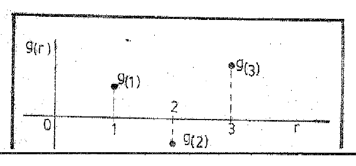
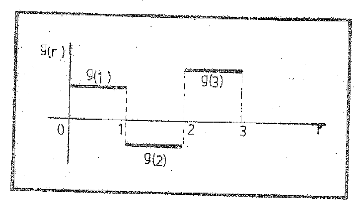

# Series de Fourier — Sucesiones ortogonales

Fuente: «Apunte de Clases del Ing. Urrutia.pdf», carpeta de 2020. Páginas PDF
17–25. Se conservan las ecuaciones y sus números tal como aparecen.
[Procedencia y cobertura](../../../resources/2020/pdf2020-fourier-urrutia-cobertura.md).

## Página PDF 17

### Sucesiones Ortogonales de Funciones

### El Producto Interior de Dos Vectores

El concepto de “Sistema Ortogonal de Funciones” es una generalización natural
del concepto de sistema ortogonal de vectores, esto es, de un sistema de
vectores mutuamente perpendiculares. De hecho, una función puede considerarse
como un vector generalizado, y por ello las propiedades de un sistema de
vectores sugieren propiedades análogas de un sistema de funciones.

Sea g ó $`g(r)`$ un vector en el espacio tridimensional ordinario E3, cuyas
componentes rectangulares son los tres números g(1), g(2), g(3). Es el radio
vector del punto que tiene estos tres números como coordenadas cartesianas
rectangulares. La longitud de este vector, cuyo punto de aplicación es el origen
de los ejes y su extremo libre el punto mencionado, llamado su norma que
designaremos por $`\|g\|`$ es el número no-negativo tal que:

```math
\|g\|^2=[g(1)]^2+[g(2)]^2+[g(3)]^2=\sum_{r=1}^3[g(r)]^2\tag{1}
```

Si en particular $`\|g\|=1`$, se dice que g es un vector unidad, llamado también
“vector normal” o normalizado. Si $`\|g\|=0`$, entonces cada una de sus
componentes es cero y g es conocido como “vector cero”.

La combinación lineal $`c_1\cdot g_1+c_2\cdot g_2`$ de dos vectores $`g_{1}`$ y
$`g_{2}`$ donde $`c_{1}`$, $`c_{2}`$, son números, es otro vector cuyas
componentes son los tres números: $`c_1g_1(r)+c_2g_2(r)`$ para r=1,2,3, y
análogamente para tres o más vectores, o sea:

$`c_1g_1+c_2g_2+\cdots+c_ng_n`$ es el vector cuyas componentes son los tres
números $`c_1g_1(r)+c_2g_2(r)+\cdots+c_ng_n(r)`$; r=1,2,3 recordemos que la suma
y resta de dos vectores y su multiplicación por un número son combinaciones
lineales.

Observemos en particular que la norma del vector diferencia: $`g_{1}`$−$`g_{2}`$
es:

\[La continuación de esta expresión queda cortada en el borde inferior del
original.\]

## Página PDF 18 — Hoja N° 17

La distancia entre los extremos libres de los vectores $`g_{1}`$ y $`g_{2}`$.

El **producto escalar** o **“producto interior”** de $`g_{1}`$ y $`g_{2}`$ que
designamos con el símbolo ($`g_{1}`$,$`g_{2}`$), así,

```math
(g_1,g_2)=\sum_{r=1}^3g_1(r)\cdot g_2(r)=\|g_1\|\cdot\|g_2\|\cdot\cos\theta\tag{3}
```

donde $`\theta`$ es el ángulo formado por los dos vectores que está definido
cuando ninguno de los dos es el vector cero. Cuando $`\|g_2\|=1`$, entonces
($`g_{1}`$,$`g_{2}`$) es la proyección de $`g_{1}`$ sobre la dirección de
$`g_{2}`$. Se desprende, que la condición para que dos vectores no-cero “sean
ortogonales”, es decir, el uno perpendicular al otro, puede escribirse:

```math
(g_1,g_2)=0\quad\text{o también,}\quad\sum_{r=1}^3g_1(r)\cdot g_2(r)=0\tag{4}
```

teniendo presente las ecuaciones (1) y (3), la norma de un vector puede
expresarse

```math
\|g\|=(g,g)^{1/2}\tag{5}
```

donde $`g\in E_3`$.

### Sistemas Ortogonales de Vectores

Dado un sistema ortogonal de vectores no-cero $`g_{n}`$ (n=1,2,3), puede
formarse a partir de él, un sistema de vectores unidad $`\varphi_{n}`$ que
tengan las mismas direcciones dividiendo cada vector por su longitud. Los
componentes de $`\varphi_{1}`$, por ejemplo son:

$`\phi_1(r)=\|g_1\|^{-1}\cdot g_1(r)`$ (r=1,2,3). Este nuevo sistema de vectores
unidad mutuamente perpendiculares $`\varphi_{n}`$ se llama “sistema ortonormal”,
tal sistema puede describirse por medio de productos interiores, poniendo:

```math
(\phi_m,\phi_n)=\delta_{m,n}\quad(m,n=1,2,3)\tag{1}
```

donde $`\delta_{m}`$,ₙ es la $`\delta`$ de Kronecker.

```math
\delta_{m,n}=\begin{cases}0&\text{si }m\ne n\\1&\text{si }m=n\end{cases}
```

La condición (1) expresa, que

## Página PDF 19 — Hoja N° 18

los otros dos y que todos tienen por longitud la unidad. Se empleará el símbolo
$`\varphi_{n}`$ para representar a estos sistemas ortogonales, un ejemplo
sencillo lo da el sistema formado por los vectores unidad a lo largo de los ejes
coordenados que regularmente conocemos como sistema i, j, k, según los ejes x,
y, z.

Todo vector f en el espacio E3 puede expresarse como una combinación lineal de
los vectores unitarios $`\varphi_{1}`$, $`\varphi_{2}`$, $`\varphi_{3}`$:

```math
f=c_1\phi_1+c_2\phi_2+c_3\phi_3\tag{2}
```

Es decir, se pueden encontrar tres números $`c_{1}`$,$`c_{2}`$,$`c_{3}`$, para
los cuales se verifique

```math
f(r)=c_1\phi_1(r)+c_2\phi_2(r)+c_3\phi_3(r)\quad(r=1,2,3)\tag{3}
```

cuando se den los componentes del vector f(1), f(2), y f(3), para hallar
rápidamente el número $`c_{1}`$, considérese (2) como una ecuación vectorial y
efectúese el producto interior de ambos miembros de la ecuación (2) por
$`\varphi_{1}`$. Se obtiene:

$`(f,\phi_1)=c_1(\phi_1,\phi_1)+c_2(\phi_2,\phi_1)+c_3(\phi_3,\phi_1)=c_1`$
puesto que $`(\phi_1,\phi_1)=1`$ y $`(\phi_2,\phi_1)=(\phi_3,\phi_1)=0`$, según
la condición (1). De manera semejante se encuentran $`c_{2}`$ y $`c_{3}`$,
efectuando el producto interior en los miembros de la ecuación (2) por
$`\varphi_{2}`$ y $`\varphi_{3}`$, respectivamente. Los coeficientes, por tanto
son:

```math
c_n=(f,\phi_n)=\sum_{r=1}^3 f(r)\cdot\phi_n(r)\quad(n=1,2,3)\tag{4}
```

donde $`c_{n}`$ es el valor de la proyección de f sobre la dirección de
$`\varphi_{n}`$ y la expresión (3) puede escribirse

```math
f(r)=(f,\phi_1)\cdot\phi_1(r)+(f,\phi_2)\cdot\phi_2(r)+(f,\phi_3)\cdot\phi_3(r)
=\sum_{n=1}^3(f,\phi_n)\phi_n(r)\tag{5}
```

la representación 2, 3 y 5 pueden llamarse “desarrollo de un vector arbitrario f
en serie finita de los vectores ortonormales de referencia”. Estos vectores de
referencia se han supuesto normalizados.

[El final de la página está cortado en el original.]

## Página PDF 20 — Hoja N° 19

Las definiciones y resultados anteriores pueden extenderse inmediatamente a
vectores que pertenecen a un espacio de k dimensiones. En este caso el índice r,
que indica el componente, toma valores de 1 a k en lugar de 1 a 3. La definición
de producto interior de dos vectores $`g_1`$ y $`g_2\in E_k`$, se convierte en:

```math
(g_1,g_2)=\sum_{r=1}^k g_1(r)\cdot g_2(r)
=g_1(1)\cdot g_2(1)+g_1(2)\cdot g_2(2)+\cdots+g_1(k)\cdot g_2(k)\tag{6}
```

Las unidades de longitud en los ejes coordenados rectangulares, con respecto a
las cuales se miden las componentes de los vectores pueden variar de un eje a
otro según necesidad de escalas. En tal caso el producto interior o producto
escalar de dos vectores $`g_{1}`$ y $`g_{2}\in E_{3}`$, tiene la forma,

```math
(g_1,g_2)=\sum_{r=1}^3p(r)\cdot g_1(r)\cdot g_2(r),
```

en donde los “números peso” p(1), p(2) y p(3) dependen aquí de las unidades de
longitud usado a lo largo de los tres ejes.

### Funciones como vectores. Ortogonalidad

Vimos anteriormente que un vector $`g(r)\in E_{3}`$ ha quedado determinado por
los números g(1), g(2), y g(3). Cualquier función $`g(r)`$ que tenga “valores
reales” cuando r=1,2,3 representará un vector si se acuerda que estos “valores
reales” son componentes del vector.



## Página PDF 21 — Hoja N° 20

Esta función puede no estar definida para ningún otro valor de r; en ese caso,
su gráfico consistirá únicamente en tres puntos aislados según la figura
anterior.

Supongamos ahora que $`g(r)`$, definida para r=1,2,3; lo está también para otros
valores de r de modo que pueda representar a la siguiente función escalón (1).

```math
g(r)=\begin{cases}g(1)&\text{cuando }0<r\le1\\g(2)&\text{cuando }1<r\le2\\g(3)&\text{cuando }2<r\le3\end{cases}\tag{1}
```



Entonces podemos decir que [g(1)]² representa el área rectangular bajo la
gráfica de \[$`g(r)`$\]² desde r=0 hasta r=1 y análogamente para [g(2)]² y
[g(3)]², en este caso la fórmula de la norma o módulo del vector (1) puede
escribirse:

```math
\|g\|^2=\int_0^3[g(r)]^2\cdot dr
```

Si ahora $`g_{1}`$ y $`g_{2}`$ son dos funciones escalón del tipo indicado
anteriormente, su producto interior será entonces:

```math
(g_1,g_2)=\int_0^3g_1(r)\cdot g_2(r)\cdot dr
```

## Página PDF 22 — Hoja N° 21

espacio de k dimensiones, si toma valores reales cuando r=1,2,3,…,k y estos
valores son considerados como los componentes del vector.

Sea ahora $`g(x)`$ una función definida para todos los valores de x del
intervalo $`a\le x\le b`$. Si consideramos una función como vector, sus
componentes deben consistir en todas las ordenadas de su gráfica, una para cada
valor de x en el intervalo. Ahora, no resultará posible sumar con respecto a x
como lo hacíamos con respecto al índice r. El proceso natural es sumar por
integración. La norma de la función $`g(x)`$, longitud de este vector
generalizado, es la raíz cuadrada de la suma de los cuadrados de sus componentes
y se define como el número no-negativo dado por

```math
\|g\|=\left\{\int_a^b[g(x)]^2\cdot dx\right\}^{1/2}\tag{2}
```

El producto interior de dos funciones $`g_{1}(x)`$ y $`g_{2}(x)`$ es el número
definido por $`(g_1,g_2)=\int_a^b g_1(x)\cdot g_2(x)dx`$, en analogía con las
fórmulas de vector ordinario… (3)

La condición de que las “dos funciones $`g_{1}(x)`$ y $`g_{2}(x)`$” sean
ortogonales se expresará:

```math
(g_1,g_2)=0\quad\text{o sea}\quad\int_a^b g_1(x)\cdot g_2(x)\cdot dx=0\tag{4}
```

Hemos llevado la generalización de los vectores demasiado lejos para que podamos
conservar el significado original de la terminología geométrica. La norma de una
función $`g(x)`$ no tiene otra interpretación como longitud excepto con g que
será la raíz cuadrada del área bajo la gráfica de \[$`g(x)`$\]². La
ortogonalidad de dos funciones $`g_{1}`$ y $`g_{2}`$ no tiene significado en
cuanto a perpendicularidad, quiere decir solamente que el producto
$`g_{1}`$.$`g_{2}`$ toma valores positivos y negativos de modo que queda
satisfecha la ecuación (4) en el intervalo considerado.

Así la distancia generalizada entre dos funciones $`g_{1}(x)`$ y $`g_{2}(x)`$ se
expresa:

```math
\|g_1-g_2\|=\left\{\int_a^b[g_1(x)-g_2(x)]^2\cdot dx\right\}^{1/2}
```

que es una medida de la distancia media entre sus gráficas.

## Página PDF 23 — Hoja N° 22

(n=1,2,…). Si ninguna de las funciones $`g_{n}`$ tiene norma cero cada función
$`g_{n}`$ puede normalizarse sin más que dividirla por la constante $`\|g_n\|`$.
La nueva sucesión así obtenida

$`\phi_n(x)=\|g_n\|^{-1}\cdot g_n(x)`$ (n=1,2,…) es normal (longitud unitaria) y
ortogonal, abreviadamente es “ortonormal”, en el intervalo, esto es,

```math
(\phi_m,\phi_n)=\delta_{m,n}\quad(m,n=1,2,\ldots)
```

donde $`\delta_{m}`$,ₙ es la $`\delta`$ de Kronecker vista.

Escrita de esta forma más explícita, la condición anterior, para que una
sucesión sea ortogonal se convierte en:

```math
\int_a^b\phi_m(x)\cdot\phi_n(x)\cdot dx
=\begin{cases}0&\text{si }m\ne n\\1&\text{si }m=n\end{cases}
\quad(m,n=1,2,3,\ldots)
```

El intervalo (a,b) en el que están definidas las funciones y sus productos
interiores se llama Intervalo Fundamental. Podemos citar como ejemplo de una
sucesión ortogonal de funciones a el conjunto

```math
\left\{\mathop{\mathrm{sen}}\nolimits \frac{n\cdot\pi x}c\right\}\quad(n=1,2,3,\ldots)\tag{a}
```

ortogonal en el intervalo (0,c). Todas las funciones de esta sucesión (a) tienen
por norma: c/2 común y, por lo tanto, la sucesión ortonormal es el conjunto

```math
\left\{\sqrt{\frac2c}\cdot\mathop{\mathrm{sen}}\nolimits \frac{n\cdot\pi x}c\right\}
\quad\forall\;0\le x\le c\;\wedge\;(n=1,2,\ldots)
```

La misma sucesión (a) es también ortogonal en el intervalo (-c,c) en cuyo caso,
el factor de normalización es $`c^{-1/2}`$. Vemos como caso particular que si el
número $`c=\pi`$ la sucesión (a) toma la forma {sen nx} (n=1,2,…)

ortogonal en el intervalo ($`-\pi,\pi`$) y su norma será $`1/\sqrt\pi`$.

La doble sucesión:

```math
\{\mathop{\mathrm{sen}}\nolimits x,\mathop{\mathrm{sen}}\nolimits 2x,\mathop{\mathrm{sen}}\nolimits 3x,\ldots,1,\cos x,\cos2x,\cos3x,\ldots\}
```

es ortogonal en el intervalo ($`-\pi,\pi`$), obsérvese que incluye la
ortogonalidad de las funciones sen Kx, cos nx, a esta sucesión se la conoce como
sucesión fundamental.

## Página PDF 24 — Hoja N° 23

Estos conceptos, nos permiten interpretar rápidamente los resultados de las
siguientes fórmulas de posterior aplicación.

### Series De Fourier Generalizadas

Dada una sucesión ortonormal de funciones {$`\varphi_{n}(x)`$} (n=1,2,…) en el
intervalo (a,b) puede que resulte posible representar a una función f dada
arbitrariamente en aquel intervalo por medio de una combinación lineal de
aquellas funciones generalizadas a una serie infinita,

```math
f(x)=c_1\cdot\phi_1(x)+c_2\cdot\phi_2(x)+\cdots+c_n\phi_n(x)+\cdots\quad(a<x<b)\tag{1}
```

Esta representación corresponde a la representación de un vector del E3, en
términos de los tres vectores de un sistema ortonormal, visto anteriormente,
observemos que la correspondencia tiene sus limitaciones. En el caso del vector
E3, el número de vectores $`\varphi_{r}(x)`$ (r=1,2,3) en el sistema ortonormal
de referencia es el mismo que el número de componentes de un vector $`f(r)`$
(r=1,2,3). Sin embargo, el número de funciones $`\varphi_{n}(x)`$ en la sucesión
ortogonal propuesta es infinitamente numerable, esto es, se puede establecer una
correspondencia biunívoca entre aquellas funciones y el conjunto de todos los
números positivos, mientras que cada función $`f(x)`$ o $`\varphi_{n}(x)`$ tiene
tantos componentes como puntos hay en el intervalo (a,b), una infinidad no
numerable de componentes.

En el caso en que la ecuación (1) converja hacia $`f(x)`$, y el supuesto de
multiplicar todos los términos de (1) por $`\varphi_{n}(x)`$, la serie que
resulte en el segundo miembro es integrable, podremos obtener los coeficientes
$`c_{n}`$ como productos interiores siguiendo el procedimiento utilizado con los
vectores. Después de multiplicar por $`\varphi_{n}(x)`$ e integrar entre a y b,
se tiene:

```math
(f,\phi_n)=c_1(\phi_1,\phi_n)+c_2(\phi_2,\phi_n)+\cdots+c_n(\phi_n,\phi_n)+\cdots
```

como vimos que $`(\phi_m,\phi_n)=\delta_{mn}`$ se deduce que

```math
(f,\phi_n)=c_n\quad(n=1,2,\ldots)\tag{2}
```

## Página PDF 25 — Hoja N° 24

Los números obtenidos $`c_{n}`$ se denominan coeficientes de Fourier de f
respecto a la sucesión ortonormal $`\varphi_{n}(x)`$ y pueden expresarse:

```math
(f,\phi_n)=c_n\qquad c_n=\int_a^b f(x)\cdot\phi_n(x)\cdot dx\quad(n=1,2,\ldots)
```

así la serie de la ecuación (1) con estos coeficientes $`c_{n}`$, que se conoce
con el nombre de Serie Generalizada de Fourier, se escribe:

```math
f(x)\simeq\sum_{n=1}^{\infty}c_n\cdot\phi_n(x)
=\sum_{n=1}^{\infty}\phi_n(x)\int_a^b f(t)\cdot\phi_n(t)\cdot dt
```
