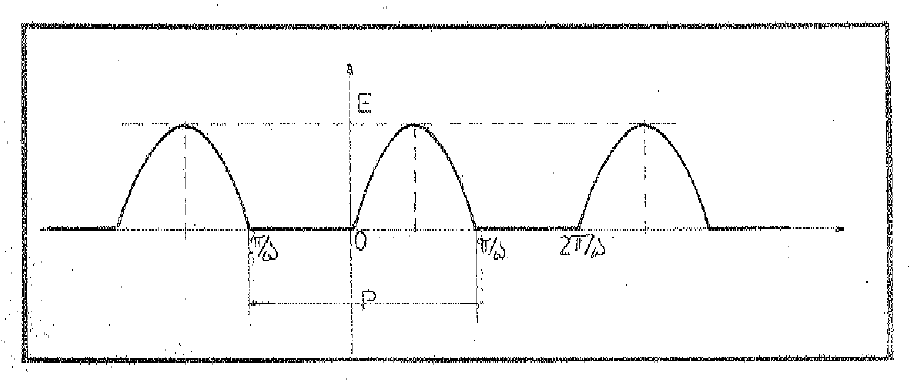
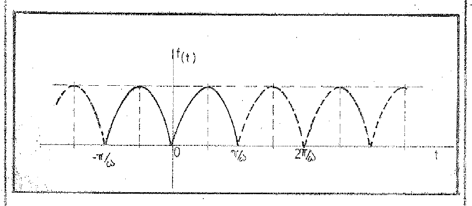
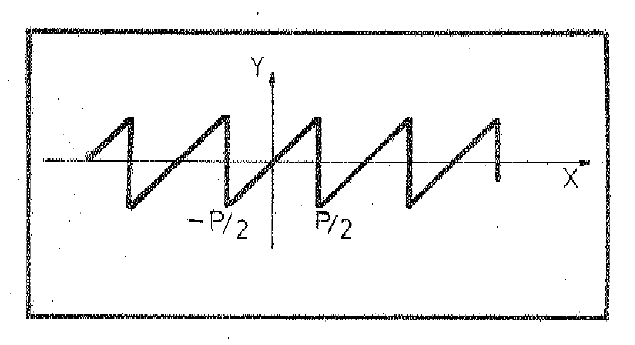
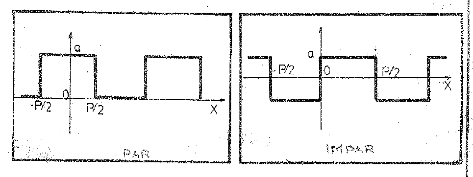

# Series de Fourier — Desarrollo y convergencia

Fuente: «Apunte de Clases del Ing. Urrutia.pdf», carpeta de 2020.
[Procedencia y cobertura](../../../resources/2020/pdf2020-fourier-urrutia-cobertura.md).

## Página PDF 26 — Hoja N° 25

### Series De Fourier

En numerosos problemas prácticos de física, ingeniería y otras ciencias,
aparecen funciones periódicas cuya transformación en una suma de funciones
periódicas más simples como lo son: sen nx y cos nx nos permite el estudio de
las mismas. Este desarrollo se denomina “Serie de Fourier” en honor del físico
francés “Jean Baptiste Fourier”. Veamos algunos ejemplos de funciones periódicas
de aplicación práctica:

#### 1) Rectificador de media onda

Si un voltaje senoidal dado por la ecuación
$V=E\cdot\mathop{\mathrm{sen}}\nolimits \omega t$ donde E es su tensión máxima y
$2\pi$/$\omega$ su período, si se aplica a través de un rectificador de media
onda, que anula sus valores negativos de la onda se obtiene la función definida
de la siguiente forma:

$$
f(t)=\begin{cases}0&\text{si }-p/2<t<0\\E\cdot\mathop{\mathrm{sen}}\nolimits \omega t&\text{si }0<t<p/2\end{cases}
\quad\text{siendo }p=\frac{2\pi}\omega
$$

que ilustramos en la gráfica que sigue:

## Página PDF 27 — Hoja N° 26

**2)** Frecuentemente para obtener la rectificación de la onda completa se
emplean dispositivos combinados que producen la inversión de la porción negativa
de la onda y se produce la onda de la siguiente gráfica.

Estos rectificadores de media onda o de onda completa son dispositivos que se
emplean en la ingeniería electromecánica o electrónica con el fin de transformar
intensidades o voltajes de una corriente alternada en intensidad o voltaje de
una corriente continua.

**3)** Otra onda que aparece frecuentemente es la llamada “dientes de sierra”

$$
f(x)=ax\quad\text{si }-p/2\le x\le p/2
$$

siendo $f(x)=f(x+p)$

## Página PDF 28 — Hoja N° 27

**4)** Ondas rectangulares, caso de generación de energía con 1 solo conductor,
de la forma par o simétrica y forma impar o antisimétrica.

Por ser estas ondas de aplicación en numerosos problemas de física haremos su
aplicación en el análisis de Fourier.

### Serie de Fourier para funciones de “Período 2π”

Sea una función $f(x)$ de período $p=2\pi$, que además es continua o
seccionalmente continua con un número finito de discontinuidades finitas en
\[$-\pi;\pi$\] y supongamos puede ser desarrollada en una serie de la forma:

$$
f(x)=\frac{a_0}2+\sum_{n=1}^{\infty}(a_n\cdot\cos nx+b_n\cdot\mathop{\mathrm{sen}}\nolimits nx)
$$

donde $a_{0}$, $a_{n}$ y $b_{n}$ son los coeficientes cuya determinación
estudiaremos. Este desarrollo de la función en una suma de infinitas funciones
simples senoidales y cosenoidales recibe el nombre de “Serie de Fourier”. Para
determinar los coeficientes partimos del supuesto de que el desarrollo existe y
la serie converge hacia los valores de la función. Con posterioridad
estudiaremos en qué condiciones se verifica dicha convergencia, supongamos su
desarrollo de la forma:

## Página PDF 29 — Hoja N° 28

$$
f(x)=\frac{a_0}2+\sum_{n=1}^{\infty}(a_n\cdot\cos nx+b_n\cdot\mathop{\mathrm{sen}}\nolimits nx)
\quad\text{donde }a_0,a_n\text{ y }b_n\text{ son constantes.}
$$

a) Integrando ambos miembros entre los límites $-\pi$ y $\pi$ se obtiene:

$$
\int_{-\pi}^{\pi}f(x)\cdot dx=\int_{-\pi}^{\pi}a_0/2\cdot dx
+\sum_{n=1}^{\infty}\left(a_n\int_{-\pi}^{\pi}\cos nx\cdot dx
+b_n\int_{-\pi}^{\pi}\mathop{\mathrm{sen}}\nolimits nx\cdot dx\right)
$$

conforme lo demostrado (en las fórmulas 1 y 2 de la hoja 10) las integrales que
aparecen dentro del paréntesis (del signo $\Sigma$) son nulas, resultando:

$$
\int_{-\pi}^{\pi}f(x)\cdot dx=\frac{a_0}2\int_{-\pi}^{\pi}dx
=\frac{a_0}2\left.x\right|_{-\pi}^{\pi}=\pi\cdot a_0
$$

$$
a_0=\frac1\pi\int_{-\pi}^{\pi}f(x)\cdot dx
$$

b) Multiplicamos ambos miembros del desarrollo por cos Kx
$\forall K\in\mathbb N$, integrando:

$$
\begin{aligned}
\int_{-\pi}^{\pi}f(x)\cdot\cos Kx\cdot dx
&=\frac{a_0}2\int_{-\pi}^{\pi}\cos Kx\,dx\\
&\quad+\sum_{n=1}^{\infty}\left(a_n\int_{-\pi}^{\pi}\cos nx\cdot\cos Kx\cdot dx
+b_n\int_{-\pi}^{\pi}\cos Kx\cdot\mathop{\mathrm{sen}}\nolimits nx\cdot dx\right)
\end{aligned}
$$

Todas las integrales del segundo miembro son nulas (de acuerdo con 1 y 3 de la
hoja 10), con excepción de la integral

$$
\int_{-\pi}^{\pi}\cos nx\cdot\cos Kx\cdot dx=\pi\quad\text{cuando }n=K
$$

por lo tanto:

$$
\int_{-\pi}^{\pi}f(x)\cdot\cos nx\cdot dx
=a_n\int_{-\pi}^{\pi}(\cos nx)^2\cdot dx=a_n\cdot\pi
$$

## Página PDF 30 — Hoja N° 29

$$
a_n=\frac1\pi\int_{-\pi}^{\pi}f(x)\cdot\cos nx\cdot dx
$$

c) Multiplicando ambos miembros del desarrollo por sen Kx,
$\forall K\in\mathbb N$ e integrando entre los límites $-\pi$ y $\pi$ tendremos:

$$
\begin{aligned}
\int_{-\pi}^{\pi}f(x)\cdot\mathop{\mathrm{sen}}\nolimits Kx\cdot dx
&=\frac{a_0}2\int_{-\pi}^{\pi}\mathop{\mathrm{sen}}\nolimits Kx\cdot dx\\
&\quad+\sum_{n=1}^{\infty}\left(a_n\int_{-\pi}^{\pi}\mathop{\mathrm{sen}}\nolimits Kx\cdot\cos nx\cdot dx
+b_n\int_{-\pi}^{\pi}\mathop{\mathrm{sen}}\nolimits Kx\cdot\mathop{\mathrm{sen}}\nolimits nx\cdot dx\right)
\end{aligned}
$$

de acuerdo a lo demostrado (fórmulas 2 y 3 de la hoja 10) todas las integrales
del segundo miembro son nulas menos:

$$
\int_{-\pi}^{\pi}\mathop{\mathrm{sen}}\nolimits Kx\cdot\mathop{\mathrm{sen}}\nolimits nx\cdot dx=\pi\quad\text{si }K=n
$$

$$
\int_{-\pi}^{\pi}f(x)\cdot\mathop{\mathrm{sen}}\nolimits nx\cdot dx
=b_n\int_{-\pi}^{\pi}(\mathop{\mathrm{sen}}\nolimits nx)^2\cdot dx=\pi\cdot b_n
$$

$$
b_n=\frac1\pi\cdot\int_{-\pi}^{\pi}f(x)\cdot\mathop{\mathrm{sen}}\nolimits nx\cdot dx
$$

Las fórmulas obtenidas para la determinación de los coeficientes $a_{0}$,
$a_{n}$ y $b_{n}$ se les da el nombre de “Fórmulas de Euler”, para la
determinación de los “coeficientes de Fourier” de la serie:

$$
f(x)=\frac{a_0}2+\sum_{n=1}^{\infty}(a_n\cdot\cos nx+b_n\cdot\mathop{\mathrm{sen}}\nolimits nx)
$$

### Condiciones de Dirichlet

Si una función $f(x)$ cumple las siguientes condiciones:

**1ro)** está definida arbitrariamente en el intervalo ($-\pi,\pi$) excepto
posiblemente un número finito de puntos pertenecientes al intervalo.

## Página PDF 31 — Hoja N° 30

**2do)** fuera de ese intervalo es $f(x)=f(x+2\pi)$, o sea periódica de
$p=2\pi$.

**3ro)** $f(x)$ es continua en ($-\pi,\pi$), a lo sumo tiene un número finito de
discontinuidades de primera especie (saltos).

**4to)** posee un número finito de máximos o mínimos en el intervalo
($-\pi,\pi$).

Entonces $f(x)$ puede ser desarrollada por la serie de Fourier cuyos
coeficientes han sido determinados por las fórmulas de Euler, anteriores.

Esta serie converge uniformemente hacia los valores de la función $f(x)$, si x
es un “punto de continuidad” y hacia el promedio $[f(x_0+0)+f(x_0-0)]/2$ si
$x_{0}$ es un punto de discontinuidad, entendiéndose que:

$$
f(x_0+0)=\lim_{\xi\to0}f(x_0+\xi)\quad\text{y}\quad
f(x_0-0)=\lim_{\xi\to0}f(x_0-\xi)
$$

Las condiciones expresadas son “suficientes” pero no “necesarias”. No existen
condiciones necesarias y suficientes, tampoco lo es suficientes ser continuas en
($-\pi,\pi$).

### “Fórmula de Dirichlet”. Para sumas parciales de una Serie de Fourier

$$
S_n(x)=\frac{a_0}2+\sum_{K=1}^n(a_K\cdot\cos Kx+b_K\cdot\mathop{\mathrm{sen}}\nolimits Kx)
\quad\forall K\in\mathbb N
$$

donde:

$$
a_0=\frac1\pi\int_{-\pi}^{\pi}f(t)\cdot dt;\qquad
 a_K=\frac1\pi\int_{-\pi}^{\pi}f(t)\cdot\cos Kt\cdot dt;\qquad
 b_K=\frac1\pi\int_{-\pi}^{\pi}f(t)\cdot\mathop{\mathrm{sen}}\nolimits Kt\cdot dt
$$

$$
S_n(x)=\frac1{2\pi}\int_{-\pi}^{\pi}f(t)\cdot dt
+\frac1\pi\sum_{K=1}^n\int_{-\pi}^{\pi}f(t)\cdot(\cos Kx\cdot\cos Kt+\mathop{\mathrm{sen}}\nolimits Kx\cdot\mathop{\mathrm{sen}}\nolimits Kt)\cdot dt=
$$

## Página PDF 32 — Hoja N° 31

$$
\begin{aligned}
&=\frac1{2\pi}\int_{-\pi}^{\pi}f(t)\cdot dt
+\frac1\pi\sum_{K=1}^n\int_{-\pi}^{\pi}f(t)\cos K(t-x)\cdot dt\\
&=\frac1\pi\int_{-\pi}^{\pi}f(t)\cdot\left[\frac12+\sum_{K=1}^n\cos K(t-x)\right]\cdot dt\\
&=\frac1\pi\int_{-\pi}^{\pi}f(t)\cdot\frac{\mathop{\mathrm{sen}}\nolimits (n+1/2)\cdot(t-x)}{2\cdot\mathop{\mathrm{sen}}\nolimits (t-x)/2}\cdot dt
\end{aligned}
$$

(por la fórmula 6 de la hoja 11)

haciendo: $`t-x=s\;\to\;t=s+x`$ y para un $x_{0}$ fijo $dt=ds$

y también

$$
\begin{cases}\text{si }t=-\pi\Rightarrow s=-\pi-x\\\text{si }t=\pi\Rightarrow s=\pi-x\end{cases}
$$

sustituyendo estos valores:

$$
S_n(x)=\frac1\pi\int_{-\pi-x}^{\pi-x}f(x+s)\cdot
\frac{\mathop{\mathrm{sen}}\nolimits (n+1/2)\cdot s}{2\cdot\mathop{\mathrm{sen}}\nolimits s/2}\cdot ds
$$

como el integrando tiene un período $2\pi$, podemos reemplazar el intervalo
\[$-\pi$−x$;\pi$−x\], por cualquier otro intervalo de longitud $2\pi$, en
particular \[$-\pi;\pi$\]; por lo tanto la sumatoria será:

$$
S_n(x)=\frac1\pi\int_{-\pi}^{\pi}f(x+s)\cdot
\frac{\mathop{\mathrm{sen}}\nolimits (n+1/2)\cdot s}{2\cdot\mathop{\mathrm{sen}}\nolimits s/2}\cdot ds
$$

### Convergencia De La Serie De Fourier

Sea $f(x)$ continua por tramos en (-$\infty$,$\infty$), por período $2\pi$ y se
supone que:

$$
f(x)=\frac12[f(x^+)+f(x^-)]\quad\forall x
$$

Entonces, el desarrollo en serie de Fourier para $f(x)$ converge

## Página PDF 33 — Hoja N° 32

a f($x_{0}$) en cada $x_{0}$, donde $f(x)$ tenga una derivada por la derecha y
por la izquierda.

**1°)** Primero consideremos el caso en que $f(x)$ es continua en $x_{0}$ por lo
tanto se cumplirá:

$$
f(x_0^+)=f(x_0^-)=f(x_0),
$$

además como las derivadas existen a ambos lados de $x_{0}$, será entonces:

$$
\lim_{h\to0^+}\frac{f(x_0+h)-f(x_0^+)}h\quad\text{y}\quad
\lim_{h\to0^-}\frac{f(x_0+h)-f(x_0^-)}h
$$

partiendo de esta hipótesis, demostraremos que:

$$
|S_n(x_0)-f(x_0)|<\xi\quad\text{para }n>K
$$

Por la fórmula de Dirichlet:

$$
S_n(x_0)=\frac1\pi\int_{-\pi}^{\pi}f(x_0+s)\cdot
\frac{\mathop{\mathrm{sen}}\nolimits (n+1/2)\cdot s}{2\cdot\mathop{\mathrm{sen}}\nolimits s/2}\cdot ds\tag{1}
$$

$$
f(x_0)=\frac1\pi\cdot f(x_0)\cdot\pi
=\frac1\pi f(x_0)\int_{-\pi}^{\pi}\frac{\mathop{\mathrm{sen}}\nolimits (n+1/2)\cdot s}{2\cdot\mathop{\mathrm{sen}}\nolimits s/2}ds
=\frac1\pi\int_{-\pi}^{\pi}f(x_0)\cdot\frac{\mathop{\mathrm{sen}}\nolimits (n+1/2)\cdot s}{2\cdot\mathop{\mathrm{sen}}\nolimits s/2}\cdot ds\tag{2}
$$

(ver hoja 12)

si restamos (1) y (2) obtendremos:

$$
S_n(x_0)+f(x_0)=\frac1\pi\int_{-\pi}^{\pi}\frac{f(x_0+s)-f(x_0)}{2\cdot\mathop{\mathrm{sen}}\nolimits s/2}
\cdot\mathop{\mathrm{sen}}\nolimits (n+1/2)\cdot s\cdot ds
$$

por lo tanto multiplicando y dividiendo por s, $\forall s\ne0$

$$
S_n(x_0)-f(x_0)=\frac1\pi\int_{-\pi}^{\pi}
\left[\frac{f(x_0+s)-f(x_0)}s\cdot\frac{s/2}{\mathop{\mathrm{sen}}\nolimits s/2}\right]
\cdot\mathop{\mathrm{sen}}\nolimits (n+1/2)s\cdot ds
$$

## Página PDF 34 — Hoja N° 33

llamemos al primer factor del integrando

$$
g(s)=\left[\frac{f(x_0+s)-f(x_0)}s\cdot\frac{s/2}{\mathop{\mathrm{sen}}\nolimits s/2}\right]
$$

por ser $f(x)$ continua, es $g(s)$ continua $\forall s\ne0$.

para s→0 existen los límites por la derecha y por la izquierda de $g(s)$ en s=0,
por lo que $g(s)$ es seccionalmente continua en el período \[$-\pi,\pi$\].

Aplicando el Lema de Rieman-Lebesgue ya visto, es:

$\lim_{n\to\infty}\frac1\pi\int_{-\pi}^{\pi}g(s)\cdot\mathop{\mathrm{sen}}\nolimits [(n+1/2)\cdot s]ds=0$,
por lo tanto:

$$
|S_n(x_0)-f(x_0)|<\xi\quad\text{para }n>K
$$

**2do)** Caso en que $x_{0}$ es un punto de discontinuidad de $f(x)$,
demostraremos:

$\frac{a_0}2+\sum_{K=1}^{\infty}(a_K\cdot\cos Kx+b_K\cdot\mathop{\mathrm{sen}}\nolimits Kx)$
converge a $\frac12[f(x_0+0)+f(x_0-0)]$ por lo tanto

$$
\begin{aligned}
S_n(x_0)&=\frac1\pi\int_{-\pi}^0 f(x_0+s)\frac{\mathop{\mathrm{sen}}\nolimits (n+1/2)\cdot s}{2\cdot\mathop{\mathrm{sen}}\nolimits s/2}\cdot ds\\
&\quad+\frac1\pi\int_0^{\pi}f(x_0+s)\cdot\frac{\mathop{\mathrm{sen}}\nolimits (n+1/2)\cdot s}{2\cdot\mathop{\mathrm{sen}}\nolimits s/2}\cdot ds\tag{1}
\end{aligned}
$$

además por descomposición de la fórmula 7), por ser un integrando par:

$$
\int_{-\pi}^0\frac{\mathop{\mathrm{sen}}\nolimits (n+1/2)\cdot s}{2\cdot\mathop{\mathrm{sen}}\nolimits s/2}\cdot ds=\pi/2
$$

$$
\int_0^{\pi}\frac{\mathop{\mathrm{sen}}\nolimits (n+1/2)\cdot s}{2\cdot\mathop{\mathrm{sen}}\nolimits s/2}\cdot ds=\pi/2
$$

por lo tanto multiplicando

## Página PDF 35 — Hoja N° 34

la primera integral por $\frac{f(x_0-0)}\pi$ y la segunda por
$\frac{f(x_0+0)}\pi$, tendremos:

$$
\frac1\pi\int_{-\pi}^0 f(x_0-0)\frac{\mathop{\mathrm{sen}}\nolimits (n+1/2)\cdot s}{2\cdot\mathop{\mathrm{sen}}\nolimits s/2}\cdot ds
=\frac{f(x_0-0)}2
$$

$$
\frac1\pi\int_0^{\pi}f(x_0+0)\cdot\frac{\mathop{\mathrm{sen}}\nolimits (n+1/2)\cdot s}{2\cdot\mathop{\mathrm{sen}}\nolimits s/2}\cdot ds
=\frac{f(x_0+0)}2
$$

y sumando ambas igualdades:

$$
\begin{aligned}
\frac{f(x_0+0)+f(x_0-0)}2
&=\frac1\pi\int_{-\pi}^0 f(x_0+0)\cdot\frac{\mathop{\mathrm{sen}}\nolimits (n+1/2)\cdot s}{2\cdot\mathop{\mathrm{sen}}\nolimits s/2}\cdot ds\\
&\quad+\frac1\pi\int_0^{\pi}f(x_0-0)\cdot\frac{\mathop{\mathrm{sen}}\nolimits (n+1/2)\cdot s}{2\cdot\mathop{\mathrm{sen}}\nolimits s/2}\cdot ds\tag{2}
\end{aligned}
$$

Restando (1)-(2) encontradas anteriormente tendremos:

$$
\begin{aligned}
S_n(x_0)-\frac{f(x_0+0)-f(x_0-0)}2
&=\frac1\pi\int_{-\pi}^0[f(x_0+s)-f(x_0-0)]\frac{\mathop{\mathrm{sen}}\nolimits (n+1/2)s}{2\cdot\mathop{\mathrm{sen}}\nolimits s/2}ds\\
&\quad+\frac1\pi\int_0^{\pi}[f(x_0+s)-f(x_0+0)]\frac{\mathop{\mathrm{sen}}\nolimits (n+1/2)s}{2\cdot\mathop{\mathrm{sen}}\nolimits s/2}ds
\end{aligned}
$$

$g_1(s)=\frac{f(x_0+s)-f(x_0-0)}{2\cdot\mathop{\mathrm{sen}}\nolimits s/2}$ es
continua en el intervalo ($+\pi$,0).

para $s\to0^-$

$$
\frac{f(x_0+s)+f(x_0-0)}{s/2}\cdot\frac{s/2}{2\cdot\mathop{\mathrm{sen}}\nolimits s/2}
\to\frac{f'(x_0^-)}2\quad\text{existe.}
$$

por lo tanto $g_{1}(s)$ es continua.

## Página PDF 36 — Hoja N° 35

para $s\to0^+$

$$
g_2(s)=\frac{f(x_0+s)+f(x_0+0)}2\cdot\frac{s/2}{2\cdot\mathop{\mathrm{sen}}\nolimits s/2}
\to\frac{f'(x_0^+)}2\quad\text{existe}
$$

aplicando entonces el lema de Rieman-Lebesgue, ambas integrales tenderán a cero
cuando n→$\infty$ y entonces:

$$
S_n(x_0)\text{ converge a }\frac{f(x_0+0)+f(x_0-0)}2
$$

### Desarrollo en Serie de Fourier de Funciones Pares

Si $f(x)$ una función par, se cumple además que $f(x)$=f(-x); sabemos también
que cos nx es par y sen nx es una función impar. Como el producto de dos
funciones pares es otra función par, por lo tanto, $f(x)$.cos nx es función par
y en el desarrollo de Fourier los coeficientes de los términos cosenoidales
toman la forma siguiente:

$$
a_n=\frac1\pi\int_{-\pi}^{\pi}f(x)\cdot\cos nx\cdot dx
=\frac2\pi\int_0^{\pi}f(x)\cdot\cos nx\cdot dx
$$

de la misma manera:

$$
a_0=\frac1\pi\int_{-\pi}^{\pi}f(x)\cdot dx=\frac2\pi\int_0^{\pi}f(x)\cdot dx
$$

en cambio por ser el producto $f(x)$.sen nx una función impar, se tendrá:

$$
b_n=\frac1\pi\int_{-\pi}^{\pi}f(x)\cdot\mathop{\mathrm{sen}}\nolimits nx\cdot dx=0
$$

los coeficientes de los términos sinusoidales serán todos nulos.

## Página PDF 37 — Hoja N° 36

por lo tanto el desarrollo de la serie de Fourier se reduce, resultando así:

$$
f(x)=\frac{a_0}2+\sum_{n=1}^{\infty}a_n\cdot\cos nx
$$

donde sus coeficientes serán

$$
a_0=\frac2\pi\int_0^{\pi}f(x)\cdot dx\quad\text{y}\quad
 a_n=\frac2\pi\int_0^{\pi}f(x)\cdot\cos nx\cdot dx
$$

### Funciones Impares

Si $f(x)$ es impar

$$
\begin{cases}f(x)\cdot\cos nx&\to\text{es impar}\\f(x)\cdot\mathop{\mathrm{sen}}\nolimits nx&\to\text{es par}\end{cases}
$$

$$
a_0=\frac1\pi\int_{-\pi}^{\pi}f(x)\cdot dx=0\qquad
 a_n=\frac1\pi\int_{-\pi}^{\pi}f(x)\cdot\cos nx\cdot dx=0
$$

por integrando impar, por lo tanto el desarrollo en serie de Fourier para
funciones impares queda:

$$
f(x)=\sum_{n=1}^{\infty}b_n\cdot\mathop{\mathrm{sen}}\nolimits nx\quad\text{donde:}\quad
 b_n=\frac2\pi\int_0^{\pi}f(x)\cdot\mathop{\mathrm{sen}}\nolimits nx\cdot dx
$$

### Desarrollo en Serie de Fourier para Funciones de Período 2L

Sea $f(x)$ una función periódica de período 2L, por lo tanto $f(x)$=f(x+2L),
supongamos que $f(x)$ cumple las condiciones necesarias para poder ser
desarrollada en Serie de Fourier. Si hacemos $x=\frac L\pi\cdot t$ por lo tanto:

$$
f(x)=f\left(\frac L\pi\cdot t\right)=\psi(t)
$$

## Página PDF 38 — Hoja N° 37

Demostraremos primeramente que la nueva función $\psi$(t) es también una función
periódica de período $2\pi$.

$$
\psi(t+2\pi)=f\left[\frac L\pi(t+2\pi)\right]
=f\left(\frac L\pi t+2L\right)\quad\text{pero sabemos que}
$$

$$
f\left(\frac L\pi t+2L\right)=f\left(\frac L\pi\cdot t\right)
$$

ya que la función $f(x)$ tiene período 2L y podemos escribir:

$\psi(t+2\pi)=f(\frac L\pi t+2L)=f(\frac L\pi\cdot t)=\psi(t)$, queda así
demostrado que $\psi$(t) es una función periódica de período $2\pi$, en esas
condiciones, $\psi$(t) puede ser desarrollada en serie de Fourier en la forma
conocida:

$$
\psi(t)=\frac{a_0}2+\sum_{n=1}^{\infty}(a_n\cdot\cos nt+b_n\cdot\mathop{\mathrm{sen}}\nolimits nt)\tag{1}
$$

donde los coeficientes $a_{0}$,$a_{n}$ y $b_{n}$ están dados por las fórmulas de
Euler:

$$
a_0=\frac1\pi\int_{-\pi}^{\pi}\psi(t)\cdot dt
$$

$$
a_n=\frac1\pi\int_{-\pi}^{\pi}\psi(t)\cdot\cos nt\cdot dt
$$

$$
b_n=\frac1\pi\int_{-\pi}^{\pi}\psi(t)\cdot\mathop{\mathrm{sen}}\nolimits nt\cdot dt
$$

Haciendo el cambio de variable correspondiente $x=\frac L\pi\cdot t$ por lo
tanto: $t=x\cdot\frac\pi L$ será: $dt=\frac\pi L\cdot dx$.

además sabemos que $\psi$(t)=$f(x)$, también que
$\cos nt=\cos\frac{n\cdot\pi}Lx$;
$\mathop{\mathrm{sen}}\nolimits nt=\mathop{\mathrm{sen}}\nolimits \frac{n\cdot\pi}Lx$;
veamos los límites de integración:

## Página PDF 39 — Hoja N° 38

cuando $`t=\pi\to x=\frac L\pi\pi=L\;\therefore\;\text{si }t=\pi\to x=L`$

cuando $`t=-\pi\to x=\frac L\pi(-\pi)=-L\;\therefore\;\text{si }t=-\pi\to x=-L`$

reemplazando en (1) todas las expresiones encontradas tendremos:

$$
f(x)=\frac{a_0}2+\sum_{n=1}^{\infty}\left(a_n\cdot\cos\frac{n\pi}L\cdot x+b_n\cdot\mathop{\mathrm{sen}}\nolimits \frac{n\pi}L\cdot x\right)
$$

los coeficientes serán:

$$
a_0=\frac1\pi\int_{-\pi}^{\pi}\psi(t)\cdot dt
=\frac1\pi\int_{-L}^L f(x)\cdot\frac\pi L\cdot dx
=\frac1L\int_{-L}^L f(x)\cdot dx
$$

$$
a_0=\frac1L\int_{-L}^L f(x)\cdot dx
$$

$$
a_n=\frac1\pi\int_{-\pi}^{\pi}\psi(t)\cdot\cos nt\cdot dt
=\frac1\pi\int_{-L}^L f(x)\cdot\cos\frac{n\pi}L\cdot x\cdot\frac\pi L dx
$$

$$
a_n=\frac1L\int_{-L}^L f(x)\cdot\cos\frac{n\pi}L\cdot x\cdot dx
$$

$$
b_n=\frac1\pi\int_{-\pi}^{\pi}\psi(t)\cdot\mathop{\mathrm{sen}}\nolimits nt\cdot dt
=\frac1\pi\int_{-L}^L f(x)\cdot\mathop{\mathrm{con}}\nolimits \frac{n\pi x}L\cdot\frac\pi L dx
$$

$$
b_n=\frac1L\int_{-L}^L f(x)\cdot\mathop{\mathrm{sen}}\nolimits \frac{\pi n x}L\cdot dx
$$
