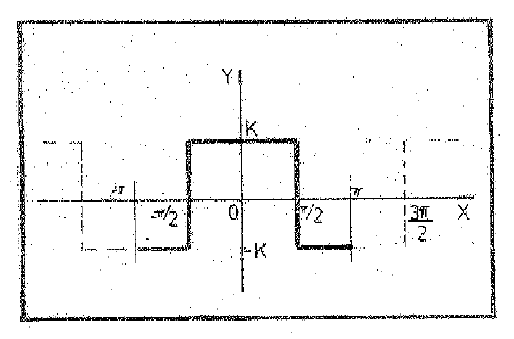
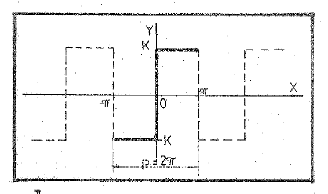
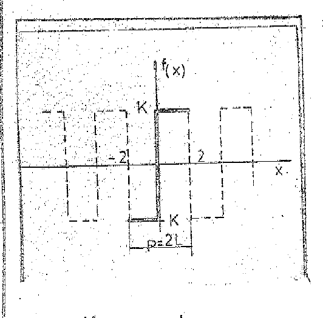

# Series de Fourier — Ejemplos prácticos

Fuente: «Apunte de Clases del Ing. Urrutia.pdf», carpeta de 2020. Esta parte
transcribe las páginas PDF 40–57 (hojas impresas 39–56).
[Procedencia y cobertura](../../../resources/2020/pdf2020-fourier-urrutia-cobertura.md).

## Página PDF 40 — Hoja N° 39

### Ejemplos Prácticos

**1)** Desarrollar en Serie de Fourier la forma simétrica de una onda
rectangular dada por:

```math
f(x)=\begin{cases}
-K&\text{si }x\in(-\pi;-\pi/2)\;\wedge\;x\in(\pi/2;\pi)\\
K&\text{si }x\in(-\pi/2;\pi/2)
\end{cases}
```

siendo $`f(x)=f(x+2\pi)`$

la onda se ilustra en el siguiente gráfico, simétrica al eje y.



Por tratarse de una función par, la serie de Fourier es un desarrollo reducido
de términos cosenoidales ya que $`b_{n}`$=0.

```math
f(x)=\frac{a_0}2+\sum_{n=1}^{\infty}a_n\cdot\cos nx;\quad\text{siendo}
```

```math
a_n=\frac2\pi\int_0^{\pi}f(x)\cdot\cos nx\cdot dx
\qquad a_0=\frac2\pi\int_0^{\pi}f(x)\cdot dx
```

Cálculo del coeficiente $`a_{0}`$

## Página PDF 41 — Hoja N° 40

```math
a_0=\frac2\pi\int_0^{\pi}f(x)\cdot dx
```

```math
a_0=\frac2\pi\left[\int_0^{\pi/2}K\cdot dx+\int_{\pi/2}^{\pi}(-K)dx\right]
=\frac{2K}\pi\left[\int_0^{\pi/2}dx-\int_{\pi/2}^{\pi}dx\right]
=\frac{2K}\pi(\pi/2-\pi/2)
```

```math
a_0=0
```

Cálculo de $`a_{n}`$.

```math
a_n=\frac2\pi\left[\int_0^{\pi}f(x)\cdot\cos nx\cdot dx\right]
```

```math
\begin{aligned}
a_n&=\frac2\pi\left[\int_0^{\pi/2}K\cdot\cos nx\cdot dx
+\int_{\pi/2}^{\pi}(-K)\cdot\cos nx\cdot dx\right]\\
&=\frac{2K}\pi\left[\int_0^{\pi/2}\cos nx\cdot dx-\int_{\pi/2}^{\pi}\cos nx\cdot dx\right]\\
&=\frac{2K}{n\pi}\left[\left.\mathop{\mathrm{sen}}\nolimits nx\right|_0^{\pi/2}-\left.\mathop{\mathrm{sen}}\nolimits nx\right|_{\pi/2}^{\pi}\right]
\end{aligned}
```

como
$`\mathop{\mathrm{sen}}\nolimits (n\cdot0)=\mathop{\mathrm{sen}}\nolimits (n\pi)=0`$
por lo tanto.

```math
a_n=\frac{2K}{n\pi}(\mathop{\mathrm{sen}}\nolimits n\pi/2+\mathop{\mathrm{sen}}\nolimits n\pi/2)
=\frac{4K}{n\pi}\mathop{\mathrm{sen}}\nolimits n\frac\pi2
```

esto indica que
$`a_0=0;\;a_1=\frac{4K}\pi;\;a_2=0;\;a_3=-\frac43\cdot\frac K\pi;\;a_4=0;\;a_5=\frac45\frac K\pi;\ldots`$

donde todos los términos de orden par se anulan y los de orden impar son
alternadamente positivos y negativos, tomando $`\frac{4K}\pi`$ factor común:

```math
f(x)=\frac{4K}\pi(\cos x-\tfrac13\cdot\cos3x+\tfrac15\cos5x-\tfrac17\cos7x+\cdots)
=4K/\pi\sum_{n=1}^{\infty}(-1)^{2n-1}\cdot\frac{\cos(2n-1)\cdot x}{(2n-1)}
```

**2)** Desarrollar en Serie de Fourier la forma antisimétrica de una onda
rectangular:

## Página PDF 42 — Hoja N° 41

```math
f(x)=\begin{cases}-K&\text{si }-\pi\lt x\lt 0\\K&\text{si }0\lt x\lt \pi\end{cases}
\quad\text{siendo }f(x)=f(x+2\pi)
```

ilustramos la onda en el siguiente gráfico, simétrica respecto del origen. Por
tratarse de una función impar el desarrollo en serie, como vimos anteriormente,
se reduce a una suma de términos senoidales, mientras que
$`a_0=a_n=0\;\forall n`$, y solo debemos calcular el coeficiente $`b_{n}`$
mediante la fórmula:



```math
b_n=\frac2\pi\int_0^{\pi}f(x)\cdot\mathop{\mathrm{sen}}\nolimits nx\cdot dx
\;\therefore\;f(x)=\sum_{n=1}^{\infty}b_n\cdot\mathop{\mathrm{sen}}\nolimits nx
```

```math
b_n=\frac2\pi\int_0^{\pi}K\cdot\mathop{\mathrm{sen}}\nolimits nx\cdot dx
=\frac{2K}\pi\int_0^{\pi}\mathop{\mathrm{sen}}\nolimits nx\,dx
=\frac{2K}{n\pi}\int_0^{\pi}\mathop{\mathrm{sen}}\nolimits (nx)\cdot d(nx)
```

```math
b_n=\frac{2K}{n\pi}\left.(-\cos nx)\right|_{x=0}^{\pi}
=\frac{2K}{n\pi}[-\cos n\pi-(-\cos0)]
=\frac{2K}{n\pi}(\cos0-\cos n\pi)
```

$`b_n=\frac{2K}{n\pi}(1-(-1)^n)`$ (término general del coeficiente $`b_{n}`$)

si n es par, por lo tanto $`b_n=\frac{2K}{\pi n}(1-(-1)^n)=0`$.

si n es impar por lo tanto $`b_n=\frac{2K}{n\pi}(1-(-1)^n)=\frac{4K}{\pi n}`$,
por lo tanto esto significa que:

```math
b_1=\frac{4K}\pi;\quad b_2=0;\quad b_3=\frac{4K}{3\pi};\quad b_4=0;\quad b_5=\frac{4K}{5\pi}
```

## Página PDF 43 — Hoja N° 43 (orden del original)

```math
b_n=\frac{2K}{n\pi}\int_0^2\mathop{\mathrm{sen}}\nolimits u\cdot du
=-\frac{2K}{n\pi}\left.\cos u\right|_0^2
```

```math
\begin{aligned}
b_n&=-\frac{2K}{n\pi}\left[\cos\frac{n\pi}2x\right]_0^2
=-\frac{2K}{n\pi}\left[\cos\frac{n\pi}2\cdot2-\cos\frac{n\pi}2\cdot0\right]\\
&=-\frac{2K}{n\pi}[\cos n\pi-\cos0]
\end{aligned}
```

introduciendo el signo negativo dentro del paréntesis tenemos:

```math
b_n=\frac{2K}{n\pi}[\cos0-\cos n\pi]=\frac{2K}{n\pi}[1-(-1)^n],
```

ya que $`\cos n\pi=(-1)^n`$

```math
b_n=\frac{2K}{n\pi}[1-(-1)^n]
\begin{cases}\text{para valores de n par: }b_n=0\quad\text{ya que }(-1)^n=1\\
\text{para valores de n impar: }b_n=\frac{2K}{n\pi}(1+1)=\frac{4K}{n\pi}
\end{cases}
```

```math
f(x)=\frac{4K}\pi\left(\mathop{\mathrm{sen}}\nolimits \frac\pi2x+\frac13\mathop{\mathrm{sen}}\nolimits \frac{3\pi}2x
+\frac15\mathop{\mathrm{sen}}\nolimits \frac{5\pi}2x+\frac17\mathop{\mathrm{sen}}\nolimits \frac{7\pi}2x+\cdots\right)
```

o sea

```math
f(x)=\sum_{n=1}^{\infty}\frac{4K}{\pi(2n-1)}\cdot\mathop{\mathrm{sen}}\nolimits \frac{(2n-1)\pi}2\cdot x
```

para valores de $`b_{n}`$ impar (1,3,5,…)

## Página PDF 44 — Hoja N° 42 (orden del original)

como vemos el valor $`\frac{4K}\pi`$ es común en todos los términos por lo tanto
el desarrollo en serie de Fourier será:

```math
f(x)=\frac{4K}\pi\left(\mathop{\mathrm{sen}}\nolimits x+\frac13\cdot\mathop{\mathrm{sen}}\nolimits 3x
+\frac15\cdot\mathop{\mathrm{sen}}\nolimits 5x+\frac17\cdot\mathop{\mathrm{sen}}\nolimits 7x+\cdots
+\frac1{2n-1}\cdot\mathop{\mathrm{sen}}\nolimits (2n-1)x+\cdots\right)
```

**3)** Supongamos la onda antisimétrica rectangular del ejemplo anterior pero
ahora con un período arbitrario $`2L\ne2\pi`$.

```math
f(x)=\begin{cases}K&\text{si }0\lt x\lt 2\\-K&\text{si }-2\lt x\lt 0\end{cases}
```

```math
P=2L=4\Rightarrow L=2
```



como vimos anteriormente se trata de una onda simétrica respecto del origen por
lo que $`a_0=a_n=0`$ y el desarrollo en serie de Fourier reduce entonces a una
sumatoria de ondas senoidales cuyos coeficientes están dados por la expresión:

```math
b_n=\frac2L\int_0^L f(x)\cdot\mathop{\mathrm{sen}}\nolimits \frac{n\pi}Lx\cdot dx
```

pero en nuestro caso $`f(x)`$=K en el intervalo de integración [0;L] y además
L=2, tendremos:

```math
b_n=\frac22\int_0^2 K\cdot\mathop{\mathrm{sen}}\nolimits \frac{n\pi}2x\cdot dx
=K\int_0^2\mathop{\mathrm{sen}}\nolimits \frac{n\pi}2x\cdot dx
=\frac{2K}{n\pi}\int_0^2\mathop{\mathrm{sen}}\nolimits \frac{\pi n x}2\cdot d\left(\frac{n\pi}2x\right)
```

haciendo $`u=\frac{n\pi}2x`$

## Página PDF 45 — Hoja N° 43

```math
b_n=\frac{2K}{n\pi}\int_0^2\mathop{\mathrm{sen}}\nolimits u\cdot du
=-\frac{2K}{n\pi}\left.\cos u\right|_0^2
```

```math
\begin{aligned}
b_n&=-\frac{2K}{n\pi}\left[\cos\frac{n\pi}2x\right]_0^2
=-\frac{2K}{n\pi}\left[\cos\frac{n\pi}2\cdot2-\cos\frac{n\pi}2\cdot0\right]\\
&=-\frac{2K}{n\pi}[\cos n\pi-\cos0]
\end{aligned}
```

introduciendo el signo negativo dentro del paréntesis tenemos:

```math
b_n=\frac{2K}{n\pi}[\cos0-\cos n\pi]=\frac{2K}{n\pi}[1-(-1)^n],
```

ya que $`\cos n\pi=(-1)^n`$

```math
b_n=\frac{2K}{n\pi}[1-(-1)^n]
\begin{cases}\text{para valores de n par: }b_n=0\quad\text{ya que }(-1)^n=1\\
\text{para valores de n impar: }b_n=\frac{2K}{n\pi}(1+1)=\frac{4K}{n\pi}
\end{cases}
```

```math
f(x)=\frac{4K}\pi\left(\mathop{\mathrm{sen}}\nolimits \frac\pi2x+\frac13\mathop{\mathrm{sen}}\nolimits \frac{3\pi}2x
+\frac15\mathop{\mathrm{sen}}\nolimits \frac{5\pi}2x+\frac17\mathop{\mathrm{sen}}\nolimits \frac{7\pi}2x+\cdots\right)
```

o sea

```math
f(x)=\sum_{n=1}^{\infty}\frac{4K}{\pi(2n-1)}\cdot\mathop{\mathrm{sen}}\nolimits \frac{(2n-1)\pi}2\cdot x
```

para valores de $`b_{n}`$ impar (1,3,5,…)
