# Series de Fourier — Otras formas e integral de Fourier

Fuente: «Apunte de Clases del Ing. Urrutia.pdf», carpeta de 2020. Páginas PDF
46–57.
[Procedencia y cobertura](../../../resources/2020/pdf2020-fourier-urrutia-cobertura.md).

## Página PDF 46

### Otras Formas De La Serie De Fourier

La forma original del desarrollo en serie de Fourier de una función de período
arbitrario p=2L, deducido anteriormente, podemos expresarla en otras formas
trigonométricas y en una forma exponencial, en la cual, en lugar de funciones
trigonométricas reales, aparecen exponenciales imaginarias.

Veamos por ejemplo la serie básica:

```math
f(x)=\frac{a_0}2+\sum_{n=1}^{\infty}\left(a_n\cdot\cos\frac{n\pi}Lx+b_n\cdot\mathop{\mathrm{sen}}\nolimits \frac{n\pi}Lx\right)\tag{1}
```

podemos aplicar a cada par de términos “de la misma frecuencia”, el
procedimiento normal utilizado para reducir la suma de un seno y un coseno de un
mismo ángulo a un único término. Si multiplicamos y dividimos por
$`\sqrt{a_n^2+b_n^2}\;\therefore`$

```math
f(x)=\frac{a_0}2+\sum_{n=1}^{\infty}\sqrt{a_n^2+b_n^2}\cdot
\left(\frac{a_n}{\sqrt{a_n^2+b_n^2}}\cdot\cos\frac{n\pi}Lx
+\frac{b_n}{\sqrt{a_n^2+b_n^2}}\cdot\mathop{\mathrm{sen}}\nolimits \frac{n\pi}Lx\right)\tag{2}
```

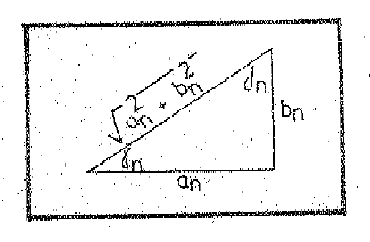

Si definimos ahora los ángulos $`\gamma_{n}`$ y $`\delta_{n}`$ en el triángulo
de la figura y además llamamos:

```math
A_0=\frac{a_0}2\quad\text{y}\quad A_n=\sqrt{a_n^2+b_n^2}
```

La expresión (2) puede también escribirse en la forma:

```math
f(x)=A_0+\sum_{n=1}^{\infty}A_n\left(\cos\frac{n\pi}Lx\cdot\cos\gamma_n
+\mathop{\mathrm{sen}}\nolimits \frac{n\pi}Lx\cdot\mathop{\mathrm{sen}}\nolimits \gamma_n\right)
```

## Página PDF 47 — Hoja N° 45

```math
=A_0+\sum_{n=1}^{\infty}A_n\cdot\cos\left(\frac{n\pi}Lx-\gamma_n\right)
```

o también expresarla según $`\delta_{n}`$.

```math
f(x)=A_0+\sum_{n=1}^{\infty}A_n\left(\cos\frac{n\pi}Lx\cdot\mathop{\mathrm{sen}}\nolimits \delta_n
+\mathop{\mathrm{sen}}\nolimits \frac{n\pi}L\cdot x\cdot\cos\delta_n\right)
```

```math
=A_0+\sum_{n=1}^{\infty}A_n\cdot\mathop{\mathrm{sen}}\nolimits \left(\frac{n\pi}L\cdot x+\delta_n\right)
```

En cualquiera de estas dos formas, la cantidad $`A_n=\sqrt{a_n^2+b_n^2}`$ es la
amplitud resultante de las componentes de frecuencia n$`.\pi`$/L, es decir, “la
amplitud del n-ésimo armónico del desarrollo”. Los ángulos de fase
$`\gamma_{n}`$ y $`\delta_{n}`$ miden el retraso o adelanto del n-ésimo armónico
con relación a una onda sinusoidal o cosenoidal “pura de la misma frecuencia”.

## Página PDF 48 — Hoja N° 46

### Forma Exponencial

La forma exponencial Compleja de una Serie de Fourier se obtiene sustituyendo en
la forma original de la serie, los términos seno y coseno por sus equivalentes
exponenciales para cada frecuencia:

```math
f(x)=\frac{a_0}2+\sum_{n=1}^{\infty}\left(
 a_n\cdot\frac{e^{i n\pi x/L}+e^{-i n\pi x/L}}2
+b_n\cdot\frac{e^{i n\pi x/L}+e^{-i n\pi x/L}}{2i}\right)
```

si realizamos los productos y agrupamos convenientemente:

```math
f(x)=\frac{a_0}2+\sum_{n=1}^{\infty}\left(
\frac{a_n-i b_n}2\cdot e^{i n\pi x/L}+\frac{a_n+i b_n}2\cdot e^{-i n\pi x/L}\right)\tag{1}
```

si definimos ahora que:

```math
C_0=\frac{a_0}2\qquad C_n=\frac{a_n-i b_n}2\qquad C_{-n}=\frac{a_n+i b_n}2
```

la expresión (1) podemos escribirla:

```math
f(x)=\sum_{n=-\infty}^{\infty}C_n\cdot e^{\frac{in\pi}L\cdot x}
```

que representa la forma exponencial.

Cuando se utiliza la forma exponencial, caso de usarse, constituye por sí mismo
una forma básica; es decir, se obtiene a través del cálculo previo de la forma
trigonométrica y su posterior transformación, sino que se establece directamente
a partir de la función dada. Para ello se requiere conocer las fórmulas que
permiten calcular directamente los coeficientes $`C_{n}`$. Estas pueden
deducirse en forma sencilla a partir de sus definiciones. Así entonces.

```math
C_0=\frac{a_0}2=\frac1{2L}\int_{-L}^L f(x)\cdot dx
```

```math
C_n=\frac{a_n-i b_n}2
=\frac12\left(\frac1L\int_{-L}^L f(x)\cdot\cos\frac{n\pi x}L\cdot dx
-i\cdot\frac1L\cdot\int_{-L}^L f(x)\cdot\mathop{\mathrm{sen}}\nolimits \frac{n\pi x}L\cdot dx\right)
```

## Página PDF 49 — Hoja N° 47

```math
=\frac1{2L}\int_{-L}^L f(x)\cdot\left(\cos\frac{n\pi x}L-i\cdot\mathop{\mathrm{sen}}\nolimits \frac{n\pi x}L\right)\cdot dx
```

```math
C_n=\frac1{2L}\int_{-L}^L f(x)\cdot e^{-in\pi x/L}\cdot dx
```

por lo tanto

```math
C_{-n}=\frac1{2L}\int_{-L}^L f(x)\cdot e^{in\pi x/L}\cdot dx
```

Es evidente, con independencia del signo del índice n, positivo negativo o nulo,
que $`C_{n}`$ viene dado por una única fórmula, pudiéndose expresar el
desarrollo de la serie de la forma:

```math
f(x)=\sum_{n=-\infty}^{\infty}C_n\cdot e^{\frac{in\pi}Lx}
\qquad\text{donde}\qquad C_n=\frac1{2L}\int_{-L}^L f(x)\cdot e^{-\frac{in\pi}L\cdot x}\cdot dx
```

### Ejemplo

Encontrar la forma compleja de la Serie de Fourier correspondiente a la función:

```math
f(x)=e^{-x}\quad\forall x\in[-1,1]\qquad\text{por lo tanto }f(x)=f(x+2L);\quad L=1
```

```math
C_n=\frac12\int_{-1}^1 e^{-x}\cdot e^{-in\pi\cdot x}\cdot dx
=\frac12\int_{-1}^1 e^{-(1+in\pi)x}dx
=\frac12\left.\frac{e^{-(1+in\pi)x}}{-(1+in\pi)}\right|_{x=-1}^1
```

## Página PDF 50 — Hoja N° 48

```math
=\frac{e^{-(1+in\pi)}-e^{(1+in\pi)}}{-2(1+in\pi)}
=\frac{e\cdot e^{in\pi}-e^{-1}\cdot e^{-in\pi}}{2(1+in\pi)}
```

como $`e^{in\pi}=\cos n\pi+i\cdot\mathop{\mathrm{sen}}\nolimits n\pi=-1`$;
$`e^{in\pi}=e^{-in\pi}=(-1)^n\;\therefore`$

```math
C_n=\frac{(-1)^n\cdot(e-e^{-1})}{(1+in\pi)\cdot2}
=\frac{(-1)^n}{1+in\pi}\cdot\mathop{\mathrm{Sh}}\nolimits 1
=\frac{(-1)^n(1-n\pi i)}{1+n^2\pi^2}\cdot\mathop{\mathrm{Sh}}\nolimits 1
```

el desarrollo toma la forma

```math
f(x)=\sum_{n=-\infty}^{\infty}(-1)^n\frac{(1-n\pi i)}{1+n^2\pi^2}\mathop{\mathrm{Sh}}\nolimits 1\cdot e^{in\pi x}
```

si llamamos el Sh 1=e dando valores enteros a n obtenemos la serie.

Este último desarrollo puede sin dificultad ponerse en la forma trigonométrica
real, recordando que:

```math
C_n=\frac12(a_n-i b_n)\qquad C_{-n}=\frac12(a_n+i b_n)\qquad C_0=a_0/2
```

por lo que se deduce $`a_n=C_n+C_{-n};\;b_n=i(C_n-C_{-n});\;a_0=2C_0`$.

el alumno podrá comprobar al realizar los reemplazos que la serie toma la forma

```math
\begin{aligned}
f(x)&=\mathop{\mathrm{Sh}}\nolimits 1-2\mathop{\mathrm{Sh}}\nolimits 1\left(\frac{\cos\pi x}{1+\pi^2}
-\frac{\cos2\pi x}{1+4\pi^2}+\frac{\cos3\pi x}{1+9\pi^2}-\cdots\right)\\
&\quad-2\pi\mathop{\mathrm{Sh}}\nolimits 1\left(\frac{\mathop{\mathrm{sen}}\nolimits \pi x}{1+\pi^2}
-\frac{2\mathop{\mathrm{sen}}\nolimits 2\pi x}{1+4\pi^2}
+\frac{3\mathop{\mathrm{sen}}\nolimits 3\pi x}{1+9\pi^2}-\cdots\right)
\end{aligned}
```

## Página PDF 51 — Hoja N° 49

### Integral de Fourier

Las propiedades de las Series de Fourier vistas hasta ahora, nos permiten
efectuar el desarrollo en serie de cualquier “función periódica” que satisfaga
las condiciones de Dirichlet y permitir estudiar el comportamiento de numerosos
sistemas mecánicos y eléctricos, bajo la acción de una perturbación cualquiera
de tipo periódica. En muchos casos la fuerza o tensión aplicada a un sistema no
es periódica, sino aperiódica, como por ejemplo, un solo impulso que no se
repite. Este tipo de funciones no pueden estudiarse mediante la serie de
Fourier, ya que mediante estas, solo se pueden definir “necesariamente”
funciones periódicas. Sin embargo, analizando cuál es el límite al que tiende la
serie de Fourier cuando el período de la función se hace infinito, (caso de
existir) quizá se puede obtener un medio más adecuado de representar una función
aperiódica. Veamos a través de un ejemplo la presentación de la teoría en que se
basa este procedimiento.

Sea la función graficada, $`f(x)`$=f(x+2L) → 2L=4.

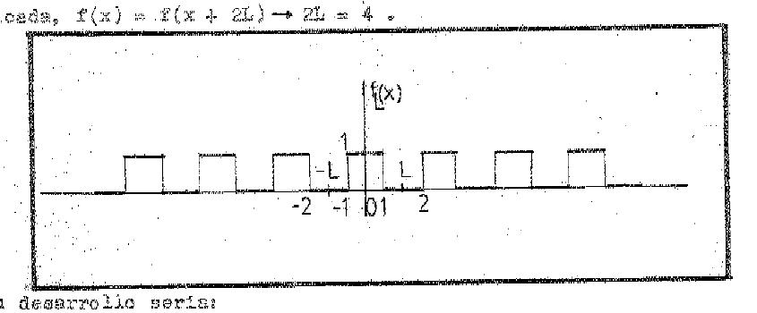

Su desarrollo será:

```math
f_1(x)=\frac{a_0}2+a_1\cdot\cos\frac\pi Lx+a_2\cdot\cos\frac{2\pi}Lx+\cdots+a_n\cdot\cos\frac{n\pi}Lx+\cdots\tag{1}
```

```math
a_0=\frac2L\int_0^L f(x)dx=\frac2L\int_0^1 1\cdot dx=\frac2L
```

```math
a_n=\frac2L\int_0^1 1\cdot\cos\frac{n\pi}Lx\cdot dx
=\frac2L\left.\frac{\mathop{\mathrm{sen}}\nolimits n\pi x/L}{n\pi/L}\right|_{x=0}^1
=\frac2L\cdot\frac{\mathop{\mathrm{sen}}\nolimits n\pi/L}{n\pi/L}\tag{1b}
```

## Página PDF 52 — Hoja N° 50

Consideremos ahora el comportamiento cuando $`L\to\infty`$ de la función dada,
límite cuya representación se observa seguidamente:

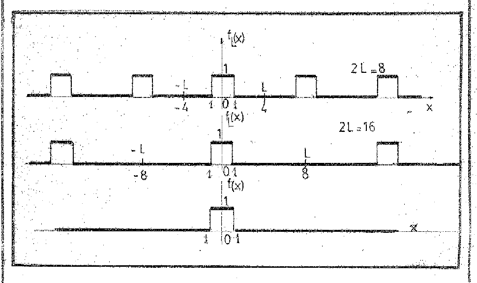

Nos ayuda también a comprender, el análisis de lo que sucede con los
coeficientes $`a_{n}`$ cuando $`L\to\infty`$, la representación gráfica de
“espectro” de $`f_{1}(x)`$, es decir la gráfica de la variación de $`a_{n}`$ en
función de la frecuencia.

Si hacemos $`\frac{n\pi}L=\omega_n`$ correspondiente a los distintos valores de
L, podemos observar que:
$`a_n=\frac2L\cdot\frac{\mathop{\mathrm{sen}}\nolimits \omega_n}{\omega_n}`$, en
donde a sucesivos valores de n corresponden distintos valores $`\omega_{n}`$ que
difieren entre sí en una cantidad constante

```math
\Delta\omega=\omega_{n+1}-\omega_n=(n+1)\frac\pi L-\frac{n\pi}L=\pi/L
```

```math
\Delta\omega=\pi/L
```

Podemos apreciar que los valores de $`a_{n}`$ son simplemente las ordenadas de
la curva $`y=\frac2L\cdot\frac{\mathop{\mathrm{sen}}\nolimits \omega}{\omega}
=\frac{2\mathop{\mathrm{sen}}\nolimits \omega}{\pi\omega}\Delta\omega`$,
correspondientes a intervalos $`\omega`$ sucesivos de $`\pi`$/L, a partir del
valor de $`\omega_0=0`$.

Como parece deducirse de estas gráficas, y lo confirma la función
$`y=\frac2\pi\cdot\frac{\mathop{\mathrm{sen}}\nolimits \omega}{\omega}\Delta\omega`$,
las dos únicas diferencias que presentan las gráficas o espectros de los
coeficientes correspondientes a los distintos valores de L=2,4,8,… son:

a) En la escala vertical, que es inversamente proporcional a L (o directamente
proporcional a $`\Delta\omega`$) recordemos que $`\Delta\omega=\pi/L`$.

## Página PDF 53 — Hoja N° 51

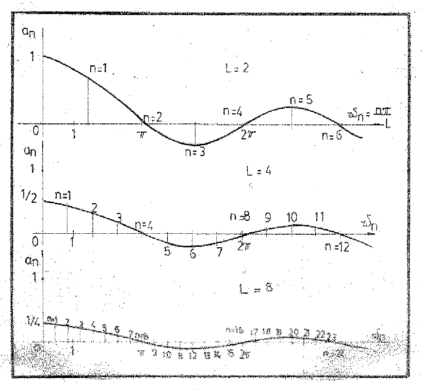

b) En la separación ó distancia horizontal entre las ordenadas, que también es
inversamente proporcional a L (o igual a $`\Delta\omega`$).

El hecho de que cuando $`L\to\infty`$ (ó $`\Delta\omega\to0`$), las frecuencias
de los términos de (1) se aproximan cada vez más y que los coeficientes tiendan
a cero, sugiere que esta serie, aunque en principio la hemos considerado como
una función de L, en realidad sea una suma “infinitesimal” cuyo límite es una
integral. En efecto, esto se dice en términos generales en lo referente a una
Serie de Fourier, como lo evidencia el siguiente esquema de pasos. Si partimos
de la forma compleja exponencial de la serie de Fourier para la función
$`f_{1}(x)`$ tendremos:

```math
f_1(x)=\sum_{n=-\infty}^{\infty}C_n\cdot e^{\frac{in\pi}L\cdot x}
\quad\text{donde}\quad
C_n=\frac1{2L}\int_{-L}^L f_1(x)\cdot e^{-\frac{in\pi}L\cdot x}\cdot dx
```

o también sea, sustituyendo

## Página PDF 54 — Hoja N° 52

```math
f_L(x)=\sum_{n=-\infty}^{\infty}\left[\frac1{2L}\int_{-L}^L f_L(s)\cdot e^{-in\pi s/L}\,ds\right]e^{in\pi x/L}
```

```math
=\sum_{n=-\infty}^{\infty}\left[\frac1{2\pi}\int_{-L}^L f_L(s)\cdot e^{-in\pi s/L}\,ds\right]e^{in\pi x/L}\cdot\frac\pi L
```

Si como anteriormente, representamos la frecuencia del término enésimo por
$`\omega_n=n\pi/L`$ y la diferencia de frecuencias entre dos términos
consecutivos por $`\Delta\omega=\pi/L`$, podemos escribir a la función
$`f_L(x)`$ en la forma

```math
f_L(x)=\sum_{n=-\infty}^{\infty}\left[\frac1{2\pi}\cdot e^{i\omega_n x}\int_{-L}^L f_L(s)\cdot e^{-i\omega_n s}\,ds\right]\Delta\omega
```

si definimos ahora a

```math
F(\omega)=\frac1{2\pi}\cdot e^{i\omega x}\int_{-L}^L f_L(s)\cdot e^{-i\omega s}\,ds
```

y reemplazamos en la anterior, por lo tanto

```math
f_L(x)=\sum_{n=-\infty}^{\infty}F(\omega_n)\cdot\Delta\omega
```

expresión en la cual $`\omega_n`$ es un punto (es, en efecto, el extremo
derecho) del n-ésimo intervalo $`\Delta\omega`$. Sabemos, en condiciones muy
generales que el límite de la sumatoria cuando $`\Delta\omega\to0`$ es la
integral de la forma $`\int_{-\infty}^{\infty}F(\omega)\cdot d\omega`$. Por
consiguiente, como $`L\to\infty`$ implica el que $`\Delta\omega\to0`$, se deduce
que existen fundadas razones para suponer que cuando $`p\to\infty`$ el límite,
el límite “no periódico” de $`f_L(x)`$ puede escribirse como la integral

```math
f(x)=\int_{-\infty}^{\infty}\left[\frac1{2\pi}\cdot e^{i\omega x}\int_{-\infty}^{\infty}f(s)\cdot e^{-i\omega s}\,ds\right]d\omega\tag{1}
```

La simplificada deducción precedente, con este último resultado constituye
realmente una representación válida de la función límite no periódica siempre
que, en todos los intervalos finitos, $`f(x)`$ cumpla las condiciones de
DIRICHLET y que exista la integral

```math
\int_{-\infty}^{\infty}|f(x)|\cdot dx
```

## Página PDF 55 — Hoja N° 53

En estas condiciones, la llamada “INTEGRAL DE FOURIER” (1), nos da en todos los
puntos en que $`f(x)`$ sea continua, el valor de esta función, mientras que en
los puntos de discontinuidades de la función, nos da la media aritmética de los
límites de $`f(x)`$ a lado derecho e izquierdo del punto. Esta integral de
fourier (1) puede escribirse de diversas formas, exponencial trigonométrica
senoidal, cosenoidal, etc. Una de ellas, es la forma:

```math
f(x)=\int_{-\infty}^{\infty}g(\omega)\cdot e^{i\omega x}\cdot d\omega
\quad\text{en la cual}\quad
g(\omega)=\frac1{2\pi}\int_{-\infty}^{\infty}f(s)\cdot e^{-i\omega s}\cdot ds
```

estas dos expresiones que ponen de manifiesto la simetría de $`f(x)`$ y su
función coeficiente $`g(\omega)`$, constituyen lo que se conoce como “PAR DE
TRANSFORMADAS DE FOURIER”. Por supuesto, la función coeficiente $`g(\omega)`$ es
totalmente equivalente a $`f(x)`$; y por consiguiente tenemos así dos
representaciones diferentes de la función que estamos considerando: una $`f(x)`$
correspondiente al dominio de los “tiempos” y la otra $`g(\omega)`$, al de las
“frecuencias”.

Con este propósito, el de facilitar la resolución de problemas de tipo práctico,
existen tablas en las que encontramos recopiladas los pares de transformadas de
FOURIER. De la forma exponencial propuesta podemos pasar fácilmente a cualquiera
de las formas trigonométricas por sustitución.

## Página PDF 56 — Hoja N° 54

### Ejercicios Propuestos

#### 1)

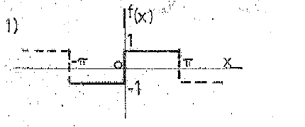

```math
f(x)\begin{cases}-1&\text{si }-\pi<x<0\\1&\text{si }0<x<\pi\end{cases}
\qquad f(x)=f(x\pm2\pi)
```

#### 2)

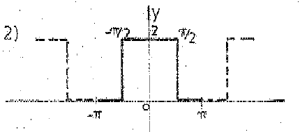

```math
f(x)\begin{cases}2&\text{si }-\pi/2<x<\pi/2\\0&\text{si }\begin{cases}-\pi<x<-\pi/2\\\pi/2<x<\pi\end{cases}\end{cases}
\qquad f(x)=f(x\pm2\pi)
```

#### 3)

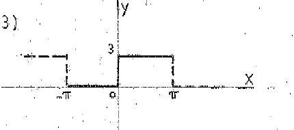

```math
f(x)\begin{cases}0&\text{si }-\pi<x<0\\3&\text{si }0<x<\pi\end{cases}
\qquad p=2\pi
```

#### 4)

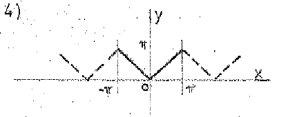

```math
f(x)=\begin{cases}x&\text{si }0<x<\pi\\-x&\text{si }-\pi<x<0\end{cases}
\qquad p=2\pi
```

#### 5)

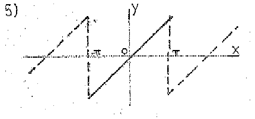

```math
f(x)=x\,,\quad\text{si }-\pi<x<\pi\qquad p=2\pi
```

#### 6)

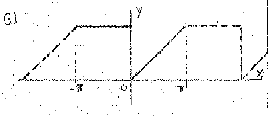

```math
f(x)\begin{cases}x&\text{si }0<x<\pi\\\pi&\text{si }\pi<x<0\end{cases}
\qquad p=2\pi
```

> Nota de transcripción: el segundo intervalo se conserva como aparece en el
> original: $`\pi<x<0`$.

#### 7)

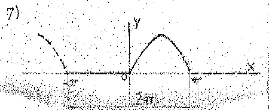

```math
f(x)\begin{cases}0&\text{si }-\pi<x<0\\\mathop{\mathrm{sen}}\nolimits x&\text{si }0<x<\pi\end{cases}
```

## Página PDF 57 — Hoja N° 55

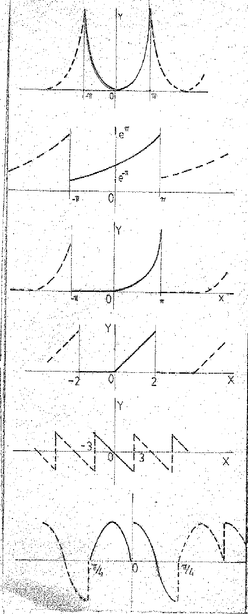

Los seis gráficos de esta página aparecen sin numeración. Sus expresiones, en el
orden vertical del original, son:

```math
f(x)=x^2\,,\quad-\pi<x<\pi\qquad p=2\pi
```

```math
f(x)=e^x\,,\quad-\pi<x<\pi\qquad f(x)=f(x+2\pi)
```

```math
f(x)\begin{cases}0&\text{si }-\pi\;x<0\\x^2&\text{si }0<x<\pi\end{cases}
\qquad p=2\pi
```

> Nota de transcripción: en la primera condición del tercer gráfico no se
> distingue un signo de comparación entre $`-\pi`$ y $`x`$ en el original.

```math
f(x)=\begin{cases}0&\text{si }-2<x<0\\x&\text{si }0<x<2\end{cases}
\qquad p=2L=4
```

```math
f(x)=-x\quad\text{si }-3<x<3\qquad 2L=6
```

```math
f(x)\begin{cases}-\mathop{\mathrm{sen}}\nolimits 4x&-\pi/4<x<0\\\cos4x&0<x<\pi/4\end{cases}
\qquad p=2L=\frac\pi2
```
