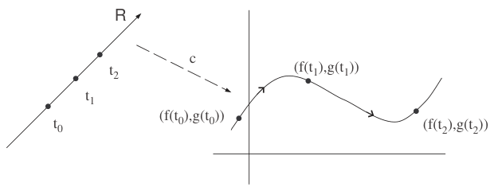
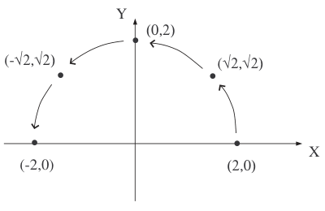
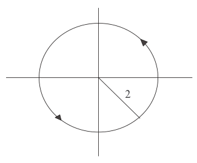
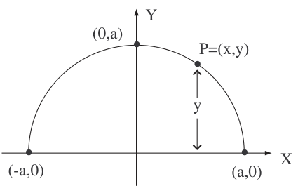
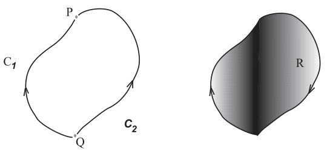
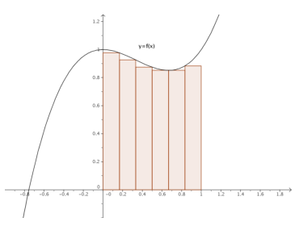
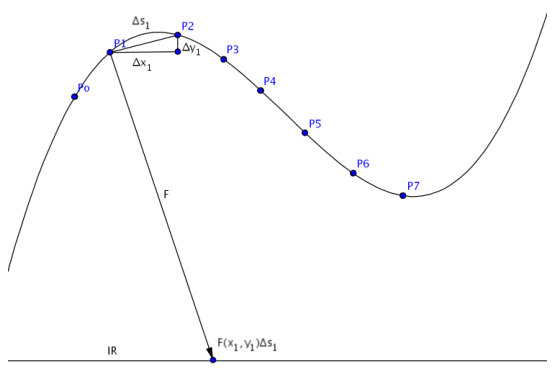

<!-- markdownlint-disable MD029 MD036 -->

# Integrales de línea. Teorema de Green

Fuente externa: José Antonio Vallejo, Departamento de Matemáticas, Facultad de
Ciencias, Universidad Autónoma de San Luis Potosí. Fecha impresa: 16 Noviembre
2007\. Archivo `T. Green.pdf`, páginas 1–19, conservado en la carpeta 2020. Este
material se atribuye a su autor e institución originales.
[Procedencia y revisión](../../../resources/2020/pdf2020-green-vallejo-cobertura.md).

## Página 1

José Antonio Vallejo

Departamento de Matemáticas

Facultad de Ciencias

Universidad Autónoma de San Luis Potosí

email: <jvallejo@fciencias.uaslp.mx>

16 Noviembre 2007

### 1. Curvas parametrizadas

A menudo nos interesará ver una cierta gráfica como si fuese el rastro que deja
un móvil que se desplaza por el plano. Esto lo podemos hacer mediante las
llamadas curvas parametrizadas.

**Definición 1** Una curva parametrizada en el plano es un par de ecuaciones

```math
C\equiv\begin{cases}x=f(t)\\y=g(t)\end{cases},\quad t\in[a,b].\tag{1}
```

A $`t`$ se le llama parámetro de la curva, y resulta útil pensar en el como en
el tiempo.



**Nota 1** Es importante especificar el intervalo de definición del parámetro,
pues en caso contrario nos restringiremos a una región u otra de la curva.
Cuando no digamos nada, entenderemos que el parámetro puede tomar cualquier
valor real para el que estén definidas $`f(t)`$ y $`g(t)`$.

## Página 2

Entonces, en cada instante la partícula móvil tendrá unas coordenadas
$`(x,y)=(f(t),g(t))`$. Observemos que a medida que vamos tomando $`t`$ mayores,
nos vamos desplazando según un cierto sentido sobre la curva $`C`$. Este sentido
de recorrido se llama orientación de la curva $`C`$.

**Ejemplo 1** Consideremos la curva parametrizada $`C`$ dada por las ecuaciones

```math
C\equiv\begin{cases}x=2\cos t\\y=2\sin t\end{cases},\quad t\in[0,2\pi].\tag{2}
```

Podemos hacernos una idea de su forma dando valores al parámetro $`t`$.
Obtenemos así una tabla como la siguiente:

| $`t`$ | $`(x,y)`$ |
| -- | -- |
| $`0`$ | $`(2,0)`$ |
| $`\pi/4`$ | $`(\sqrt2,\sqrt2)`$ |
| $`\pi/2`$ | $`(0,2)`$ |
| $`3\pi/4`$ | $`(-\sqrt2,\sqrt2)`$ |
| $`\pi`$ | $`(-2,0)`$ |

y, si vamos representando las parejas de valores $`(x,y)`$ resulta:



Nótese como hemos indicado la orientación de la curva, mediante flechas que
determinan el sentido de recorrido. Si representamos suficientes punetos,
veremos que la gráfica es la de una circunferencia de radio 2, recorrida en
sentido antihorario (por convenio, el sentido antihorario se dice que es
positivo, véase la figura 3).

En este ejemplo, podríamos haber reconocido que la curva es una circunferencia
sin más que eliminar el parámetro $`t`$ para obtener una ecuación de la forma
$`y=y(x)`$. En este caso, elevando al cuadrado las expresiones (2) para $`x,y`$
y sumando:

```math
x^2+y^2=4\cos^2t+4\sin^2t=4.
```

## Página 3



**Ejemplo 2** En la curva parametrizada con parámetro $`\theta`$

```math
\begin{cases}x=3\sec\theta\\y=2\tan\theta\end{cases},\quad\theta\in[0,2\pi],
```

podemos eliminar el parámetro de la siguiente forma: tenemos que
$`x=3\sec\theta=3/\cos t`$, o sea, $`\cos\theta=3/x`$. De aquí,

```math
\sin\theta=\sqrt{1-\cos^2\theta}=\sqrt{1-\frac9{x^2}}.
```

Una vez que tenemos $`\sin\theta`$, $`\cos\theta`$ en términos de $`x`$, podemos
sustituir en la expressión de $`y`$:

```math
y=2\tan\theta=2\frac{\sin\theta}{\cos\theta}=\frac23x\sqrt{1-\frac9{x^2}},
```

o bien, elevando al cuadrado:

```math
y^2-\frac49x^2=1.
```

Este proceso no es posible en todos los casos; no siempre se puede despejar el
parámetro para obtener una ecuación $`y=y(x)`$. En otras palabras: no toda curva
parametrizada $`C`$ es globalmente el gráfico de una función $`y=y(x)`$. Como
ejemplo tenemos la curva de ecuaciones

```math
\begin{cases}x=\frac{e^t}{\cos t}\\y=t^2\sin t\end{cases}.
```

**Nota 2** Lo que sí se puede hacer siempre es escribir una función arbitraria
$`y=y(x)`$ como una curva parametrizada. Sólo hay que poner

```math
\begin{cases}x=t\\y=y(t)\end{cases}.
```

## Página 4

**Ejemplo 3** Consideremos la parábola $`4x^2+y=4`$. De la ecuación resulta
$`y=4(1-x^2)`$ y, según acabamos de decir, una parametrización sería

```math
\begin{cases}x=t\\y=4(1-t^2)\end{cases}.
```

### Problemas Sección 1

En los siguientes ejercicios, eliminar $`t`$ de las curvas parametrizadas que se
proponen. Representar la curva y determinar su orientación.

1. $`\begin{cases}x=t-1\\y=t^3\end{cases}`$
1. $`\begin{cases}x=t-1\\y=t(t+4)\end{cases}`$
1. $`\begin{cases}x=a\cos t\\y=b\sin t\end{cases}`$
1. $`\begin{cases}x=a\cos^3t\\y=a\sin^3t\end{cases}`$
1. $`\begin{cases}x=\sin t\\y=\cot s\end{cases}`$

Solución: (1) $`y=(x+1)^3`$, (2) $`y=x^2+2x-3`$, (3) $`(x/a)^2+(y/b)^2=1`$, (4)
$`(x/a)^{2/3}+(y/b)^{2/3}=1`$, (5) $`4y^4-4y^2+x^2=0`$.

### 2. Integrales de línea de campos escalares

Supongamos una función definida el el plano, $`F:\mathbb R^2\to\mathbb R`$, que
denotaremos $`F(x,y)`$, y una curva parametrizada $`C`$, dada por las ecuaciones
(1).

**Definición 2** A una función como $`F(x,y)`$ se la llama campo escalar, porque
se puede pensar que nos dice, para cada punto $`(x,y)`$ del plano, cuál es el
valor de una magnitud numérica (o escalar) definida sobre el plano. Por ejemplo,
podría darnos la temperatura en cada punto de una plancha metálica.

**Definición 3** Se llama integral de línea del campo $`F(x,y)`$ a lo largo de
la curva $`C`$, entre los puntos $`P=(x_P,y_P)`$ y $`Q=(x_Q,y_Q)`$, y se denota
por $`\int_C F(s)\cdot ds`$, a la integral de una variable dada por

```math
\int_{t_P}^{t_Q}F(f(t),g(t))\sqrt{f'(t)^2+g'(t)^2}\,dt.\tag{3}
```

En esta expresión, $`t_P`$ y $`t_Q`$ son los valores del parámetro $`t`$ para
los cuales la curva pasa por $`P=(x_P,y_P)`$ y $`Q=(x_Q,y_Q)`$, respectivamente.

## Página 5

**Nota 3 [importante]** Si cambiamos la orientación de $`C`$, la integral (3)
cambia de signo, ya que $`\int_{t_Q}^{t_P}=-\int_{t_P}^{t_Q}`$.

Fijémonos en que si la curva $`C`$ pasara por alguno de estos puntos para más de
un instante $`t`$, no sabríamos cual de esos instantes tomar para calcular la
integral. Por eso, supondremos que las curvas parametrizadas con las que
trabajaremos no tienen autonintersecciones (se dice a veces que son curvas
simples). Por ejemplo, una circunferencia

```math
C\equiv\begin{cases}x=\cos t\\y=\sin t\end{cases},\quad t\in[0,2\pi],
```

no tiene autointersecciones, pero la curva (que tiene la gráfica de un 8)

```math
C\equiv\begin{cases}x=\sin2t\\y=\cot s\end{cases},\quad t\in[0,2\pi],
```

tiene una autointersección en $`(x,y)=(0,0)`$ (pasa por este punto para los
valores $`t=\pi/2`$ y $`t=3\pi/2`$).

**Ejemplo 4** Vamos a evaluar la integral de línea del campo $`F(x,y)=x^3/y`$ a
lo largo de la parábola $`y=x^2/2`$ entre los puntos $`(0,0)`$ y $`(2,2)`$. Lo
primero que hay que hacer es parametrizar la parábola; recordando la nota 2, es
fácil hacer

```math
C\equiv\begin{cases}x=t\\y=t^2/2\end{cases},
```

es decir, tomar $`f(t)=t`$ y $`g(t)=t^2/2`$. Los valores del parámetro $`t`$
para los cuales la parábola pasa por $`(0,0)`$ y $`(2,2)`$ son, respectivamente,
$`t=0`$ y $`t=2`$. Ahora, ya podemos aplicar la fórmula (3); lo que queremos
calcular es

```math
\int_{t=0}^{t=2}F\left(t,\frac{t^2}2\right)\sqrt{1+t^2}\,dt
=\int_0^2\frac{t^3}{t^2/2}\sqrt{1+t^2}\,dt
=\int_0^2 2t\sqrt{1+t^2}\,dt,
```

o sea:

```math
\int_C F(s)\cdot ds=\left.\frac23(1+t^2)^{3/2}\right|_0^2=\frac23(\sqrt{75}-1).
```

Un tipo de problema muy interesante al que se aplica el concepto de integral de
línea, es el de la determinación de masas (o cargas) conocida la densidad.

**Ejemplo 5** Un alambre tiene la forma de una semicircunferencia de radio
$`a`$. La densidad lineal de masa en un punto $`P`$ es directamente proporcional
a la distancia de $`P`$ a la recta que pasa por los extremos del alambre, y
queremos determinar cuál es la masa total. El primer paso consiste en situar el
alambre en un sistema coordenado sobre el plano, como en la figura:

Ahora, observemos que la densidad puede interpretarse como un campo escalar: lo
que nos dicen es que en cada punto $`P=(x,y)`$ de la curva que describe el
alambre, la densidad es

```math
\lambda(x,y)=ky
```

## Página 6



(donde $`k`$ es la constante de proporcionalidad), ya que $`y`$ es la distancia
de $`P`$ a la recta que pasa por los extremos. Calcular la masa total equivale a
sumar la densidad sobre todos los puntos de la curva, y así lo que queremos
calcular es $`m=\int_C\lambda(s)\,ds`$, donde $`C`$ es la curva que describe el
alambre, la semicircunferencia de radio $`a`$. Una parametrización para $`C`$
es:

```math
C\equiv\begin{cases}x=a\cos t\\y=a\sin t\end{cases},\quad t\in[0,2\pi].
```

Esta parametrización tiene orientación antihoraria, es decir, comienza en
$`(a,0)`$ para $`t=0`$ y pasa por $`(-a,0)`$ en $`t=\pi`$. Aplicando la
definición de integral de línea:

```math
\begin{aligned}
m&=\int_C\lambda(s)\,ds=\int_0^\pi ka\sin t\sqrt{a^2\sin^2t+a^2\cos^2t}\,dt\\
&=ka^2\int_0^\pi\sin t\,dt=-ka^2\left.(\cos t)\right|_0^\pi=2ka^2.
\end{aligned}
```

### Problemas Sección 2

1. Calcular la integral de línea del campo $`F(x,y)=xy^2`$ a lo largo de la
   curva

   ```math
   \begin{cases}x=\cos t\\y=\sin t\end{cases},\quad t\in[0,2\pi].
   ```

   Solución: $`1/3`$.

1. Dado el campo escalar $`f(x,y)=2xy`$, calcular su integral a lo largo del
   cuadrante de elipse $`x^2/9+y^2/4=1`$ desde el punto $`(3,0)`$ al $`(0,2)`$.
   Solución: $`76/5`$.

## Página 7

3. Calcular la masa de un alambre con densidad lineal
   $`f(x,y,z)=\frac1{\sqrt2}xy+y-z`$, definido por las ecuaciones

   ```math
   \begin{cases}y=x\\z=\frac{x^2}{\sqrt2}\end{cases}
   ```

   desde el punto $`(0,0,0)`$ hasta el punto $`(1,1,\sqrt2/2)`$. Solución:
   $`(4-\sqrt2)/3`$.

1. Calcular la carga total de un alambre cuya forma sigue la curva $`y=x^2`$
   desde el punto $`(0,0)`$ hasta el punto $`(2,4)`$, si la densidad de carga en
   cada punto viene dada por $`f(x,y)=x`$. Solución: $`(17^{3/2}-1)/12`$.

### 3. Integrales de línea de campos vectoriales

**Definición 4** Una aplicación diferenciable $`F:\mathbb R^n\to\mathbb R^n`$ se
dice que es un campo vectorial $`n`$-dimensional. Usualmente, trabajaremos con
los casos $`n=2,3`$.

Intuitivamente, un campo $`F`$ asigna un vector (de $`\mathbb R^n`$) a cada
punto de $`\mathbb R^n`$ de manera que la orientación de esos vectores no sufre
variaciones bruscas.

**Nota 4** Por simplicidad, describiremos al situación en la que $`n=2`$. Más
adelante veremos ejemplos del caso $`n=3`$.

Escribiremos la acción del campo $`F`$ como
$`F(x,y)=F_1(x,y)\boldsymbol i+F_2(x,y)\boldsymbol j`$ o como
$`F(x,y)=(F_1(x,y),F_2(x,y))`$, indistintamente. Ahora, como pasaba con las
integrales de camos escalares, dada una curva parametrizada

```math
C\equiv\begin{cases}x=f(t)\\y=g(t)\end{cases},\quad t\in[a,b],\tag{4}
```

podemos considerar la integral de $`F`$ a lo largo de $`C`$.

**Definición 5** Se llama integral de línea del campo $`F(x,y)`$ a lo largo de
la curva $`C`$, entre los puntos $`P=(x_P,y_P)`$ y $`Q=(x_Q,y_Q)`$, a la
integral

```math
\int_{t_P}^{t_Q}F_1(x,y)\,dx+\int_{t_P}^{t_Q}F_2(x,y)\,dy.\tag{5}
```

Por brevedad, la integral anterior se denota simplemente por

```math
\int_C F_1(x,y)\,dx+F_2(x,y)\,dy.
```

## Página 8

Nuevamente, $`t_P`$ y $`t_Q`$ son los valores del parámetro $`t`$ para los
cuales la curva pasa por $`P=(x_P,y_P)`$ y $`Q=(x_Q,y_Q)`$, respectivamente.
Observemos que las integrales de (5) tienen los extremos expresados en función
del parámetro $`t`$. Por tanto, habrá que hacer un cambio de variable para
convertir $`dx`$ y $`dy`$ en $`dt`$. La táctica para conseguirlo, es la misma
que se emplea en los cambios de variable de las integrales usuales:
diferenciando las ecuaciones paramétricas de $`C`$ (4) para obtener $`dx`$ y
$`dy`$ en función de $`dt`$,

```math
\begin{cases}dx=f'(t)\,dt\\dy=g'(t)\,dt\end{cases}.\tag{6}
```

**Ejemplo 6** Evaluemos la integral de línea del campo $`F(x,y)=(xy,x^2)`$ a lo
largo de la curva $`C`$ con ecuaciones paramétricas

```math
C\equiv\begin{cases}x=3t-1\\y=3t^2-2t\end{cases},\quad t\in[1,5/3].
```

En este caso, tenemos que

```math
F_1(x,y)=xy,\quad F_2(x,y)=x^2,
```

y, por tanto, lo que queremos es $`\int_C xy\,dx+x^2\,dy`$. De las ecuaciones de
$`C`$, resulta (véase la (6)):

```math
\begin{aligned}
dx&=(3t-1)'\,dt=3\,dt\\
dy&=(3t^2-2t)'\,dt=(6t-2)\,dt,
\end{aligned}
```

y sustuyendo:

```math
\begin{aligned}
\int_C xy\,dx+x^2\,dy
&=\int_1^{5/3}((3t-1)(3t^2-2t)3t+(3t-1)^2(6t-2))\,dt\\
&=\int_1^{5/3}(81t^3-81t^2+24t-2)\,dt=58.
\end{aligned}
```

**Nota 5** La interpretación física de la integral
$`\int_C F_1(x,y)\,dx+F_2(x,y)\,dy`$ es la del trabajo que realiza el campo
vectorial $`F(x,y)=(F_1(x,y),F_2(x,y))`$ cuando una partícula se desplaza desde
el punto $`P`$ al $`Q`$ siguiendo la trayectoria $`C`$.

Naturalmente, el caso de las integrales de campos tridimensionales
$`F(x,y,z)=(F_1(x,y,z),F_2(x,y,z),F_3(x,y,z))`$ se hace de manera anàloga.

**Ejemplo 7** Calculemos el trabajo ejercido por el campo

```math
\boldsymbol F(x,y,z)=(3x-2y,y+2z,-x^2)
```

sobre una partícula que se mueve según la curva parametrizada en el espacio

```math
C\equiv\begin{cases}x=z^2\\z=y^2\end{cases},\tag{7}
```

## Página 9

desde el punto $`(0,0,0)`$ hasta el $`(1,1,1)`$. Primeramente, identifiquemos
las componentes del campo $`F`$. Son:

```math
F_1(x,y,z)=3x-2y,\quad F_2(x,y,z)=y+2z,\quad F_3(x,y,z)=-x^2.
```

A continuación, analizemos la parametritzación de la curva $`C`$. En principio,
necesitamos 3 ecuaciones del tipo

```math
C\equiv\begin{cases}x=f(t)\\y=g(t)\\z=h(t)\end{cases},
```

y en (7) aparentemente no hay nada de esto. Pero si nos fijamos, nos daremos
cuenta de que la variable $`y`$ puede variar libremente, de manera que podemos
tomar

```math
y=t.
```

Con esto, la ecuación para $`z`$ pasa a ser

```math
z=t^2,
```

y como $`x`$ se obtiene elevando al cuadrado la $`z`$,

```math
x=t^4.
```

Es decir, nuestra curva es

```math
C\equiv\begin{cases}x=t^4\\y=t\\z=t^2\end{cases}.\tag{8}
```

Ahora, determinemos los valores del parámetro $`t`$ para los cuales la curva
pasa por $`(0,0,0)`$ y $`(1,1,1)`$. Claramente, estos valores son $`t=0`$ y
$`t=1`$, respectivamente. El trabajo $`W`$ que queremos calcular no es más que
la integral

```math
W=\int_C F_1(x,y,z)\,dx+F_2(x,y,z)\,dy+F_3(x,y,z)\,dz.
```

Diferenciando en (8) podemos expresar $`dx`$, $`dy`$ y $`dz`$ en función de
$`dt`$:

```math
\begin{aligned}
dx&=4t^3\,dt\\
dy&=dt\\
dz&=2t\,dt.
\end{aligned}
```

Y ya tenemos todo lo que necesitamos:

```math
\begin{aligned}
W&=\int_{t=0}^{t=1}((3t^4-2t)4t^3+(t+2t^2)-t^8 2t)\,dt\\
&=\int_0^1(12t^7-8t^4+t+2t^2-2t^9)\,dt=\frac{13}{15}.
\end{aligned}
```

## Página 10

### Problemas Sección 3

1. Calcular las integrales de línea del campo vectorial dado sobre las curvas
   indicadas:

   a) $`F(x,y)=(x^2-2xy,y^2-2xy)`$ a lo largo de la parábola $`y=x^2`$ desde el
   punto $`(-2,4)`$ hasta el punto $`(1,1)`$.

   b) $`F(x,y,z)=(x,y,xz-y)`$ sobre el segmento de recta desde el punto
   $`(0,0,0)`$ hasta el punto $`(1,2,4)`$.

   Solución: (a) $`-369/10`$, (b) $`23/6`$.

1. Dado el campo vectorial:

   ```math
   F(x,y)=\left(\frac{x+y}{x^2+y^2},\frac{x+y}{x^2+y^2}\right)
   ```

   calcular la integral de línea de $`F`$ a lo largo de la circunferencia
   $`x^2+y^2=a^2`$ recorrida en sentido positivo. Solución: $`0`$.

1. Calcular la integral de línea del campo

   ```math
   F(x,y)=\left(\frac x{\sqrt{1+x^2+y^2}},\frac y{\sqrt{1+x^2+y^2}}\right)
   ```

   sobre el cuarto de elipse $`x^2/a^2+y^2/b^2=1`$ situado en el primer
   cuadrante, desde el punto $`(a,0)`$ hasta el punto $`(0,b)`$. Solución:
   $`\sqrt{1+b^2}-\sqrt{1+a^2}`$.

1. Calcular el trabajo realizado por una fuerza proporcional al vector dirigido
   hacia el origen, sobre el recorrido del primer cuadrante de la elipse
   $`x^2/a^2+y^2/b^2=1`$, desde el punto $`(a,0)`$ hasta el $`(0,b)`$. Solución:
   $`\frac k2(a^2-b^2)`$ con $`k>0`$.

1. Calcular la integral

   ```math
   \int yz\,dx+xz\,dy+xy\,dz
   ```

   a lo largo de la hélice

   ```math
   \begin{cases}x=a\cos t\\y=a\sin t\\z=kt\end{cases},
   ```

   entre los puntos $`(a,0,0)`$ y $`(a,0,2k\pi)`$. Solución: $`0`$.

## Página 11

6. Calcular la integral

   ```math
   \int x\,dy-y\,dx
   ```

   a lo largo de la hipocicloide

   ```math
   \begin{cases}x=a\cos^3t\\y=a\sin^3t\end{cases},\quad t\in[0,2\pi].
   ```

   Solución: $`\frac34\pi a^2`$ (es el doble del área de la hipocicloide).

1. Calcular

   ```math
   \int_{(1,1)}^{(4,2)}(x+y)\,dx+(y-x)\,dy
   ```

   a lo largo de:

   a) La parábola $`y^2=x`$.

   b) Una recta.

   c) Los segmentos desde $`(1,1)`$ a $`(1,2)`$ y desde $`(1,2)`$ a $`(4,2)`$.

   d) La curva

   ```math
   \begin{cases}x=2t^2+t+1\\y=t^2+1\end{cases}
   ```

   Solución: (a) $`34/3`$, (b) $`11`$, (c) $`14`$, (d) $`32/3`$.

1. Calcular la integral $`\int(2x-y+4)\,dx+(5y+3x-6)\,dy`$ sobre las aristas del
   triángulo en el plano $`XY`$ de vértices $`(0,0)`$, $`(3,0)`$ y $`(3,2)`$.
   Solución: $`12`$.

1. Calcular la misma integral del ejercicio 8 pero sobre la circunferencia de
   radio 4 centrada en el origen. Solución: $`64\pi`$.

### 4. Teorema de Green

El resultado que estudiaremos en esta sección, el llamado Teorema de Green,
relaciona un cierto tipo de integrales de línea (aquéllas en que la curva $`C`$
es cerrada¹ y simple, o sea, no tiene “picos” ni autointersecciones) con
integrales dobles (o integrales de área).

**Notación 1** Cuando escribamos una integral de línea a lo largo de una curva
cerrada $`C`$, utilizaremos el símbolo $`\oint_C`$, como en
$`\oint_C F_1(x,y)\,dx+F_2(x,y)\,dy`$.

¹ Otra forma de decir que una curva es cerrada, es afirmando que su punto
inicial y el final coinciden.

## Página 12

**Definición 6** Diremos que una curva parametrizada en el plano
$`C\equiv(f(t),g(t))`$ es regular por secciones si para las funciones $`f,g`$
existen las derivadas en todo punto $`t`$ de su dominio exceptuando un número
finito de valores $`t_0,t_1,\ldots,t_k`$.

Así, por ejemplo, el contorno de un triángulo es una curva regular por
secciones, ya que es diferenciable en todos los valores $`t`$ corresponidientes
a las aristas, excepto los vértices. El mismo comentario es válido para
cualquier polígono regular y para circunferencias, elipses, etc.

**Teorema 1 [Green]** Sea $`C`$ una curva parametrizada en el plano, cerrada y
regular por secciones. Sea $`R`$ la región del plano determinada por $`C`$ y su
interior. Si $`M,N:\mathbb R^2\to\mathbb R`$ son funciones reales continuas y
que tienen derivadas parciales continuas en toda la región $`R`$, entonces

```math
\oint_C M(x,y)\,dx+N(x,y)\,dy=\iint_R\left(\frac{\partial N}{\partial x}-\frac{\partial M}{\partial y}\right)\,dA.
```

El Teorema de Green puede utilizarse tanto para calcular un integral de línea
mediante una integral doble como para realizar el cálculo inverso. A
continuación, veremos un ejemplo de cada caso.

**Ejemplo 8** Supongamos que queremos calcular la integral de línea

```math
I=\oint_C(2y+\sqrt{1+x^5})\,dx+(5x-e^{y^2})\,dy
```

a lo largo de la circunferencia $`x^2+y^2=4`$. Lo primero que hay que hacer es
comprobar que se cumplen las hipótesis del teorema; pero claramente la
circunferencia es una curva cerrada regular y, en este caso en que

```math
M(x,y)=2y+\sqrt{1+x^5},\quad N(x,y)=5x-e^{y^2},
```

tenemos:

```math
\frac{\partial M}{\partial y}=2,\quad\frac{\partial N}{\partial x}=5,
```

que obviamente son funciones continuas. Aplicando el teorema, con $`R`$ el
círculo de radio 2, resulta:

```math
\begin{aligned}
I&=\oint_C(2y+\sqrt{1+x^5})\,dx+(5x-e^{y^2})\,dy=\iint_R(5-2)\,dA\\
&=3\iint_R dA=3\cdot4\pi=12\pi.
\end{aligned}
```

Notemos que evaluar directamente $`I`$ como integral de línea hubiera sido mucho
más difícil.

## Página 13

**Ejemplo 9** Vamos a ver una fórmula para calcular áreas mediante integrales de
línea.

Si $`R`$ es una región cualquiera a la que se le puede aplicar el Teorema de
Green (es decir, está delimitada por una curva cerrada $`C`$ simple y regular a
trozos), el área $`A`$ de $`R`$ está dada por la expressión

```math
A=\frac12\oint_C x\,dy-y\,dx.\tag{9}
```

En efecto: tomando $`M(x,y)=-y`$ y $`N(x,y)=x`$ como las funciones del enunciado
del Teorema de Green, resulta que

```math
\frac{\partial M}{\partial y}=-1,\quad\frac{\partial N}{\partial x}=1,
```

de donde, aplicando Green,

```math
\oint_C x\,dy-y\,dx=\iint_R(1-(-1))\,dA=2\iint_R dA=2A.
```

Podemos aplicar esta fórmula, por ejemplo, para encontrar el área encerrada por
la elipse $`(x/a)^2+(y/b)^2=1`$. Una parametrización de la elipse (que, como ya
hemos comentado, es cerrada, simple y regular) viene dada por

```math
C\equiv\begin{cases}x=a\cos t\\y=b\sin t\end{cases},\quad t\in[0,2\pi].
```

Ahora, aplicando la fórmula (9) con $`dx=-a\sin t\,dt`$ i $`dy=b\cos t\,dt`$:

```math
\begin{aligned}
A&=\frac12\oint_C x\,dy-y\,dx\\
&=\frac12\int_0^{2\pi}a\cos t\cdot b\cos t\cdot dt-b\sin t\cdot(-a\sin t)\cdot dt\\
&=\frac12\int_0^{2\pi}(ab\cos^2t+ab\sin^2t)\cdot dt\\
&=\frac12 2ab\pi=\pi ab.
\end{aligned}
```

### Problemas Sección 4

1. Comprueba el Teorema de Green sobre el cuadrado de vértices $`(0,0)`$,
   $`(2,0)`$, $`(2,2)`$ y $`(0,2)`$ con el campo vectorial
   $`\boldsymbol F(x,y)=(x^2-xy^3,y^2-2xy)`$.
1. Comprueba el Teorema de Green en el caso del problema 8 de la Sección 3.
1. Comprueba el Teorema de Green en el caso del problema 9 de la Sección 3.

## Página 14

4. Enuncia el Teorema de Green. Utiliza este teorema para calcular el área del
   cuadrilátero determinado por los puntos $`(0,0)`$, $`(5,1)`$, $`(4,5)`$ y
   $`(0,3)`$. Solución: $`33/2`$.

1. Sea $`C`$ la curva cerrada descrita por el par de gráficas

   ```math
   \begin{cases}y=\sin x\\y=2\sin x\end{cases},\quad x\in[0,2\pi],
   ```

   orientada en sentido positivo. Calcula la integral siguiente directamente y
   utilizando el Teorema de Green:

   ```math
   \int_C(1+y^2)\,dx+y\,dy.
   ```

   Solución: $`-3\pi/2`$.

1. Sea $`C`$ la curva cerrada y orientada positivamente descrita de la manera
   siguiente: el segmento $`y=0`$ entre $`x=1`$ y $`x=2`$, el arco
   $`y=\sqrt{4-x^2}`$ en el primer cuadrante, el segmento $`x=0`$ entre $`y=2`$
   y $`y=1`$, el arco $`y=\sqrt{1-x^2}`$ en el primer cuadrante. Calcula la
   integral siguiente directamente y utilizando el Teorema de Green:

   ```math
   \int_C\frac x{x^2+y^2}\,dx-\frac y{x^2+y^2}\,dy.
   ```

   Solución: $`2\log2`$.

1. Enuncia el Teorema de Green. Utiliza este resultado para calcular el área del
   cuadrilátero determinado por los puntos $`(0,0)`$, $`(5,2)`$, $`(3,4)`$ y
   $`(0,3)`$. Solución: $`23/2`$.

### 5. Interpretación física del Teorema de Green: campos conservativos

Recordemos de los cursos de Física que un campo de fuerzas se dice que es
conservativo si el trabajo que efectúa sobre una partícula que se mueve de un
punto $`P=(x_P,y_P)`$ a otro $`Q=(x_Q,y_Q)`$ no depende del camino seguido por
la partícula. La cuestión que ahora nos planteamos es la de saber cuándo un
campo $`F(x,y)=(F_1(x,y),F_2(x,y))`$ es conservativo, y la respuesta nos la da
el Teorema de Green: si $`F`$ es tal que $`\partial F_1/\partial y`$ y
$`\partial F_2/\partial x`$ son continuas y además

```math
\frac{\partial F_1}{\partial y}=\frac{\partial F_2}{\partial x},
```

entonces, $`F(x,y)`$ es conservativo.

## Página 15

En efecto, consideremos dos caminos regulares a trozos cualesquiera $`C_1,C_2`$
que van de $`P`$ a $`Q`$ sin cruzarse. En ese caso, el camino
$`C=C_1\cup(-C_2)`$ (es decir: vamos de $`P`$ a $`Q`$ siguiendo $`C_1`$ y
regresamos de $`Q`$ a $`P`$ por $`C_2`$ recorrido en sentido inverso, como en la
figura) es un camino simple cerrado, y suponiendo que las componentes
$`F_1(x,y)`$ y $`F_2(x,y)`$ del campo $`F(x,y)`$ son continuas y con derivadas
parciales continuas, podemos aplicar el teorema y hallar que el trabajo
efectuado por $`F`$ a lo largo de $`C`$ es:

```math
\begin{aligned}
W&=\oint_C F_1(x,y)\,dx+F_2(x,y)\,dy\\
&=\iint_R\left(\frac{\partial F_2}{\partial x}-\frac{\partial F_1}{\partial y}\right)\,dA=0.
\end{aligned}
```



Pero el trabajo a lo largo de $`C`$ es igual al trabajo efectuado a lo largo de
$`C_1`$ menos el trabajo a lo largo de $`C_2`$ (ya que $`C_2`$ está recorrida en
sentido contrario, recordemos la nota 3), es decir:

```math
\int_{C_1}F_1(x,y)\,dx+F_2(x,y)\,dy-\int_{C_2}F_1(x,y)\,dx+F_2(x,y)\,dy=0,
```

o bien (observemos que ahora las integrales a lo largo de $`C_1`$ y $`C_2`$ no
son cerradas):

```math
\int_{C_1}F_1(x,y)\,dx+F_2(x,y)\,dy=\int_{C_2}F_1(x,y)\,dx+F_2(x,y)\,dy,
```

y por tanto el trabajo invertido en ir de $`P`$ a $`Q`$ no depende del camino
seguido.

**Ejemplo 10** Comprobemos que el campo $`F(x,y)=(ye^{xy}-2x,xe^{xy}+2y)`$ es
conservativo. Lo que hay que hacer es ver que la integral

```math
\int_P^Q(ye^{xy}-2x)\,dx+(xe^{xy}+2y)\,dy
```

## Página 16

no depende de qué curva $`C`$ elijamos para ir de $`P`$ a $`Q`$. Aquí,

```math
F_1(x,y)=ye^{xy}-2x,\quad F_2(x,y)=xe^{xy}+2y,
```

y claramente:

```math
\begin{aligned}
\frac{\partial F_1}{\partial y}&=e^{xy}+xye^{xy}\\
\frac{\partial F_2}{\partial x}&=e^{xy}+yxe^{xy}.
\end{aligned}
```

Como $`\partial F_1/\partial y=\partial F_2/\partial x`$, la integral del campo
$`F`$ no depende del camino, y es conservativo.

### Problemas Sección 5

1. Demuestra que

   ```math
   \int_{(1,0)}^{(2,1)}(2xy-y^4+3)\,dx+(x^2-4xy^3)\,dy
   ```

   es independiente del camino. Calcula su valor. Solución: $`60\pi`$.

1. Consideremos el campo $`\boldsymbol F(x,y)=(10x^4-2xy^3,-3x^2y^2)`$. ¿Es
   conservativo? Calcular la integral del campo $`\boldsymbol F`$ desde el punto
   $`(0,0)`$ al punto $`(2,1)`$ a lo largo de la curva $`x^4-6xy^3=4y^2`$.
   Solución: Si. $`60`$.

1. El campo $`\boldsymbol F(x,y)=(3x^2y,x^3+1)`$, ¿es conservativo?. Solución:
   Si.

1. El campo $`F(x,y)=(xy^2,x^3y)`$, ¿es conservativo?. Solución: No.

1. Calcular

   ```math
   \int_{(1,0)}^{(-1,0)}\frac{-y\,dx+x\,dy}{x^2+y^2}
   ```

   a lo largo de los caminos siguientes:

   a) El segmento que une los puntos (en este orden) $`(1,0)`$, $`(1,1)`$,
   $`(-1,1)`$ y $`(-1,0)`$.

   b) El segmento que une los puntos (en este orden) $`(1,0)`$, $`(1,-1)`$,
   $`(-1,-1)`$ y $`(-1,0)`$.

   Demostrar que, aunque se verifica
   $`\partial M/\partial y=\partial N/\partial x`$, la integral depende de la
   trayectoria que va de $`(1,0)`$ a $`(-1,0)`$. Razonar la respuesta. Solución:
   (a) $`\pi`$, (b) $`-\pi`$.

## Página 17

### 6. Justificación de la definición de integral de línea

A continuación, presentamos una justificación de por qué la definición de
integral de línea para campos escalares es la que se ha dado. Esto no constiyuye
una demostración (las definiciones no se demuestran), sólo es una ayuda para
entender una construcción aparentemente tan complicada. Recordemos muy
brevemente la interpretación geométrica de la integral definida, que da lugar a
su definición. Si queremos integrar $`y=F(x)`$ cuando $`x\in[a,b]`$, dividimos
el intervalo $`[a,b]`$ en subintervalos de la forma $`[x_i,x_{i+1}]`$ y sumamos
las áreas rectangulares $`F(x_i)(x_{i+1}-x_i)`$. Después, se toma el límite
cuando el tamaño de los subintervalos $`[x_i,x_{i+1}]`$ se hace tender a 0, es
decir: si $`\Delta x_i=x_{i+1}-x_i`$, se toma $`\Delta x_i\to0`$.



Supongamos ahora que queremos integrar una función
$`F:\mathbb R^2\to\mathbb R`$, que está definida sobre el plano, a lo largo de
una cierta curva $`y=y(x)`$. Es decir, queremos calcular la “suma infinita de
todos los valores $`F(x,y)`$ que toma la función $`F`$ cuando los puntos
$`(x,y)`$ están sobre la curva $`y=y(x)`$”. Este número es lo que se conoce como
integral de línea de $`F`$ a lo largo de $`y=y(x)`$ y se representa por

```math
\int_C F(s)\,ds,
```

donde $`C`$ es una parametrización de la curva.

Imitando el proceso para funciones reales de variable real, dividiremos la curva
en segmentos curvos $`\widehat{P_iP_{i+1}}`$, tomaremos el valor de la función
en un punto extremo, $`F(P_i)`$, y formaremos los productos
$`F(P_i)\cdot\Delta s_i`$, donde $`\Delta s_i`$ es la longitud del segmento
$`\widehat{P_iP_{i+1}}`$. Todo el problema se reduce ahora a encontrar la forma
de tomar el límite cuando $`\Delta s_i\to0`$.

## Página 18

Una forma de construir este límite es la siguiente. Consideremos el arco
$`\widehat{P_iP_{i+1}}`$ y la aproximación a su longitud que nos da el teorema
de Pitágoras:

```math
\Delta s_i\simeq\sqrt{(\Delta x_i)^2+(\Delta y_i)^2}.
```

Entonces, cuando tomemos el límite $`\Delta x_i\to0`$, $`\Delta y_i\to0`$,
también será $`\Delta s_i\to0`$. Con esto, el problema pasa de construir el
límite cuando $`\Delta s_i\to0`$ a hacerlo cuando $`\Delta x_i\to0`$,
$`\Delta y_i\to0`$.



Para ver cómo podemos definir este otro límite, supongamos que la curva
$`y=y(x)`$ a lo alrgo de la cual integraremos $`F`$, viene dada en forma
paramétrica como

```math
\begin{cases}x=f(t)\\y=g(t)\end{cases}.
```

En tal caso, por la definición de derivada como límite de cocientes
incrementales (o, para aquellos que sepan de qué se trata, por el teorema del
valor medio), en un punto $`(x_0,y_0)`$ será:

```math
\Delta x_0=x-x_0=f(t)-f(t_0)\simeq f'(t_0)(t-t_0)=f'(t_0)\Delta t_0,
```

y, análogamente,

```math
\Delta y_0\simeq g'(t_0)\Delta t_0.
```

Sustituyendo en la expresión aproximada de $`\Delta s_i`$:

```math
\Delta s_i\simeq\sqrt{f'(t_i)^2+g'(t_i)^2}\cdot\Delta t_i,
```

## Página 19

donde $`t_i`$ es el instante para el cual la curva pasa por $`(x_i,y_i)`$, es
decir,

```math
(x_i,y_i)=P_i=(f(t_i),g(t_i)).
```

Por tanto, tomar el límite cuando $`\Delta s_i\to0`$ equivale a tomar el límite
$`\Delta t_i\to0`$. Cuando hacemos esto, en realidad estamos calculando

```math
\int_C F(s)\,ds=\lim_{\Delta t_i\to0}\sum_i F(x_i,y_i)\cdot\sqrt{f'(t_i)^2+g'(t_i)^2}\cdot\Delta t_i,
```

o sea,

```math
\int_C F(s)\,ds=\int_{t\in[a,b]}F(x(t),y(t))\cdot\sqrt{f'(t_i)^2+g'(t_i)^2}\,dt.
```

En definitiva: si queremos calcular la integral de línea del campo escalar
$`F:\mathbb R^2\to\mathbb R`$ a lo largo de la curva $`C(t):(x=f(t),y=g(t))`$,
entre los puntos $`P=(x_0,y_0)=(f(t_0),g(t_0))`$ y
$`Q=(x_1,y_1)=(f(t_1),g(t_1))`$, hemos de calcular la integral de una variable

```math
\int_C F(s)\,ds=\int_{t_0}^{t_1}F(x(t),y(t))\cdot\sqrt{f'(t_i)^2+g'(t_i)^2}\,dt.
```

## Notas de transcripción

Se mantienen los enunciados, las soluciones impresas y las erratas del original,
sin resolver los ejercicios que no tienen solución ni corregir silenciosamente
los que la incluyen. En particular:

- Página 3: aparece $`3/\cos t`$ en el cálculo con parámetro $`\theta`$; se
  conserva $`y^2-(4/9)x^2=1`$ y la elección de raíz positiva de $`\sin\theta`$.
- Páginas 4–5: se conserva $`y=\cot s`$, y en la solución del problema 4 de la
  sección 1 aparece $`b`$ aunque el enunciado utiliza $`a`$ en ambas
  componentes.
- Página 5: la nota 3 afirma cambio de signo para la integral escalar; se
  conserva esa afirmación, junto al resultado $`\frac23(\sqrt{75}-1)`$ del
  ejemplo 4 y su campo $`x^3/y`$ en el punto $`(0,0)`$.
- Página 6: la parametrización de la semicircunferencia imprime $`[0,2\pi]`$,
  mientras la integral de masa usa $`[0,\pi]`$; el problema 1 conserva solución
  $`1/3`$ e intervalo $`[0,2\pi]`$.
- Página 8: se conserva el factor $`3t`$ de la primera sustitución del ejemplo
  6\.
- Página 12: se conserva $`\sqrt{1+x^5}`$ en la circunferencia de radio 2 y la
  afirmación sobre cumplimiento de las hipótesis.
- Página 16: el problema 1 de la sección 5 imprime solución $`60\pi`$.
- Página 19: las dos integrales finales mantienen $`t_i`$ en las derivadas
  dentro del integrando, tal como en el original.

Se preservan también las erratas ortográficas visibles, como «punetos»,
«expressión», «el el», «autonintersecciones», «al situación», «camos»,
«sustuyendo», «anàloga», «analizemos», «parametritzación», «corresponidientes»,
«constiyuye» y «alrgo».
