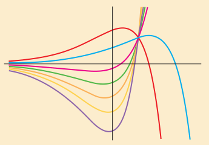
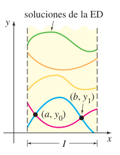
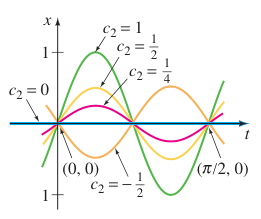
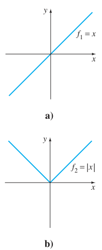

# 4. Ecuaciones diferenciales de orden superior — Teoría preliminar

> Fuente editorial:
> `Ecuaciones diferenciales con aplicaciones de modelado - Zill.pdf`, archivada
> en `2020/15-EDO 2do Orden/`. El nombre del archivo atribuye la obra a Zill;
> este extracto no incluye portada bibliográfica ni año de edición. No se
> atribuye a la carrera ISI. Transcripción de las páginas PDF 1–14, impresas
> 117–130, hasta el final de los ejercicios 4.1. Se conserva el idioma, la
> numeración y las soluciones ya presentes; los ejercicios propuestos quedan sin
> resolver.

## Página 117

4.1 Teoría preliminar: Ecuaciones lineales

- 4.1.1 Problemas con valores iniciales y con valores en la frontera
- 4.1.2 Ecuaciones homogéneas
- 4.1.3 Ecuaciones no homogéneas

4.2 Reducción de orden

4.3 Ecuaciones lineales homogéneas con coeficientes constantes

4.4 Coeficientes indeterminados: Método de superposición

4.5 Coeficientes indeterminados: Método del anulador

4.6 Variación de parámetros

4.7 Ecuación de Cauchy-Euler

4.8 Solución de sistemas de ED lineales por eliminación

4.9 Ecuaciones diferenciales no lineales

REPASO DEL CAPÍTULO 4



Ahora trataremos la solución de ecuaciones diferenciales de orden dos o
superior. En las primeras siete secciones de este capítulo se analizan la teoría
fundamental y cierta clase de *ecuaciones lineales*. El método de eliminación
para resolver sistemas de ecuaciones lineales se introduce en la sección 4.8
porque este método simplemente desacopla un sistema en ecuaciones lineales de
cada variable dependiente. El capítulo concluye con un breve análisis de
*ecuaciones no lineales* de orden superior.

## Página 118 — 4.1 TEORÍA PRELIMINAR: ECUACIONES LINEALES

REPASO DE MATERIAL

- Lea nuevamente los *Comentarios* al final de la sección 1.1.
- Sección 2.3 (especialmente páginas 54 a 58).

**INTRODUCCIÓN.** En el capítulo 2 vimos que se pueden resolver algunas
ecuaciones diferenciales de primer orden si se reconocen como separables,
exactas, homogéneas o quizás como ecuaciones de Bernoulli. Aunque las soluciones
de estas ecuaciones estuvieran en la forma de una familia uniparamétrica, esta
familia, con una excepción, no representa la solución de la ecuación
diferencial. Sólo en el caso de las ED *lineales* de primer orden se pueden
obtener soluciones generales considerando ciertas condiciones iniciales.
Recuerde que una **solución general** es una familia de soluciones definida en
algún intervalo $`I`$ que contiene *todas* las soluciones de la ED que están
definidas en $`I`$. Como el objetivo principal de este capítulo es encontrar
soluciones generales de ED lineales de orden superior, primero necesitamos
examinar un poco de la teoría de ecuaciones lineales.

### 4.1.1 PROBLEMAS CON VALORES INICIALES Y CON VALORES EN LA FRONTERA

**PROBLEMA CON VALORES INICIALES.** En la sección 1.2 se definió un problema con
valores iniciales para una ecuación diferencial de $`n`$-ésimo orden. Para una
ecuación diferencial lineal, un **problema con valores iniciales de $`n`$-ésimo
orden** es

Resuelva:

```math
a_n(x)\frac{d^ny}{dx^n}+a_{n-1}(x)\frac{d^{n-1}y}{dx^{n-1}}+\cdots
+a_1(x)\frac{dy}{dx}+a_0(x)y=g(x)
```

Sujeta a:

```math
y(x_0)=y_0,\quad y'(x_0)=y_1,\ldots,\quad y^{(n-1)}(x_0)=y_{n-1}.\tag{1}
```

Recuerde que para un problema como éste se busca una función definida en algún
intervalo $`I`$, que contiene a $`x_0`$, que satisface la ecuación diferencial y
las $`n`$ condiciones iniciales que se especifican en $`x_0`$: $`y(x_0)=y_0`$,
$`y'(x_0)=y_1,\ldots,y^{(n-1)}(x_0)=y_{n-1}`$. Ya hemos visto que en el caso de
un problema con valores iniciales de segundo orden, una curva solución debe
pasar por el punto $`(x_0,y_0)`$ y tener pendiente $`y_1`$ en este punto.

**EXISTENCIA Y UNICIDAD.** En la sección 1.2 se expresó un teorema que daba las
condiciones con las que se garantizaba la existencia y unicidad de una solución
de un problema con valores iniciales de primer orden. El teorema siguiente tiene
condiciones suficientes para la existencia y unicidad de una solución única del
problema en (1).

### TEOREMA 4.1.1. Existencia de una solución única

Sean $`a_n(x),a_{n-1}(x),\ldots,a_1(x),a_0(x)`$ y $`g(x)`$ continuas en un
intervalo $`I`$, y sea $`a_n(x)\ne0`$ para toda $`x`$ en este intervalo. Si
$`x=x_0`$ es cualquier punto en este intervalo, entonces una solución $`y(x)`$
del problema con valores iniciales (1) existe en el intervalo y es única.

### EJEMPLO 1. Solución única de un PVI

El problema con valores iniciales

```math
3y'''+5y''-y'+7y=0,\quad y(1)=0,\quad y'(1)=0,\quad y''(1)=0
```

## Página 119

tiene la solución trivial $`y=0`$. Debido a que la ecuación de tercer orden es
lineal con coeficientes constantes, se cumplen las condiciones del teorema
4.1.1. Por tanto $`y=0`$ es la *única* solución en cualquier intervalo que
contiene a $`x=1`$.

### EJEMPLO 2. Solución única de un PVI

Se debe comprobar que la función $`y=3e^{2x}+e^{-2x}-3x`$ es una solución del
problema con valores iniciales

```math
y''-4y=12x,\quad y(0)=4,\quad y'(0)=1.
```

Ahora la ecuación diferencial es lineal; los coeficientes, así como
$`g(x)=12x`$, son continuos y $`a_2(x)=1\ne0`$ en algún intervalo $`I`$ que
contenga a $`x=0`$. Concluimos del teorema 4.1.1 que la función dada es la única
solución en $`I`$.

Los requisitos en el teorema 4.1.1 de que $`a_i(x)`$, $`i=0,1,2,\ldots,n`$ sean
continuas y $`a_n(x)\ne0`$ para toda $`x`$ en $`I`$ son importantes. En
particular, si $`a_n(x)=0`$ para algún $`x`$ en el intervalo, entonces la
solución de un problema lineal con valores iniciales podría no ser única o ni
siquiera existir. Por ejemplo, se debe comprobar que la función $`y=cx^2+x+3`$
es una solución de problema con valores iniciales

```math
x^2y''-2xy'+2y=6,\quad y(0)=3,\quad y'(0)=1
```

en el intervalo $`(-\infty,\infty)`$ para alguna elección del parámetro $`c`$.
En otras palabras, no hay solución única del problema. Aunque se satisface la
mayoría de las condiciones del teorema 4.1.1, las dificultades obvias son que
$`a_2(x)=x^2`$ es cero en $`x=0`$ y que las condiciones iniciales también se
imponen en $`x=0`$.

**PROBLEMA CON VALORES EN LA FRONTERA.** Otro tipo de problema consiste en
resolver una ecuación diferencial lineal de orden dos o mayor en que la variable
dependiente $`y`$ o sus derivadas se especifican en *diferentes puntos*. Un
problema tal como

Resuelva:

```math
a_2(x)\frac{d^2y}{dx^2}+a_1(x)\frac{dy}{dx}+a_0(x)y=g(x)
```

Sujeto a: $`y(a)=y_0,\quad y(b)=y_1`$

se llama **problema con valores en la frontera (PVF)**. Los valores prescritos
$`y(a)=y_0`$ y $`y(b)=y_1`$ se llaman **condiciones en la frontera**. Una
solución del problema anterior es una función que satisface la ecuación
diferencial en algún intervalo $`I`$, que contiene a $`a`$ y $`b`$, cuya gráfica
pasa por los puntos $`(a,y_0)`$ y $`(b,y_1)`$. Véase la figura 4.1.1.



Para una ecuación diferencial de segundo orden, otros pares de condiciones en la
frontera podrían ser

```math
\begin{aligned}
y'(a)&=y_0,& y(b)&=y_1\\
y(a)&=y_0,& y'(b)&=y_1\\
y'(a)&=y_0,& y'(b)&=y_1,
\end{aligned}
```

donde $`y_0`$ y $`y_1`$ denotan constantes arbitrarias. Estos pares de
condiciones son sólo casos especiales de las condiciones en la frontera
generales.

```math
\begin{aligned}
\alpha_1y(a)+\beta_1y'(a)&=\gamma_1\\
\alpha_2y(b)+\beta_2y'(b)&=\gamma_2.
\end{aligned}
```

En el ejemplo siguiente se muestra que aun cuando se cumplen las condiciones del
teorema 4.1.1, un problema con valores en la frontera puede tener varias
soluciones (como se sugiere en la figura 4.1.1), una solución única o no tener
ninguna solución.

## Página 120

### EJEMPLO 3. Un PVF puede tener muchas, una o ninguna solución

En el ejemplo 4 de la sección 1.1 vimos que la familia de soluciones de dos
parámetros de la ecuación diferencial $`x''+16x=0`$ es

```math
x=c_1\cos4t+c_2\mathop{\mathrm{sen}}\nolimits 4t.\tag{2}
```

a) Suponga que ahora deseamos determinar la solución de la ecuación que
satisface más condiciones en la frontera $`x(0)=0`$, $`x(\pi/2)=0`$. Observe que
la primera condición $`0=c_1\cos0+c_2\mathop{\mathrm{sen}}\nolimits 0`$ implica
que $`c_1=0`$, por tanto $`x=c_2\mathop{\mathrm{sen}}\nolimits 4t`$. Pero cuando
$`t=\pi/2`$, $`0=c_2\mathop{\mathrm{sen}}\nolimits 2\pi`$ se satisface para
cualquier elección de $`c_2`$ ya que $`\mathop{\mathrm{sen}}\nolimits 2\pi=0`$.
Por tanto el problema con valores en la frontera

```math
x''+16x=0,\quad x(0)=0,\quad x\left(\frac\pi2\right)=0\tag{3}
```

tiene un número infinito de soluciones. En la figura 4.1.2 se muestran las
gráficas de algunos de los miembros de la familia uniparamétrica
$`x=c_2\mathop{\mathrm{sen}}\nolimits 4t`$ que pasa por los dos puntos $`(0,0)`$
y $`(\pi/2,0)`$.



b) Si el problema con valores en la frontera en (3) se cambia a

```math
x''+16x=0,\quad x(0)=0,\quad x\left(\frac\pi8\right)=0,\tag{4}
```

entonces $`x(0)=0`$ aún requiere que $`c_1=0`$ en la solución (2). Pero
aplicando $`x(\pi/8)=0`$ a $`x=c_2\mathop{\mathrm{sen}}\nolimits 4t`$ requiere
que $`0=c_2\mathop{\mathrm{sen}}\nolimits (\pi/2)=c_2\cdot1`$. Por tanto $`x=0`$
es una solución de este nuevo problema con valores en la frontera. De hecho, se
puede demostrar que $`x=0`$ es la *única* solución de (4).

c) Por último, si se cambia el problema a

```math
x''+16x=0,\quad x(0)=0,\quad x\left(\frac\pi2\right)=1,\tag{5}
```

se encuentra de nuevo de $`x(0)=0`$ que $`c_1=0`$, pero al aplicar
$`x(\pi/2)=1`$ a $`x=c_2\mathop{\mathrm{sen}}\nolimits 4t`$ conduce a la
contradicción $`1=c_2\mathop{\mathrm{sen}}\nolimits 2\pi=c_2\cdot0=0`$. Por
tanto el problema con valores en la frontera (5) **no tiene solución**.

### 4.1.2 ECUACIONES HOMOGÉNEAS

Una ecuación diferencial lineal de $`n`$-ésimo orden de la forma

```math
a_n(x)\frac{d^ny}{dx^n}+a_{n-1}(x)\frac{d^{n-1}y}{dx^{n-1}}+\cdots
+a_1(x)\frac{dy}{dx}+a_0(x)y=0\tag{6}
```

se dice que es **homogénea**, mientras que una ecuación

```math
a_n(x)\frac{d^ny}{dx^n}+a_{n-1}(x)\frac{d^{n-1}y}{dx^{n-1}}+\cdots
+a_1(x)\frac{dy}{dx}+a_0(x)y=g(x),\tag{7}
```

con $`g(x)`$ no igual a cero, se dice que es **no homogénea**. Por ejemplo,
$`2y''+3y'-5y=0`$ es una ecuación diferencial lineal homogénea de segundo orden,
mientras que $`x^3y'''+6y'+10y=e^x`$ es una ecuación diferencial lineal de
tercer orden no homogénea. La palabra *homogénea* en este contexto no se refiere
a los coeficientes que son funciones homogéneas, como en la sección 2.5.

Después veremos que para resolver una ecuación lineal no homogénea (7), primero
se debe poder resolver la **ecuación homogénea asociada** (6).

Para evitar la repetición innecesaria en lo que resta de este libro, se harán,
como algo natural, las siguientes suposiciones importantes cuando se establezcan

## Página 121

definiciones y teoremas acerca de las ecuaciones lineales (1). En algún
intervalo común $`I`$,

- las funciones coeficientes $`a_i(x)`$, $`i=0,1,2,\ldots,n`$ y $`g(x)`$ son
  continuas;
- $`a_n(x)\ne0`$ para toda $`x`$ en el intervalo.

Nota marginal: Por favor recuerde estas dos suposiciones.

**OPERADORES DIFERENCIALES.** En cálculo la derivación se denota con frecuencia
con la letra $`D`$ mayúscula, es decir, $`dy/dx=Dy`$. El símbolo $`D`$ se llama
**operador diferencial** porque convierte una función derivable en otra función.
Por ejemplo, $`D(\cos4x)=-4\mathop{\mathrm{sen}}\nolimits 4x`$ y
$`D(5x^3-6x^2)=15x^2-12x`$. Las derivadas de orden superior se expresan en
términos de $`D`$ de manera natural:

```math
\frac d{dx}\left(\frac{dy}{dx}\right)=\frac{d^2y}{dx^2}=D(Dy)=D^2y
\quad\text{y, en general}\quad\frac{d^ny}{dx^n}=D^ny,
```

donde $`y`$ representa una función suficientemente derivable. Las expresiones
polinomiales en las que interviene $`D`$, tales como $`D+3`$, $`D^2+3D-4`$ y
$`5x^3D^3-6x^2D^2+4xD+9`$, son también operadores diferenciales. En general, se
define un **operador diferencial de $`n`$-ésimo orden** u **operador
polinomial** como

```math
L=a_n(x)D^n+a_{n-1}(x)D^{n-1}+\cdots+a_1(x)D+a_0(x).\tag{8}
```

Como una consecuencia de dos propiedades básicas de la derivada,
$`D(cf(x))=cDf(x)`$, $`c`$ es una constante y $`D\{f(x)+g(x)\}=Df(x)+Dg(x)`$, el
operador diferencial $`L`$ tiene una propiedad de linealidad; es decir, $`L`$
operando sobre una combinación lineal de dos funciones derivables es lo mismo
que la combinación lineal de $`L`$ operando en cada una de las funciones.
Simbólicamente esto se expresa como

```math
L\{\alpha f(x)+\beta g(x)\}=\alpha L(f(x))+\beta L(g(x)),\tag{9}
```

donde $`\alpha`$ y $`\beta`$ son constantes. Como resultado de (9) se dice que
el operador diferencial de $`n`$-ésimo orden es un **operador lineal**.

**ECUACIONES DIFERENCIALES.** Cualquier ecuación diferencial lineal puede
expresarse en términos de la notación $`D`$. Por ejemplo, la ecuación
diferencial $`y''+5y'+6y=5x-3`$ se puede escribir como $`D^2y+5Dy+6y=5x-3`$ o
$`(D^2+5D+6)y=5x-3`$. Usando la ecuación (8), se pueden escribir las ecuaciones
diferenciales lineales de $`n`$-énesimo orden (6) y (7) en forma compacta como

```math
L(y)=0\quad\text{y}\quad L(y)=g(x),
```

respectivamente.

**PRINCIPIO DE SUPERPOSICIÓN.** En el siguiente teorema se ve que la suma o
**superposición** de dos o más soluciones de una ecuación diferencial lineal
homogénea es también una solución.

### TEOREMA 4.1.2. Principio de superposición; ecuaciones homogéneas

Sean $`y_1,y_2,\ldots,y_k`$ soluciones de la ecuación homogénea de $`n`$-ésimo
orden (6) en un intervalo $`I`$. Entonces la combinación lineal

```math
y=c_1y_1(x)+c_2y_2(x)+\cdots+c_ky_k(x),
```

donde las $`c_i`$, $`i=1,2,\ldots,k`$ son constantes arbitrarias, también es una
solución en el intervalo.

**DEMOSTRACIÓN.** Se demuestra el caso $`k=2`$. Sea $`L`$ el operador
diferencial que se definió en (8) y sean $`y_1(x)`$ y $`y_2(x)`$ soluciones de
la ecuación homogénea $`L(y)=0`$. Si se define $`y=c_1y_1(x)+c_2y_2(x)`$,
entonces por la linealidad de $`L`$ se tiene que

```math
L(y)=L\{c_1y_1(x)+c_2y_2(x)\}=c_1L(y_1)+c_2L(y_2)=c_1\cdot0+c_2\cdot0=0.
```

## Página 122 — COROLARIOS DEL TEOREMA 4.1.2

A) Un múltiplo constante $`y=c_1y_1(x)`$ de una solución $`y_1(x)`$ de una
ecuación diferencial lineal homogénea es también una solución.

B) Una ecuación diferencial lineal homogénea tiene siempre la solución trivial
$`y=0`$.

### EJEMPLO 4. Superposición; ED homogénea

Las funciones $`y_1=x^2`$ y $`y_2=x^2\ln x`$ son soluciones de la ecuación
lineal homogénea $`x^3y'''-2xy'+4y=0`$ en el intervalo $`(0,\infty)`$. Por el
principio de superposición, la combinación lineal

```math
y=c_1x^2+c_2x^2\ln x
```

es también una solución de la ecuación en el intervalo.

La función $`y=e^{7x}`$ es una solución de $`y''-9y'+14y=0`$. Debido a que la
ecuación diferencial es lineal y homogénea, el múltiplo constante $`y=ce^{7x}`$
es también una solución. Para varios valores de $`c`$ se ve que $`y=9e^{7x}`$,
$`y=0`$, $`y=-\sqrt5e^{7x},\ldots`$ son todas soluciones de la ecuación.

**DEPENDENCIA LINEAL E INDEPENDENCIA LINEAL.** Los dos conceptos son básicos
para el estudio de ecuaciones diferenciales lineales.

### DEFINICIÓN 4.1.1. Dependencia e independencia lineal

Se dice que un conjunto de funciones $`f_1(x),f_2(x),\ldots,f_n(x)`$ es
**linealmente dependiente** en un intervalo $`I`$ si existen constantes
$`c_1,c_2,\ldots,c_n`$ no todas cero, tales que

```math
c_1f_1(x)+c_2f_2(x)+\cdots+c_nf_n(x)=0
```

para toda $`x`$ en el intervalo. Si el conjunto de funciones no es linealmente
dependiente en el intervalo, se dice que es **linealmente independiente**.

En otras palabras, un conjunto de funciones es linealmente independiente en un
intervalo $`I`$ si las únicas constantes para las que

```math
c_1f_1(x)+c_2f_2(x)+\cdots+c_nf_n(x)=0
```

para toda $`x`$ en el intervalo son $`c_1=c_2=\cdots=c_n=0`$.

Es fácil entender estas definiciones para un conjunto que consiste en dos
funciones $`f_1(x)`$ y $`f_2(x)`$. Si el conjunto de funciones es linealmente
dependiente en un intervalo, entonces existen constantes $`c_1`$ y $`c_2`$ que
no son ambas cero de manera tal que, para toda $`x`$ en el intervalo,
$`c_1f_1(x)+c_2f_2(x)=0`$. Por tanto, si suponemos que $`c_1\ne0`$, se deduce
que $`f_1(x)=(-c_2/c_1)f_2(x)`$; es decir, *si un conjunto de dos funciones es
linealmente dependiente, entonces una función es simplemente un múltiplo
constante del otro*. A la inversa, si $`f_1(x)=c_2f_2(x)`$ para alguna constante
$`c_2`$, entonces $`(-1)\cdot f_1(x)+c_2f_2(x)=0`$ para toda $`x`$ en el
intervalo. Por tanto, el conjunto de funciones es linealmente dependiente porque
al menos una de las constantes (en particular, $`c_1=-1`$) no es cero. Se
concluye que *un conjunto de dos funciones $`f_1(x)`$ y $`f_2(x)`$ es
linealmente independiente cuando ninguna función es un múltiplo constante de la
otra* en el intervalo. Por ejemplo, el conjunto de funciones
$`f_1(x)=\mathop{\mathrm{sen}}\nolimits 2x`$,
$`f_2(x)=\mathop{\mathrm{sen}}\nolimits x\cos x`$ es linealmente dependiente en
$`(-\infty,\infty)`$ porque $`f_1(x)`$ es un múltiplo constante de $`f_2(x)`$.
Recuerde de la fórmula del seno del doble de un ángulo que
$`\mathop{\mathrm{sen}}\nolimits 2x=2\mathop{\mathrm{sen}}\nolimits x\cos x`$.
Por otro lado, el conjunto de funciones $`f_1(x)=x`$, $`f_2(x)=|x|`$ es
linealmente independiente en $`(-\infty,\infty)`$. Al examinar la figura 4.1.3
usted debe convencerse de que ninguna función es un múltiplo constante de la
otra en el intervalo.



## Página 123

Del análisis anterior se tiene que el cociente $`f_2(x)/f_1(x)`$ no es una
constante en un intervalo en el que el conjunto $`f_1(x),f_2(x)`$ es linealmente
independiente. Esto se usará en la siguiente sección.

### EJEMPLO 5. Conjunto de funciones linealmente dependiente

El conjunto de funciones $`f_1(x)=\cos^2x`$,
$`f_2(x)=\mathop{\mathrm{sen}}\nolimits ^2x`$, $`f_3(x)=\sec^2x`$,
$`f_4(x)=\tan^2x`$ es linealmente dependiente en el intervalo $`(-\pi/2,\pi/2)`$
porque

```math
c_1\cos^2x+c_2\mathop{\mathrm{sen}}\nolimits ^2x+c_3\sec^2x+c_4\tan^2x=0
```

donde $`c_1=c_2=1`$, $`c_3=-1`$, $`c_4=1`$. Aquí se usa
$`\cos^2x+\mathop{\mathrm{sen}}\nolimits ^2x=1`$ y $`1+\tan^2x=\sec^2x`$.

Un conjunto de funciones $`f_1(x),f_2(x),\ldots,f_n(x)`$ es linealmente
dependiente en un intervalo si por lo menos una función se puede expresar como
una combinación lineal de las otras funciones.

### EJEMPLO 6. Conjunto de funciones linealmente dependientes

El conjunto de funciones $`f_1(x)=\sqrt x+5`$, $`f_2(x)=\sqrt x+5x`$,
$`f_3(x)=x-1`$, $`f_4(x)=x^2`$ es linealmente dependientes en el intervalo
$`(0,\infty)`$ porque $`f_2`$ puede escribirse como una combinación lineal de
$`f_1,f_3`$ y $`f_4`$. Observe que

```math
f_2(x)=1\cdot f_1(x)+5\cdot f_3(x)+0\cdot f_4(x)
```

para toda $`x`$ en el intervalo $`(0,\infty)`$.

**SOLUCIONES DE ECUACIONES DIFERENCIALES.** Estamos interesados principalmente
en funciones linealmente independientes o con más precisión, soluciones
linealmente independientes de una ecuación diferencial lineal. Aunque se podría
apelar siempre en forma directa a la definición 4.1.1, resulta que la cuestión
de si el conjunto de $`n`$ soluciones $`y_1,y_2,\ldots,y_n`$ de una ecuación
diferencial lineal homogénea de $`n`$-ésimo orden (6) es linealmente
independiente se puede establecer en forma un poco mecánica usando un
determinante.

### DEFINICIÓN 4.1.2. Wronskiano

Suponga que cada una de las funciones $`f_1(x),f_2(x),\ldots,f_n(x)`$ tiene al
menos $`n-1`$ derivadas. El determinante

```math
W(f_1,f_2,\ldots,f_n)=\begin{vmatrix}
f_1&f_2&\cdots&f_n\\
f_1'&f_2'&\cdots&f_n'\\
\vdots&\vdots&&\vdots\\
f_1^{(n-1)}&f_2^{(n-1)}&\cdots&f_n^{(n-1)}
\end{vmatrix},
```

donde las primas denotan derivadas, se llama el **Wronskiano** de las funciones.

### TEOREMA 4.1.3. Criterio para soluciones linealmente independientes

Sean $`y_1,y_2,\ldots,y_n`$ $`n`$ soluciones de la ecuación diferencial lineal
homogénea de $`n`$-ésimo orden (6) en el intervalo $`I`$. El conjunto de
soluciones es **linealmente independiente** en $`I`$ si y sólo si
$`W(y_1,y_2,\ldots,y_n)\ne0`$ para toda $`x`$ en el intervalo.

## Página 124

Se tiene del teorema 4.1.3 que cuando $`y_1,y_2,\ldots,y_n`$ son $`n`$
soluciones de (6) en un intervalo $`I`$, el Wronskiano $`W(y_1,y_2,\ldots,y_n)`$
es igual a cero o nunca es cero en el intervalo.

Al conjunto de $`n`$ soluciones linealmente independientes de una ecuación
diferencial lineal homogénea de $`n`$-ésimo orden se le da un nombre especial.

### DEFINICIÓN 4.1.3. Conjunto fundamental de soluciones

Cualquier conjunto $`y_1,y_2,\ldots,y_n`$ de $`n`$ soluciones linealmente
independientes de la ecuación diferencial lineal homogénea de $`n`$-ésimo orden
(6) en un intervalo $`I`$ es un **conjunto fundamental de soluciones** en el
intervalo.

La respuesta a la cuestión básica sobre la existencia de un conjunto fundamental
de soluciones para una ecuación lineal está en el siguiente teorema.

### TEOREMA 4.1.4. Existencia de un conjunto fundamental

Existe un conjunto fundamental de soluciones para la ecuación diferencial lineal
homogénea de $`n`$-ésimo orden (6) en un intervalo $`I`$.

Similar al hecho de que cualquier vector en tres dimensiones se puede expresar
como una combinación lineal de los vectores *linealmente independientes*
$`\mathbf i,\mathbf j,\mathbf k`$, cualquier solución de una ecuación
diferencial lineal homogénea de $`n`$-ésimo orden en un intervalo $`I`$ se
expresa como una combinación lineal de $`n`$ soluciones linealmente
independientes en $`I`$. En otras palabras, $`n`$ soluciones linealmente
independientes $`y_1,y_2,\ldots,y_n`$ son los bloques básicos para la solución
general de la ecuación.

### TEOREMA 4.1.5. Solución general; ecuaciones homogéneas

Sea $`y_1,y_2,\ldots,y_n`$ un conjunto fundamental de soluciones de la ecuación
diferencial lineal homogénea de $`n`$-ésimo orden (6) en el intervalo $`I`$.
Entonces la **solución general** de la ecuación en el intervalo es

```math
y=c_1y_1(x)+c_2y_2(x)+\cdots+c_ny_n(x),
```

donde $`c_i`$, $`i=1,2,\ldots,n`$ son constantes arbitrarias.

El teorema 4.1.5 establece que si $`Y(x)`$ es alguna solución de (6) en el
intervalo, entonces siempre se pueden encontrar constantes
$`C_1,C_2,\ldots,C_n`$ tales que

```math
Y(x)=C_1y_1(x)+C_2y_2(x)+\cdots+C_ny_n(x).
```

Demostraremos el caso cuando $`n=2`$.

**DEMOSTRACIÓN.** Sea $`Y`$ una solución y $`y_1`$ y $`y_2`$ soluciones
linealmente independientes de $`a_2y''+a_1y'+a_0y=0`$ en un intervalo $`I`$.
Suponga que $`x=t`$ es un punto en $`I`$ para el cual $`W(y_1(t),y_2(t))\ne0`$.
Suponga también que $`Y(t)=k_1`$ y $`Y'(t)=k_2`$. Si ahora examinamos las
ecuaciones

```math
\begin{aligned}
C_1y_1(t)+C_2y_2(t)&=k_1\\
C_1y_1'(t)+C_2y_2'(t)&=k_2,
\end{aligned}
```

se tiene que podemos determinar $`C_1`$ y $`C_2`$ de manera única, a condición
de que el determinante de los coeficientes satisfaga

```math
\begin{vmatrix}y_1(t)&y_2(t)\\y_1'(t)&y_2'(t)\end{vmatrix}\ne0.
```

## Página 125

Pero este determinante es simplemente el Wronskiano evaluado en $`x=t`$ y por
suposición, $`W\ne0`$. Si se define $`G(x)=C_1y_1(x)+C_2y_2(x)`$, se observa que
$`G(x)`$ satisface la ecuación diferencial puesto que es una superposición de
dos soluciones conocidas; $`G(x)`$ satisface las condiciones iniciales

```math
G(t)=C_1y_1(t)+C_2y_2(t)=k_1\quad\text{y}\quad
G'(t)=C_1y_1'(t)+C_2y_2'(t)=k_2;
```

y $`Y(x)`$ satisface la *misma* ecuación lineal y las *mismas* condiciones
iniciales. Debido a que la solución de este problema con valores iniciales
lineal es única (teorema 4.1.1), se tiene $`Y(x)=G(x)`$ o
$`Y(x)=C_1y_1(x)+C_2y_2(x)`$.

### EJEMPLO 7. Solución general de una ED homogénea

Las funciones $`y_1=e^{3x}`$ y $`y_2=e^{-3x}`$ son soluciones de la ecuación
lineal homogénea $`y''-9y=0`$ en el intervalo $`(-\infty,\infty)`$. Por
inspección las soluciones son linealmente independientes en el eje $`x`$. Este
hecho se corrobora al observar que el Wronskiano

```math
W(e^{3x},e^{-3x})=\begin{vmatrix}e^{3x}&e^{-3x}\\3e^{3x}&-3e^{-3x}\end{vmatrix}
=-6\ne0
```

para toda $`x`$. Se concluye que $`y_1`$ y $`y_2`$ forman un conjunto
fundamental de soluciones y por tanto, $`y=c_1e^{3x}+c_2e^{-3x}`$ es la solución
general de la ecuación en el intervalo.

### EJEMPLO 8. Una solución obtenida de una solución general

La función $`y=4\mathop{\mathrm{senh}}\nolimits 3x-5e^{3x}`$ es una solución de
la ecuación diferencial del ejemplo 7. (Compruebe esto.) Aplicando el teorema
4.1.5, debe ser posible obtener esta solución a partir de la solución general
$`y=c_1e^{3x}+c_2e^{-3x}`$. Observe que si se elige $`c_1=2`$ y $`c_2=-7`$,
entonces $`y=2e^{3x}-7e^{-3x}`$ puede rescribirse como

```math
y=2e^{3x}-2e^{-3x}-5e^{-3x}
=4\left(\frac{e^{3x}-e^{-3x}}2\right)-5e^{-3x}.
```

Esta última expresión se reconoce como
$`y=4\mathop{\mathrm{senh}}\nolimits 3x-5e^{-3x}`$.

> Errata del original: la primera mención de la función en este ejemplo imprime
> $`-5e^{3x}`$; su desarrollo y frase final imprimen $`-5e^{-3x}`$. Se conservan
> ambas.

### EJEMPLO 9. Solución general de una ED homogénea

Las funciones $`y_1=e^x`$, $`y_2=e^{2x}`$ y $`y_3=e^{3x}`$ satisfacen la
ecuación de tercer orden $`y'''-6y''+11y'-6y=0`$. Puesto que

```math
W(e^x,e^{2x},e^{3x})=\begin{vmatrix}
e^x&e^{2x}&e^{3x}\\e^x&2e^{2x}&3e^{3x}\\e^x&4e^{2x}&9e^{3x}
\end{vmatrix}=2e^{6x}\ne0
```

para todo valor real de $`x`$, las funciones $`y_1,y_2`$ y $`y_3`$ forman un
conjunto fundamental de soluciones en $`(-\infty,\infty)`$. Se concluye que
$`y=c_1e^x+c_2e^{2x}+c_3e^{3x}`$ es la solución general de la ecuación
diferencial en el intervalo.

### 4.1.3 ECUACIONES NO HOMOGÉNEAS

Cualquier función $`y_p`$ libre de parámetros arbitrarios, que satisface (7) se
dice que es una **solución particular** o **integral particular** de la
ecuación. Por ejemplo, es una tarea directa demostrar que la función constante
$`y_p=3`$ es una solución particular de la ecuación no homogénea $`y''+9y=27`$.

## Página 126

Ahora si $`y_1,y_2,\ldots,y_k`$ son soluciones de (6) en un intervalo $`I`$ y
$`y_p`$ es cualquier solución particular de (7) en $`I`$, entonces la
combinación lineal

```math
y=c_1y_1(x)+c_2y_2(x)+\cdots+c_ky_k(x)+y_p\tag{10}
```

es también una solución de la ecuación no homogénea (7). Si piensa al respecto,
esto tiene sentido, porque la combinación lineal
$`c_1y_1(x)+c_2y_2(x)+\cdots+c_ky_k(x)`$ se transforma en 0 por el operador
$`L=a_nD^n+a_{n-1}D^{n-1}+\cdots+a_1D+a_0`$, mientras que $`y_p`$ se convierte
en $`g(x)`$. Si se usa $`k=n`$ soluciones linealmente independientes de la
ecuación de $`n`$-ésimo orden (6), entonces la expresión en (10) se convierte en
la solución general de (7).

### TEOREMA 4.1.6. Solución general; ecuaciones no homogéneas

Sea $`y_p`$ cualquier solución particular de la ecuación diferencial lineal no
homogénea de $`n`$-ésimo orden (7) en un intervalo $`I`$, y sea
$`y_1,y_2,\ldots,y_n`$ un conjunto fundamental de soluciones de la ecuación
diferencial homogénea asociada (6) en $`I`$. Entonces la **solución general** de
la ecuación en el intervalo es

```math
y=c_1y_1(x)+c_2y_2(x)+\cdots+c_ny_n(x)+y_p,
```

donde las $`c_i`$, $`i=1,2,\ldots,n`$ son constantes arbitrarias.

**DEMOSTRACIÓN.** Sea $`L`$ el operador diferencial definido en (8) y sean
$`Y(x)`$ y $`y_p(x)`$ soluciones particulares de la ecuación no homogénea
$`L(y)=g(x)`$. Si se define $`u(x)=Y(x)-y_p(x)`$, entonces por la linealidad de
$`L`$ se tiene

```math
L(u)=L\{Y(x)-y_p(x)\}=L(Y(x))-L(y_p(x))=g(x)-g(x)=0.
```

Esto demuestra que $`u(x)`$ es una solución de la ecuación homogénea $`L(y)=0`$.
Así por el teorema 4.1.5, $`u(x)=c_1y_1(x)+c_2y_2(x)+\cdots+c_ny_n(x)`$, y así

```math
Y(x)-y_p(x)=c_1y_1(x)+c_2y_2(x)+\cdots+c_ny_n(x)
```

o

```math
Y(x)=c_1y_1(x)+c_2y_2(x)+\cdots+c_ny_n(x)+y_p(x).
```

**FUNCIÓN COMPLEMENTARIA.** Vemos en el teorema 4.1.6 que la solución general de
una ecuación lineal no homogénea está compuesta por la suma de dos funciones:

```math
y=c_1y_1(x)+c_2y_2(x)+\cdots+c_ny_n(x)+y_p(x)=y_c(x)+y_p(x).
```

La combinación lineal $`y_c(x)=c_1y_1(x)+c_2y_2(x)+\cdots+c_ny_n(x)`$, que es la
solución general de (6), se llama **función complementaria** para la ecuación
(7). En otras palabras, para resolver una ecuación diferencial lineal no
homogénea, primero se resuelve la ecuación homogénea asociada y luego se
encuentra una solución particular de la ecuación no homogénea. La solución
general de la ecuación no homogénea es entonces

```math
\begin{aligned}
y&=\text{función complementaria}+\text{cualquier solución particular}\\
&=y_c+y_p.
\end{aligned}
```

### EJEMPLO 10. Solución general de una ED no homogénea

Por sustitución, se demuestra con facilidad que la función
$`y_p=-\frac{11}{12}-\frac12x`$ es una solución particular de la ecuación no
homogénea

```math
y'''-6y''+11y'-6y=3x.\tag{11}
```

## Página 127

Para escribir la solución general de (11), también se debe poder resolver la
ecuación homogénea asociada

```math
y'''-6y''+11y'-6y=0.
```

Pero en el ejemplo 9 vimos que la solución general de esta última ecuación en el
intervalo $`(-\infty,\infty)`$ fue $`y_c=c_1e^x+c_2e^{2x}+c_3e^{3x}`$. Por tanto
la solución general de (11) en el intervalo es

```math
y=y_c+y_p=c_1e^x+c_2e^{2x}+c_3e^{3x}-\frac{11}{12}-\frac12x.
```

**OTRO PRINCIPIO DE SUPERPOSICIÓN.** El último teorema de este análisis se usará
en la sección 4.4 cuando se considera un método para encontrar soluciones
particulares de ecuaciones no homogéneas.

### TEOREMA 4.1.7. Principio de superposición; ecuaciones no homogéneas

Sean $`y_{p_1},y_{p_2},\ldots,y_{p_k}`$ $`k`$ soluciones particulares de la
ecuación diferencial lineal no homogénea de $`n`$-ésimo orden (7) en un
intervalo $`I`$ que corresponde, a su vez, a $`k`$ funciones diferentes
$`g_1,g_2,\ldots,g_k`$. Es decir, se supone que $`y_{p_i}`$ denota una solución
particular de la ecuación diferencial correspondiente

```math
a_n(x)y^{(n)}+a_{n-1}(x)y^{(n-1)}+\cdots+a_1(x)y'+a_0(x)y=g_i(x),\tag{12}
```

donde $`i=1,2,\ldots,k`$. Entonces

```math
y_p=y_{p_1}(x)+y_{p_2}(x)+\cdots+y_{p_k}(x)\tag{13}
```

es una solución particular de

```math
\begin{aligned}
a_n(x)y^{(n)}+a_{n-1}(x)y^{(n-1)}+\cdots+a_1(x)y'+a_0(x)y
&=g_1(x)+g_2(x)+\cdots+g_k(x).
\end{aligned}\tag{14}
```

**DEMOSTRACIÓN.** Se demuestra el caso $`k=2`$. Sea $`L`$ el operador
diferencial definido en (8) y sean $`y_{p_1}(x)`$ y $`y_{p_2}(x)`$ soluciones
particulares de las ecuaciones no homogéneas $`L(y)=g_1(x)`$ y $`L(y)=g_2(x)`$,
respectivamente. Si definimos $`y_p=y_{p_1}(x)+y_{p_2}(x)`$, queremos demostrar
que $`y_p`$ es una solución particular de $`L(y)=g_1(x)+g_2(x)`$. Nuevamente se
deduce el resultado por la linealidad del operador $`L`$:

```math
L(y_p)=L\{y_{p_1}(x)+y_{p_2}(x)\}=L(y_{p_1}(x))+L(y_{p_2}(x))=g_1(x)+g_2(x).
```

### EJEMPLO 11. Superposición, ED no homogénea

Usted debe comprobar que

```math
y_{p_1}=-4x^2\quad\text{es una solución particular de}\quad
 y''-3y'+4y=-16x^2+24x-8,
```

```math
y_{p_2}=e^{2x}\quad\text{es una solución particular de}\quad
 y''-3y'+4y=2e^{2x},
```

```math
y_{p_3}=xe^x\quad\text{es una solución particular de}\quad
 y''-3y'+4y=2xe^x-e^x.
```

Se tiene de (13) del teorema 4.1.7 que la superposición de $`y_{p_1},y_{p_2}`$ y
$`y_{p_3}`$,

```math
y=y_{p_1}+y_{p_2}+y_{p_3}=-4x^2+e^{2x}+xe^x,
```

es una solución de

```math
y''-3y'+4y=\underbrace{-16x^2+24x-8}_{g_1(x)}
+\underbrace{2e^{2x}}_{g_2(x)}+\underbrace{2xe^x-e^x}_{g_3(x)}.
```

## Página 128

**NOTA.** Si las $`y_{p_i}`$ son soluciones particulares de (12) para
$`i=1,2,\ldots,k`$, entonces la combinación lineal

```math
y_p=c_1y_{p_1}+c_2y_{p_2}+\cdots+c_ky_{p_k},
```

donde las $`c_i`$ son constantes, es también una solución particular de (14)
cuando el miembro del lado derecho de la ecuación es la combinación lineal

```math
c_1g_1(x)+c_2g_2(x)+\cdots+c_kg_k(x).
```

Antes de que empecemos a resolver realmente ecuaciones diferenciales lineales
homogéneas y no homogéneas, se necesita un poco más de la teoría, que se
presenta en la siguiente sección.

### COMENTARIOS

Esta observación es una continuación del breve análisis de sistemas dinámicos
que se presentó al final de la sección 1.3.

Un sistema dinámico cuya regla o modelo matemático es una ecuación diferencial
lineal de $`n`$-ésimo orden

```math
a_n(t)y^{(n)}+a_{n-1}(t)y^{(n-1)}+\cdots+a_1(t)y'+a_0(t)y=g(t)
```

se dice que es un **sistema lineal** de $`n`$-ésimo orden. Las $`n`$ funciones
dependientes del tiempo $`y(t),y'(t),\ldots,y^{(n-1)}(t)`$ son las **variables
de estado** del sistema. Recuerde que sus valores en el tiempo $`t`$ dan el
**estado del sistema**. La función $`g`$ tiene varios nombres: **función de
entrada, función de fuerza** o **función de excitación**. Una solución $`y(t)`$
de la ecuación diferencial se llama **salida** o **respuesta del sistema**. Bajo
las condiciones establecidas en el teorema 4.1.1, la salida o respuesta $`y(t)`$
se determina de manera única por la entrada y el estado del sistema prescritos
en el tiempo $`t_0`$; es decir, por las condiciones iniciales
$`y(t_0),y'(t_0),\ldots,y^{(n-1)}(t_0)`$.

Para que un sistema dinámico sea un sistema lineal es necesario que se cumpla en
el sistema el principio de superposición (teorema 4.1.7); es decir, la respuesta
del sistema a una superposición de entradas es una superposición de salidas. Ya
se analizaron algunos de los sistemas lineales simples en la sección 3.1
(ecuaciones lineales de primer orden); en la sección 5.1 se examinan sistemas
lineales en los que los modelos matemáticos son ecuaciones diferenciales de
segundo orden.

### EJERCICIOS 4.1

*Las respuestas a los problemas con número impar comienzan en la página RES-4.*

### 4.1.1 PROBLEMAS CON VALORES INICIALES Y CON VALORES EN LA FRONTERA — Ejercicios

En los problemas 1 a 4 la familia de funciones que se proporciona es la solución
general de la ecuación diferencial en el intervalo que se indica. Encuentre un
miembro de la familia que sea una solución del problema con valores iniciales.

1\) $`y=c_1e^x+c_2e^{-x}`$, $`(-\infty,\infty)`$; $`y''-y=0`$, $`y(0)=0`$,
$`y'(0)=1`$.

2\) $`y=c_1e^{4x}+c_2e^{-x}`$, $`(-\infty,\infty)`$; $`y''-3y'-4y=0`$,
$`y(0)=1`$, $`y'(0)=2`$.

3\) $`y=c_1x+c_2x\ln x`$, $`(0,\infty)`$; $`x^2y''-xy'+y=0`$, $`y(1)=3`$,
$`y'(1)=-1`$.

4\) $`y=c_1+c_2\cos x+c_3\mathop{\mathrm{sen}}\nolimits x`$,
$`(-\infty,\infty)`$; $`y'''+y'=0`$, $`y(\pi)=0`$, $`y'(\pi)=2`$,
$`y''(\pi)=-1`$.

5\) Dado que $`y=c_1+c_2x^2`$ es una familia de dos parámetros de soluciones de
$`xy''-y'=0`$ en el intervalo $`(-\infty,\infty)`$, demuestre que no se pueden
encontrar las constantes $`c_1`$ y $`c_2`$ tales que un miembro de la familia
satisface las condiciones iniciales $`y(0)=0`$, $`y'(0)=1`$. Explique por qué
esto no viola el teorema 4.1.1.

6\) Encuentre dos miembros de la familia de soluciones del problema 5 que
satisfagan las condiciones iniciales $`y(0)=0`$, $`y'(0)=0`$.

7\) Como $`x(t)=c_1\cos\omega t+c_2\mathop{\mathrm{sen}}\nolimits \omega t`$ es
la solución general de $`x''+\omega^2x=0`$ en el intervalo $`(-\infty,\infty)`$,
demuestre que una solución que satisface las condiciones iniciales $`x(0)=x_0`$,
$`x'(0)=x_1`$ está dada por

```math
x(t)=x_0\cos\omega t+\frac{x_1}{\omega}\mathop{\mathrm{sen}}\nolimits \omega t.
```

## Página 129

8\) Use la solución general de $`x''+\omega^2x=0`$ que se da en el problema 7
para demostrar que una solución que satisface las condiciones iniciales
$`x(t_0)=x_0`$, $`x'(t_0)=x_1`$ es la solución dada en el problema 7 cambiada
por una cantidad $`t_0`$:

```math
x(t)=x_0\cos\omega(t-t_0)+\frac{x_1}{\omega}\mathop{\mathrm{sen}}\nolimits \omega(t-t_0).
```

En los problemas 9 y 10 encuentre un intervalo centrado en $`x=0`$ para el cual
el problema con valores iniciales dado tiene una solución única.

9\) $`(x-2)y''+3y=x`$, $`y(0)=0`$, $`y'(0)=1`$.

10\) $`y''+(\tan x)y=e^x`$, $`y(0)=1`$, $`y'(0)=0`$.

11\) a) Utilice la familia del problema 1 para encontrar una solución de
$`y''-y=0`$ que satisfaga las condiciones en la frontera $`y(0)=0`$, $`y(1)=1`$.

b) La ED del inciso a) tiene la solución general alternativa
$`y=c_3\cosh x+c_4\mathop{\mathrm{senh}}\nolimits x`$ en $`(-\infty,\infty)`$.
Use esta familia para encontrar una solución que satisfaga las condiciones en la
frontera del inciso a).

c) Demuestre que las soluciones de los incisos a) y b) son equivalentes.

12\) Use la familia del problema 5 para encontrar una solución de $`xy''-y'=0`$
que satisfaga las condiciones en la frontera $`y(0)=1`$, $`y'(1)=6`$.

En los problemas 13 y 14 la familia de dos parámetros dada es una solución de la
ecuación diferencial que se indica en el intervalo $`(-\infty,\infty)`$.
Determine si se puede encontrar un miembro de la familia que satisfaga las
condiciones en la frontera.

13\) $`y=c_1e^x\cos x+c_2e^x\mathop{\mathrm{sen}}\nolimits x`$; $`y''-2y'+2y=0`$.

a) $`y(0)=1`$, $`y'(\pi)=0`$; b) $`y(0)=1`$, $`y(\pi)=-1`$.

c) $`y(0)=1`$, $`y(\pi/2)=1`$; d) $`y(0)=0`$, $`y(\pi)=0`$.

14\) $`y=c_1x^2+c_2x^4+3`$; $`x^2y''-5xy'+8y=24`$.

a) $`y(-1)=0`$, $`y(1)=4`$; b) $`y(0)=1`$, $`y(1)=2`$.

c) $`y(0)=3`$, $`y(1)=0`$; d) $`y(1)=3`$, $`y(2)=15`$.

### 4.1.2 ECUACIONES HOMOGÉNEAS — Ejercicios

En los problemas 15 a 22 determine si el conjunto de funciones es linealmente
independiente en el intervalo $`(-\infty,\infty)`$.

15\) $`f_1(x)=x`$, $`f_2(x)=x^2`$, $`f_3(x)=4x-3x^2`$.

16\) $`f_1(x)=0`$, $`f_2(x)=x`$, $`f_3(x)=e^x`$.

17\) $`f_1(x)=5`$, $`f_2(x)=\cos^2x`$,
$`f_3(x)=\mathop{\mathrm{sen}}\nolimits ^2x`$.

18\) $`f_1(x)=\cos2x`$, $`f_2(x)=1`$, $`f_3(x)=\cos^2x`$.

19\) $`f_1(x)=x`$, $`f_2(x)=x-1`$, $`f_3(x)=x+3`$.

20\) $`f_1(x)=2+x`$, $`f_2(x)=2+|x|`$.

21\) $`f_1(x)=1+x`$, $`f_2(x)=x`$, $`f_3(x)=x^2`$.

22\) $`f_1(x)=e^x`$, $`f_2(x)=e^{-x}`$,
$`f_3(x)=\mathop{\mathrm{senh}}\nolimits x`$.

En los problemas 23 a 30 compruebe que las funciones dadas forman un conjunto
fundamental de soluciones de la ecuación diferencial en el intervalo que se
indica. Forme la solución general.

23\) $`y''-y'-12y=0`$; $`e^{-3x},e^{4x}`$, $`(-\infty,\infty)`$.

24\) $`y''-4y=0`$; $`\cosh2x,\mathop{\mathrm{senh}}\nolimits 2x`$,
$`(-\infty,\infty)`$.

25\) $`y''-2y'+5y=0`$; $`e^x\cos2x,e^x\mathop{\mathrm{sen}}\nolimits 2x`$,
$`(-\infty,\infty)`$.

26\) $`4y''-4y'+y=0`$; $`e^{x/2},xe^{x/2}`$, $`(-\infty,\infty)`$.

27\) $`x^2y''-6xy'+12y=0`$; $`x^3,x^4`$, $`(0,\infty)`$.

28\) $`x^2y''+xy'+y=0`$; $`\cos(\ln x),\mathop{\mathrm{sen}}\nolimits (\ln x)`$,
$`(0,\infty)`$.

29\) $`x^3y'''+6x^2y''+4xy'-4y=0`$; $`x,x^{-2},x^{-2}\ln x`$, $`(0,\infty)`$.

30\) $`y^{(4)}+y''=0`$; $`1,x,\cos x,\mathop{\mathrm{sen}}\nolimits x`$,
$`(-\infty,\infty)`$.

### 4.1.3 ECUACIONES NO HOMOGÉNEAS — Ejercicios

En los problemas 31 a 34 compruebe que dada la familia de soluciones de dos
parámetros, se trata de la solución general de la ecuación diferencial no
homogénea en el intervalo indicado.

31\) $`y''-7y'+10y=24e^x`$; $`y=c_1e^{2x}+c_2e^{5x}+6e^x`$, $`(-\infty,\infty)`$.

32\) $`y''+y=\sec x`$;
$`y=c_1\cos x+c_2\mathop{\mathrm{sen}}\nolimits x+x\mathop{\mathrm{sen}}\nolimits x+(\cos x)\ln(\cos x)`$,
$`(-\pi/2,\pi/2)`$.

33\) $`y''-4y'+4y=2e^{2x}+4x-12`$; $`y=c_1e^{2x}+c_2xe^{2x}+x^2e^{2x}+x-2`$,
$`(-\infty,\infty)`$.

34\) $`2x^2y''+5xy'+y=x^2-x`$;
$`y=c_1x^{-1/2}+c_2x^{-1}+\frac1{15}x^2-\frac16x`$, $`(0,\infty)`$.

35\) a) Compruebe que $`y_{p_1}=3e^{2x}`$ y $`y_{p_2}=x^2+3x`$ son,
respectivamente, soluciones particulares de

```math
y''-6y'+5y=-9e^{2x}
```

y

```math
y''-6y'+5y=5x^2+3x-16.
```

b) Use el inciso a) para encontrar soluciones particulares de

```math
y''-6y'+5y=5x^2+3x-16-9e^{2x}
```

y

```math
y''-6y'+5y=-10x^2-6x+32+e^{2x}.
```

36\) a) Por inspección encuentre una solución particular de $`y''+2y=10`$.

b) Por inspección encuentre una solución particular de $`y''+2y=-4x`$.

c) Encuentre una solución particular de $`y''+2y=-4x+10`$.

d) Determine una solución particular de $`y''+2y=8x+5`$.

## Página 130 — Problemas para analizar

37\) Sea $`n=1,2,3,\ldots`$. Analice cómo pueden utilizarse las observaciones
$`D^nx^{n-1}=0`$ y $`D^nx^n=n!`$ para encontrar soluciones generales de las
ecuaciones diferenciales dadas.

a) $`y''=0`$; b) $`y'''=0`$; c) $`y^{(4)}=0`$.

d) $`y''=2`$; e) $`y'''=6`$; f) $`y^{(4)}=24`$.

38\) Suponga que $`y_1=e^x`$ y $`y_2=e^{-x}`$ son dos soluciones de una ecuación
diferencial lineal homogénea. Explique por qué $`y_3=\cosh x`$ y
$`y_4=\mathop{\mathrm{senh}}\nolimits x`$ son también soluciones de la ecuación.

39\) a) Compruebe que $`y_1=x^3`$ y $`y_2=|x|^3`$ son soluciones linealmente
independientes de la ecuación diferencial $`x^2y''-4xy'+6y=0`$ en el intervalo
$`(-\infty,\infty)`$.

b) Demuestre que $`W(y_1,y_2)=0`$ para todo número real $`x`$. ¿Este resultado
viola el teorema 4.1.3? Explique.

c) Compruebe que $`Y_1=x^3`$ y $`Y_2=x^2`$ son también soluciones linealmente
independientes de la ecuación diferencial del inciso a) en el intervalo
$`(-\infty,\infty)`$.

d) Determine una solución de la ecuación diferencial que satisfaga $`y(0)=0`$,
$`y'(0)=0`$.

e) Por el principio de superposición, teorema 4.1.2, ambas combinaciones
lineales $`y=c_1y_1+c_2y_2`$ y $`Y=c_1Y_1+c_2Y_2`$ son soluciones de la ecuación
diferencial. Analice si una, ambas o ninguna de las combinaciones lineales es
una solución general de la ecuación diferencial en el intervalo
$`(-\infty,\infty)`$.

40\) ¿El conjunto de funciones $`f_1(x)=e^{x+2}`$, $`f_2(x)=e^{x-3}`$ es
linealmente dependiente o independiente en $`(-\infty,\infty)`$? Explique.

41\) Suponga que $`y_1,y_2,\ldots,y_k`$ son $`k`$ soluciones linealmente
independientes en $`(-\infty,\infty)`$ de una ecuación diferencial lineal
homogénea de $`n`$-ésimo orden con coeficientes constantes. Por el teorema 4.1.2
se tiene que $`y_{k+1}=0`$ es también una solución de la ecuación diferencial.
¿Es el conjunto de soluciones $`y_1,y_2,\ldots,y_k,y_{k+1}`$ linealmente
dependiente o independiente en $`(-\infty,\infty)`$? Explique.

42\) Suponga que $`y_1,y_2,\ldots,y_k`$ son $`k`$ soluciones no triviales de una
ecuación diferencial lineal homogénea de $`n`$-ésimo orden con coeficientes
constantes y que $`k=n+1`$. ¿Es el conjunto de soluciones $`y_1,y_2,\ldots,y_k`$
linealmente dependiente o independiente en $`(-\infty,\infty)`$? Explique.

Continúa en [4.2 Reducción de orden](pdf2020-zill-01-b-reduccion-orden.md), que
comienza en esta misma página del original.
