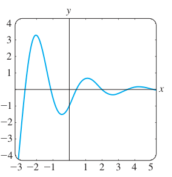
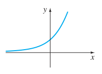
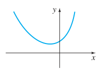
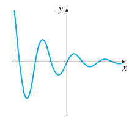
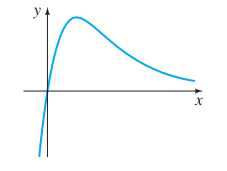
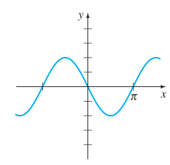
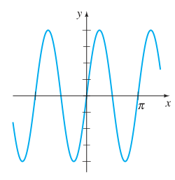

# 4.3 Ecuaciones lineales homogéneas con coeficientes constantes

> Fuente editorial atribuida a Zill por el archivo
> `Ecuaciones diferenciales con aplicaciones de modelado - Zill.pdf`,
> `2020/15-EDO 2do Orden/`. El extracto no contiene portada bibliográfica ni año
> de edición. Sin atribución a ISI. Desde el segundo tema de PDF17 (impresa133)
> hasta el primer tema de PDF24 (impresa140). Continúa
> [reducción de orden](pdf2020-zill-01-b-reduccion-orden.md).

## Página 133 — 4.3 ECUACIONES LINEALES HOMOGÉNEAS CON COEFICIENTES CONSTANTES

REPASO DE MATERIAL

- Repase el problema 27 de los ejercicios 1.1 y del teorema 4.1.5.
- Repase el álgebra de solución de ecuaciones polinomiales.

**INTRODUCCIÓN.** Como un medio para motivar el análisis en esta sección se
tratan nuevamente las ecuaciones diferenciales de primer orden más
específicamente, las ecuaciones lineales, *homogéneas* $ay'+by=0$, donde los
coeficientes $a\ne0$ y $b$ son constantes. Este tipo de ecuación se resuelve ya
sea por variables separables o con ayuda de un factor integrante, pero hay otro
método de solución, uno que sólo utiliza álgebra. Antes de mostrar este método
alternativo, hacemos una observación: despejando $y'$ de la ecuación $ay'+by=0$
se obtiene $y'=ky$, donde $k$ es una constante. Esta observación revela la
naturaleza de la solución desconocida $y$; la única función elemental no trivial
cuya derivada es una constante múltiple de sí misma es la función exponencial
$e^{mx}$. Ahora el nuevo método de solución: si sustituimos $y=e^{mx}$ y
$y'=me^{mx}$ en $ay'+by=0$, se obtiene

$$
ame^{mx}+be^{mx}=0\quad\text{o}\quad e^{mx}(am+b)=0.
$$

Como $e^{mx}$ nunca es cero para valores reales de $x$, la última ecuación se
satisface sólo cuando $m$ es una solución o raíz de la ecuación polinomial de
primer grado $am+b=0$. Para este único valor de $m$, $y=e^{mx}$ es una solución
de la ED. Para mostrar esto, considere la ecuación de coeficientes constantes
$2y'+5y=0$. No es necesario realizar la derivación y la sustitución de
$y=e^{mx}$ en la ED; sólo se tiene que formar la ecuación $2m+5=0$ y despejar
$m$. De $m=-\frac52$ se concluye que $y=e^{-5x/2}$ es una solución de
$2y'+5y=0$, y su solución general en el intervalo $(-\infty,\infty)$ es
$y=c_1e^{-5x/2}$.

En esta sección veremos que el procedimiento anterior genera soluciones
exponenciales para las ED lineales homogéneas de orden superior,

$$
a_ny^{(n)}+a_{n-1}y^{(n-1)}+\cdots+a_2y''+a_1y'+a_0y=0,\tag{1}
$$

donde los coeficientes $a_i$, $i=0,1,\ldots,n$ son constantes reales y
$a_n\ne0$.

## Página 134

**ECUACIÓN AUXILIAR.** Se empieza por considerar el caso especial de la ecuación
de segundo orden

$$
ay''+by'+cy=0,\tag{2}
$$

donde $a,b$ y $c$ son constantes. Si se intenta encontrar una solución de la
forma $y=e^{mx}$, entonces después de sustituir $y'=me^{mx}$ y $y''=m^2e^{mx}$,
la ecuación (2) se convierte en

$$
am^2e^{mx}+bme^{mx}+ce^{mx}=0\quad\text{o}\quad e^{mx}(am^2+bm+c)=0.
$$

Como en la introducción se argumenta que debido a que $e^{mx}\ne0$ para toda
$x$, es obvio que la única forma en que $y=e^{mx}$ puede satisfacer la ecuación
diferencial (2) es cuando se elige $m$ como una raíz de la ecuación cuadrática

$$
am^2+bm+c=0.\tag{3}
$$

Esta última ecuación se llama **ecuación auxiliar** de la ecuación diferencial
(2). Como las dos raíces de (3) son $m_1=(-b+\sqrt{b^2-4ac})/2a$ y
$m_2=(-b-\sqrt{b^2-4ac})/2a$, habrá tres formas de la solución general de (2)
que corresponden a los tres casos:

- $m_1$ y $m_2$ reales y distintas $(b^2-4ac>0)$,
- $m_1$ y $m_2$ reales e iguales $(b^2-4ac=0)$, y
- $m_1$ y $m_2$ números conjugados complejos $(b^2-4ac<0)$.

Analicemos cada uno de estos casos.

**CASO 1: RAÍCES REALES Y DISTINTAS.** Bajo la suposición de que la ecuación
auxiliar (3) tiene dos raíces reales desiguales $m_1$ y $m_2$, encontramos dos
soluciones, $y_1=e^{m_1x}$ y $y_2=e^{m_2x}$. Vemos que estas funciones son
linealmente independientes en $(-\infty,\infty)$ y, por tanto, forman un
conjunto fundamental. Se deduce que la solución general de (2) en este intervalo
es

$$
y=c_1e^{m_1x}+c_2e^{m_2x}.\tag{4}
$$

**CASO II: RAÍCES REALES REPETIDAS.** Cuando $m_1=m_2$, necesariamente se
obtiene sólo una solución exponencial, $y_1=e^{m_1x}$. De la fórmula cuadrática
se encuentra que $m_1=-b/2a$ puesto que la única forma en que se tiene que
$m_1=m_2$ es tener $b^2-4ac=0$. Tenemos de (5) en la sección 4.2 que una segunda
solución de la ecuación es

$$
y_2=e^{m_1x}\int\frac{e^{2m_1x}}{e^{2m_1x}}\,dx
=e^{m_1x}\int dx=xe^{m_1x}.\tag{5}
$$

En (5) hemos usado el hecho de que $-b/a=2m_1$. La solución general es entonces

$$
y=c_1e^{m_1x}+c_2xe^{m_1x}.\tag{6}
$$

**CASO III: RAÍCES COMPLEJAS CONJUGADAS.** Si $m_1$ y $m_2$ son complejas,
entonces se puede escribir $m_1=\alpha+i\beta$ y $m_2=\alpha-i\beta$, donde
$\alpha$ y $\beta>0$ son reales $i^2=-1$. De manera formal, no hay diferencia
entre este caso y el caso I y, por tanto,

$$
y=C_1e^{(\alpha+i\beta)x}+C_2e^{(\alpha-i\beta)x}.
$$

Sin embargo, en la práctica se prefiere trabajar con funciones reales en lugar
de exponenciales complejas. Con este fin se usa la **fórmula de Euler**:

$$
e^{i\theta}=\cos\theta+i\operatorname{sen}\theta,
$$

donde $\theta$ es cualquier número real.\* Se tiene de esta fórmula que

$$
e^{i\beta x}=\cos\beta x+i\operatorname{sen}\beta x
\quad\text{y}\quad e^{-i\beta x}=\cos\beta x-i\operatorname{sen}\beta x,\tag{7}
$$

\*Una deducción formal de la fórmula de Euler se obtiene de la serie de
Maclaurin $e^x=\sum_{n=0}^{\infty}\frac{x^n}{n!}$ sustituyendo $x=i\theta$, con
$i^2=-1$, $i^3=-i,\ldots$ y después separando la serie en las partes real e
imaginaria. Así se establece la plausibilidad, por lo que podemos adoptar a
$\cos\theta+i\operatorname{sen}\theta$ como la *definición* de $e^{i\theta}$.

## Página 135

donde se usaron $\cos(-\beta x)=\cos\beta x$ y
$\operatorname{sen}(-\beta x)=-\operatorname{sen}\beta x$. Observe que si
primero se suma y luego se restan las dos ecuaciones en (7), se obtiene,
respectivamente,

$$
e^{i\beta x}+e^{-i\beta x}=2\cos\beta x
\quad\text{y}\quad e^{i\beta x}-e^{-i\beta x}=2i\operatorname{sen}\beta x.
$$

Puesto que $y=C_1e^{(\alpha+i\beta)x}+C_2e^{(\alpha-i\beta)x}$ es una solución
de (2) para alguna elección de las constantes $C_1$ y $C_2$, las elecciones
$C_1=C_2=1$ y $C_1=1,C_2=-1$ dan, a su vez, dos soluciones:

$$
y_1=e^{(\alpha+i\beta)x}+e^{(\alpha-i\beta)x}
\quad\text{y}\quad y_2=e^{(\alpha+i\beta)x}-e^{(\alpha-i\beta)x}.
$$

Pero

$$
y_1=e^{\alpha x}(e^{i\beta x}+e^{-i\beta x})=2e^{\alpha x}\cos\beta x
$$

y

$$
y_2=
e^{\alpha x}(e^{i\beta x}-e^{-i\beta x})=
2ie^{\alpha x}\operatorname{sen}\beta x.
$$

Por tanto, del corolario A) del teorema 4.1.2, los dos últimos resultados
muestran que $e^{\alpha x}\cos\beta x$ y $e^{\alpha x}\operatorname{sen}\beta x$
son soluciones reales de (2). Además, estas soluciones forman un conjunto
fundamental en $(-\infty,\infty)$. Por tanto, la solución general es

$$
y=c_1e^{\alpha x}\cos\beta x+c_2e^{\alpha x}\operatorname{sen}\beta x
=e^{\alpha x}(c_1\cos\beta x+c_2\operatorname{sen}\beta x).\tag{8}
$$

### EJEMPLO 1. ED de segundo orden

Resuelva las siguientes ecuaciones diferenciales.

a) $2y''-5y'-3y=0$; b) $y''-10y'+25y=0$; c) $y''+4y'+7y=0$.

**SOLUCIÓN.** Se dan las ecuaciones auxiliares, las raíces y las soluciones
generales correspondientes.

a) $2m^2-5m-3=(2m+1)(m-3)=0$, $m_1=-\frac12$, $m_2=3$.

De (4), $y=c_1e^{-x/2}+c_2e^{3x}$.

b) $m^2-10m+25=(m-5)^2=0$, $m_1=m_2=5$.

De (6), $y=c_1e^{5x}+c_2xe^{5x}$.

c) $m^2+4m+7=0$, $m_1=-2+\sqrt3i$, $m_2=-2-\sqrt3i$.

De (8) con $\alpha=-2$, $\beta=\sqrt3$,
$y=e^{-2x}(c_1\cos\sqrt3x+c_2\operatorname{sen}\sqrt3x)$.

### EJEMPLO 2. Un problema con valores iniciales

Resuelva $4y''+4y'+17y=0$, $y(0)=-1$, $y'(0)=2$.

**SOLUCIÓN.** Usando la fórmula cuadrática tenemos que las raíces de la ecuación
auxiliar $4m^2+4m+17=0$ son $m_1=-\frac12+2i$ y $m_2=-\frac12-2i$. Por tanto, de
la ecuación (8) se tiene que $y=e^{-x/2}(c_1\cos2x+c_2\operatorname{sen}2x)$.
Aplicando la condición $y(0)=-1$, se observa de
$e^0(c_1\cos0+c_2\operatorname{sen}0)=-1$ que $c_1=-1$. Derivando
$y=e^{-x/2}(-\cos2x+c_2\operatorname{sen}2x)$ y después usando $y'(0)=2$, se
obtiene $2c_2+\frac12=2$ o $c_2=\frac34$. Por tanto, la solución del PVI es
$y=e^{-x/2}(-\cos2x+\frac34\operatorname{sen}2x)$. En la figura 4.3.1 vemos que
la solución es oscilatoria, pero $y\to0$ conforme $x\to\infty$ y $|y|\to\infty$
conforme $x\to-\infty$.

**DOS ECUACIONES QUE MERECEN CONOCERSE.** Las dos ecuaciones diferenciales

$$
y''+k^2y=0\quad\text{y}\quad y''-k^2y=0,
$$

## Página 136

donde $k$ es real, son importantes en matemáticas aplicadas. Para $y''+k^2y=0$,
la ecuación auxiliar $m^2+k^2=0$ tienen raíces imaginarias $m_1=ki$ y $m_2=-ki$.
Con $\alpha=0$ y $\beta=k$ en (8) se ve que la solución general de la ED es

$$
y=c_1\cos kx+c_2\operatorname{sen}kx.\tag{9}
$$

Por otra parte, la ecuación auxiliar $m^2-k^2=0$ para $y''-k^2y=0$ tiene raíces
reales distintas $m_1=k$ y $m_2=-k$, y así por la ecuación (4) la solución
general de la ED es

$$
y=c_1e^{kx}+c_2e^{-kx}.\tag{10}
$$

Observe que si se elige $c_1=c_2=\frac12$ y $c_1=\frac12$, $c_2=-\frac12$ en
(10), se obtienen las soluciones particulares
$y=\frac12(e^{kx}+e^{-kx})=\cosh kx$ y
$y=\frac12(e^{kx}-e^{-kx})=\operatorname{senh}kx$. Puesto que $\cosh kx$ y
$\operatorname{senh}kx$ son linealmente independientes en algún intervalo del
eje $x$, una forma alternativa para la solución general de $y''-k^2y=0$ es

$$
y=c_1\cosh kx+c_2\operatorname{senh}kx.\tag{11}
$$

Vea los problemas 41 y 42 de los ejercicios 4.3.

**ECUACIONES DE ORDEN SUPERIOR.** En general, para resolver una ecuación
diferencial de $n$-ésimo orden (1) donde $a_i$, $i=0,1,\ldots,n$ son constantes
reales, se debe resolver una ecuación polinomial de $n$-ésimo grado

$$
a_nm^n+a_{n-1}m^{n-1}+\cdots+a_2m^2+a_1m+a_0=0.\tag{12}
$$

Si todas las raíces de (12) son reales y distintas, entonces la solución general
de (1) es

$$
y=c_1e^{m_1x}+c_2e^{m_2x}+\cdots+c_ne^{m_nx}.
$$

Es un poco difícil resumir los análogos de los casos II y III porque las raíces
de una ecuación auxiliar de grado mayor que dos ocurren en muchas combinaciones.
Por ejemplo, una ecuación de quinto grado podría tener cinco raíces reales
distintas, o tres raíces reales distintas y dos complejas, o una real y cuatro
complejas, o cinco raíces reales pero iguales, o cinco raíces reales pero dos de
ellas iguales, etc. Cuando $m_1$ es una raíz de multiplicidad $k$ de una
ecuación auxiliar de $n$-ésimo grado (es decir, $k$ raíces son iguales a $m_1$),
es posible demostrar que las soluciones linealmente independientes son

$$
e^{m_1x},\quad xe^{m_1x},\quad x^2e^{m_1x},\ldots,\quad x^{k-1}e^{m_1x}
$$

y la solución general debe contener la combinación lineal

$$
c_1e^{m_1x}+c_2xe^{m_1x}+c_3x^2e^{m_1x}+\cdots+c_kx^{k-1}e^{m_1x}.
$$

Por último, se debe recordar que cuando los coeficientes son reales, las raíces
complejas de una ecuación auxiliar siempre se presentan en pares conjugados.
Así, por ejemplo, una ecuación polinomial cúbica puede tener a lo más dos raíces
complejas.

### EJEMPLO 3. ED de tercer orden

Resuelva $y'''+3y''-4y=0$.

**SOLUCIÓN.** Debe ser evidente de la inspección de $m^3+3m^2-4=0$ que una raíz
es $m_1=1$, por tanto, $m-1$ es un factor de $m^3+3m^2-4$. Dividiendo se
encuentra que

$$
m^3+3m^2-4=(m-1)(m^2+4m+4)=(m-1)(m+2)^2,
$$

así las raíces son $m_2=m_3=-2$. Así, la solución general de la ED es
$y=c_1e^x+c_2e^{-2x}+c_3xe^{-2x}$.

## Página 137

### EJEMPLO 4. ED de cuarto orden

Resuelva $\frac{d^4y}{dx^4}+2\frac{d^2y}{dx^2}+y=0$.

**SOLUCIÓN.** La ecuación auxiliar $m^4+2m^2+1=(m^2+1)^2=0$ tiene raíces
$m_1=m_3=i$ y $m_2=m_4=-i$. Así, del caso II la solución es

$$
y=C_1e^{ix}+C_2e^{-ix}+C_3xe^{ix}+C_4xe^{-ix}.
$$

Por la fórmula de Euler el grupo $C_1e^{ix}+C_2e^{-ix}$ se puede rescribir como

$$
c_1\cos x+c_2\operatorname{sen}x
$$

después de redefinir de nuevo las constantes. De manera similar,
$x(C_3e^{ix}+C_4e^{-ix})$ se puede expresar como
$x(c_3\cos x+c_4\operatorname{sen}x)$. Por tanto, la solución general es

$$
y=c_1\cos x+c_2\operatorname{sen}x+c_3x\cos x+c_4x\operatorname{sen}x.
$$

El ejemplo 4 ilustra un caso especial cuando la ecuación auxiliar tiene raíces
repetidas complejas. En general, si $m_1=\alpha+i\beta$, $\beta>0$ es una raíz
compleja de multiplicidad $k$ de una ecuación auxiliar con coeficientes reales,
entonces su conjugada $m_2=\alpha-i\beta$ es también una raíz de multiplicidad
$k$. De las $2k$ soluciones con valores complejos

$$
\begin{aligned}
&e^{(\alpha+i\beta)x},\quad xe^{(\alpha+i\beta)x},\quad x^2e^{(\alpha+i\beta)x},
\ldots,\quad x^{k-1}e^{(\alpha+i\beta)x},\\
&e^{(\alpha-i\beta)x},\quad xe^{(\alpha-i\beta)x},\quad x^2e^{(\alpha-i\beta)x},
\ldots,\quad x^{k-1}e^{(\alpha-i\beta)x},
\end{aligned}
$$

concluimos, con la ayuda de la fórmula de Euler, que la solución general de la
ecuación diferencial correspondiente debe tener una combinación lineal de las
$2k$ soluciones reales linealmente independientes.

$$
\begin{aligned}
&e^{\alpha x}\cos\beta x,\quad xe^{\alpha x}\cos\beta x,\quad
x^2e^{\alpha x}\cos\beta x,\ldots,\quad x^{k-1}e^{\alpha x}\cos\beta x,\\
&e^{\alpha x}\operatorname{sen}\beta x,\quad
xe^{\alpha x}\operatorname{sen}\beta x,
\quad x^2e^{\alpha x}\operatorname{sen}\beta x,\ldots,
\quad x^{k-1}e^{\alpha x}\operatorname{sen}\beta x.
\end{aligned}
$$

En el ejemplo 4 identificamos $k=2$, $\alpha=0$ y $\beta=1$.

Por supuesto, el aspecto más difícil de resolver ecuaciones diferenciales de
coeficientes constantes es determinar las raíces de ecuaciones auxiliares de
grado mayor que dos. Por ejemplo, para resolver $3y'''+5y''+10y'-4y=0$, debemos
resolver $3m^3+5m^2+10m-4=0$. Algo que se puede intentar es probar la ecuación
auxiliar para raíces racionales. Recuerde que si $m_1=p/q$ es una raíz racional
(en su mínima expresión) de una ecuación auxiliar $a_nm^n+\cdots+a_1m+a_0=0$ con
coeficientes enteros, entonces $p$ es un factor de $a_0$ y $q$ es un factor de
$a_n$. Para la ecuación auxiliar cúbica específica, todos los factores de
$a_0=-4$ y $a_n=3$ son $p:\ \pm1,\pm2,\pm4$ y $q:\ \pm1,\pm3$ por lo que las
posibles raíces racionales son $p/q:\ \pm1,\pm2,\pm4,\pm\frac13,\pm\frac23,
\pm\frac43$. Entonces se puede probar cada uno de estos números, digamos, por
división sintética. De esta forma se descubre la raíz $m_1=\frac13$ y la
factorización

$$
3m^3+5m^2+10m-4=\left(m-\frac13\right)(3m^2+6m+12).
$$

De la fórmula cuadrática se obtienen las otras raíces $m_2=-1+\sqrt3i$ y
$m_3=-1-\sqrt3i$. Por tanto, la solución general de $3y'''+5y''+10y'-4y=0$ es
$y=c_1e^{x/3}+e^{-x}(c_2\cos\sqrt3x+c_3\operatorname{sen}\sqrt3x)$.

**USO DE COMPUTADORAS.** Determinar las raíces o aproximar las raíces de
ecuaciones auxiliares es un problema de rutina con una calculadora apropiada o
con un paquete de cómputo. Las ecuaciones polinomiales (en una variable) de
grado menor que cinco se resuelven por medio de fórmulas algebraicas usando las
instrucciones *solve* en *Mathematica* y *Maple*. Para ecuaciones polinomiales
de grado cinco o mayor podría ser necesario recurrir a comandos numéricos tales
como **NSolve** y **FindRoot** en *Mathematica*. Debido a su capacidad para
resolver ecuaciones polinomiales, no es sorprendente que estos sistemas alge-

## Página 138

braicos para computadora también puedan, usando sus comandos *dsolve*, dar
soluciones explícitas de ecuaciones diferenciales lineales homogéneas con
coeficientes constantes.

En el libro clásico *Differential Equations* de Ralph Palmer Agnew\* (que el
autor usó cuando era estudiante), se expresa el siguiente enunciado:

> No es razonable esperar que los alumnos de este curso tengan la capacidad y el
> equipo de cómputo necesario para resolver de manera eficaz ecuaciones tales
> como

$$
4.317\frac{d^4y}{dx^4}+2.179\frac{d^3y}{dx^3}+1.416\frac{d^2y}{dx^2}
+1.295\frac{dy}{dx}+3.169y=0.\tag{13}
$$

Aunque es debatible si en todos estos años ha mejorado la capacidad para
realizar cálculos, es indiscutible que la tecnología sí lo ha hecho. Si se tiene
acceso a un sistema algebraico para computadora, se podría ahora considerar
razonable la ecuación (13). Después de simplificar y efectuar algunas
sustituciones en el resultado, *Mathematica* genera la solución general
(aproximada)

$$
\begin{aligned}
y={}&c_1e^{-0.728852x}\cos(0.618605x)
+c_2e^{-0.728852x}\operatorname{sen}(0.618605x)\\
&+c_3e^{0.476478x}\cos(0.759081x)
+c_4e^{0.476478x}\operatorname{sen}(0.759081x).
\end{aligned}
$$

Por último, si se le presenta un problema con valores iniciales que consiste en,
digamos, una ecuación de cuarto orden, entonces para ajustar la solución general
de la ED a las cuatro condiciones iniciales, se deben resolver cuatro ecuaciones
lineales con las cuatro incógnitas ($c_1,c_2,c_3$ y $c_4$ en la solución
general). Si se emplea un SAC para resolver el sistema se puede ahorrar mucho
tiempo. Véanse los problemas 59 y 60 del ejercicio 4.3 y el problema 35 en
Repaso del capítulo 4.

\*McGraw-Hill, Nueva York, 1960.

### EJERCICIOS 4.3

*Las respuestas a los problemas con número impar comienzan en la página RES-4.*

En los problemas 1 a 14, obtenga la solución general de la ecuación diferencial
de segundo orden dada.

1\) $4y''+y'=0$.

2\) $y''-36y=0$.

3\) $y''-y'-6y=0$.

4\) $y''-3y'+2y=0$.

5\) $y''+8y'+16y=0$.

6\) $y''-10y'+25y=0$.

7\) $12y''-5y'-2y=0$.

8\) $y''+4y'-y=0$.

9\) $y''+9y=0$.

10\) $3y''+y=0$.

11\) $y''-4y'+5y=0$.

12\) $2y''+2y'+y=0$.

13\) $3y''+2y'+y=0$.

14\) $2y''-3y'+4y=0$.

En los problemas 15 a 28 encuentre la solución general de la ecuación
diferencial de orden superior dada.

15\) $y'''-4y''-5y'=0$.

16\) $y'''-y=0$.

17\) $y'''-5y''+3y'+9y=0$.

18\) $y'''+3y''-4y'-12y=0$.

19\) $\frac{d^3u}{dt^3}+\frac{d^2u}{dt^2}-2u=0$.

20\) $\frac{d^3x}{dt^3}-\frac{d^2x}{dt^2}-4x=0$.

21\) $y'''+3y''+3y'+y=0$.

22\) $y'''-6y''+12y'-8y=0$.

23\) $y^{(4)}+y'''+y''=0$.

24\) $y^{(4)}-2y''+y=0$.

25\) $16\frac{d^4y}{dx^4}+24\frac{d^2y}{dx^2}+9y=0$.

26\) $\frac{d^4y}{dx^4}+7\frac{d^2y}{dx^2}-18y=0$.

27\) $\frac{d^5u}{dr^5}+5\frac{d^4u}{dr^4}-2\frac{d^3u}{dr^3}
-10\frac{d^2u}{dr^2}+\frac{du}{dr}+5u=0$.

28\) $2\frac{d^5x}{ds^5}-7\frac{d^4x}{ds^4}+12\frac{d^3x}{ds^3}
+8\frac{d^2x}{ds^2}=0$.

En los problemas 29 a 36 resuelva el problema con valores iniciales.

29\) $y''+16y=0$, $y(0)=2$, $y'(0)=-2$.

30\) $\frac{d^2y}{d\theta^2}+y=0$, $y(\pi/3)=0$, $y'(\pi/3)=2$.

## Página 139

31\) $\frac{d^2y}{dt^2}-4\frac{dy}{dt}-5y=0$, $y(1)=0$, $y'(1)=2$.

32\) $4y''-4y'-3y=0$, $y(0)=1$, $y'(0)=5$.

33\) $y''+y'+2y=0$, $y(0)=y'(0)=0$.

34\) $y''-2y'+y=0$, $y(0)=5$, $y'(0)=10$.

35\) $y'''+12y''+36y'=0$, $y(0)=0$, $y'(0)=1$, $y''(0)=-7$.

36\) $y'''+2y''-5y'-6y=0$, $y(0)=y'(0)=0$, $y''(0)=1$.

En los problemas 37 a 40 resuelva el problema con valores en la frontera dado.

37\) $y''-10y'+25y=0$, $y(0)=1$, $y(1)=0$.

38\) $y''+4y=0$, $y(0)=0$, $y(\pi)=0$.

39\) $y''+y=0$, $y'(0)=0$, $y'(\pi/2)=0$.

40\) $y''-2y'+2y=0$, $y(0)=1$, $y(\pi)=1$.

En los problemas 41 y 42 resuelva el problema dado usando primero la forma de la
solución general dada en (10). Resuelva de nuevo esta vez usando la fórmula dada
en (11).

41\) $y''-3y=0$, $y(0)=1$, $y'(0)=5$.

42\) $y''-y=0$, $y(0)=1$, $y'(1)=0$.

En los problemas 43 a 48 cada figura representa la gráfica de una solución
particular de una de las siguientes ecuaciones diferenciales.

a) $y''-3y'-4y=0$; b) $y''+4y=0$.

c) $y''+2y'+y=0$; d) $y''+y=0$.

e) $y''+2y'+2y=0$; f) $y''-3y'+2y=0$.

Relacione una curva solución con una de las ecuaciones diferenciales. Explique
su razonamiento.

43\)

44\)

45\)

46\)

47\)

48\)

### Problemas para analizar

49\) Las raíces de una ecuación cúbica auxiliar son $m_1=4$ y $m_2=m_3=-5$. ¿Cuál
es la ecuación diferencial lineal homogénea correspondiente? Analice: ¿su
respuesta es única?

50\) Dos raíces de una ecuación auxiliar cúbica con coeficientes reales son
$m_1=-\frac12$ y $m_2=3+i$. ¿Cuál es la ecuación diferencial lineal homogénea
correspondiente?

## Página 140

51\) Determine la solución general de $y'''+6y''+y'-34y=0$ si se sabe que
$y_1=e^{-4x}\cos x$ es una solución.

52\) Para resolver $y^{(4)}+y=0$, es necesario encontrar las raíces de $m^4+1=0$.
Este es un problema trivial si se utiliza un SAC, pero también se resuelve a
mano trabajando con números complejos. Observe que $m^4+1=(m^2+1)^2-2m^2$. ¿Cómo
ayuda esto? Resuelva la ecuación diferencial.

53\) Compruebe que $y=\operatorname{senh}x-2\cos(x+\pi/6)$ es una solución
particular de $y^{(4)}-y=0$. Reconcilie esta solución particular con la solución
general de la ED.

54\) Considere el problema con valores en la frontera $y''+\lambda y=0$,
$y(0)=0$, $y(\pi/2)=0$. Analice: ¿es posible determinar valores de $\lambda$ tal
que el problema tenga a) soluciones triviales?, b) ¿soluciones no triviales?

### Tarea para el laboratorio de computación

En los problemas 55 a 58 use una computadora ya sea como ayuda para resolver la
ecuación auxiliar o como un medio para obtener de forma directa la solución
general de la ecuación diferencial dada. Si utiliza un SAC para obtener la
solución general, simplifique el resultado y si es necesario, escriba la
solución en términos de funciones reales.

55\) $y'''-6y''+2y'+y=0$.

56\) $6.11y'''+8.59y''+7.93y'+0.778y=0$.

57\) $3.15y^{(4)}-5.34y''+6.33y'-2.03y=0$.

58\) $y^{(4)}+2y''-y'+2y=0$.

En los problemas 59 y 60 utilice un SAC como ayuda para resolver la ecuación
auxiliar. Forme la solución general de la ecuación diferencial. Después utilice
un SAC como ayuda para resolver el sistema de ecuaciones para los coeficientes
$c_i$, $i=1,2,3,4$, que resulta cuando se aplican las condiciones iniciales a la
solución general.

59\) $2y^{(4)}+3y'''-16y''+15y'-4y=0$, $y(0)=-2$, $y'(0)=6$, $y''(0)=3$,
$y'''(0)=\frac12$.

60\) $y^{(4)}-3y'''+3y''-y'=0$, $y(0)=y'(0)=0$, $y''(0)=y'''(0)=1$.

Continúa en
[4.4 Coeficientes indeterminados: método de superposición](pdf2020-zill-01-d-superposicion.md),
que comienza en esta misma página del original.
