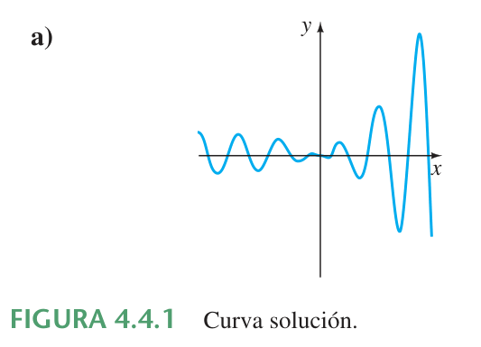
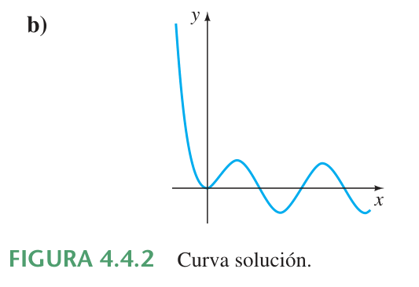
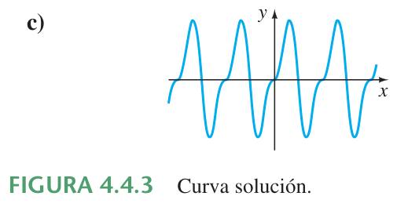
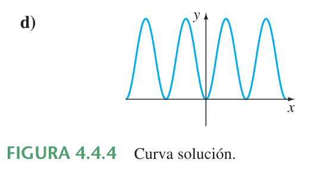

# Coeficientes indeterminados: método de superposición (continuación)

> Transcripción del extracto *Ecuaciones diferenciales con aplicaciones de
> modelado*, atribuido a Zill por el nombre del archivo.\\n> Páginas impresas
> 147–149 (páginas PDF 31–33 de la copia conservada). Material bibliográfico
> externo, conservado en la carpeta de 2020; no se atribuye a ISI ni se infiere
> año de publicación. El comienzo continúa un ejemplo iniciado antes del rango
> transcrito.

<!-- markdownlint-disable MD029 MD036 -->

## Página 147

La inspección de estas funciones muestra que un término en $`y_{p_2}`$ se
duplica en $`y_c`$. Si multiplicamos $`y_{p_2}`$ por $`x`$, se nota que el
término $`xe^{3x}`$ aún es parte de $`y_c`$. Pero multiplicando $`y_{p_2}`$ por
$`x^2`$ se eliminan las duplicaciones. Así la forma operativa de una solución
particular es

```math
y_p=Ax^2+Bx+C+Ex^2e^{3x}.
```

Derivando esta última forma y sustituyendo en la ecuación diferencial, agrupando
términos semejantes se obtiene

```math
y_p''-6y_p'+9y_p=9Ax^2+(-12A+9B)x+2A-6B+9C+2Ee^{3x}
=6x^2+2-12e^{3x}.
```

De esta identidad se tiene que $`A=\frac23`$, $`B=\frac89`$, $`C=\frac23`$ y
$`E=-6`$. Por tanto la solución general $`y=y_c+y_p`$ es

```math
y=c_1e^{3x}+c_2xe^{3x}+\frac23x^2+\frac89x+\frac23-6x^2e^{3x}.
```

### Ejemplo 10. ED de tercer orden. Caso I

Resuelva $`y'''+y''=e^x\cos x`$.

**Solución.** De la ecuación característica $`m^3+m^2=0`$ encontramos que
$`m_1=m_2=0`$ y $`m_3=-1`$. Así la función complementaria de la ecuación es
$`y_c=c_1+c_2x+c_3e^{-x}`$. Con $`g(x)=e^x\cos x`$, se ve de la entrada 10 de la
tabla 4.1 que se debe suponer

```math
y_p=Ae^x\cos x+Be^x\mathop{\mathrm{sen}}\nolimits x.
```

Debido a que no hay funciones en $`y_p`$ que dupliquen las funciones de la
solución complementaria, procedemos de la manera usual. De

```math
y_p'''+y_p''=(-2A+4B)e^x\cos x+(-4A-2B)e^x\mathop{\mathrm{sen}}\nolimits x=e^x\cos x
```

se obtiene $`-2A+4B=1`$ y $`-4A-2B=0`$. De este sistema se obtiene
$`A=-\frac1{10}`$ y $`B=\frac15`$, así que una solución particular es
$`y_p=-\frac1{10}e^x\cos x+\frac15e^x\mathop{\mathrm{sen}}\nolimits x`$. La
solución general de la ecuación es

```math
y=y_c+y_p=c_1+c_2x+c_3e^{-x}-\frac1{10}e^x\cos x+\frac15e^x\mathop{\mathrm{sen}}\nolimits x.
```

### Ejemplo 11. ED de cuarto orden. Caso II

Determine la forma de una solución particular de $`y^{(4)}+y'''=1-x^2e^{-x}`$.

**Solución.** Comparando $`y_c=c_1+c_2x+c_3x^2+c_4e^{-x}`$ con la suposición
normal para una solución particular

```math
y_p=\underbrace{A}_{y_{p_1}}+\underbrace{Bx^2e^{-x}+Cxe^{-x}+Ee^{-x}}_{y_{p_2}},
```

vemos que las duplicaciones entre $`y_c`$ y $`y_p`$ se eliminan cuando
$`y_{p_1}`$ se multiplica por $`x^3`$ y $`y_{p_2}`$ se multiplica por $`x`$. Así
la suposición correcta para una solución particular es

```math
y_p=Ax^3+Bx^3e^{-x}+Cx^2e^{-x}+Exe^{-x}.
```

## Página 148

### Comentarios

*i)* En los problemas 27 a 36 de los ejercicios 4.4 se pide resolver problemas
con valores iniciales y en los problemas 37 a 40 se pide resolver problemas con
valores en la frontera. Como se muestra en el ejemplo 8, asegúrese de aplicar
las condiciones iniciales o condiciones en la frontera a la solución general
$`y=y_c+y_p`$. Los estudiantes con frecuencia cometen el error de aplicar estas
condiciones sólo a la función complementaria $`y_c`$ porque ésta es la parte de
la solución que contiene las constantes $`c_1,c_2,\ldots,c_n`$.

*ii)* De la “Regla de la forma para el caso I” de la página 145 de esta sección,
se ve por qué el método de coeficientes indeterminados no es muy adecuado para
ED lineales no homogéneas cuando la función de entrada $`g(x)`$ es algo distinta
de uno de los cuatro tipos básicos resaltados en color azul en la página 141.
Por ejemplo, si $`P(x)`$ es un polinomio, entonces la derivación continua de
$`P(x)e^{\alpha x}\mathop{\mathrm{sen}}\nolimits \beta x`$ genera un conjunto
independiente que contiene sólo un número *finito* de funciones, todas del mismo
tipo, en particular, un polinomio multiplicado por
$`e^{\alpha x}\mathop{\mathrm{sen}}\nolimits \beta x`$ o un polinomio
multiplicado por $`e^{\alpha x}\cos\beta x`$. Por otro lado, la derivación
sucesiva de funciones de entrada como $`g(x)=\ln x`$ o $`g(x)=\tan^{-1}x`$
genera un conjunto independiente que contiene un número *infinito* de funciones:

```math
\text{derivadas de }\ln x:\quad \frac1x,\frac{-1}{x^2},\frac2{x^3},\ldots,
```

```math
\text{derivadas de }\tan^{-1}x:\quad
\frac1{1+x^2},\frac{-2x}{(1+x^2)^2},\frac{-2+6x^2}{(1+x^2)^3},\ldots.
```

### Ejercicios 4.4

*Las respuestas a los problemas con número impar comienzan en la página RES-5.*

En los problemas 1 a 26 resuelva la ecuación diferencial dada usando
coeficientes indeterminados.

1. $`y''+3y'+2y=6`$
1. $`4y''+9y=15`$
1. $`y''-10y'+25y=30x+3`$
1. $`y''+y'-6y=2x`$
1. $`\frac14y''+y'+y=x^2-2x`$
1. $`y''-8y'+20y=100x^2-26xe^x`$
1. $`y''+3y=-48x^2e^{3x}`$
1. $`4y''-4y'-3y=\cos2x`$
1. $`y''-y'=-3`$
1. $`y''+2y'=2x+5-e^{-2x}`$
1. $`y''-y'+\frac14y=3+e^{x/2}`$
1. $`y''-16y=2e^{4x}`$
1. $`y''+4y=3\mathop{\mathrm{sen}}\nolimits 2x`$
1. $`y''-4y=(x^2-3)\mathop{\mathrm{sen}}\nolimits 2x`$
1. $`y''+y=2x\mathop{\mathrm{sen}}\nolimits x`$
1. $`y''-5y'=2x^3-4x^2-x+6`$
1. $`y''-2y'+5y=e^x\cos2x`$
1. $`y''-2y'+2y=e^{2x}(\cos x-3\mathop{\mathrm{sen}}\nolimits x)`$
1. $`y''+2y'+y=\mathop{\mathrm{sen}}\nolimits x+3\cos2x`$
1. $`y''+2y'-24y=16-(x+2)e^{4x}`$
1. $`y'''-6y''=3-\cos x`$
1. $`y'''-2y''-4y'+8y=6xe^{2x}`$
1. $`y'''-3y''+3y'-y=x-4e^x`$
1. $`y'''-y''-4y'+4y=5-e^x+e^{2x}`$
1. $`y^{(4)}+2y''+y=(x-1)^2`$
1. $`y^{(4)}-y''=4x+2xe^{-x}`$

En los problemas 27 a 36 resuelva el problema con valores iniciales dado.

27. $`y''+4y=-2,\quad y(\pi/8)=\frac12,\ y'(\pi/8)=2`$
01. $`2y''+3y'-2y=14x^2-4x-11,\quad y(0)=0,\ y'(0)=0`$
01. $`5y''+y'=-6x,\quad y(0)=0,\ y'(0)=-10`$
01. $`y''+4y'+4y=(3+x)e^{-2x},\quad y(0)=2,\ y'(0)=5`$
01. $`y''+4y'+5y=35e^{-4x},\quad y(0)=-3,\ y'(0)=1`$

## Página 149

32. $`y''-y=\cosh x,\quad y(0)=2,\ y'(0)=12`$
01. $`\frac{d^2x}{dt^2}+\omega^2x=F_0\mathop{\mathrm{sen}}\nolimits \omega t,\quad x(0)=0,\ x'(0)=0`$
01. $`\frac{d^2x}{dt^2}+\omega^2x=F_0\cos\gamma t,\quad x(0)=0,\ x'(0)=0`$
01. $`y'''-2y''+y'=2-24e^x+40e^{5x},\quad y(0)=\frac12,\ y'(0)=\frac52,\ y''(0)=-\frac92`$
01. $`y'''+8y=2x-5+8e^{-2x},\quad y(0)=-5,\ y'(0)=3,\ y''(0)=-4`$

En los problemas 37 a 40 resuelva el problema con valores en la frontera dado.

37. $`y''+y=x^2+1,\quad y(0)=5,\ y(1)=0`$
01. $`y''-2y'+2y=2x-2,\quad y(0)=0,\ y(\pi)=\pi`$
01. $`y''+3y=6x,\quad y(0)=0,\ y(1)+y'(1)=0`$
01. $`y''+3y=6x,\quad y(0)+y'(0)=0,\ y(1)=0`$

En los problemas 41 y 42 resuelva el problema con valores iniciales dado en el
que la función de entrada $`g(x)`$ es discontinua. \[*Sugerencia:* Resuelva cada
problema en dos intervalos y después encuentre una solución tal que $`y`$ y
$`y'`$ sean continuas en $`x=\pi/2`$ (problema 41) y en $`x=\pi`$ (problema
42).\]

41. $`y''+4y=g(x),\quad y(0)=1,\ y'(0)=2`$, donde

    $$
    g(x)=\begin{cases}\mathop{\mathrm{sen}}\nolimits x,&0\le x\le\pi/2,\cr 0,&x\gt \pi/2.\end{cases}
    $$

01. $`y''-2y'+10y=g(x),\quad y(0)=0,\ y'(0)=0`$, donde

    $$
    g(x)=\begin{cases}20,&0\le x\le\pi,\cr 0,&x\gt \pi.\end{cases}
    $$

### Problemas para analizar

43. Considere la ecuación diferencial $`ay''+by'+cy=e^{kx}`$, donde $`a,b,c`$ y
    $`k`$ son constantes. La ecuación auxiliar de la ecuación homogénea asociada
    es $`am^2+bm+c=0`$.

    a) Si $`k`$ no es una raíz de la ecuación auxiliar, demuestre que se puede
    encontrar una solución particular de la forma $`y_p=Ae^{kx}`$, donde
    $`A=1/(ak^2+bk+c)`$.

    b) Si $`k`$ es una raíz de la ecuación auxiliar de multiplicidad uno,
    muestre que se puede encontrar una solución particular de la forma
    $`y_p=Axe^{kx}`$, donde $`A=1/(2ak+b)`$. Explique cómo se sabe que
    $`k\ne-b/2a`$.

    c) Si $`k`$ es una raíz de la ecuación auxiliar de multiplicidad dos,
    demuestre que podemos encontrar una solución particular de la forma
    $`y=Ax^2e^{kx}`$, donde $`A=1/(2a)`$.

01. Explique cómo se puede usar el método de esta sección para encontrar una
    solución particular de $`y''+y=\mathop{\mathrm{sen}}\nolimits x\cos2x`$.
    Lleve a cabo su idea.

01. Sin resolver, relacione una curva solución de $`y''+y=f(x)`$ que se muestra
    en la figura con una de las siguientes funciones:

    $$
    \begin{array}{ll}
        i)\ f(x)=1,&ii)\ f(x)=e^{-x},\cr
        iii)\ f(x)=e^x,&iv)\ f(x)=\mathop{\mathrm{sen}}\nolimits 2x,\cr
        v)\ f(x)=e^x\mathop{\mathrm{sen}}\nolimits x,&vi)\ f(x)=\mathop{\mathrm{sen}}\nolimits x.
        \end{array}
    $$

    Analice brevemente su razonamiento.









### Tarea para el laboratorio de computación

En los problemas 46 y 47 determine una solución particular de la ecuación
diferencial dada. Use un SAC como ayuda para realizar las derivadas,
simplificaciones y álgebra.

46. $`y''-4y'+8y=(2x^2-3x)e^{2x}\cos2x+(10x^2-x-1)e^{2x}\mathop{\mathrm{sen}}\nolimits 2x`$
01. $`y^{(4)}+2y''+y=2\cos x-3x\mathop{\mathrm{sen}}\nolimits x`$

## Nota de transcripción

Se conserva la referencia impresa a la “tabla 4.1” en el ejemplo 10.
