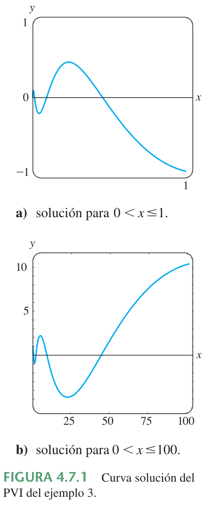

# 4.7 Ecuación de Cauchy-Euler

> Transcripción del extracto *Ecuaciones diferenciales con aplicaciones de
> modelado*, atribuido a Zill por el nombre del archivo. Páginas impresas
> 162–168 (PDF 46–52), sección 4.7. Material bibliográfico externo conservado en
> la carpeta de 2020; sin portada, edición ni año verificables en la copia.

<!-- markdownlint-disable MD029 MD036 -->

## Página 162 (comienzo de sección 4.7)

### Repaso de material

- Repase el concepto de la ecuación auxiliar en la sección 4.3.

### Introducción

La relativa facilidad con que pudimos encontrar soluciones explícitas de
ecuaciones lineales de orden superior con coeficientes constantes en las
secciones anteriores, en general no se realiza en ecuaciones lineales con
coeficientes variables. En el capítulo 6 veremos que cuando una ED lineal tiene
coeficientes variables, lo mejor que podemos esperar, *usualmente*, es encontrar
una solución en forma de serie infinita. Sin embargo, el tipo de ecuación
diferencial que consideramos en esta sección es una excepción a esta regla; esta
es una ecuación lineal con coeficientes variables cuya solución general siempre
se puede expresar en términos de potencias de $`x`$, senos, cosenos y funciones
logarítmicas. Además este método de solución es bastante similar al de las
ecuaciones con coeficientes constantes en los que se debe resolver una ecuación
auxiliar.

## Página 163

### Ecuación de Cauchy-Euler

Una ecuación diferencial lineal de la forma

```math
a_nx^n\frac{d^ny}{dx^n}+a_{n-1}x^{n-1}\frac{d^{n-1}y}{dx^{n-1}}
+\cdots+a_1x\frac{dy}{dx}+a_0y=g(x),
```

donde los coeficientes $`a_n,a_{n-1},\ldots,a_0`$ son constantes, se conoce como
**ecuación de Cauchy-Euler**. La característica observable de este tipo de
ecuación es que el grado $`k=n,n-1,\ldots,1,0`$ de los coeficientes monomiales
$`x^k`$ coincide con el orden $`k`$ de la derivación $`d^ky/dx^k`$:

```math
a_nx^{\overbrace{n}^{\text{mismo}}}\frac{d^{\overbrace{n}^{\text{mismo}}}y}{dx^n}
+a_{n-1}x^{\overbrace{n-1}^{\text{mismo}}}
\frac{d^{\overbrace{n-1}^{\text{mismo}}}y}{dx^{n-1}}+\cdots.
```

Al igual que en la sección 4.3, iniciamos el análisis con un examen detallado de
las formas de las soluciones generales de la ecuación homogénea de segundo orden

```math
ax^2\frac{d^2y}{dx^2}+bx\frac{dy}{dx}+cy=0.
```

La solución de ecuaciones de orden superior se deduce de manera análoga.
También, podemos resolver la ecuación no homogénea $`ax^2y''+bxy'+cy=g(x)`$ por
variación de parámetros, una vez que se ha determinado la función complementaria
$`y_c`$.

**Nota.** El coeficiente $`ax^2`$ de $`y''`$ es cero en $`x=0`$. Por lo que,
para garantizar que los resultados fundamentales del teorema 4.1.1 sean
aplicables a la ecuación de Cauchy-Euler, centramos nuestra atención en
encontrar soluciones generales definidas en el intervalo $`(0,\infty)`$. Las
soluciones en el intervalo $`(-\infty,0)`$ se obtienen al sustituir $`t=-x`$ en
la ecuación diferencial. Véanse los problemas 37 y 38 de los ejercicios 4.7.

### Método de solución

Se prueba una solución de la forma $`y=x^m`$, donde $`m`$ es un valor que se
debe determinar. Análogo a lo que sucede cuando se sustituye $`e^{mx}`$ en una
ecuación lineal con coeficientes constantes, cuando se sustituye $`x^m`$, cada
término de una ecuación de Cauchy-Euler se convierte en un polinomio en $`m`$
veces $`x^m`$, puesto que

```math
a_kx^k\frac{d^ky}{dx^k}
=a_kx^km(m-1)(m-2)\cdots(m-k+1)x^{m-k}
=a_km(m-1)(m-2)\cdots(m-k+1)x^m.
```

Por ejemplo, cuando sustituimos $`y=x^m`$, la ecuación de segundo orden se
transforma en

```math
ax^2\frac{d^2y}{dx^2}+bx\frac{dy}{dx}+cy
=am(m-1)x^m+bmx^m+cx^m=(am(m-1)+bm+c)x^m.
```

Así $`y=x^m`$ es una solución de la ecuación diferencial siempre que $`m`$ sea
una solución de la **ecuación auxiliar**

```math
am(m-1)+bm+c=0\quad\text{o}\quad am^2+(b-a)m+c=0. \tag{1}
```

Hay tres casos distintos a considerar que dependen de si las raíces de esta
ecuación cuadrática son reales y distintas, reales e iguales o complejas. En el
último caso las raíces aparecen como un par conjugado.

### Caso I: raíces reales y distintas

Sean $`m_1`$ y $`m_2`$ las raíces reales de (1), tales que $`m_1\ne m_2`$.
Entonces $`y_1=x^{m_1}`$ y $`y_2=x^{m_2}`$ forman un conjunto fundamental de
soluciones. Por tanto, la solución general es

```math
y=c_1x^{m_1}+c_2x^{m_2}. \tag{2}
```

## Página 164

### Ejemplo 1. Raíces distintas

Resuelva $`x^2\frac{d^2y}{dx^2}-2x\frac{dy}{dx}-4y=0`$.

**Solución.** En lugar de memorizar la ecuación (1), algunas veces es preferible
suponer $`y=x^m`$ como la solución para entender el origen y la diferencia entre
esta nueva forma de ecuación auxiliar y la obtenida en la sección 4.3. Derive
dos veces,

```math
\frac{dy}{dx}=mx^{m-1},\qquad \frac{d^2y}{dx^2}=m(m-1)x^{m-2},
```

y sustituyendo esto en la ecuación diferencial

```math
\begin{aligned}
x^2\frac{d^2y}{dx^2}-2x\frac{dy}{dx}-4y
&=x^2\cdot m(m-1)x^{m-2}-2x\cdot mx^{m-1}-4x^m\\
&=x^m(m(m-1)-2m-4)=x^m(m^2-3m-4)=0
\end{aligned}
```

si $`m^2-3m-4=0`$. Ahora $`(m+1)(m-4)=0`$ implica que $`m_1=-1`$, $`m_2=4`$, así
que $`y=c_1x^{-1}+c_2x^4`$.

### Caso II: raíces reales repetidas

Si las raíces de (1) son repetidas (es decir, $`m_1=m_2`$), entonces se obtiene
sólo una solución particular, $`y=x^{m_1}`$. Cuando las raíces de la ecuación
cuadrática $`am^2+(b-a)m+c=0`$ son iguales, el discriminante de los coeficientes
necesariamente es cero. De la fórmula cuadrática se deduce que las raíces deben
ser $`m_1=-(b-a)/2a`$.

Ahora se puede construir una segunda solución $`y_2`$, con la ecuación (5) de la
sección 4.2. Primero se escribe la ecuación de Cauchy-Euler en la forma estándar

```math
\frac{d^2y}{dx^2}+\frac b{ax}\frac{dy}{dx}+\frac c{ax^2}y=0
```

y haciendo las identificaciones $`P(x)=b/ax`$ y $`\int(b/ax)\,dx=(b/a)\ln x`$.
Así

```math
\begin{aligned}
y_2&=x^{m_1}\int\frac{e^{-(b/a)\ln x}}{x^{2m_1}}\,dx\\
&=x^{m_1}\int x^{-b/a}\cdot x^{-2m_1}\,dx
&&\leftarrow e^{-(b/a)\ln x}=e^{\ln x^{-b/a}}=x^{-b/a}\\
&=x^{m_1}\int x^{-b/a}\cdot x^{(b-a)/a}\,dx
&&\leftarrow -2m_1=(b-a)/a\\
&=x^{m_1}\int\frac{dx}x=x^{m_1}\ln x.
\end{aligned}
```

La solución general es entonces

```math
y=c_1x^{m_1}+c_2x^{m_1}\ln x. \tag{3}
```

### Ejemplo 2. Raíces repetidas

Resuelva $`4x^2\frac{d^2y}{dx^2}+8x\frac{dy}{dx}+y=0`$.

**Solución.** Sustituyendo $`y=x^m`$ se obtiene

```math
4x^2\frac{d^2y}{dx^2}+8x\frac{dy}{dx}+y
=x^m(4m(m-1)+8m+1)=x^m(4m^2+4m+1)=0
```

## Página 165

donde $`4m^2+4m+1=0`$ o $`(2m+1)^2=0`$. Puesto que $`m_1=-\frac12`$, la solución
general es $`y=c_1x^{-1/2}+c_2x^{-1/2}\ln x`$.

Para ecuaciones de orden superior, si $`m_1`$ es una raíz de multiplicidad
$`k`$, entonces se puede demostrar que

```math
x^{m_1},\quad x^{m_1}\ln x,\quad x^{m_1}(\ln x)^2,\ldots,\quad
x^{m_1}(\ln x)^{k-1}
```

son $`k`$ soluciones linealmente independientes. En correspondencia, la solución
general de la ecuación diferencial debe contener una combinación lineal de estas
$`k`$ soluciones.

### Caso III: raíces complejas conjugadas

Si las raíces de (1) son el par conjugado $`m_1=\alpha+i\beta`$,
$`m_2=\alpha-i\beta`$, donde $`\alpha`$ y $`\beta\gt 0`$ son reales, entonces
una solución es

```math
y=C_1x^{\alpha+i\beta}+C_2x^{\alpha-i\beta}.
```

Pero cuando las raíces de la ecuación auxiliar son complejas, como en el caso de
las ecuaciones con coeficientes constantes, se desea escribir la solución sólo
en términos de funciones reales. Observemos la identidad

```math
x^{i\beta}=(e^{\ln x})^{i\beta}=e^{i\beta\ln x},
```

que, por la fórmula de Euler, es lo mismo que

```math
x^{i\beta}=\cos(\beta\ln x)+i\mathop{\mathrm{sen}}\nolimits (\beta\ln x).
```

De forma similar,

```math
x^{-i\beta}=\cos(\beta\ln x)-i\mathop{\mathrm{sen}}\nolimits (\beta\ln x).
```

Si se suman y restan los dos últimos resultados, se obtiene

```math
x^{i\beta}+x^{-i\beta}=2\cos(\beta\ln x)
\quad\text{y}\quad
x^{i\beta}-x^{-i\beta}=2i\mathop{\mathrm{sen}}\nolimits (\beta\ln x),
```

respectivamente. Del hecho de que
$`y=C_1x^{\alpha+i\beta}+C_2x^{\alpha-i\beta}`$ es una solución para cualquier
valor de las constantes, note, a su vez, para $`C_1=C_2=1`$ y $`C_1=1`$,
$`C_2=-1`$ que

```math
y_1=x^\alpha(x^{i\beta}+x^{-i\beta})
\quad\text{y}\quad y_2=x^\alpha(x^{i\beta}-x^{-i\beta})
```

o

```math
y_1=2x^\alpha\cos(\beta\ln x)
\quad\text{y}\quad y_2=2ix^\alpha\mathop{\mathrm{sen}}\nolimits (\beta\ln x)
```

también son soluciones. Como
$`W(x^\alpha\cos(\beta\ln x),x^\alpha\mathop{\mathrm{sen}}\nolimits (\beta\ln x))
=\beta x^{2\alpha-1}\ne0`$, $`\beta\gt 0`$ en el intervalo $`(0,\infty)`$, se
concluye que

```math
y_1=x^\alpha\cos(\beta\ln x)\quad\text{y}\quad
y_2=x^\alpha\mathop{\mathrm{sen}}\nolimits (\beta\ln x)
```

constituyen un conjunto fundamental de soluciones reales de la ecuación
diferencial. Así la solución general es

```math
y=x^\alpha[c_1\cos(\beta\ln x)+c_2\mathop{\mathrm{sen}}\nolimits (\beta\ln x)]. \tag{4}
```

### Ejemplo 3. Problema con valores iniciales

Resuelva $`4x^2y''+17y=0`$, $`y(1)=-1`$, $`y'(1)=-\frac12`$.

**Solución.** El término $`y'`$ falta en la ecuación de Cauchy-Euler; sin
embargo, la sustitución $`y=x^m`$ produce

```math
4x^2y''+17y=x^m(4m(m-1)+17)=x^m(4m^2-4m+17)=0
```

donde $`4m^2-4m+17=0`$. De la fórmula cuadrática se encuentra que las raíces son
$`m_1=\frac12+2i`$ y $`m_2=\frac12-2i`$. Con las identificaciones
$`\alpha=\frac12`$ y $`\beta=2`$ se ve de (4) que la solución general de la
ecuación diferencial es

```math
y=x^{1/2}[c_1\cos(2\ln x)+c_2\mathop{\mathrm{sen}}\nolimits (2\ln x)].
```

Aplicando las condiciones iniciales $`y(1)=-1`$, $`y'(1)=-\frac12`$ la solución
anterior y usando $`\ln1=0`$, se obtiene, a su vez, que $`c_1=-1`$ y $`c_2=0`$.
Así la solución del problema



## Página 166

con valores iniciales es $`y=-x^{1/2}\cos(2\ln x)`$. En la figura 4.7.1 se
presenta la gráfica de esta función que se obtuvo con ayuda de un paquete de
cómputo. Se observa que la solución particular es oscilatoria y no acotada
conforme $`x\to\infty`$.

En el ejemplo siguiente se ilustra la solución de una ecuación de Cauchy-Euler
de tercer orden.

### Ejemplo 4. Ecuación de tercer orden

Resuelva $`x^3\frac{d^3y}{dx^3}+5x^2\frac{d^2y}{dx^2}+7x\frac{dy}{dx}+8y=0`$.

**Solución.** Las tres primeras derivadas de $`y=x^m`$ son

```math
\frac{dy}{dx}=mx^{m-1},\quad
\frac{d^2y}{dx^2}=m(m-1)x^{m-2},\quad
\frac{d^3y}{dx^3}=m(m-1)(m-2)x^{m-3},
```

así la ecuación diferencial dada se convierte en

```math
\begin{aligned}
x^3\frac{d^3y}{dx^3}+5x^2\frac{d^2y}{dx^2}+7x\frac{dy}{dx}+8y
&=x^3m(m-1)(m-2)x^{m-3}+5x^2m(m-1)x^{m-2}+7xmx^{m-1}+8x^m\\
&=x^m(m(m-1)(m-2)+5m(m-1)+7m+8)\\
&=x^m(m^3+2m^2+4m+8)=x^m(m+2)(m^2+4)=0.
\end{aligned}
```

En este caso veremos que $`y=x^m`$ es una solución de la ecuación diferencial
para $`m_1=-2`$, $`m_2=2i`$ y $`m_3=-2i`$. Por tanto, la solución general es
$`y=c_1x^{-2}+c_2\cos(2\ln x)+c_3\mathop{\mathrm{sen}}\nolimits (2\ln x)`$.

El método de coeficientes indeterminados que se describió en las secciones 4.5 y
4.6 no se aplica, *en general*, a las ecuaciones diferenciales lineales con
coeficientes variables. Por tanto en el siguiente ejemplo se emplea el método de
variación de parámetros.

### Ejemplo 5. Variación de parámetros

Resuelva $`x^2y''-3xy'+3y=2x^4e^x`$.

**Solución.** Puesto que la ecuación es no homogénea, primero se resuelve la
ecuación homogénea asociada. De la ecuación auxiliar $`(m-1)(m-3)=0`$ se
encuentra $`y_c=c_1x+c_2x^3`$. Ahora, antes de usar la variación de parámetros
para encontrar una solución particular $`y_p=u_1y_1+u_2y_2`$, recuerde que las
fórmulas $`u_1'=W_1/W`$ y $`u_2'=W_2/W`$, donde $`W_1`$, $`W_2`$ y $`W`$, son
los determinantes definidos en la página 158, que se dedujeron bajo la
suposición de que la ecuación diferencial se escribió en la forma estándar
$`y''+P(x)y'+Q(x)y=f(x)`$. Por tanto, dividiendo entre $`x^2`$ la ecuación dada,

```math
y''-\frac3xy'+\frac3{x^2}y=2x^2e^x
```

hacemos la identificación $`f(x)=2x^2e^x`$. Ahora con $`y_1=x`$, $`y_2=x^3`$, y

```math
W=\begin{vmatrix}x&x^3\\1&3x^2\end{vmatrix}=2x^3,\quad
W_1=\begin{vmatrix}0&x^3\\2x^2e^x&3x^2\end{vmatrix}=-2x^5e^x,\quad
W_2=\begin{vmatrix}x&0\\1&2x^2e^x\end{vmatrix}=2x^3e^x,
```

encontramos

```math
u_1'=-\frac{2x^5e^x}{2x^3}=-x^2e^x
\quad\text{y}\quad u_2'=\frac{2x^3e^x}{2x^3}=e^x.
```

## Página 167

La integral de la última función es inmediata, pero en el caso de $`u_1'`$ se
integra por partes dos veces. Los resultados son $`u_1=-x^2e^x+2xe^x-2e^x`$ y
$`u_2=e^x`$. Por tanto $`y_p=u_1y_1+u_2y_2`$ es

```math
y_p=(-x^2e^x+2xe^x-2e^x)x+e^xx^3=2x^2e^x-2xe^x.
```

Finalmente,

```math
y=y_c+y_p=c_1x+c_2x^3+2x^2e^x-2xe^x.
```

### Reducción a coeficientes constantes

Las similitudes entre las formas de soluciones de ecuaciones de Cauchy-Euler y
soluciones de ecuaciones lineales con coeficientes constantes no sólo son una
coincidencia. Por ejemplo, cuando las raíces de las ecuaciones auxiliares para
$`ay''+by'+cy=0`$ y $`ax^2y''+bxy'+cy=0`$ son distintas y reales, las soluciones
generales respectivas son

```math
y=c_1e^{m_1x}+c_2e^{m_2x}
\quad\text{y}\quad y=c_1x^{m_1}+c_2x^{m_2},\quad x\gt 0. \tag{5}
```

Usando la identidad $`e^{\ln x}=x`$, $`x\gt 0`$, la segunda solución dada en (5)
puede expresarse en la misma forma que la primera solución:

```math
y=c_1e^{m_1\ln x}+c_2e^{m_2\ln x}=c_1e^{m_1t}+c_2e^{m_2t},
```

donde $`t=\ln x`$. Este último resultado ilustra el hecho de que cualquier
ecuación de Cauchy-Euler siempre se puede escribir de nuevo como una ecuación
diferencial lineal con coeficientes constantes sustituyendo $`x=e^t`$. La idea
es resolver la nueva ecuación diferencial en términos de la variable $`t`$,
usando los métodos de las secciones anteriores y una vez obtenida la solución
general, sustituir nuevamente $`t=\ln x`$. Este método, que se ilustró en el
último ejemplo, requiere el uso de la regla de la cadena de la derivación.

### Ejemplo 6. Cambio a coeficientes constantes

Resuelva $`x^2y''-xy'+y=\ln x`$.

**Solución.** Sustituyendo $`x=e^t`$ o $`t=\ln x`$, se tiene que

```math
\frac{dy}{dx}=\frac{dy}{dt}\frac{dt}{dx}=\frac1x\frac{dy}{dt}
\qquad\leftarrow\text{Regla de la cadena}
```

```math
\begin{aligned}
\frac{d^2y}{dx^2}
&=\frac1x\frac d{dx}\left(\frac{dy}{dt}\right)
+\frac{dy}{dt}\left(-\frac1{x^2}\right)
&&\leftarrow\text{Regla del producto y regla de la cadena}\\
&=\frac1x\left(\frac{d^2y}{dt^2}\frac1x\right)
+\frac{dy}{dt}\left(-\frac1{x^2}\right)
=\frac1{x^2}\left(\frac{d^2y}{dt^2}-\frac{dy}{dt}\right).
\end{aligned}
```

Sustituyendo en la ecuación diferencial dada y simplificando se obtiene

```math
\frac{d^2y}{dt^2}-2\frac{dy}{dt}+y=t.
```

Como esta última ecuación tiene coeficientes constantes, su ecuación auxiliar es
$`m^2-2m+1=0`$, o $`(m-1)^2=0`$. Así se obtiene $`y_c=c_1e^t+c_2te^t`$.

Usando coeficientes indeterminados se prueba una solución particular de la forma
$`y_p=A+Bt`$. Esta suposición conduce a $`-2B+A+Bt=t`$, por tanto $`A=2`$ y
$`B=1`$. Usando $`y=y_c+y_p`$, se obtiene

```math
y=c_1e^t+c_2te^t+2+t,
```

así la solución general de la ecuación diferencial original en el intervalo
$`(0,\infty)`$ es $`y=c_1x+c_2x\ln x+2+\ln x`$.

## Página 168

### Ejercicios 4.7

*Las respuestas a los problemas con número impar comienzan en la página RES-5.*

En los problemas 1 a 18 resuelva la ecuación diferencial dada.

1. $`x^2y''-2y=0`$
1. $`4x^2y''+y=0`$
1. $`xy''+y'=0`$
1. $`xy''-3y'=0`$
1. $`x^2y''+xy'+4y=0`$
1. $`x^2y''+5xy'+3y=0`$
1. $`x^2y''-3xy'-2y=0`$
1. $`x^2y''+3xy'-4y=0`$
1. $`25x^2y''+25xy'+y=0`$
1. $`4x^2y''+4xy'-y=0`$
1. $`x^2y''+5xy'+4y=0`$
1. $`x^2y''+8xy'+6y=0`$
1. $`3x^2y''+6xy'+y=0`$
1. $`x^2y''-7xy'+41y=0`$
1. $`x^3y'''-6y=0`$
1. $`x^3y'''+xy'-y=0`$
1. $`xy^{(4)}+6y'''=0`$
1. $`x^4y^{(4)}+6x^3y'''+9x^2y''+3xy'+y=0`$

En los problemas 19 a 24 resuelva la ecuación diferencial dada por variación de
parámetros.

19. $`xy''-4y'=x^4`$
01. $`2x^2y''+5xy'+y=x^2-x`$
01. $`x^2y''-xy'+y=2x`$
01. $`x^2y''-2xy'+2y=x^4e^x`$
01. $`x^2y''+xy'-y=\ln x`$
01. $`x^2y''+xy'-y=1/(x+1)`$

En los problemas 25 a 30 resuelva el problema con valores iniciales. Use una
aplicación para graficar y obtenga la gráfica de la curva solución.

25. $`x^2y''+3xy'=0,\quad y(1)=0,\ y'(1)=4`$
01. $`x^2y''-5xy'+8y=0,\quad y(2)=32,\ y'(2)=0`$
01. $`x^2y''+xy'+y=0,\quad y(1)=1,\ y'(1)=2`$
01. $`x^2y''-3xy'+4y=0,\quad y(1)=5,\ y'(1)=3`$
01. $`xy''+y'=x,\quad y(1)=1,\ y'(1)=-\frac12`$
01. $`x^2y''-5xy'+8y=8x^6,\quad y(\frac12)=0,\ y'(\frac12)=0`$

En los problemas 31 a 36 use la sustitución $`x=e^t`$ para convertir la ecuación
de Cauchy-Euler a una ecuación diferencial con coeficientes constantes. Resuelva
la ecuación original al resolver la nueva ecuación usando los procedimientos de
las secciones 4.3 a 4.5.

31. $`x^2y''+9xy'-20y=0`$
01. $`x^2y''-9xy'+25y=0`$
01. $`x^2y''+10xy'+8y=x^2`$
01. $`x^2y''-4xy'+6y=\ln x^2`$
01. $`x^2y''-3xy'+13y=4+3x`$
01. $`x^3y'''-3x^2y''+6xy'-6y=3+\ln x^3`$

En los problemas 37 y 38 resuelva el problema con valores iniciales dado en el
intervalo $`(-\infty,0)`$.

37. $`4x^2y''+y=0,\quad y(-1)=2,\ y'(-1)=4`$
01. $`x^2y''-4xy'+6y=0,\quad y(-2)=8,\ y'(-2)=0`$

### Problemas para analizar

39. ¿Cómo podría utilizar el método de esta sección para resolver

    ```math
    (x+2)^2y''+(x+2)y'+y=0?
    ```

    Lleve a cabo sus ideas. Exprese un intervalo en el cual esté definida la
    solución.

01. ¿Es posible encontrar una ecuación diferencial de Cauchy-Euler de orden
    mínimo con coeficientes reales si se sabe que 2 y $`1-i`$ son raíces de su
    ecuación auxiliar? Lleve a cabo sus ideas.

01. Las condiciones iniciales $`y(0)=y_0`$, $`y'(0)=y_1`$ se aplican a cada una
    de las siguientes ecuaciones diferenciales:

    ```math
    \begin{aligned}
        x^2y''&=0,\\
        x^2y''-2xy'+2y&=0,\\
        x^2y''-4xy'+6y&=0.
        \end{aligned}
    ```

    ¿Para qué valores de $`y_0`$ y $`y_1`$ cada problema con valores iniciales
    tiene una solución?

01. ¿Cuáles son las intersecciones con el eje $`x`$ de la curva solución que se
    muestra en la figura 4.7.1? ¿Cuántas intersecciones con el eje $`x`$ hay en
    $`0\lt x\lt \frac12`$?

### Tarea para el laboratorio de computación

En los problemas 43 al 46 resuelva la ecuación diferencial dada usando un SAC
para encontrar las raíces (aproximadas) de la ecuación auxiliar.

43. $`2x^3y'''-10.98x^2y''+8.5xy'+1.3y=0`$
01. $`x^3y'''+4x^2y''+5xy'-9y=0`$
01. $`x^4y^{(4)}+6x^3y'''+3x^2y''-3xy'+4y=0`$
01. $`x^4y^{(4)}-6x^3y'''+33x^2y''-105xy'+169y=0`$
01. Resuelva $`x^3y'''-x^2y''-2xy'+6y=x^2`$ por variación de parámetros. Use un
    SAC como ayuda para calcular las raíces de la ecuación auxiliar y los
    determinantes dados en (10) de la sección 4.6.

## Notas de transcripción

Se conservan las referencias originales a “secciones 4.5 y 4.6” en la página 166
y a “último ejemplo” en la página 167. El enunciado sobre $`\alpha`$ y
$`\beta\gt 0`$ en el caso III se mantiene como aparece impreso. Los cuadros en
las fórmulas sustituyen el sombreado original; las indicaciones de igualdad de
órdenes se mantienen mediante anotaciones matemáticas.
