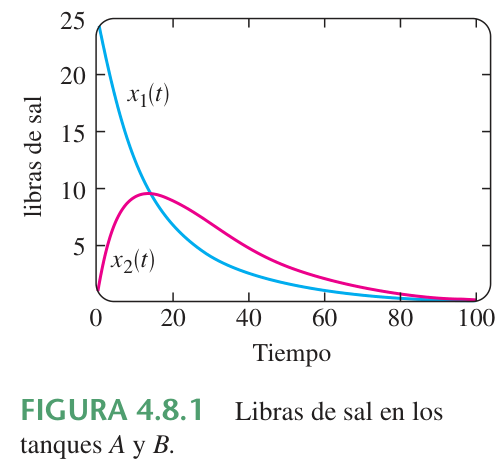
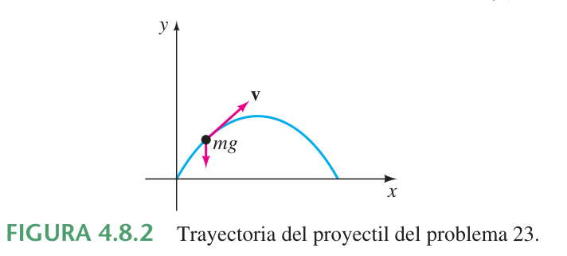
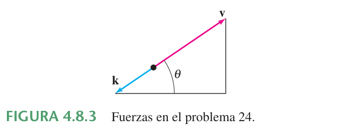

# 4.8 Solución de sistemas de ED lineales por eliminación

> Transcripción del extracto *Ecuaciones diferenciales con aplicaciones de
> modelado*, atribuido a Zill por el nombre del archivo. Páginas impresas
> 169–173 (PDF 53–57). Material bibliográfico externo conservado en la carpeta
> de 2020; sin portada, edición ni año verificables en la copia.

<!-- markdownlint-disable MD029 MD036 -->

## Página 169

### Repaso de material

- Puesto que el método de eliminación sistemática desacopla un sistema en
  distintas EDO lineales en cada variable dependiente, esta sección le brinda la
  oportunidad de practicar lo que aprendió en las secciones 4.3, 4.4 (o 4.5) y
  4.6.

### Introducción

Las ecuaciones diferenciales ordinarias simultáneas tienen que ver con dos o más
ecuaciones que contienen derivadas de dos o más variables dependientes (las
funciones desconocidas) respecto a una sola variable independiente. El método de
**eliminación sistemática** para resolver sistemas de ecuaciones diferenciales
con coeficientes constantes se basa en el principio algebraico de eliminación de
variables. Veremos que la operación análoga de *multiplicar* una ecuación
algebraica por una constante es *operar* en una EDO con cierta combinación de
derivadas.

### Eliminación sistemática

La eliminación de una incógnita en un sistema de ecuaciones diferenciales
lineales se facilita al rescribir cada ecuación del sistema en notación de
operador diferencial. Recuerde de la sección 4.1 que una sola ecuación lineal

```math
a_ny^{(n)}+a_{n-1}y^{(n-1)}+\cdots+a_1y'+a_0y=g(t),
```

donde las $`a_i`$, $`i=0,1,\ldots,n`$ son constantes, puede escribirse como

```math
(a_nD^n+a_{n-1}D^{(n-1)}+\cdots+a_1D+a_0)y=g(t).
```

Si el operador diferencial de $`n`$-ésimo orden
$`a_nD^n+a_{n-1}D^{(n-1)}+\cdots+a_1D+a_0`$ se factoriza en operadores
diferenciales de menor orden, entonces los factores conmutan. Ahora, por
ejemplo, para rescribir el sistema

```math
\begin{aligned}
x''+2x'+y''&=x+3y+\mathop{\mathrm{sen}}\nolimits t\\
x'+y'&=-4x+2y+e^{-t}
\end{aligned}
```

en términos del operador $`D`$, primero se escriben los términos con variables
dependientes en un miembro y se agrupan las mismas variables.

```math
\begin{aligned}
x''+2x'-x+y''-3y&=\mathop{\mathrm{sen}}\nolimits t\\
x'-4x+y'-2y&=e^{-t}
\end{aligned}
\quad\text{es lo mismo que}\quad
\begin{aligned}
(D^2+2D-1)x+(D^2-3)y&=\mathop{\mathrm{sen}}\nolimits t\\
(D-4)x+(D-2)y&=e^{-t}.
\end{aligned}
```

### Solución de un sistema

Una **solución** de un sistema de ecuaciones diferenciales es un conjunto de
funciones suficientemente derivables $`x=\phi_1(t)`$, $`y=\phi_2(t)`$,
$`z=\phi_3(t)`$, etcétera, que satisface cada ecuación del sistema en algún
intervalo común $`I`$.

### Método de solución

Considere el sistema simple de ecuaciones lineales de primer orden

```math
\begin{aligned}
\frac{dx}{dt}&=3y\\
\frac{dy}{dt}&=2x
\end{aligned}
\quad\text{o, equivalentemente}\quad
\begin{aligned}
Dx-3y&=0\\
2x-Dy&=0.
\end{aligned} \tag{1}
```

Operando con $`D`$ la primera ecuación de (1) en tanto que la segunda se
multiplica por $`-3`$ y después se suma para eliminar $`y`$ del sistema, se
obtiene $`D^2x-6x=0`$. Puesto que las raíces de la ecuación auxiliar de la
última ED son $`m_1=\sqrt6`$ y $`m_2=-\sqrt6`$, se obtiene

```math
x(t)=c_1e^{-\sqrt6t}+c_2e^{\sqrt6t}. \tag{2}
```

## Página 170

Multiplicando la primera ecuación en (1) por 2 mientras que se opera la segunda
con $`D`$ y después restando, se obtiene la ecuación diferencial para $`y`$,
$`D^2y-6y=0`$. Inmediatamente se tiene que

```math
y(t)=c_3e^{-\sqrt6t}+c_4e^{\sqrt6t}. \tag{3}
```

Ahora (2) y (3) no satisfacen el sistema (1) para toda elección de
$`c_1,c_2,c_3`$ y $`c_4`$ porque el sistema en sí pone una restricción al número
de parámetros en una solución que se puede elegir en forma arbitraria. Para ver
esto, observe que sustituyendo $`x(t)`$ y $`y(t)`$ en la primera ecuación del
sistema original (1), después de simplificar, se obtiene

```math
(-\sqrt6c_1-3c_3)e^{-\sqrt6t}+(\sqrt6c_2-3c_4)e^{\sqrt6t}=0.
```

Puesto que la última expresión es cero para todos los valores de $`t`$, debemos
tener $`-\sqrt6c_1-3c_3=0`$ y $`\sqrt6c_2-3c_4=0`$. Estas dos ecuaciones nos
permiten escribir $`c_3`$ como un múltiplo de $`c_1`$ y $`c_4`$ como un múltiplo
de $`c_2`$:

```math
c_3=-\frac{\sqrt6}3c_1\quad\text{y}\quad c_4=\frac{\sqrt6}3c_2. \tag{4}
```

Por tanto se concluye que una solución del sistema debe ser

```math
x(t)=c_1e^{-\sqrt6t}+c_2e^{\sqrt6t},\qquad
y(t)=-\frac{\sqrt6}3c_1e^{-\sqrt6t}+\frac{\sqrt6}3c_2e^{\sqrt6t}.
```

Se recomienda sustituir (2) y (3) en la segunda ecuación de (1) y comprobar que
se cumple la misma relación (4) entre las constantes.

### Ejemplo 1. Solución por eliminación

Resuelva

```math
\begin{aligned}
Dx+(D+2)y&=0\\
(D-3)x-2y&=0.
\end{aligned} \tag{5}
```

**Solución.** Operando con $`D-3`$ la primera ecuación y la segunda con $`D`$ y
luego restándolas se elimina $`x`$ del sistema. Se deduce que la ecuación
diferencial para $`y`$ es

```math
[(D-3)(D+2)+2D]y=0\quad\text{o}\quad (D^2+D-6)y=0.
```

Puesto que la ecuación característica de esta última ecuación diferencial es
$`m^2+m-6=(m-2)(m+3)=0`$, se obtiene la solución

```math
y(t)=c_1e^{2t}+c_2e^{-3t}. \tag{6}
```

Eliminando $`y`$ de modo similar, se obtiene $`(D^2+D-6)x=0`$, a partir de lo
cual se encuentra que

```math
x(t)=c_3e^{2t}+c_4e^{-3t}. \tag{7}
```

Como se observó en la descripción anterior, una solución de (5) no contiene
cuatro constantes independientes. Sustituyendo (6) y (7) en la primera ecuación
de (5) se obtiene

```math
(4c_1+2c_3)e^{2t}+(-c_2-3c_4)e^{-3t}=0.
```

De $`4c_1+2c_3=0`$ y $`-c_2-3c_4=0`$ se obtiene $`c_3=-2c_1`$ y
$`c_4=-\frac13c_2`$. Por tanto una solución del sistema es

```math
x(t)=-2c_1e^{2t}-\frac13c_2e^{-3t},\qquad y(t)=c_1e^{2t}+c_2e^{-3t}.
```

Ya que sólo se podría despejar fácilmente a $`c_3`$ y $`c_4`$ en términos de
$`c_1`$ y $`c_2`$, la solución del ejemplo 1 se escribe en la forma alternativa

```math
x(t)=c_3e^{2t}+c_4e^{-3t},\qquad y(t)=-\frac12c_3e^{2t}-3c_4e^{-3t}.
```

## Página 171

En ocasiones da resultado mantener los ojos abiertos cuando se resuelven
sistemas. Si en el primer ejemplo se hubiera resuelto para $`x`$, entonces se
podría encontrar $`y`$, junto con la relación entre las constantes, usando la
última ecuación del sistema (5). Usted debe comprobar que la sustitución de
$`x(t)`$ en $`y=\frac12(Dx-3x)`$ produce $`y=-\frac12c_3e^{2t}-3c_4e^{-3t}`$.
Observe también en la descripción inicial que la relación que se proporciona en
(4) y la solución $`y(t)`$ de (1) se podría haber obtenido al usar $`x(t)`$ en
(2) y la primera ecuación de (1) en la forma

```math
y=\frac13Dx=-\frac13\sqrt6c_1e^{-\sqrt6t}+\frac13\sqrt6c_2e^{\sqrt6t}.
```

*Nota marginal:* Esto podría ahorrarle algo de tiempo.

### Ejemplo 2. Solución por eliminación

Resuelva

```math
\begin{aligned}
x'-4x+y''&=t^2\\
x'+x+y'&=0.
\end{aligned} \tag{8}
```

**Solución.** Primero se escribe el sistema en notación de operador diferencial:

```math
\begin{aligned}
(D-4)x+D^2y&=t^2\\
(D+1)x+Dy&=0.
\end{aligned} \tag{9}
```

Entonces, eliminando a $`x`$, obtenemos

```math
[(D+1)D^2-(D-4)D]y=(D+1)t^2-(D-4)0
```

o

```math
(D^3+4D)y=t^2+2t.
```

Puesto que las raíces de la ecuación auxiliar $`m(m^2+4)=0`$ son $`m_1=0`$,
$`m_2=2i`$ y $`m_3=-2i`$, la función complementaria es
$`y_c=c_1+c_2\cos2t+c_3\mathop{\mathrm{sen}}\nolimits 2t`$. Para determinar la
solución particular $`y_p`$, se usan coeficientes indeterminados suponiendo que
$`y_p=At^3+Bt^2+Ct`$. Por tanto $`y_p'=3At^2+2Bt+C`$, $`y_p''=6At+2B`$,
$`y_p'''=6A`$,

```math
y_p'''+4y_p'=12At^2+8Bt+6A+4C=t^2+2t.
```

La última igualdad indica que $`12A=1`$, $`8B=2`$ y $`6A+4C=0`$; por tanto
$`A=\frac1{12}`$, $`B=\frac14`$, y $`C=-\frac18`$. Así

```math
y=y_c+y_p=c_1+c_2\cos2t+c_3\mathop{\mathrm{sen}}\nolimits 2t
+\frac1{12}t^3+\frac14t^2-\frac18t. \tag{10}
```

Eliminando $`y`$ del sistema (9), se obtiene

```math
[(D-4)-D(D+1)]x=t^2\quad\text{o}\quad(D^2+4)x=-t^2.
```

Debe ser obvio que $`x_c=c_4\cos2t+c_5\mathop{\mathrm{sen}}\nolimits 2t`$ y que
se pueden aplicar coeficientes indeterminados para obtener una solución
particular de la forma $`x_p=At^2+Bt+C`$. En este caso usando derivadas y
álgebra usuales se obtiene $`x_p=-\frac14t^2+\frac18`$, y así

```math
x=x_c+x_p=c_4\cos2t+c_5\mathop{\mathrm{sen}}\nolimits 2t-\frac14t^2+\frac18. \tag{11}
```

Ahora se expresan $`c_4`$ y $`c_5`$ en términos de $`c_2`$ y $`c_3`$
sustituyendo (10) y (11) en cualquier ecuación de (8). Utilizando la segunda
ecuación, se encuentra, después de combinar términos,

```math
(c_5-2c_4-2c_2)\mathop{\mathrm{sen}}\nolimits 2t+(2c_5+c_4+2c_3)\cos2t=0,
```

así $`c_5-2c_4-2c_2=0`$ y $`2c_5+c_4+2c_3=0`$. Despejando $`c_4`$ y $`c_5`$ en
términos de $`c_2`$ y $`c_3`$ se obtiene $`c_4=-\frac15(4c_2+2c_3)`$ y
$`c_5=\frac15(2c_2-4c_3)`$. Por último, se encuentra que una solución de (8) es

```math
\begin{aligned}
x(t)&=-\frac15(4c_2+2c_3)\cos2t+\frac15(2c_2-4c_3)\mathop{\mathrm{sen}}\nolimits 2t
-\frac14t^2+\frac18,\\
y(t)&=c_1+c_2\cos2t+c_3\mathop{\mathrm{sen}}\nolimits 2t+\frac1{12}t^3+\frac14t^2-\frac18t.
\end{aligned}
```

## Página 172

### Ejemplo 3. Volver a tratar un problema de mezclas

En (3) de la sección 3.3 vimos que el sistema de ecuaciones diferenciales
lineales de primer orden

```math
\begin{aligned}
\frac{dx_1}{dt}&=-\frac2{25}x_1+\frac1{50}x_2\\
\frac{dx_2}{dt}&=\frac2{25}x_1-\frac2{25}x_2
\end{aligned}
```

es un modelo para la cantidad de libras de sal $`x_1(t)`$ y $`x_2(t)`$ en
mezclas de salmuera en los tanques $`A`$ y $`B`$, respectivamente, que se
muestran en la figura 3.3.1. En ese momento no podíamos resolver el sistema.
Pero ahora, en términos de operadores diferenciales, el sistema anterior se
puede escribir como

```math
\begin{aligned}
\left(D+\frac2{25}\right)x_1-\frac1{50}x_2&=0\\
-\frac2{25}x_1+\left(D+\frac2{25}\right)x_2&=0.
\end{aligned}
```

Operando con $`D+\frac2{25}`$ la primera ecuación y multiplicando la segunda
ecuación por $`\frac1{50}`$, se suman y simplifican, y se obtiene
$`(625D^2+100D+3)x_1=0`$. De la ecuación auxiliar

```math
625m^2+100m+3=(25m+1)(25m+3)=0
```

se observa inmediatamente que $`x_1(t)=c_1e^{-t/25}+c_2e^{-3t/25}`$. Ahora se
puede obtener $`x_2(t)`$ usando la primera ED del sistema en la forma
$`x_2=50(D+\frac2{25})x_1`$. De esta manera se encuentra que la solución del
sistema es

```math
x_1(t)=c_1e^{-t/25}+c_2e^{-3t/25},\qquad
x_2(t)=2c_1e^{-t/25}-2c_2e^{-3t/25}.
```

En el análisis original de la página 107 se supuso que las condiciones iniciales
eran $`x_1(0)=25`$ y $`x_2(0)=0`$. Aplicando estas condiciones a la solución se
obtiene $`c_1+c_2=25`$ y $`2c_1-2c_2=0`$. Resolviendo simultáneamente estas
ecuaciones se obtiene $`c_1=c_2=\frac{25}2`$. Por último, una solución del
problema con valores iniciales es

```math
x_1(t)=\frac{25}2e^{-t/25}+\frac{25}2e^{-3t/25},\qquad
x_2(t)=25e^{-t/25}-25e^{-3t/25}.
```

En la figura 4.8.1 se muestran las gráficas de ambas ecuaciones. Consistentes
con el hecho que se bombea agua pura al tanque $`A`$ en la figura vemos que
$`x_1(t)\to0`$ y $`x_2(t)\to0`$ conforme $`t\to\infty`$.



### Ejercicios 4.8

*Las respuestas a los problemas con número impar comienzan en la página RES-6.*

En los problemas 1 a 20 resuelva el sistema de ecuaciones diferenciales dado por
eliminación sistemática.

1. $`\begin{aligned}dx/dt&=2x-y\\dy/dt&=x\end{aligned}`$
1. $`\begin{aligned}dx/dt&=4x+7y\\dy/dt&=x-2y\end{aligned}`$
1. $`\begin{aligned}dx/dt&=-y+t\\dy/dt&=x-t\end{aligned}`$
1. $`\begin{aligned}dx/dt-4y&=1\\dy/dt+x&=2\end{aligned}`$
1. $`\begin{aligned}(D^2+5)x-2y&=0\\-2x+(D^2+2)y&=0\end{aligned}`$
1. $`\begin{aligned}(D+1)x+(D-1)y&=2\\3x+(D+2)y&=-1\end{aligned}`$
1. $`\begin{aligned}d^2x/dt^2&=4y+e^t\\d^2y/dt^2&=4x-e^t\end{aligned}`$
1. $`\begin{aligned}d^2x/dt^2+dy/dt&=-5x\\dx/dt+dy/dt&=-x+4y\end{aligned}`$
1. $`\begin{aligned}Dx+D^2y&=e^{3t}\\(D+1)x+(D-1)y&=4e^{3t}\end{aligned}`$

## Página 173

10. $`\begin{aligned}D^2x-Dy&=t\\(D+3)x+(D+3)y&=2\end{aligned}`$
01. $`\begin{aligned}(D^2-1)x-y&=0\\(D-1)x+Dy&=0\end{aligned}`$
01. $`\begin{aligned}(2D^2-D-1)x-(2D+1)y&=1\\(D-1)x+Dy&=-1\end{aligned}`$
01. $`\begin{aligned}2dx/dt-5x+dy/dt&=e^t\\dx/dt-x+dy/dt&=5e^t\end{aligned}`$
01. $`\begin{aligned}dx/dt+dy/dt&=e^t\\-d^2x/dt^2+dx/dt+x+y&=0\end{aligned}`$
01. $`\begin{aligned}(D-1)x+(D^2+1)y&=1\\(D^2-1)x+(D+1)y&=2\end{aligned}`$
01. $`\begin{aligned}D^2x-2(D^2+D)y&=\mathop{\mathrm{sen}}\nolimits t\\x+Dy&=0\end{aligned}`$
01. $`\begin{aligned}Dx&=y\\Dy&=z\\Dz&=x\end{aligned}`$
01. $`\begin{aligned}Dx+z&=e^t\\(D-1)x+Dy+Dz&=0\\x+2y+Dz&=e^t\end{aligned}`$
01. $`\begin{aligned}dx/dt&=6y\\dy/dt&=x+z\\dz/dt&=x+y\end{aligned}`$
01. $`\begin{aligned}dx/dt&=-x+z\\dy/dt&=-y+z\\dz/dt&=-x+y\end{aligned}`$

En los problemas 21 y 22 resuelva el problema con valores iniciales.

21. $`\begin{aligned}dx/dt&=-5x-y\\dy/dt&=4x-y\end{aligned}`$

    $`x(1)=0,\ y(1)=1`$

01. $`\begin{aligned}dx/dt&=y-1\\dy/dt&=-3x+2y\end{aligned}`$

    $`x(0)=0,\ y(0)=0`$

### Modelos matemáticos

23. **Movimiento de un proyectil.** Un proyectil disparado de una pistola tiene
    un peso $`w=mg`$ y una velocidad $`\mathbf v`$ tangente a su trayectoria de
    movimiento. Ignorando la resistencia del aire y las fuerzas que actúan sobre
    el proyectil excepto su peso, determine un sistema de ecuaciones
    diferenciales que describa su trayectoria de movimiento. Véase la figura
    4.8.2. Resuelva el sistema. \[*Sugerencia:* Use la segunda ley de Newton del
    movimiento en las direcciones $`x`$ y $`y`$.\]



24. **Movimiento del proyectil con resistencia del aire.** Determine un sistema
    de ecuaciones diferenciales que describa la trayectoria de movimiento en el
    problema 23 si la resistencia del aire es una fuerza retardadora
    $`\mathbf k`$ (de magnitud $`k`$) que actúa tangente a la trayectoria del
    proyectil pero opuesta a su movimiento. Véase la figura 4.8.3. Resuelva el
    sistema. \[*Sugerencia:* $`\mathbf k`$ es un múltiplo de velocidad, digamos,
    $`c\mathbf v`$.\]



### Problemas para analizar

25. Examine y analice el siguiente sistema:

    $`\displaystyle \begin{aligned}
    Dx-2Dy&=t^2\\
    (D+1)x-2(D+1)y&=1.
    \end{aligned}`$

### Tarea para el laboratorio de computación

26. Examine de nuevo la figura 4.8.1 del ejemplo 3. Luego utilice una aplicación
    para determinar raíces para saber cuando el tanque $`B`$ contiene más sal
    que el tanque $`A`$.

01. a) Lea nuevamente el problema 8 de los ejercicios 3.3. En ese problema se
    pidió demostrar que el sistema de ecuaciones diferenciales

    $`\displaystyle \begin{aligned}
    \frac{dx_1}{dt}&=-\frac1{50}x_1\\
    \frac{dx_2}{dt}&=\frac1{50}x_1-\frac2{75}x_2\\
    \frac{dx_3}{dt}&=\frac2{75}x_2-\frac1{25}x_3
    \end{aligned}`$

    es un modelo para las cantidades de sal en los tanques de mezclado
    conectados $`A`$, $`B`$ y $`C`$ que se muestran en la figura 3.3.7. Resuelva
    el sistema sujeto a $`x_1(0)=15`$, $`x_2(t)=10`$, $`x_3(t)=5`$.

    b) Use un SAC para graficar $`x_1(t)`$, $`x_2(t)`$ y $`x_3(t)`$ en el mismo
    plano coordenado (como en la figura 4.8.1) en el intervalo $`[0,200]`$.

    c) Debido a que se bombea agua pura hacia el tanque $`A`$, es lógico que en
    algún momento la sal salga de los tres tanques. Utilice una aplicación de un
    SAC para encontrar raíces para determinar el tiempo cuando la cantidad de
    sal en cada recipiente sea menor o igual que 0.5 libras. ¿Cuándo son las
    cantidades de sal $`x_1(t)`$, $`x_2(t)`$ y $`x_3(t)`$ simultáneamente
    menores o iguales que 0.5 libras?

## Notas de transcripción

En el ejemplo introductorio de la página 169 se conserva el cambio impreso de
$`x'+y'=-4x+2y+e^{-t}`$ a $`x'-4x+y'-2y=e^{-t}`$ y $`(D-4)x+(D-2)y=e^{-t}`$, sin
corregir el signo. Se conserva en el ejemplo 2 la expresión impresa
$`(c_5-2c_4-2c_2)\mathop{\mathrm{sen}}\nolimits 2t`$ y la ecuación de
coeficientes que la sigue. En el ejercicio 27 a) el original escribe
$`x_2(t)=10`$, $`x_3(t)=5`$; no se sustituye $`t`$ por 0. Las figuras 3.3.1 y
3.3.7 son referencias a páginas ajenas al extracto y no aparecen en estas
páginas.
