# Zill — Modelado — Sistemas resorte/masa y circuitos LRC

Fuente: extracto «Ecuaciones diferenciales con aplicaciones de modelado -
Zill.pdf». Zill es la atribución del nombre del archivo; edición y año no
constan en estas páginas. Material bibliográfico, no autoría de ISI.
[Procedencia y cobertura](../../../resources/2020/pdf2020-zill-03-cobertura.md).

Páginas PDF 65–77 (impresas 181–193). Se conserva el orden del extracto y la
continuidad de los capítulos.

## Página PDF 65 — Página impresa 181

### 5. Modelado con ecuaciones diferenciales de orden superior

5.1 Modelos lineales: Problemas con valores iniciales

5.1.1 Sistemas resorte/masa: Movimiento libre no amortiguado

5.1.2 Sistemas resorte/masa: Movimiento libre amortiguado

5.1.3 Sistemas resorte/masa: Movimiento forzado

5.1.4 Circuito en serie análogo

5.2 Modelos lineales: Problemas con valores en la frontera

5.3 Modelos no lineales

REPASO DEL CAPÍTULO 5

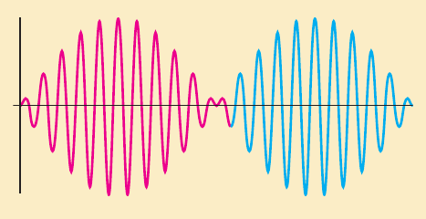

Ya hemos visto que una sola ecuación puede servir como modelo matemático para
varios sistemas físicos. Por esta razón sólo examinamos una aplicación, el
movimiento de una masa sujeta a un resorte, que se trata en la sección 5.1.
Excepto por la terminología y las interpretaciones físicas de los cuatro
términos de la ecuación lineal $`ay''+by'+cy=g(t)`$, las matemáticas de,
digamos, un circuito eléctrico en serie son idénticas a las de un sistema
vibratorio masa/resorte. Las formas de esta ED de segundo orden se presentan en
el análisis de problemas en diversas áreas de la ciencia e ingeniería. En la
sección 5.1 se tratan exclusivamente problemas con valores iniciales, mientras
que en la sección 5.2 examinamos aplicaciones descritas por problema con valores
en la frontera. También en la sección 5.2 vemos cómo algunos problemas con
valores en la frontera conducen a los importantes conceptos con *eigenvalores y
funciones propias* (eigenfunciones). La sección 5.3 inicia con un análisis
acerca de las diferencias entre los resortes lineales y no lineales; entonces se
muestra cómo el péndulo simple y un cable suspendido conducen a modelos
matemáticos no lineales.

## Página PDF 66 — Página impresa 182

### 5.1 Modelos lineales: Problemas con valores iniciales

### Repaso de material

- Secciones 4.1, 4.3 y 4.4
- Problemas 29 a 36 de los ejercicios 4.3
- Problemas 27 a 36 de los ejercicios 4.4

### Introducción

En esta sección, se van a considerar varios sistemas dinámicos lineales en los
que cada modelo matemático es una ecuación diferencial de segundo orden con
coeficientes constantes junto con condiciones iniciales especificadas en un
tiempo que tomaremos como $`t=0`$:

```math
a\frac{d^2y}{dt^2}+b\frac{dy}{dt}+cy=g(t),\qquad y(0)=y_0,\quad y'(0)=y_1.
```

Recuerde que la función $`g`$ es la **entrada, función de conducción o función
forzada** del sistema. Una solución $`y(t)`$ de la ecuación diferencial en un
intervalo $`I`$ que contiene a $`t=0`$ que satisface las condiciones iniciales
se llama **salida o respuesta** del sistema.

### 5.1.1 Sistemas resorte/masa: Movimiento libre no amortiguado

### Ley de Hooke

Suponga que un resorte se suspende verticalmente de un soporte rígido y luego se
le fija una masa $`m`$ a su extremo libre. Por supuesto, la cantidad del
alargamiento o elongación del resorte depende de la masa; masas con pesos
diferentes alargan el resorte en cantidades diferentes. Por la ley de Hooke, el
resorte mismo ejerce una fuerza restauradora $`F`$ opuesta a la dirección de
elongación y proporcional a la cantidad de elongación $`s`$ y es expresada en
forma simple como $`F=ks`$, donde $`k`$ es una constante de proporcionalidad
llamada **constante de resorte**. El resorte se caracteriza en esencia por el
número $`k`$. Por ejemplo, si una masa que pesa 10 libras hace que un resorte se
alargue $`\frac12`$ pie, entonces $`10=k\left(\frac12\right)`$ implica que
$`k=20`$ lb/pie. Entonces necesariamente una masa que pesa, digamos, 8 libras
alarga el mismo resorte sólo $`\frac25`$ pie.

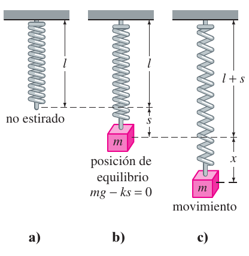

### Segunda ley de Newton

Después de que se une una masa $`m`$ a un resorte, ésta alarga el resorte una
cantidad $`s`$ y logra una posición de equilibrio en la cual su peso $`W`$
equilibra mediante la fuerza restauradora $`ks`$. Recuerde que el peso se define
mediante $`W=mg`$, donde la masa se mide en slugs, kilogramos o gramos y
$`g=32`$ pies/s², 9.8 m/s², o bien 980 cm/s², respectivamente. Como se indica en
la figura 5.1.1b, la condición de equilibrio es $`mg=ks`$ o $`mg-ks=0`$. Si la
masa se desplaza por una cantidad $`x`$ de su posición de equilibrio, la fuerza
restauradora del resorte es entonces $`k(x+s)`$. Suponiendo que no hay fuerzas
restauradoras que actúan sobre el sistema y suponiendo que la masa vibra libre
de otras fuerzas externas —**movimiento libre**— se puede igualar la segunda ley
de Newton con la fuerza neta o resultante de la fuerza restauradora y el peso.

```math
m\frac{d^2x}{dt^2}=-k(s+x)+mg=-kx+\underbrace{mg-ks}_{\text{cero}}=-kx.\tag{1}
```

El signo negativo en (1) indica que la fuerza restauradora del resorte actúa
opuesta a la dirección de movimiento. Además, se adopta la convención de que los
desplazamientos medidos abajo de la posición de equilibrio son positivos. Véase
la figura 5.1.2.

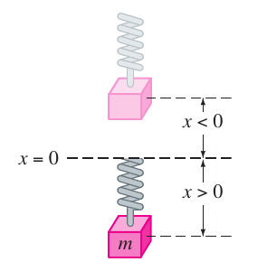

## Página PDF 67 — Página impresa 183

### ED de un movimiento libre no amortiguado

Dividiendo (1) entre la masa $`m`$, se obtiene la ecuación diferencial de
segundo orden $`d^2x/dt^2+(k/m)x=0`$, o

```math
\frac{d^2x}{dt^2}+\omega^2x=0,\tag{2}
```

donde $`\omega^2=k/m`$. Se dice que la ecuación (2) describe el **movimiento
armónico simple o movimiento libre no amortiguado**. Dos condiciones iniciales
obvias relacionadas con (2) son $`x(0)=x_0`$ y $`x'(0)=x_1`$, el desplazamiento
inicial y la velocidad inicial de la masa, respectivamente. Por ejemplo, si
$`x_0>0`$, $`x_1<0`$, la masa parte de un punto *abajo* de la posición de
equilibrio con una velocidad impartida hacia *arriba*. Cuando $`x'(0)=0`$, se
dice que la masa se libera a partir del reposo. Por ejemplo, si $`x_0<0`$,
$`x_1=0`$, la masa se libera desde el *reposo* de un punto $`|x_0|`$ unidades
*arriba* de la posición de equilibrio.

### Ecuación de movimiento

Para resolver la ecuación (2), se observa que la solución de su ecuación
auxiliar $`m^2+\omega^2=0`$ son los números complejos $`m_1=\omega i`$,
$`m_2=-\omega i`$. Así de (8) de la sección 4.3 se encuentra la solución general
de (2) es

```math
x(t)=c_1\cos\omega t+c_2\mathop{\mathrm{sen}}\nolimits \omega t.\tag{3}
```

El **periodo** del movimiento descrito por la ecuación (3) es $`T=2\pi/\omega`$.
El número $`T`$ representa el tiempo (medido en segundos) que tarda la masa en
ejecutar un ciclo de movimiento. Un ciclo es una oscilación completa de la masa,
es decir, la masa $`m`$ que se mueve, por ejemplo, al punto mínimo abajo de la
posición de equilibrio hasta el punto más alto arriba de la misma y luego de
regreso al punto mínimo. Desde un punto de vista gráfico, $`T=2\pi/\omega`$
segundos es la longitud del intervalo de tiempo entre dos máximos sucesivos (o
mínimos) de $`x(t)`$. Recuerde que un máximo de $`x(t)`$ es el desplazamiento
positivo correspondiente a la masa que alcanza su distancia máxima debajo de la
posición de equilibrio, mientras que un mínimo de $`x(t)`$ es el desplazamiento
negativo correspondiente a la masa que logra su altura máxima arriba de la
posición de equilibrio. Se hace referencia a cualquier caso como un
**desplazamiento extremo** de la masa. La **frecuencia** de movimiento es
$`f=1/T=\omega/2\pi`$ y es el número de ciclos completado cada segundo. Por
ejemplo, si $`x(t)=2\cos3\pi t-4\mathop{\mathrm{sen}}\nolimits 3\pi t`$,
entonces el periodo es $`T=2\pi/3\pi=2/3`$ s y la frecuencia es $`f=3/2`$
ciclos/s. Desde un punto de vista esquemático la gráfica de $`x(t)`$ se repite
cada $`\frac23`$ de segundo, es decir, $`x\left(t+\frac23\right)=x(t)`$, y
$`\frac32`$ ciclos de la gráfica se completan cada segundo (o, equivalentemente,
tres ciclos de la gráfica se completan cada dos segundos). El número
$`\omega=\sqrt{k/m}`$ (medido en radianes por segundo) se llama **frecuencia
circular** del sistema. Dependiendo de qué libro lea, tanto $`f=\omega/2\pi`$
como $`\omega`$ se conocen como **frecuencia natural** del sistema. Por último,
cuando se emplean las condiciones iniciales para determinar las constantes
$`c_1`$ y $`c_2`$ en (3), se dice que la solución particular resultante o
respuesta es la **ecuación de movimiento**.

### Ejemplo 1. Movimiento libre no amortiguado

Una masa que pesa 2 libras alarga 6 pulgadas un resorte. En $`t=0`$ se libera la
masa desde un punto que está 8 pulgadas abajo de la posición de equilibrio con
una velocidad ascendente de $`\frac43`$ pie/s. Determine la ecuación de
movimiento.

**Solución** Debido a que se está usando el sistema de unidades de ingeniería,
las mediciones dadas en términos de pulgadas se deben convertir en pies: 6 pulg
$`=\frac12`$ pie; 8 pulg $`=\frac23`$ pie. Además, se deben convertir las
unidades de peso dadas en libras a unidades de masa. De $`m=W/g`$ tenemos que
$`m=\frac2{32}=\frac1{16}`$ slug. También, de la ley de Hooke,
$`2=k\left(\frac12\right)`$ implica que la constante de resorte es $`k=4`$
lb/pie. Por lo que, de la ecuación (1) se obtiene

```math
\frac1{16}\frac{d^2x}{dt^2}=-4x\quad\text{o}\quad\frac{d^2x}{dt^2}+64x=0.
```

El desplazamiento inicial y la velocidad inicial son $`x(0)=\frac23`$,
$`x'(0)=-\frac43`$, donde el signo negativo en la última condición es una
consecuencia del hecho de que a la masa se le da una velocidad inicial en la
dirección negativa o hacia arriba.

## Página PDF 68 — Página impresa 184

Ahora $`\omega^2=64`$ o $`\omega=8`$, por lo que la solución general de la
ecuación diferencial es

```math
x(t)=c_1\cos8t+c_2\mathop{\mathrm{sen}}\nolimits 8t.\tag{4}
```

Aplicando las condiciones iniciales a $`x(t)`$ y $`x'(t)`$ se obtiene
$`c_1=\frac23`$ y $`c_2=-\frac16`$. Por tanto, la ecuación de movimiento es

```math
x(t)=\frac23\cos8t-\frac16\mathop{\mathrm{sen}}\nolimits 8t.\tag{5}
```

### Forma alternativa de x(t)

Cuando $`c_1\ne0`$ y $`c_2\ne0`$, la **amplitud** $`A`$ de las vibraciones
libres no es evidente a partir de la inspección de la ecuación (3). Por ejemplo,
aunque la masa del ejemplo 1 se desplaza inicialmente $`\frac23`$ pie más allá
de la posición de equilibrio, la amplitud de las vibraciones es un número mayor
que $`\frac23`$. Por tanto, suele ser conveniente convertir una solución de la
forma (3) en una forma más simple

```math
x(t)=A\mathop{\mathrm{sen}}\nolimits (\omega t+\phi),\tag{6}
```

donde $`A=\sqrt{c_1^2+c_2^2}`$ y $`\phi`$ es un **ángulo de fase** definido por

```math
\left.\begin{aligned}\mathop{\mathrm{sen}}\nolimits \phi&=\frac{c_1}A\\\cos\phi&=\frac{c_2}A\end{aligned}\right\}\tan\phi=\frac{c_1}{c_2}.\tag{7}
```

Para comprobar esto se desarrolla la ecuación (6) usando la fórmula de suma para
la función seno:

```math
A\mathop{\mathrm{sen}}\nolimits \omega t\cos\phi+A\cos\omega t\mathop{\mathrm{sen}}\nolimits \phi
=(A\mathop{\mathrm{sen}}\nolimits \phi)\cos\omega t+(A\cos\phi)\mathop{\mathrm{sen}}\nolimits \omega
t.\tag{8}
```

Se deduce de la figura 5.1.3 que si $`\phi`$ está definida por

```math
\mathop{\mathrm{sen}}\nolimits \phi=\frac{c_1}{\sqrt{c_1^2+c_2^2}}=\frac{c_1}A,\qquad
\cos\phi=\frac{c_2}{\sqrt{c_1^2+c_2^2}}=\frac{c_2}A,
```

entonces la ecuación (8) se convierte en

```math
A\frac{c_1}A\cos\omega t+A\frac{c_2}A\mathop{\mathrm{sen}}\nolimits \omega t
=c_1\cos\omega t+c_2\mathop{\mathrm{sen}}\nolimits \omega t=x(t).
```

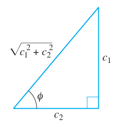

### Ejemplo 2. Forma alternativa de solución (5)

En vista de la descripción anterior, se puede escribir la solución (5) en la
forma alternativa $`x(t)=A\mathop{\mathrm{sen}}\nolimits (8t+\phi)`$. El cálculo
de la amplitud es directo,
$`A=\sqrt{\left(\frac23\right)^2+\left(-\frac16\right)^2}=\sqrt{\frac{17}{36}}\approx0.69`$
pies, pero se debe tener cuidado al calcular el ángulo de fase $`\phi`$ definido
por (7). Con $`c_1=\frac23`$ y $`c_2=-\frac16`$ se encuentra $`\tan\phi=-4`$ y,
con una calculadora se obtiene $`\tan^{-1}(-4)=-1.326`$ rad. Este *no* es el
ángulo de fase, puesto que $`\tan^{-1}(-4)`$ se localiza en el *cuarto
cuadrante* y por tanto contradice el hecho de que
$`\mathop{\mathrm{sen}}\nolimits \phi>0`$ y $`\cos\phi<0`$ porque $`c_1>0`$ y
$`c_2<0`$. Por tanto, se debe considerar que $`\phi`$ es un ángulo del *segundo
cuadrante* $`\phi=\pi+(-1.326)=1.816`$ rad. Así la ecuación (5) es igual a

```math
x(t)=\frac{\sqrt{17}}6\mathop{\mathrm{sen}}\nolimits (8t+1.816).\tag{9}
```

El periodo de esta función es $`T=2\pi/8=\pi/4`$ s.

En la figura 5.1.4a se ilustra la masa del ejemplo 2 que recorre aproximadamente
dos ciclos completos de movimiento. Leyendo de izquierda a derecha, las primeras
cinco posiciones (marcadas con puntos negros) corresponden a la posición inicial
de la masa debajo de la posición de equilibrio $`\left(x=\frac23\right)`$, la
masa que pasa por la posición

## Página PDF 69 — Página impresa 185

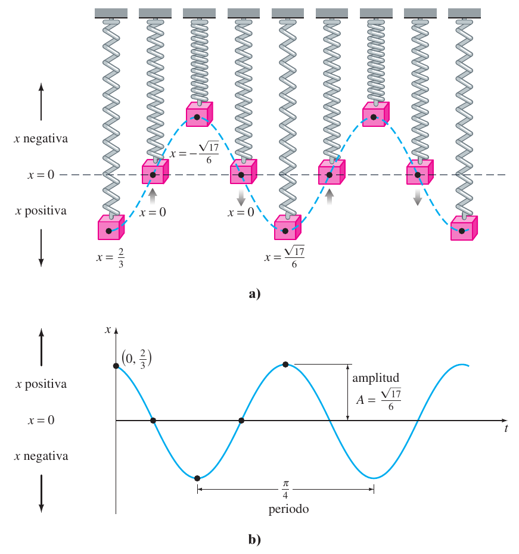

de equilibrio por primera vez en dirección ascendente ($`x=0`$), la masa en su
desplazamiento extremo arriba de la posición de equilibrio ($`x=-\sqrt{17}/6`$),
la masa en la posición de equilibrio para la segunda vez que se dirige hacia
arriba ($`x=0`$) y la masa en su desplazamiento extremo abajo de la posición de
equilibrio ($`x=\sqrt{17}/6`$). Los puntos negros sobre la gráfica de (9), que
se presenta en la figura 5.1.4b también concuerdan con las cinco posiciones
antes mencionadas. Sin embargo, observe que en la figura 5.1.4b la dirección
positiva en el plano $`tx`$ es la dirección ascendente usual y por tanto, es
opuesta a la dirección positiva que se indica en la figura 5.1.4a. Por lo que la
gráfica sólida azul que representa el movimiento de la masa en la figura 5.1.4b
es la reflexión por el eje $`t`$ de la curva punteada azul de la figura 5.1.4a.

La forma (6) es muy útil porque es fácil encontrar valores de tiempo para los
cuales la gráfica de $`x(t)`$ cruza el eje $`t`$ positivo (la recta $`x=0`$). Se
observa que $`\mathop{\mathrm{sen}}\nolimits (\omega t+\phi)=0`$ cuando
$`\omega t+\phi=n\pi`$, donde $`n`$ es un entero no negativo.

### Sistemas con constantes de resorte variables

En el modelo apenas analizado se supuso una situación ideal, una en la que las
características físicas del resorte no cambian con el tiempo. No obstante, en la
situación no ideal, parece razonable esperar que cuando un sistema resorte/masa
está en movimiento durante un largo tiempo, el resorte se debilita; en otras
palabras, varía la “constante de resorte”, de manera más específica, decae con
el tiempo. En un modelo para el **resorte cada vez más viejo** la constante de
resorte $`k`$ en (1) se reemplaza con la función decreciente
$`K(t)=ke^{-\alpha t}`$, $`k>0`$, $`\alpha>0`$. La ecuación diferencial lineal
$`mx''+ke^{-\alpha t}x=0`$ no se puede resolver con los métodos considerados en
el capítulo 4. Sin embargo, es posible obtener dos soluciones linealmente
independientes con los métodos del capítulo 6. Véase el problema 15 en los
ejercicios 5.1, el ejemplo 4 de la sección 6.3 y los problemas 33 y 39 de los
ejercicios 6.3.

## Página PDF 70 — Página impresa 186

Cuando un sistema resorte/masa se somete a un ambiente en el cual la temperatura
disminuye con rapidez, podría tener sentido reemplazar la constante $`k`$ con
$`K(t)=kt`$, $`k>0`$, una función que se incrementa con el tiempo. El modelo
resultante, $`mx''+ktx=0`$, es una forma de la **ecuación diferencial de Airy**.
Al igual que la ecuación para un resorte viejo, la ecuación de Airy se resuelve
con los métodos del capítulo 6. Véase el problema 16 de los ejercicios 5.1, el
ejemplo 4 de la sección 6.1 y los problemas 34, 35 y 40 de los ejercicios 6.3.

### 5.1.2 Sistemas resorte/masa: Movimiento libre amortiguado

El concepto de movimiento armónico libre es un poco irreal, puesto que el
movimiento que describe la ecuación (1) supone que no hay fuerzas retardadoras
actuando sobre la masa en movimiento. A menos que la masa se suspenda en un
vacío perfecto, habrá por lo menos una fuerza de resistencia debida al medio
circundante. Como se muestra en la figura 5.1.5, la masa podría estar suspendida
en un medio viscoso o unida a un dispositivo amortiguador.

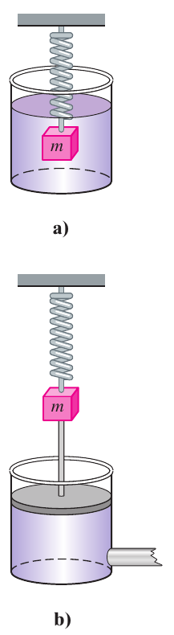

### ED de un movimiento libre amortiguado

En el estudio de la mecánica, las fuerzas de amortiguamiento que actúan sobre un
cuerpo se consideran proporcionales a una potencia de la velocidad instantánea.
En particular, en el análisis posterior se supone que esta fuerza está dada por
un múltiplo constante de $`dx/dt`$. Cuando ninguna otra fuerza actúa en el
sistema, se tiene de la segunda ley de Newton que

```math
m\frac{d^2x}{dt^2}=-kx-\beta\frac{dx}{dt},\tag{10}
```

donde $`\beta`$ es una *constante de amortiguamiento* positiva y el signo
negativo es una consecuencia del hecho de que la fuerza de amortiguamiento actúa
en una dirección opuesta al movimiento.

Dividiendo la ecuación (10) entre la masa $`m`$, se encuentra que la ecuación
diferencial del **movimiento libre amortiguado** es
$`d^2x/dt^2+(\beta/m)dx/dt+(k/m)x=0`$ o

```math
\frac{d^2x}{dt^2}+2\lambda\frac{dx}{dt}+\omega^2x=0,\tag{11}
```

donde

```math
2\lambda=\frac\beta m,\qquad\omega^2=\frac km.\tag{12}
```

El símbolo $`2\lambda`$ se usa sólo por conveniencia algebraica, porque la
ecuación auxiliar es $`m^2+2\lambda m+\omega^2=0`$ y las raíces correspondientes
son entonces

```math
m_1=-\lambda+\sqrt{\lambda^2-\omega^2},\qquad
m_2=-\lambda-\sqrt{\lambda^2-\omega^2}.
```

Ahora se pueden distinguir tres casos posibles dependiendo del signo algebraico
de $`\lambda^2-\omega^2`$. Puesto que cada solución contiene el *factor de
amortiguamiento* $`e^{-\lambda t}`$, $`\lambda>0`$, los desplazamientos de la
masa se vuelven despreciables conforme el tiempo $`t`$ aumenta.

### Caso I: $`\lambda^2-\omega^2>0`$

En esta situación el sistema está **sobreamortiguado** porque el coeficiente de
amortiguamiento $`\beta`$ es grande comparado con la constante del resorte
$`k`$. La solución correspondiente de (11) es $`x(t)=c_1e^{m_1t}+c_2e^{m_2t}`$ o

```math
x(t)=e^{-\lambda
t}\left(c_1e^{\sqrt{\lambda^2-\omega^2}\,t}+c_2e^{-\sqrt{\lambda^2-\omega^2}\,t}\right).\tag{13}
```

Esta ecuación representa un movimiento uniforme y no oscilatorio. En la figura
5.1.6 se muestran dos gráficas posibles de $`x(t)`$.

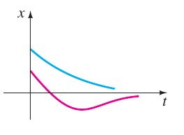

## Página PDF 71 — Página impresa 187

### Caso II: $`\lambda^2-\omega^2=0`$

Este sistema está **críticamente amortiguado** porque cualquier ligera
disminución en la fuerza de amortiguamiento daría como resultado un movimiento
oscilatorio. La solución general de (11) es $`x(t)=c_1e^{m_1t}+c_2te^{m_1t}`$ o

```math
x(t)=e^{-\lambda t}(c_1+c_2t).\tag{14}
```

En la figura 5.1.7 se presentan algunas gráficas típicas de movimiento. Observe
que el movimiento es bastante similar al de un sistema sobreamortiguado. También
es evidente de (14) que la masa puede pasar por la posición de equilibrio a lo
más una vez.

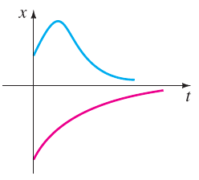

### Caso III: $`\lambda^2-\omega^2<0`$

En este caso el sistema está **subamortiguado** puesto que el coeficiente de
amortiguamiento es pequeño comparado con la constante del resorte. Las raíces
$`m_1`$ y $`m_2`$ ahora son complejas:

```math
m_1=-\lambda+\sqrt{\omega^2-\lambda^2}\,i,\qquad
m_2=-\lambda-\sqrt{\omega^2-\lambda^2}\,i.
```

Así que la ecuación general de la ecuación (11) es

```math
x(t)=e^{-\lambda
t}\left(c_1\cos\sqrt{\omega^2-\lambda^2}\,t+c_2\mathop{\mathrm{sen}}\nolimits \sqrt{\omega^2-\lambda^2}\,t\right).\tag{15}
```

Como se indica en la figura 5.1.8, el movimiento descrito por la ecuación (15)
es oscilatorio; pero debido al coeficiente $`e^{-\lambda t}`$, las amplitudes de
vibración $`\to0`$ cuando $`t\to\infty`$.

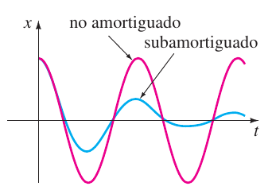

### Ejemplo 3. Movimiento sobreamortiguado

Se comprueba fácilmente que la solución del problema con valores iniciales

```math
\frac{d^2x}{dt^2}+5\frac{dx}{dt}+4x=0,\qquad x(0)=1,\quad x'(0)=1
```

es

```math
x(t)=\frac53e^{-t}-\frac23e^{-4t}.\tag{16}
```

El problema se puede interpretar como representativo del movimiento
sobreamortiguado de una masa sobre un resorte. La masa se libera al inicio de
una posición una unidad *abajo* de la posición de equilibrio con velocidad
*descendente* de 1 pie/s.

Para graficar $`x(t)`$, se encuentra el valor de $`t`$ para el cual la función
tiene un extremo, es decir, el valor de tiempo para el cual la primera derivada
(velocidad) es cero. Derivando la ecuación (16) se obtiene
$`x'(t)=-\frac53e^{-t}+\frac83e^{-4t}`$, así $`x'(t)=0`$ implica que
$`e^{3t}=\frac85`$ o $`t=\frac13\ln\frac85=0.157`$. Se tiene de la prueba de la
primera derivada, así como de la intuición física, que $`x(0.157)=1.069`$ pies
es en realidad un máximo. En otras palabras, la masa logra un desplazamiento
extremo de 1.069 pies abajo de la posición de equilibrio.

Se debe comprobar también si la gráfica cruza el eje $`t`$, es decir, si la masa
pasa por la posición de equilibrio. En este caso tal cosa no puede suceder,
porque la ecuación $`x(t)=0`$, o $`e^{3t}=\frac25`$, tiene una solución
irrelevante desde el punto de vista físico $`t=\frac13\ln\frac25=-0.305`$.

En la figura 5.1.9 se presenta la gráfica de $`x(t)`$, junto con algunos otros
datos pertinentes.

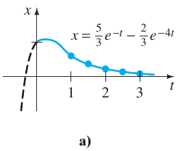

Figura 5.1.9b:

| $`t`$ | $`x(t)`$ |
| -- | -- |
| 1 | 0.601 |
| 1.5 | 0.370 |
| 2 | 0.225 |
| 2.5 | 0.137 |
| 3 | 0.083 |

### Ejemplo 4. Movimiento críticamente amortiguado

Una masa que pesa 8 libras alarga 2 pies un resorte. Suponiendo que una fuerza
amortiguada que es igual a dos veces la velocidad instantánea actúa sobre el
sistema, determine la ecuación de movimiento si la masa inicial se libera desde
la posición de equilibrio con una velocidad ascendente de 3 pies/s.

## Página PDF 72 — Página impresa 188

**Solución** De la ley de Hooke se ve que $`8=k(2)`$ da $`k=4`$ lb/pie y que
$`W=mg`$ da $`m=\frac8{32}=\frac14`$ slug. La ecuación diferencial de movimiento
es entonces

```math
\frac14\frac{d^2x}{dt^2}=-4x-2\frac{dx}{dt}\quad\text{o}\quad
\frac{d^2x}{dt^2}+8\frac{dx}{dt}+16x=0.\tag{17}
```

La ecuación auxiliar para (17) es $`m^2+8m+16=(m+4)^2=0`$, así que
$`m_1=m_2=-4`$. Por tanto el sistema está críticamente amortiguado y

```math
x(t)=c_1e^{-4t}+c_2te^{-4t}.\tag{18}
```

Aplicando las condiciones iniciales $`x(0)=0`$ y $`x'(0)=-3`$, se encuentra, a
su vez, que $`c_1=0`$ y $`c_2=-3`$. Por tanto la ecuación de movimiento es

```math
x(t)=-3te^{-4t}.\tag{19}
```

Para graficar $`x(t)`$, se procede como en el ejemplo 3. De
$`x'(t)=-3e^{-4t}(1-4t)`$ vemos que $`x'(t)=0`$ cuando $`t=\frac14`$. El
desplazamiento extremo correspondiente es
$`x\left(\frac14\right)=-3\left(\frac14\right)e^{-1}=-0.276`$ pies. Como se
muestra en la figura 5.1.10, este valor se interpreta para indicar que la masa
alcanza una altura máxima de 0.276 pies arriba de la posición de equilibrio.

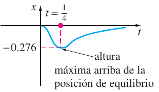

### Ejemplo 5. Movimiento subamortiguado

Una masa que pesa 16 libras se une a un resorte de 5 pies de largo. En
equilibrio el resorte mide 8.2 pies. Si al inicio la masa se libera desde el
reposo en un punto 2 pies arriba de la posición de equilibrio, encuentre los
desplazamientos $`x(t)`$ si se sabe además que el medio circundante ofrece una
resistencia numéricamente igual a la velocidad instantánea.

**Solución** La elongación del resorte después que se une la masa es
$`8.2-5=3.2`$ pies, así que se deduce de la ley de Hooke que $`16=k(3.2)`$ o
$`k=5`$ lb/pie. Además, $`m=\frac{16}{32}=\frac12`$ slug, por lo que la ecuación
diferencial está dada por

```math
\frac12\frac{d^2x}{dt^2}=-5x-\frac{dx}{dt}\quad\text{o}\quad
\frac{d^2x}{dt^2}+2\frac{dx}{dt}+10x=0.\tag{20}
```

Procediendo, encontramos que las raíces de $`m^2+2m+10=0`$ son $`m_1=-1+3i`$ y
$`m_2=-1-3i`$, lo que significa que el sistema está subamortiguado y

```math
x(t)=e^{-t}(c_1\cos3t+c_2\mathop{\mathrm{sen}}\nolimits 3t).\tag{21}
```

Por último, las condiciones iniciales $`x(0)=-2`$ y $`x'(0)=0`$ producen
$`c_1=-2`$ y $`c_2=-\frac23`$, por lo que la ecuación de movimiento es

```math
x(t)=e^{-t}\left(-2\cos3t-\frac23\mathop{\mathrm{sen}}\nolimits 3t\right).\tag{22}
```

### Forma alternativa de x(t) — continuación, PDF 72

De una manera idéntica al procedimiento usado en la página 184, se puede
escribir cualquier solución

```math
x(t)=e^{-\lambda
t}\left(c_1\cos\sqrt{\omega^2-\lambda^2}\,t+c_2\mathop{\mathrm{sen}}\nolimits \sqrt{\omega^2-\lambda^2}\,t\right)
```

en la forma alternativa

```math
x(t)=Ae^{-\lambda
t}\mathop{\mathrm{sen}}\nolimits \left(\sqrt{\omega^2-\lambda^2}\,t+\phi\right),\tag{23}
```

donde $`A=\sqrt{c_1^2+c_2^2}`$ y el ángulo de fase $`\phi`$ se determina de las
ecuaciones

```math
\mathop{\mathrm{sen}}\nolimits \phi=\frac{c_1}A,\qquad\cos\phi=\frac{c_2}A,\qquad\tan\phi=\frac{c_1}{c_2}.
```

## Página PDF 73 — Página impresa 189

El coeficiente $`Ae^{-\lambda t}`$ en ocasiones se llama **amplitud
amortiguada** de vibraciones. Debido a que (23) no es una función periódica, el
número $`2\pi/\sqrt{\omega^2-\lambda^2}`$ se llama **cuasi periodo** y
$`\sqrt{\omega^2-\lambda^2}/2\pi`$ es la **cuasi frecuencia**. El cuasi periodo
es el intervalo de tiempo entre dos máximos sucesivos de $`x(t)`$. Se debe
comprobar, para la ecuación de movimiento del ejemplo 5, que $`A=2\sqrt{10}/3`$
y $`\phi=4.391`$. Por tanto, una forma equivalente de (22) es

```math
x(t)=\frac{2\sqrt{10}}3e^{-t}\mathop{\mathrm{sen}}\nolimits (3t+4.391).
```

### 5.1.3 Sistemas resorte/masa: Movimiento forzado

### ED de movimiento forzado con amortiguamiento

Suponga que ahora se toma en consideración una fuerza externa $`f(t)`$ que actúa
sobre una masa vibrante en un resorte. Por ejemplo, $`f(t)`$ podría representar
una fuerza motriz que causa un movimiento vertical oscilatorio del soporte del
resorte. Véase la figura 5.1.11. La inclusión de $`f(t)`$ en la formulación de
la segunda ley de Newton da la ecuación diferencial de **movimiento forzado o
dirigido**:

```math
m\frac{d^2x}{dt^2}=-kx-\beta\frac{dx}{dt}+f(t).\tag{24}
```

Dividiendo la ecuación (24) entre $`m`$, se obtiene

```math
\frac{d^2x}{dt^2}+2\lambda\frac{dx}{dt}+\omega^2x=F(t),\tag{25}
```

donde $`F(t)=f(t)/m`$ y, como en la sección anterior, $`2\lambda=\beta/m`$,
$`\omega^2=k/m`$. Para resolver la última ecuación homogénea, se puede usar ya
sea el método de coeficientes indeterminados o variación de parámetros.

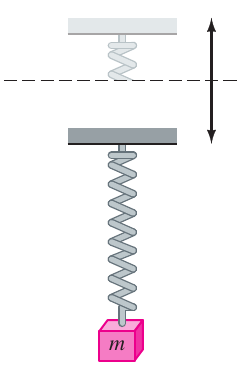

### Ejemplo 6. Interpretación de un problema con valores iniciales

Interprete y resuelva el problema con valores iniciales

```math
\frac15\frac{d^2x}{dt^2}+1.2\frac{dx}{dt}+2x=5\cos4t,\qquad
x(0)=\frac12,\quad x'(0)=0.\tag{26}
```

**Solución** Se puede interpretar el problema para representar un sistema
vibratorio que consiste en una masa ($`m=\frac15`$ slug o kilogramo) unida a un
resorte ($`k=2`$ lb/pie o N/m). La masa se libera inicialmente desde el reposo
$`\frac12`$ unidad (pie o metro) abajo de la posición de equilibrio. El
movimiento es amortiguado ($`\beta=1.2`$) y está siendo impulsado por una fuerza
periódica externa ($`T=\pi/2`$ s) comenzando en $`t=0`$. De manera intuitiva, se
podría esperar que incluso con amortiguamiento el sistema permaneciera en
movimiento hasta que se “desactive” la función forzada, en cuyo caso
disminuirían las amplitudes. Sin embargo, como se plantea en el problema,
$`f(t)=5\cos4t`$ permanecerá “activada” por siempre.

Primero se multiplica la ecuación diferencial en (26) por 5 y se resuelve

```math
\frac{dx^2}{dt^2}+6\frac{dx}{dt}+10x=0
```

por los métodos usuales. Debido a que $`m_1=-3+i`$, $`m_2=-3-i`$, se deduce que
$`x_c(t)=e^{-3t}(c_1\cos t+c_2\mathop{\mathrm{sen}}\nolimits t)`$. Con el método
de coeficientes indeterminados, se supone una solución particular de la forma
$`x_p(t)=A\cos4t+B\mathop{\mathrm{sen}}\nolimits 4t`$. Derivando $`x_p(t)`$ y
sustituyendo en la ED, se obtiene

```math
x_p''+6x_p'+10x_p=(-6A+24B)\cos4t+(-24A-6B)\mathop{\mathrm{sen}}\nolimits 4t=25\cos4t.
```

## Página PDF 74 — Página impresa 190

El sistema de ecuaciones resultante

```math
-6A+24B=25,\qquad-24A-6B=0
```

se cumple en $`A=-\frac{25}{102}`$ y $`B=\frac{50}{51}`$. Se tiene que

```math
x(t)=e^{-3t}(c_1\cos
t+c_2\mathop{\mathrm{sen}}\nolimits t)-\frac{25}{102}\cos4t+\frac{50}{51}\mathop{\mathrm{sen}}\nolimits 4t.\tag{27}
```

Cuando se hace $`t=0`$ en la ecuación anterior, se obtiene
$`c_1=\frac{38}{51}`$. Derivando la expresión y haciendo $`t=0`$, se encuentra
también que $`c_2=-\frac{86}{51}`$. Por tanto, la ecuación de movimiento es

```math
x(t)=e^{-3t}\left(\frac{38}{51}\cos
t-\frac{86}{51}\mathop{\mathrm{sen}}\nolimits t\right)-\frac{25}{102}\cos4t+\frac{50}{51}\mathop{\mathrm{sen}}\nolimits 4t.\tag{28}
```

### Términos transitorio y de estado estable

Cuando $`F`$ es una función periódica, como
$`F(t)=F_0\mathop{\mathrm{sen}}\nolimits \gamma t`$ o $`F(t)=F_0\cos\gamma t`$,
la solución general de (25) para $`\lambda>0`$ es la suma de una función no
periódica $`x_c(t)`$ y una función periódica $`x_p(t)`$. Además $`x_c(t)`$ se
desvanece conforme se incrementa el tiempo, es decir,
$`\lim_{t\to\infty}x_c(t)=0`$. Así, para valores grandes de tiempo, los
desplazamientos de la masa se aproximan mediante la solución particular
$`x_p(t)`$. Se dice que la función complementaria $`x_c(t)`$ es un **término
transitorio o solución transitoria** y la función $`x_p(t)`$, la parte de la
solución que permanece después de un intervalo de tiempo, se llama **término de
estado estable o solución de estado estable**. Por tanto, observe que el efecto
de las condiciones iniciales en un sistema resorte/masa impulsado por $`F`$ es
transitorio. En la solución particular (28),
$`e^{-3t}\left(\frac{38}{51}\cos t-\frac{86}{51}\mathop{\mathrm{sen}}\nolimits t\right)`$
es un término transitorio y
$`x_p(t)=-\frac{25}{102}\cos4t+\frac{50}{51}\mathop{\mathrm{sen}}\nolimits 4t`$
es un término de estado estable. Las gráficas de estos dos términos y la
solución (28) se presentan en las figuras 5.12a y 5.12b, respectivamente.

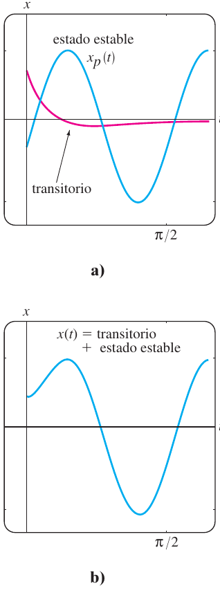

### Ejemplo 7. Soluciones de estado transitorio y de estado estable

La solución del problema con valores iniciales

```math
\frac{d^2x}{dt^2}+2\frac{dx}{dt}+2x=4\cos t+2\mathop{\mathrm{sen}}\nolimits t,\qquad
x(0)=0,\quad x'(0)=x_1,
```

donde $`x_1`$ es constante, está dada por

```math
x(t)=\underbrace{(x_1-2)e^{-t}\mathop{\mathrm{sen}}\nolimits t}_{\text{transitorio}}+\underbrace{2\mathop{\mathrm{sen}}\nolimits t}_{\text{estado
estable}}.
```

Las curvas solución para valores seleccionados de la velocidad inicial $`x_1`$
aparecen en la figura 5.1.13. Las gráficas muestran que la influencia del
término transitorio es despreciable para un valor aproximado de $`t>3\pi/2`$.

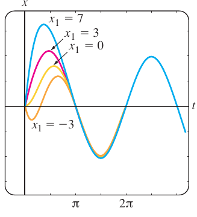

### ED de movimiento forzado sin amortiguamiento

Cuando se ejerce una fuerza periódica sin fuerza de amortiguamiento, no hay
término transitorio en la solución de un problema. También se ve que una fuerza
periódica con una frecuencia cercana o igual a la frecuencia de las vibraciones
libres amortiguadas causa un problema grave en un sistema mecánico oscilatorio.

### Ejemplo 8. Movimiento no amortiguado forzado

Resuelva el problema con valor inicial

```math
\frac{d^2x}{dt^2}+\omega^2x=F_0\mathop{\mathrm{sen}}\nolimits \gamma t,\qquad x(0)=0,\quad
x'(0)=0,\tag{29}
```

donde $`F_0`$ es una constante y $`\gamma\ne\omega`$.

## Página PDF 75 — Página impresa 191

**Solución** La función complementaria es
$`x_c(t)=c_1\cos\omega t+c_2\mathop{\mathrm{sen}}\nolimits \omega t`$. Para
obtener una solución particular se supone
$`x_p(t)=A\cos\gamma t+B\mathop{\mathrm{sen}}\nolimits \gamma t`$, por lo que

```math
x_p''+\omega^2x_p=A(\omega^2-\gamma^2)\cos\gamma
t+B(\omega^2-\gamma^2)\mathop{\mathrm{sen}}\nolimits \gamma t=F_0\mathop{\mathrm{sen}}\nolimits \gamma t.
```

Igualando los coeficientes se obtiene de inmediato $`A=0`$ y
$`B=F_0/(\omega^2-\gamma^2)`$. Por tanto,

```math
x_p(t)=\frac{F_0}{\omega^2-\gamma^2}\mathop{\mathrm{sen}}\nolimits \gamma t.
```

Aplicando las condiciones iniciales a la solución general

```math
x(t)=c_1\cos\omega t+c_2\mathop{\mathrm{sen}}\nolimits \omega
t+\frac{F_0}{\omega^2-\gamma^2}\mathop{\mathrm{sen}}\nolimits \gamma t
```

se obtiene $`c_1=0`$ y $`c_2=-\gamma F_0/\omega(\omega^2-\gamma^2)`$. Por tanto,
la solución es

```math
x(t)=\frac{F_0}{\omega(\omega^2-\gamma^2)}(-\gamma\mathop{\mathrm{sen}}\nolimits \omega
t+\omega\mathop{\mathrm{sen}}\nolimits \gamma t),\qquad\gamma\ne\omega.\tag{30}
```

### Resonancia pura

Aunque la ecuación (30) no se define para $`\gamma=\omega`$, es interesante
observar que su valor límite conforme $`\gamma\to\omega`$ se obtiene al aplicar
la regla de L’Hôpital. Este proceso límite es análogo a “sintonizar” la
frecuencia de la fuerza impulsora ($`\gamma/2\pi`$) con la frecuencia de
vibraciones libres ($`\omega/2\pi`$). De una manera intuitiva, se espera que en
un espacio de tiempo se deban poder incrementar en forma sustancial las
amplitudes de vibración. Para $`\gamma=\omega`$ se define la solución como

```math
\begin{aligned}
x(t)&=\lim_{\gamma\to\omega}F_0\frac{-\gamma\mathop{\mathrm{sen}}\nolimits \omega
t+\omega\mathop{\mathrm{sen}}\nolimits \gamma t}{\omega(\omega^2-\gamma^2)}
=F_0\lim_{\gamma\to\omega}\frac{\frac d{d\gamma}(-\gamma\mathop{\mathrm{sen}}\nolimits \omega
t+\omega\mathop{\mathrm{sen}}\nolimits \gamma t)}{\frac
d{d\gamma}(\omega^3-\omega\gamma^2)}\\
&=F_0\lim_{\gamma\to\omega}\frac{-\mathop{\mathrm{sen}}\nolimits \omega t+\omega t\cos\gamma
t}{-2\omega\gamma}\\
&=F_0\frac{-\mathop{\mathrm{sen}}\nolimits \omega t+\omega t\cos\omega t}{-2\omega^2}\\
&=\frac{F_0}{2\omega^2}\mathop{\mathrm{sen}}\nolimits \omega t-\frac{F_0}{2\omega}t\cos\omega
t.
\end{aligned}\tag{31}
```

Como se sospechaba, conforme $`t\to\infty`$ los desplazamientos se vuelven
largos; de hecho, $`|x(t_n)|\to\infty`$ cuando $`t_n=n\pi/\omega`$,
$`n=1,2,\ldots`$. El fenómeno recién descrito se conoce como **resonancia
pura**. La gráfica de la figura 5.1.14 muestra el movimiento característico en
este caso.

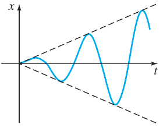

En conclusión, se debe observar que no hay necesidad real de usar un proceso
límite en (30) para obtener la solución para $`\gamma=\omega`$.
Alternativamente, la ecuación (31) se deduce resolviendo el problema con valores
iniciales

```math
\frac{d^2x}{dt^2}+\omega^2x=F_0\mathop{\mathrm{sen}}\nolimits \omega t,\qquad x(0)=0,\quad
x'(0)=0
```

en forma directa por métodos convencionales.

Si realmente una función, como la ecuación (31) describiera los desplazamientos
de un sistema resorte/masa, el sistema necesariamente fallaría. Las oscilaciones
grandes de la masa forzarán en algún momento el resorte más allá de su límite
elástico. Se podría argumentar también que el modelo resonante presentado en la
figura 5.1.14 es por completo irreal, porque no se toman en cuenta los efectos
retardadores de las fuerzas de amortiguamiento que siempre están presentes.
Aunque es verdad que la resonancia pura no puede ocurrir cuando se toma en
consideración la cantidad pequeña de amortiguamiento, las amplitudes de
vibración grandes e igualmente destructivas pueden ocurrir (aunque acotadas
conforme $`t\to\infty`$). Véase el problema 43 de los ejercicios 5.1.

## Página PDF 76 — Página impresa 192

### 5.1.4 Circuito en serie análogo

### Circuitos LRC en serie

Como se mencionó en la introducción de este capítulo, muchos sistemas físicos
diferentes se describen mediante una ecuación diferencial de segundo orden
similar a la ecuación diferencial de movimiento forzado con amortiguamiento:

```math
m\frac{d^2x}{dt^2}+\beta\frac{dx}{dt}+kx=f(t).\tag{32}
```

Si $`i(t)`$ denota la corriente en el **circuito eléctrico en serie LRC** que se
muestra en la figura 5.1.15, entonces las caídas de voltaje en el inductor,
resistor y capacitor son como se muestra en la figura 1.3.3. Por la segunda ley
de Kirchhoff, la suma de estos voltajes es igual al voltaje $`E(t)`$ aplicado al
circuito; es decir,

```math
L\frac{di}{dt}+Ri+\frac1Cq=E(t).\tag{33}
```

Pero la carga $`q(t)`$ en el capacitor se relaciona con la corriente $`i(t)`$
con $`i=dq/dt`$, así la ecuación (33) se convierte en la ecuación diferencial
lineal de segundo orden

```math
L\frac{d^2q}{dt^2}+R\frac{dq}{dt}+\frac1Cq=E(t).\tag{34}
```

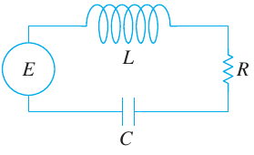

La nomenclatura usada en el análisis de circuitos es similar a la que se emplea
para describir sistemas resorte/masa.

Si $`E(t)=0`$, se dice que las **vibraciones eléctricas** del circuito están
**libres**. Debido a que la ecuación auxiliar para (34) es $`Lm^2+Rm+1/C=0`$,
habrá tres formas de solución con $`R\ne0`$, dependiendo del valor del
discriminante $`R^2-4L/C`$. Se dice que el circuito es

**sobreamortiguado** si $`R^2-4L/C>0`$,

**críticamente amortiguado** si $`R^2-4L/C=0`$,

y **subamortiguado** si $`R^2-4L/C<0`$.

En cada uno de estos tres casos, la solución general de (34) contiene el factor
$`e^{-Rt/2L}`$, así $`q(t)\to0`$ conforme $`t\to\infty`$. En el caso
subamortiguado cuando $`q(0)=q_0`$, la carga en el capacitor oscila a medida que
ésta disminuye; en otras palabras, el capacitor se carga y se descarga conforme
$`t\to\infty`$. Cuando $`E(t)=0`$ y $`R=0`$, se dice que el circuito no está
amortiguado y las vibraciones eléctricas no tienden a cero conforme $`t`$ crece
sin límite; la respuesta del circuito es **armónica simple**.

### Ejemplo 9. Circuito en serie subamortiguado

Encuentre la carga $`q(t)`$ en el capacitor en un circuito LRC cuando $`L=0.25`$
henry (h), $`R=10`$ ohms ($`\Omega`$), $`C=0.001`$ farad (f), $`E(t)=0`$,
$`q(0)=q_0`$ coulombs (C) e $`i(0)=0`$.

**Solución** Puesto que $`1/C=1000`$, la ecuación (34) se convierte en

```math
\frac14q''+10q'+1000q=0\quad\text{o}\quad q''+40q'+4000q=0.
```

Resolviendo esta ecuación homogénea de la manera usual, se encuentra que el
circuito es subamortiguado y
$`q(t)=e^{-20t}(c_1\cos60t+c_2\mathop{\mathrm{sen}}\nolimits 60t)`$. Aplicando
las condiciones iniciales, se encuentra $`c_1=q_0`$ y $`c_2=\frac13q_0`$. Por
tanto

```math
q(t)=q_0e^{-20t}\left(\cos60t+\frac13\mathop{\mathrm{sen}}\nolimits 60t\right).
```

## Página PDF 77 — Página impresa 193

Usando (23), podemos escribir la solución anterior como

```math
q(t)=\frac{q_0\sqrt{10}}3e^{-20t}\mathop{\mathrm{sen}}\nolimits (60t+1.249).
```

Cuando se aplica un voltaje $`E(t)`$ al circuito, se dice que las vibraciones
eléctricas son **forzadas**. En el caso cuando $`R\ne0`$, la función
complementaria $`q_c(t)`$ de (34) se llama **solución transitoria**. Si $`E(t)`$
es periódica o una constante, entonces la solución particular $`q_p(t)`$ de (34)
es una **solución de estado estable**.

### Ejemplo 10. Corriente de estado estable

Encuentre la solución de estado estable $`q_p(t)`$ y la **corriente de estado
estable** en un circuito LRC en serie cuando el voltaje aplicado es
$`E(t)=E_0\mathop{\mathrm{sen}}\nolimits \gamma t`$.

**Solución** La solución de estado estable $`q_p(t)`$ es una solución particular
de la ecuación diferencial

```math
L\frac{d^2q}{dt^2}+R\frac{dq}{dt}+\frac1Cq=E_0\mathop{\mathrm{sen}}\nolimits \gamma t.
```

Con el método de coeficientes indeterminados, se supone una solución particular
de la forma $`q_p(t)=A\mathop{\mathrm{sen}}\nolimits \gamma t+B\cos\gamma t`$.
Sustituyendo esta expresión en la ecuación diferencial e igualando coeficientes,
se obtiene

```math
A=\frac{E_0\left(L\gamma-\frac1{C\gamma}\right)}{-\gamma\left(L^2\gamma^2-\frac{2L}C+\frac1{C^2\gamma^2}+R^2\right)},\qquad
B=\frac{E_0R}{-\gamma\left(L^2\gamma^2-\frac{2L}C+\frac1{C^2\gamma^2}+R^2\right)}.
```

Es conveniente expresar $`A`$ y $`B`$ en términos de algunos nuevos símbolos.

Si $`X=L\gamma-\frac1{C\gamma}`$, entonces

```math
Z^2=L^2\gamma^2-\frac{2L}C+\frac1{C^2\gamma^2}.
```

Si $`Z=\sqrt{X^2+R^2}`$, entonces

```math
Z^2=L^2\gamma^2-\frac{2L}C+\frac1{C^2\gamma^2}+R^2.
```

Por tanto $`A=E_0X/(-\gamma Z^2)`$ y $`B=E_0R/(-\gamma Z^2)`$, así que la carga
de estado estable es

```math
q_p(t)=-\frac{E_0X}{\gamma Z^2}\mathop{\mathrm{sen}}\nolimits \gamma t-\frac{E_0R}{\gamma
Z^2}\cos\gamma t.
```

Ahora la corriente de estado estable está dada por $`i_p(t)=q_p'(t)`$:

```math
i_p(t)=\frac{E_0}Z\left(\frac RZ\mathop{\mathrm{sen}}\nolimits \gamma t-\frac XZ\cos\gamma
t\right).\tag{35}
```

Las cantidades $`X=L\gamma-1/C\gamma`$ y $`Z=\sqrt{X^2+R^2}`$ definidas en el
ejemplo 11 se llaman **reactancia e impedancia** del circuito, respectivamente.
Tanto la reactancia como la impedancia se miden en ohms.
