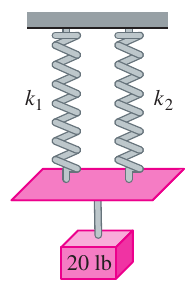
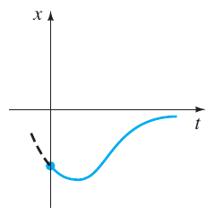
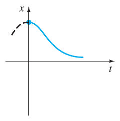
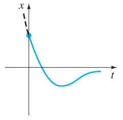
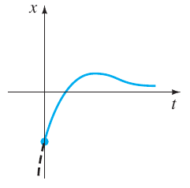
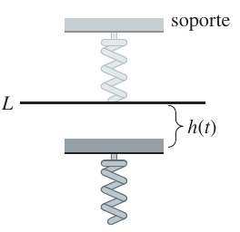
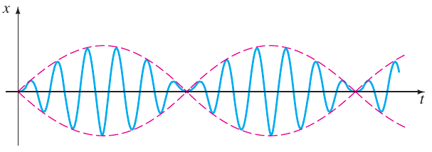

# Zill — Ejercicios de sistemas resorte/masa y circuitos

Fuente: extracto «Ecuaciones diferenciales con aplicaciones de modelado -
Zill.pdf». Zill es la atribución del nombre del archivo; edición y año no
constan en estas páginas. Material bibliográfico, no autoría de ISI.
[Procedencia y cobertura](../../../resources/2020/pdf2020-zill-03-cobertura.md).

Páginas PDF 78–82 (impresas 194–198). Se conserva el orden del extracto y la
continuidad de los capítulos.

## Página PDF 78 — Página impresa 194

### Ejercicios 5.1

Las respuestas a los problemas con número impar comienzan en la página RES-7.

### 5.1.1 Sistemas resorte/masa: Movimiento libre no amortiguado

**1.** Una masa que pesa 4 libras se une a un resorte cuya constante es 16
lb/pie. ¿Cuál es el periodo del movimiento armónico simple?

**2.** Una masa de 20 kilogramos se une a un resorte. Si la frecuencia del
movimiento armónico simple es $`2/\pi`$ ciclos/s, ¿cuál es la constante de
resorte $`k`$? ¿Cuál es la frecuencia del movimiento armónico simple si la masa
original se reemplaza con una masa de 80 kilogramos?

**3.** Una masa que pesa 24 libras, unida al extremo de un resorte, lo alarga 4
pulgadas. Al inicio, la masa se libera desde el reposo en un punto 3 pulgadas
arriba de la posición de equilibrio. Encuentre la ecuación de movimiento.

**4.** Determine la ecuación de movimiento si la masa del problema 3 se libera
al inicio desde la posición de equilibrio con una velocidad descendente de 2
pies/s.

**5.** Una masa que pesa 20 libras alarga 6 pulgadas un resorte. La masa se
libera al inicio desde el reposo en un punto 6 pulgadas abajo de la posición de
equilibrio.

a) Encuentre la posición de la masa en los tiempos
$`t=\pi/12,\pi/8,\pi/6,\pi/4`$ y $`9\pi/32`$ s.

b) ¿Cuál es la velocidad de la masa cuando $`t=3\pi/16`$ s? ¿En qué dirección se
dirige la masa en este instante?

c) ¿En qué tiempos la masa pasa por la posición de equilibrio?

**6.** Una fuerza de 400 newtons alarga 2 metros un resorte. Una masa de 50
kilogramos se une al extremo del resorte y se libera inicialmente desde la
posición de equilibrio con una velocidad ascendente de 10 m/s. Encuentre la
ecuación de movimiento.

**7.** Otro resorte cuya constante es 20 N/m se suspende del mismo soporte, pero
paralelo al sistema resorte/masa del problema 6. Al segundo resorte se le coloca
una masa de 20 kilogramos y ambas masas se liberan al inicio desde la posición
de equilibrio con una velocidad ascendente de 10 m/s.

a) ¿Cuál masa presenta la mayor amplitud de movimiento?

b) ¿Cuál masa se mueve más rápido en $`t=\pi/4`$ s? ¿En $`\pi/2`$ s?

c) ¿En qué instantes las dos masas están en la misma posición? ¿Dónde están las
masas en estos instantes? ¿En qué direcciones se están moviendo las masas?

**8.** Una masa que pesa 32 libras alarga 2 pies un resorte. Determine la
amplitud y el periodo de movimiento si la masa se libera inicialmente desde un
punto situado 1 pie arriba de la posición de equilibrio con una velocidad
ascendente de 2 pies/s. ¿Cuántos ciclos enteros habrá completado la masa al
final de $`4\pi`$ segundos?

**9.** Una masa que pesa 8 libras se une a un resorte. Cuando se pone en
movimiento, el sistema resorte/masa exhibe movimiento armónico simple. Determine
la ecuación de movimiento si la constante de resorte es 1 lb/pie y la masa se
libera inicialmente desde un punto 6 pulgadas abajo de la posición de
equilibrio, con una velocidad descendente de $`\frac32`$ pie/s. Exprese la
ecuación de movimiento en la forma dada en (6).

**10.** Una masa que pesa 10 libras alarga un resorte $`\frac14`$ pie. Esta masa
se retira y se coloca una de 1.6 slugs, que se libera desde un punto situado a
$`\frac13`$ pie arriba de la posición de equilibrio, con una velocidad
descendente de $`\frac54`$ pie/s. Exprese la ecuación de movimiento en la forma
dada en (6). ¿En qué tiempos la masa logra un desplazamiento debajo de la
posición de equilibrio numéricamente igual a $`\frac12`$ de la amplitud?

**11.** Una masa que pesa 64 libras alarga 0.32 pies un resorte. Al inicio la
masa se libera desde un punto que está 8 pulgadas arriba de la posición de
equilibrio con una velocidad descendente de 5 pies/s.

a) Encuentre la ecuación de movimiento.

b) ¿Cuáles son la amplitud y el periodo del movimiento?

c) ¿Cuántos ciclos completos habrá realizado la masa al final de $`3\pi`$
segundos?

d) ¿En qué momento la masa pasa por la posición de equilibrio con dirección
hacia abajo por segunda vez?

e) ¿En qué instantes la masa alcanza sus desplazamientos extremos en cualquier
lado de la posición de equilibrio?

f) ¿Cuál es la posición de la masa en $`t=3`$ s?

g) ¿Cuál es la velocidad instantánea en $`t=3`$ s?

h) ¿Cuál es la aceleración en $`t=3`$ s?

i) ¿Cuál es la velocidad instantánea en los instantes cuando la masa pasa por la
posición de equilibrio?

j) ¿En qué instantes la masa está 5 pulgadas abajo de la posición de equilibrio?

k) ¿En qué instantes la masa está 5 pulgadas abajo de la posición de equilibrio
apuntando en dirección hacia arriba?

**12.** Una masa de 1 slug se suspende de un resorte cuya constante es de 9
lb/pie. Inicialmente la masa se libera desde un punto que está 1 pie arriba de
la posición de equilibrio con una velocidad ascendente de $`\sqrt3`$ pies/s.
Determine los instantes en los que la masa se dirige hacia abajo a una velocidad
de 3 pies/s.

## Página PDF 79 — Página impresa 195

**13.** Bajo algunas circunstancias, cuando dos resortes paralelos, con
constantes $`k_1`$ y $`k_2`$, soportan una sola masa, la **constante de resorte
efectiva** del sistema se expresa como $`k=4k_1k_2/(k_1+k_2)`$. Una masa que
pesa 20 libras estira 6 pulgadas un resorte y 2 pulgadas otro resorte. Los
resortes se unen a un soporte rígido común y luego a una placa metálica. Como se
muestra en la figura 5.1.16, la masa se une al centro de la placa en la
configuración de resorte doble. Determine la constante de resorte efectiva de
este sistema. Encuentre la ecuación de movimiento si la masa se libera
inicialmente desde la posición de equilibrio con una velocidad descendente de 2
pies/s.



**14.** Una cierta masa alarga un resorte $`\frac13`$ pie y otro resorte
$`\frac12`$ pie. Los dos resortes se unen a un soporte rígido común en la manera
descrita en el problema 13 y en la figura 5.1.16. Se quita la primera masa y se
coloca una que pesa 8 libras en la configuración de resorte doble y se pone en
movimiento el sistema. Si el periodo de movimiento es $`\pi/15`$ segundos,
determine cuánto pesa la primera masa.

**15.** Un modelo de un sistema de resorte/masa es $`4x''+e^{-0.1t}x=0`$. Por
inspección de la ecuación diferencial solamente, describa el comportamiento del
sistema durante un periodo largo.

**16.** El modelo de un sistema de resorte/masa es $`4x''+tx=0`$. Por inspección
de la ecuación diferencial solamente, describa el comportamiento del sistema
durante un periodo largo.

### 5.1.2 Sistemas resorte/masa: Movimiento libre amortiguado

En los problemas 17 a 20, la figura representa la gráfica de una ecuación de
movimiento para un sistema resorte/masa amortiguado. Use la gráfica para
determinar:

a) si el desplazamiento inicial está arriba o abajo de la posición de equilibrio
y

b) si la masa se libera inicialmente desde el reposo, con dirección descendente
o ascendente.

### Problema 17



### Problema 18



### Problema 19



### Problema 20



**21.** Una masa que pesa 4 libras se une a un resorte cuya constante es 2
lb/pie. El medio ofrece una fuerza de amortiguamiento que es numéricamente igual
a la velocidad instantánea. La masa se libera desde un punto situado 1 pie
arriba de la posición de equilibrio con una velocidad descendente de 8 pies/s.
Determine el tiempo en el que la masa pasa por la posición de equilibrio.
Encuentre el tiempo en el que la masa alcanza su desplazamiento extremo desde la
posición de equilibrio. ¿Cuál es la posición de la masa en este instante?

## Página PDF 80 — Página impresa 196

**22.** Un resorte de 4 pies mide 8 pies de largo después de colgarle una masa
que pesa 8 libras. El medio por el que se mueve la masa ofrece una fuerza de
amortiguamiento igual a $`\sqrt2`$ veces la velocidad instantánea. Encuentre la
ecuación de movimiento si la masa se libera inicialmente desde la posición de
equilibrio con una velocidad descendente de 5 pies/s. Calcule el tiempo en que
la masa alcanza su desplazamiento extremo desde la posición de equilibrio. ¿Cuál
es la posición de la masa en ese instante?

**23.** Una masa de 1 kilogramo se fija a un resorte cuya constante es 16 N/m y
luego el sistema completo se sumerge en un líquido que imparte una fuerza
amortiguadora igual a 10 veces la velocidad instantánea. Determine las
ecuaciones de movimiento si:

a) al inicio la masa se libera desde un punto situado 1 metro abajo de la
posición de equilibrio, y luego

b) la masa se libera inicialmente desde un punto 1 metro abajo de la posición de
equilibrio con una velocidad ascendente de 12 m/s.

**24.** En los incisos a) y b) del problema 23, determine si la masa pasa por la
posición de equilibrio. En cada caso, calcule el tiempo en que la masa alcanza
su desplazamiento extremo desde la posición de equilibrio. ¿Cuál es la posición
de la masa en este instante?

**25.** Una fuerza de 2 libras alarga 1 pie un resorte. Una masa que pesa 3.2
libras se une al resorte y luego se sumerge el sistema en un medio que ofrece
una fuerza de amortiguamiento igual a 0.4 veces la velocidad instantánea.

a) Encuentre la ecuación de movimiento si inicialmente se libera la masa desde
el reposo en un punto situado a 1 pie por encima de la posición de equilibrio.

b) Exprese la ecuación de movimiento en la forma dada en (23).

c) Encuentre la primera vez en que la masa pasa a través de la posición de
equilibrio en dirección hacia arriba.

**26.** Después de que una masa de 10 libras se sujeta a un resorte de 5 pies,
éste llega a medir 7 pies. Se retira la masa y se sustituye con una de 8 libras.
Luego se coloca al sistema en un medio que ofrece una fuerza de amortiguamiento
igual a la velocidad instantánea.

a) Encuentre la ecuación de movimiento si la masa se libera inicialmente desde
el reposo de un punto situado 1 pie arriba de la posición de equilibrio.

b) Exprese la ecuación de movimiento en la forma dada en (23).

c) Calcule los tiempos en los que la masa pasa por la posición de equilibrio con
dirección hacia abajo.

d) Trace la gráfica de la ecuación de movimiento.

**27.** Una masa que pesa 10 libras produce un alargamiento de 2 pies en un
resorte. La masa se une a un dispositivo amortiguador que ofrece una fuerza de
amortiguamiento igual a $`\beta`$ ($`\beta\gt 0`$) veces la velocidad
instantánea. Determine los valores de la constante de amortiguamiento $`\beta`$
por lo que el movimiento posterior sea **a)** sobreamortiguado, **b)**
críticamente amortiguado y **c)** subamortiguado.

**28.** Una masa que pesa 24 libras alarga 4 pies un resorte. El movimiento
posterior toma lugar en un medio que ofrece una fuerza de amortiguamiento igual
a $`\beta`$ ($`\beta\gt 0`$) veces la velocidad instantánea. Si al inicio la
masa se libera desde la posición de equilibrio con una velocidad ascendente de 2
pies/s, muestre que cuando $`\beta\gt 3\sqrt2`$ la ecuación de movimiento es

```math
x(t)=\frac{-3}{\sqrt{\beta^2-18}}e^{-2\beta
t/3}\mathop{\mathrm{senh}}\nolimits \frac23\sqrt{\beta^2-18}\,t.
```

### 5.1.3 Sistemas resorte/masa: Movimiento forzado

**29.** Una masa que pesa 16 libras alarga $`\frac83`$ pie un resorte. La masa
se libera inicialmente desde el reposo desde un punto 2 pies abajo de la
posición de equilibrio y el movimiento posterior ocurre en un medio que ofrece
una fuerza de amortiguamiento igual a $`\frac12`$ de la velocidad instantánea.
Encuentre la ecuación de movimiento si se aplica a la masa una fuerza externa
igual a $`f(t)=10\cos3t`$.

**30.** Una masa de 1 slug está unida a un resorte cuya constante es 5 lb/pie.
Al inicio la masa se libera 1 pie abajo de la posición de equilibrio con una
velocidad descendente de 5 pies/s y el movimiento posterior toma lugar en un
medio que ofrece una fuerza de amortiguamiento igual a dos veces la velocidad
instantánea.

a) Encuentre la ecuación de movimiento si una fuerza externa igual a
$`f(t)=12\cos2t+3\mathop{\mathrm{sen}}\nolimits 2t`$ actúa sobre la masa.

b) Trace la gráfica de las soluciones transitorias y de estado estable en los
mismos ejes de coordenadas.

c) Trace la gráfica de la ecuación de movimiento.

**31.** Una masa de 1 slug, cuando se une a un resorte, causa en éste un
alargamiento de 2 pies y luego llega al punto de reposo en la posición de
equilibrio. Empezando en $`t=0`$, una fuerza externa igual a
$`f(t)=8\mathop{\mathrm{sen}}\nolimits 4t`$ se aplica al sistema. Encuentre la
ecuación de movimiento si el medio circundante ofrece una fuerza de
amortiguamiento igual a 8 veces la velocidad instantánea.

**32.** En el problema 31 determine la ecuación de movimiento si la fuerza
externa es $`f(t)=e^{-t}\mathop{\mathrm{sen}}\nolimits 4t`$. Analice el
desplazamiento para $`t\to\infty`$.

**33.** Cuando una masa de 2 kilogramos se une a un resorte cuya constante es 32
N/m, éste llega al reposo en la posición de equilibrio. Comenzando en $`t=0`$,
una fuerza igual a $`f(t)=68e^{-2t}\cos4t`$ se aplica al sistema. Determine la
ecuación de movimiento en ausencia de amortiguamiento.

**34.** En el problema 33, escriba la ecuación de movimiento en la forma
$`x(t)=A\mathop{\mathrm{sen}}\nolimits (\omega t+\phi)+Be^{-2t}\mathop{\mathrm{sen}}\nolimits (4t+\theta)`$.
¿Cuál es la amplitud de las vibraciones después de un tiempo muy largo?

## Página PDF 81 — Página impresa 197

**35.** Una masa $`m`$ está unida al extremo de un resorte cuya constante es
$`k`$. Después de que la masa alcanza el equilibrio, su soporte empieza a
oscilar verticalmente respecto a una recta horizontal $`L`$ de acuerdo con una
fórmula $`h(t)`$. El valor de $`h`$ representa la distancia en pies medida desde
$`L`$. Véase la figura 5.1.21.

a) Determine la ecuación diferencial de movimiento si el sistema entero se mueve
en un medio que ofrece una fuerza de amortiguamiento igual a $`\beta(dx/dt)`$.

b) Resuelva la ecuación diferencial del inciso a) si el resorte se alarga 4 pies
con una masa que pesa 16 libras y $`\beta=2`$, $`h(t)=5\cos t`$,
$`x(0)=x'(0)=0`$.



**36.** Una masa de 100 gramos se fija a un resorte cuya constante es 1600
dinas/cm. Después de que la masa alcanza el equilibrio, su apoyo oscila de
acuerdo con la fórmula $`h(t)=\mathop{\mathrm{sen}}\nolimits 8t`$, donde $`h`$
representa el desplazamiento desde su posición original. Véanse el problema 35 y
la figura 5.1.21.

a) En ausencia de amortiguamiento, determine la ecuación de movimiento si la
masa parte del reposo desde la posición de equilibrio.

b) ¿En qué instantes la masa pasa por la posición de equilibrio?

c) ¿En qué tiempos la masa alcanza sus desplazamientos extremos?

d) ¿Cuáles son los desplazamientos máximo y mínimo?

e) Trace la gráfica de la ecuación de movimiento.

En los problemas 37 y 38, resuelva el problema con valores iniciales.

### Problema 37

```math
\frac{d^2x}{dt^2}+4x=-5\mathop{\mathrm{sen}}\nolimits 2t+3\cos2t,\qquad x(0)=-1,\quad
x'(0)=1.
```

### Problema 38

```math
\frac{d^2x}{dt^2}+9x=5\mathop{\mathrm{sen}}\nolimits 3t,\qquad x(0)=2,\quad x'(0)=0.
```

**39.** a) Muestre que la solución del problema con valores iniciales

```math
\frac{d^2x}{dt^2}+\omega^2x=F_0\cos\gamma t,\qquad x(0)=0,\quad x'(0)=0
```

es

```math
x(t)=\frac{F_0}{\omega^2-\gamma^2}(\cos\gamma t-\cos\omega t).
```

b) Evalúe
$`\lim_{\gamma\to\omega}\frac{F_0}{\omega^2-\gamma^2}(\cos\gamma t-\cos\omega t)`$.

**40.** Compare el resultado obtenido en el inciso b) del problema 39 con la
solución obtenida usando la variación de parámetros cuando la fuerza externa es
$`F_0\cos\omega t`$.

**41.** a) Muestre que $`x(t)`$ dada en el inciso a) del problema 39 se puede
describir en la forma

```math
x(t)=\frac{-2F_0}{\omega^2-\gamma^2}\mathop{\mathrm{sen}}\nolimits \frac12(\gamma-\omega)t\mathop{\mathrm{sen}}\nolimits \frac12(\gamma+\omega)t.
```

b) Si se define $`\varepsilon=\frac12(\gamma-\omega)`$, muestre que cuando
$`\varepsilon`$ es pequeña una solución aproximada es

```math
x(t)=\frac{F_0}{2\varepsilon\gamma}\mathop{\mathrm{sen}}\nolimits \varepsilon
t\mathop{\mathrm{sen}}\nolimits \gamma t.
```

Cuando $`\varepsilon`$ es pequeña, la frecuencia $`\gamma/2\pi`$ de la fuerza
aplicada es cercana a la frecuencia $`\omega/2\pi`$ de vibraciones libres.
Cuando esto ocurre, el movimiento es como se indica en la figura 5.1.22. Las
oscilaciones de esta clase se llaman **pulsaciones** y se deben al hecho de que
la frecuencia de $`\mathop{\mathrm{sen}}\nolimits \varepsilon t`$ es bastante
pequeña en comparación con la frecuencia de
$`\mathop{\mathrm{sen}}\nolimits \gamma t`$. Las curvas punteadas o envoltura de
la gráfica de $`x(t)`$, se obtienen de las gráficas de
$`\pm(F_0/2\varepsilon\gamma)\mathop{\mathrm{sen}}\nolimits \varepsilon t`$. Use
un programa de graficación para trazar gráficas con varios valores de $`F_0`$,
$`\varepsilon`$, y $`\gamma`$ para comprobar la gráfica de la figura 5.1.22.



### Tarea para el laboratorio de computación

**42.** ¿Puede haber pulsaciones cuando se agrega una fuerza de amortiguamiento
al modelo del inciso a) del problema 39? Defienda su posición con las gráficas
obtenidas ya sea de la solución explícita del problema

```math
\frac{d^2x}{dt^2}+2\lambda\frac{dx}{dt}+\omega^2x=F_0\cos\gamma t,\qquad
x(0)=0,\quad x'(0)=0
```

o de curvas solución obtenidas usando un programa de solución numérica.

**43.** a) Muestre que la solución general de

```math
\frac{d^2x}{dt^2}+2\lambda\frac{dx}{dt}+\omega^2x=F_0\mathop{\mathrm{sen}}\nolimits \gamma t
```

## Página PDF 82 — Página impresa 198

es

```math
x(t)=Ae^{-\lambda
t}\mathop{\mathrm{sen}}\nolimits \left(\sqrt{\omega^2-\lambda^2}\,t+\phi\right)
+\frac{F_0}{\sqrt{(\omega^2-\gamma^2)^2+4\lambda^2\gamma^2}}\mathop{\mathrm{sen}}\nolimits (\gamma
t+\theta),
```

donde $`A=\sqrt{c_1^2+c_2^2}`$ y los ángulos de fase $`\phi`$ y $`\theta`$
están, respectivamente, definidos por
$`\mathop{\mathrm{sen}}\nolimits \phi=c_1/A`$, $`\cos\phi=c_2/A`$ y

```math
\mathop{\mathrm{sen}}\nolimits \theta=\frac{-2\lambda\gamma}{\sqrt{(\omega^2-\gamma^2)^2+4\lambda^2\gamma^2}},\qquad
\cos\theta=\frac{\omega^2-\gamma^2}{\sqrt{(\omega^2-\gamma^2)^2+4\lambda^2\gamma^2}}.
```

b) La solución del inciso a) tiene la forma $`x(t)=x_c(t)+x_p(t)`$. La
inspección muestra que $`x_c(t)`$ es transitoria y por tanto para valores
grandes de tiempo, la solución se aproxima mediante
$`x_p(t)=g(\gamma)\mathop{\mathrm{sen}}\nolimits (\gamma t+\theta)`$, donde

```math
g(\gamma)=\frac{F_0}{\sqrt{(\omega^2-\gamma^2)^2+4\lambda^2\gamma^2}}.
```

Aunque la amplitud $`g(\gamma)`$ de $`x_p(t)`$ está acotada conforme
$`t\to\infty`$, demuestre que las oscilaciones máximas ocurrirán en el valor
$`\gamma_1=\sqrt{\omega^2-2\lambda^2}`$. ¿Cuál es el valor máximo de $`g`$? El
número $`\sqrt{\omega^2-2\lambda^2}/2\pi`$ se dice que es la **frecuencia de
resonancia** del sistema.

c) Cuando $`F_0=2`$, $`m=1`$ y $`k=4`$, $`g`$ se convierte en

```math
g(\gamma)=\frac2{\sqrt{(4-\gamma^2)^2+\beta^2\gamma^2}}.
```

Construya una tabla de valores de $`\gamma_1`$ y $`g(\gamma_1)`$ que
corresponden a los coeficientes de amortiguamiento $`\beta=2`$, $`\beta=1`$,
$`\beta=\frac34`$, $`\beta=\frac12`$, y $`\beta=\frac14`$. Usando un programa de
graficación para trazar obtenga las gráficas de $`g`$ que corresponden a estos
coeficientes de amortiguamiento. Use los mismos ejes de coordenadas. Esta
familia de gráficas se llama **curva de resonancia o curva de respuesta de
frecuencia** del sistema. ¿A qué valor se aproxima $`\gamma_1`$ conforme
$`\beta\to0`$? ¿Qué sucede con la curva de resonancia conforme $`\beta\to0`$?

**44.** Considere un sistema resorte/masa no amortiguado descrito por el
problema con valores iniciales

```math
\frac{d^2x}{dt^2}+\omega^2x=F_0\mathop{\mathrm{sen}}\nolimits ^n\gamma t,\qquad x(0)=0,\quad
x'(0)=0.
```

a) Para $`n=2`$, explique por qué hay una sola frecuencia $`\gamma_1/2\pi`$ en
la que el sistema está en resonancia pura.

b) Para $`n=3`$, analice por qué hay dos frecuencias $`\gamma_1/2\pi`$ y
$`\gamma_2/2\pi`$ en las que el sistema está en resonancia pura.

c) Suponga que $`\omega=1`$ y $`F_0=1`$. Use un programa de solución numérica
para obtener la gráfica de la solución del problema con valores iniciales para
$`n=2`$ y $`\gamma=\gamma_1`$ en el inciso a). Obtenga la gráfica de la solución
del problema con valores iniciales para $`n=3`$ que corresponde, a su vez, a
$`\gamma=\gamma_1`$ y $`\gamma=\gamma_2`$ en el inciso b).

### 5.1.4 Circuito en serie análogo

**45.** Encuentre la carga en el capacitor de un circuito en serie LRC en
$`t=0.01`$ s cuando $`L=0.05`$ h, $`R=2\;\Omega`$, $`C=0.01`$ f, $`E(t)=0`$ V,
$`q(0)=5`$ C e $`i(0)=0`$ A. Determine la primera vez en que la carga del
capacitor es igual a cero.

**46.** Calcule la carga del capacitor en un circuito LRC en serie cuando
$`L=\frac14`$ h, $`R=20\;\Omega`$, $`C=\frac1{300}`$ f, $`E(t)=0`$ V, $`q(0)=4`$
C e $`i(0)=0`$ A. ¿Alguna vez la carga en el capacitor es igual a cero?

En los problemas 47 y 48 encuentre la carga en el capacitor y la corriente en el
circuito LRC. Determine la carga máxima en el capacitor.

**47.** $`L=\frac53`$ h, $`R=10\;\Omega`$, $`C=\frac1{30}`$ f, $`E(t)=300`$ V,
$`q(0)=0`$ C, $`i(0)=0`$ A.

**48.** $`L=1`$ h, $`R=100\;\Omega`$, $`C=0.0004`$ f, $`E(t)=30`$ V, $`q(0)=0`$
C, $`i(0)=2`$ A.

**49.** Encuentre la carga y la corriente de estado estable en un circuito LRC
en serie cuando $`L=1`$ h, $`R=2\;\Omega`$, $`C=0.25`$ f y $`E(t)=50\cos t`$ V.

**50.** Demuestre que la amplitud de la corriente de estado estable en el
circuito LRC en serie del ejemplo 10 está dada por $`E_0/Z`$, donde $`Z`$ es la
impedancia del circuito.

**51.** Use el problema 50 para demostrar que la corriente de estado estable en
un circuito LRC en serie cuando $`L=\frac12`$ h, $`R=20\;\Omega`$, $`C=0.001`$
f, y $`E(t)=100\mathop{\mathrm{sen}}\nolimits 60t`$ V, está dada por
$`i_p(t)=4.160\mathop{\mathrm{sen}}\nolimits (60t-0.588)`$.

**52.** Encuentre la corriente de estado estable en un circuito LRC cuando
$`L=\frac12`$ h, $`R=20\;\Omega`$, $`C=0.001`$ f y
$`E(t)=100\mathop{\mathrm{sen}}\nolimits 60t+200\cos40t`$ V.

**53.** Encuentre la carga en el capacitor de un circuito LRC en serie cuando
$`L=\frac12`$ h, $`R=10\;\Omega`$, $`C=0.01`$ f, $`E(t)=150`$ V, $`q(0)=1`$ C e
$`i(0)=0`$ A. ¿Cuál es la carga en el capacitor después de un largo tiempo?

**54.** Demuestre que si $`L`$, $`R`$, $`C`$ y $`E_0`$ son constantes, entonces
la amplitud de la corriente de estado estable del ejemplo 10 es un máximo cuando
$`\gamma=1/\sqrt{LC}`$. ¿Cuál es la amplitud máxima?

**55.** Demuestre que si $`L`$, $`R`$, $`E_0`$ y $`\gamma`$ son constantes,
entonces la amplitud de la corriente de estado estable en el ejemplo 10 es un
máximo cuando la capacitancia es $`C=1/L\gamma^2`$.

**56.** Calcule la carga en el capacitor y la corriente en un circuito LC cuando
$`L=0.1`$ h, $`C=0.1`$ f, $`E(t)=100\mathop{\mathrm{sen}}\nolimits \gamma t`$ V,
$`q(0)=0`$ C e $`i(0)=0`$ A.

**57.** Calcule la carga del capacitor y la corriente en un circuito LC cuando
$`E(t)=E_0\cos\gamma t`$ V, $`q(0)=q_0`$ C e $`i(0)=i_0`$ A.

**58.** En el problema 57, determine la corriente cuando el circuito está en
resonancia.
