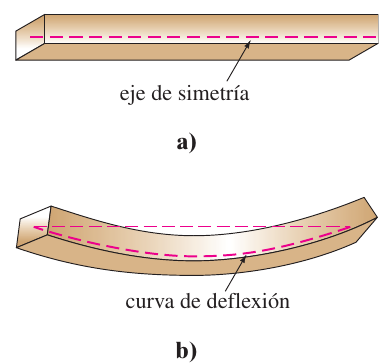
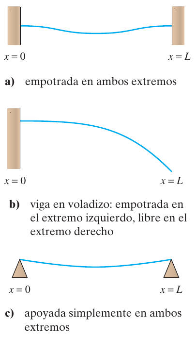
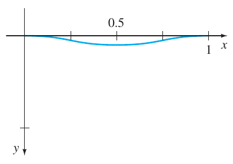
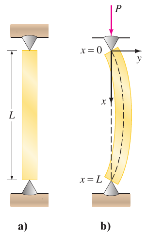
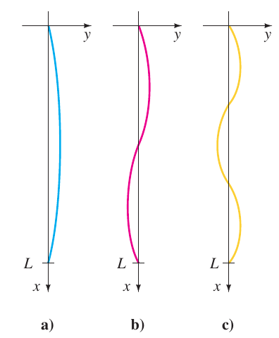
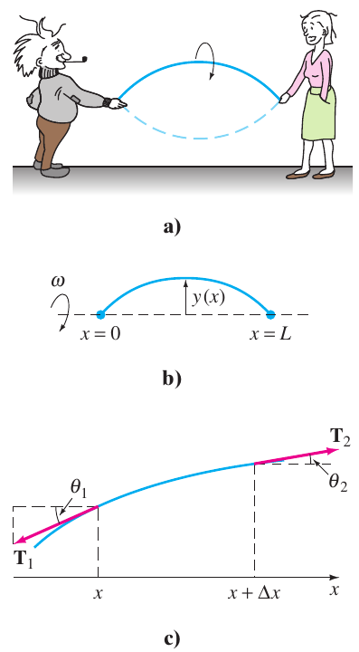
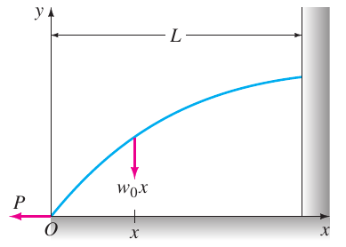
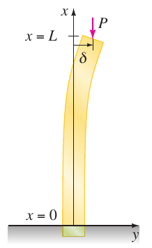
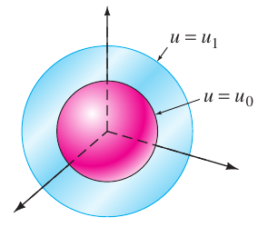
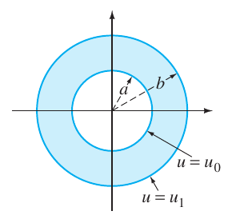

# Zill — Modelos lineales y problemas con valores en la frontera

Fuente: extracto «Ecuaciones diferenciales con aplicaciones de modelado -
Zill.pdf». Zill es la atribución del nombre del archivo; edición y año no
constan en estas páginas. Material bibliográfico, no autoría de ISI.
[Procedencia y cobertura](../../../resources/2020/pdf2020-zill-03-cobertura.md).

Páginas PDF 83–90 (impresas 199–206). Se conserva el orden del extracto y la
continuidad de los capítulos.

## Página PDF 83 — Página impresa 199

### 5.2 Modelos lineales: Problemas con valores en la frontera

### Repaso de material

- Problemas 37 a 40 de los ejercicios 4.3
- Problemas 37 a 40 de los ejercicios 4.4

### Introducción

La sección anterior se dedicó a sistemas en los que un modelo matemático de
segundo orden va acompañado de condiciones iniciales. Es decir, condiciones
suplementarias que se especifican en la función desconocida y su primera
derivada es un solo punto. Pero con frecuencia la descripción matemática de un
sistema físico requiere resolver una ecuación diferencial lineal homogénea
sujeta a condiciones en la frontera, es decir, condiciones específicas de la
función desconocida o en una de sus derivadas o incluso una combinación lineal
de la función desconocida y una de sus derivadas en dos (o más) puntos
diferentes.

### Deflexión de una viga

Muchas estructuras se construyen usando trabes o vigas y estas vigas se
flexionan o deforman bajo su propio peso o por la influencia de alguna fuerza
externa. Como veremos a continuación, esta deflexión $y(x)$ está gobernada por
una ecuación diferencial lineal de cuarto orden relativamente simple.

Para empezar, supongamos que una viga de longitud $L$ es homogénea y tiene
secciones transversales uniformes a lo largo de su longitud. En ausencia de
carga en la viga (incluyendo su peso), una curva que une los centroides de todas
sus secciones transversales es una recta conocida como **eje de simetría**.
Véase la figura 5.2.1a. Si se aplica una carga a la viga en un plano vertical
que contiene al eje de simetría, la viga, como se muestra en la figura 5.2.1b,
experimenta una distorsión y la curva que conecta los centroides de las
secciones transversales se llama **curva de deflexión o curva elástica**. La
curva de deflexión se aproxima a la forma de una viga. Ahora suponga que el eje
$x$ coincide con el eje de simetría y que la deflexión $y(x)$, medida desde este
eje, es positiva si es hacia abajo. En la teoría de la elasticidad se muestra
que el momento de flexión $M(x)$ en un punto $x$ a lo largo de la viga se
relaciona con la carga por unidad de longitud $w(x)$ mediante la ecuación

$$
\frac{d^2M}{dx^2}=w(x).\tag{1}
$$

Además, el momento de flexión $M(x)$ es proporcional a la curvatura $\kappa$ de
la curva elástica

$$
M(x)=EI\kappa,\tag{2}
$$

donde $E$ e $I$ son constantes; $E$ es el módulo de Young de elasticidad del
material de la viga e $I$ es el momento de inercia de una sección transversal de
la viga (respecto a un eje conocido como el eje neutro). El producto $EI$ se
llama **rigidez flexional** de la viga.

Ahora, del cálculo, la curvatura está dada por $\kappa=y''/[1+(y')^2]^{3/2}$.
Cuando la deflexión $y(x)$ es pequeña, la pendiente $y'\approx0$, y por tanto
$[1+(y')^2]^{3/2}\approx1$. Si se permite que $\kappa\approx y''$, la ecuación
(2) se convierte en $M=EIy''$. La segunda derivada de esta última expresión es

$$
\frac{d^2M}{dx^2}=EI\frac{d^2}{dx^2}y''=EI\frac{d^4y}{dx^4}.\tag{3}
$$

Si se utiliza el resultado en (1) para reemplazar $d^2M/dx^2$ en (3), se ve que
la deflexión $y(x)$ satisface la ecuación diferencial de cuarto orden

$$
EI\frac{d^4y}{dx^4}=w(x).\tag{4}
$$

## Página PDF 84 — Página impresa 200

Las condiciones de frontera asociadas con la ecuación (4) dependen de cómo estén
apoyados los dos extremos de la viga. Una viga en voladizo está **empotrada o
fija** en un extremo y libre en el otro. Un trampolín, un brazo extendido, un
ala de avión y un balcón son ejemplos comunes de tales vigas, pero incluso
árboles, astas de banderas, rascacielos y monumentos, actúan como vigas en
voladizo, debido a que están empotrados en un extremo y sujetos a la fuerza de
flexión del viento. Para una viga en voladizo la deflexión $y(x)$ debe
satisfacer las siguientes dos condiciones en el extremo fijo $x=0$:

- $y(0)=0$ porque no hay flexión y
- $y'(0)=0$ porque la curva de deflexión es tangente al eje $x$ (en otras
  palabras, la pendiente de la curva de deflexión es cero en este punto).

En $x=L$ las condiciones de extremo libre son

- $y''(L)=0$ porque el momento de flexión es cero y
- $y'''(L)=0$ porque la fuerza de corte es cero.

La función $`F(x)=dM/dx=EI\,d^3y/dx^3`$ se llama fuerza de corte. Si un extremo
de la viga está **apoyado simplemente o abisagrado** (a lo que también se conoce
como **apoyo con perno o fulcro**) entonces se debe tener $y=0$ y $y''=0$ en ese
extremo. En la tabla 5.1 se resumen las condiciones en la frontera que se
relacionan con (4). Véase la figura 5.2.2.

Tabla 5.1

| Extremos de la viga | Condiciones frontera |
| -- | -- |
| empotrados | $y=0$, $y'=0$ |
| libres | $y''=0$, $y'''=0$ |
| apoyados simplemente o abisagrados | $y=0$, $y''=0$ |

### Ejemplo 1. Una viga empotrada

Una viga de longitud $L$ está empotrada en ambos extremos. Encuentre la
deflexión de la viga si una carga constante $w_0$ está uniformemente distribuida
a lo largo de su longitud, es decir, $w(x)=w_0$, $0<x<L$.

**Solución** De (4) vemos que la deflexión $y(x)$ satisface

$$
EI\frac{d^4y}{dx^4}=w_0.
$$

Debido a que la viga está empotrada tanto en su extremo izquierdo ($x=0$) como
en su extremo derecho ($x=L$), no hay deflexión vertical y la recta de deflexión
es horizontal en estos puntos. Así, las condiciones en la frontera son

$$
y(0)=0,\quad y'(0)=0,\quad y(L)=0,\quad y'(L)=0.
$$

Se puede resolver la ecuación diferencial no homogénea de la manera usual
(determinar $y_c$ observando que $m=0$ es raíz de multiplicidad cuatro de la
ecuación auxiliar $m^4=0$ y luego encontrar una solución particular $y_p$ por
coeficientes indeterminados) o simplemente se integra la ecuación
$d^4y/dx^4=w_0/EI$ sucesivamente cuatro veces. De cualquier modo, se encuentra
la solución general de la ecuación $y=y_c+y_p$ que es

$$
y(x)=c_1+c_2x+c_3x^2+c_4x^3+\frac{w_0}{24EI}x^4.
$$

Ahora las condiciones $y(0)=0$ y $y'(0)=0$ dan, a su vez, $c_1=0$ y $c_2=0$,
mientras que las condiciones restantes $y(L)=0$ y $y'(L)=0$ aplicadas a
$y(x)=c_3x^2+c_4x^3+\frac{w_0}{24EI}x^4$ producen las ecuaciones simultáneas

$$
c_3L^2+c_4L^3+\frac{w_0}{24EI}L^4=0
$$

y

$$
2c_3L+3c_4L^2+\frac{w_0}{6EI}L^3=0.
$$

## Página PDF 85 — Página impresa 201

Resolviendo este sistema se obtiene $c_3=w_0L^2/24EI$ y $c_4=-w_0L/12EI$. Así
que la deflexión es

$$
y(x)=\frac{w_0L^2}{24EI}x^2-\frac{w_0L}{12EI}x^3+\frac{w_0}{24EI}x^4
$$

o $y(x)=\frac{w_0}{24EI}x^2(x-L)^2$. Eligiendo $w_0=24EI$, y $L=1$, obtenemos la
curva de deflexión de la figura 5.2.3.

### Eigenvalores y funciones propias

Muchos problemas de aplicación requieren que se resuelva un problema con valores
en la frontera en dos puntos (PVF) en los que interviene una ecuación
diferencial lineal que contiene un parámetro $\lambda$. Se buscan los valores de
$\lambda$ para los que el problema con valores en la frontera tiene soluciones
*no triviales*, es decir, *no nulas*.

### Ejemplo 2. Soluciones no triviales de un PVF

Resuelva el problema con valores en la frontera

$$
y''+\lambda y=0,\qquad y(0)=0,\quad y(L)=0.
$$

**Solución** Consideraremos tres casos: $\lambda=0$, $\lambda<0$ y $\lambda>0$.

**Caso I:** Para $\lambda=0$ la solución de $y''=0$ es $y=c_1x+c_2$. Las
condiciones $y(0)=0$ y $y(L)=0$ aplicadas a esta solución implican, a su vez,
$c_2=0$ y $c_1=0$. Por tanto, para $\lambda=0$ la única solución del problema
con valores en la frontera es la solución trivial $y=0$.

**Caso II:** Para $\lambda<0$ es conveniente escribir $\lambda=-\alpha^2$, donde
$\alpha$ denota un número positivo. Con esta notación las raíces de la ecuación
auxiliar $m^2-\alpha^2=0$ son $m_1=\alpha$ y $m_2=-\alpha$. Puesto que el
intervalo en el que se está trabajando es finito, se elige escribir la solución
general de $y''-\alpha^2y=0$ como
$y=c_1\cosh\alpha x+c_2\mathop{\mathrm{senh}}\nolimits \alpha x$. Ahora $y(0)$
es

$$
y(0)=c_1\cosh0+c_2\mathop{\mathrm{senh}}\nolimits 0=c_1\cdot1+c_2\cdot0=c_1,
$$

y por tanto, $y(0)=0$ significa que $c_1=0$. Así
$y=c_2\mathop{\mathrm{senh}}\nolimits \alpha x$. La segunda condición $y(L)=0$
requiere que $c_2\mathop{\mathrm{senh}}\nolimits \alpha L=0$. Para $\alpha\ne0$,
$\mathop{\mathrm{senh}}\nolimits \alpha L\ne0$; en consecuencia, se está forzado
a elegir $c_2=0$. De nuevo la solución del PVF es la solución trivial $y=0$.

> Observe que aquí se emplean funciones hiperbólicas. Vuelva a leer “Dos
> ecuaciones que merecen conocerse” de la página 135.

**Caso III:** Para $\lambda>0$ se escribe $\lambda=\alpha^2$, donde $\alpha$ es
un número positivo. Debido a que la ecuación auxiliar $m^2+\alpha^2=0$ tiene
raíces complejas $m_1=i\alpha$ y $m_2=-i\alpha$, la solución general de
$y''+\alpha^2y=0$ es
$y=c_1\cos\alpha x+c_2\mathop{\mathrm{sen}}\nolimits \alpha x$. Como antes,
$y(0)=0$ produce $c_1=0$ y por tanto
$y=c_2\mathop{\mathrm{sen}}\nolimits \alpha x$. Ahora la última condición
$y(L)=0$, o

$$
c_2\mathop{\mathrm{sen}}\nolimits \alpha L=0,
$$

se satisface al elegir $c_2=0$. Pero esto significa que $y=0$. Si se requiere
$c_2\ne0$, entonces $\mathop{\mathrm{sen}}\nolimits \alpha L=0$ se satisface
siempre que $\alpha L$ sea un múltiplo entero de $\pi$.

$$
\alpha L=n\pi\quad\text{o}\quad\alpha=\frac{n\pi}L\quad\text{o}\quad
\lambda_n=\alpha_n^2=\left(\frac{n\pi}L\right)^2,\qquad n=1,2,3,\ldots.
$$

Por tanto, para cualquier número real $c_2$ distinto de cero,
$y=c_2\mathop{\mathrm{sen}}\nolimits (n\pi x/L)$ es una solución del problema
para cada $n$. Debido a que la ecuación diferencial es homogénea, cualquier
múltiplo constante de una solución también es una solución, así que si se desea
se podría simplemente tomar $c_2=1$. En otras palabras, para cada número de la
sucesión

$$
\lambda_1=\frac{\pi^2}{L^2},\qquad\lambda_2=\frac{4\pi^2}{L^2},\qquad\lambda_3=\frac{9\pi^2}{L^2},\quad\ldots,
$$

## Página PDF 86 — Página impresa 202

la función *correspondiente* en la sucesión

$$
y_1=\mathop{\mathrm{sen}}\nolimits \frac\pi Lx,\qquad
y_2=\mathop{\mathrm{sen}}\nolimits \frac{2\pi}Lx,\qquad
y_3=\mathop{\mathrm{sen}}\nolimits \frac{3\pi}Lx,\quad\ldots,
$$

es una solución no trivial del problema original.

Los números $\lambda_n=n^2\pi^2/L^2$, $n=1,2,3,\ldots$ para los cuales el
problema con valores en la frontera del ejemplo 2 tiene soluciones no triviales
que se conocen como **eigenvalores** (valores propios). Las soluciones no
triviales que dependen de estos valores de $\lambda_n$,
$y_n=c_2\mathop{\mathrm{sen}}\nolimits (n\pi x/L)$ o simplemente
$y_n=\mathop{\mathrm{sen}}\nolimits (n\pi x/L)$, se llaman **funciones propias**
(eigenfunciones).

### Pandeo de una columna vertical delgada

En el siglo XVIII, Leonhard Euler fue uno de los primeros matemáticos en
estudiar un problema con eigenvalores y analizar cómo se pandea una columna
elástica delgada bajo una fuerza axial compresiva.

Considere una columna vertical larga y delgada de sección transversal uniforme y
longitud $L$. Sea $y(x)$ la deflexión de la columna cuando se aplica en la parte
superior una fuerza compresiva vertical constante, una carga $P$, como se
muestra en la figura 5.2.4. Al comparar los momentos de flexión en algún punto a
lo largo de la columna, se obtiene

$$
EI\frac{d^2y}{dx^2}=-Py\quad\text{o}\quad EI\frac{d^2y}{dx^2}+Py=0,\tag{5}
$$

donde $E$ es el módulo de Young para la elasticidad e $I$ es el momento de
inercia de una sección transversal respecto a una recta vertical por su
centroide.

### Ejemplo 3. La carga de Euler

Encuentre la deflexión de una columna homogénea vertical y delgada de longitud
$L$ sujeta a una carga axial constante $P$ si la columna se fija con bisagras en
ambos extremos.

**Solución** El problema con valores en la frontera por resolver es

$$
EI\frac{d^2y}{dx^2}+Py=0,\qquad y(0)=0,\quad y(L)=0.
$$

Primero observe que $y=0$ es una solución muy buena de este problema. Esta
solución tiene una simple interpretación intuitiva: Si la carga $P$ no es
suficientemente grande, no hay deflexión. Entonces la pregunta es ésta: ¿para
qué valores de $P$ se dobla la columna? En términos matemáticos: ¿para qué
valores de $P$ el problema con valores en la frontera tiene soluciones no
triviales?

Al escribir $\lambda=P/EI$, vemos que

$$
y''+\lambda y=0,\qquad y(0)=0,\quad y(L)=0
$$

es idéntico al problema del ejemplo 2. Del caso III de esa descripción se ve que
las deflexiones son $y_n(x)=c_2\mathop{\mathrm{sen}}\nolimits (n\pi x/L)$ que
corresponden a los eigenvalores $\lambda_n=P_n/EI=n^2\pi^2/L^2$,
$n=1,2,3,\ldots$. Desde el punto de vista físico, esto significa que la columna
experimenta flexión sólo cuando la fuerza compresiva es uno de los valores
$P_n=n^2\pi^2EI/L^2$, $n=1,2,3,\ldots$. Estas fuerzas diferentes se llaman
**cargas críticas**. La deflexión correspondiente a la carga crítica más pequeña
$P_1=\pi^2EI/L^2$, llamada **carga de Euler**, es
$y_1(x)=c_2\mathop{\mathrm{sen}}\nolimits (\pi x/L)$ y se conoce como **primer
modo de pandeo**.

Las curvas de deflexión del ejemplo 3 que corresponden a $n=1$, $n=2$ y $n=3$ se
muestran en la figura 5.2.5. Observe que si la columna original tiene alguna
clase de restricción física en $x=L/2$, entonces la carga crítica más pequeña
será $P_2=4\pi^2EI/L^2$, y la curva de deflexión será como se muestra en la
figura 5.2.5b. Si se ponen restricciones a la columna en $x=L/3$ y en $x=2L/3$,
entonces la columna

## Página PDF 87 — Página impresa 203

no se pandea hasta que se aplica la carga crítica $P_3=9\pi^2EI/L^2$ y la curva
de deflexión será como se muestra en la figura 5.2.5c. Véase el problema 23 de
los ejercicios 5.2.

### Cuerda rotando

La ecuación diferencial lineal de segundo orden

$$
y''+\lambda y=0\tag{6}
$$

se presenta una y otra vez como un modelo matemático. En la sección 5.1 vimos
que la ecuación (6) en las formas $d^2x/dt^2+(k/m)x=0$ y $d^2q/dt^2+(1/LC)q=0$
son modelos para el movimiento armónico simple de un sistema resorte/masa y la
respuesta armónica simple de un circuito en serie, respectivamente. Es evidente
cuando el modelo para la deflexión de una columna delgada en (5) se escribe como
$d^2y/dx^2+(P/EI)y=0$ que es lo mismo que (6). Se encuentra la ecuación básica
(6) una vez más en esta sección: como un modelo que define la curva de deflexión
o la forma $y(x)$ que adopta una cuerda rotatoria. La situación física es
similar a cuando dos personas sostienen una cuerda para saltar y la hacen girar
de una manera sincronizada. Véase la figura 5.2.6a y 5.2.6b.

Suponga que una cuerda de longitud $L$ con densidad lineal constante $\rho$
(masa por unidad de longitud) se estira a lo largo del eje $x$ y se fija en
$x=0$ y $x=L$. Suponga que la cuerda se hace girar respecto al eje a una
velocidad angular constante $\omega$. Considere una porción de la cuerda en el
intervalo $[x,x+\Delta x]$, donde $\Delta x$ es pequeña. Si la magnitud $T$ de
la tensión $\mathbf T$ que actúa tangencial a la cuerda, es constante a lo largo
de ésta, entonces la ecuación diferencial deseada se obtiene al igualar dos
formulaciones distintas de la fuerza neta que actúa en la cuerda en el intervalo
$[x,x+\Delta x]$. Primero, vemos en la figura 5.2.6c se ve que la fuerza
vertical neta es

$$
F=T\mathop{\mathrm{sen}}\nolimits \theta_2-T\mathop{\mathrm{sen}}\nolimits \theta_1.\tag{7}
$$

Cuando los ángulos $\theta_1$ y $\theta_2$ (medidos en radianes) son pequeños,
se tiene $\mathop{\mathrm{sen}}\nolimits \theta_2\approx\tan\theta_2$ y
$\mathop{\mathrm{sen}}\nolimits \theta_1\approx\tan\theta_1$. Además, puesto que
$\tan\theta_2$ y $\tan\theta_1$, son, a su vez, pendientes de las rectas que
contienen los vectores $\mathbf T_2$ y $\mathbf T_1$ también se puede escribir

$$
\tan\theta_2=y'(x+\Delta x)\quad\text{y}\quad\tan\theta_1=y'(x).
$$

Por tanto, la ecuación (7) se convierte en

$$
F\approx T[y'(x+\Delta x)-y'(x)].\tag{8}
$$

Segundo, se puede obtener una forma diferente de esta misma fuerza neta usando
la segunda ley de Newton, $F=ma$. Aquí la masa del resorte en el intervalo es
$`m=\rho\,\Delta x`$; la aceleración centrípeta de un cuerpo que gira con
velocidad angular $\omega$ en un círculo de radio $r$ es $a=r\omega^2$. Con
$\Delta x$ pequeña se toma $r=y$. Así la fuerza vertical neta es también
aproximadamente igual a

$$
F\approx-(\rho\,\Delta x)y\omega^2,\tag{9}
$$

donde el signo menos viene del hecho de que la aceleración apunta en la
dirección opuesta a la dirección $y$ positiva. Ahora, al igualar (8) y (9), se
tiene

$$
T[y'(x+\Delta x)-y'(x)]=-(\rho\Delta x)y\omega^2
\quad\text{o}\quad
T\overbrace{\frac{y'(x+\Delta x)-y'(x)}{\Delta x}}^{\text{cociente de
diferencias}}+\rho\omega^2y=0.\tag{10}
$$

Para $\Delta x$ cercana a cero el cociente de diferencias en (10) es
aproximadamente la segunda derivada $d^2y/dx^2$. Por último, se llega al modelo

$$
T\frac{d^2y}{dx^2}+\rho\omega^2y=0.\tag{11}
$$

Puesto que la cuerda está anclada en sus extremos en $x=0$ y $x=L$, esperamos
que la solución $y(x)$ de la ecuación (11) satisfaga también las condiciones
frontera $y(0)=0$ y $y(L)=0$.

## Página PDF 88 — Página impresa 204

### Comentarios

i) Los eigenvalores no siempre son fáciles de encontrar, como sucedió en el
ejemplo 2; es posible que se tengan que aproximar las raíces de ecuaciones como
$\tan x=-x$ o $\cos x\cosh x=1$. Véanse los problemas 34 a 38 en los ejercicios
5.2.

ii) Las condiciones de frontera aplicadas a una solución general de una ecuación
diferencial dan lugar a un sistema algebraico homogéneo de ecuaciones lineales
en las que las incógnitas son los coeficientes $c_i$ de la solución general. Un
sistema algebraico homogéneo de ecuaciones lineales es siempre consistente
porque por lo menos tiene una solución trivial. Pero un sistema homogéneo de $n$
ecuaciones lineales con $n$ incógnitas tiene una solución no trivial si y sólo
si el determinante de los coeficientes es igual a cero. Podría ser necesario
usar este último hecho en los problemas 19 y 20 de los ejercicios 5.2.

### Ejercicios 5.2

Las respuestas a los problemas con número impar comienzan en la página RES-8.

### Deflexión de una viga — continuación, PDF 88

En los problemas 1 a 5 resuelva la ecuación (4) sujeta a las condiciones de
frontera adecuadas. La viga es de longitud $L$ y $w_0$ es una constante.

**1.** a) La viga está empotrada en su extremo izquierdo y libre en su extremo
derecho y $w(x)=w_0$, $0<x<L$.

b) Use un programa de graficación para trazar la curva de deflexión cuando
$w_0=24EI$ y $L=1$.

**2.** a) La viga está apoyada simplemente en ambos extremos, y $w(x)=w_0$,
$0<x<L$.

b) Use un programa de graficación para trazar la curva de deflexión cuando
$w_0=24EI$ y $L=1$.

**3.** a) La viga está empotrada en su extremo izquierdo y apoyada simplemente
en su extremo derecho, y $w(x)=w_0$, $0<x<L$.

b) Use un programa de graficación para trazar la curva de deflexión cuando
$w_0=48EI$ y $L=1$.

**4.** a) La viga está empotrada en su extremo izquierdo y apoyada simplemente
en su extremo derecho, y $w(x)=w_0\mathop{\mathrm{sen}}\nolimits (\pi x/L)$,
$0<x<L$.

b) Utilice un programa de graficación para trazar la curva de deflexión cuando
$w_0=2\pi^3EI$ y $L=1$.

c) Usando un programa de graficación para encontrar raíces (o de una calculadora
gráfica) aproxime el punto en la gráfica del inciso b) en el que ocurre la
máxima deflexión. ¿Cuál es la máxima deflexión?

**5.** a) La viga está simplemente soportada en ambos extremos y $w(x)=w_0x$,
$0<x<L$.

b) Utilice un programa de graficación para trazar la curva de deflexión cuando
$w_0=36EI$ y $L=1$.

c) Usando un programa de graficación para encontrar raíces (o de una calculadora
gráfica) aproxime el punto en la gráfica del inciso b) en el que ocurre la
máxima deflexión. ¿Cuál es la máxima deflexión?

**6.** a) Calcule la deflexión máxima de la viga en voladizo del problema 1.

b) ¿Cómo se compara con el valor del inciso a) con la deflexión máxima de una
viga que tiene la mitad de largo?

c) Encuentre la deflexión máxima de la viga apoyada del problema 2.

d) ¿Cómo se compara la deflexión máxima de la viga con apoyos simples del inciso
c) con el valor de la deflexión máxima de la viga empotrada del ejemplo 1?

**7.** Una viga en voladizo de longitud $L$ está empotrada en su extremo derecho
y se aplica una fuerza de $P$ libras en su extremo izquierdo libre. Cuando el
origen se toma como su extremo libre, como se ilustra en la figura 5.2.7, se
puede demostrar que la deflexión $y(x)$ de la viga satisface la ecuación
diferencial

$$
EIy''=Py-w(x)\frac x2.
$$

Encuentre la deflexión de la viga en voladizo si $w(x)=w_0x$, $0<x<L$ y
$y(0)=0$, $y'(L)=0$.

## Página PDF 89 — Página impresa 205

**8.** Cuando se aplica una fuerza compresiva en lugar de una fuerza de tensión
en el extremo libre de la viga del problema 7, la ecuación diferencial de la
deflexión es

$$
EIy''=-Py-w(x)\frac x2.
$$

Resuelva esta ecuación si $w(x)=w_0x$, $0<x<L$, y $y(0)=0$, $y'(L)=0$.

### Eigenvalores y funciones propias — continuación, PDF 89

En los problemas 9 a 18 determine los eigenvalores y las funciones propias del
problema con valores en la frontera dado.

**9.** $y''+\lambda y=0$, $y(0)=0$, $y(\pi)=0$.

**10.** $y''+\lambda y=0$, $y(0)=0$, $y(\pi/4)=0$.

**11.** $y''+\lambda y=0$, $y'(0)=0$, $y(L)=0$.

**12.** $y''+\lambda y=0$, $y(0)=0$, $y'(\pi/2)=0$.

**13.** $y''+\lambda y=0$, $y'(0)=0$, $y'(\pi)=0$.

**14.** $y''+\lambda y=0$, $y(-\pi)=0$, $y(\pi)=0$.

**15.** $y''+2y'+(\lambda+1)y=0$, $y(0)=0$, $y(5)=0$.

**16.** $y''+(\lambda+1)y=0$, $y'(0)=0$, $y'(1)=0$.

**17.** $x^2y''+xy'+\lambda y=0$, $y(1)=0$, $y(e^\pi)=0$.

**18.** $x^2y''+xy'+\lambda y=0$, $y'(e^{-1})=0$, $y(1)=0$.

En los problemas 19 y 20 determine los eigenvalores y las funciones propias del
problema con valores en la frontera dado. Considere sólo el caso
$\lambda=\alpha^4$, $\alpha>0$.

**19.** $y^{(4)}-\lambda y=0$, $y(0)=0$, $y''(0)=0$, $y(1)=0$, $y''(1)=0$.

**20.** $y^{(4)}-\lambda y=0$, $y'(0)=0$, $y'''(0)=0$, $y(\pi)=0$, $y''(\pi)=0$.

### Pandeo de una columna delgada

**21.** Considere la figura 5.2.5. ¿Dónde se deben colocar en la columna las
restricciones físicas si se quiere que la carga crítica sea $P_4$? Dibuje la
curva de deflexión correspondiente a esta carga.

**22.** Las cargas críticas de columnas delgadas dependen de las condiciones de
extremo de la columna. El valor de la carga de Euler $P_1$ en el ejemplo 3 se
obtuvo bajo la suposición de que la columna estaba abisagrada por ambos
extremos. Suponga que una columna vertical homogénea delgada está empotrada en
su base ($x=0$) y libre en su parte superior ($x=L$) y que se aplica una carga
axial constante $P$ en su extremo libre. Esta carga causa una deflexión pequeña
$\delta$ como se muestra en la figura 5.2.8 o no causa tal deflexión. En
cualquier caso la ecuación diferencial para la deflexión $y(x)$ es

$$
EI\frac{d^2y}{dx^2}+Py=P\delta.
$$

a) ¿Cuál es la deflexión predicha cuando $\delta=0$?

b) Cuando $\delta\ne0$, demuestre que la carga de Euler para esta columna es un
cuarto de la carga de Euler para la columna que está abisagrada del ejemplo 3.

**23.** Como se mencionó en el problema 22, la ecuación diferencial (5) que
gobierna la deflexión $y(x)$ de una columna elástica delgada sujeta a una fuerza
axial compresiva constante $P$ es válida sólo cuando los extremos de la columna
están abisagrados. En general, la ecuación diferencial que gobierna la deflexión
de la columna está dada por

$$
\frac{d^2}{dx^2}\left(EI\frac{d^2y}{dx^2}\right)+P\frac{d^2y}{dx^2}=0.
$$

Suponga que la columna es uniforme ($EI$ es una constante) y que los extremos de
la columna están abisagrados. Muestre que la solución de esta ecuación
diferencial de cuarto orden sujeta a las condiciones límite $y(0)=0$,
$y''(0)=0$, $y(L)=0$, $y''(L)=0$ es equivalente al análisis del ejemplo 3.

**24.** Suponga que una columna elástica delgada y uniforme está abisagrada en
el extremo $x=0$ y empotrada en el extremo $x=L$.

a) Use la ecuación diferencial de cuarto orden del problema 23 para encontrar
los valores propios $\lambda_n$, las cargas críticas $P_n$, la carga de Euler
$P_1$ y las deflexiones $y_n(x)$.

b) Use un programa de graficación para trazar la gráfica del primer modo de
pandeo.

### Cuerda rotando — continuación, PDF 89

**25.** Considere el problema con valores en la frontera presentado en la
construcción del modelo matemático para la forma de una cuerda rotatoria:

$$
T\frac{d^2y}{dx^2}+\rho\omega^2y=0,\qquad y(0)=0,\quad y(L)=0.
$$

Para $T$ y $\rho$ constantes, defina las velocidades críticas de la rotación
angular $\omega_n$ como los valores de $\omega$ para los cuales el problema con
valores en la frontera tiene soluciones no triviales. Determine las rapideces
críticas $\omega_n$ y las deflexiones correspondientes $y_n(x)$.

## Página PDF 90 — Página impresa 206

**26.** Cuando la magnitud de la tensión $T$ no es constante, entonces un modelo
para la curva de deflexión o forma $y(x)$ que toma una cuerda rotatoria está
dado por

$$
\frac d{dx}\left[T(x)\frac{dy}{dx}\right]+\rho\omega^2y=0.
$$

Suponga que $1<x<e$ y que $T(x)=x^2$.

a) Si $y(1)=0$, $y(e)=0$ y $\rho\omega^2>0.25$, demuestre que las velocidades
críticas de rotación angular son $\omega_n=\frac12\sqrt{(4n^2\pi^2+1)/\rho}$ y
las deflexiones correspondientes son

$$
y_n(x)=c_2x^{-1/2}\mathop{\mathrm{sen}}\nolimits (n\pi\ln x),\qquad n=1,2,3,\ldots.
$$

b) Utilice un programa de graficación para trazar las curvas de deflexión en el
intervalo $[1,e]$ para $n=1,2,3$. Elija $c_2=1$.

### Diferentes problemas con valores en la frontera

**27. Temperatura en una esfera** Considere dos esferas concéntricas de radio
$r=a$ y $r=b$, $a<b$. Véase la figura 5.2.9. La temperatura $u(r)$ en la región
entre las esferas se determina del problema con valores en la frontera

$$
r\frac{d^2u}{dr^2}+2\frac{du}{dr}=0,\qquad u(a)=u_0,\quad u(b)=u_1,
$$

donde $u_0$ y $u_1$ son constantes. Resuelva para $u(r)$.

**28. Temperatura en un anillo** La temperatura $u(r)$ en el anillo circular
mostrado en la figura 5.2.10 se determina a partir del problema con valores en
la frontera

$$
r\frac{d^2u}{dr^2}+\frac{du}{dr}=0,\qquad u(a)=u_0,\quad u(b)=u_1,
$$

donde $u_0$ y $u_1$ son constantes. Demuestre que

$$
u(r)=\frac{u_0\ln(r/b)-u_1\ln(r/a)}{\ln(a/b)}.
$$

### Problemas para analizar

**29. Movimiento armónico simple** El modelo $mx''+kx=0$ para el movimiento
armónico simple, que se analizó en la sección 5.1, se puede relacionar con el
ejemplo 2 de esta sección.

Considere un sistema resorte/masa libre no amortiguado para el cual la constante
de resorte es, digamos, $k=10$ lb/pie. Determine las masas $m_n$ que se pueden
unir al resorte para que cuando se libere cada masa en la posición de equilibrio
en $t=0$ con una velocidad $v_0$ diferente de cero, pase por la posición de
equilibrio en $t=1$ segundo. ¿Cuántas veces pasa cada masa $m_n$ por la posición
de equilibrio en el intervalo de tiempo $0<t<1$?

**30. Movimiento amortiguado** Suponga que el modelo para el sistema
resorte/masa del problema 29 se reemplaza por $mx''+2x'+kx=0$. En otras palabras
el sistema es libre pero está sujeto a amortiguamiento numéricamente igual a dos
veces la velocidad instantánea. Con las mismas condiciones iniciales y la
constante de resorte del problema 29, investigue si es posible encontrar una
masa $m$ que pase por la posición de equilibrio en $t=1$ segundo.

En los problemas 31 y 32, determine si es posible encontrar valores $y_0$ y
$y_1$ (problema 31) y valores de $L>0$ (problema 32) tal que el problema con
valores iniciales tenga **a)** exactamente una solución no trivial, **b)** más
de una solución, **c)** ninguna solución, **d)** la solución trivial.

**31.** $y''+16y=0$, $y(0)=y_0$, $y(\pi/2)=y_1$.

**32.** $y''+16y=0$, $y(0)=1$, $y(L)=1$.

**33.** Considere el problema con valores en la frontera

$$
y''+\lambda y=0,\qquad y(-\pi)=y(\pi),\quad y'(-\pi)=y'(\pi).
$$

a) Al tipo de condiciones en la frontera especificadas se le llaman
**condiciones frontera periódicas**. Dé una interpretación geométrica de estas
condiciones.

b) Determine los eigenvalores y las funciones propias del problema.

c) Usando un programa de graficación para trazar algunas de las funciones
propias. Compruebe su interpretación geométrica de las condiciones frontera
dadas en el inciso a).

**34.** Muestre que los eigenvalores y las funciones propias del problema con
valores en la frontera

$$
y''+\lambda y=0,\qquad y(0)=0,\quad y(1)+y'(1)=0
$$

son $\lambda_n=\alpha_n^2$ y $y_n=\mathop{\mathrm{sen}}\nolimits \alpha_nx$,
respectivamente, donde $\alpha_n$, $n=1,2,3,\ldots$ son las raíces positivas
consecutivas de la ecuación $\tan\alpha=-\alpha$.
