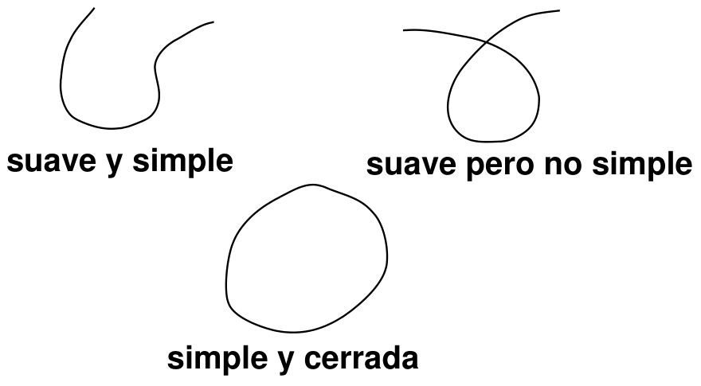
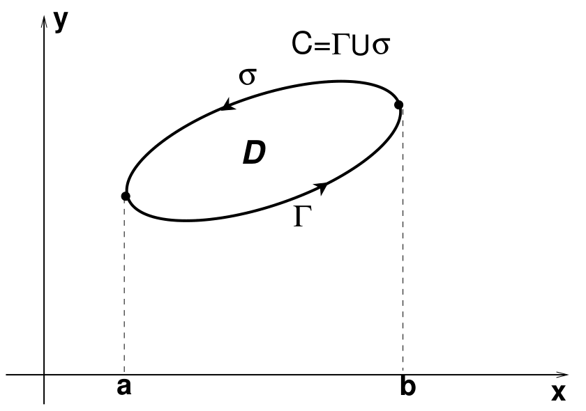
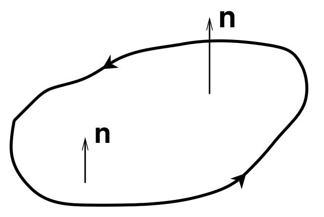

<!-- markdownlint-disable MD036 -->

# Lectura 3. Integrales de línea y de superficie

Fuente: `Integrales_AM.pdf`, 32 diapositivas. Archivo en la carpeta 2020;
portada: curso 2011-12, septiembre 2011.
[Procedencia y revisión](../../../resources/2020/resume-integrales-am-cobertura.md).
El título «Integrales de línea y de superficie» y el subtítulo de cada sección
se repiten en los encabezados originales. Se conserva la división en páginas.

## Página 1/32: portada

Lectura 3

Ampliación de Matemáticas. Grado en Ingeniería Civil

Curso 2011-12

Septiembre 2011


## Página 2/32: Integrales de línea y de superficie

**Motivación:** muchas ecuaciones y propiedades fundamentales de la Física (y,
en consecuencia, de aplicación en Ingeniería) se derivan a partir de integrales
de campos escalares y vectoriales sobre líneas, superficies y volúmenes.

**Ejemplos:**

1. Mecánica de Fluidos: Ecuación de continuidad.
1. Termodinámica: Ecuación de conducción del calor.
1. Mecánica: Campos de fuerza conservativos.

## Página 3/32: Integrales de línea

**Integral de línea:** va a generalizar el concepto de integral de Riemann en
una variable. El dominio de integración será ahora una curva en $`\mathbb R^n`$
($`n=2,3`$ en las aplicaciones que consideremos).

### Curva en $`\mathbb R^n`$

Es una función $`C:\mathbb R\to\mathbb R^n`$ tal que existen las derivadas de
sus componentes y son continuas (es decir, que es de clase $`\mathcal C^1`$, a
lo cual nos referiremos diciendo que la curva es suave).

En particular, una curva en $`\mathbb R^2`$ es una función:

```math
\begin{aligned}
C:D\subset\mathbb R&\longrightarrow\mathbb R^2\\
t&\longrightarrow(x(t),y(t))
\end{aligned}
```

siendo $`t`$ el parámetro, que al ser variado va generando los puntos $`(x,y)`$
de la curva.

## Página 4/32: Integrales de línea

### Integral de línea de una función escalar (para curvas en $`\mathbb R^2`$)

Sea una curva en $`\mathbb R^2`$ que une los puntos $`A`$ y $`B`$ dada en forma
paramétrica $`t\to(x(t),y(t))`$, definimos la integral de línea de una función
continua $`f(x,y)`$ sobre la curva $`C`$ entre $`A=(x(a),y(a))`$ y
$`B=(x(b),y(b))`$ como:

```math
\int_{C_{AB}} f\,dl=\int_a^b f(x(t),y(t))\sqrt{x'(t)^2+y'(t)^2}\,dt.
```

**Casos particulares:**

1. Si el parámetro de la curva es $`x`$, es decir, $`t=x`$, entonces
   $`\int_{C_{AB}}f\,dl=\int_a^b f(x,y(x))\sqrt{1+y'(x)^2}\,dx`$.
1. Si sobre la curva $`f`$ una de las variables fuera constante (por ej. $`y`$)
   entonces:
   $`\int_{C_{AB}}f\,dl=\int_a^b f(x(t),k)\sqrt{x'(t)^2}\,dt=\pm\int_{x_a}^{x_b}f(x,k)\,dx`$
   que es la conocida integral de Riemann en una variable.

## Página 5/32: Integrales de línea

La definición puede, por supuesto, extenderse a fácilmente a curvas en
$`\mathbb R^3`$ o sin más a $`\mathbb R^n`$: Sea la curva

```math
\begin{aligned}
C:D\subset\mathbb R&\longrightarrow\mathbb R^n\\
t&\longrightarrow\boldsymbol x(t)=(x_1(t),\ldots,x_n(t))
\end{aligned}
```

Consideremos $`\boldsymbol x'(t)=(x'_1(t),\ldots,x'_n(t))`$ y sea
$`\|\boldsymbol x'(t)\|`$ el módulo de este vector. Entonces

### Integral de línea de una función escalar (para curvas en $`\mathbb R^n`$)

```math
\int_{C_{AB}}f\,dl=\int_a^b f(\boldsymbol x(t))\|\boldsymbol x'(t)\|\,dt\tag{1}
```

**Comentario:** $`\boldsymbol x'(t_0)`$ es un vector tangente a la curva
$`\boldsymbol x(t)`$ en $`t=t_0`$ (es el vector velocidad de la curva en ese
punto).

## Página 6/32: Integrales de línea

**Comentario:** en los cálculos consideraremos siempre que las curvas son
*suaves* y *simples* (o la unión de curvas suaves y simples).



## Página 7/32: Integrales de línea

En las definiciones anteriores asumimos que $`f`$ era una función escalar (es
decir, los valores de la función eran números reales). Es posible extender la
definición de integral de línea a funciones (campos, por su aplicación en
Física) vectoriales (es decir, los valores de la función son elementos de
$`\mathbb R^n`$).

### Integral de línea de una función vectorial (para curvas en $`\mathbb R^n`$)

Sea $`\boldsymbol r:D\subset\mathbb R\to\mathbb R^n`$ una curva suave que une
los puntos $`A`$ y $`B`$. Denotamos por $`C_{AB}`$ el lugar de los puntos de la
curva desde $`A`$ a $`B`$. Sea $`\boldsymbol F:\mathbb R^n\to\mathbb R^n`$ una
función continua. Definimos la integral de línea de $`\boldsymbol F`$ sobre la
curva $`\boldsymbol r`$ entre los puntos $`A`$ y $`B`$ de $`\mathbb R^n`$ como:

```math
\int_{C_{AB}}\boldsymbol F\cdot d\boldsymbol r=\int_{C_{AB}}(\boldsymbol F\cdot\boldsymbol T)\,dl
```

representando $`\boldsymbol T`$ el vector unitario (variable) tangente a la
curva. Es decir, que la integral de $`\boldsymbol F`$ sobre la curva
$`\boldsymbol r(t)`$ es la integral de línea de la función escalar
$`\boldsymbol F\cdot\boldsymbol T`$ (proyección de $`\boldsymbol F`$ sobre la
tangente) sobre la curva.

## Página 8/32: Integrales de línea

**Comentario:** Asumiendo que $`\boldsymbol r'(t)\ne0`$, es claro que el vector
unitario tangente a la curva en $`t=t_0`$ es
$`\boldsymbol T(t_0)=\boldsymbol r'(t_0)/\|\boldsymbol r'(t_0)\|`$ y por lo
tanto, podemos escribir:

```math
\int_{C_{AB}}\boldsymbol F\cdot d\boldsymbol r=\int_a^b\boldsymbol F(\boldsymbol r(t))\cdot\boldsymbol r'(t)\,dt
```

donde $`\boldsymbol r(a)=\boldsymbol A`$ y $`\boldsymbol r(b)=\boldsymbol B`$.

**Ejemplo:** Sea $`\boldsymbol F(x,y,z)=(z,y,x)`$. Calcular la integral de línea
de $`\boldsymbol F`$ a lo largo de la curva $`y=x^2`$, $`z=x`$ entre $`(0,0,0)`$
y $`(1,1,1)`$.

**Solución:**

Escogemos como parámetro $`t=x`$ de forma que $`\boldsymbol r'(t)=(1,2t,1)`$,
$`\boldsymbol F(\boldsymbol r(t))=(t,t^2,t)`$ y $`\boldsymbol r(0)=(0,0,0)`$,
$`\boldsymbol r(1)=(1,1,1)`$. Luego
$`\boldsymbol F\cdot\boldsymbol r'=t+2t^3+t`$ y entonces

```math
\int_C\boldsymbol F\,d\boldsymbol r=\int_0^1(2t+2t^3)\,dt=3/2.
```

## Página 9/32: Integrales de línea

Un teorema fundamental es la regla de Barrow para integrales de línea.

### Regla de Barrow

Sea $`\phi`$ una función escalar tal que la función $`\nabla\phi`$ es continua y
sea $`C`$ un camino suave que une los puntos $`A`$ y $`B`$, entonces:

```math
\int_{C_{AB}}\nabla\phi\,d\boldsymbol r=\phi(\boldsymbol B)-\phi(\boldsymbol A)
```

Este Teorema nos garantiza que si una función vectorial continua se puede
escribir como el gradiente de una función escalar, entonces la integral de
camino entre $`A`$ y $`B`$ es la misma para cualquier camino suave a trozos
uniendo estos dos puntos, es decir, que sólo depende de los puntos iniciales y
finales del camino. Una función vectorial que cumple esta propiedad se dice que
es un campo conservativo.

## Página 10/32: Integrales de línea

### Campo conservativo: definición

Diremos que un campo vectorial es conservativo si se cumple cualquiera de las
siguientes condiciones (equivalentes entre sí).

1. $`\boldsymbol F`$ es el gradiente de un campo escalar $`\phi`$, al que se le
   llama función escalar del campo conservativo $`\boldsymbol F`$.
1. Para cualesquiera caminos suaves $`C_{AB}`$, $`\bar C_{AB}`$ que unan los
   puntos $`A`$ y $`B`$ (desde $`A`$ a $`B`$, por ejemplo), se tiene que
   $`\int_{C_{AB}}\boldsymbol F\,d\boldsymbol r=\int_{\bar C_{AB}}\boldsymbol F\,d\boldsymbol r`$.
1. Si $`C`$ es una curva cerrada (que empieza y termina en un mismo punto)
   entonces
   $`\int_C\boldsymbol F\,d\boldsymbol r\equiv\oint_C\boldsymbol F\,d\boldsymbol r`$
   (Integral de Circulación) $`=0`$.

### Campo conservativo: propiedad 1

Si $`\boldsymbol F`$ es un campo conservativo con función potencial $`\phi`$,
entonces $`\phi+K`$, siendo $`K`$ una constante, también es una función
potencial del mismo campo $`\boldsymbol F`$.

## Página 11/32: Integrales de línea

### Campo conservativo: condición (necesaria) de Green para campos de $`\mathbb R^2`$

Si $`\boldsymbol F=(F^x,F^y)`$,
$`\boldsymbol F:D\subset\mathbb R^2\to\mathbb R^2`$, es conservativo en el
dominio $`D`$, teniendo $`F^x`$ y $`F^y`$ derivadas parciales continuas en
$`D`$, entonces $`F^y_x=F^x_y`$.

### Campo conservativo: condición (suficiente) de Green para campos de $`\mathbb R^2`$

Sea $`\boldsymbol F:D\subset\mathbb R^2\to\mathbb R^2`$ un campo vectorial con
dominio $`D`$ simplemente conexo de tal forma que las derivadas parciales de sus
componentes $`F^x`$, $`F^y`$ tienen primeras derivadas parciales continuas en
$`D`$ cumpliéndose que $`F^y_x=F^x_y`$. Entonces $`\boldsymbol F`$ es
conservativo.

**Dominio simplemente conexo:** dominio sin agujeros y sin piezas separadas.

## Página 12/32: Integrales de línea

**Ejemplo:** Estudiar si el campo vectorial $`\boldsymbol F(x,y)=(2xy,x^2)`$ es
un campo conservativo. Obtener su función potencial.

**Solución:**

$`\boldsymbol F`$ es un campo $`\mathcal C^\infty`$ en todo $`\mathbb R^2`$ y se
cumple que $`F^y_x=F^x_y`$, luego es un campo conservativo. Calculemos la
función potencial $`\phi(x,y)`$: Como $`\boldsymbol F=\nabla\phi(x,y)`$, se
verifica que

```math
\phi_x=F^x=2xy\Rightarrow\phi(x,y)=x^2y+C(y)
```

y derivando $`\phi_y=x^2+C'(y)`$, pero $`\phi_y=F^y=x^2`$ luego $`C'(y)=0`$ y
$`C(y)`$ es una constante (podemos tomarla cero), de modo que una función
potencial es

```math
\phi(x,y)=x^2y.
```

**Comentario:** Para campos vectoriales de $`\mathbb R^2`$ la definición de los
campos conservativos no cambia, aunque sí ligeramente la condición de Green: se
deberá verificar $`F^y_x=F^x_y`$, $`F^y_z=F^z_y`$, $`F^z_x=F^x_z`$
simultáneamente. Estas condiciones se pueden escribir de modo más simple
introduciendo el operador rotacional.

## Página 13/32: Integrales de línea

### Rotacional de un campo vectorial: definición

Sea $`\boldsymbol F`$ un campo vectorial
$`\boldsymbol F:\mathbb R^3\to\mathbb R^3`$, que escribimos como
$`\boldsymbol F=F^x\boldsymbol i+F^y\boldsymbol j+F^z\boldsymbol k`$, siendo
$`\{\boldsymbol i,\boldsymbol j,\boldsymbol k\}`$ la base canónica. Definimos el
campo rotacional de $`\boldsymbol F`$ como:

```math
\mathop{\mathrm{rot}}\nolimits \boldsymbol F=\nabla\times\boldsymbol F=
\begin{vmatrix}\boldsymbol i&\boldsymbol j&\boldsymbol k\\
\frac\partial{\partial x}&\frac\partial{\partial y}&\frac\partial{\partial z}\\
F^x&F^y&F^z\end{vmatrix}
=(F^z_y-F^y_z)\boldsymbol i+(F^x_z-F^z_x)\boldsymbol j+(F^y_x-F^x_y)\boldsymbol k
```

Un campo vectorial $`\boldsymbol F`$ es el gradiente de una función escalar
$`\longleftrightarrow\nabla\times\boldsymbol F=\boldsymbol0`$.

## Página 14/32: Integrales de Superficie

Acabamos de generalizar el concepto de integral de Riemann “adaptándolo” a la
integración sobre curvas en el espacio, no necesariamente rectas. Es de esperar
que podamos también encontrar una generalización del concepto de integral doble
que nos permita integrar sobre superficies curvadas en el espacio. Un elemento
esencial del cálculo será la parametrización de las superficies

### Superficie parametrizada: definición

Una superficie parametrizada en $`\mathbb R^3`$ es una función
$`\boldsymbol r:D\subset\mathbb R^2\to\mathbb R^3`$. La superficie $`S`$
correspondiente a la función $`\boldsymbol r`$ es la imagen
$`S=\boldsymbol r(D)`$. Escribiremos

```math
\boldsymbol r(u,v)=(x(u,v),y(u,v),z(u,v))
```

y si $`\boldsymbol r`$ es diferenciable se dirá que $`S`$ es una superficie
diferenciable.

## Página 15/32: Integrales de Superficie

Dos ejemplos sencillos de parametrización de superficies son los siguientes:

1. **Parametrización del plano en coordenadas polares.** El plano $`z=k`$ se
   puede parametrizar utilizando coordenadas polares:

   $$
   \lbrace (x,y,k),\ x,y\in\mathbb R\rbrace =\lbrace (r\cos\phi,r\sin\phi,k),\ r\ge0,\ 0\le\phi\lt 2\pi\rbrace .
   $$

1. **Parametrización de una esfera mediante coordenadas esféricas.** Una esfera
   de radio $`R`$ se puede parametrizar utilizando dos ángulos:

   $$
   \begin{aligned}
      x(\theta,\phi)&=R\sin\theta\cos\phi\cr
      y(\theta,\phi)&=R\sin\theta\sin\phi\cr
      z(\theta,\phi)&=R\cos\theta
      \end{aligned}
   $$

   De modo que la esfera $`S`$ es:

   $$
   S=\lbrace (x(\theta,\phi),y(\theta,\phi),z(\theta,\phi))\ 0\le\theta\lt \pi,\ 0\le\phi\le2\pi\rbrace
   $$

## Página 16/32: Integrales de Superficie

**Observación:** Consideraremos en todo momento superficies diferenciables
$`S=S(u,v)`$. Fijado uno de los parámetros, pongamos que $`v`$, al variar el
otro obtendríamos una curva en $`\mathbb R^3`$. Las tangentes a esta curva en
cada punto se pueden obtener por derivación respecto a $`u`$:

```math
\boldsymbol T_u=\frac{\partial x}{\partial u}\boldsymbol i+\frac{\partial y}{\partial u}\boldsymbol j+\frac{\partial z}{\partial u}\boldsymbol k
```

y de similar forma podríamos obtener el vector tangente a la superficie a lo
largo de la dirección de $`v`$:

```math
\boldsymbol T_v=\frac{\partial x}{\partial v}\boldsymbol i+\frac{\partial y}{\partial v}\boldsymbol j+\frac{\partial z}{\partial v}\boldsymbol k
```

## Página 17/32: Integrales de Superficie

Dado un punto de la superficie $`S`$, como ambos vectores $`\boldsymbol T_u`$ y
$`\boldsymbol T_v`$ son tangentes a dos curvas contenidas en $`S`$, ambos son
ortogonales al vector normal a la superficie en ese punto y por lo tanto, por
las propiedades del producto vectorial,

```math
\boldsymbol N=\boldsymbol T_u\times\boldsymbol T_v
```

es normal a las superficie, siempre, claro está, que
$`\boldsymbol T_u\times\boldsymbol T_v\ne0`$ en el punto en cuestión (si esto es
así, diríamos que la superficie parametrizada no es suave; consideraremos que
esto no ocurre).

**Comentario:** Esto nos permite obtener la ecuación del plano tangente en un
punto $`(x_0,y_0,z_0)`$:

```math
(x-x_0,y-y_0,z-z_0)\boldsymbol N=0
```

donde $`\boldsymbol N`$ se evalúa en $`(x_0,y_0,z_0)`$.

## Página 18/32: Integrales de Superficie

**Ejemplo:**

Considerando la parametrización de la esfera antes considerada, tendríamos que

```math
\begin{aligned}
\boldsymbol T_\theta&=R(\cos\phi\cos\theta,\sin\phi\cos\theta,-\sin\theta)\\
\boldsymbol T_\phi&=R(-\sin\phi\sin\theta,\cos\phi\sin\theta,0)
\end{aligned}
```

y
$`\boldsymbol T_\theta\times\boldsymbol T_\phi=R\sin\theta(R\sin\theta\cos\phi,R\sin\theta\sin\phi,R\cos\theta)=R\sin\theta\boldsymbol r`$.
Por lo tanto, si $`\sin\theta\ne0`$, se trata de un vector proporcional al
vector $`(x,y,z)`$ que tiene la dirección radial, como cabría esperar del vector
normal a la superificie de una esfera.

El caso $`\sin\theta=0`$ ($`\theta=0,\pi`$) presenta un problema en la
parametrización: diríamos que la superficie parametrizada no es suave para esos
valores de $`\theta`$.

Ya estamos en condiciones de definir la integral de una función escalar sobre
una superficie parametrizada ...

## Página 19/32: Integrales de Superficie

### Integral de una función escalar sobre una superficie parametrizada: definición

Si $`f(x,y,z)`$ es una función escalar continua, definida sobre una superficie
$`S`$, estando $`S`$ parametrizada por el campo vectorial
$`\boldsymbol r(u,v)`$, con $`u`$ y $`v`$ variando en un dominio $`D`$, se
define la integral de $`f`$ sobre $`S`$ como:

```math
\int_S f(x,y,z)\,dS=\iint_D f(\boldsymbol r(u,v))\|\boldsymbol T_u\times\boldsymbol T_v\|\,du\,dv
```

**Observaciones:**

1. La integral doble de Riemann puede verse como un caso particular de esta
   definición (yendo a una dimensión más, eso sí).
1. La fórmula de cambio de variable está, de algún modo, contenida en esta
   definición.

## Página 20/32: Integrales de Superficie

### Integral de una función vectorial sobre una superficie parametrizada: definición

Si $`\boldsymbol F(x,y,z)`$ es un campo vectorial continuo, definido sobre una
superficie $`S`$, estando $`S`$ parametrizada por el campo vectorial
$`\boldsymbol r(u,v)`$, con $`u`$ y $`v`$ variando en un dominio $`D`$, se
define la integral de $`\boldsymbol F`$ sobre $`S`$ como:

```math
\int_S\boldsymbol F(x,y,z)\,d\boldsymbol S=\iint_D\boldsymbol F(\boldsymbol r(u,v))\cdot(\boldsymbol T_u\times\boldsymbol T_v)\,du\,dv
```

## Página 21/32: Teoremas fundamentales del cálculo vectorial

**Comentario:** De la misma forma que las integrales de línea pueden reducirse
al problema de calcular una función (potencial) en dos puntos (regla de Barrow)
cuando el campo vectorial es conservativo, es tentador pensar que semejante
“reducción de dimensión” puede aplicarse para relacionar determinadas integrales
de superficie con integrales de línea e integrales de volumen con integrales de
superficie. Veremos que este tipo de relaciones son establecidas en los teoremas
de Gauss y Stokes (Green).

## Página 22/32: Teoremas fundamentales del cálculo vectorial

### Teorema de Green

Sea $`D`$ una región en el plano delimitada por una curva $`C`$ suave a trozos y
cerrada y sea $`\boldsymbol F(x,y)=(F^x(x,y),F^y(x,y))`$ un campo vectorial
$`\mathcal C^1`$ en $`D`$. Entonces

```math
\oint_C\boldsymbol F\,d\boldsymbol r=\iint_D\left(\frac{\partial F^y}{\partial x}-\frac{\partial F^x}{\partial y}\right)\,dx\,dy
```

donde la curva $`C`$ se recorre en el sentido tal que si nos moviéramos sobre la
curva en este sentido, el dominio $`D`$ quedaría a nuestra izquierda. Si $`D`$
está delimitada por varias curvas suaves y cerradas $`C_1,\ldots,C_n`$, entonces

```math
\sum_{i=1}^n\oint_{C_i}\boldsymbol F\,d\boldsymbol r=\iint_D\left(\frac{\partial F^y}{\partial x}-\frac{\partial F^x}{\partial y}\right)\,dx\,dy
```

donde cada curva se recorre en el sentido tal que la región $`D`$ quede a la
izquierda (diremos que éste es el sentido positivo).

## Página 23/32: Teoremas fundamentales del cálculo vectorial

Un dibujo sirve para aclarar qué entendemos por *sentido positivo de recorrido*
...



## Página 24/32: Teoremas fundamentales del cálculo vectorial

Como vemos, el teorema de Green relaciona integrales dobles con integrales de
línea sobre curvas planas. En realidad es un caso particular del teorema de
Stokes, que enunciaremos más adelante. Una primera aplicación del Teorema de
Green es el cálculo de áreas planas.

### Cálculo de áreas planas

Sea una región $`D`$ para la que se puede aplicar el teorema de Green,
delimitada por curvas $`C_1,\ldots,C_n`$, entonces el área de la superficie, se
puede obtener de siguiente modo:

```math
\mu(D)=\iint_D dx\,dy=\frac12\sum_{i=1}^n\oint_{C_i}[x\,dy-y\,dx]
```

donde las integrales de línea se recorren en el sentido positivo (teorema de
Green).

## Página 25/32: Teoremas fundamentales del cálculo vectorial

**Ejemplo:** Calcular el área de una elipse de semiejes $`a`$ y $`b`$.

**Solución:**

Una parametrización conveniente para la elipse $`x^2/a^2+y^2/b^2=1`$ es la
siguiente

```math
\begin{aligned}
x=a\cos t&\longrightarrow dx=-a\sin t\,dt\\
y=b\sin t&\longrightarrow dy=b\cos t\,dt
\end{aligned}
```

variando $`t`$ desde 0 hasta $`2\pi`$ se recorre la elipse en el sentido
positivo. Aplicando el anterior corolario:

```math
S=\frac12\oint[x\,dy-y\,dx]=\frac12\int_0^{2\pi}[a\cos t(b\cos t\,dt)-b\sin t(-a\sin t\,dt)]=ab\pi.
```

## Página 26/32: Teoremas fundamentales del cálculo vectorial

Una consecuencia del teorema de Green es la fórmula de la integral doble del
Laplaciano. Antes,recordemos qué es un Laplaciano: Sea $`f`$ una función escalar
dos veces derivable dependiente de $`n`$ variables, se define la actuación del
Laplaciano $`\Delta`$ sobre $`f`$ como:

```math
\Delta f=\sum_{i=1}^n\frac{\partial^2 f}{\partial x_i^2}.
```

### Integral doble del Laplaciano

Sea $`D`$ una región plana delimitada por una curva parametrizada suave $`C`$
con orientación positiva y $`f:D\subset\mathbb R^2\to\mathbb R`$ de clase
$`\mathcal C^2`$ entonces

```math
\iint_D\Delta f\,dx\,dy=\oint D_{\boldsymbol n}f\,dl
```

donde la integral de la derecha es la integral de línea de la función escalar
$`D_{\boldsymbol n}f`$ (derivada direccional de $`f`$ según el vector unitario
normal a la curva en cada punto y apuntando hacia el exterior).

## Página 27/32: Teoremas fundamentales del cálculo vectorial

El teorema de Gauss relaciona integrales en volumen con integrales de
superficie. Para enunciarlo es conveniente recordar la definición de divergencia
de un campo vectorial: Sea $`\boldsymbol F`$ un campo vectorial en
$`\mathbb R^n`$ dependiente de $`n`$ variables,
$`\boldsymbol F=(F^{x_1},\ldots,F^{x_n})`$. Se define su divergencia como:

```math
\mathop{\mathrm{div}}\nolimits (\boldsymbol F)=\nabla\boldsymbol F=\sum_{i=1}^n\frac{\partial F^{x_i}}{\partial x_i}\equiv\sum_{i=1}^nF^{x_i}_{x_i}.
```

### Teorema de Gauss o de la divergencia

Sea una región $`V`$ en $`\mathbb R^3`$ encerrada por una superficie $`S`$
parametrizada con parámetros $`u`$ y $`v`$, de tal modo que el vector normal
$`\boldsymbol N=\boldsymbol T_u\times\boldsymbol T_u`$ apunta hacia el exterior
del volumen $`V`$. Sea un campo vectorial $`\boldsymbol F`$ que es de clase
$`\mathcal C^1`$ en $`V`$, entonces:

```math
\iiint_V\nabla\boldsymbol F\,dV=\iint_S\boldsymbol F\cdot d\boldsymbol S
```

## Página 28/32: Teoremas fundamentales del cálculo vectorial

**Comentario:** La integral de $`\boldsymbol F`$ a la derecha de la expresión
del Teorema de Gauss recibe el nombre de flujo de $`\boldsymbol F`$ sobre la
superficie $`S`$.

**Ejercicio:** Verificar el teorema de la divergencia para el siguiente campo
vectorial: $`\boldsymbol F=x^2\boldsymbol i+y^2\boldsymbol j+z^2\boldsymbol k`$
siendo $`S`$ la superficie cilíndrica $`x^2+y^2=4`$, $`0\le z\le5`$ junto con
sus bases $`\{(x,y)|x^2+y^2\le4,z=5\}`$ y $`\{(x,y)|x^2+y^2\le4,z=0\}`$.

**Hacer!**

## Página 29/32: Teoremas fundamentales del cálculo vectorial

El teorema de Stokes va a relacionar integrales de superficie en $`\mathbb R^3`$
con integrales de línea en $`\mathbb R^2`$; el teorema de Green no será más que
un caso particular de este caso más general. Antes de enunciar el teorema,
necesitamos introducir el concepto de superficie suave orientable:

1. De igual forma que decíamos que una curva era suave si admitía tangente en
   todo punto de la curva, siendo la tangente una función continua, diremos que
   una superficie es suave si existe la normal a la superficie en cada punto y
   esta varía de forma continua al movernos sobre la superficie.
1. Es evidente que dada una superficie y $`\boldsymbol n`$ el vector unitario
   perpendicular a la superficie en un punto, también podríamos escoger
   $`-\boldsymbol n`$ como vector normal; cada una de estas opciones dará
   normales de sentido opuesto en cada punto. Escoger una de estas dos opciones
   se dice que es escoger una orientación de la superficie.

## Página 30/32: Teoremas fundamentales del cálculo vectorial

Consideremos una superficie $`S`$ cuya frontera es una curva suave simple y
cerrada. Escogida la parametrización de la curva $`\boldsymbol r(t)`$ diremos
que la orientación de la curva es positiva respecto a la orientación de la
superficie (o que tiene el sentido inducido por la superficie orientada) si los
vectores normales $`\boldsymbol n`$ a la superficie cercanos a esta curva son
tales que $`\frac{d\boldsymbol r}{dt}\times\boldsymbol n`$ apunta alejándose de
la superficie o, dicho de otra forma, si al caminar sobre la curva frontera de
la superficie, el vector normal apunta hacia arriba y la superficie queda a la
izquierda.



## Página 31/32: Teoremas fundamentales del cálculo vectorial

### Teorema de Stokes

Sea una superficie $`S`$ limitada por una curva suave y cerrada $`\Gamma`$ y
$`\boldsymbol F`$ un campo vectorial $`\mathcal C^1`$ en $`S`$ entonces

```math
\iint_S(\nabla\times\boldsymbol F)\,d\boldsymbol S=\oint_\Gamma\boldsymbol F\,d\boldsymbol r
```

donde la orientación de $`\Gamma`$ es la inducida por la orientación de la
superficie.

## Página 32/32: Teoremas fundamentales del cálculo vectorial

**Ejercicio:** Utilizar el teorema de Stokes para evaluar la integral de línea

```math
\int_C(-y^3\,dx+x^3\,dy-z^3\,dz),
```

donde $`C`$ es la intersección del cilindro $`x^2+y^2=1`$ y el plano
$`x+y+z=1`$. La orientación de $`C`$ es tal que gira en el sentido que lleva el
eje X al eje Y. Verificar el resultado haciendo directamente la integral de
línea.

**Hacer!**

## Notas de transcripción

Se conserva el texto y las expresiones del original, incluidas estas erratas
identificadas durante el cotejo:

- Página 4: «sobre la curva f».
- Página 5: «extenderse a fácilmente».
- Página 12: el comentario menciona $`\mathbb R^2`$ antes de dar condiciones con
  tres componentes.
- Página 13: se conserva la equivalencia final tal como aparece, sin agregar
  hipótesis topológicas.
- Página 15: la parametrización de la esfera imprime $`0\le\theta\lt \pi`$ y
  $`0\le\phi\le2\pi`$.
- Página 17: «las superficie» y el paréntesis «si esto es así ... no es suave»
  siguen a la condición de producto vectorial distinto de cero.
- Página 27: se imprime $`\boldsymbol T_u\times\boldsymbol T_u`$, y se usa
  $`\nabla\boldsymbol F`$ para la divergencia.
- Página 29: se imprime integrales de línea en $`\mathbb R^2`$.

Los dos ejercicios marcados «Hacer!» se conservan sin resolver.
