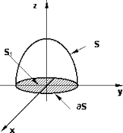
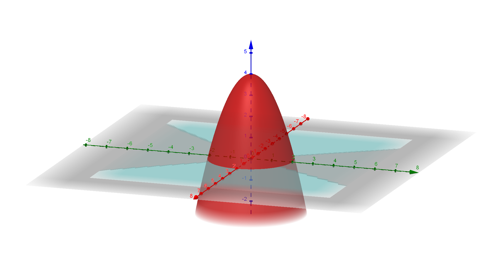

<!-- markdownlint-disable MD036 -->

# Teoremas de Stokes y de la divergencia

> Transcripción del original. Año de archivo: 2020. Atribución: Archivado en
> carpeta canónica de AMII; carrera no identificada en el documento. Las erratas
> y las repeticiones del original se conservan.

## Diapositiva 1 — Teorema de Stokes

Sea S una superficie orientada con vector unitario normal N, acotada por una
curva cerrada simple, suave a trozos C, con orientación positiva. Si F es un
campo vectorial cuyas funciones componentes tienen derivadas parciales continuas
en una región abierta que contiene a S y a C, entonces

```math
\int_C F.dr=\iint_S(\mathop{\mathrm{rot}}\nolimits F).N\,dS
```



## Diapositiva 2

Recordar que la superficie es la gráfica de $`z=f(x,y)`$ y que

```math
N=\nabla G,\quad\text{siendo }G(x,y,z)=z-f(x,y)
```

## Diapositiva 3

- Verificar el Teorema de Stokes con $`F(x,y,z)=2z\vec i+x\vec j+y^2\vec k`$
  donde S es la superficie del círculo $`x^2+y^2\leq4`$ y C es la traza de S en
  el plano xy
- Supongamos ahora que la superficie es un paraboloide $`z=4-x^2-y^2`$, limitado
  por la misma circunferencia
- Calcular nuevamente $`\iint_S(\mathop{\mathrm{rot}}\nolimits F).N\,dS`$

## Diapositiva 4 — Teorema de la divergencia

Sea Q una región sólida limitada o acotada por una superficie cerrada S
orientada por un vector unitario normal dirigido hacia el exterior de Q. Si F es
un campo vectorial cuyas funciones componentes tienen derivadas parciales
continuas en Q, entonces

```math
\iint_S F.N\,dS=\iiint_Q\mathop{\mathrm{div}}\nolimits F\,dV
```

## Diapositiva 5 — Ejemplo

Trabajemos sobre la misma superficie $`z=4-x^2-y^2`$, limitada también por el
plano xy y siendo $`F=(2z,x,y^2)`$


