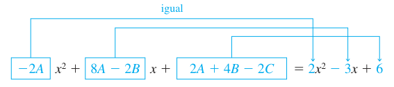
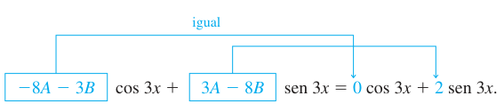

# 4.4 Coeficientes indeterminados: método de superposición — Inicio

> Fuente editorial atribuida a Zill por el archivo
> `Ecuaciones diferenciales con aplicaciones de modelado - Zill.pdf`,
> `2020/15-EDO 2do Orden/`. El extracto no contiene portada bibliográfica ni año
> de edición. Sin atribución a ISI. Desde el segundo tema de PDF24 (impresa140)
> hasta el final de PDF 30 (impresa 146). La solución del ejemplo 9 continúa en
> la página PDF 31, fuera de este tramo. Continúa
> [coeficientes constantes](zill-01-c-coeficientes-constantes.md).

## Página 140 — 4.4 COEFICIENTES INDETERMINADOS: MÉTODO DE SUPERPOSICIÓN\*

REPASO DE MATERIAL

- Repaso de los teoremas 4.1.6 y 4.1.7 (sección 4.1).

**INTRODUCCIÓN.** Para resolver una ecuación diferencial lineal no homogénea

```math
a_ny^{(n)}+a_{n-1}y^{(n-1)}+\cdots+a_1y'+a_0y=g(x),\tag{1}
```

se debe hacer dos cosas:

- encontrar la función complementaria $`y_c`$ y
- encontrar alguna solución particular $`y_p`$ de la ecuación no homogénea (1).

Entonces, como se explicó en la sección 4.1, la solución general de (1) es
$`y=y_c+y_p`$. La función complementaria $`y_c`$ es la solución general de la ED
homogénea asociada de (1), es decir,

```math
a_ny^{(n)}+a_{n-1}y^{(n-1)}+\cdots+a_1y'+a_0y=0.
```

En la sección 4.3 vimos cómo resolver esta clase de ecuaciones cuando los
coeficientes eran constantes. Así, el objetivo en esta sección es desarrollar un
método para obtener soluciones particulares.

- **Nota para el profesor:** En esta sección el método de coeficientes
  indeterminados se desarrolla desde el punto de vista del principio de
  superposición para ecuaciones no homogéneas (teorema 4.7.1). En la sección 4.5
  se presentará un método totalmente diferente que utiliza el concepto de
  operadores diferenciales anuladores. Elija el que convenga.

## Página 141

**MÉTODO DE COEFICIENTES INDETERMINADOS.** La primera de las dos formas que se
consideran para obtener una solución particular $`y_p`$ de una ED lineal no
homogénea se llama **método de coeficientes indeterminados**. La idea
fundamental detrás de este método es una conjetura acerca de la forma de
$`y_p`$, en realidad una intuición educada, motivada por las clases de funciones
que forman la función de entrada $`g(x)`$. El método general se limita a ED
lineales como (1) donde

- los coeficientes $`a_i`$, $`i=0,1,\ldots,n`$ son constantes y
- $`g(x)`$ es una constante $`k`$, una función polinomial, una función
  exponencial $`e^{\alpha x}`$, una función seno o coseno
  $`\mathop{\mathrm{sen}}\nolimits \beta x`$ o $`\cos\beta x`$ o sumas finitas y
  productos de estas funciones.

**NOTA.** Estrictamente hablando, $`g(x)=k`$ (constante) es una función
polinomial. Puesto que probablemente una función constante no es lo primero en
que se piensa cuando se consideran funciones polinomiales, para enfatizar
continuaremos con la redundancia “funciones constantes, polinomios, ...”.

Las siguientes funciones son algunos ejemplos de los tipos de entradas $`g(x)`$
que son apropiadas para esta descripción:

```math
g(x)=10,\quad g(x)=x^2-5x,\quad g(x)=15x-6+8e^{-x},
```

```math
g(x)=\mathop{\mathrm{sen}}\nolimits 3x-5x\cos2x,\quad
 g(x)=xe^x\mathop{\mathrm{sen}}\nolimits x+(3x^2-1)e^{4x}.
```

Es decir, $`g(x)`$ es una combinación lineal de funciones de la clase

```math
P(x)=a_nx^n+a_{n-1}x^{n-1}+\cdots+a_1x+a_0,\quad
P(x)e^{\alpha x},\quad P(x)e^{\alpha x}\mathop{\mathrm{sen}}\nolimits \beta x
\quad\text{y}\quad P(x)e^{\alpha x}\cos\beta x,
```

donde $`n`$ es un entero no negativo y $`\alpha`$ y $`\beta`$ son números
reales. El método de coeficientes indeterminados no es aplicable a ecuaciones de
la forma (1) cuando

```math
g(x)=\ln x,\quad g(x)=\frac1x,\quad g(x)=\tan x,\quad
 g(x)=\mathop{\mathrm{sen}}\nolimits ^{-1}x,
```

etcétera. Las ecuaciones diferenciales en las que la entrada $`g(x)`$ es una
función de esta última clase se consideran en la sección 4.6.

El conjunto de funciones que consiste en constantes, polinomios, exponenciales
$`e^{\alpha x}`$, senos y cosenos tiene la notable propiedad de que las
derivadas de sus sumas y productos son de nuevo sumas y productos de constantes,
polinomios, exponenciales $`e^{\alpha x}`$, senos y cosenos. Debido a que la
combinación lineal de derivadas
$`a_ny_p^{(n)}+a_{n-1}y_p^{(n-1)}+\cdots+a_1y_p'+a_0y_p`$ debe ser idéntica a
$`g(x)`$, parece razonable suponer que $`y_p`$ *tiene la misma forma que*
$`g(x)`$.

En los dos ejemplos siguientes se ilustra el método básico.

### EJEMPLO 1. Solución general usando coeficientes indeterminados

Resuelva $`y''+4y'-2y=2x^2-3x+6`$. (2)

**SOLUCIÓN. Paso 1.** Se resuelve primero la ecuación homogénea asociada
$`y''+4y'-2y=0`$. De la fórmula cuadrática se encuentra que las raíces de la
ecuación auxiliar $`m^2+4m-2=0`$ son $`m_1=-2-\sqrt6`$ y $`m_2=-2+\sqrt6`$. Por
tanto, la función complementaria es

```math
y_c=c_1e^{-(2+\sqrt6)x}+c_2e^{(-2+\sqrt6)x}.
```

**Paso 2.** Ahora, debido a que la función $`g(x)`$ es un polinomio cuadrático,
supongamos una solución particular que también es de la forma de un polinomio
cuadrático:

```math
y_p=Ax^2+Bx+C.
```

## Página 142

Se busca determinar coeficientes *específicos* $`A,B`$ y $`C`$ para los cuales
$`y_p`$ es una solución de (2). Sustituyendo $`y_p`$ y las derivadas

```math
y_p'=2Ax+B\quad\text{y}\quad y_p''=2A
```

en la ecuación diferencial (2), se obtiene

```math
y_p''+4y_p'-2y_p=2A+8Ax+4B-2Ax^2-2Bx-2C=2x^2-3x+6.
```

Como se supone que la última ecuación es una identidad, los coeficientes de los
exponentes semejantes a $`x`$ deben ser iguales:

```math
\boxed{-2A}x^2+\boxed{8A-2B}x+\boxed{2A+4B-2C}=2x^2-3x+6.
```



Las flechas del original, rotuladas “igual”, vinculan cada coeficiente encerrado
con el coeficiente de la misma potencia en el segundo miembro.

Es decir,

```math
-2A=2,\quad8A-2B=-3,\quad2A+4B-2C=6.
```

Resolviendo este sistema de ecuaciones se obtienen los valores $`A=-1`$,
$`B=-\frac52`$ y $`C=-9`$. Así, una solución particular es

```math
y_p=-x^2-\frac52x-9.
```

**Paso 3.** La solución general de la ecuación dada es

```math
y=y_c+y_p=c_1e^{-(2+\sqrt6)x}+c_1e^{(-2+\sqrt6)x}-x^2-\frac52x-9.
```

> Errata del original: en esta última fórmula se repite $`c_1`$; en el paso 1 de
> la página 141 la segunda constante se imprime $`c_2`$. Se conserva lo impreso.

### EJEMPLO 2. Solución particular usando coeficientes indeterminados

Encuentre una solución particular de
$`y''-y'+y=2\mathop{\mathrm{sen}}\nolimits 3x`$.

**SOLUCIÓN.** Una primera suposición natural para una solución particular sería
$`A\mathop{\mathrm{sen}}\nolimits 3x`$. Pero debido a que las derivadas
sucesivas de $`\mathop{\mathrm{sen}}\nolimits 3x`$ producen
$`\mathop{\mathrm{sen}}\nolimits 3x`$ y $`\cos3x`$, se puede suponer una
solución particular que incluye ambos términos:

```math
y_p=A\cos3x+B\mathop{\mathrm{sen}}\nolimits 3x.
```

Derivando $`y_p`$ y sustituyendo los resultados en la ecuación diferencial, se
obtiene, después de reagrupar,

```math
y_p''-y_p'+y_p=(-8A-3B)\cos3x+(3A-8B)\mathop{\mathrm{sen}}\nolimits 3x
=2\mathop{\mathrm{sen}}\nolimits 3x
```

o

```math
\boxed{-8A-3B}\cos3x+\boxed{3A-8B}\mathop{\mathrm{sen}}\nolimits 3x
=0\cos3x+2\mathop{\mathrm{sen}}\nolimits 3x.
```



Las flechas “igual” del original vinculan $`-8A-3B`$ con 0 y $`3A-8B`$ con 2.

Del sistema de ecuaciones resultante,

```math
-8A-3B=0,\quad3A-8B=2,
```

se obtiene $`A=\frac6{73}`$ y $`B=-\frac{16}{73}`$. Una solución particular de
la ecuación es

```math
y_p=\frac6{73}\cos3x-\frac{16}{73}\mathop{\mathrm{sen}}\nolimits 3x.
```

Como se mencionó, la forma que se supone para la solución particular $`y_p`$ es
una intuición educada; no es una intuición a ciegas. Esta intuición educada debe
considerar no sólo los tipos de funciones que forman a $`g(x)`$ sino también,
como se verá en el ejemplo 4, las funciones que conforman la función
complementaria $`y_c`$.

## Página 143

### EJEMPLO 3. Formando yₚ por superposición

Resuelva $`y''-2y'-3y=4x-5+6xe^{2x}`$. (3)

**SOLUCIÓN. Paso 1.** Primero, se encuentra que la solución de la ecuación
homogénea asociada $`y''-2y'-3y=0`$ es $`y_c=c_1e^{-x}+c_2e^{3x}`$.

**Paso 2.** A continuación, la presencia de $`4x-5`$ en $`g(x)`$ indica que la
solución particular incluye un polinomio lineal. Además, debido a que la
derivada del producto $`xe^{2x}`$ produce $`2xe^{2x}`$ y $`e^{2x}`$, se supone
también que la solución particular incluye tanto a $`xe^{2x}`$ como a
$`e^{2x}`$. En otras palabras, $`g`$ es la suma de dos clases básicas de
funciones:

```math
g(x)=g_1(x)+g_2(x)=\text{polinomio}+\text{exponenciales}.
```

Por lo que, el principio de superposición para ecuaciones no homogéneas (teorema
4.1.7) indica que se busca una solución particular

```math
y_p=y_{p_1}+y_{p_2},
```

donde $`y_{p_1}=Ax+B`$ y $`y_{p_2}=Cxe^{2x}+Ee^{2x}`$. Sustituyendo

```math
y_p=Ax+B+Cxe^{2x}+Ee^{2x}
```

en la ecuación (3) y agrupando términos semejantes, se obtiene

```math
y_p''-2y_p'-3y_p=-3Ax-2A-3B-3Cxe^{2x}+(2C-3E)e^{2x}
=4x-5+6xe^{2x}.\tag{4}
```

De esta identidad obtenemos las cuatro expresiones

```math
-3A=4,\quad-2A-3B=-5,\quad-3C=6,\quad2C-3E=0.
```

La última ecuación en este sistema es resultado de la interpretación de que el
coeficiente de $`e^{2x}`$ en el miembro derecho de (4) es cero. Resolviendo, se
encuentra que $`A=-\frac43`$, $`B=\frac{23}9`$, $`C=-2`$ y $`E=-\frac43`$. Por
tanto,

```math
y_p=-\frac43x+\frac{23}9-2xe^{2x}-\frac43e^{2x}.
```

**Paso 3.** La solución general de la ecuación es

```math
y=c_1e^{-x}+c_2e^{3x}-\frac43x+\frac{23}9-\left(2x+\frac43\right)e^{2x}.
```

En vista del principio de superposición (teorema 4.1.7) se puede aproximar
también el ejemplo 3 desde el punto de vista de resolver dos problemas más
simples. Se debe comprobar que sustituyendo

```math
y_{p_1}=Ax+B\quad\text{en}\quad y''-2y'-3y=4x-5
```

y

```math
y_{p_2}=Cxe^{2x}+Ee^{2x}\quad\text{en}\quad y''-2y'-3y=6xe^{2x}
```

se obtiene, a su vez, $`y_{p_1}=-\frac43x+\frac{23}9`$ y
$`y_{p_2}=-(2x+\frac43)e^{2x}`$. Entonces, una solución particular de (3) es
$`y_p=y_{p_1}+y_{p_2}`$.

En el siguiente ejemplo se ilustra que algunas veces la suposición “obvia” para
la forma de $`y_p`$ no es una suposición correcta.

### EJEMPLO 4. Una falla imprevista del método

Encuentre una solución particular de $`y''-5y'+4y=8e^x`$.

**SOLUCIÓN.** Derivando $`e^x`$ no se obtienen nuevas funciones. Así, si se
procede como se hizo en los ejemplos anteriores, se puede suponer razonablemente
que una solución particular de la forma $`y_p=Ae^x`$. Pero sustituir esta
expresión en la ecuación diferencial

## Página 144

da como resultado la expresión contradictoria $`0=8e^x`$, por lo que claramente
se hizo la conjetura equivocada para $`y_p`$.

La dificultad aquí es evidente al examinar la función complementaria
$`y_c=c_1e^x+c_2e^{4x}`$. Observe que la suposición $`Ae^x`$ ya está presente en
$`y_c`$. Esto significa que $`e^x`$ es una solución de la ecuación diferencial
homogénea asociada y un múltiplo constante $`Ae^x`$ cuando se sustituye en la
ecuación diferencial necesariamente da cero.

¿Entonces cuál debe ser la forma de $`y_p`$? Inspirados en el caso II de la
sección 4.3, vemos que sí se puede encontrar una solución particular de la forma

```math
y_p=Axe^x.
```

Sustituyendo $`y_p'=Axe^x+Ae^x`$ y $`y_p''=Axe^x+2Ae^x`$ en la ecuación
diferencial y simplificando, se obtiene

```math
y_p''-5y_p'+4y_p=-3Ae^x=8e^x.
```

De la última igualdad se ve que el valor de $`A`$ ahora se determina como
$`A=-\frac83`$. Por tanto, una solución particular de la ecuación dada es
$`y_p=-\frac83xe^x`$.

La diferencia en los procedimientos usados en los ejemplos 1 a 3 y en el ejemplo
4 indica que se consideran dos casos. El primer caso refleja la situación en los
ejemplos 1 a 3.

**CASO I.** Ninguna función de la solución particular supuesta es una solución
de la ecuación diferencial homogénea asociada.

En la tabla 4.1 se muestran algunos ejemplos específicos de $`g(x)`$ en (1)
junto con la forma correspondiente de la solución particular. Por supuesto, se
da por sentado que ninguna función de la solución particular supuesta $`y_p`$ se
duplica por una función en la función complementaria $`y_c`$.

### TABLA 4.1. Soluciones particulares de prueba

| Nº | g(x) | Forma de yₚ |
| -- | -- | -- |
| 1 | $`1`$ (cualquier constante) | $`A`$ |
| 2 | $`5x+7`$ | $`Ax+B`$ |
| 3 | $`3x^2-2`$ | $`Ax^2+Bx+C`$ |
| 4 | $`x^3-x+1`$ | $`Ax^3+Bx^2+Cx+E`$ |
| 5 | $`\mathrm{sen}4x`$ | $`A\cos4x+B\mathrm{sen}4x`$ |
| 6 | $`\cos4x`$ | $`A\cos4x+B\mathrm{sen}4x`$ |
| 7 | $`e^{5x}`$ | $`Ae^{5x}`$ |
| 8 | $`(9x-2)e^{5x}`$ | $`(Ax+B)e^{5x}`$ |
| 9 | $`x^2e^{5x}`$ | $`(Ax^2+Bx+C)e^{5x}`$ |
| 10 | $`e^{3x}\mathrm{sen}4x`$ | $`Ae^{3x}\cos4x+Be^{3x}\mathrm{sen}4x`$ |
| 11 | $`5x^2\mathrm{sen}4x`$ | $`(Ax^2+Bx+C)\cos4x+(Ex^2+Fx+G)\mathrm{sen}4x`$ |
| 12 | $`xe^{3x}\cos4x`$ | $`(Ax+B)e^{3x}\cos4x+(Cx+E)e^{3x}\mathrm{sen}4x`$ |

### EJEMPLO 5. Formas de soluciones particulares. Caso I

Determine la forma de una solución particular de

a) $`y''-8y'+25y=5x^3e^{-x}-7e^{-x}`$; b) $`y''+4y=x\cos x`$.

**SOLUCIÓN.** a) Se puede escribir $`g(x)=(5x^3-7)e^{-x}`$. Usando el elemento 9
de la tabla como modelo, suponemos una solución particular de la forma

```math
y_p=(Ax^3+Bx^2+Cx+E)e^{-x}.
```

Observe que no hay duplicación entre los términos en $`y_p`$ y los términos en
la función complementaria
$`y_c=e^{4x}(c_1\cos3x+c_2\mathop{\mathrm{sen}}\nolimits 3x)`$.

## Página 145

b) La función $`g(x)=x\cos x`$ es similar al elemento 11 de la tabla 4.1
excepto, por supuesto, que se usa un polinomio lineal en vez de uno cuadrático y
$`\cos x`$ y $`\mathop{\mathrm{sen}}\nolimits x`$ en lugar de $`\cos4x`$ y
$`\mathop{\mathrm{sen}}\nolimits 4x`$ en la forma de $`y_p`$:

```math
y_p=(Ax+B)\cos x+(Cx+E)\mathop{\mathrm{sen}}\nolimits x.
```

Nuevamente observe que no hay duplicación de términos entre $`y_p`$ y
$`y_c=c_1\cos2x+c_2\mathop{\mathrm{sen}}\nolimits 2x`$.

Si $`g(x)`$ consiste en una suma de, digamos, $`m`$ términos de la clase listada
en la tabla, entonces (como en el ejemplo 3) la suposición para una solución
particular $`y_p`$ consiste en la suma de las formas de prueba
$`y_{p_1},y_{p_2},\ldots,y_{p_m}`$ correspondientes a estos términos:

```math
y_p=y_{p_1}+y_{p_2}+\cdots+y_{p_m}.
```

El enunciado anterior se puede escribir de otra forma:

**Regla de forma para el caso I.** *La forma de $`y_p`$ es una combinación
lineal de las funciones linealmente independientes que se generan mediante
derivadas sucesivas de $`g(x)`$.*

### EJEMPLO 6. Formación de yₚ por superposición. Caso I

Determine la forma de una solución particular de

```math
y''-9y'+14y=3x^2-5\mathop{\mathrm{sen}}\nolimits 2x+7xe^{6x}.
```

SOLUCIÓN

Se supone que a $`3x^2`$ le corresponde $`y_{p_1}=Ax^2+Bx+C`$.

Se considera que a $`-5\mathop{\mathrm{sen}}\nolimits 2x`$ le corresponde
$`y_{p_2}=E\cos2x+F\mathop{\mathrm{sen}}\nolimits 2x`$.

Se supone que a $`7xe^{6x}`$ le corresponde $`y_{p_3}=(Gx+H)e^{6x}`$.

Entonces la presunción para la solución particular es

```math
y_p=y_{p_1}+y_{p_2}+y_{p_3}=Ax^2+Bx+C+E\cos2x
+F\mathop{\mathrm{sen}}\nolimits 2x+(Gx+H)e^{6x}.
```

En esta suposición ningún término duplica un término de
$`y_c=c_1e^{2x}+c_2e^{7x}`$.

**CASO II.** Una función en la solución particular supuesta también es una
solución de la ecuación diferencial homogénea asociada.

El siguiente ejemplo es similar al ejemplo 4.

### EJEMPLO 7. Solución particular. Caso II

Encuentre una solución particular de $`y''-2y'+y=e^x`$.

**SOLUCIÓN.** La función complementaria es $`y_c=c_1e^x+c_2xe^x`$. Como en el
ejemplo 4, la suposición $`y_p=Ae^x`$ falla, puesto que es evidente de $`y_c`$
que $`e^x`$ es una solución de la ecuación homogénea asociada $`y''-2y'+y=0`$.
Además, no es posible encontrar una solución particular de la forma
$`y_p=Axe^x`$, ya que el término $`xe^x`$ también se duplica en $`y_c`$. A
continuación se prueba

```math
y_p=Ax^2e^x.
```

Sustituyendo en la ecuación diferencial dada se obtiene $`2Ae^x=e^x`$, así
$`A=\frac12`$. Así una solución particular es $`y_p=\frac12x^2e^x`$.

## Página 146

Nuevamente suponga que $`g(x)`$ consiste en $`m`$ términos de la clase que se
proporciona en la tabla 4.1 y suponga además que la presunción usual para una
solución particular es

```math
y_p=y_{p_1}+y_{p_2}+\cdots+y_{p_m},
```

donde las $`y_{p_i}`$, $`i=1,2,\ldots,m`$ son las formas de solución particular
de prueba correspondientes a estos términos. Bajo las circunstancias descritas
en el caso II, se puede formar la siguiente regla general.

**Regla de multiplicación para el caso II.** *Si alguna $`y_{p_i}`$ contiene
términos que duplican los términos de $`y_c`$, entonces esa $`y_{p_i}`$ se debe
multiplicar por $`x^n`$, donde $`n`$ es el entero positivo más pequeño que
elimina esa duplicación.*

### EJEMPLO 8. Un problema con valores iniciales

Resuelva $`y''+y=4x+10\mathop{\mathrm{sen}}\nolimits x`$, $`y(\pi)=0`$,
$`y'(\pi)=2`$.

**SOLUCIÓN.** La solución de la ecuación homogénea asociada $`y''+y=0`$ es
$`y_c=c_1\cos x+c_2\mathop{\mathrm{sen}}\nolimits x`$. Debido a que
$`g(x)=4x+10\mathop{\mathrm{sen}}\nolimits x`$ es la suma de un polinomio lineal
y una función seno, la suposición normal para $`y_p`$, de las entradas 2 y 5 de
la tabla 4.1, sería la suma de $`y_{p_1}=Ax+B`$ y
$`y_{p_2}=C\cos x+E\mathop{\mathrm{sen}}\nolimits x`$:

```math
y_p=Ax+B+C\cos x+E\mathop{\mathrm{sen}}\nolimits x.\tag{5}
```

Pero hay una duplicación obvia de los términos $`\cos x`$ y
$`\mathop{\mathrm{sen}}\nolimits x`$ en esta forma supuesta y dos términos de la
función complementaria. Esta duplicación se elimina simplemente multiplicando
$`y_{p_2}`$ por $`x`$. En lugar de (5) ahora se usa

```math
y_p=Ax+B+Cx\cos x+Ex\mathop{\mathrm{sen}}\nolimits x.\tag{6}
```

Derivando esta expresión y sustituyendo los resultados en la ecuación
diferencial, se obtiene

```math
y_p''+y_p=Ax+B-2C\mathop{\mathrm{sen}}\nolimits x+2E\cos x=4x+10\mathop{\mathrm{sen}}\nolimits x,
```

y por tanto $`A=4`$, $`B=0`$, $`-2C=10`$, y $`2E=0`$. Las soluciones del sistema
son inmediatas: $`A=4`$, $`B=0`$, $`C=-5`$, y $`E=0`$. Por tanto de la ecuación
(6) se obtiene $`y_p=4x-5x\cos x`$. La solución general de la ecuación es

```math
y=y_c+y_p=c_1\cos x+c_2\mathop{\mathrm{sen}}\nolimits x+4x-5x\cos x.
```

Ahora se aplican las condiciones iniciales prescritas a la solución general de
la ecuación. Primero,
$`y(\pi)=c_1\cos\pi+c_2\mathop{\mathrm{sen}}\nolimits \pi+4\pi-5\pi\cos\pi=0`$
produce $`c_1=9\pi`$ puesto que $`\cos\pi=-1`$ y
$`\mathop{\mathrm{sen}}\nolimits \pi=0`$. Ahora, de la derivada

```math
y'=-9\pi\mathop{\mathrm{sen}}\nolimits x+c_2\cos x+4+5x\mathop{\mathrm{sen}}\nolimits x-5\cos x
```

y

```math
y'(\pi)=-9\pi\mathop{\mathrm{sen}}\nolimits \pi+c_2\cos\pi+4
+5\pi\mathop{\mathrm{sen}}\nolimits \pi-5\cos\pi=2
```

encontramos $`c_2=7`$. La solución del problema con valores iniciales es
entonces

```math
y=9\pi\cos x+7\mathop{\mathrm{sen}}\nolimits x+4x-5x\cos x.
```

### EJEMPLO 9. Uso de la regla de multiplicación

Resuelva $`y''-6y'+9y=6x^2+2-12e^{3x}`$.

**SOLUCIÓN.** La función complementaria es $`y_c=c_1e^{3x}+c_2xe^{3x}`$. Y así,
con base en los elementos 3 y 7 de la tabla 4.1, la suposición usual para una
solución particular sería

```math
y_p=\underbrace{Ax^2+Bx+C}_{y_{p_1}}+\underbrace{Ee^{3x}}_{y_{p_2}}.
```

> Continuidad editorial: la solución del ejemplo 9 continúa en la página impresa
> 147, PDF 31 de la misma fuente. Este tramo termina exactamente al pie de PDF
> 30\.
