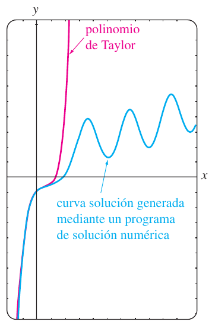
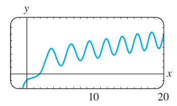

# Zill — Ecuaciones no lineales y repaso del capítulo 4

Fuente: extracto «Ecuaciones diferenciales con aplicaciones de modelado -
Zill.pdf». Zill es la atribución del nombre del archivo; edición y año no
constan en estas páginas. Material bibliográfico, no autoría de ISI.
[Procedencia y cobertura](../../../resources/2020/zill-03-cobertura.md).

Páginas PDF 61–64 (impresas 177–180). Se conserva el orden del extracto y la
continuidad de los capítulos.

## Página PDF 61 — Página impresa 177

### 4.9 Ecuaciones diferenciales no lineales — Continuación

### Ejemplo 4. Análisis gráfico del ejemplo 3

Siguiendo el procedimiento anterior, se encuentra que el problema con valores
iniciales de segundo orden del ejemplo 3 es equivalente a

```math
\frac{dy}{dx}=u,\qquad \frac{du}{dx}=x+y-y^2
```

con condiciones iniciales $`y(0)=-1`$, $`u(0)=1`$. Con ayuda de un programa de
solución numérica, se obtiene la curva solución en azul en la figura 4.9.1. Por
comparación, la gráfica del polinomio de Taylor de quinto grado
$`T_5(x)=-1+x-x^2+\frac23x^3-\frac13x^4+\frac15x^5`$ se muestra en rojo. Aunque
no se conoce el intervalo de convergencia de la serie de Taylor obtenida en el
ejemplo 3, la proximidad de las dos curvas en una vecindad del origen indica que
la serie de potencias podría converger en el intervalo $`(-1,1)`$.



### Cuestiones cualitativas

La gráfica en azul de la figura 4.9.1 origina algunas preguntas de naturaleza
cualitativa: ¿la solución del problema con valores iniciales original es
oscilatoria conforme $`x\to\infty`$? La gráfica generada con un programa de
solución numérica en el intervalo más grande, que se muestra en la figura 4.9.2
parecería *sugerir* que la respuesta es sí. Pero este simple ejemplo o incluso
un grupo de ejemplos, no responde la pregunta básica en cuanto a si *todas* las
soluciones de la ecuación diferencial $`y''=x+y-y^2`$ son de naturaleza
oscilatoria. También, ¿qué está sucediendo con la curva solución de la figura
4.9.2 conforme $`x`$ está cerca de $`-1`$? ¿Cuál es el comportamiento de las
soluciones de la ecuación diferencial conforme $`x\to\infty`$? ¿Están acotadas
las soluciones conforme $`x\to\infty`$? Preguntas como éstas no son fáciles de
responder, en general, para ecuaciones diferenciales de segundo orden no
lineales. Pero ciertas clases de ecuaciones de segundo orden se prestan a un
análisis cualitativo sistemático y éstas, al igual que las ecuaciones de primer
orden que se obtuvieron en la sección 2.1, son de la clase que no tiene
dependencia explícita en la variable independiente. Las EDO de segundo orden de
la forma

```math
F(y,y',y'')=0\quad\text{o}\quad\frac{d^2y}{dx^2}=f(y,y'),
```

ecuaciones libres de la variable independiente $`x`$, se llaman **autónomas**.
La ecuación diferencial del ejemplo 2 es autónoma y debido a la presencia del
término $`x`$ en su miembro derecho, la ecuación del ejemplo 3 es autónoma. Para
un tratamiento profundo del tema de estabilidad de ecuaciones diferenciales
autónomas de segundo orden y sistemas autónomos de ecuaciones diferenciales,
refiérase al capítulo 10 de *Ecuaciones diferenciales con problemas con valores
en la frontera*.



### Ejercicios 4.9

Las respuestas a los problemas con número impar comienzan en la página RES-6.

En los problemas 1 y 2 compruebe que $`y_1`$ y $`y_2`$ son soluciones de la
ecuación diferencial dada pero que $`y=c_1y_1+c_2y_2`$ en general, no es una
solución.

**1.** $`(y'')^2=y^2`$; $`y_1=e^x`$, $`y_2=\cos x`$.

**2.** $`yy''=\frac12(y')^2`$; $`y_1=1`$, $`y_2=x^2`$.

En los problemas 3 a 8 resuelva la ecuación diferencial usando la sustitución
$`u=y'`$.

**3.** $`y''+(y')^2+1=0`$.

**4.** $`y''=1+(y')^2`$.

**5.** $`x^2y''+(y')^2=0`$.

**6.** $`(y+1)y''=(y')^2`$.

**7.** $`y''+2y(y')^3=0`$.

**8.** $`y^2y''=y'`$.

**9.** Considere el problema con valores iniciales

```math
y''+yy'=0,\qquad y(0)=1,\quad y'(0)=-1.
```

a) Use la ED y un programa de solución numérica para trazar la curva solución.

b) Encuentre una solución explícita del PVI. Use un programa de graficación para
trazar la solución.

c) Determine un intervalo de definición para la solución del inciso b).

## Página PDF 62 — Página impresa 178

**10.** Encuentre dos soluciones del problema con valores iniciales

```math
(y'')^2+(y')^2=1,\qquad y\left(\frac\pi2\right)=\frac12,\quad
y'\left(\frac\pi2\right)=\frac{\sqrt3}2.
```

Use un programa de solución numérica para trazar la gráfica de las curvas
solución.

En los problemas 11 y 12 demuestre que la sustitución $`u=y'`$ conduce a una
ecuación de Bernoulli. Resuelva esta ecuación (véase la sección 2.5).

**11.** $`xy''=y'+(y')^3`$.

**12.** $`xy''=y'+x(y')^2`$.

En los problemas 13 a 16 proceda como en el ejemplo 3 y obtenga los primeros
seis términos no cero de una solución en serie de Taylor, centrada en 0, del
problema con valores iniciales. Use un programa de solución numérica para
comparar la curva solución con la gráfica del polinomio de Taylor.

**13.** $`y''=x+y^2`$, $`y(0)=1`$, $`y'(0)=1`$.

**14.** $`y''+y^2=1`$, $`y(0)=2`$, $`y'(0)=3`$.

**15.** $`y''=x^2+y^2-2y'`$, $`y(0)=1`$, $`y'(0)=1`$.

**16.** $`y''=e^y`$, $`y(0)=0`$, $`y'(0)=-1`$.

**17.** En cálculo, la curvatura de una línea que se define por medio de una
función $`y=f(x)`$ es

```math
\kappa=\frac{y''}{[1+(y')^2]^{3/2}}.
```

Encuentre $`y=f(x)`$ para la cual $`\kappa=1`$. \[*Sugerencia*: Por simplicidad,
desprecie las constantes de integración.\]

### Problemas para analizar

**18.** En el problema 1 vimos que $`\cos x`$ y $`e^x`$ eran soluciones de la
ecuación no lineal $`(y'')^2-y^2=0`$. Compruebe que
$`\mathop{\mathrm{sen}}\nolimits x`$ y $`e^{-x}`$ también son soluciones. Sin
intentar resolver la ecuación diferencial, analice cómo se pueden encontrar
estas soluciones usando su conocimiento acerca de las ecuaciones lineales. Sin
intentar comprobar, analice por qué las combinaciones lineales
$`y=c_1e^x+c_2e^{-x}+c_3\cos x+c_4\mathop{\mathrm{sen}}\nolimits x`$ y
$`y=c_2e^{-x}+c_4\mathop{\mathrm{sen}}\nolimits x`$ no son, en general,
soluciones, pero las dos combinaciones lineales especiales
$`y=c_1e^x+c_2e^{-x}`$ y $`y=c_3\cos x+c_4\mathop{\mathrm{sen}}\nolimits x`$
*deben* satisfacer la ecuación diferencial.

**19.** Analice cómo se puede aplicar el método de reducción de orden
considerado en esta sección a la ecuación diferencial de tercer orden
$`y'''=\sqrt{1+(y'')^2}`$. Lleve a cabo sus ideas y resuelva la ecuación.

**20.** Explique cómo encontrar una familia alternativa de soluciones de dos
parámetros para la ecuación diferencial no lineal $`y''=2x(y')^2`$ en el ejemplo
1\. \[*Sugerencia*: Suponga que $`-c_1^2`$ se usa como constante de integración
en lugar de $`+c_1^2`$.\]

### Modelos matemáticos

**21. Movimiento de un campo de fuerza** Un modelo matemático para la posición
$`x(t)`$ de un cuerpo con movimiento rectilíneo en el eje $`x`$ en un campo de
fuerza inverso del cuadrado de $`x`$ es

```math
\frac{d^2x}{dt^2}=-\frac{k^2}{x^2}.
```

Suponga que en $`t=0`$ el cuerpo comienza a partir del reposo en la posición
$`x=x_0`$, $`x_0\gt 0`$. Muestre que la velocidad del cuerpo en el tiempo $`t`$
está dada por $`v^2=2k^2(1/x-1/x_0)`$. Use la última expresión y un SAC para
realizar la integración para expresar al tiempo $`t`$ en términos de $`x`$.

**22.** Un modelo matemático para la posición $`x(t)`$ de un objeto en
movimiento es

```math
\frac{d^2x}{dt^2}+\mathop{\mathrm{sen}}\nolimits x=0.
```

Use un programa de solución numérica para investigar en forma gráfica las
soluciones de la ecuación sujeta a $`x(0)=0`$, $`x'(0)=x_1`$, $`x_1\ge0`$.
Analice el movimiento del objeto para $`t\ge0`$ y para diferentes elecciones de
$`x_1`$. Investigue la ecuación

```math
\frac{d^2x}{dt^2}+\frac{dx}{dt}+\mathop{\mathrm{sen}}\nolimits x=0
```

en la misma forma. Proponga una interpretación física posible del término
$`dx/dt`$.

### Repaso del capítulo 4

Las respuestas a los problemas con número impar comienzan en la página RES-6.

Conteste los problemas 1 al 4 sin consultar el final del libro. Complete el
espacio en blanco o conteste falso o verdadero.

**1.** La única solución del problema con valores iniciales $`y''+x^2y=0`$,
$`y(0)=0`$, $`y'(0)=0`$ es \_\_\_\_\_\_\_\_\_\_.

**2.** Para el método de coeficientes indeterminados, la forma supuesta de la
solución particular $`y_p`$ para $`y''-y=1+e^x`$ es \_\_\_\_\_\_\_\_\_\_.

**3.** Un múltiplo constante de una solución de una ecuación diferencial lineal
es también una solución. \_\_\_\_\_\_\_\_\_\_

**4.** Si el conjunto que consiste en dos funciones $`f_1`$ y $`f_2`$ es
linealmente independiente en un intervalo $`I`$, entonces el Wronskiano
$`W(f_1,f_2)\ne0`$ para toda $`x`$ en $`I`$. \_\_\_\_\_\_\_\_\_\_

**5.** Dé un intervalo en el que el conjunto de dos funciones $`f_1(x)=x^2`$ y
$`f_2(x)=x|x|`$ es linealmente independiente.

## Página PDF 63 — Página impresa 179

Después indique un intervalo en el que el conjunto formado por $`f_1`$ y $`f_2`$
es linealmente dependiente.

**6.** Sin la ayuda del Wronskiano, determine si el conjunto de funciones es
linealmente independiente o dependiente en el intervalo indicado.

a) $`f_1(x)=\ln x`$, $`f_2(x)=\ln x^2`$, $`(0,\infty)`$.

b) $`f_1(x)=x^n`$, $`f_2(x)=x^{n+1}`$, $`n=1,2,\ldots`$, $`(-\infty,\infty)`$.

c) $`f_1(x)=x`$, $`f_2(x)=x+1`$, $`(-\infty,\infty)`$.

d) $`f_1(x)=\cos\left(x+\frac\pi2\right)`$,
$`f_2(x)=\mathop{\mathrm{sen}}\nolimits x`$, $`(-\infty,\infty)`$.

e) $`f_1(x)=0`$, $`f_2(x)=x`$, $`(-5,5)`$.

f) $`f_1(x)=2`$, $`f_2(x)=2x`$, $`(-\infty,\infty)`$.

g) $`f_1(x)=x^2`$, $`f_2(x)=1-x^2`$, $`f_3(x)=2+x^2`$, $`(-\infty,\infty)`$.

h) $`f_1(x)=xe^{x+1}`$, $`f_2(x)=(4x-5)e^x`$, $`f_3(x)=xe^x`$,
$`(-\infty,\infty)`$.

**7.** Suponga que $`m_1=3`$, $`m_2=-5`$ y $`m_3=1`$ son raíces de multiplicidad
uno, dos y tres, respectivamente, de una ecuación auxiliar. Escriba la solución
general de la ED lineal homogénea correspondiente si es

a) una ecuación con coeficientes constantes,

b) una ecuación de Cauchy-Euler.

**8.** Considere la ecuación diferencial $`ay''+by'+cy=g(x)`$, donde $`a`$,
$`b`$ y $`c`$ son constantes. Elija las funciones de entrada $`g(x)`$ para las
que es aplicable el método de coeficientes indeterminados y las funciones de
entrada para las que es aplicable el método de variación de parámetros.

a) $`g(x)=e^x\ln x`$.

b) $`g(x)=x^3\cos x`$.

c) $`g(x)=\frac{\mathop{\mathrm{sen}}\nolimits x}{e^x}`$.

d) $`g(x)=2x^{-2}e^x`$.

e) $`g(x)=\mathop{\mathrm{sen}}\nolimits ^2x`$.

f) $`g(x)=\frac{e^x}{\mathop{\mathrm{sen}}\nolimits x}`$.

En los problemas del 9 a 24 use los procedimientos desarrollados en este
capítulo para encontrar la solución general de cada ecuación diferencial.

**9.** $`y''-2y'-2y=0`$.

**10.** $`2y''+2y'+3y=0`$.

**11.** $`y'''+10y''+25y'=0`$.

**12.** $`2y'''+9y''+12y'+5y=0`$.

**13.** $`3y'''+10y''+15y'+4y=0`$.

**14.** $`2y^{(4)}+3y'''+2y''+6y'-4y=0`$.

**15.** $`y''-3y'+5y=4x^3-2x`$.

**16.** $`y''-2y'+y=x^2e^x`$.

**17.** $`y'''-5y''+6y'=8+2\mathop{\mathrm{sen}}\nolimits x`$.

**18.** $`y'''-y''=6`$.

**19.** $`y''-2y'+2y=e^x\tan x`$.

**20.** $`y''-y=\frac{2e^x}{e^x+e^{-x}}`$.

**21.** $`6x^2y''+5xy'-y=0`$.

**22.** $`2x^3y'''+19x^2y''+39xy'+9y=0`$.

**23.** $`x^2y''-4xy'+6y=2x^4+x^2`$.

**24.** $`x^2y''-xy'+y=x^3`$.

**25.** Escriba la forma de la solución general $`y=y_c+y_p`$ de la ecuación
diferencial en los dos casos $`\omega\ne\alpha`$ y $`\omega=\alpha`$. No
determine los coeficientes en $`y_p`$.

a) $`y''+\omega^2y=\mathop{\mathrm{sen}}\nolimits \alpha x`$.

b) $`y''-\omega^2y=e^{\alpha x}`$.

**26.** a) Dado que $`y=\mathop{\mathrm{sen}}\nolimits x`$ es una solución de

```math
y^{(4)}+2y'''+11y''+2y'+10y=0,
```

encuentre la solución general de la ED *sin la ayuda de una calculadora o
computadora*.

b) Encuentre una ecuación diferencial lineal de segundo orden con coeficientes
constantes para la cual $`y_1=1`$ y $`y_2=e^{-x}`$ son soluciones de la ecuación
homogénea asociada y $`y_p=\frac12x^2-x`$ es una solución particular de la
ecuación homogénea.

**27.** a) Escriba completamente la solución general de la ED de cuarto orden
$`y^{(4)}-2y''+y=0`$ en términos de funciones hiperbólicas.

b) Escriba la forma de una solución particular de
$`y^{(4)}-2y''+y=\mathop{\mathrm{senh}}\nolimits x`$.

**28.** Considere la ecuación diferencial

```math
x^2y''-(x^2+2x)y'+(x+2)y=x^3.
```

Compruebe que $`y_1=x`$ es una solución de la ecuación homogénea asociada.
Después demuestre que el método de reducción de orden analizado en la sección
4.2 conduce a una segunda solución $`y_2`$ de la ecuación homogénea así como a
una solución particular $`y_p`$ de la ecuación no homogénea. Forme la solución
general de la ED en el intervalo $`(0,\infty)`$.

En los problemas 29 a 34 resuelva la ecuación diferencial sujeta a las
condiciones indicadas.

**29.** $`y''-2y'+2y=0`$, $`y\left(\frac\pi2\right)=0`$, $`y(\pi)=-1`$.

**30.** $`y''+2y'+y=0`$, $`y(-1)=0`$, $`y'(0)=0`$.

**31.** $`y''-y=x+\mathop{\mathrm{sen}}\nolimits x`$, $`y(0)=2`$, $`y'(0)=3`$.

**32.** $`y''+y=\sec^3x`$, $`y(0)=1`$, $`y'(0)=\frac12`$.

## Página PDF 64 — Página impresa 180

**33.** $`y'y''=4x`$, $`y(1)=5`$, $`y'(1)=2`$.

**34.** $`2y''=3y^2`$, $`y(0)=1`$, $`y'(0)=1`$.

**35.** a) Use un SAC como ayuda para encontrar las raíces de la ecuación
auxiliar para

```math
12y^{(4)}+64y'''+59y''-23y'-12y=0.
```

Dé la solución general de la ecuación.

b) Resuelva la ED del inciso a) sujeta a las condiciones iniciales $`y(0)=-1`$,
$`y'(0)=2`$, $`y''(0)=5`$, $`y'''(0)=0`$. Use un SAC como ayuda para resolver el
sistema resultante de cuatro ecuaciones con cuatro incógnitas.

**36.** Encuentre un miembro de la familia de soluciones de
$`xy''+y'+\sqrt{x}=0`$ cuya gráfica es tangente al eje $`x`$ en $`x=1`$. Use una
aplicación para graficar y obtenga la curva solución.

En los problemas 37 a 40 use la eliminación sistemática para resolver cada
sistema.

### Problema 37

```math
\begin{aligned}
\frac{dx}{dt}+\frac{dy}{dt}&=2x+2y+1,\\
\frac{dx}{dt}+2\frac{dy}{dt}&=y+3.
\end{aligned}
```

### Problema 38

```math
\frac{dx}{dt}=2x+y+t-2,\qquad\frac{dy}{dt}=3x+4y-4t.
```

### Problema 39

```math
\begin{aligned}(D-2)x-y&=-e^t,\\-3x+(D-4)y&=-7e^t.\end{aligned}
```

### Problema 40

```math
\begin{aligned}(D+2)x+(D+1)y&=\mathop{\mathrm{sen}}\nolimits 2t,\\5x+(D+3)y&=\cos2t.\end{aligned}
```
