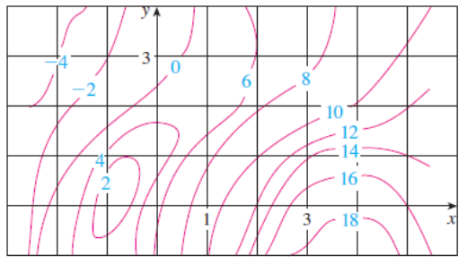

# Derivadas Parciales

> Fuente: `2022 [Intensivo]/Derivadas.pdf`. Archivo de 2022; sin año impreso.
> Procedencia y controles en
> [cobertura PDF 2022](../../../resources/2022/pdf2022-cobertura.md).

## Página 1

1. Sea $f$ una función de dos variables, definir el procedimiento para hallar
   las derivadas parciales de primer orden.
1. Dibujar una superficie que represente una función de dos variables. Utilizar
   la gráfica para dar una interpretación geométrica de
   $\frac{\partial f}{\partial x}$ y $\frac{\partial f}{\partial y}$.
1. Dibujar la gráfica de una función $z=f(x,y)$ cuya derivada $f_x$ sea siempre
   negativa y cuya derivada $f_y$ sea siempre positiva.
1. Dibujar la gráfica de una función $z=f(x,y)$ cuyas derivadas $f_x$ y $f_y$
   sea siempre positivas.
1. Si $f$ es una función de $x$ e $y$ tal que $f_{xy}$ y $f_{yx}$ son continuas,
   ¿Qué relación existe entre las derivadas parciales mixtas?

### Ejercicios

1. Hallar y evaluar las primeras derivadas parciales en el punto $(1,\ln2)$.
   $f(x,y)=e^{x^2y}$.

1. Hallar las pendientes en las direcciones de $x$ y de $y$ de la superficie
   dada por $f(x,y)=-\frac{x^2}{2}-y^2+\frac{25}{8}$ en el punto $(1/2,1,2)$.

1. Mostrar que la función $f(x,y)=e^x\mathop{\mathrm{sen}}\nolimits y$ satisface
   la ecuación de Laplace
   $\frac{\partial^2z}{\partial x^2}+\frac{\partial^2z}{\partial y^2}=0$.

1. ¿En qué puntos del dominio de $f(x,y)$ se anulan simultáneamente las
   derivadas parciales $f_x$ y $f_y$?

1. a) $f(x,y)=x^2+4xy+y^2-4x+16y+3$.

   b) $f(x,y)=3x^3-12xy+y^3$.

   c) $f(x,y)=\frac1x+\frac1y+xy$.

   d) $f(x,y)=\ln(x^2+y^2+1)$.

1. Utilizar un sistema computacional para representar gráficamente las
   superficies representadas por

   a. $z=3-x^2-y^2+6y$.

   b. $z=3x^2+2y^2-3x+4y-5$.

## Página 2

**10.** Se presenta un mapa de contorno de una función $f$. Utilícela para
estimar $f_x(2,1)$ y $f_y(2,1)$.

**11.** Si $f(x,y)=16-4x^2-y^2$, determine $f_x(1,2)$ y $f_y(1,2)$ e interprete
estos números como pendientes. Ilustre con gráficas elaboradas a mano o mediante
una computadora.

**12.** Si $f(x,y)=\sqrt{4-x^2-4y^2}$, determine $f_x(1,0)$ y $f_y(1,0)$ e
interprete estos valores como pendientes. Ilustre con gráficas elaboradas a mano
o mediante una computadora.

**4.** La altura $h$ de una ola en el mar abierto depende de la rapidez $v$ del
viento y de la cantidad de tiempo $t$ que el viento ha estado soplando a esa
rapidez. En la tabla siguiente se registran valores de la función $h=f(v,t)$ en
pies.

Duración $t$ (horas); velocidad del viento $v$ (nudos):

| $v\backslash t$ | 5 | 10 | 15 | 20 | 30 | 40 | 50 |
| -- | -- | -- | -- | -- | -- | -- | -- |
| 10 | 2 | 2 | 2 | 2 | 2 | 2 | 2 |
| 15 | 4 | 4 | 5 | 5 | 5 | 5 | 5 |
| 20 | 5 | 7 | 8 | 8 | 9 | 9 | 9 |
| 30 | 9 | 13 | 16 | 17 | 18 | 19 | 19 |
| 40 | 14 | 21 | 25 | 28 | 31 | 33 | 33 |
| 50 | 19 | 29 | 36 | 40 | 45 | 48 | 50 |
| 60 | 24 | 37 | 47 | 54 | 62 | 67 | 69 |

## Página 3 — continuación del punto 4

a) ¿Cuáles son los significados de las derivadas parciales
$\partial h/\partial v$ y $\partial h/\partial t$?

b) Estime los valores de $f_v(40,15)$ y $f_t(40,15)$. ¿Cuáles son las
interpretaciones prácticas de estos valores?

c) ¿Cuál parece ser el valor del límite siguiente?

$$
\lim_{t\to\infty}\frac{\partial h}{\partial t}
$$

Nota de transcripción: se conservan los saltos de numeración del original (6 a
10, y 12 a 4).
