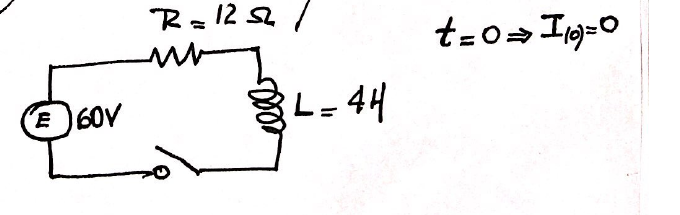

# Ejercicios de ecuaciones diferenciales — manuscrito

> Fuente: `2022 [Intensivo]/Nuevo doc 2020-04-06 08.44.09.pdf`. Archivo de 2022;
> sin año impreso. Procedencia y controles en
> [cobertura PDF 2022](../../../resources/2022/pdf2022-cobertura.md).

1. Dada la ecuación diferencial $y''-3y'+2y=8x$ hallar la solución particular
   que en el punto $(0,y_0)$ tiene recta tangente con la ecuación $y=16x+8$.

1. Dada la ecuación diferencial $4y''-y=e^{4x}-5x^3$, hallar la solución
   particular tal que $y(0)=1$ e $y'(0)=2$.

1. Hallar la ecuación de la recta tangente a la gráfica de $f$ en $(2,-2)$
   sabiendo que $y=e^x+e^2-x^3$ es una solución particular de la ecuación
   diferencial $y''-y'=f(x)$.

1. Dada $ay''+by'+cy=16x$, halle la solución particular tal que $y(0)=-1$ e
   $y'(0)=-7$ sabiendo que dos soluciones linealmente independientes de la
   homogénea son $e^x$ y $e^{-4x}$.

1. Resolver la siguiente EDO: $`dy=\mathop{\mathrm{sen}}\nolimits (x+y)\,dx`$.

1. Sea

   

   $t=0\Rightarrow I(0)=0$.

   Hallar:

   a) $I(t)$.

   b) La corriente al cabo de 1 segundo.

   c) El valor límite de la corriente.

   d) En vez de una batería se conecta un generador
   $E(t)=60\mathop{\mathrm{sen}}\nolimits (30t)$ [V], ¿determinar $I(t)$=?

Scanned with CamScanner.
